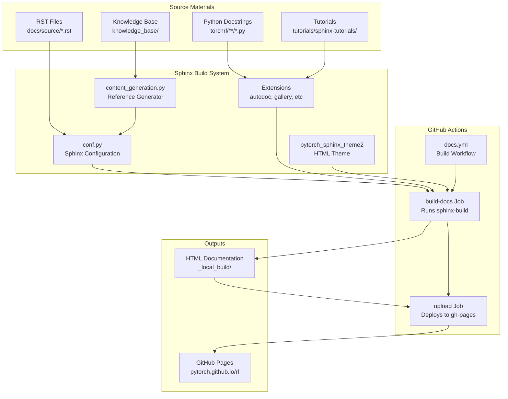
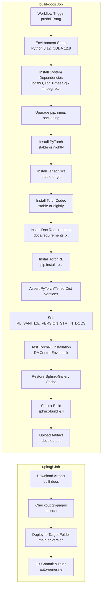
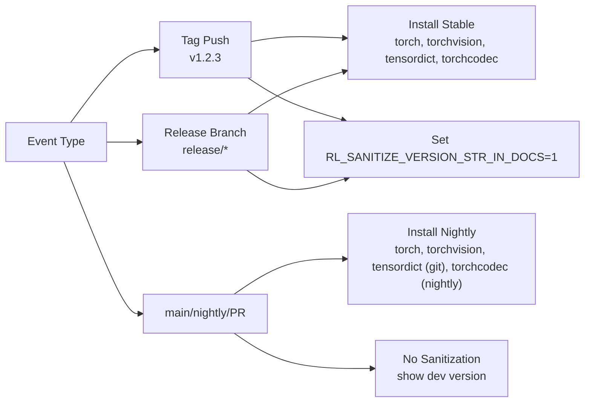
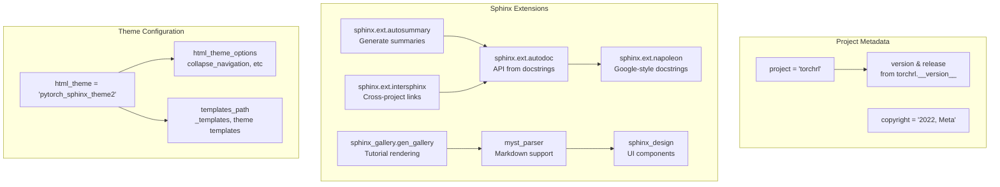
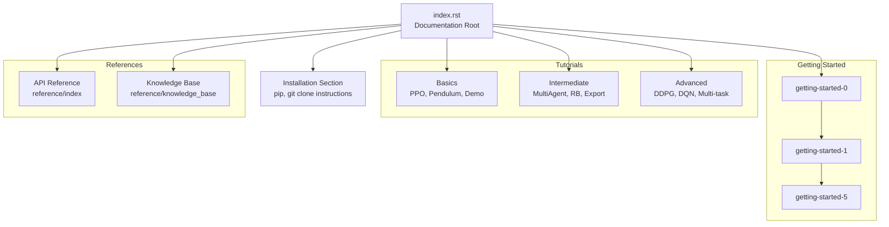
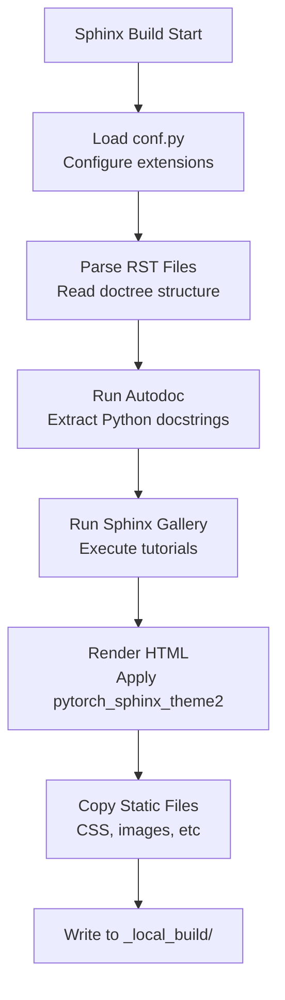
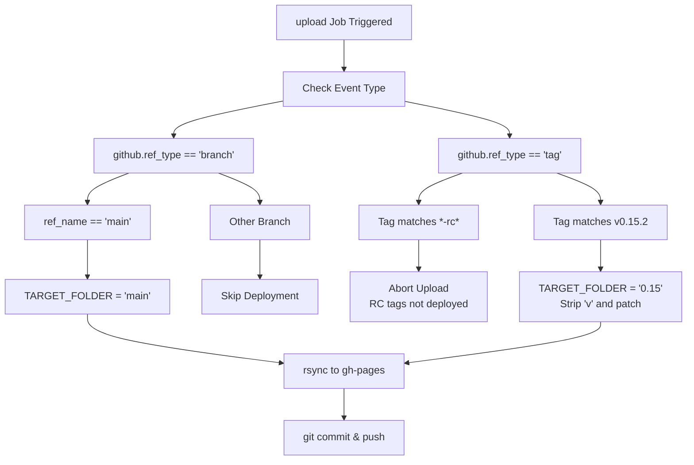

<!-- source: DeepWiki mcp.deepwiki.com · repo pytorch/rl · page 12.2 Documentation System · fetched 2026-10-21 -->

# Documentation System

<details>
<summary>Relevant source files</summary>

The following files were used as context for generating this wiki page:

- [.github/workflows/docs.yml](.github/workflows/docs.yml)
- [README.md](README.md)
- [docs/requirements.txt](docs/requirements.txt)
- [docs/source/conf.py](docs/source/conf.py)
- [docs/source/index.rst](docs/source/index.rst)
- [docs/source/reference/objectives.rst](docs/source/reference/objectives.rst)
- [docs/source/reference/objectives_other.rst](docs/source/reference/objectives_other.rst)
- [torchrl/objectives/__init__.py](torchrl/objectives/__init__.py)

</details>


## Purpose and Scope

This document describes the TorchRL documentation build system, including the Sphinx configuration, GitHub Actions workflows, and deployment process for generating and publishing documentation to GitHub Pages. It covers the technical infrastructure that transforms reStructuredText and Python docstrings into the hosted documentation at pytorch.github.io/rl.

For information about the build system and package distribution, see [Build System](#12.1).

## Documentation Architecture Overview

The TorchRL documentation system uses Sphinx to generate HTML documentation from multiple sources, with automated builds and deployments via GitHub Actions.



**Sources:** [.github/workflows/docs.yml:1-186](), [docs/source/conf.py:1-196]()

## GitHub Actions Workflow

The documentation build and deployment is automated through a GitHub Actions workflow defined in `.github/workflows/docs.yml`.

### Workflow Triggers

The workflow is triggered on:
- Pushes to `nightly`, `main`, or `release/*` branches
- Version tags matching `v[0-9]+.[0-9]+.[0-9]+` or `v[0-9]+.[0-9]+.[0-9]+-rc[0-9]+`
- Pull requests (build only, no deployment)
- Manual workflow dispatch
- Workflow call

**Sources:** [.github/workflows/docs.yml:3-14]()

### Build and Deploy Pipeline



**Sources:** [.github/workflows/docs.yml:28-123](), [.github/workflows/docs.yml:124-186]()

### Build Environment Configuration

The build job runs on a `linux.g5.4xlarge.nvidia.gpu` instance with specific system dependencies:

| Component | Purpose |
|-----------|---------|
| `libglfw3`, `libgl1-mesa-glx`, `libegl1-mesa-dev` | Required for rendering environments like DMControl and MuJoCo |
| `xvfb` | Headless X server for GUI-based environments |
| `ffmpeg`, `libavcodec-dev`, etc. | Video encoding/decoding for tutorials |
| `cmake`, `git` | Build tools |
| Python 3.12 | Base Python version for documentation build |
| CUDA 12.8 | GPU support for examples |

Environment variables set during build:
- `PYOPENGL_PLATFORM=egl` - Configure OpenGL rendering backend
- `MUJOCO_GL=egl` - Configure MuJoCo rendering backend
- `RL_SANITIZE_VERSION_STR_IN_DOCS=1` - (Conditional) Sanitize version string for releases.
- `TORCHRL_DOCS_GALLERY_CACHE` - (Conditional) Controls Sphinx-Gallery cache behavior.

**Sources:** [.github/workflows/docs.yml:34-51](), [.github/workflows/docs.yml:97-104](), [docs/source/conf.py:51]()

### Version-Specific Build Logic

The workflow handles version string sanitization and PyTorch/TensorDict installation differently based on the trigger type:



When `RL_SANITIZE_VERSION_STR_IN_DOCS` is set, the version string in `conf.py` is shortened from `1.11.0aHASH` to `1.11` for clean release documentation.

**Sources:** [.github/workflows/docs.yml:65-79](), [.github/workflows/docs.yml:88-104](), [docs/source/conf.py:43-49]()

### Sphinx-Gallery Cache

The `build-docs` job attempts to restore a Sphinx-Gallery cache from a dedicated `docs-gallery-cache` branch. This mechanism prevents re-executing tutorials whose source code has not changed, significantly speeding up documentation builds.

- **Cache Key**: The cache key is generated based on `conf.py`, `docs/requirements.txt`, and the resolved `torch`/`sphinx_gallery` versions.
- **Restoration Conditions**: The cache is restored on pull requests and pushes to `main`.
- **Exclusions**: It is *not* restored on `nightly` (which performs a full rebuild to refresh the cache) or `tags`/`release` branches (which build with stable PyTorch and should not inherit outputs from nightly builds).
- **Disabling**: The cache can be explicitly disabled by setting `TORCHRL_DOCS_GALLERY_CACHE=0`.

**Sources:** [.github/workflows/docs.yml:113-139]()

## Sphinx Configuration

The Sphinx build is configured in `docs/source/conf.py`, which defines the documentation structure, extensions, and output format.

### Core Configuration



**Sources:** [docs/source/conf.py:34-50](), [docs/source/conf.py:65-77](), [docs/source/conf.py:165](), [docs/source/conf.py:171-174](), [docs/source/conf.py:195-196]()

### Extension Configuration Details

| Extension | Configuration | Purpose |
|-----------|--------------|---------|
| `sphinx.ext.autodoc` | Enabled | Extracts API documentation from Python docstrings |
| `sphinx.ext.autosummary` | `autosummary_generate = True` | Automatically generates summary tables |
| `sphinx.ext.napoleon` | Google-style, no NumPy style | Parses Google-formatted docstrings |
| `sphinx.ext.intersphinx` | Maps to PyTorch, tensordict, etc. | Creates cross-library documentation links |
| `sphinx_gallery.gen_gallery` | Custom config in `sphinx_gallery_conf` | Executes and renders tutorial notebooks |
| `myst_parser` | Enabled | Allows Markdown in documentation |
| `sphinx_design` | Enabled | Provides UI components like cards and grids |

**Sources:** [docs/source/conf.py:65-77](), [docs/source/conf.py:163-166]()

### Intersphinx Configuration

The documentation links to external projects using intersphinx mappings:

```python
intersphinx_mapping = {
    "torch": ("https://pytorch.org/docs/stable/", None),
    "tensordict": ("https://docs.pytorch.org/tensordict/stable/", None),
    # "torchrl": ("https://pytorch.org/rl/", None),
    "torchaudio": ("https://pytorch.org/audio/stable/", None),
    "torchtext": ("https://pytorch.org/text/stable/", None),
    "torchvision": ("https://pytorch.org/vision/stable/", None),
}
```

This enables cross-linking like `:class:`torch.nn.Module`` to resolve to the PyTorch documentation.

**Sources:** [docs/source/conf.py:79-86]()

### Sphinx Gallery Configuration

The `sphinx_gallery_conf` dictionary controls tutorial rendering:

| Setting | Value | Purpose |
|---------|-------|---------|
| `examples_dirs` | `"reference/generated/tutorials/"` | Source directory for tutorial scripts |
| `gallery_dirs` | `"tutorials"` | Output directory for rendered tutorials |
| `filename_pattern` | `"reference/generated/tutorials/"` | Pattern to match tutorial files |
| `download_all_examples` | `True` | Enable download of all examples |
| `abort_on_example_error` | `True` | Fail build if tutorial execution fails |
| `reset_modules` | `(kill_procs, "matplotlib", "seaborn")` | Clean up processes after each tutorial |
| `ignore_pattern` | `r"llm_browser\.py"` | Exclude tutorials requiring external services |

The `kill_procs` function [docs/source/conf.py:89-135]() terminates all child processes after tutorial execution to prevent resource leaks.

**Sources:** [docs/source/conf.py:137-161]()

## Documentation Structure

The documentation is organized using reStructuredText (RST) files with a hierarchical table of contents.

### Main Entry Point

The `docs/source/index.rst` file serves as the documentation homepage and defines the overall structure:



**Sources:** [docs/source/index.rst:1-158]()

### Documentation Sections

The documentation is divided into major sections accessible from the main index:

| Section | Path | Content |
|---------|------|---------|
| Installation | Inline in index.rst | PyPI and git installation instructions |
| Getting Started | `tutorials/getting-started-*` | 6-part tutorial series for beginners |
| Basics Tutorials | `tutorials/coding_ppo`, `tutorials/pendulum`, etc. | Fundamental RL concepts and implementations |
| Intermediate Tutorials | `tutorials/multiagent_ppo`, `tutorials/rb_tutorial`, etc. | Advanced features and use cases |
| Advanced Tutorials | `tutorials/coding_ddpg`, `tutorials/multi_task`, etc. | Complex algorithms and scenarios |
| API Reference | `reference/index` | Auto-generated API documentation |
| Knowledge Base | `reference/knowledge_base` | FAQ and conceptual explanations |

**Sources:** [docs/source/index.rst:79-142]()

## Build Process

The Sphinx build process transforms source files into HTML documentation through multiple stages.

### Build Command and Options

The documentation is built using the `sphinx-build` command:

```bash
PYOPENGL_PLATFORM=egl MUJOCO_GL=egl python -m sphinx -b html ./source _local_build -v -j 4
```

| Option | Purpose |
|--------|---------|
| `./source` | Source directory containing RST files and conf.py |
| `_local_build` | Output directory for generated HTML |
| `-v` | Verbose output for debugging |
| `-j 4` | Parallel build using 4 processes |

**Sources:** [.github/workflows/docs.yml:115]()

### Build Stages



The build process requires a fully functional TorchRL installation because:
1. `sphinx.ext.autodoc` imports modules to extract docstrings
2. `sphinx_gallery` executes tutorial code

**Sources:** [.github/workflows/docs.yml:109-118]()

## Deployment Process

Documentation is deployed to GitHub Pages under different paths based on the trigger type.

### Deployment Target Logic



### Target Folder Determination

The `upload` job determines the target folder using bash conditionals:

- **Main branch**: Deployed to `main/` directory
- **Release tags** (e.g., `v0.15.2`): Deployed to versioned directory `0.15/`
- **RC tags** (e.g., `v0.15.2-rc1`): Build completes but upload is aborted
- **Other branches**: Build only, no deployment

The version stripping logic removes the leading `v` and trailing patch version: `v0.15.2` → `0.15`.

**Sources:** [.github/workflows/docs.yml:139-161]()

### Static Files Handling

For the `main` branch deployment, the `_static` directory is copied to the root of gh-pages:

```bash
if [[ "${TARGET_FOLDER}" == "main" ]] ; then
  mkdir -p _static
  rm -rf _static/*
  cp -r "${TARGET_FOLDER}"/_static/* _static
  git add _static || true
fi
```

This ensures the latest static assets (CSS, JavaScript, images) are available at the root level for all documentation versions.

**Sources:** [.github/workflows/docs.yml:173-179]()

### Git Configuration and Push

The deployment uses a bot identity for commits:

```bash
git config user.name 'pytorchbot'
git config user.email 'soumith+bot@pytorch.org'
git config http.postBuffer 524288000
git commit -m "auto-generating sphinx docs" || true
git push
```

The `http.postBuffer` setting is increased to handle large documentation payloads.

**Sources:** [.github/workflows/docs.yml:181-185]()

## Documentation Requirements

The documentation build requires a comprehensive set of dependencies specified in `docs/requirements.txt`.

### Dependency Categories

| Category | Packages | Purpose |
|----------|----------|---------|
| **Sphinx Core** | `sphinx>=5.3.0,<7.2.6`, `Jinja2==3.1.6` | Core documentation build engine |
| **Sphinx Extensions** | `sphinx-copybutton`, `sphinx-gallery`, `sphinx-autodoc-typehints`, `myst-parser`, `sphinx_design` | Enhanced documentation features |
| **Theme** | `pytorch-sphinx-theme2>=0.4.11` | PyTorch-consistent visual theme |
| **Visualization** | `matplotlib`, `git+https://github.com/vmoens/aafig@4319769eae88fff8e3464858f3cf8c277f35335d`, `sphinxcontrib-htmlhelp`, `sphinxcontrib-video` | Diagram and plot generation |
| **RL Environments** | `dm_control>=1.0.41`, `mujoco>=3.8.1,<3.9.0`, `gymnasium[classic_control,atari,mujoco]`, `pygame`, `vmas`, `ale-py>=0.9.0` | Required for tutorial execution |
| **Deep Learning** | `torchvision`, `onnxscript`, `onnxruntime`, `onnx` | PyTorch ecosystem and model export |
| **Utilities** | `numpy`, `tqdm`, `ipython`, `imageio[ffmpeg,pyav]`, `memory_profiler`, `pytest`, `psutil`, `playwright` | Supporting tools |
| **Configuration** | `hydra-core>=1.3,<1.4`, `omegaconf`, `hydra-submitit-launcher` | Configuration management |
| **LLM** | `transformers`, `accelerate`, `sentencepiece` | LLM-related tutorials |

**Sources:** [docs/requirements.txt:1-39]()

### Critical Version Pinnings

Certain packages are pinned to specific versions to ensure build reproducibility:

- `sphinx>=5.3.0,<7.2.6` - Specific Sphinx version range to avoid breaking changes
- `Jinja2==3.1.6` - Template engine compatibility
- `mujoco>=3.8.1,<3.9.0` - Specific MuJoCo version range
- `sphinx-serve==1.0.1` - Exact version for local development

The `aafig` package is installed from a specific commit to include necessary fixes:
```
git+https://github.com/vmoens/aafig@4319769eae88fff8e3464858f3cf8c277f35335d
```

**Sources:** [docs/requirements.txt:5-12]()

## Contributing to Documentation

### Building Documentation Locally

To build the documentation locally for testing:

1. Install TorchRL in development mode:
   ```bash
   python -m pip install -e . --no-build-isolation --no-deps
   ```
   or using `uv`:
   ```bash
   uv pip install --no-deps -e .
   ```

2. Install documentation requirements:
   ```bash
   python -m pip install -r docs/requirements.txt
   ```

3. Build the documentation:
   ```bash
   cd docs
   python -m sphinx -b html ./source _local_build
   ```

4. View the documentation by opening `docs/_local_build/index.html` in a browser.

**Sources:** [.github/workflows/docs.yml:86-87](), [.github/workflows/docs.yml:83](), [docs/source/index.rst:68-77]()

### Documentation File Locations

| Content Type | Location | Format |
|--------------|----------|--------|
| Main documentation pages | `docs/source/*.rst` | reStructuredText |
| Tutorial source files | `tutorials/sphinx-tutorials/` | Python scripts with RST headers |
| Knowledge base articles | `knowledge_base/` | Markdown or RST |
| API reference structure | `docs/source/reference/` | RST with autosummary directives |
| Static assets | `docs/source/_static/` | CSS, images, fonts |

**Sources:** [docs/source/conf.py:138-139]()

### Environment Setup for Tutorial Execution

Some tutorials require specific environment setup, particularly for rendering:

```bash
export PYOPENGL_PLATFORM=egl
export MUJOCO_GL=egl
export TORCHRL_CONSOLE_STREAM=stdout
```

These environment variables are crucial for headless rendering in CI environments and should be set when building documentation that includes visual environment tutorials.

**Sources:** [.github/workflows/docs.yml:109-110](), [docs/source/conf.py:51]()

---

