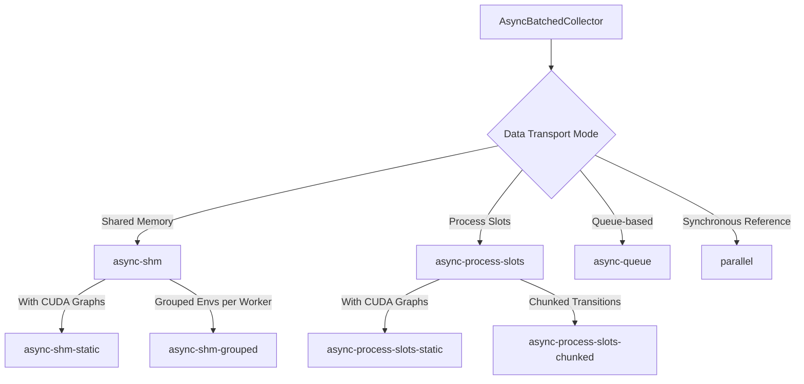

<!-- source: DeepWiki mcp.deepwiki.com · repo pytorch/rl · page 12.4 Benchmarking · fetched 2026-10-21 -->

# Benchmarking

<details>
<summary>Relevant source files</summary>

The following files were used as context for generating this wiki page:

- [.github/async-benchmark-requirements.txt](.github/async-benchmark-requirements.txt)
- [.github/benchmark-requirements.txt](.github/benchmark-requirements.txt)
- [.github/benchmark-versions.env](.github/benchmark-versions.env)
- [.github/scripts/comment_pr_benchmarks.py](.github/scripts/comment_pr_benchmarks.py)
- [.github/scripts/compare_pr_benchmarks.py](.github/scripts/compare_pr_benchmarks.py)
- [.github/scripts/summarize_async_benchmarks.py](.github/scripts/summarize_async_benchmarks.py)
- [.github/scripts/test_pr_benchmark_workflow.py](.github/scripts/test_pr_benchmark_workflow.py)
- [.github/workflows/benchmarks.yml](.github/workflows/benchmarks.yml)
- [.github/workflows/benchmarks_post_merge.yml](.github/workflows/benchmarks_post_merge.yml)
- [.github/workflows/benchmarks_pr.yml](.github/workflows/benchmarks_pr.yml)
- [.github/workflows/benchmarks_pr_comment.yml](.github/workflows/benchmarks_pr_comment.yml)
- [benchmarks/ASYNC_BENCHMARKS.md](benchmarks/ASYNC_BENCHMARKS.md)
- [benchmarks/bench_dreamer_v3_env.py](benchmarks/bench_dreamer_v3_env.py)
- [benchmarks/dreamer_v3.yaml](benchmarks/dreamer_v3.yaml)
- [benchmarks/requirements.txt](benchmarks/requirements.txt)
- [benchmarks/test_collectors_benchmark.py](benchmarks/test_collectors_benchmark.py)
- [benchmarks/test_dreamer_v3_benchmark.py](benchmarks/test_dreamer_v3_benchmark.py)
- [benchmarks/test_objectives_benchmarks.py](benchmarks/test_objectives_benchmarks.py)

</details>


This page documents the benchmarking suite within the TorchRL codebase, focusing on its structure, the `pytest-benchmark` integration, workflows for comparing Pull Request (PR) performance, and specific considerations for asynchronous benchmarking. The goal is to provide a comprehensive guide for understanding, running, and interpreting TorchRL benchmarks.

## Benchmarking Suite Overview

The `benchmarks/` directory [benchmarks/]() houses various performance tests designed to measure the efficiency of different TorchRL components. These benchmarks are crucial for tracking performance regressions and improvements across the codebase. They leverage `pytest-benchmark` for execution and result collection.

The benchmarking suite includes:
*   **Objective Function Benchmarks**: Located in `benchmarks/test_objectives_benchmarks.py`(), these tests evaluate the performance of various loss functions and value estimators, such as `generalized_advantage_estimate` [benchmarks/test_objectives_benchmarks.py:113]() and `ClipPPOLoss` [benchmarks/test_objectives_benchmarks.py:35]().
*   **Collector Benchmarks**: Found in `benchmarks/test_collectors_benchmark.py`(), these focus on the data collection mechanisms, including synchronous and asynchronous collectors, and different data transport methods.
*   **DreamerV3 Training Benchmarks**: Defined in `benchmarks/test_dreamer_v3_benchmark.py`(), these measure the end-to-end performance of the DreamerV3 training loop, including collection, learning, and replay buffer interactions.

Sources:
* `benchmarks/test_objectives_benchmarks.py`
* `benchmarks/test_collectors_benchmark.py`
* `benchmarks/test_dreamer_v3_benchmark.py`

## `pytest-benchmark` Workflows

The TorchRL benchmarking suite uses `pytest-benchmark` to execute performance tests. This plugin provides detailed statistics like mean, median, and standard deviation of execution times, and allows for easy comparison of results.

A typical `pytest-benchmark` test function takes `benchmark` as an argument [benchmarks/test_objectives_benchmarks.py:123](). The `benchmark` fixture can be used to time a function call. For example, `benchmark(gae_fn, ...)` [benchmarks/test_objectives_benchmarks.py:159]() measures the execution time of `gae_fn`. For more controlled setups, `benchmark.pedantic()` [benchmarks/test_objectives_benchmarks.py:124]() can be used, which allows specifying setup functions, iterations, and rounds to ensure consistent measurement conditions.

The `benchmarks/requirements.txt` [benchmarks/requirements.txt:2]() file lists `pytest-benchmark` as a dependency for running these tests.

### Example: Benchmarking Value Functions

The `test_objectives_benchmarks.py` [benchmarks/test_objectives_benchmarks.py]() file provides an example of benchmarking value estimation functions.

```python
# benchmarks/test_objectives_benchmarks.py
@pytest.mark.parametrize(
    "val_fn,has_lmbda,has_state_value",
    [
        [generalized_advantage_estimate, True, True],
        [vec_generalized_advantage_estimate, True, True],
        # ... other functions
    ],
)
def test_values(benchmark, val_fn, has_lmbda, has_state_value):
    benchmark.pedantic(
        val_fn,
        setup=setup_value_fn(
            has_lmbda=has_lmbda,
            has_state_value=has_state_value,
        ),
        iterations=1,
        rounds=50,
    )
```

In this example, `test_values` [benchmarks/test_objectives_benchmarks.py:122]() is parameterized to run different value functions (`val_fn`). The `setup_value_fn` class [benchmarks/test_objectives_benchmarks.py:76]() prepares the input data (`values`, `next_values`, `reward`, `done`) on the appropriate device (CPU or CUDA) before each benchmark round. `benchmark.pedantic()` [benchmarks/test_objectives_benchmarks.py:124]() ensures that the setup is executed once per round, and the function `val_fn` is called `iterations` times within each round, with `rounds` total repetitions.

Sources:
* `benchmarks/requirements.txt`
* `benchmarks/test_objectives_benchmarks.py`

## PR Comparison Scripts

TorchRL employs a robust system for comparing benchmark results between a Pull Request (PR) and its baseline branch. This system is primarily managed through GitHub Actions workflows: `.github/workflows/benchmarks_pr.yml`() and `.github/workflows/benchmarks_pr_comment.yml`().

### Workflow Trigger and Execution

The PR benchmarking workflow is opt-in, triggered by adding the `"benchmarks/upload"` label to a PR [benchmarks_pr.yml:21](). When triggered, it performs the following steps:

1.  **Prepare Benchmark Definitions**: The `prepare-definitions` job [benchmarks_pr.yml:19]() checks out the benchmark definitions from the PR's base SHA and archives them. This ensures that the same benchmark code is used for both the baseline and the PR's head revision, preventing changes in the benchmark itself from skewing results.
2.  **Prepare Pinned Environment**: The `prepare-environment` job [benchmarks_pr.yml:71]() sets up a consistent Python environment with pinned dependencies, including specific versions of PyTorch, torchvision, and tensordict. This environment is cached to speed up subsequent runs [benchmarks_pr.yml:95]().
3.  **Run Benchmarks**: The `benchmark` job [benchmarks_pr.yml:152]() runs the benchmarks for both the `baseline` (PR's base SHA) and `contender` (PR's head SHA) revisions on separate pinned runners for CPU and GPU. This ensures isolation and consistent hardware.
4.  **Compare Results**: After both baseline and contender benchmarks complete, the results are compared. The comparison logic is implemented in `.github/scripts/compare_pr_benchmarks.py`(). This script analyzes the `pytest-benchmark` output, focusing on median duration to determine performance changes [test_pr_benchmark_workflow.py:97-119](). It also validates that the environments (e.g., Docker image, dependencies) are consistent between runs [test_pr_benchmark_workflow.py:171-200]().
5.  **Publish Comment**: The `.github/workflows/benchmarks_pr_comment.yml`() workflow is triggered upon successful completion of the PR benchmark workflow. It uses `.github/scripts/comment_pr_benchmarks.py`() to format and post a comment on the PR, summarizing the benchmark results, including any regressions or improvements.

### Comparison Logic

The `compare_pr_benchmarks.py` script [compare_pr_benchmarks.py]() is central to the PR comparison. It takes the raw `pytest-benchmark` JSON outputs for the baseline and contender, and for each benchmark, it calculates the percentage change in operations per second (ops). It prioritizes the median duration for comparison [test_pr_benchmark_workflow.py:97-119]().

**Diagram: PR Benchmark Comparison Workflow**

```mermaid
graph TD
    A[Pull Request Labeled "benchmarks/upload"] --> B{benchmarks_pr.yml};
    B --> C[Job: prepare-definitions];
    C --> D[Archive benchmark definitions from PR base SHA];
    B --> E[Job: prepare-environment];
    E --> F[Setup pinned Python environment & dependencies];
    D & F --> G[Job: benchmark (baseline)];
    G --> H[Run benchmarks on PR base SHA (CPU/GPU)];
    D & F --> I[Job: benchmark (contender)];
    I --> J[Run benchmarks on PR head SHA (CPU/GPU)];
    H & J --> K[Job: compare-results];
    K --> L[Script: compare_pr_benchmarks.py];
    L --> M[Analyze median duration, calculate % change];
    M --> N[Generate comparison report];
    N --> O{benchmarks_pr_comment.yml};
    O --> P[Job: benchmark-comment];
    P --> Q[Script: comment_pr_benchmarks.py];
    Q --> R[Post comment on PR with results];
```

Sources:
* `.github/workflows/benchmarks_pr.yml`
* `.github/workflows/benchmarks_pr_comment.yml`
* `.github/scripts/compare_pr_benchmarks.py`
* `.github/scripts/test_pr_benchmark_workflow.py`

## Asynchronous Benchmarking

Asynchronous components, particularly collectors, are critical for performance in RL. The `benchmarks/test_collectors_benchmark.py`() and `benchmarks/test_dreamer_v3_benchmark.py`() files contain benchmarks specifically designed for asynchronous operations. The `ASYNC_BENCHMARKS.md` [benchmarks/ASYNC_BENCHMARKS.md]() provides detailed documentation on these benchmarks.

### Async Collector Benchmarks

The `test_async_collection_pixels` function [benchmarks/test_collectors_benchmark.py:79]() in `test_collectors_benchmark.py`() measures the end-to-end performance of data collection using `Collector` and `AsyncBatchedCollector`. It uses `PixelMockEnv` [benchmarks/test_collectors_benchmark.py:15]() and `PolicyFactory` [benchmarks/test_collectors_benchmark.py:15]() to simulate a realistic workload.

Key aspects of async collector benchmarking:
*   **Modes**: Various modes are tested, including `parallel` (synchronous reference), `async-queue`, `async-shm` (shared memory), `async-shm-static` (CUDA graphs), `async-shm-grouped`, and `async-process-slots` [benchmarks/test_collectors_benchmark.py:64-78](). These modes evaluate different communication and execution strategies for collectors.
*   **Workloads**: Benchmarks use a fixed workload with parameters like `num_envs`, `frames_per_batch`, and `batches_per_round` [benchmarks/test_collectors_benchmark.py:136-139](). A "slow-reset" regime [benchmarks/test_collectors_benchmark.py:63]() is included to expose bottlenecks related to environment resets.
*   **Metrics**: The primary metric is throughput (frames/s), but memory usage (RSS, CUDA peak) and batch latency are also tracked [summarize_async_benchmarks.py:41-54]().

**Diagram: Async Collector Benchmarking Modes**



Sources:
* `benchmarks/test_collectors_benchmark.py`
* `benchmarks/ASYNC_BENCHMARKS.md`
* `.github/scripts/summarize_async_benchmarks.py`

### DreamerV3 Training Benchmarks

The `test_dreamer_v3_async_training` benchmark [benchmarks/test_dreamer_v3_benchmark.py:144]() measures the end-to-end performance of the DreamerV3 training loop. This benchmark runs the `sota-implementations/dreamer_v3` example [benchmarks/test_dreamer_v3_benchmark.py:10]() in a child process with a fixed configuration (`dreamer_v3.yaml` [benchmarks/dreamer_v3.yaml]()).

*   **Metrics**: Throughput is read directly from the example's metrics log [benchmarks/test_dreamer_v3_benchmark.py:7]().
*   **Workload**: It uses `bench_dreamer_v3_env.py` [benchmarks/bench_dreamer_v3_env.py]() for environment simulation, with specific configurations for environment processes, pixel observations, and action spaces [ASYNC_BENCHMARKS.md:100-107]().
*   **Training Ratios**: Different `train_ratio` values (e.g., 2 and 16) are used to emphasize either the collection path or the learner step and replay buffer interactions [ASYNC_BENCHMARKS.md:117-119]().

The `_MetricsTail` class [benchmarks/test_dreamer_v3_benchmark.py:71]() is used to incrementally read and parse the JSON-lines metrics file generated by the DreamerV3 example, allowing for real-time monitoring of training progress and throughput.

Sources:
* `benchmarks/test_dreamer_v3_benchmark.py`
* `benchmarks/ASYNC_BENCHMARKS.md`
* `benchmarks/dreamer_v3.yaml`
* `benchmarks/bench_dreamer_v3_env.py`

### Continuous Benchmark Workflow

The `.github/workflows/benchmarks.yml`() workflow orchestrates the continuous benchmarking.

*   **Triggers**: It runs on `pull_request` events affecting benchmark-related files, `push` events to `main` (especially for `torchrl/**`, `benchmarks/**`, `sota-implementations/dreamer_v3/**`), and can be manually triggered via `workflow_dispatch` [benchmarks.yml:4-28]().
*   **Suites**: It supports `async` (short, pinned suite for main merges) and `full` (nightly suite) benchmark suites [benchmarks.yml:23-24]().
*   **Environment Setup**: Similar to PR benchmarks, it sets up a consistent environment, including system packages and Python dependencies, often using cached virtual environments [benchmarks.yml:99-168](). For async benchmarks, dependencies are pinned in `.github/async-benchmark-requirements.txt` [async-benchmark-requirements.txt]() to ensure stability of the trend.
*   **Reporting**: The `summarize_async_benchmarks.py` script [summarize_async_benchmarks.py]() processes the raw `pytest-benchmark` outputs to generate a human-readable summary and a `trend.json` file for dashboard visualization.

**Diagram: Continuous Benchmark Workflow**

```mermaid
graph TD
    A[Push to main / PR / Manual Trigger] --> B{benchmarks.yml};
    B -- "If push to main" --> C[Run async suite];
    B -- "If manual/nightly" --> D[Run full suite];
    C & D --> E[Job: benchmark (CPU/GPU)];
    E --> F[Setup environment & dependencies];
    F --> G[Execute pytest-benchmark tests];
    G --> H[Collect raw benchmark results (JSON)];
    H --> I[Script: summarize_async_benchmarks.py];
    I --> J[Generate Markdown summary & trend.json];
    J --> K[Upload artifacts & publish to trend dashboard];
```

Sources:
* `.github/workflows/benchmarks.yml`
* `.github/async-benchmark-requirements.txt`
* `.github/scripts/summarize_async_benchmarks.py`
* `benchmarks/ASYNC_BENCHMARKS.md`

## Post-Merge Benchmarks

The `.github/workflows/benchmarks_post_merge.yml`() workflow allows for immediate execution of the full benchmark suite on `main` after a PR merge, bypassing the nightly schedule. This is triggered by merging a PR that carries the `"benchmarks/trigger"` label [benchmarks_post_merge.yml:20](). This ensures that significant changes can be benchmarked and reflected in the trend dashboard without delay.

Sources:
* `.github/workflows/benchmarks_post_merge.yml`

---

