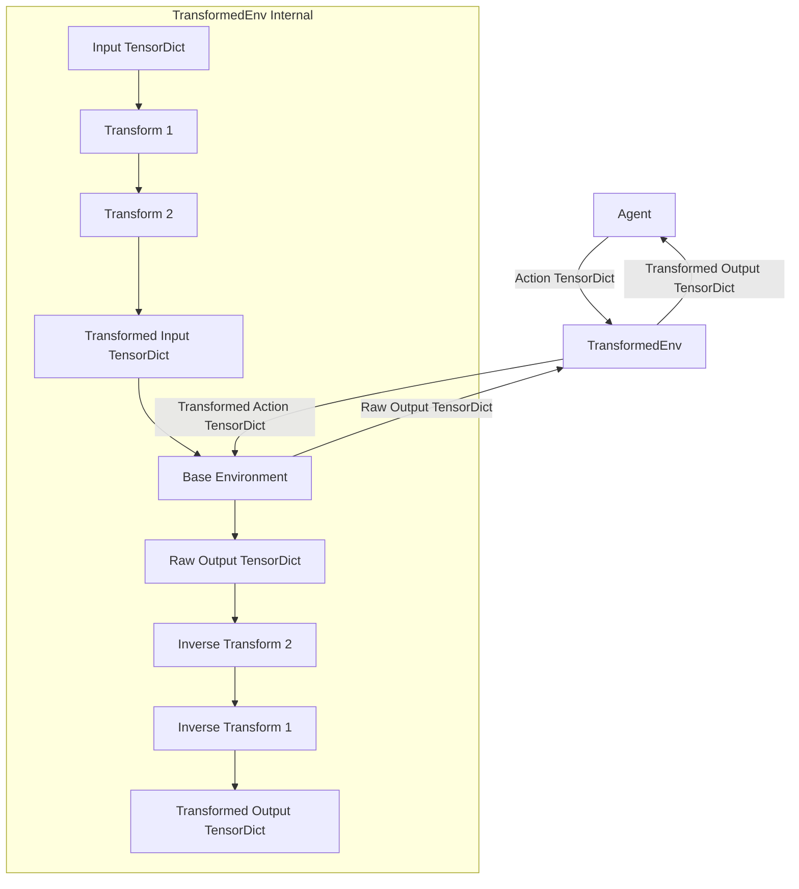
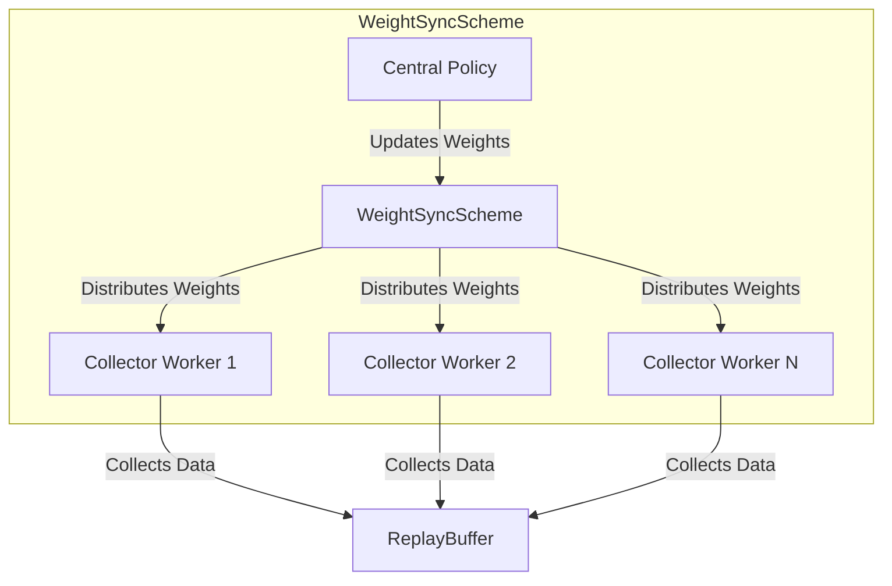

<!-- source: DeepWiki mcp.deepwiki.com · repo pytorch/rl · page 13 Glossary · fetched 2026-10-21 -->

# Glossary

<details>
<summary>Relevant source files</summary>

The following files were used as context for generating this wiki page:

- [.github/workflows/docs.yml](.github/workflows/docs.yml)
- [README.md](README.md)
- [docs/requirements.txt](docs/requirements.txt)
- [docs/source/conf.py](docs/source/conf.py)
- [docs/source/index.rst](docs/source/index.rst)
- [docs/source/reference/collectors_distributed.rst](docs/source/reference/collectors_distributed.rst)
- [docs/source/reference/collectors_replay.rst](docs/source/reference/collectors_replay.rst)
- [docs/source/reference/data_layout.rst](docs/source/reference/data_layout.rst)
- [docs/source/reference/objectives.rst](docs/source/reference/objectives.rst)
- [docs/source/reference/objectives_other.rst](docs/source/reference/objectives_other.rst)
- [test/test_collectors.py](test/test_collectors.py)
- [test/test_specs.py](test/test_specs.py)
- [test/test_utils.py](test/test_utils.py)
- [torchrl/_utils.py](torchrl/_utils.py)
- [torchrl/collectors/_base.py](torchrl/collectors/_base.py)
- [torchrl/collectors/_multi_base.py](torchrl/collectors/_multi_base.py)
- [torchrl/collectors/_runner.py](torchrl/collectors/_runner.py)
- [torchrl/collectors/_single.py](torchrl/collectors/_single.py)
- [torchrl/collectors/collectors.py](torchrl/collectors/collectors.py)
- [torchrl/collectors/distributed/ray.py](torchrl/collectors/distributed/ray.py)
- [torchrl/collectors/utils.py](torchrl/collectors/utils.py)
- [torchrl/data/tensor_specs.py](torchrl/data/tensor_specs.py)
- [torchrl/envs/batched_envs.py](torchrl/envs/batched_envs.py)
- [torchrl/envs/common.py](torchrl/envs/common.py)
- [torchrl/envs/gym_like.py](torchrl/envs/gym_like.py)
- [torchrl/envs/libs/gym.py](torchrl/envs/libs/gym.py)
- [torchrl/envs/transforms/transforms.py](torchrl/envs/transforms/transforms.py)
- [torchrl/envs/utils.py](torchrl/envs/utils.py)
- [torchrl/objectives/__init__.py](torchrl/objectives/__init__.py)
- [torchrl/objectives/a2c.py](torchrl/objectives/a2c.py)
- [torchrl/objectives/common.py](torchrl/objectives/common.py)
- [torchrl/objectives/cql.py](torchrl/objectives/cql.py)
- [torchrl/objectives/crossq.py](torchrl/objectives/crossq.py)
- [torchrl/objectives/ddpg.py](torchrl/objectives/ddpg.py)
- [torchrl/objectives/decision_transformer.py](torchrl/objectives/decision_transformer.py)
- [torchrl/objectives/deprecated.py](torchrl/objectives/deprecated.py)
- [torchrl/objectives/iql.py](torchrl/objectives/iql.py)
- [torchrl/objectives/ppo.py](torchrl/objectives/ppo.py)
- [torchrl/objectives/redq.py](torchrl/objectives/redq.py)
- [torchrl/objectives/reinforce.py](torchrl/objectives/reinforce.py)
- [torchrl/objectives/sac.py](torchrl/objectives/sac.py)
- [torchrl/objectives/td3.py](torchrl/objectives/td3.py)
- [torchrl/objectives/td3_bc.py](torchrl/objectives/td3_bc.py)
- [torchrl/objectives/utils.py](torchrl/objectives/utils.py)
- [torchrl/trainers/algorithms/configs/collectors.py](torchrl/trainers/algorithms/configs/collectors.py)
- [tutorials/sphinx-tutorials/getting-started-3.py](tutorials/sphinx-tutorials/getting-started-3.py)
- [tutorials/sphinx-tutorials/rb_tutorial.py](tutorials/sphinx-tutorials/rb_tutorial.py)

</details>


This page defines key terms, jargon, abbreviations, and domain-specific concepts used throughout the TorchRL codebase. Each entry provides a definition, context within TorchRL, and relevant code pointers for deeper understanding.

## TensorDict

A `TensorDict` is the fundamental data structure in TorchRL, serving as a dictionary-like container for tensors and other data. It allows for structured data exchange between different components of an RL system, such as environments, policies, and replay buffers. `TensorDict` supports common tensor operations while preserving named fields, enabling cleaner and more explicit code.

**Key Features:**
*   **Named Fields:** Data is accessed via keys, similar to a Python dictionary.
*   **Batch Dimensions:** Automatically handles batching and unbatching of data.
*   **Device Management:** Supports seamless transfer of data between CPU and GPU.
*   **Shared Memory:** Can be stored in shared memory for efficient multi-process communication.
*   **Lazy Views:** Provides lazy stacking and other views for memory efficiency.

**Implementation Details:**
`TensorDict` is implemented in the `tensordict` library, which TorchRL builds upon. It is extensively used across all TorchRL components. For example, environment interactions are represented as `TensorDict` objects [README.md:70-70](), policies operate on `TensorDict` inputs and produce `TensorDict` outputs [README.md:71-71](), and replay buffers store `TensorDict` trajectories [README.md:72-72]().

**Example Usage:**
```python
import torch
from tensordict import TensorDict

# Create a TensorDict
data = TensorDict(
    {"observation": torch.randn(10, 4), "action": torch.randn(10, 2)},
    batch_size=[10]
)
print(data)
# Access data
print(data["observation"].shape)
# Move to device
data = data.to("cuda")
```

**Diagram: TensorDict Data Flow**
```mermaid
graph TD
    subgraph "RL System Components"
        Env[Environment] -->|`TensorDict` (obs, reward, done)| Policy[Policy Module]
        Policy -->|`TensorDict` (action, log_prob)| Env
        Env -->|`TensorDict` (trajectory)| Collector[Collector]
        Collector -->|`TensorDict` (batch of trajectories)| ReplayBuffer[Replay Buffer]
        ReplayBuffer -->|`TensorDict` (sampled batch)| LossModule[Loss Module]
        LossModule -->|`TensorDict` (losses)| Optimizer[Optimizer]
    end
```
Sources:
*   [README.md:42-45]()
*   [README.md:70-72]()
*   [README.md:134-142]()

## TensorSpec

`TensorSpec` defines the properties and constraints of tensors within a `TensorDict`. It acts as a type system for RL data, allowing for validation, shape inference, and ensuring compatibility between components. `TensorSpec` objects can specify `shape`, `dtype`, `device`, and `domain` (e.g., `Bounded`, `Categorical`, `Unbounded`).

**Key Features:**
*   **Data Validation:** Ensures that tensors conform to predefined specifications.
*   **Shape Inference:** Helps in automatically determining tensor shapes.
*   **Domain Constraints:** Defines the valid range or set of values for a tensor.
*   **Composite Specifications:** `Composite` specs allow defining specifications for nested `TensorDict` structures.

**Implementation Details:**
`TensorSpec` and its subclasses (`Bounded`, `Categorical`, `Unbounded`, `Composite`, etc.) are defined in `torchrl.data.tensor_specs.py`. Environments use `TensorSpec` to define their observation and action spaces [torchrl/envs/common.py:39-45](). Transforms also use `TensorSpec` to update the environment's specifications after transformation.

**Example Usage:**
```python
from torchrl.data.tensor_specs import Bounded, Composite, Unbounded
import torch

# Define a bounded observation spec
observation_spec = Bounded(
    low=torch.tensor([-1.0, -1.0]),
    high=torch.tensor([1.0, 1.0]),
    shape=torch.Size([2]),
    dtype=torch.float32
)

# Define a composite spec for an environment
env_spec = Composite(
    observation=observation_spec,
    action=Bounded(0, 1, torch.Size([1]), torch.float32),
    reward=Unbounded(shape=torch.Size([1]), dtype=torch.float32)
)

# Validate a TensorDict against the spec
td = env_spec.rand()
env_spec.is_in(td) # Returns True
```
Sources:
*   [torchrl/data/tensor_specs.py:38-43]()
*   [torchrl/envs/common.py:39-45]()
*   [test/test_specs.py:38-41]()

## Composite

`Composite` is a specialized `TensorSpec` that represents the specification for a `TensorDict`. It allows defining a hierarchical structure of `TensorSpec` objects, mirroring the nested structure of a `TensorDict`. This is crucial for defining complex observation spaces, action spaces, and other data structures within TorchRL.

**Implementation Details:**
`Composite` is a subclass of `TensorSpec` and is defined in `torchrl.data.tensor_specs.py` [torchrl/data/tensor_specs.py:31](). It holds a dictionary of `TensorSpec` objects, where keys correspond to the keys in a `TensorDict`.

**Diagram: Composite Spec Structure**
```mermaid
graph TD
    CompositeSpec[Composite] -->|contains| ObservationSpec[Bounded(low, high)]
    CompositeSpec -->|contains| ActionSpec[Categorical(n_actions)]
    CompositeSpec -->|contains| RewardSpec[Unbounded]
    CompositeSpec -->|contains| NextObsSpec[Composite("next")]
    NextObsSpec -->|contains| NextObservation[Bounded(low, high)]
```
Sources:
*   [torchrl/data/tensor_specs.py:31]()
*   [torchrl/envs/common.py:40]()
*   [test/test_specs.py:31]()

## step_mdp

`step_mdp` is a utility function (or its stateful counterpart `_StepMDP`) that processes a `TensorDict` representing a single step in an environment. It transforms the `TensorDict` from the current state to the next state, typically by moving "next" keys to the root and handling other keys like rewards, dones, and actions. This function is crucial for constructing trajectories from individual environment steps.

**Implementation Details:**
The core logic for `step_mdp` is encapsulated within the `_StepMDP` class in `torchrl/envs/utils.py` [torchrl/envs/utils.py:79-80](). This class precomputes lists of keys to include or exclude, optimizing the transformation process. It handles the renaming of keys (e.g., `("next", "observation")` becomes `"observation"`) and the removal of transient keys.

**Diagram: step_mdp Transformation**
```mermaid
graph TD
    CurrentStepTD[Current Step TensorDict]
    CurrentStepTD -->|`step_mdp`| NextStepTD[Next Step TensorDict]

    subgraph "Current Step TensorDict"
        CurrentObs[observation]
        CurrentAction[action]
        NextObs[next/observation]
        NextReward[next/reward]
        NextDone[next/done]
        OtherKeys[other_data]
    end

    subgraph "Next Step TensorDict"
        NewObs[observation (from next/observation)]
        NewReward[reward (from next/reward)]
        NewDone[done (from next/done)]
        OtherKeysPreserved[other_data (if `keep_other`)]
    end

    CurrentObs --> NewObs
    NextObs --> NewObs
    NextReward --> NewReward
    NextDone --> NewDone
    OtherKeys --> OtherKeysPreserved
```
Sources:
*   [torchrl/envs/utils.py:54]()
*   [torchrl/envs/utils.py:79-80]()
*   [torchrl/envs/utils.py:90-147]()

## in_keys/out_keys

`in_keys` and `out_keys` are attributes used by `TensorDictModule` and its subclasses to explicitly define which keys a module expects as input and which keys it will produce as output within a `TensorDict`. This explicit interface promotes modularity and helps in debugging data flow issues.

**Implementation Details:**
These attributes are central to the `TensorDictModule` system, which wraps `nn.Module` instances to operate on `TensorDict` objects. For example, a policy network might have `in_keys=["observation"]` and `out_keys=["action", "log_prob"]` [README.md:112-113](). This allows TorchRL to automatically extract the necessary inputs from a `TensorDict`, pass them to the underlying `nn.Module`, and then insert the outputs back into the `TensorDict` under the specified `out_keys`.

**Example Usage:**
```python
from tensordict.nn import TensorDictModule
from torch import nn

policy_module = TensorDictModule(
    nn.Linear(4, 2),
    in_keys=["observation"],
    out_keys=["action"]
)
```
Sources:
*   [README.md:112-113]()
*   [tensordict.nn:TensorDictModule]() (conceptual, not directly in provided files)

## TransformedEnv

`TransformedEnv` is a wrapper around an `EnvBase` instance that applies a sequence of `Transform` objects to the environment's observations, actions, and rewards. This allows for flexible and composable environment preprocessing and postprocessing without modifying the base environment.

**Key Features:**
*   **Composability:** Multiple transforms can be chained together using `Compose`.
*   **Modularity:** Transforms are independent units that can be easily added, removed, or reordered.
*   **Spec Transformation:** `TransformedEnv` automatically updates the environment's `TensorSpec` to reflect the changes introduced by the transforms.

**Implementation Details:**
`TransformedEnv` is defined in `torchrl.envs.transforms._base.py` and re-exported in `torchrl.envs.transforms/transforms.py` [torchrl/envs/transforms/transforms.py:38](). It takes an `EnvBase` instance and a `Transform` (or `Compose` of transforms) as input. When `step()` or `reset()` is called on `TransformedEnv`, the transforms are applied in sequence to the input `TensorDict` before passing it to the base environment, and then to the output `TensorDict` from the base environment.

**Diagram: TransformedEnv Data Flow**

Sources:
*   [torchrl/envs/transforms/transforms.py:38]()
*   [torchrl/envs/transforms/transforms.py:187]()
*   [README.md:99]()

## Collector

A `Collector` is responsible for gathering data (trajectories) from one or more environments using a given policy. It manages the interaction loop between the policy and the environment, handles batching of experiences, and can be configured for synchronous or asynchronous data collection.

**Key Features:**
*   **Environment Interaction:** Executes `policy.forward()` and `env.step()` repeatedly.
*   **Trajectory Batching:** Aggregates individual steps into complete trajectories or fixed-size batches.
*   **Synchronous/Asynchronous:** Supports various collection strategies, including `Collector` (synchronous), `AsyncCollector` (asynchronous with a single worker), `MultiSyncCollector`, and `MultiAsyncCollector` (multiple workers).
*   **Weight Synchronization:** Integrates with `WeightSyncScheme` to keep policy weights updated across workers.

**Implementation Details:**
The base class `BaseCollector` is defined in `torchrl.collectors._base.py` [torchrl/collectors/_base.py:8](). Concrete implementations like `Collector` [torchrl/collectors/_single.py:28]() and `AsyncCollector` [torchrl/collectors/_single_async.py:28]() are found in their respective files and re-exported in `torchrl/collectors/collectors.py` [torchrl/collectors/collectors.py:34](). Collectors typically take an environment, a policy, and a `frames_per_batch` argument to control the amount of data collected.

**Diagram: Collector Architecture**
```mermaid
graph TD
    Policy[Policy] --> Collector[Collector]
    Environment[Environment] --> Collector
    Collector -->|Collects `frames_per_batch`| Trajectories[TensorDict of Trajectories]
    Trajectories --> ReplayBuffer[Replay Buffer]

    subgraph "Collector Loop"
        direction LR
        Init[Initialize] --> Reset[env.reset()]
        Reset --> PolicyForward[policy.forward(obs)]
        PolicyForward --> Step[env.step(action)]
        Step --> Store[Store data]
        Step -- Trajectory Done? --> Reset
        Step -- Not Done --> PolicyForward
        Store -- `frames_per_batch` collected? --> Output[Output Trajectories]
        Store -- Not enough frames --> PolicyForward
    end
```
Sources:
*   [torchrl/collectors/collectors.py:34]()
*   [torchrl/collectors/_base.py:8]()
*   [torchrl/collectors/_single.py:28]()
*   [torchrl/collectors/_single_async.py:28]()
*   [README.md:71]()

## frames_per_batch

`frames_per_batch` is a common parameter used in `Collector` instances to specify the total number of environment steps (or "frames") that should be collected in a single batch before yielding the data. This parameter controls the granularity of data collection and is crucial for managing memory and computational resources.

**Context:**
When a `Collector` is iterated, it will continue to interact with the environment(s) until `frames_per_batch` steps have been accumulated. The collected data is then returned as a single `TensorDict` batch. This is particularly important for on-policy algorithms like PPO, where a fixed amount of data is collected for each policy update.

**Implementation Details:**
This parameter is passed during the initialization of `Collector` and its variants [torchrl/collectors/_single.py:39-40](). The collector's internal loop tracks the number of collected frames and stops when the target is reached.

Sources:
*   [torchrl/collectors/_single.py:39-40]() (conceptual, not directly in provided files)

## WeightSyncScheme

`WeightSyncScheme` defines how policy weights are synchronized between a main process (or a central policy) and worker processes (e.g., in distributed data collection). This is critical for ensuring that all collectors use the most up-to-date policy parameters.

**Key Implementations:**
*   `NoWeightSyncScheme`: No synchronization occurs.
*   `SharedMemWeightSyncScheme`: Weights are synchronized via shared memory, suitable for multi-threading or multi-processing on a single machine.
*   `MultiProcessWeightSyncScheme`: Uses `torch.multiprocessing` for synchronization.
*   `RPCWeightSyncScheme`: Uses PyTorch RPC for distributed synchronization.
*   `DistributedWeightSyncScheme`: Uses `torch.distributed` for synchronization.
*   `RayWeightSyncScheme`: Integrates with Ray for distributed weight synchronization.

**Implementation Details:**
The base class `WeightSyncScheme` is defined in `torchrl.weight_update.weight_sync.py` (not provided, but inferred from `test/test_collectors.py`). The `from_backend` static method in `WeightSyncScheme` [test/test_collectors.py:189-190]() allows creating an instance based on a string identifier (e.g., "shared", "rpc"). The `_device_shareable_across_processes` utility [test/test_collectors.py:212]() helps determine if a device supports direct cross-process sharing, influencing whether CPU staging is needed.

**Diagram: WeightSyncScheme Overview**

Sources:
*   [test/test_collectors.py:148-157]()
*   [test/test_collectors.py:189-190]()
*   [test/test_collectors.py:212]()

## LossModule

`LossModule` is the base class for all loss functions in TorchRL. It provides a standardized interface for computing losses from a `TensorDict` of data, often involving functional module conversion and target networks. This abstraction allows for flexible and composable loss computations.

**Key Features:**
*   **TensorDict-based Input/Output:** Expects a `TensorDict` as input and returns a `TensorDict` containing various loss components.
*   **Functionalization:** Supports converting modules to their functional form for gradient computation.
*   **Target Networks:** Often incorporates logic for managing and updating target networks.
*   **Composability:** Can be combined with `ValueEstimators` to compute advantages and value targets.

**Implementation Details:**
`LossModule` is defined in `torchrl.objectives.common.py` (not provided, but inferred from `torchrl/objectives/ppo.py`). Subclasses like `PPOLoss` [torchrl/objectives/ppo.py:119]() implement specific algorithm losses. The `forward` method of a `LossModule` typically takes a `TensorDict` and returns a `TensorDict` with loss values.

**Diagram: LossModule Data Flow**
```mermaid
graph TD
    SampledBatch[Sampled TensorDict Batch] --> LossModule[LossModule (e.g., PPOLoss)]
    LossModule -->|Computes| ActorLoss[actor_loss]
    LossModule -->|Computes| CriticLoss[critic_loss]
    LossModule -->|Computes| EntropyLoss[entropy_loss]
    LossModule -->|Returns| LossesTD[TensorDict with Losses]
    LossesTD --> Optimizer[Optimizer]
```
Sources:
*   [torchrl/objectives/ppo.py:42]()
*   [torchrl/objectives/ppo.py:119]()

## ValueEstimators

`ValueEstimators` are utility functions or classes that compute value estimates (e.g., advantages, returns) from a `TensorDict` containing rewards, values, and `done` flags. They are typically used in conjunction with `LossModule` instances to provide the necessary targets for value-based or actor-critic algorithms.

**Key Implementations:**
*   `GAE` (Generalized Advantage Estimation)
*   `TD-Lambda`
*   `V-Trace`

**Implementation Details:**
`ValueEstimators` are part of `torchrl.objectives.utils.py` [torchrl/objectives/ppo.py:54](). They take a `TensorDict` and parameters like `gamma` and `lmbda` to compute advantage and value targets, which are then added back to the `TensorDict`.

Sources:
*   [torchrl/objectives/ppo.py:54]()

## GAE

`GAE` stands for Generalized Advantage Estimation. It is a popular method for estimating advantages in actor-critic reinforcement learning algorithms. GAE provides a way to balance the bias-variance trade-off in advantage estimation by using a weighted average of n-step returns.

**Formula:**
The GAE advantage is computed as:
$A_t = \sum_{l=0}^{\infty} (\gamma\lambda)^l \delta_{t+l}$
where $\delta_t = R_t + \gamma V(S_{t+1}) - V(S_t)$ is the TD error, $\gamma$ is the discount factor, and $\lambda$ is the GAE parameter.

**Context in TorchRL:**
`GAE` is implemented as a `ValueEstimator` [torchrl/objectives/ppo.py:54]() and is commonly used with on-policy algorithms like PPO [torchrl/objectives/ppo.py:130-134]() and A2C. It takes a `TensorDict` containing rewards, value estimates, and `done` flags, and adds the computed advantages and value targets to the `TensorDict`.

Sources:
*   [torchrl/objectives/ppo.py:54]()
*   [torchrl/objectives/ppo.py:130-134]() (conceptual, not directly in provided files)

## RSSM

`RSSM` (Recurrent State-Space Model) is a core component of model-based reinforcement learning algorithms like Dreamer. It learns a compact, recurrent latent state representation of the environment, which can then be used to predict future observations, rewards, and states.

**Key Components:**
*   **Encoder:** Maps observations to a latent state.
*   **Decoder:** Maps the latent state back to observations.
*   **Dynamics Model:** Predicts the next latent state given the current latent state and action.
*   **Reward Model:** Predicts the reward from the latent state.

**Context in TorchRL:**
TorchRL provides implementations of RSSM components within `torchrl/modules/models/model_based.py` (not provided, but inferred from TOC). These modules are used to build world models for DreamerV3 and other model-based agents.

Sources:
*   [6.6. Planners and Model-Based Modules]() (TOC entry)
*   [7.6. Model-Based RL: Dreamer and DreamerV3]() (TOC entry)

## symlog

`symlog` (symmetric logarithm) is a transformation used in model-based RL, particularly in Dreamer, to handle values that can span a wide range (both positive and negative) while maintaining numerical stability. It applies a logarithm-like compression to large values and a linear transformation to values close to zero.

**Formula:**
$symlog(x) = sign(x) \cdot \log(1 + |x|)$

**Context in TorchRL:**
`symlog` is used in the DreamerV3 implementation within TorchRL, typically for transforming rewards or other values that might have a large dynamic range, improving the stability of neural network training.

Sources:
*   [7.6. Model-Based RL: Dreamer and DreamerV3]() (TOC entry)

## two-hot

`two-hot` encoding is a technique used in model-based RL, specifically in Dreamer, for representing categorical distributions. Instead of a single "hot" (1) value, it uses two "hot" values to represent a categorical variable, often combined with a softmax distribution. This can help in learning more expressive representations.

**Context in TorchRL:**
`two-hot` encoding is part of the DreamerV3 implementation in TorchRL, particularly for representing the categorical latent states within the RSSM.

Sources:
*   [7.6. Model-Based RL: Dreamer and DreamerV3]() (TOC entry)

## functionalization

Functionalization in TorchRL refers to the process of converting `nn.Module` instances into their functional equivalent. This means that instead of modifying the module's internal state (parameters, buffers) directly, operations are performed by passing the parameters and buffers as explicit arguments to a function. This is particularly useful for:

*   **Meta-learning:** Where parameters are updated in an inner loop without affecting the outer loop's parameters.
*   **Gradient computation:** Allows for more flexible gradient calculations, especially when dealing with target networks or multiple policy versions.
*   **JIT compilation:** Can improve compatibility with `torch.compile` by making computations more explicit and state-free.

**Implementation Details:**
TorchRL's `LossModule` often leverages functionalization, for example, to create functional versions of actor and critic networks for computing losses without modifying the original network's state [torchrl/objectives/ppo.py:42](). This is typically achieved using `torch.func` utilities.

Sources:
*   [torchrl/objectives/ppo.py:42]() (conceptual, not directly in provided files)

## ConfigStore / _target_

`ConfigStore` and `_target_` are components of Hydra, a configuration management library used in TorchRL for defining and managing experiment configurations.

*   **`ConfigStore`**: A registry for storing configuration schemas. It allows defining the structure and default values of configurations.
*   **`_target_`**: A special field in a Hydra configuration that specifies the Python path to a class or function that should be instantiated or called. Hydra uses this field to dynamically create objects based on the configuration.

**Context in TorchRL:**
TorchRL uses Hydra for its training pipelines, especially in `sota-implementations`. Configurations for environments, models, collectors, and loss functions are defined using `ConfigStore`, and `_target_` is used to specify which TorchRL classes should be instantiated (e.g., `_target_: torchrl.envs.GymEnv` to create a Gym environment). This enables highly flexible and declarative experiment setup.

Sources:
*   [8.3. Hydra Configuration System]() (TOC entry)
*   [torchrl/trainers/algorithms/configs/collectors.py]() (example of config usage)

## GRPO

`GRPO` (Generalized Reinforcement Learning with Policy Optimization) is a reinforcement learning algorithm, particularly relevant in the context of Large Language Models (LLMs) and Reinforcement Learning from Human Feedback (RLHF). It is a generalization of PPO that can be applied to various policy optimization problems, including those with complex reward structures and high-dimensional action spaces typical of LLMs.

**Context in TorchRL:**
TorchRL provides an implementation of GRPO, especially for LLM fine-tuning and RLHF tasks. It is part of the `torchrl/objectives/grpo.py` (not provided, but inferred from TOC) and `sota-implementations/grpo` [9.5. GRPO and Expert Iteration Pipelines]() [9.6. Vision-Language-Action (VLA) Models]() for state-of-the-art LLM training pipelines.

Sources:
*   [9.3. LLM Training Objectives]() (TOC entry)
*   [9.5. GRPO and Expert Iteration Pipelines]() (TOC entry)
*   [9.6. Vision-Language-Action (VLA) Models]() (TOC entry)

## History

In the context of LLM integration in TorchRL, `History` is a `TensorClass` (a `TensorDict` subclass with a fixed schema) used to store the conversational history of an LLM interaction. It typically contains sequences of tokens, masks, and other relevant information for managing multi-turn dialogues.

**Implementation Details:**
`History` and related `TensorClass` objects like `ChatHistory`, `Text`, `Tokens`, `Masks`, and `LogProbs` are defined in `torchrl/data/rlhf/value_classes.py` (not provided, but inferred from TOC). These specialized `TensorDict`s ensure type-safe and structured handling of LLM-specific data.

Sources:
*   [9.2. LLM Data Structures]() (TOC entry)

## VLA

`VLA` stands for Vision-Language-Action models. These are models that integrate visual observations, natural language instructions, and action generation, typically for robotic control or embodied AI tasks.

**Context in TorchRL:**
TorchRL supports VLA models, particularly through its `torchrl/data/vla` and `torchrl/modules/vla` packages (not provided, but inferred from TOC). The `vla_grpo` implementation is a state-of-the-art example of using GRPO for VLA tasks, such as OpenVLA.

Sources:
*   [9.6. Vision-Language-Action (VLA) Models]() (TOC entry)

## sota-implementations

`sota-implementations` is a directory within the TorchRL repository (`sota-implementations/`) that contains reference implementations of various State-of-the-Art (SOTA) reinforcement learning algorithms. These implementations serve as examples of how to use TorchRL components to build complete training pipelines.

**Key Aspects:**
*   **Full Training Pipelines:** Each implementation typically includes scripts for training, evaluation, and configuration.
*   **Best Practices:** Demonstrates recommended ways to combine TorchRL's environments, collectors, replay buffers, modules, and loss functions.
*   **Reproducibility:** Aims to provide reproducible results for well-known benchmarks.
*   **Hydra Integration:** Often uses Hydra for configuration management.

**Context in TorchRL:**
This directory is a valuable resource for users looking to understand how to build complex RL systems with TorchRL or to reproduce SOTA results. Examples include implementations for PPO, SAC, DreamerV3, and GRPO for LLMs.

Sources:
*   [README.md:51]()
*   [11.2. SOTA Implementations]() (TOC entry)