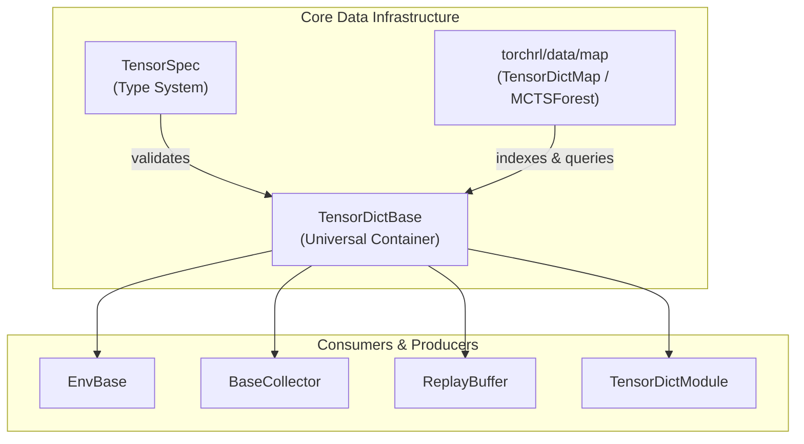
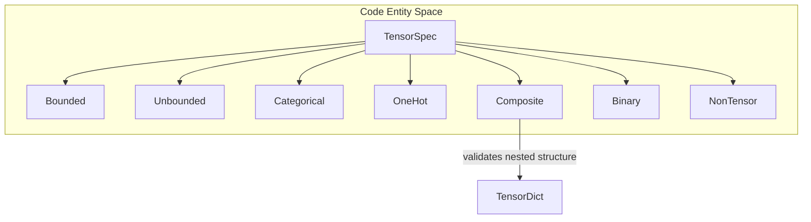
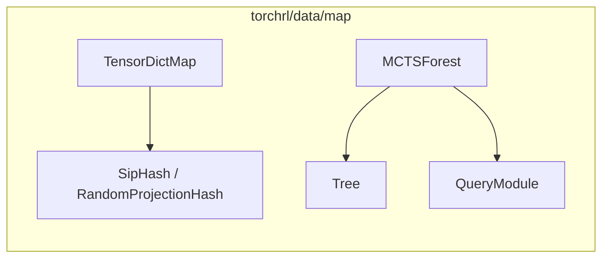

<!-- source: DeepWiki mcp.deepwiki.com · repo pytorch/rl · page 2 Core Data Infrastructure · fetched 2026-10-21 -->

# Core Data Infrastructure

Relevant source files

The following files were used as context for generating this wiki page:

- [benchmarks/test_replaybuffer_benchmark.py](benchmarks/test_replaybuffer_benchmark.py)
- [docs/source/reference/data.rst](docs/source/reference/data.rst)
- [docs/source/reference/data_replaybuffers.rst](docs/source/reference/data_replaybuffers.rst)
- [test/rb/test_rb_core.py](test/rb/test_rb_core.py)
- [test/rb/test_rb_distributed.py](test/rb/test_rb_distributed.py)
- [test/rb/test_storages.py](test/rb/test_storages.py)
- [test/test_specs.py](test/test_specs.py)
- [test/test_utils.py](test/test_utils.py)
- [torchrl/_comm/replay_service.py](torchrl/_comm/replay_service.py)
- [torchrl/_utils.py](torchrl/_utils.py)
- [torchrl/collectors/collectors.py](torchrl/collectors/collectors.py)
- [torchrl/data/__init__.py](torchrl/data/__init__.py)
- [torchrl/data/replay_buffers/__init__.py](torchrl/data/replay_buffers/__init__.py)
- [torchrl/data/replay_buffers/ray_buffer.py](torchrl/data/replay_buffers/ray_buffer.py)
- [torchrl/data/replay_buffers/replay_buffers/base.py](torchrl/data/replay_buffers/replay_buffers/base.py)
- [torchrl/data/tensor_specs.py](torchrl/data/tensor_specs.py)
- [torchrl/envs/batched_envs.py](torchrl/envs/batched_envs.py)
- [torchrl/envs/common.py](torchrl/envs/common.py)
- [torchrl/envs/gym_like.py](torchrl/envs/gym_like.py)
- [torchrl/envs/libs/gym.py](torchrl/envs/libs/gym.py)
- [torchrl/envs/transforms/transforms.py](torchrl/envs/transforms/transforms.py)
- [torchrl/envs/utils.py](torchrl/envs/utils.py)

TorchRL's core data infrastructure provides foundational, type-safe data containers, type validation systems, and specialized memory maps that all modular RL components use for communication. The system revolves around three primary pillars: universal tensor dictionaries (`TensorDict`), structural and type validation specifications (`TensorSpec`), and specialized tensor maps and tree structures for planning (`torchrl/data/map`).

**Scope**: As a parent page, this section introduces the high-level architecture of TorchRL's data infrastructure. For deep technical implementation details, operations, and advanced usage patterns, refer to the child pages:
- [TensorDict System](#2.1) — Explain TensorDict as the universal data container, its operations, and how it enables composable RL components
- [TensorSpec System](#2.2) — Document the TensorSpec type system for defining tensor properties, validating data, and ensuring spec compatibility across environments and models
- [MCTS Forests and Tensor Maps](#2.3) — Document `torchrl/data/map`: `TensorDictMap`, hashing, query modules and the MCTS Forest/Tree structures.

---

## Architecture Overview

The core data infrastructure establishes a unified data contract between environments, collectors, replay buffers, policy modules, and planning algorithms.

Title: Core Data Infrastructure Architecture

Sources: [torchrl/data/__init__.py:22-32](), [torchrl/data/tensor_specs.py:589-615]()

---

## 2.1 TensorDict System

`TensorDict` (provided by the underlying `tensordict` library) acts as the universal data container across TorchRL. It behaves like a dictionary whose values are tensors (or tensor-like collections) that share a common batch size. This abstraction allows environment transitions, rollout trajectories, and batched policy inputs to be manipulated as unified batch-aware structures.

For complete documentation on container operations, hierarchical nesting, concatenation, and memory efficiency, see [TensorDict System](#2.1).

Sources: [torchrl/envs/common.py:20-25](), [torchrl/data/__init__.py:68-98]()

---

## 2.2 TensorSpec System

The `TensorSpec` type system defines structural and domain constraints (shape, dtype, device, bounds) for tensor data exchanged between TorchRL components. Every environment, policy, and loss module declares its input/output expectations using specs.

Title: TensorSpec Hierarchy and Validation

Sources: [torchrl/data/tensor_specs.py:589-615](), [torchrl/data/__init__.py:99-117]()

For detailed documentation on spec validation (`is_in`), encoding (`encode`), projection (`project`), and Gym interoperability, see [TensorSpec System](#2.2).

---

## 2.3 MCTS Forests and Tensor Maps

TorchRL includes specialized mapping and tree structures under `torchrl/data/map` designed for Monte Carlo Tree Search (MCTS) and embedding-based retrieval. These structures integrate closely with `TensorDict` to store and query trajectories or search nodes efficiently.

Title: Tensor Map and MCTS Forest Architecture

Sources: [torchrl/data/__init__.py:22-32]()

Key components exposed in `torchrl.data`:
- **`TensorDictMap` & `TensorMap`**: Map keys/hashes to structured `TensorDict` nodes [torchrl/data/__init__.py:22-32]().
- **`MCTSForest` & `Tree`**: Specialized tree structures for managing search nodes during planning algorithms [torchrl/data/__init__.py:22-32]().
- **`QueryModule` & Hashing (`SipHash`, `RandomProjectionHash`)**: Modules for state hashing and similarity queries [torchrl/data/__init__.py:22-32]().

For detailed documentation on MCTS node management, hashing strategies, and query modules, see [MCTS Forests and Tensor Maps](#2.3).

---

