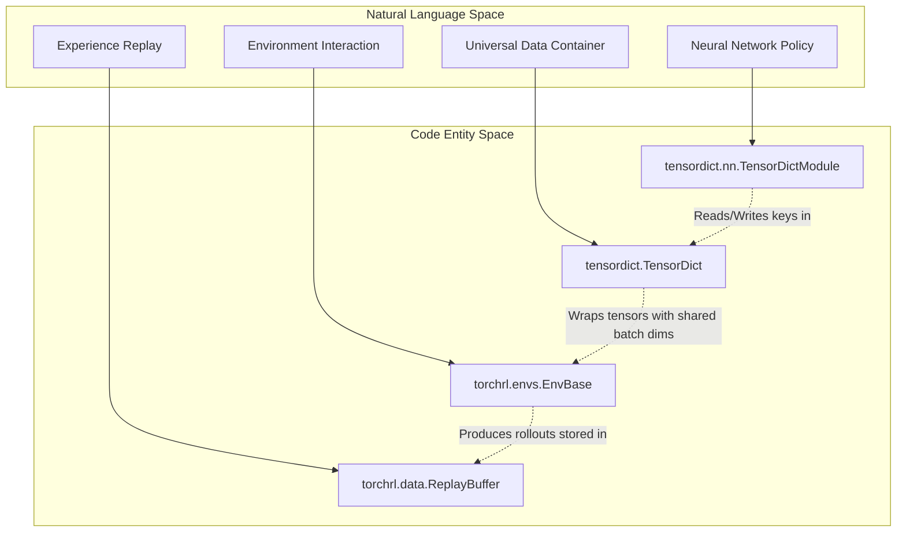
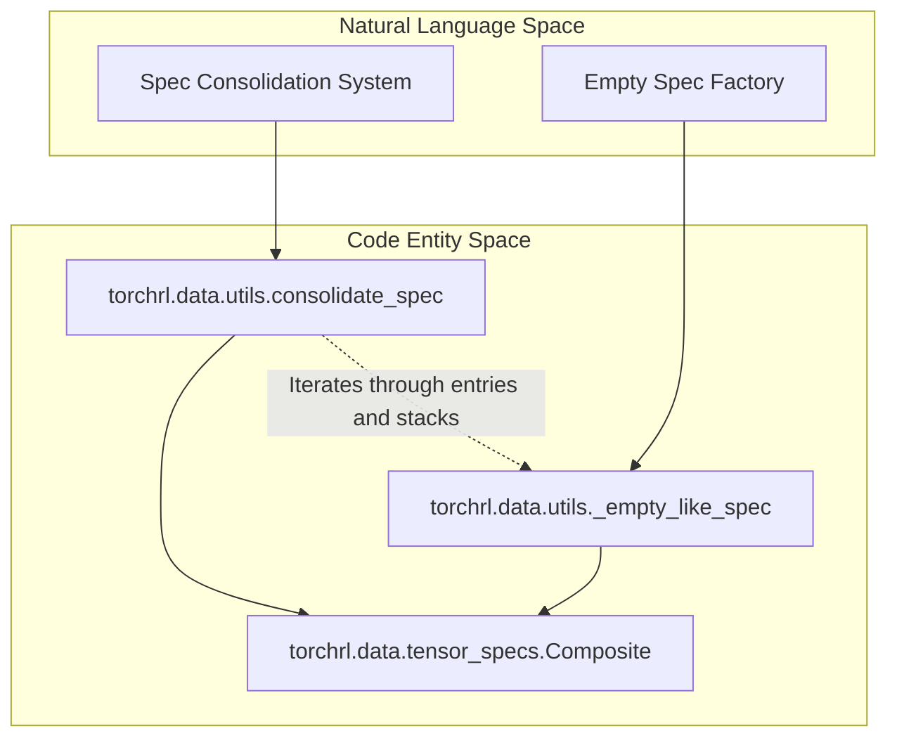

<!-- source: DeepWiki mcp.deepwiki.com · repo pytorch/rl · page 2.1 TensorDict System · fetched 2026-10-21 -->

# TensorDict System

<details>
<summary>Relevant source files</summary>

The following files were used as context for generating this wiki page:

- [.github/workflows/docs.yml](.github/workflows/docs.yml)
- [README.md](README.md)
- [docs/requirements.txt](docs/requirements.txt)
- [docs/source/conf.py](docs/source/conf.py)
- [docs/source/index.rst](docs/source/index.rst)
- [docs/source/reference/objectives.rst](docs/source/reference/objectives.rst)
- [docs/source/reference/objectives_other.rst](docs/source/reference/objectives_other.rst)
- [torchrl/data/utils.py](torchrl/data/utils.py)
- [torchrl/objectives/__init__.py](torchrl/objectives/__init__.py)

</details>


## Purpose and Scope

This document details **TensorDict** as TorchRL's universal data container, its core operations, and how it enables composable, type-safe reinforcement learning components. TensorDict is a dictionary-like tensor container provided by the [`tensordict`](https://github.com/pytorch/tensordict/) library and used across TorchRL for environment states, observations, actions, rewards, and multi-agent rollouts [README.md:42-44]().

This page covers:
- TensorDict's structural invariants (batch size consistency and nested keys)
- Core tensor operations (indexing, stacking, concatenation, device transfers)
- Composable module integration via `in_keys` and `out_keys` (`tensordict.nn.TensorDictModule`) [README.md:104-114]()
- Data flow across environments (`EnvBase`), collectors, replay buffers, and loss modules
- Utility functions for spec manipulation and consolidation (`torchrl/data/utils.py`) [torchrl/data/utils.py:74-183]()

For the type validation system that verifies TensorDict contents, refer to [TensorSpec System](#2.2).

---

## What is TensorDict

TensorDict provides a dictionary-like interface where values are PyTorch tensors or nested TensorDicts sharing a common leading batch dimension. This design removes ad-hoc tuple or dictionary unpacking glue code in RL pipelines [README.md:85-88]().

### System Architecture and Code Entity Mapping

The following diagram bridges the natural language concept of the universal data container to its concrete code entities and files across TorchRL:



Sources: `README.md:31-45`, `torchrl/objectives/__init__.py:9`

---

## Core Concepts

### Batch Dimensions and Nested Keys

Every TensorDict maintains a `batch_size` attribute (a `torch.Size` tuple). All top-level and nested tensors must have leading dimensions matching or broadcasting with this batch size. Hierarchical organization is achieved via tuple keys (e.g., `("next", "observation")` or `("agents", "agent_0", "action")`) [README.md:75-87]().

---

## Key Operations and Utilities

TensorDict supports standard PyTorch operations while preserving dictionary keys:
- **Indexing and Slicing**: Returns zero-copy views (`td[0]`, `td[5:10]`) [README.md:136-142]()
- **Stacking and Concatenation**: `torch.stack([td1, td2], dim=0)` and `torch.cat([td1, td2], dim=0)`
- **Device Transfers**: `td.to("cuda")` moves all contained tensors simultaneously

### Spec Consolidation Utilities

When working with lazy stacked containers or heterogeneous environment observations, TorchRL provides utility functions in `torchrl/data/utils.py` to normalize and consolidate composite specs [torchrl/data/utils.py:74-139]().



Sources: `torchrl/data/utils.py:74-183`

---

## Integration with TorchRL Modules

Modules interface with TensorDict via `in_keys` and `out_keys`. A `TensorDictModule` reads specified input keys, applies an underlying `nn.Module`, and writes outputs back into the same TensorDict in-place [README.md:104-114]().

```python
policy = TensorDictModule(
    nn.Sequential(nn.LazyLinear(64), nn.Tanh(), nn.Linear(64, 1)),
    in_keys=["observation"],
    out_keys=["action"],
)
```

Sources: `README.md:104-114`

---

## Role in Data Flow

TensorDict flows through the primary pillars of TorchRL:
1. **Environments (`EnvBase`)**: `reset()` returns a TensorDict observation; `step()` accepts an action TensorDict and returns a nested `("next", ...)` TensorDict [README.md:75-82]().
2. **Collectors**: Aggregate trajectories across environments into multi-dimensional rollout TensorDicts [README.md:78]().
3. **Replay Buffers**: Store and sample batches of TensorDicts [README.md:79]().
4. **Loss Modules**: Consume sampled batches, read named keys, and output differentiable loss values [README.md:80]().

Sources: `README.md:71-82`, `docs/source/reference/objectives.rst:8-19`

---

## Summary

TensorDict serves as the universal data container across TorchRL, providing shape consistency, nested hierarchy via tuple keys, zero-copy slicing, and seamless integration with `TensorDictModule` and `LossModule`.

Sources: `README.md:31-45`, `torchrl/data/utils.py:74-183`, `docs/source/reference/objectives.rst:8-19`

---

