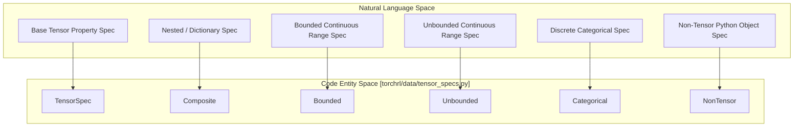
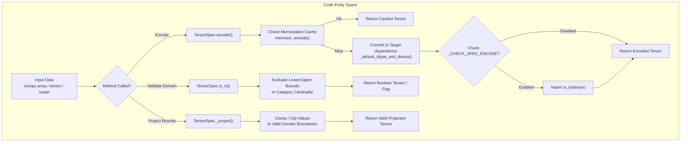
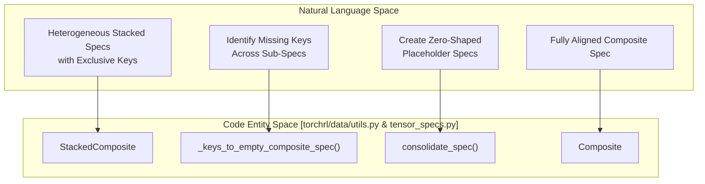
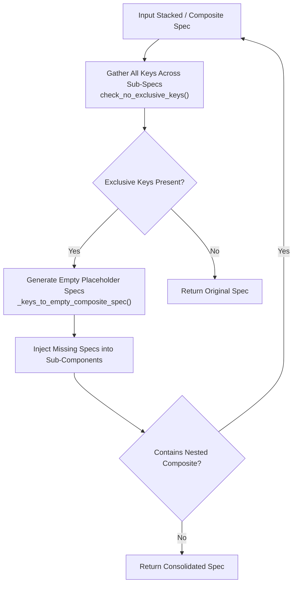
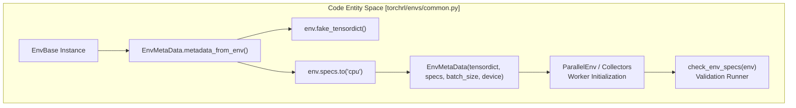

<!-- source: DeepWiki mcp.deepwiki.com · repo pytorch/rl · page 2.2 TensorSpec System · fetched 2026-10-21 -->

# TensorSpec System

Relevant source files

The following files were used as context for generating this wiki page:

- [docs/source/reference/data_specs.rst](docs/source/reference/data_specs.rst)
- [test/test_specs.py](test/test_specs.py)
- [test/test_utils.py](test/test_utils.py)
- [test/transforms/test_module_transforms.py](test/transforms/test_module_transforms.py)
- [torchrl/_utils.py](torchrl/_utils.py)
- [torchrl/collectors/collectors.py](torchrl/collectors/collectors.py)
- [torchrl/data/tensor_specs.py](torchrl/data/tensor_specs.py)
- [torchrl/envs/batched_envs.py](torchrl/envs/batched_envs.py)
- [torchrl/envs/common.py](torchrl/envs/common.py)
- [torchrl/envs/gym_like.py](torchrl/envs/gym_like.py)
- [torchrl/envs/libs/gym.py](torchrl/envs/libs/gym.py)
- [torchrl/envs/llm/transforms/browser.py](torchrl/envs/llm/transforms/browser.py)
- [torchrl/envs/llm/transforms/tools.py](torchrl/envs/llm/transforms/tools.py)
- [torchrl/envs/transforms/module.py](torchrl/envs/transforms/module.py)
- [torchrl/envs/transforms/ray_service.py](torchrl/envs/transforms/ray_service.py)
- [torchrl/envs/transforms/transforms.py](torchrl/envs/transforms/transforms.py)
- [torchrl/envs/transforms/utils.py](torchrl/envs/transforms/utils.py)
- [torchrl/envs/utils.py](torchrl/envs/utils.py)
- [torchrl/testing/modules.py](torchrl/testing/modules.py)
- [tutorials/sphinx-tutorials/llm_browser.py](tutorials/sphinx-tutorials/llm_browser.py)

## Purpose and Scope

The TensorSpec system provides a type-checking, property-definition, and data-validation framework across TorchRL environments, collectors, replay buffers, and neural network modules. `TensorSpec` subclasses define shapes, dtypes, and domain boundaries (such as continuous bounds or discrete categories) for tensor and non-tensor data. This page details the implementation of spec classes, encoding and validation pipelines, memoization strategies, spec consolidation for batched and stacked structures, and integration with environment metadata.

---

## TensorSpec Core Hierarchy and Base Classes

The foundation of the type system is the abstract base class `TensorSpec` in `torchrl/data/tensor_specs.py`. Specialized subclasses extend this base class to represent continuous spaces, discrete categories, binary flags, composite dictionaries, and non-tensor data structures.

### Hierarchy Bridge: Natural Language Space to Code Entity Space

Sources: [torchrl/data/tensor_specs.py:1-41]()

### Key Classes and Roles

- `TensorSpec`: Abstract base class defining shape, device, dtype, and abstract methods like `is_in()`, `encode()`, `rand()`, and `to_numpy()` [torchrl/data/tensor_specs.py:1-120]().
- `Bounded`: Represents continuous tensor domains constrained between lower and upper bounds. Supports projection via `_project()` and random sampling within bounds [test/test_specs.py:52-79]().
- `Unbounded`: Represents unconstrained continuous domains across arbitrary dtypes and shapes [test/test_specs.py:107-124]().
- `Categorical`: Represents discrete integer choices up to a given cardinality [test/test_specs.py:80-106]().
- `Composite`: Manages nested mappings of `TensorSpec` instances, mirroring `TensorDict` data structures [torchrl/envs/common.py:39-45]().
- `NonTensor`: Handles non-tensor Python objects and metadata within spec hierarchies [test/test_specs.py:35]().

Sources: [torchrl/data/tensor_specs.py:1-41](), [test/test_specs.py:25-41]()

---

## Data Validation and Encoding Pipeline

`TensorSpec` implementations provide methods for validating domain membership (`is_in`), converting external data formats into tensors (`encode`), and projecting out-of-bounds values back into valid domains (`_project`).

### Validation and Encoding Flow

Sources: [torchrl/data/tensor_specs.py:77-126](), [test/test_specs.py:52-106]()

### Core Validation Methods

- `encode(val)`: Converts numpy arrays, lists, or scalars to torch tensors matching the spec's dtype, shape, and device, optionally verifying bounds if `_CHECK_SPEC_ENCODE` is active [test/test_specs.py:70-78]().
- `is_in(val)`: Checks whether a tensor or value falls strictly within the defined domain boundaries [test/test_specs.py:72]().
- `memoize_encode(memo: bool)`: Toggles caching on encoding operations to accelerate repeated conversions of identical numpy structures [test/test_specs.py:56-78]().

Sources: [torchrl/data/tensor_specs.py:77-79](), [test/test_specs.py:52-106]()

---

## Spec Consolidation and Batched Specifications

When handling vectorized environments or heterogeneous parallel rollouts, sub-environments can expose differing keys within their observation or action specs. The consolidation system aligns these specifications.

### Consolidation Bridge: Natural Language Space to Code Entity Space

Sources: [test/test_specs.py:25-42]()

### Consolidation Algorithm

The `consolidate_spec` utility ensures uniform keys across stacked specifications by inspecting all sub-specs, identifying keys present in only a subset of members, and injecting zero-shaped placeholder specs for missing entries.

Sources: [test/test_specs.py:25-42]()

---

## Environment Integration and Metadata

Specifications act as the schema contract for `EnvBase` environments. They govern observation, action, reward, and state spaces, validated during environment initialization or rollout generation.

### Environment Metadata and Specification Validation

`EnvMetaData` captures environment specs, batch dimensions, and device mappings to serialize environment configuration across multiprocessing workers and parallel collectors [torchrl/envs/common.py:124-217]().

Sources: [torchrl/envs/common.py:124-217](), [torchrl/envs/utils.py:56]()

### Key Integration Utilities

- `EnvMetaData`: Stores environment structure, batch sizes, and device topologies for transfer to subprocess workers [torchrl/envs/common.py:124-148]().
- `metadata_from_env(env)`: Instantiates a fake rollout trajectory using `fake_tensordict()` to infer and extract all specification boundaries [torchrl/envs/common.py:180-216]().
- `check_env_specs(env)`: Validates that environment step and reset operations conform strictly to declared observation and action specifications [torchrl/envs/utils.py:56]().

Sources: [torchrl/envs/common.py:124-217](), [torchrl/envs/utils.py:56]()

---

