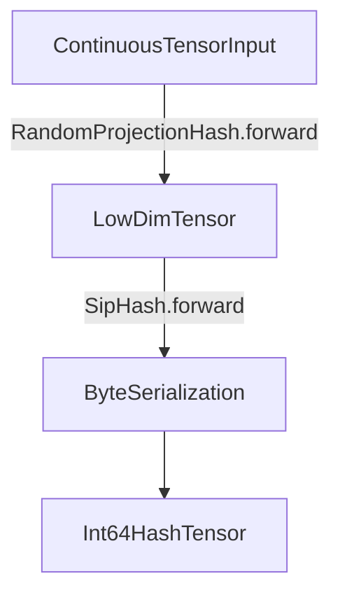
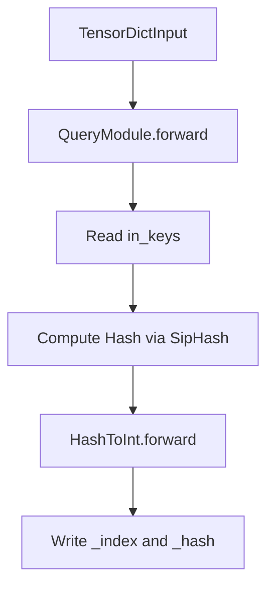
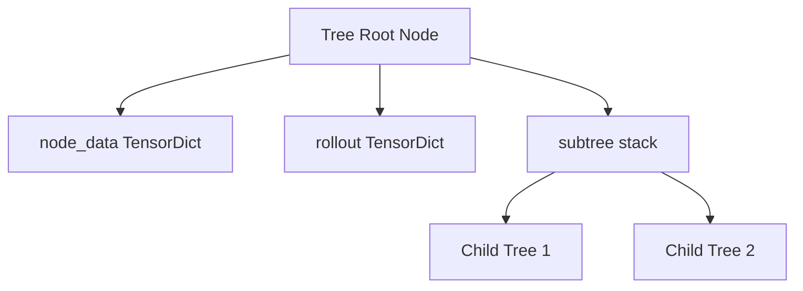

<!-- source: DeepWiki mcp.deepwiki.com · repo pytorch/rl · page 2.3 MCTS Forests and Tensor Maps · fetched 2026-10-21 -->

# MCTS Forests and Tensor Maps

Relevant source files

The following files were used as context for generating this wiki page:

- [docs/source/_static/img/mcts_forest.png](docs/source/_static/img/mcts_forest.png)
- [torchrl/data/datasets/common.py](torchrl/data/datasets/common.py)
- [torchrl/data/llm/__init__.py](torchrl/data/llm/__init__.py)
- [torchrl/data/llm/utils.py](torchrl/data/llm/utils.py)
- [torchrl/data/map/__init__.py](torchrl/data/map/__init__.py)
- [torchrl/data/map/hash.py](torchrl/data/map/hash.py)
- [torchrl/data/map/query.py](torchrl/data/map/query.py)
- [torchrl/data/map/tdstorage.py](torchrl/data/map/tdstorage.py)
- [torchrl/data/map/tree.py](torchrl/data/map/tree.py)
- [torchrl/data/map/utils.py](torchrl/data/map/utils.py)

## Purpose and Scope
This page documents the components under `torchrl/data/map`, which provide state-action hashing, storage indexing, and Monte Carlo Tree Search (MCTS) tree and forest structures built on top of the `TensorDict` and `TensorClass` ecosystems. These modules enable efficient state lookup, replay mapping, and tree-based planning algorithms within TorchRL.

---

## 1. Hashing and Feature Transformation
The hashing submodule (`torchrl/data/map/hash.py`) provides neural network modules designed to convert continuous or discrete tensor observations and states into hash values or compact representations suitable for dictionary-like lookups.

- **`BinaryToDecimal`**: Converts binary-encoded tensors into decimal integer representations [torchrl/data/map/hash.py:13-40](). It reshapes features and uses dot products over pre-computed bases to aggregate bits [torchrl/data/map/hash.py:54-72]().
- **`SipHash`**: Computes `SipHash` values for given input tensors [torchrl/data/map/hash.py:75-80](). It serializes input batches into byte strings and maps them via Python's built-in `hash` function into `int64` tensors [torchrl/data/map/hash.py:106-116]().
- **`RandomProjectionHash`**: Combines random projections with `SipHash` to project high-dimensional inputs into a low-dimensional space before hashing [torchrl/data/map/hash.py:119-138]().

Sources: `torchrl/data/map/hash.py:13-171()`

---

## 2. Query Modules and Indexing
Query modules (`torchrl/data/map/query.py`) bridge raw `TensorDict` inputs with storage indices by orchestrating hashing and mapping steps.

- **`HashToInt`**: Statefully maps hash integer values to contiguous non-negative integer indices used for indexing storage backends [torchrl/data/map/query.py:23-42](). It maintains an internal `_index_to_index` mapping dictionary and supports state saving/loading [torchrl/data/map/query.py:28-57]().
- **`QueryModule`**: A `TensorDictModuleBase` subclass that reads specified `in_keys` from a `TensorDict`, computes hashes via `hash_module` or `aggregator`, and converts them to storage indices via `hash_to_int` [torchrl/data/map/query.py:59-124](). The resulting index and hash are written back to designated output keys (`index_key` and `hash_key`) [torchrl/data/map/query.py:117-134]().

Sources: `torchrl/data/map/query.py:23-165()`

---

## 3. TensorDictMap and Storages
The `torchrl/data/map/tdstorage.py` module defines abstract and concrete map storages for `TensorDict` objects.

- **`TensorMap`**: An abstract base class defining the interface (`clear`, `__getitem__`, `__setitem__`, `__len__`, `contains`) for key-value maps [torchrl/data/map/tdstorage.py:29-57]().
- **`TensorDictMap`**: A `TensorDictModuleBase` and `TensorMap` implementation that combines a `QueryModule` with one or more tensor storage backends (e.g., `TensorStorage`, `LazyTensorStorage`) [torchrl/data/map/tdstorage.py:59-136](). It allows indexing storage data directly using structured `TensorDict` query keys [torchrl/data/map/tdstorage.py:93-116]().

Sources: `torchrl/data/map/tdstorage.py:29-190()`

---

## 4. MCTS Trees and Forests
The `torchrl/data/map/tree.py` module implements data structures for Monte Carlo Tree Search algorithms using `TensorClass`.

- **`Tree`**: Represents a single MCTS node or tree structure [torchrl/data/map/tree.py:30-43](). Key attributes include:
  - `count`: Visit count [torchrl/data/map/tree.py:77]()
  - `wins`: Cumulative reward or win statistic [torchrl/data/map/tree.py:78]()
  - `index`: Child node indices in the data map [torchrl/data/map/tree.py:80]()
  - `hash`: Unique hash for the node state-action pair [torchrl/data/map/tree.py:82]()
  - `rollout`: Trajectory rollout data following the node observation [torchrl/data/map/tree.py:85-86]()
  - `node_data`: Tensor data defining the node state before branching [torchrl/data/map/tree.py:89]()
  - `subtree`: Stack of subtrees representing branches taken from actions [torchrl/data/map/tree.py:91-92]()
  - `_parent`: Weak reference(s) to parent nodes [torchrl/data/map/tree.py:95]()
- **`Tree.make_node`**: Class method that initializes a new `Tree` instance from rollout data or observation tensordicts [torchrl/data/map/tree.py:105-132]().

Sources: `torchrl/data/map/tree.py:30-132()`

---

