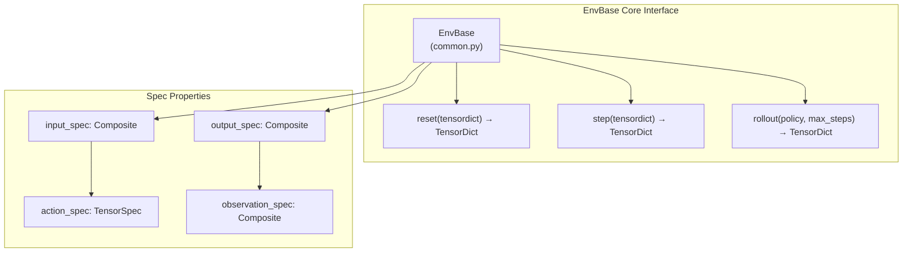
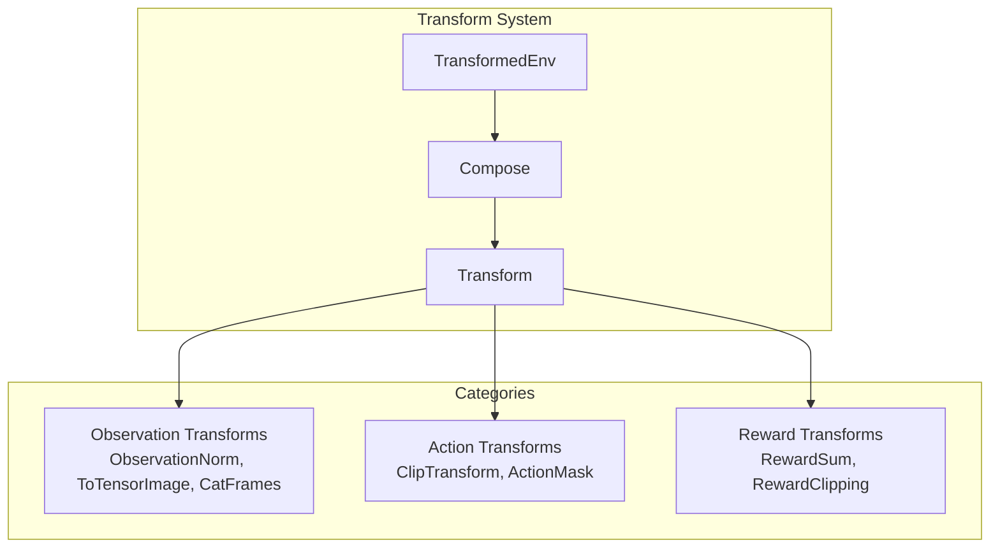
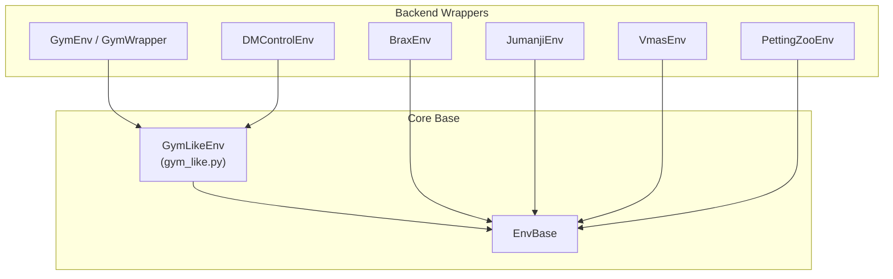
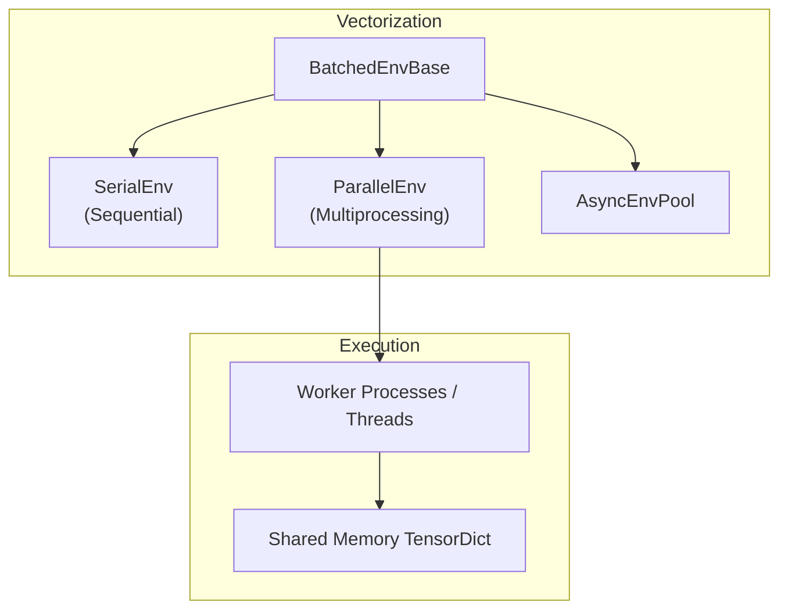

<!-- source: DeepWiki mcp.deepwiki.com · repo pytorch/rl · page 3 Environments · fetched 2026-10-21 -->

# Environments

Relevant source files

The following files were used as context for generating this wiki page:

- [docs/source/reference/envs.rst](docs/source/reference/envs.rst)
- [docs/source/reference/envs_transforms.rst](docs/source/reference/envs_transforms.rst)
- [test/test_specs.py](test/test_specs.py)
- [test/test_utils.py](test/test_utils.py)
- [test/transforms/test_action_transforms.py](test/transforms/test_action_transforms.py)
- [torchrl/_utils.py](torchrl/_utils.py)
- [torchrl/collectors/collectors.py](torchrl/collectors/collectors.py)
- [torchrl/data/tensor_specs.py](torchrl/data/tensor_specs.py)
- [torchrl/envs/__init__.py](torchrl/envs/__init__.py)
- [torchrl/envs/batched_envs.py](torchrl/envs/batched_envs.py)
- [torchrl/envs/common.py](torchrl/envs/common.py)
- [torchrl/envs/gym_like.py](torchrl/envs/gym_like.py)
- [torchrl/envs/libs/gym.py](torchrl/envs/libs/gym.py)
- [torchrl/envs/transforms/__init__.py](torchrl/envs/transforms/__init__.py)
- [torchrl/envs/transforms/_action.py](torchrl/envs/transforms/_action.py)
- [torchrl/envs/transforms/transforms.py](torchrl/envs/transforms/transforms.py)
- [torchrl/envs/utils.py](torchrl/envs/utils.py)
- [torchrl/trainers/algorithms/configs/transforms.py](torchrl/trainers/algorithms/configs/transforms.py)

## Purpose and Scope

This page provides an overview of TorchRL's environment abstraction layer, which enables uniform interaction with reinforcement learning environments from different backends (Gym, DMControl, Brax, etc.). The environment system is built around foundational base classes, a robust specification system, transform pipelines, backend wrappers, and vectorized execution engines.

**Scoping Note:** As a parent page, this section introduces high-level concepts and architecture. For deep technical details, refer to the following child pages:
- For `EnvBase` internals, the reset/step/rollout interface, and the `TensorSpec` system, see [EnvBase and Environment Specifications](#3.1).
- For the `Transform` system, `TransformedEnv`, and the `Compose` pattern, see [Environment Transforms](#3.2).
- For integrations with external libraries like Gym/Gymnasium, DMControl, Brax, Jumanji, VMAS, and others, see [Backend Integrations](#3.3).
- For vectorized execution via `ParallelEnv`, `SerialEnv`, `AsyncEnvPool`, and shared memory management, see [Batched and Parallel Environments](#3.4).
- For built-in and custom environments such as Pendulum, Chess, TicTacToe, and model-based/Dreamer environments, see [Custom and Built-in Environments](#3.5).

Sources: [torchrl/envs/common.py:1-220](), [torchrl/envs/transforms/transforms.py:1-39]()

## Overview

TorchRL's environment system provides a unified API for interacting with RL environments regardless of their underlying implementation. All environments inherit from `EnvBase` [torchrl/envs/common.py:8()]() and communicate using `TensorDict` objects, which serve as the universal data container throughout the library. This design allows environments to handle arbitrary numbers of inputs and outputs, nested data structures, and batched execution without changing the interface.

The environment system consists of core abstraction layers:
1. **Base Layer**: `EnvBase` defines the core interface (`reset()`, `step()`, `rollout()`) and manages environment specifications. For details, see [EnvBase and Environment Specifications](#3.1).
2. **Transform Layer**: `Transform` and `TransformedEnv` modify environment behavior by preprocessing observations, shaping rewards, or altering actions. For details, see [Environment Transforms](#3.2).
3. **Backend Layer**: Wrapper classes adapt external environment libraries to the TorchRL interface. For details, see [Backend Integrations](#3.3).
4. **Batching Layer**: `ParallelEnv` and `SerialEnv` enable vectorized execution of multiple environment instances. For details, see [Batched and Parallel Environments](#3.4).
5. **Custom and Built-in Environments**: Native PyTorch implementations and model-based environments. For details, see [Custom and Built-in Environments](#3.5).

Sources: [torchrl/envs/common.py:1-220](), [torchrl/envs/batched_envs.py:1-50]()

## EnvBase and Environment Specifications

`EnvBase` is the abstract base class that all TorchRL environments inherit from [torchrl/envs/common.py:8()](). It defines the contract for state management, execution control, and specification handling. Every environment maintains `input_spec` and `output_spec` dictionaries built from `TensorSpec` subclasses (such as `Bounded`, `Unbounded`, `Categorical`, and `Composite`) [torchrl/data/tensor_specs.py:25-45](). These specifications validate data types, shapes, and domains during environment interactions.

For detailed documentation on the `EnvBase` API, reset/step semantics, rollout generation, and specification validation, see [EnvBase and Environment Specifications](#3.1).

Sources: [torchrl/envs/common.py:1-220](), [torchrl/data/tensor_specs.py:25-45]()

## Environment Transforms

The transform system enables modular preprocessing of environment interactions without modifying the underlying simulation code. `TransformedEnv` wraps any `EnvBase` instance with one or more `Transform` objects using the `Compose` pattern [torchrl/envs/transforms/transforms.py:27-39](). Transforms can modify observations (e.g., normalization, resizing), actions (e.g., clipping, masking), and rewards (e.g., scaling, accumulation) while automatically keeping the environment specs in sync.

For comprehensive guides on observation, action, and reward transforms, custom transform implementation, and spec transformation rules, see [Environment Transforms](#3.2).

Sources: [torchrl/envs/transforms/transforms.py:27-39]()

## Backend Integrations

TorchRL provides extensive integration wrappers for popular RL libraries and simulation backends [docs/source/reference/envs.rst:8-10](). Wrappers like `GymEnv`, `DMControlEnv`, `BraxEnv`, `JumanjiEnv`, `VmasEnv`, and `PettingZooEnv` bridge external environment APIs to TorchRL's unified `EnvBase` interface [torchrl/envs/__init__.py:45-95](). They handle automatic spec conversion, tensor device placement, and info dictionary extraction via `GymLikeEnv` and `BaseInfoDictReader` [torchrl/envs/gym_like.py:26-40]().

For detailed instructions on backend-specific setup, wrapper configurations, and data conversion utilities, see [Backend Integrations](#3.3).

Sources: [torchrl/envs/gym_like.py:26-40](), [torchrl/envs/__init__.py:45-95](), [docs/source/reference/envs.rst:8-10]()

## Batched and Parallel Environments

To maximize data collection throughput, TorchRL supports vectorized environment execution through `SerialEnv`, `ParallelEnv`, and `AsyncEnvPool` [torchrl/envs/__init__.py:6-7](). These classes execute multiple environment instances concurrently either across subprocesses or threads, presenting a single batched environment interface with an expanded batch dimension. Shared memory management ensures zero-copy or low-overhead tensor transfer between worker processes.

For in-depth explanations of vectorization strategies, start methods, worker coordination, and memory sharing, see [Batched and Parallel Environments](#3.4).

Sources: [torchrl/envs/__init__.py:6-7](), [torchrl/envs/batched_envs.py:1-50]()

## Custom and Built-in Environments

TorchRL includes a rich set of built-in environments implemented natively in PyTorch, ranging from classic control tasks (Pendulum) and board games (TicTacToe, Chess) to complex continuous control domains (MuJoCo microduck and cube-bowl tasks) and model-based environment blocks [torchrl/envs/__init__.py:9-30]() [torchrl/envs/__init__.py:96-102](). These environments serve as self-contained benchmarks and testing grounds for reinforcement learning algorithms without requiring external library dependencies.

For detailed documentation on built-in task suites, environment creation helpers, and model-based environment wrappers, see [Custom and Built-in Environments](#3.5).

Sources: [torchrl/envs/__init__.py:9-30](), [torchrl/envs/__init__.py:96-102]()

---

