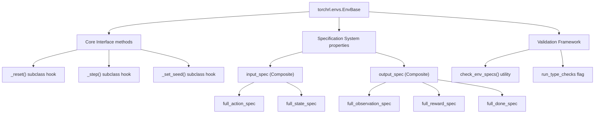
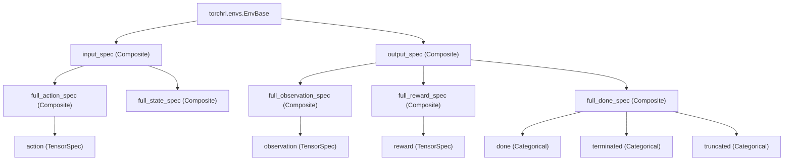

<!-- source: DeepWiki mcp.deepwiki.com · repo pytorch/rl · page 3.1 EnvBase and Environment Specifications · fetched 2026-10-21 -->

# EnvBase and Environment Specifications

<details>
<summary>Relevant source files</summary>

The following files were used as context for generating this wiki page:

- [benchmarks/test_storage_write_benchmark.py](benchmarks/test_storage_write_benchmark.py)
- [test/envs/test_env_base.py](test/envs/test_env_base.py)
- [test/envs/test_model_based.py](test/envs/test_model_based.py)
- [test/libs/test_isaac.py](test/libs/test_isaac.py)
- [test/modules/test_qvalue_actor.py](test/modules/test_qvalue_actor.py)
- [test/objectives/test_dreamer.py](test/objectives/test_dreamer.py)
- [test/test_specs.py](test/test_specs.py)
- [test/test_utils.py](test/test_utils.py)
- [torchrl/_utils.py](torchrl/_utils.py)
- [torchrl/collectors/collectors.py](torchrl/collectors/collectors.py)
- [torchrl/data/tensor_specs.py](torchrl/data/tensor_specs.py)
- [torchrl/envs/batched_envs.py](torchrl/envs/batched_envs.py)
- [torchrl/envs/common.py](torchrl/envs/common.py)
- [torchrl/envs/env_creator.py](torchrl/envs/env_creator.py)
- [torchrl/envs/gym_like.py](torchrl/envs/gym_like.py)
- [torchrl/envs/libs/gym.py](torchrl/envs/libs/gym.py)
- [torchrl/envs/libs/isaac_lab.py](torchrl/envs/libs/isaac_lab.py)
- [torchrl/envs/transforms/transforms.py](torchrl/envs/transforms/transforms.py)
- [torchrl/envs/utils.py](torchrl/envs/utils.py)
- [torchrl/testing/__init__.py](torchrl/testing/__init__.py)
- [torchrl/testing/env_helper.py](torchrl/testing/env_helper.py)
- [torchrl/testing/mocking_classes.py](torchrl/testing/mocking_classes.py)

</details>


This page documents `EnvBase`, the foundational abstract class for all environments in TorchRL, and the specification system that enables type-safe, validated environment interactions.

## Overview

`EnvBase` is an abstract base class (subclass of `torch.nn.Module`) defined in `torch.envs.common` that defines the standard interface all TorchRL environments must implement [torchrl/envs/common.py:314](). It provides three key components:

1. **Core Interface**: Abstract methods `_reset()`, `_step()`, and `_set_seed()` that subclasses must implement [torchrl/envs/common.py:1579-1641]()
2. **Specification System**: Comprehensive `TensorSpec` objects that define the structure, dtype, shape, and constraints of all environment inputs/outputs [torchrl/envs/common.py:510-538]()
3. **Validation Framework**: Automatic validation of data against specs via `run_type_checks` and `check_env_specs()` [torchrl/envs/common.py:481-543](), [torchrl/envs/utils.py:653-909]()

All data exchange uses `TensorDict` as the standardized container, enabling consistent behavior across different environment types.



*EnvBase Architecture: Mapping Natural Language Concepts to Code Entities (`torchrl.envs.EnvBase`, `_reset`, `_step`, `input_spec`, `output_spec`)*

Sources: [torchrl/envs/common.py:314-475](), [torchrl/envs/common.py:481-543]()

## EnvBase Class Definition

`EnvBase` inherits from `torch.nn.Module` and utilizes the `_EnvPostInit` metaclass [torchrl/envs/common.py:258-311]() to perform post-initialization tasks such as locking specs and validating key consistency.

### Constructor Arguments

```python
EnvBase(
    device: DEVICE_TYPING | None = None,
    batch_size: tuple | torch.Size | None = None,
    run_type_checks: bool = False,
    allow_done_after_reset: bool = False,
    spec_locked: bool = True,
    auto_reset: bool = False,
)
```

Key initialization parameters accepted by `EnvBase.__init__`:
- `device`: Device where input/output tensors should reside [torchrl/envs/common.py:481-543]()
- `batch_size`: Leading dimensions for batched environments [torchrl/envs/common.py:481-543]()
- `run_type_checks`: If `True`, performs dtype/shape validation on every `reset()` and `step()` [torchrl/envs/common.py:481-543]()
- `spec_locked`: If `True`, specs are locked and cached for performance [torchrl/envs/common.py:562-606]()
- `auto_reset`: If `True`, automatically wraps the environment in an auto-reset mechanism [torchrl/envs/common.py:258-311]()

Sources: [torchrl/envs/common.py:481-543]()

### Abstract Methods (Must Implement)

Subclasses must implement three abstract methods as part of their backend integration:

| Method | Signature | Purpose |
|--------|-----------|---------|
| `_reset()` | `_reset(self, tensordict: TensorDictBase, **kwargs) -> TensorDictBase` | Initialize or reinitialize the environment and return initial observations [torchrl/envs/common.py:1579-1641]() |
| `_step()` | `_step(self, tensordict: TensorDictBase) -> TensorDictBase` | Execute one step given actions and return next observations, rewards, and done flags [torchrl/envs/common.py:1579-1641]() |
| `_set_seed()` | `_set_seed(self, seed: int \| None) -> None` | Set the random seed of the environment for reproducibility [torchrl/envs/common.py:1579-1641]() |

Sources: [torchrl/envs/common.py:1579-1641]()

### Public Interface Methods

Public methods invoked by users and collectors that wrap the abstract methods with validation and preprocessing:

| Method | Purpose |
|--------|---------|
| `reset(tensordict=None, **kwargs)` | Public reset method with validation and post-processing [torchrl/envs/common.py:1579-2057]() |
| `step(tensordict)` | Public step method with input validation and key routing [torchrl/envs/common.py:1579-2057]() |
| `rollout(max_steps, policy, ...)` | Execute a multi-step rollout trajectory using a given policy [torchrl/envs/common.py:1579-2057]() |
| `set_seed(seed)` | Set the seed and return the next seed value for distributed chains [torchrl/envs/common.py:1579-2057]() |
| `rand_step(tensordict=None)` | Execute a step using a randomly sampled action from `action_spec` [torchrl/envs/common.py:1579-2057]() |
| `step_and_maybe_reset(tensordict)` | Step the environment and automatically reset any terminated sub-environments [torchrl/envs/common.py:1579-2057]() |

Sources: [torchrl/envs/common.py:1579-2057]()

## Environment Specifications

The specification system defines and validates the structure of environment inputs and outputs using `Composite` and `TensorSpec` instances [torchrl/envs/common.py:510-538]().

### Specification Hierarchy



*Specification Hierarchy and Code Structures (`input_spec`, `output_spec`, `Composite`, `TensorSpec`)*

Sources: [torchrl/envs/common.py:510-538](), [torchrl/envs/common.py:901-1119]()

### Spec Properties

`EnvBase` exposes property accessors for managing specs [torchrl/envs/common.py:901-1119]():

| Property | Type | Description |
|----------|------|-------------|
| `input_spec` | `Composite` | Parent spec containing all input specs |
| `output_spec` | `Composite` | Parent spec containing all output specs |
| `full_action_spec` | `Composite` | All action tensor specs |
| `full_state_spec` | `Composite` | All state tensor specs (non-action inputs) |
| `full_observation_spec` | `Composite` | All observation tensor specs |
| `full_reward_spec` | `Composite` | All reward tensor specs |
| `full_done_spec` | `Composite` | All done signal specs (`done`, `terminated`, `truncated`) |

Convenience properties return single leaf specs when unambiguous:
- `action_spec`: Leaf action spec if single action, otherwise `full_action_spec` [torchrl/envs/common.py:901-1119]()
- `observation_spec`: Leaf observation spec if single observation, otherwise `full_observation_spec` [torchrl/envs/common.py:901-1119]()
- `reward_spec`: Leaf reward spec if single reward, otherwise `full_reward_spec` [torchrl/envs/common.py:901-1119]()
- `done_spec`: Returns `full_done_spec` [torchrl/envs/common.py:901-1119]()
- `state_spec`: Returns `full_state_spec` [torchrl/envs/common.py:901-1119]()

Sources: [torchrl/envs/common.py:901-1119]()

### Spec Locking and Caching

Specifications are locked by default (`spec_locked=True`) to cache derived properties and prevent unauthorized modifications [torchrl/envs/common.py:562-606](). Modifying specs requires temporarily disabling the lock using `set_spec_lock_(False)` [torchrl/envs/common.py:562-606](). Caching is managed via `@_cache_value` [torchrl/envs/common.py:90-104]() and `@_clear_cache_when_set` [torchrl/envs/common.py:107-121]() decorators.

Sources: [torchrl/envs/common.py:562-606](), [torchrl/envs/common.py:88-121]()

## Spec Validation

Validation can be executed dynamically or statically:
- **Runtime Validation**: Enabled via `run_type_checks=True` in the constructor, validating tensors on every `reset()` and `step()` [torchrl/envs/common.py:481-543]().
- **Static Validation**: Performed using `check_env_specs(env)` from `torchrl.envs.utils`, which executes test rollouts and verifies shapes, dtypes, and bounds [torchrl/envs/utils.py:653-909]().

Sources: [torchrl/envs/common.py:481-543](), [torchrl/envs/utils.py:653-909]()

## EnvMetaData and Metaclass Initialization

`EnvMetaData` stores environment metadata (`tensordict`, `specs`, `batch_size`, `device`, etc.) for passing across multiprocessing boundaries in parallel environments [torchrl/envs/common.py:122-256](). The `_EnvPostInit` metaclass handles post-initialization configuration, spec locking, and done-spec creation [torchrl/envs/common.py:258-311]().

Sources: [torchrl/envs/common.py:122-256](), [torchrl/envs/common.py:258-311]()

---

