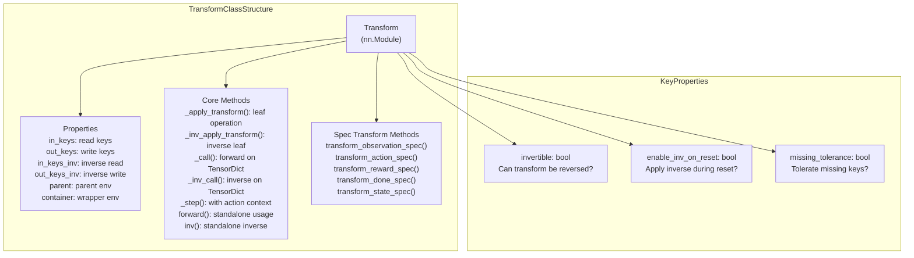
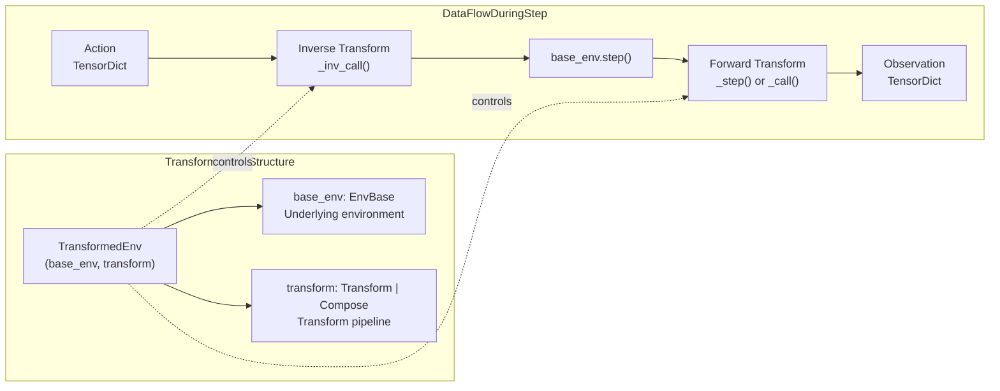
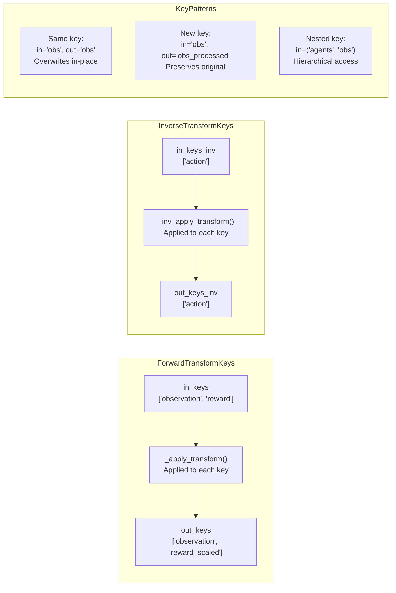
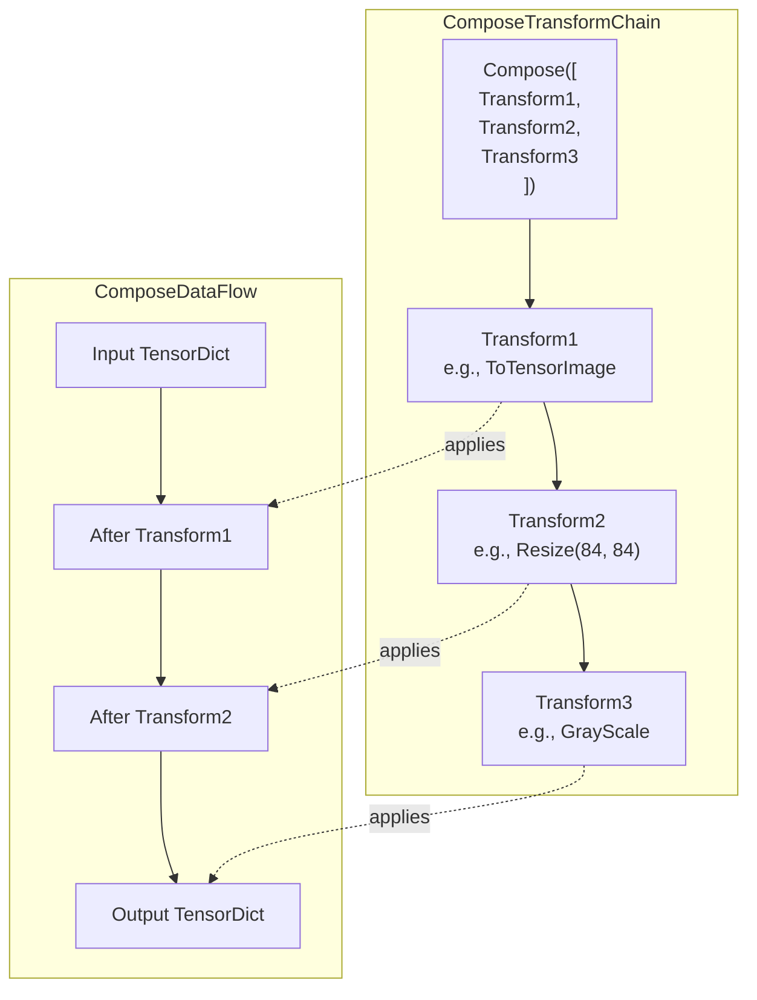
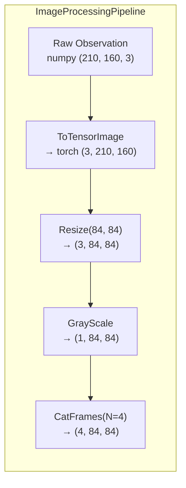
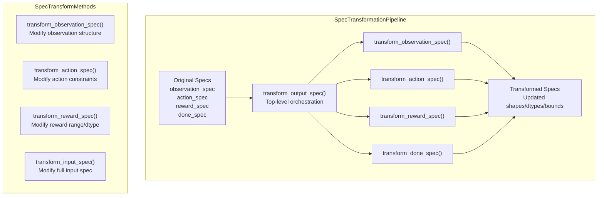

<!-- source: DeepWiki mcp.deepwiki.com · repo pytorch/rl · page 3.2 Environment Transforms · fetched 2026-10-21 -->

# Environment Transforms

<details>
<summary>Relevant source files</summary>

The following files were used as context for generating this wiki page:

- [benchmarks/benchmark_parallel_env_startup.py](benchmarks/benchmark_parallel_env_startup.py)
- [docs/source/reference/envs.rst](docs/source/reference/envs.rst)
- [docs/source/reference/envs_transforms.rst](docs/source/reference/envs_transforms.rst)
- [docs/source/reference/modules_utils.rst](docs/source/reference/modules_utils.rst)
- [sota-implementations/multiagent/utils/utils.py](sota-implementations/multiagent/utils/utils.py)
- [test/envs/test_auto_reset.py](test/envs/test_auto_reset.py)
- [test/envs/test_parallel.py](test/envs/test_parallel.py)
- [test/transforms/test_action_transforms.py](test/transforms/test_action_transforms.py)
- [test/transforms/test_compose_and_env.py](test/transforms/test_compose_and_env.py)
- [test/transforms/test_env_transforms.py](test/transforms/test_env_transforms.py)
- [torchrl/envs/__init__.py](torchrl/envs/__init__.py)
- [torchrl/envs/transforms/__init__.py](torchrl/envs/transforms/__init__.py)
- [torchrl/envs/transforms/_action.py](torchrl/envs/transforms/_action.py)
- [torchrl/envs/transforms/_base.py](torchrl/envs/transforms/_base.py)
- [torchrl/envs/transforms/_clip.py](torchrl/envs/transforms/_clip.py)
- [torchrl/envs/transforms/_env.py](torchrl/envs/transforms/_env.py)
- [torchrl/envs/transforms/_misc.py](torchrl/envs/transforms/_misc.py)
- [torchrl/envs/transforms/_reward.py](torchrl/envs/transforms/_reward.py)
- [torchrl/envs/transforms/r3m.py](torchrl/envs/transforms/r3m.py)
- [torchrl/envs/transforms/vecnorm.py](torchrl/envs/transforms/vecnorm.py)
- [torchrl/envs/transforms/vip.py](torchrl/envs/transforms/vip.py)
- [torchrl/modules/utils/__init__.py](torchrl/modules/utils/__init__.py)
- [torchrl/modules/utils/utils.py](torchrl/modules/utils/utils.py)
- [torchrl/trainers/algorithms/configs/transforms.py](torchrl/trainers/algorithms/configs/transforms.py)

</details>


## Purpose and Scope

Environment transforms modify or create data in `TensorDict` instances during environment interactions. This page covers the `Transform` base class (`[torchrl/envs/transforms/_base.py:179]()`), the `TransformedEnv` wrapper (`[torchrl/envs/transforms/_base.py:101]()`), transform composition with `Compose` (`[torchrl/envs/transforms/_base.py:98]()`), and the complete library of built-in transforms for observation processing, action modification, reward shaping, and state management.

For information about the base environment interface that transforms operate on, see [EnvBase and Environment Specifications](#3.1). For specific environment backend integrations, see [Backend Integrations](#3.3).

Sources: [torchrl/envs/transforms/__init__.py:179-180](), [docs/source/reference/envs.rst:1-63]()

---

## Core Architecture

### Transform Base Class

The `Transform` class (`[torchrl/envs/transforms/_base.py:179]()`) is an `nn.Module` that receives a `TensorDict` as input and returns a modified `TensorDict` as output. Transforms define which keys they read from (`in_keys`) and write to (`out_keys`), enabling precise control over data flow.



**Key Attributes:**

| Attribute | Type | Description |
|-----------|------|-------------|
| `in_keys` | `Sequence[NestedKey]` | Keys to read from input TensorDict |
| `out_keys` | `Sequence[NestedKey]` | Keys to write to output TensorDict |
| `in_keys_inv` | `Sequence[NestedKey]` | Keys for inverse transform input |
| `out_keys_inv` | `Sequence[NestedKey]` | Keys for inverse transform output |
| `parent` | `TransformedEnv \| None` | Parent environment up to this transform |
| `container` | `EnvBase \| None` | Top-level environment containing this transform |
| `invertible` | `bool` | Whether transform supports inverse operations |

Sources: [torchrl/envs/transforms/_base.py:179-346]()

### TransformedEnv Wrapper

`TransformedEnv` (`[torchrl/envs/transforms/_base.py:101]()`) wraps an `EnvBase` (`[torchrl/envs/common.py:8]()`) with a transform or `Compose` chain (`[torchrl/envs/transforms/_base.py:98]()`). It intercepts `step()` and `reset()` calls, applying transforms to observations and inverse transforms to actions.



**Key Features:**
- **Auto-unwrap**: When wrapping a `TransformedEnv` in another `TransformedEnv`, transforms are automatically merged into a single chain (configurable via `auto_unwrap` parameter).
- **Spec caching**: Transformed specs are cached by default for performance.
- **Transform composition**: Multiple transforms can be chained using `Compose` (`[torchrl/envs/transforms/_base.py:98]()`).

Sources: [torchrl/envs/transforms/_base.py:865-1010]()

---

## Transform Execution Flow

Transforms have three distinct execution contexts with different method hooks:

```mermaid
graph TB
    subgraph "ExecutionStepContext"
        step_td["tensordict at time t<br/>(includes action)"]
        inv_call["_inv_call()<br/>Transform action before env"]
        base_step["base_env.step()"]
        step_method["_step(td, next_td)<br/>Access to both t and t+1"]
        call_method["_call(next_td)<br/>Transform observations"]
        step_out["next_tensordict<br/>(transformed)"]
        
        step_td --> inv_call
        inv_call --> base_step
        base_step --> step_method
        step_method --> call_method
        call_method --> step_out
    end
    
    subgraph "ExecutionResetContext"
        reset_in["reset tensordict<br/>(optional)"]
        reset_inv["_reset_env_preprocess()<br/>Inverse if enable_inv_on_reset"]
        base_reset["base_env.reset()"]
        reset_call["_call()<br/>Transform initial observation"]
        reset_out["initial tensordict"]
        
        reset_in --> reset_inv
        reset_inv --> base_reset
        base_reset --> reset_call
        reset_call --> reset_out
    end
    
    subgraph "StandaloneContext"
        standalone_td["TensorDict"]
        forward_apply["forward()<br/>Calls _apply_transform"]
        inv_apply["inv()<br/>Calls _inv_apply_transform"]
        standalone_out["Transformed TensorDict"]
        
        standalone_td --> forward_apply
        standalone_td --> inv_apply
        forward_apply --> standalone_out
        inv_apply --> standalone_out
    end
```



**Method Hierarchy:**

| Context | Public Method | Internal Hook | Leaf Operation |
|---------|---------------|---------------|----------------|
| Environment step | `step()` → transforms | `_step(td, next_td)` → `_call(next_td)` | `_apply_transform(tensor)` |
| Environment reset | `reset()` → transforms | `_call(td)` | `_apply_transform(tensor)` |
| Action preprocessing | Before `step()` | `_inv_call(td)` | `_inv_apply_transform(tensor)` |
| Standalone forward | `forward(td)` or `__call__(td)` | `_apply_transform(tensor)` | Direct application |
| Standalone inverse | `inv(td)` | `_inv_apply_transform(tensor)` | Direct application |

Sources: [torchrl/envs/transforms/_base.py:405-576]()

---

## Key-Based Transform System

Transforms use an explicit key mapping system to define their data dependencies and outputs:



**Example: RewardScaling Transform**
```python
from torchrl.envs.transforms import RewardScaling

# Scales rewards by a factor
transform = RewardScaling(
    in_keys=["reward"],          # Read from "reward" key
    out_keys=["reward"],          # Write back to "reward" key (overwrite)
    scale=0.1,
    loc=0.0
)
```

**Example: Multiple Keys with Different Names**
```python
from torchrl.envs.transforms import ClipTransform

transform = ClipTransform(
    in_keys=["observation", "reward"],
    out_keys=["observation_clipped", "reward_clipped"],
    low=-1.0,
    high=1.0
)
```

Sources: [torchrl/envs/transforms/_base.py:289-346](), [torchrl/envs/transforms/_base.py:439-548]()

---

## Composing Transforms

The `Compose` class (`[torchrl/envs/transforms/_base.py:98]()`) chains multiple transforms into a sequential pipeline:



**Usage Pattern:**
```python
from torchrl.envs import TransformedEnv, Compose
from torchrl.envs.transforms import (
    ToTensorImage,
    Resize,
    GrayScale,
    CatFrames,
    RewardSum,
)

env = TransformedEnv(
    base_env,
    Compose(
        ToTensorImage(),
        Resize(84, 84),
        GrayScale(),
        CatFrames(N=4, dim=-3),
        RewardSum(),
    ),
)
```

Sources: [torchrl/envs/transforms/_base.py:1372-1900]()

---

## Transform Categories

### Observation Transforms

Modify or preprocess observation data. Common use cases include image processing, normalization, and frame stacking.

| Transform | Purpose | Key Parameters |
|-----------|---------|----------------|
| `ObservationNorm` | Normalize observations using running statistics | `loc` (mean), `scale` (std) |
| `ToTensorImage` | Convert numpy images to PyTorch tensors | - |
| `Resize` | Resize images to target dimensions | `w` (width), `h` (height) |
| `GrayScale` | Convert RGB images to grayscale | - |
| `CenterCrop` | Center crop images | `w`, `h` |
| `CatFrames` | Stack consecutive frames along a dimension | `N` (frame count), `dim` (stack dimension) |
| `FlattenObservation` | Flatten observation tensors | `start_dim`, `end_dim` |



Sources: [torchrl/envs/transforms/__init__.py:1-100]()

### Action Transforms

Modify actions before they are passed to the base environment, including clipping, discretization, and masking.

| Transform | Purpose | Key Parameters |
|-----------|---------|----------------|
| `ClipTransform` | Clip actions to valid range | `low`, `high` |
| `ActionMask` | Apply action masks for discrete actions | `action_key`, `mask_key` |
| `ActionDiscretizer` | Convert continuous actions to discrete | `num_intervals`, `action_space` |
| `DiscreteActionProjection` | Project discrete actions (`[torchrl/envs/transforms/_action.py:79]()`) | `num_actions`, `max_actions` |

Sources: [torchrl/envs/transforms/_action.py:65-76]()

### Reward Shaping

Shape or modify reward signals to improve learning performance.

| Transform | Purpose | Key Parameters |
|-----------|---------|----------------|
| `RewardSum` | Accumulate rewards over episode | - |
| `RewardScaling` | Scale and shift rewards | `scale`, `loc` |
| `RewardClipping` | Clip rewards to range | `clip_min`, `clip_max` |
| `BinarizeReward` | Convert rewards to {0, 1} | - |

Sources: [torchrl/envs/transforms/__init__.py:1-100]()

### State Management Transforms

Track and manage episode state information (`[torchrl/envs/transforms/_env.py:59]()`).

| Transform | Purpose | Output Keys |
|-----------|---------|-------------|
| `StepCounter` | Count steps in episode (`[torchrl/envs/transforms/_env.py:67]()`) | `"step_count"`, `"truncated"` |
| `TrajCounter` | Count completed trajectories (`[torchrl/envs/transforms/_env.py:69]()`) | `"traj_count"` |
| `InitTracker` | Track environment resets (`[torchrl/envs/transforms/_env.py:64]()`) | `"is_init"` |
| `TensorDictPrimer` | Initialize keys with default values (`[torchrl/envs/transforms/_env.py:68]()`) | Configured keys |

Sources: [torchrl/envs/transforms/_env.py:59-71]()

---

## Spec Transformation

Transforms update environment specs to reflect changes in data structure. The spec transformation system ensures that the transformed environment's specs match its actual outputs.



**Key Methods:**

| Method | Purpose | When to Override |
|--------|---------|------------------|
| `transform_observation_spec()` | Modify observation specs | Transform changes observation shape/dtype/bounds |
| `transform_action_spec()` | Modify action specs | Transform changes action constraints |
| `transform_reward_spec()` | Modify reward specs | Transform changes reward range/dtype |
| `transform_done_spec()` | Modify done specs | Transform adds/modifies termination signals |
| `transform_input_spec()` | Modify input specs | Combination of action and state changes |

Sources: [torchrl/envs/transforms/_base.py:586-704]()

---

## Subclassing Transforms

Creating custom transforms requires subclassing `Transform` (`[torchrl/envs/transforms/_base.py:179]()`) and implementing specific hooks:

1. **Per-Key Transform**: Override `_apply_transform(self, tensor)` for element-wise or tensor-wise transformations on `in_keys`.
2. **TensorDict-Level Transform**: Override `_call(self, tensordict)` for multi-key dependencies.
3. **Action Preprocessing**: Implement `_inv_apply_transform(self, action)` and set `in_keys_inv`/`out_keys_inv`.
4. **Spec Modification**: Implement `transform_observation_spec()` or related spec methods.

Sources: [torchrl/envs/transforms/_base.py:179-230]()

---

## Usage Patterns

### With Environments
```python
from torchrl.envs import GymEnv, TransformedEnv, Compose
from torchrl.envs.transforms import RewardSum, StepCounter

env = TransformedEnv(
    GymEnv("Pendulum-v1"),
    Compose(RewardSum(), StepCounter(max_steps=200)),
)
rollout = env.rollout(100)
```

### With Replay Buffers
```python
from torchrl.data import ReplayBuffer, LazyTensorStorage
from torchrl.envs.transforms import CatFrames

catframes = CatFrames(N=4, in_keys=["observation", ("next", "observation")], dim=-1)
rb = ReplayBuffer(storage=LazyTensorStorage(1000))
rb.append_transform(catframes)
```

Sources: [test/test_transforms.py:323-370](), [test/test_transforms.py:1041-1091]()

---

