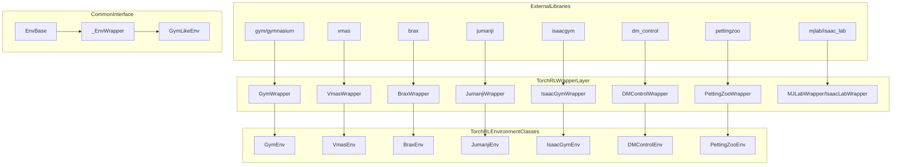
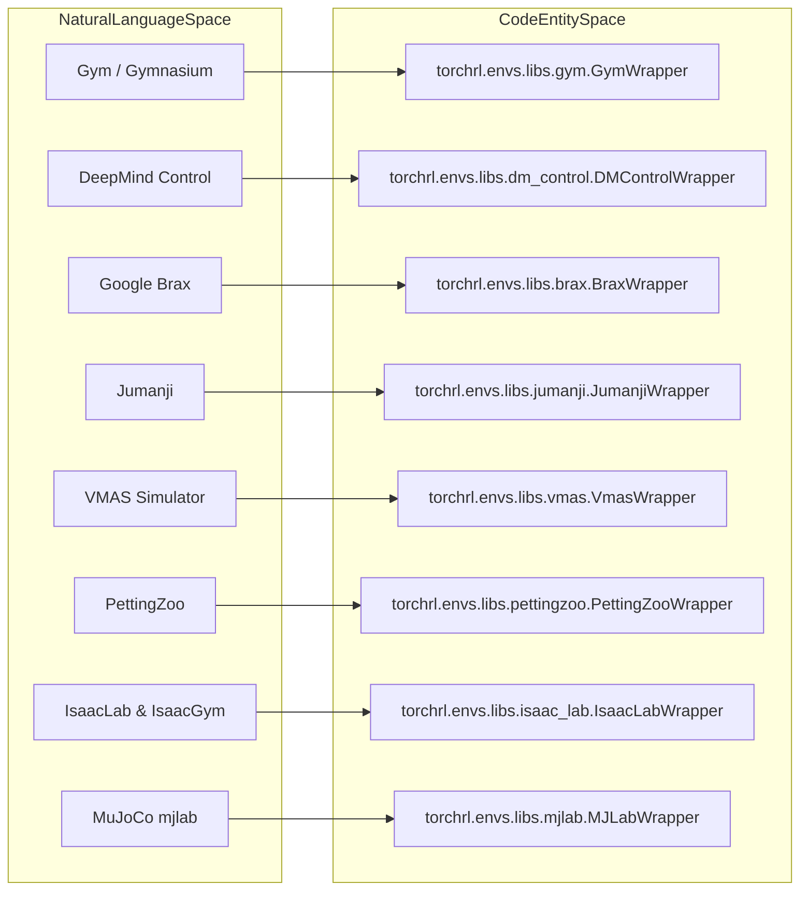
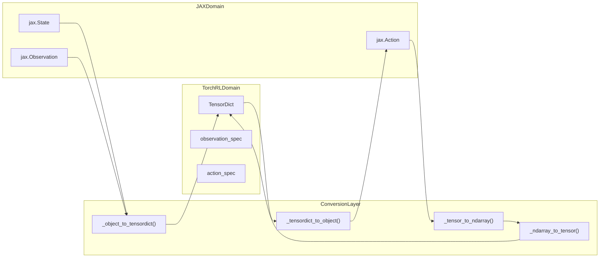

<!-- source: DeepWiki mcp.deepwiki.com · repo pytorch/rl · page 3.3 Backend Integrations · fetched 2026-10-21 -->

# Backend Integrations

Relevant source files

The following files were used as context for generating this wiki page:

- [.github/labeler.yml](.github/labeler.yml)
- [.github/labels.yml](.github/labels.yml)
- [.github/unittest/linux_libs/scripts_pettingzoo/environment.yml](.github/unittest/linux_libs/scripts_pettingzoo/environment.yml)
- [.github/unittest/linux_libs/scripts_pettingzoo/post_process.sh](.github/unittest/linux_libs/scripts_pettingzoo/post_process.sh)
- [.github/unittest/linux_libs/scripts_pettingzoo/run_test.sh](.github/unittest/linux_libs/scripts_pettingzoo/run_test.sh)
- [.github/unittest/linux_libs/scripts_pettingzoo/setup_env.sh](.github/unittest/linux_libs/scripts_pettingzoo/setup_env.sh)
- [.github/workflows/test-linux-habitat.yml](.github/workflows/test-linux-habitat.yml)
- [.github/workflows/test-linux-libs.yml](.github/workflows/test-linux-libs.yml)
- [docs/source/reference/envs_libraries.rst](docs/source/reference/envs_libraries.rst)
- [docs/source/reference/isaaclab.rst](docs/source/reference/isaaclab.rst)
- [docs/source/reference/objectives_common.rst](docs/source/reference/objectives_common.rst)
- [docs/source/reference/objectives_value.rst](docs/source/reference/objectives_value.rst)
- [examples/collectors/isaaclab_rnn_ppo_memory.py](examples/collectors/isaaclab_rnn_ppo_memory.py)
- [examples/collectors/isaaclab_rnn_ppo_memory_utils.py](examples/collectors/isaaclab_rnn_ppo_memory_utils.py)
- [examples/microduck/ppo_mjlab.py](examples/microduck/ppo_mjlab.py)
- [knowledge_base/ISAACLAB.md](knowledge_base/ISAACLAB.md)
- [test/libs/test_brax.py](test/libs/test_brax.py)
- [test/libs/test_dm_control.py](test/libs/test_dm_control.py)
- [test/libs/test_genesis.py](test/libs/test_genesis.py)
- [test/libs/test_gym.py](test/libs/test_gym.py)
- [test/libs/test_habitat.py](test/libs/test_habitat.py)
- [test/libs/test_libero.py](test/libs/test_libero.py)
- [test/libs/test_mjlab.py](test/libs/test_mjlab.py)
- [test/libs/test_mujoco_playground.py](test/libs/test_mujoco_playground.py)
- [test/libs/test_multiagent.py](test/libs/test_multiagent.py)
- [test/objectives/test_dqn.py](test/objectives/test_dqn.py)
- [torchrl/envs/libs/__init__.py](torchrl/envs/libs/__init__.py)
- [torchrl/envs/libs/brax.py](torchrl/envs/libs/brax.py)
- [torchrl/envs/libs/dm_control.py](torchrl/envs/libs/dm_control.py)
- [torchrl/envs/libs/envpool.py](torchrl/envs/libs/envpool.py)
- [torchrl/envs/libs/habitat.py](torchrl/envs/libs/habitat.py)
- [torchrl/envs/libs/isaacgym.py](torchrl/envs/libs/isaacgym.py)
- [torchrl/envs/libs/jax_utils.py](torchrl/envs/libs/jax_utils.py)
- [torchrl/envs/libs/jumanji.py](torchrl/envs/libs/jumanji.py)
- [torchrl/envs/libs/lbforaging.py](torchrl/envs/libs/lbforaging.py)
- [torchrl/envs/libs/mjlab.py](torchrl/envs/libs/mjlab.py)
- [torchrl/envs/libs/openml.py](torchrl/envs/libs/openml.py)
- [torchrl/envs/libs/pettingzoo.py](torchrl/envs/libs/pettingzoo.py)
- [torchrl/envs/libs/robohive.py](torchrl/envs/libs/robohive.py)
- [torchrl/envs/libs/smacv2.py](torchrl/envs/libs/smacv2.py)
- [torchrl/envs/libs/vmas.py](torchrl/envs/libs/vmas.py)
- [torchrl/trainers/algorithms/configs/envs_libs.py](torchrl/trainers/algorithms/configs/envs_libs.py)

This document covers TorchRL's integration with external reinforcement learning environment libraries. It explains how TorchRL provides unified interfaces to popular RL environment ecosystems including OpenAI Gym/Gymnasium, DMControl, Brax, Jumanji, VMAS, PettingZoo, IsaacLab, MuJoCo/mjlab, and others through wrapper classes and spec conversion systems.

For information about the base environment interface that all environments conform to, see [EnvBase and Environment Specifications](#3.1). For details about environment transforms and data preprocessing, see [Environment Transforms](#3.2).

## 1. Architecture Overview & Integration Pattern

TorchRL integrates with external environment libraries through a layered architecture that provides unified interfaces while preserving library-specific functionality and performance features (such as GPU vectorization, JAX JIT compilation, or parallel subprocess execution).

### Integration Architecture

Sources: [torchrl/envs/libs/__init__.py:1-96](), [torchrl/envs/libs/gym.py:1-50](), [torchrl/envs/libs/vmas.py:111-159]()

### Wrapper to Code Entities Bridge

The following diagram bridges natural language references of external environment ecosystems to their concrete Python class implementations within `torchrl/envs/libs/`.

Sources: [torchrl/envs/libs/__init__.py:44-92](), [torchrl/envs/libs/gym.py:42-43](), [torchrl/envs/libs/dm_control.py:37-37](), [torchrl/envs/libs/brax.py:6-7](), [torchrl/envs/libs/jumanji.py:23-23](), [torchrl/envs/libs/vmas.py:37-37](), [torchrl/envs/libs/pettingzoo.py:36-36](), [torchrl/envs/libs/isaac_lab.py:21-21](), [torchrl/envs/libs/mjlab.py:27-27]()

---

## 2. Gym and Gymnasium Integration

The Gym integration is foundational, supporting both the legacy `gym` library and the modern `gymnasium` library via a dynamic backend selection system.

### Backend Management and Wrappers

TorchRL provides `set_gym_backend()` and `gym_backend()` to control whether `gym` or `gymnasium` is targeted [torchrl/envs/libs/gym.py:12-18]().
- `GymWrapper`: Wraps any standard gym-like environment instance into a TorchRL `EnvBase` [test/libs/test_gym.py:43-43]().
- `GymEnv`: Instantiates a gym environment by string name [test/libs/test_gym.py:42-42]().
- `MOGymWrapper` / `MOGymEnv`: Multi-objective extensions for gym [test/libs/test_gym.py:44-45]().

### Spec Conversion Registry

Gym/Gymnasium spaces are mapped to TorchRL's `TensorSpec` system using a conversion registry [test/libs/test_gym.py:36-48]`:
- `gym.spaces.Box` $\rightarrow$ `Bounded` or `Unbounded`
- `gym.spaces.Discrete` $\rightarrow$ `Categorical` or `OneHot`
- `gym.spaces.MultiDiscrete` $\rightarrow$ `MultiCategorical` or `MultiOneHot`
- `gym.spaces.Dict` $\rightarrow$ `Composite`

Sources: [test/libs/test_gym.py:21-48](), [torchrl/envs/libs/gym.py:12-18]()

---

## 3. DeepMind Control (DMControl) Integration

DeepMind Control Suite environments are wrapped via `DMControlWrapper` and `DMControlEnv` [torchrl/envs/libs/dm_control.py:37-37]().

### Metaclass Spawning and Specs
- `_DMControlMeta`: Intercepts instantiation of `DMControlEnv` when `num_workers > 1`, returning a `ParallelEnv` directly without spawning unnecessary local parent environment instances [torchrl/envs/libs/dm_control.py:119-155]().
- `_dmcontrol_to_torchrl_spec_transform`: Converts `dm_env.specs` (`DiscreteArray`, `BoundedArray`, `Array`, and nested `OrderedDict`) into TorchRL `Categorical`, `Bounded`, `Unbounded`, and `Composite` specs [torchrl/envs/libs/dm_control.py:40-93]().

Sources: [torchrl/envs/libs/dm_control.py:37-156]()

---

## 4. JAX-Based Environments: Brax and Jumanji

Brax and Jumanji provide hardware-accelerated physics and combinatorial simulation built on JAX. TorchRL wraps them while supporting batched rollouts via `vmap` and gradient backpropagation through trajectories.

### JAX-Torch Data Flow and Utilities

- `BraxWrapper` / `BraxEnv`: Integrates Google Brax, supporting batch sizes mapped to JAX `vmap` execution [torchrl/envs/libs/brax.py:69-108]().
- `JumanjiWrapper` / `JumanjiEnv`: Integrates Instadeep's Jumanji, supporting JIT compilation (`env.jit = True`) and dynamic batching [torchrl/envs/libs/jumanji.py:116-171]().
- `jax_utils.py`: Provides zero-copy or efficient conversion helpers (`_ndarray_to_tensor`, `_tensor_to_ndarray`, `_object_to_tensordict`, `_tensordict_to_object`) [torchrl/envs/libs/brax.py:17-25](), [torchrl/envs/libs/jumanji.py:33-40]().

Sources: [torchrl/envs/libs/brax.py:69-142](), [torchrl/envs/libs/jumanji.py:51-171](), [torchrl/envs/libs/jax_utils.py:1-165]()

---

## 5. Multi-Agent and Vectorized Integrations: VMAS and PettingZoo

TorchRL provides native support for multi-agent reinforcement learning (MARL) through specialized wrappers that group agent observations, actions, and rewards into structured `TensorDict` hierarchies.

### Agent Grouping and Masking
- `VmasWrapper` / `VmasEnv`: Wraps VMAS (Vectorized Multi-Agent Simulator), executing vectorized multi-agent simulations directly in PyTorch [torchrl/envs/libs/vmas.py:111-159](). Uses `group_map` to cluster agents following naming conventions (e.g. `"<name>_<int>"` grouped by `"<name>"`) [torchrl/envs/libs/vmas.py:137-142]().
- `PettingZooWrapper` / `PettingZooEnv`: Wraps both `AECEnv` (Agent-Environment Cycle) and `ParallelEnv` from PettingZoo [torchrl/envs/libs/pettingzoo.py:86-93](). Automatically constructs `"mask"`, `"terminated"`, `"truncated"`, and `"action_mask"` tensors for each agent group [torchrl/envs/libs/pettingzoo.py:96-110]().

Sources: [torchrl/envs/libs/vmas.py:111-159](), [torchrl/envs/libs/pettingzoo.py:86-144]()

---

## 6. Robotics and Advanced Simulators: IsaacLab, IsaacGym, MuJoCo / mjlab, Habitat, and RoboHive

TorchRL integrates with modern GPU-accelerated robotics simulators and vision-navigation platforms.

### Simulator Wrappers
- `IsaacLabWrapper`: Integrates NVIDIA Isaac Lab environments, leveraging GPU-accelerated PhysX and tensor-based state exchange [torchrl/envs/libs/__init__.py:21-21]().
- `IsaacGymWrapper` / `IsaacGymEnv`: Wraps IsaacGymEnvs with single-process per environment constraints due to CUDA context management [torchrl/envs/libs/isaacgym.py:22-52]().
- `MJLabWrapper` / `MJLabEnv`: Integrates MuJoCo-based GPU simulation frameworks (`mjlab`) [torchrl/envs/libs/__init__.py:27-27]().
- `HabitatEnv`: Integrates AI Habitat for embodied AI and navigation tasks, supporting per-worker GPU assignment for parallel instances [torchrl/envs/libs/habitat.py:90-139]().
- `RoboHiveEnv`: Wraps RoboHive MuJoCo-based robotics task suites [torchrl/envs/libs/robohive.py:69-126]().

Sources: [torchrl/envs/libs/isaac_lab.py:1-50](), [torchrl/envs/libs/isaacgym.py:22-52](), [torchrl/envs/libs/mjlab.py:1-40](), [torchrl/envs/libs/habitat.py:90-139](), [torchrl/envs/libs/robohive.py:69-126]()

---

