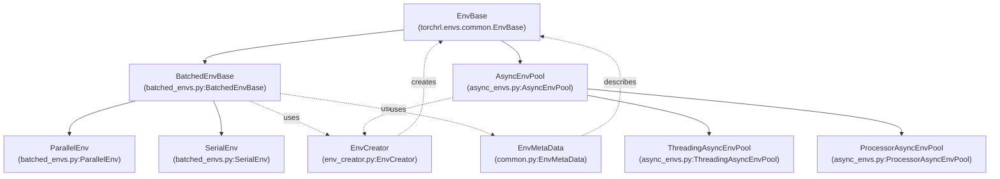
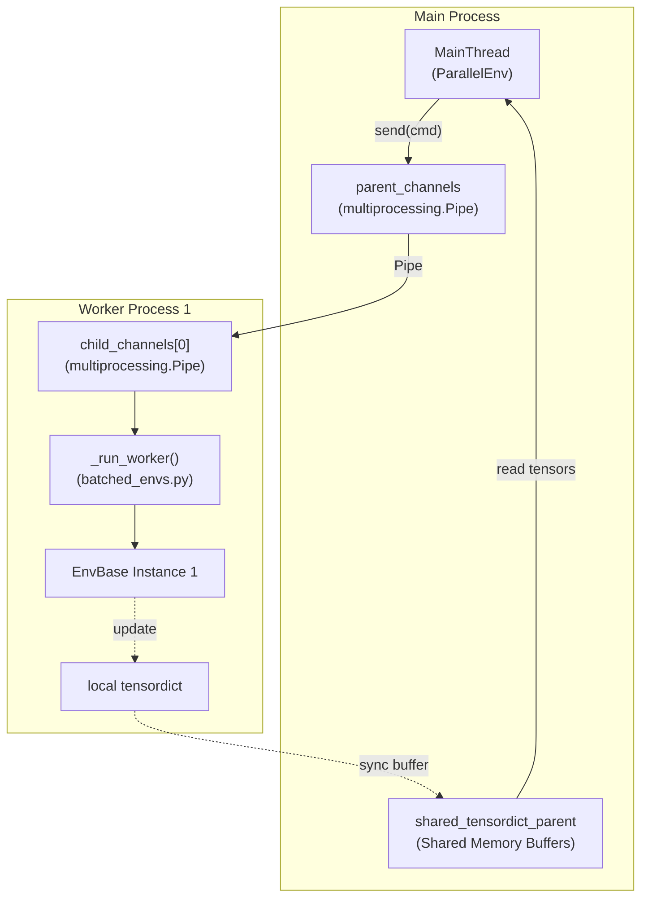
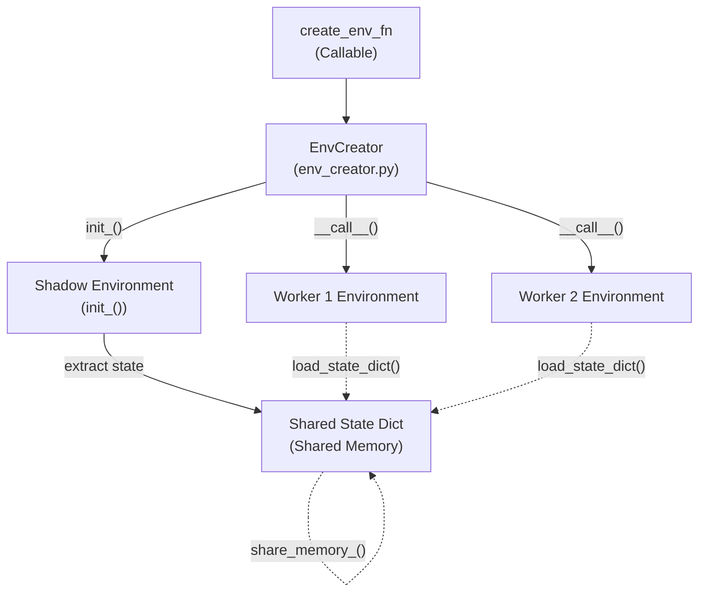

<!-- source: DeepWiki mcp.deepwiki.com · repo pytorch/rl · page 3.4 Batched and Parallel Environments · fetched 2026-10-21 -->

# Batched and Parallel Environments

<details>
<summary>Relevant source files</summary>

The following files were used as context for generating this wiki page:

- [benchmarks/benchmark_batched_envs.py](benchmarks/benchmark_batched_envs.py)
- [benchmarks/test_envs_benchmark.py](benchmarks/test_envs_benchmark.py)
- [docs/source/reference/envs_vectorized.rst](docs/source/reference/envs_vectorized.rst)
- [test/envs/test_special.py](test/envs/test_special.py)
- [test/test_shared.py](test/test_shared.py)
- [test/test_specs.py](test/test_specs.py)
- [test/test_utils.py](test/test_utils.py)
- [torchrl/_utils.py](torchrl/_utils.py)
- [torchrl/collectors/collectors.py](torchrl/collectors/collectors.py)
- [torchrl/data/tensor_specs.py](torchrl/data/tensor_specs.py)
- [torchrl/envs/_async_exchange.py](torchrl/envs/_async_exchange.py)
- [torchrl/envs/async_envs.py](torchrl/envs/async_envs.py)
- [torchrl/envs/batched_envs.py](torchrl/envs/batched_envs.py)
- [torchrl/envs/common.py](torchrl/envs/common.py)
- [torchrl/envs/gym_like.py](torchrl/envs/gym_like.py)
- [torchrl/envs/libs/gym.py](torchrl/envs/libs/gym.py)
- [torchrl/envs/transforms/transforms.py](torchrl/envs/transforms/transforms.py)
- [torchrl/envs/utils.py](torchrl/envs/utils.py)
- [torchrl/trainers/algorithms/configs/envs.py](torchrl/trainers/algorithms/configs/envs.py)

</details>


This document describes TorchRL's system for running multiple environment instances simultaneously, either in parallel across processes, asynchronously, or serially on a single process. These vectorized environments enable efficient data collection by executing multiple rollouts concurrently.

**Scope**: This page covers `BatchedEnvBase`, `ParallelEnv`, `SerialEnv`, `AsyncEnvPool`, `EnvCreator`, `EnvMetaData`, and shared memory management. For single environment instances, see [EnvBase and Environment Specifications](#3.1). For environment transforms applied to batched environments, see [Environment Transforms](#3.2). For data collection strategies, see [Collector Architecture](#4.1).

---

## 1. Overview

Batched environments execute multiple environment copies simultaneously. The primary benefit is **vectorization**: instead of stepping through experiences sequentially from a single environment, you collect `N` experiences concurrently, maximizing hardware utilization and data throughput.

TorchRL provides three primary batched abstractions:
- **`ParallelEnv`**: Executes environments in separate worker processes using inter-process communication (`multiprocessing.Pipe`) [torchrl/envs/batched_envs.py:1248]()
- **`SerialEnv`**: Executes environments sequentially in the main process, sharing the same batched API for debugging and gradient-based workflows [torchrl/envs/batched_envs.py:1874]()
- **`AsyncEnvPool`**: Manages environments asynchronously via threading or multiprocessing pools (`AsyncEnvPool`, `ThreadingAsyncEnvPool`, `ProcessorAsyncEnvPool`), allowing asynchronous stepping and resetting [torchrl/envs/async_envs.py:74-98]()

Sources: `[torchrl/envs/batched_envs.py:140-287]`, `[torchrl/envs/async_envs.py:74-98]()`

---

## 2. Class Hierarchy and Core Architecture

All batched environments inherit from `EnvBase` via `BatchedEnvBase` or `AsyncEnvPool`.



Sources: `[torchrl/envs/batched_envs.py:140]`, `[torchrl/envs/batched_envs.py:1248]`, `[torchrl/envs/batched_envs.py:1874]`, `[torchrl/envs/async_envs.py:74-98]`, `[torchrl/envs/common.py:122]`, `[torchrl/envs/env_creator.py:19]()`

---

## 3. ParallelEnv: Multi-Process Execution

`ParallelEnv` spawns individual worker processes for each environment instance. The main process dispatches commands (`step`, `reset`, `seed`, `close`) via `multiprocessing.Pipe` and synchronizes data through shared memory buffers.

### Process Architecture and Control Flow



### Worker Lifecycle
The worker loop is implemented in `_run_worker` (`[torchrl/envs/batched_envs.py:854-1093]()`):
1. **Instantiation**: The worker loads its environment from `EnvCreator` or a constructor callable.
2. **Command Polling**: It blocks on its pipe waiting for instructions (`_reset`, `_step`, `_set_seed`, `_close`).
3. **Buffer Synchronization**: When stepping or resetting, outputs are written directly into pre-allocated shared memory slots (`use_buffers=True`) or returned via pipe (`use_buffers=False`).

Sources: `[torchrl/envs/batched_envs.py:854-1093]`, `[torchrl/envs/batched_envs.py:1248-1872]()`

---

## 4. SerialEnv: Sequential Execution

`SerialEnv` (`[torchrl/envs/batched_envs.py:1874]()`) executes multiple environment instances sequentially in a single process while exposing the identical batched interface as `ParallelEnv`.

- **Use Cases**: Debugging without multiprocessing overhead, tracking gradient flow through environment dynamics, or low worker counts.
- **API Parity**: Returns batched `TensorDict` instances whose leading dimension equals `num_workers`.

Sources: `[torchrl/envs/batched_envs.py:1874-2119]()`

---

## 5. AsyncEnvPool: Asynchronous Environment Pools

`AsyncEnvPool` (`[torchrl/envs/async_envs.py:74-98]()`) provides asynchronous stepping and resetting across multiple environments. It supports multiple backends via its metaclass `_AsyncEnvMeta`:
- **`"threading"`**: Uses `ThreadingAsyncEnvPool` backed by thread pools and thread-safe queues.
- **`"multiprocessing"`**: Uses `ProcessorAsyncEnvPool` backed by separate processes and inter-process exchange mechanisms (`exchange="queue"` or `exchange="shm"` via `_SharedSlotExchange`) [torchrl/envs/_async_exchange.py]().

### Async Data Exchange
When using `exchange="shm"`, fixed-shape tensor data is written to shared memory slots, and lightweight readiness descriptors are passed through queues, minimizing serialization overhead.

Sources: `[torchrl/envs/async_envs.py:74-146]`, `[torchrl/envs/_async_exchange.py]()`

---

## 6. EnvCreator and Shared State Management

`EnvCreator` (`[torchrl/envs/env_creator.py:19]()`) wraps an environment constructor function to manage shared state across workers (e.g., global normalization statistics in `VecNorm`).



Sources: `[torchrl/envs/env_creator.py:19-228]`, `[test/test_collector.py:646-726]()`

---

## 7. EnvMetaData and Specifications

`EnvMetaData` (`[torchrl/envs/common.py:122]()`) captures static environment descriptors (fake tensordict templates, input/output specs, batch sizes, device mappings, and dynamic spec flags) so that batched wrappers can initialize buffers without instantiating full worker environments prematurely.

Sources: `[torchrl/envs/common.py:122-256]`, `[torchrl/envs/batched_envs.py:506-554]()`

---

## 8. Memory Management Strategies

`BatchedEnvBase` supports three memory management modes:
1. **Shared Memory (`shared_memory=True`)**: Tensors are allocated in shared memory via `tensor.share_memory_()`, enabling zero-copy IPC between worker processes and the main process [torchrl/envs/batched_envs.py:353-368]().
2. **Memory-Mapped Files (`memmap=True`)**: Tensors are backed by disk files, suitable for massive observation spaces or persistence.
3. **Standard Memory (`shared_memory=False`)**: Tensors are serialized and transferred via pipes.

When `use_buffers=True` and specs are static, pre-allocated circular buffers (`shared_tensordict_parent` [torchrl/envs/batched_envs.py:746]()) eliminate runtime allocation overhead during rollouts.

Sources: `[torchrl/envs/batched_envs.py:353-368]`, `[torchrl/envs/batched_envs.py:745-783]()`

---

## 9. Common Usage Patterns

### Pattern 1: Parallel Data Collection
```python
from torchrl.envs import ParallelEnv
from torchrl.collectors import Collector
from torchrl.envs.libs.gym import GymWrapper
import gym

def make_env():
    return GymWrapper(gym.make("CartPole-v1"))

env = ParallelEnv(num_workers=4, create_env_fn=make_env)
collector = Collector(env, policy=policy, frames_per_batch=1000)

for batch in collector:
    loss = loss_fn(batch)
    loss.backward()
```
Sources: `[test/test_env.py:355-374]`, `[torchrl/collectors/collectors.py:8-30]()`

### Pattern 2: Shared Transforms with EnvCreator
```python
from torchrl.envs import EnvCreator, ParallelEnv, TransformedEnv
from torchrl.envs.transforms import VecNorm
import gym

def make_env():
    return TransformedEnv(GymWrapper(gym.make("Pendulum-v1")), VecNorm())

env_creator = EnvCreator(make_env)
parallel_env = ParallelEnv(num_workers=4, create_env_fn=env_creator)
```
Sources: `[torchrl/envs/env_creator.py:19-228]`, `[test/test_collector.py:646-726]()`

---

