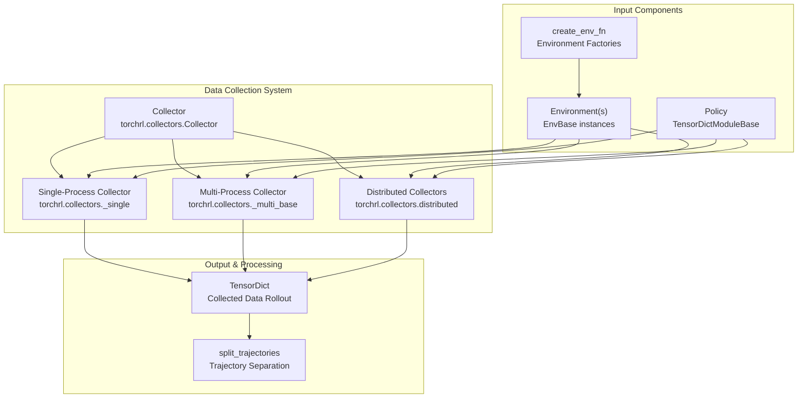

<!-- source: DeepWiki mcp.deepwiki.com · repo pytorch/rl · page 4 Data Collection · fetched 2026-10-21 -->

# Data Collection

Relevant source files

The following files were used as context for generating this wiki page:

- [docs/source/reference/collectors_distributed.rst](docs/source/reference/collectors_distributed.rst)
- [docs/source/reference/collectors_replay.rst](docs/source/reference/collectors_replay.rst)
- [docs/source/reference/data_layout.rst](docs/source/reference/data_layout.rst)
- [test/test_collectors.py](test/test_collectors.py)
- [torchrl/collectors/_base.py](torchrl/collectors/_base.py)
- [torchrl/collectors/_multi_base.py](torchrl/collectors/_multi_base.py)
- [torchrl/collectors/_runner.py](torchrl/collectors/_runner.py)
- [torchrl/collectors/_single.py](torchrl/collectors/_single.py)
- [torchrl/collectors/distributed/ray.py](torchrl/collectors/distributed/ray.py)
- [torchrl/collectors/utils.py](torchrl/collectors/utils.py)
- [torchrl/trainers/algorithms/configs/collectors.py](torchrl/trainers/algorithms/configs/collectors.py)
- [tutorials/sphinx-tutorials/getting-started-3.py](tutorials/sphinx-tutorials/getting-started-3.py)
- [tutorials/sphinx-tutorials/rb_tutorial.py](tutorials/sphinx-tutorials/rb_tutorial.py)

Data collection is the core infrastructure component responsible for gathering experience from reinforcement learning environments using policies. This system provides the bridge between environment interaction and training data, handling rollout execution, data aggregation, and policy weight synchronization across both single-node and distributed setups [tutorials/sphinx-tutorials/getting-started-3.py:23-37]().

This is a parent page providing a high-level overview of TorchRL's data collection framework. For in-depth technical details, implementation specifics, and advanced configurations, please refer to the child pages:
- [Collector Architecture](#4.1)
- [Distributed Collection Strategies](#4.2)
- [Weight Synchronization](#4.3)
- [Inference Server](#4.4)

## Purpose and High-Level Architecture

The data collection system serves as the reinforcement learning equivalent of PyTorch `DataLoader`, with the key distinction that it interacts with dynamic, stateful environments rather than static datasets [tutorials/sphinx-tutorials/getting-started-3.py:23-37](). The unified entry point `Collector` (and its base class `BaseCollector`) handles direct, multi-process, Ray, RPC, and distributed execution backends transparently through a metaclass dispatch mechanism [torchrl/collectors/_single.py:80-184]().

**Core Data Collection Architecture**

Sources: [torchrl/collectors/_single.py:80-184](), [torchrl/collectors/_multi_base.py:58-82]()

## Sub-Topics and Child Pages Overview

### 4.1 Collector Architecture
The foundational architecture centers around `BaseCollector`, the concrete `Collector` class, and multi-worker variants (`MultiSyncCollector`, `MultiAsyncCollector`) [torchrl/collectors/_single.py:80-184](), [torchrl/collectors/_multi_base.py:58-82](). The runner process model manages worker lifecycles, environment execution, and policy interaction.

For full details, see [Collector Architecture](#4.1).

### 4.2 Distributed Collection Strategies
TorchRL supports scalable distributed collection using Ray (`RayCollector`), PyTorch RPC (`RPCCollector`), and generic process-group distributed backends (`DistributedCollector`) [docs/source/reference/collectors_distributed.rst:1-47](). These backends support both synchronous and asynchronous iteration patterns, submitit integration, and direct-to-replay-buffer writing topologies [docs/source/reference/collectors_distributed.rst:48-66]().

For full details, see [Distributed Collection Strategies](#4.2).

### 4.3 Weight Synchronization
To keep worker policies up-to-date with the learner, TorchRL implements various `WeightSyncScheme` classes (such as shared memory, multiprocessing, RPC, distributed, and Ray schemes) [test/test_collectors.py:175-190](). These schemes handle weight extraction, transport, updates, and CPU staging fallbacks for devices without cross-process sharing support (such as MPS or Windows CUDA) [test/test_collectors.py:205-210]().

For full details, see [Weight Synchronization](#4.3).

### 4.4 Inference Server
The `torchrl/modules/inference_server` package implements a dedicated server-client architecture with process slots, custom transports, and shared memory support to run async batched collectors efficiently without duplicating model weights across every worker thread or process.

For full details, see [Inference Server](#4.4).

Sources: [torchrl/collectors/_single.py:80-184](), [torchrl/collectors/_multi_base.py:58-82](), [docs/source/reference/collectors_distributed.rst:1-66](), [test/test_collectors.py:175-210]()

---

