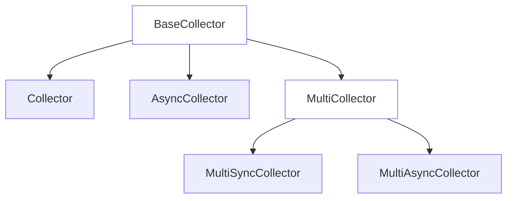
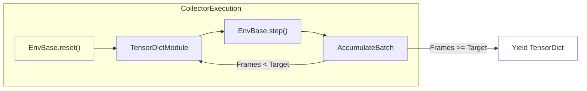
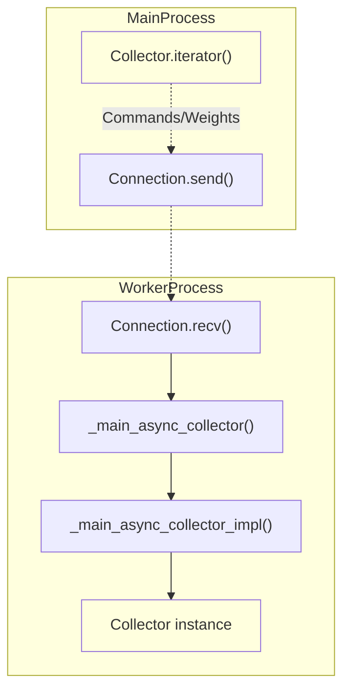
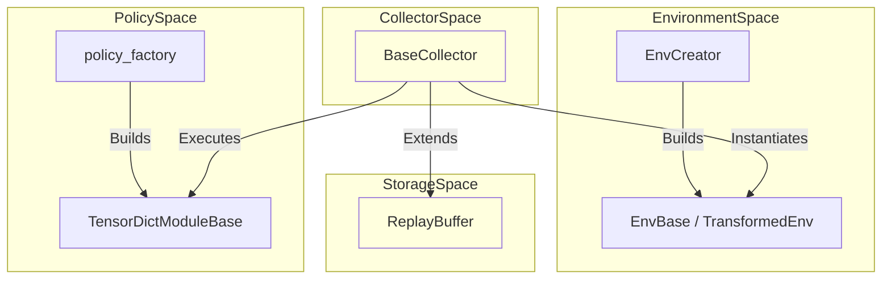

<!-- source: DeepWiki mcp.deepwiki.com · repo pytorch/rl · page 4.1 Collector Architecture · fetched 2026-10-21 -->

# Collector Architecture

Relevant source files

The following files were used as context for generating this wiki page:

- [.github/unittest/linux_libs/scripts_isaaclab/isaac.sh](.github/unittest/linux_libs/scripts_isaaclab/isaac.sh)
- [docs/source/reference/collectors_distributed.rst](docs/source/reference/collectors_distributed.rst)
- [docs/source/reference/collectors_replay.rst](docs/source/reference/collectors_replay.rst)
- [docs/source/reference/collectors_weightsync.rst](docs/source/reference/collectors_weightsync.rst)
- [docs/source/reference/data_layout.rst](docs/source/reference/data_layout.rst)
- [test/collectors/test_evaluator.py](test/collectors/test_evaluator.py)
- [test/test_collectors.py](test/test_collectors.py)
- [test/transforms/test_timer_video.py](test/transforms/test_timer_video.py)
- [torchrl/collectors/_base.py](torchrl/collectors/_base.py)
- [torchrl/collectors/_evaluator.py](torchrl/collectors/_evaluator.py)
- [torchrl/collectors/_multi_async.py](torchrl/collectors/_multi_async.py)
- [torchrl/collectors/_multi_base.py](torchrl/collectors/_multi_base.py)
- [torchrl/collectors/_multi_sync.py](torchrl/collectors/_multi_sync.py)
- [torchrl/collectors/_runner.py](torchrl/collectors/_runner.py)
- [torchrl/collectors/_single.py](torchrl/collectors/_single.py)
- [torchrl/collectors/distributed/_ray_eval_runtime.py](torchrl/collectors/distributed/_ray_eval_runtime.py)
- [torchrl/collectors/distributed/ray.py](torchrl/collectors/distributed/ray.py)
- [torchrl/collectors/distributed/ray_eval_worker.py](torchrl/collectors/distributed/ray_eval_worker.py)
- [torchrl/collectors/utils.py](torchrl/collectors/utils.py)
- [torchrl/trainers/algorithms/configs/collectors.py](torchrl/trainers/algorithms/configs/collectors.py)
- [torchrl/weight_update/_ray.py](torchrl/weight_update/_ray.py)
- [torchrl/weight_update/weight_sync_schemes.py](torchrl/weight_update/weight_sync_schemes.py)
- [tutorials/sphinx-tutorials/getting-started-3.py](tutorials/sphinx-tutorials/getting-started-3.py)
- [tutorials/sphinx-tutorials/rb_tutorial.py](tutorials/sphinx-tutorials/rb_tutorial.py)

## Purpose and Scope

This document describes the collector architecture in TorchRL, which is responsible for gathering environment interactions during reinforcement learning training. Collectors orchestrate the interaction loop between policies and environments, producing batches of experience data (observations, actions, rewards, done flags) packaged as `TensorDict` objects.

For details on the foundational environment abstractions, see [Environments](#3). For replay buffer integration, see [Replay Buffers](#5). For distributed collection strategies and weight synchronization, see [Distributed Collection Strategies](#4.2) and [Weight Synchronization](#4.3).

---

## Collector Hierarchy and Metaclass Dispatch

TorchRL collectors are built upon an abstract base class `BaseCollector` [torchrl/collectors/_base.py](), with specialized implementations dispatched dynamically through custom metaclasses like `_CollectorMeta` [torchrl/collectors/_single.py:80-88]() and `_MultiCollectorMeta` [torchrl/collectors/_multi_base.py:58-65]().

Sources: [torchrl/collectors/_base.py:1](), [torchrl/collectors/_single.py:80](), [torchrl/collectors/_multi_base.py:58]()

The `_CollectorMeta` metaclass intercepts public `Collector` instantiations to dispatch across backends such as `"direct"`, `"process"`, `"ray"`, `"rpc"`, `"distributed"`, and `"submitit"` [torchrl/collectors/_single.py:80-88](). Similarly, `_MultiCollectorMeta` dispatches `MultiCollector` instances to either `MultiSyncCollector` or `MultiAsyncCollector` based on the boolean `sync` flag [torchrl/collectors/_multi_base.py:58-79]().

---

## Core Components: BaseCollector

`BaseCollector` defines the standardized iterator protocol and state management interface required by all collector variants [torchrl/collectors/_base.py]().

**Key Responsibilities:**
- Implement iterator protocols (`__iter__`, `__next__`) yielding experience batches.
- Manage global frame counts (`_frames`) and iteration counters (`_iter`) [torchrl/collectors/_base.py]().
- Handle random seed propagation and state checkpointing via `state_dict()` and `load_state_dict()`.
- Coordinate pre-collect hooks (`pre_collect_hook`) and post-collect hooks (`post_collect_hook`) [torchrl/collectors/_runner.py:95-96]().

Sources: [torchrl/collectors/_base.py:1-1726](), [torchrl/collectors/_runner.py:36-100]()

---

## Collector Variants (Sync / Async / Multi)

### Synchronous Single Collectors (`Collector`)
The synchronous single-environment collector executes policy evaluation and environment stepping sequentially within the calling process [torchrl/collectors/_single.py](). It accumulates steps until `frames_per_batch` is satisfied, returning a flat or trajectory-split `TensorDict`.

Sources: [torchrl/collectors/_single.py:1](), [torchrl/collectors/_runner.py:142-171]()

### Asynchronous Collectors (`AsyncCollector`)
`AsyncCollector` runs the inner collector inside a separate background worker process, communicating via pipes and queues (`_main_async_collector`) while the main thread or process continues training [torchrl/collectors/_runner.py:36-60]().

### Multi-Environment Collectors (`MultiSyncCollector` & `MultiAsyncCollector`)
Multi-environment collectors manage multiple worker environments simultaneously:
- **`MultiSyncCollector`**: Dispatches policy execution across parallel workers, waiting for all workers to finish their designated slice of `frames_per_batch` before stacking and yielding the combined batch.
- **`MultiAsyncCollector`**: Asynchronously consumes rollouts from a worker pool as individual environments complete their trajectories, maximizing throughput under heterogeneous workload conditions [torchrl/collectors/_multi_async.py]().

Sources: [torchrl/collectors/_multi_base.py:1](), [torchrl/collectors/_multi_sync.py:1](), [torchrl/collectors/_multi_async.py:1]()

---

## The Runner Process Model

When multi-process or asynchronous collectors launch workers, they invoke the runner process entrypoint function `_main_async_collector` and its implementation `_main_async_collector_impl` [torchrl/collectors/_runner.py:36-100]().

Sources: [torchrl/collectors/_runner.py:36-171]()

**Lifecycle of `_main_async_collector_impl`:**
1. Executes an optional process-level initialization hook (`init_fn`), such as Isaac Lab's `AppLauncher` [torchrl/collectors/_runner.py:101-104]().
2. Wraps the policy with `_make_policy_factory` to support synchronization schemes and worker-specific weights [torchrl/collectors/_runner.py:112-121]().
3. Instantiates the inner `Collector` class with environment factories, storage devices, and replay buffer integrations [torchrl/collectors/_runner.py:142-171]().
4. Intercepts exceptions like `EOFError` or `BrokenPipeError` during clean shutdowns [torchrl/collectors/_runner.py:43-55]().

Sources: [torchrl/collectors/_runner.py:36-171]()

---

## Relationship Between Collectors, Policies, and Environments

Collectors serve as the orchestration boundary tying together environments (`EnvBase`), policies (`TensorDictModuleBase`), and experience storage (`ReplayBuffer`).

Sources: [torchrl/collectors/_base.py:1](), [torchrl/collectors/_runner.py:60-86](), [torchrl/collectors/_single.py:51]()

**Integration Protocols:**
- **Environments**: Registered via `env.register_collector(self)`, ensuring transforms, specs, and device allocations are properly synchronized.
- **Policies**: Treated as black-box `TensorDict` transformers. Policies accept a `TensorDict` containing observation keys and append action keys [torchrl/collectors/_single.py:96-113]().
- **Replay Buffers**: Collectors can directly extend a provided `ReplayBuffer` (`replay_buffer` argument) during rollout collection, supporting both rollout-mode and trajectory-mode writes [torchrl/collectors/_runner.py:134-141]().

Sources: [torchrl/collectors/_base.py:1](), [torchrl/collectors/_single.py:80-140](), [torchrl/collectors/_runner.py:60-171]()

---

