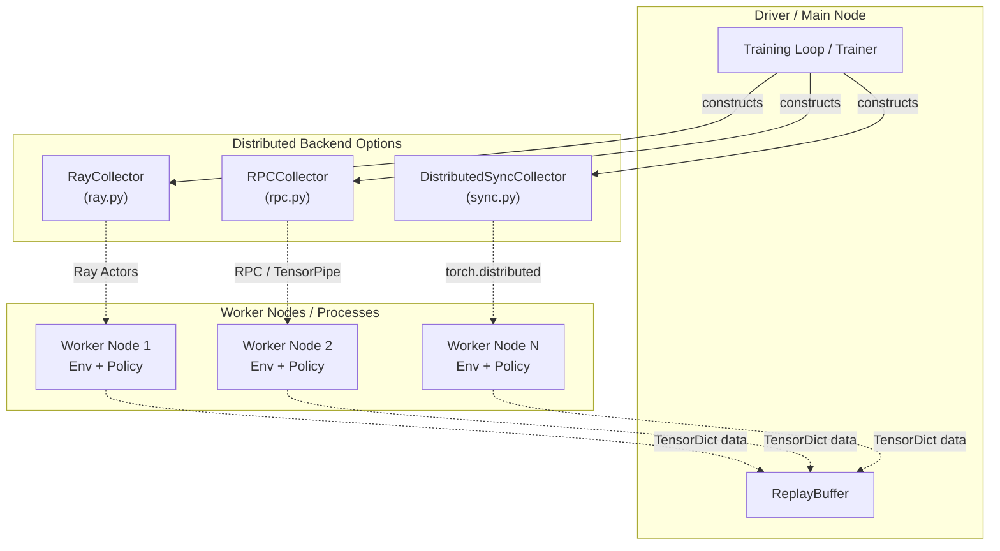
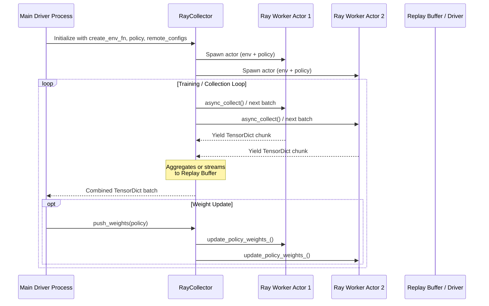
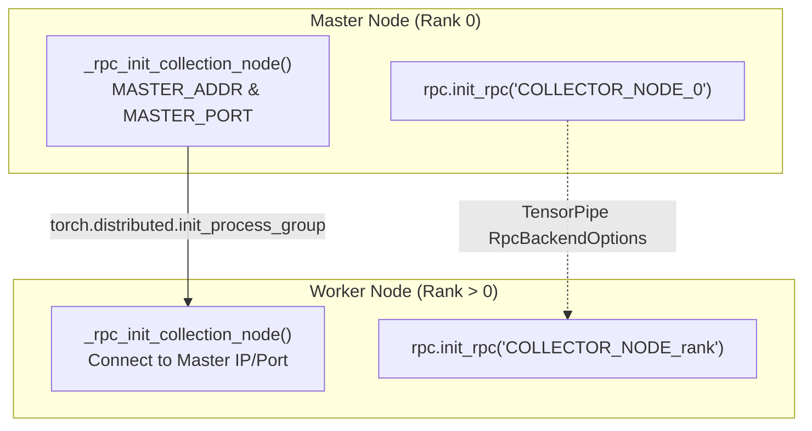
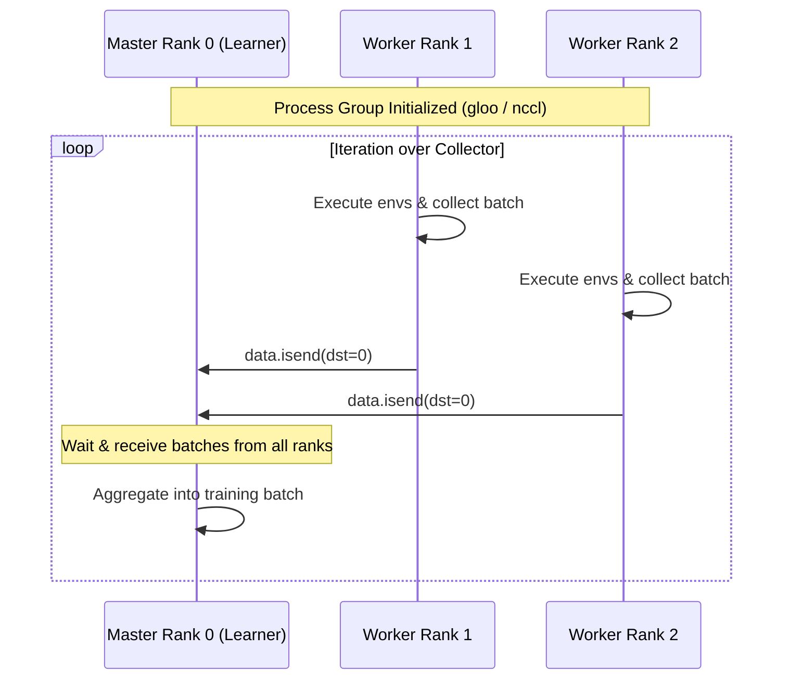
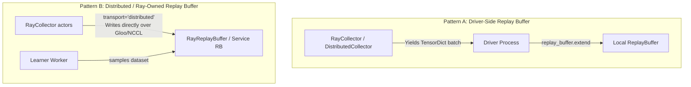

<!-- source: DeepWiki mcp.deepwiki.com · repo pytorch/rl · page 4.2 Distributed Collection Strategies · fetched 2026-10-21 -->

# Distributed Collection Strategies

<details>
<summary>Relevant source files</summary>

The following files were used as context for generating this wiki page:

- [docs/source/reference/collectors.rst](docs/source/reference/collectors.rst)
- [examples/distributed/collectors/multi_nodes/delayed_dist.py](examples/distributed/collectors/multi_nodes/delayed_dist.py)
- [examples/distributed/collectors/multi_nodes/delayed_rpc.py](examples/distributed/collectors/multi_nodes/delayed_rpc.py)
- [examples/distributed/collectors/multi_nodes/generic.py](examples/distributed/collectors/multi_nodes/generic.py)
- [examples/distributed/collectors/multi_nodes/ray_train.py](examples/distributed/collectors/multi_nodes/ray_train.py)
- [examples/distributed/collectors/multi_nodes/rpc.py](examples/distributed/collectors/multi_nodes/rpc.py)
- [examples/distributed/collectors/multi_nodes/sync.py](examples/distributed/collectors/multi_nodes/sync.py)
- [examples/distributed/collectors/single_machine/generic.py](examples/distributed/collectors/single_machine/generic.py)
- [examples/distributed/collectors/single_machine/rpc.py](examples/distributed/collectors/single_machine/rpc.py)
- [examples/distributed/collectors/single_machine/sync.py](examples/distributed/collectors/single_machine/sync.py)
- [examples/distributed/replay_buffers/distributed_replay_buffer.py](examples/distributed/replay_buffers/distributed_replay_buffer.py)
- [test/test_distributed.py](test/test_distributed.py)
- [torchrl/collectors/__init__.py](torchrl/collectors/__init__.py)
- [torchrl/collectors/distributed/__init__.py](torchrl/collectors/distributed/__init__.py)
- [torchrl/collectors/distributed/generic.py](torchrl/collectors/distributed/generic.py)
- [torchrl/collectors/distributed/rpc.py](torchrl/collectors/distributed/rpc.py)
- [torchrl/collectors/distributed/sync.py](torchrl/collectors/distributed/sync.py)
- [torchrl/collectors/distributed/utils.py](torchrl/collectors/distributed/utils.py)
- [torchrl/collectors/weight_update.py](torchrl/collectors/weight_update.py)
- [torchrl/trainers/_ray_execution.py](torchrl/trainers/_ray_execution.py)

</details>


This page covers TorchRL's distributed data collection strategies for multi-node and large-scale multi-process setups, including Ray-based collectors, `torch.distributed.rpc` collectors, generic `torch.distributed` sync collectors (`DistributedSyncCollector`), submitit launching, and coordination patterns with replay buffers. For local multi-process collection (`MultiSyncCollector` and `MultiAsyncCollector`), see [Collector Architecture](#4.1). For weight synchronization schemes across workers, see [Weight Synchronization](#4.3).

---

## 1. Overview of Distributed Collectors

When scaling reinforcement learning workloads beyond a single machine, TorchRL provides three primary distributed collection backends wrapped by the unified `Collector` class (`torchrl/collectors/collectors.py`) or specialized classes:

1. **Ray Collectors (`RayCollector`)**: Built on Ray actors, supporting asynchronous execution, custom placement groups, and direct object-store or replay buffer integration `[torchrl/collectors/distributed/ray.py]`.
2. **RPC Collectors (`RPCCollector`)**: Uses `torch.distributed.rpc` (TensorPipe backend) for remote procedure calls and weight/data transport `[torchrl/collectors/distributed/rpc.py]`.
3. **Generic Distributed Collectors (`DistributedSyncCollector`, `DistributedCollector`)**: Uses native `torch.distributed` process groups and collective operations (such as `isend`/`irecv` or `torch.distributed` process groups) for high-performance cluster collection `[torchrl/collectors/distributed/sync.py, torchrl/collectors/distributed/generic.py]`.



Sources: `[torchrl/collectors/distributed/ray.py]`, `[torchrl/collectors/distributed/rpc.py]`, `[torchrl/collectors/distributed/sync.py]`, `[docs/source/reference/collectors.rst:1-131]()`

---

## 2. Ray-Based Collectors (`RayCollector`)

`RayCollector` manages collection across distributed Ray actors. It integrates seamlessly with Ray clusters, allowing fine-grained specification of CPU, GPU, and memory resources per worker `[examples/distributed/collectors/multi_nodes/ray_train.py:113-134]()`.

### Architecture and Execution Flow



Sources: `[examples/distributed/collectors/multi_nodes/ray_train.py:113-196]()`, `[torchrl/trainers/_ray_execution.py:117-185]()`

### Key Configuration Parameters

- `create_env_fn`: A list of environment callables or an environment factory replicated across workers `[examples/distributed/collectors/multi_nodes/ray_train.py:120]()`.
- `policy`: The policy module executed inside the workers `[examples/distributed/collectors/multi_nodes/ray_train.py:121]()`.
- `remote_configs`: A dictionary specifying Ray actor resource allocation (e.g., `{"num_cpus": 1, "num_gpus": 0.1, "memory": 1024**3}`) `[examples/distributed/collectors/multi_nodes/ray_train.py:113-118]()`.
- `sync`: Boolean flag determining whether collection is synchronous (`True`) or asynchronous (`False`) `[examples/distributed/collectors/multi_nodes/ray_train.py:130]()`.

---

## 3. RPC-Based Collectors (`RPCCollector`)

`RPCCollector` utilizes PyTorch's native `torch.distributed.rpc` framework with the `TensorPIPE` backend `[torchrl/collectors/distributed/rpc.py:24-105]()`. It is well-suited for cross-node setups where workers communicate via TCP and TensorPipe channels.

### Initialization and Handshake

When an `RPCCollector` starts, nodes initialize their process groups for weight transfers and establish TensorPipe RPC endpoints:



Sources: `[torchrl/collectors/distributed/rpc.py:55-105]()`

---

## 4. Generic Distributed Collectors (`DistributedSyncCollector`)

`DistributedSyncCollector` (`torchrl/collectors/distributed/sync.py`) and generic distributed launchers (`torchrl/collectors/distributed/generic.py`) coordinate distributed training nodes using standard `torch.distributed` process groups without requiring Ray or RPC infrastructure.

### Synchronous Iteration Pattern

In `DistributedSyncCollector`, each rank runs an independent sub-collector (`Collector` or `MultiSyncCollector`), collects its portion of `frames_per_batch`, and uses non-blocking communication (`data.isend(dst=0)`) to send collected `TensorDict` batches back to rank 0 `[torchrl/collectors/sync.py:117-124]()`.



Sources: `[torchrl/collectors/distributed/sync.py:116-125]()`, `[examples/distributed/collectors/single_machine/sync.py:129-144]()`

---

## 5. Submitit Launching for Distributed Clusters

TorchRL's distributed collectors integrate directly with **Submitit** (`launcher="submitit"`), enabling seamless submission of multi-node RL jobs to cluster schedulers such as SLURM `[examples/distributed/collectors/multi_nodes/rpc.py:68-101]()`.

### Slurm Job Configuration

When launching with Submitit, cluster parameters are passed via `slurm_kwargs`:

```python
slurm_conf = {
    "timeout_min": 100,
    "slurm_partition": "train",
    "slurm_cpus_per_gpu": 8,
    "slurm_gpus_per_task": 1,
}
collector = RPCCollector(
    [make_env] * num_nodes,
    RandomPolicy(action_spec),
    num_workers_per_collector=num_workers,
    frames_per_batch=frames_per_batch,
    total_frames=args.total_frames,
    slurm_kwargs=slurm_conf,
    launcher="submitit",
)
```
Sources: `[examples/distributed/collectors/multi_nodes/rpc.py:70-101]()`

---

## 6. Coordination with Replay Buffers

Distributed collectors coordinate with replay buffers using two primary patterns: **Driver-side aggregation** and **Distributed/Ray-owned replay buffers**.

### Driver-Side vs Remote Replay Coordination



Sources: `[docs/source/reference/collectors.rst:117-130]()`, `[examples/distributed/collectors/multi_nodes/ray_train.py:137-177]()`

1. **Driver-Side Aggregation**: The distributed collector yields a complete batch to the driver loop, which then pushes the data into a local or shared replay buffer (e.g., standard PPO training loops) `[examples/distributed/collectors/multi_nodes/ray_train.py:169-177]()`.
2. **High-Throughput Ray Data Path**: For fixed-layout TensorDict payloads, collectors write directly to a Ray-owned replay buffer (`service_backend="ray"` and `transport="distributed"`), bypassing driver-side bottlenecks `[docs/source/reference/collectors.rst:117-130]()`.

---

## Sources
- `[test/test_distributed.py:1-213]()`
- `[torchrl/collectors/distributed/rpc.py:1-166]()`
- `[docs/source/reference/collectors.rst:1-165]()`
- `[torchrl/collectors/distributed/generic.py:1-211]()`
- `[torchrl/collectors/distributed/sync.py:1-174]()`
- `[torchrl/collectors/weight_update.py:1-159]()`
- `[torchrl/collectors/__init__.py:1-47]()`
- `[examples/distributed/collectors/multi_nodes/ray_train.py:1-196]()`
- `[torchrl/collectors/distributed/__init__.py:1-25]()`
- `[torchrl/trainers/_ray_execution.py:1-185]()`
- `[examples/distributed/collectors/multi_nodes/rpc.py:1-115]()`
- `[examples/distributed/collectors/single_machine/sync.py:1-158]()`

---

