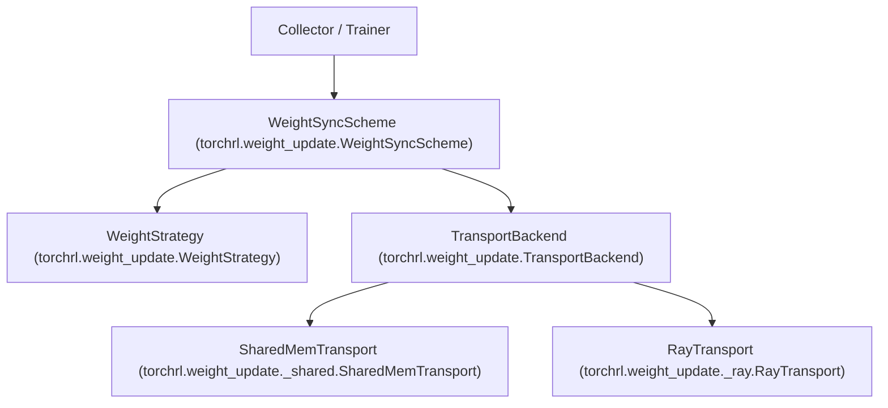
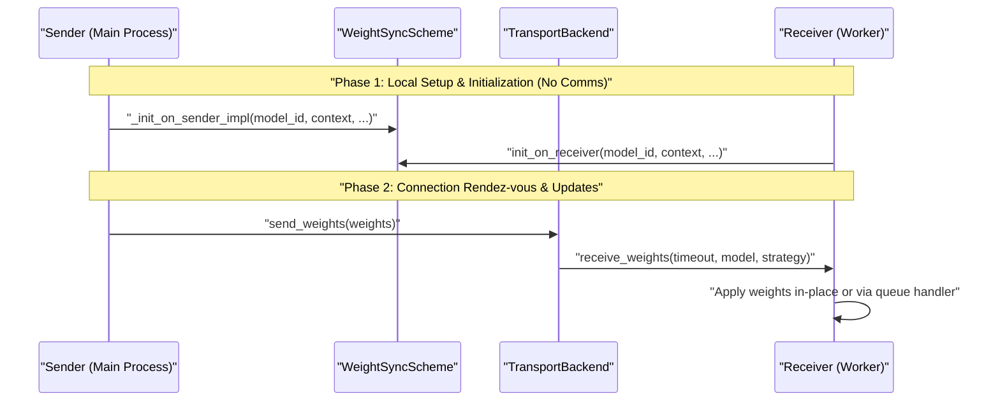

<!-- source: DeepWiki mcp.deepwiki.com · repo pytorch/rl · page 4.3 Weight Synchronization · fetched 2026-10-21 -->

# Weight Synchronization

Relevant source files

The following files were used as context for generating this wiki page:

- [.github/unittest/linux_libs/scripts_isaaclab/isaac.sh](.github/unittest/linux_libs/scripts_isaaclab/isaac.sh)
- [docs/source/reference/collectors_weightsync.rst](docs/source/reference/collectors_weightsync.rst)
- [test/collectors/test_evaluator.py](test/collectors/test_evaluator.py)
- [test/transforms/test_timer_video.py](test/transforms/test_timer_video.py)
- [torchrl/collectors/_constants.py](torchrl/collectors/_constants.py)
- [torchrl/collectors/_evaluator.py](torchrl/collectors/_evaluator.py)
- [torchrl/collectors/distributed/_ray_eval_runtime.py](torchrl/collectors/distributed/_ray_eval_runtime.py)
- [torchrl/collectors/distributed/ray_eval_worker.py](torchrl/collectors/distributed/ray_eval_worker.py)
- [torchrl/weight_update/_distributed.py](torchrl/weight_update/_distributed.py)
- [torchrl/weight_update/_mp.py](torchrl/weight_update/_mp.py)
- [torchrl/weight_update/_ray.py](torchrl/weight_update/_ray.py)
- [torchrl/weight_update/_rpc.py](torchrl/weight_update/_rpc.py)
- [torchrl/weight_update/_shared.py](torchrl/weight_update/_shared.py)
- [torchrl/weight_update/weight_sync_schemes.py](torchrl/weight_update/weight_sync_schemes.py)

The weight synchronization subsystem in TorchRL bridges the computational split between the training pipeline (which computes gradients and updates model parameters) and the inference/data collection pipeline (which gathers experience rollouts using policy weights). Because collectors [docs/source/reference/collectors_weightsync.rst:12-14]() can run across multiple threads, separate operating system processes, Ray actors, or distributed cluster nodes, TorchRL provides an extensible abstraction layer under `torchrl.weight_update` to propagate parameter updates efficiently.

This document details the core architectural components (`WeightSyncScheme`, `TransportBackend`, and `WeightStrategy`), concrete backend implementations (shared memory, multiprocessing, distributed, and Ray), CPU staging fallbacks, and the synchronization lifecycle.

---

## Architecture of the `weight_update` Module

TorchRL decouples weight synchronization into three primary abstractions defined in `torchrl.weight_update.weight_sync_schemes`:
1. **`WeightSyncScheme`**: Orchestrates the synchronization lifecycle, including initialization, connection setup, and transmission coordination [docs/source/reference/collectors_weightsync.rst:29-30]().
2. **`TransportBackend`**: Implements the data-plane protocol for transferring raw weight values across process or network boundaries (`shared`, `process`, `distributed`, `ray`) [docs/source/reference/collectors_weightsync.rst:31-32]().
3. **`WeightStrategy`**: Manages weight extraction and application, translating between PyTorch modules, `TensorDict` instances, and state dictionaries [docs/source/reference/collectors_weightsync.rst:33-34]().

Sources: `torchrl/weight_update/weight_sync_schemes.py:39-68`(), `torchrl/weight_update/_shared.py:59-81`(), `torchrl/weight_update/_ray.py:84-104`(), `docs/source/reference/collectors_weightsync.rst:26-36`()

---

## `WeightSyncScheme` Implementations

TorchRL provides several backend implementations registered via `register_weight_sync_backend` [torchrl/weight_update/weight_sync_schemes.py:114-123]().

### 1. Shared Memory (`shared` / `thread`)
Implemented via `SharedMemTransport` in `torchrl/weight_update/_shared.py`, this scheme creates shared-memory tensors during initialization and updates them in-place [torchrl/weight_update/_shared.py:59-69]().
* **Data Flow**: Workers receive references to shared memory blocks via per-worker queues during connection setup. Subsequent updates are pure in-place writes with zero copy overhead [torchrl/weight_update/_shared.py:66-69]().
* **Target Scenarios**: Single-machine multi-thread or multi-process environments where shared memory is natively supported.

### 2. Multiprocessing (`process` / `multiprocessing`)
Implemented via `MultiProcessWeightSyncScheme` in `torchrl/weight_update/_mp.py`, this scheme extends `SharedMemWeightSyncScheme` but sends explicit weight copies through queues rather than mutating shared memory in-place [torchrl/weight_update/_mp.py:18-24]().
* **Data Flow**: A background thread on the receiver listens for update instructions, reads from the weight queue, and applies the weights to the local model [torchrl/weight_update/_mp.py:25-28]().
* **Memory Management**: Weights are created on-demand during `synchronize_weights()`, allowing Python garbage collection between workers to minimize peak memory consumption [torchrl/weight_update/_mp.py:31-38]().

### 3. Distributed (`distributed`)
Implemented via `DistributedWeightSyncScheme` in `torchrl/weight_update/_distributed.py`, this scheme leverages `torch.distributed` primitives (`send`/`recv`) paired with a `TCPStore` rendezvous server [torchrl/weight_update/_distributed.py:35-44]().
* **Coordination**: The scheme automatically provisions a `TCPStore` (offset from the collector's port to prevent collisions) to coordinate ranks [torchrl/weight_update/_distributed.py:127-132]().
* **Operation Mode**: Supports both synchronous blocking updates (`sync=True`) and asynchronous background monitoring (`sync=False`) [torchrl/weight_update/_distributed.py:48-50]().

### 4. Ray (`ray`)
Implemented via `RayTransport` in `torchrl/weight_update/_ray.py`, this backend uses Ray for signaling and process coordination while transferring tensor payloads over a dedicated `torch.distributed` process group [torchrl/weight_update/_ray.py:84-90]().
* **Connection Handling**: Uses `ConnectionInfo` dataclasses to exchange master addresses, ports, and world sizes across Ray actors without signature introspection failures [torchrl/weight_update/_ray.py:55-68]().

Sources: `torchrl/weight_update/_shared.py:59-81`(), `torchrl/weight_update/_mp.py:18-70`(), `torchrl/weight_update/_distributed.py:35-64`(), `torchrl/weight_update/_ray.py:84-114`()

---

## Weight Strategies & CPU Staging Fallbacks

### `WeightStrategy`
The `WeightStrategy` class (`torchrl/weight_update/weight_sync_schemes.py`) handles model serialization and deserialization [torchrl/weight_update/weight_sync_schemes.py:145-148](). It supports two extraction targets:
* `"tensordict"` (default): Extracts weights using `TensorDict.from_module(source)` and captures extra state (e.g., running statistics in `VecNormV2`) under `__extra_state__` [torchrl/weight_update/weight_sync_schemes.py:160-196]().
* `"state_dict"`: Experimental extraction as standard PyTorch state dictionaries [torchrl/weight_update/weight_sync_schemes.py:161-165]().

### CPU Staging Fallbacks
Sharing CUDA tensors across processes relies on CUDA Inter-Process Communication (IPC). CUDA IPC is restricted to native Linux platforms and is unavailable on Windows, WSL2, or alternative hardware backends like Apple Silicon (MPS). 
* **Fallback Behavior**: When CUDA IPC or shared memory across distinct hardware contexts is unavailable, the shared memory and multiprocessing schemes stage weight tensors through **CPU shared memory** [torchrl/weight_update/_shared.py:73-79]().
* **Device Migration**: Senders serialize and place tensors into CPU shared buffers; receivers read from the CPU buffer and asynchronously transfer parameters back to their assigned local device (`cpu` or `cuda:X`) [torchrl/weight_update/_shared.py:76-79]().

Sources: `torchrl/weight_update/weight_sync_schemes.py:145-202`(), `torchrl/weight_update/_shared.py:71-79`()

---

## Lifecycle of Weight Synchronization

Weight synchronization follows a strict two-phase initialization and update lifecycle separating local setup from inter-process transport initialization [docs/source/reference/collectors_weightsync.rst:67-71]().

1. **Phase 1 (Initialization)**: `init_on_sender` configures local mappings, devices, and transport handles without triggering network communication [docs/source/reference/collectors_weightsync.rst:85-87](). Simultaneously, workers invoke `init_on_receiver` to resolve target model structures [docs/source/reference/collectors_weightsync.rst:103-105]().
2. **Phase 2 (Rendezvous & Sync)**: Transports establish connections (e.g., via `TCPStore`, Ray actors, or queues) and execute initial weight distribution [docs/source/reference/collectors_weightsync.rst:91-93](). Ongoing updates are dispatched via `send_weights()` and consumed by background loops or remote handlers on workers [docs/source/reference/collectors_weightsync.rst:95-98]().

Sources: `docs/source/reference/collectors_weightsync.rst:67-114`()

---

