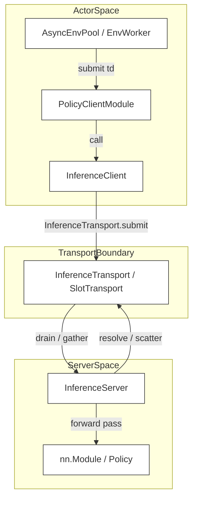
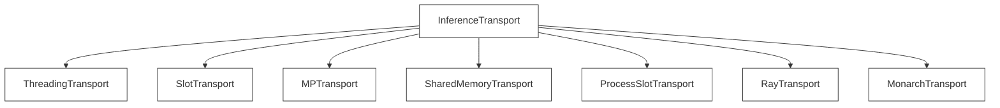
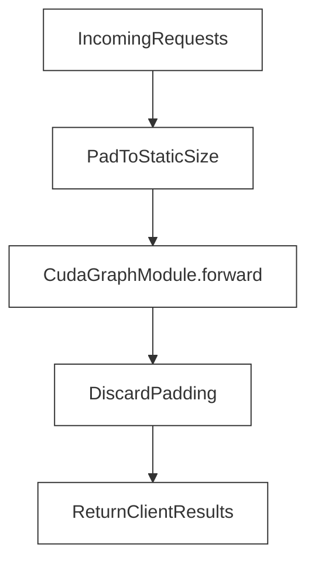
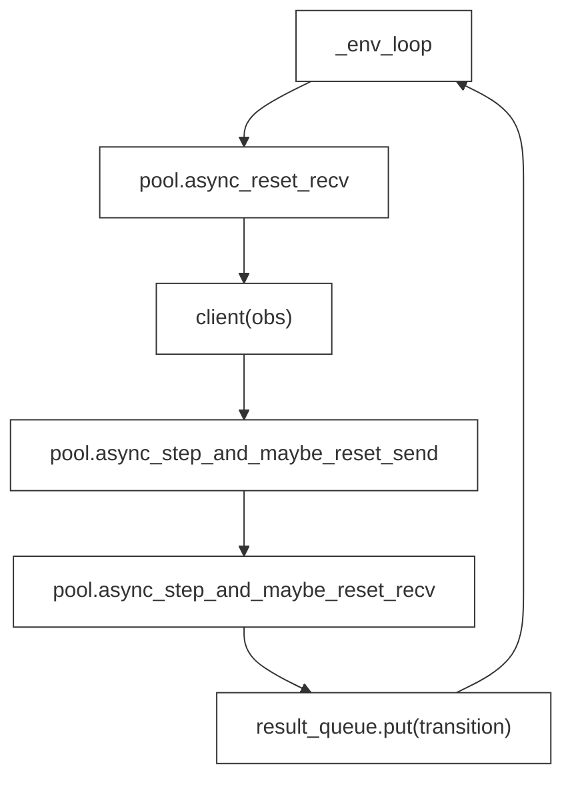

<!-- source: DeepWiki mcp.deepwiki.com · repo pytorch/rl · page 4.4 Inference Server · fetched 2026-10-21 -->

# Inference Server

Relevant source files

The following files were used as context for generating this wiki page:

- [benchmarks/ad_hoc/bench_inference_server_cudagraph.py](benchmarks/ad_hoc/bench_inference_server_cudagraph.py)
- [benchmarks/bench_collectors.py](benchmarks/bench_collectors.py)
- [benchmarks/bench_inference_server.py](benchmarks/bench_inference_server.py)
- [docs/source/reference/collectors_single.rst](docs/source/reference/collectors_single.rst)
- [docs/source/reference/modules_inference_server.rst](docs/source/reference/modules_inference_server.rst)
- [docs/source/reference/services_workflow.rst](docs/source/reference/services_workflow.rst)
- [test/test_inference_server.py](test/test_inference_server.py)
- [torchrl/_comm/mailbox.py](torchrl/_comm/mailbox.py)
- [torchrl/collectors/_async_batched.py](torchrl/collectors/_async_batched.py)
- [torchrl/modules/inference_server/__init__.py](torchrl/modules/inference_server/__init__.py)
- [torchrl/modules/inference_server/_client.py](torchrl/modules/inference_server/_client.py)
- [torchrl/modules/inference_server/_config.py](torchrl/modules/inference_server/_config.py)
- [torchrl/modules/inference_server/_factory.py](torchrl/modules/inference_server/_factory.py)
- [torchrl/modules/inference_server/_mp.py](torchrl/modules/inference_server/_mp.py)
- [torchrl/modules/inference_server/_process_slot.py](torchrl/modules/inference_server/_process_slot.py)
- [torchrl/modules/inference_server/_queue_transport.py](torchrl/modules/inference_server/_queue_transport.py)
- [torchrl/modules/inference_server/_server.py](torchrl/modules/inference_server/_server.py)
- [torchrl/modules/inference_server/_shared_memory.py](torchrl/modules/inference_server/_shared_memory.py)
- [torchrl/modules/inference_server/_slot.py](torchrl/modules/inference_server/_slot.py)
- [torchrl/modules/inference_server/_slot_utils.py](torchrl/modules/inference_server/_slot_utils.py)
- [torchrl/modules/inference_server/_threading.py](torchrl/modules/inference_server/_threading.py)
- [torchrl/modules/inference_server/_transport.py](torchrl/modules/inference_server/_transport.py)

The inference server subsystem in TorchRL (`torchrl/modules/inference_server`) provides auto-batching model serving for reinforcement learning actors [docs/source/reference/modules_inference_server.rst:8-10](). Multiple worker threads or processes submit individual `TensorDict` observation payloads; the server transparently aggregates them into a single batched tensor, executes a forward pass through a neural network policy, and routes the corresponding outputs back to the originating clients [docs/source/reference/modules_inference_server.rst:8-10]().

---

## 1. Core Server and Client Architecture

The server-client architecture decouples environment execution from policy evaluation. The primary entry points are `InferenceServer`, `InferenceClient`, and `PolicyClientModule` [torchrl/modules/inference_server/__init__.py:16-19]().

### `InferenceServer` and `InferenceClient`
`InferenceServer` manages the background inference loop, pulling requests from a configured transport layer, grouping them into batches up to `max_batch_size`, running the model, and dispatching replies [docs/source/reference/modules_inference_server.rst:8-10](). `InferenceClient` (or transport-specific equivalents) runs on the actor side, providing a submission interface that returns a `concurrent.futures.Future` or equivalent future proxy [torchrl/modules/inference_server/_transport.py:33-44]().

### `PolicyClientModule`
`PolicyClientModule` wraps an inference client to duck-type a standard TorchRL policy module (`TensorDictModuleBase`) [torchrl/modules/inference_server/_client.py:146-154](). It accepts a `TensorDictBase` observation, submits it to the remote inference server, and returns the resulting `TensorDict` containing actions [torchrl/modules/inference_server/_client.py:149-167]().

*Figure 1: Data flow bridging actor environment workers to the batched inference server via `InferenceTransport` [docs/source/reference/modules_inference_server.rst:8-10]().*

Sources: `torchrl/modules/inference_server/__init__.py:16-19](), `torchrl/modules/inference_server/_client.py:146-167](), `torchrl/modules/inference_server/_transport.py:33-44]()`.

---

## 2. Transport Backends

Communication between clients and servers is mediated by `InferenceTransport` subclasses [torchrl/modules/inference_server/_transport.py:13-14](). The transport abstraction defines methods for request submission, server-side draining (`drain`), work notification (`wait_for_work`), and result resolution (`resolve`) [torchrl/modules/inference_server/_transport.py:32-92]().

| Transport Class | Scope | Description |
| :--- | :--- | :--- |
| `ThreadingTransport` | In-process | Thread-safe queue-based transport for threads within the same process [docs/source/reference/modules_inference_server.rst:57-58](). |
| `SlotTransport` | In-process | Lock-free, pre-allocated slot transport eliminating mutex contention for thread pools [torchrl/modules/inference_server/_slot.py:96-109](). |
| `MPTransport` | Cross-process | Multiprocessing queue transport for separate OS processes. |
| `SharedMemoryTransport` | Cross-process | Preallocated shared-memory slot banks for zero-copy or low-overhead tensor exchange [docs/source/reference/modules_inference_server.rst:157-167](). |
| `ProcessSlotTransport` | Cross-process | Fixed process-shared slot transport using semaphores and shared byte arrays [torchrl/modules/inference_server/_process_slot.py:33-77](). |
| `RayTransport` | Distributed | Ray actor RPC transport for distributed workers [docs/source/reference/modules_inference_server.rst:35-36](). |
| `MonarchTransport` | Specialized | Specialized transport backend for Monarch runtimes [torchrl/modules/inference_server/_monarch.py](). |

*Figure 2: Inheritance hierarchy of `InferenceTransport` implementations in `torchrl.modules.inference_server` [torchrl/modules/inference_server/__init__.py:25-40]().*

Sources: `torchrl/modules/inference_server/_transport.py:13-107](), `torchrl/modules/inference_server/_slot.py:96-128](), `torchrl/modules/inference_server/_process_slot.py:33-77]()`.

---

## 3. Auto-Batching and Static CUDA-Graph Acceleration

`InferenceServer` automatically collects pending requests into a single batched tensor up to `max_batch_size`. For CUDA policies, overhead can be further minimized using static CUDA graphs [docs/source/reference/modules_inference_server.rst:87-95]().

### Static Batches and `CudaGraphModule`
When `static_batch_size` and an explicit CUDA `policy_device` are configured, the server captures a CUDA graph via `tensordict.nn.CudaGraphModule` [docs/source/reference/modules_inference_server.rst:87-91](). Incoming batches smaller than `static_batch_size` are padded by cloning the final real request into pad rows [docs/source/reference/modules_inference_server.rst:87-95](). The server replays the captured graph at the fixed size, discards the padded outputs, and returns owned copies to each client [docs/source/reference/modules_inference_server.rst:87-95]().

*Figure 3: Execution pipeline for static CUDA graph batching in `InferenceServer` [docs/source/reference/modules_inference_server.rst:87-95]().*

Sources: `torchrl/modules/inference_server/_server.py:82-90](), `docs/source/reference/modules_inference_server.rst:87-132]()`.

---

## 4. Async Batched Collectors

`AsyncBatchedCollector` (`torchrl.collectors._async_batched`) integrates `AsyncEnvPool` with `InferenceServer` to pipeline environment stepping and batched GPU inference [docs/source/reference/modules_inference_server.rst:123-125](), `docs/source/reference/collectors_single.rst:93-96]().

### Execution Loop
Each worker thread owns a slot in the environment pool and an inference client [torchrl/collectors/_async_batched.py:135-156](). The worker thread alternates between resetting/stepping environments and querying the policy server asynchronously [torchrl/collectors/_async_batched.py:153-188]().

*Figure 4: Per-environment worker thread loop executing asynchronous step-inference cycles [torchrl/collectors/_async_batched.py:135-188]().*

Sources: `torchrl/collectors/_async_batched.py:71-189]()`.

---

## 5. Device Configuration

Device placement across the policy server, environment workers, and storage buffers is managed by `InferenceDeviceConfig` and resolved via `_resolve_device_config` [torchrl/modules/inference_server/_config.py:36-108]().

### `InferenceDeviceConfig` Fields
* `policy_device`: Device holding the policy weights and processing server inputs [torchrl/modules/inference_server/_config.py:46-47]().
* `output_device`: Device for inference results returned by the server [torchrl/modules/inference_server/_config.py:48-49]().
* `env_device`: Device used when stepping environments [torchrl/modules/inference_server/_config.py:50-52]().
* `storing_device`: Device used for collected transitions yielded by the collector [torchrl/modules/inference_server/_config.py:53-54]().

Sources: `torchrl/modules/inference_server/_config.py:36-97]()`.

---

