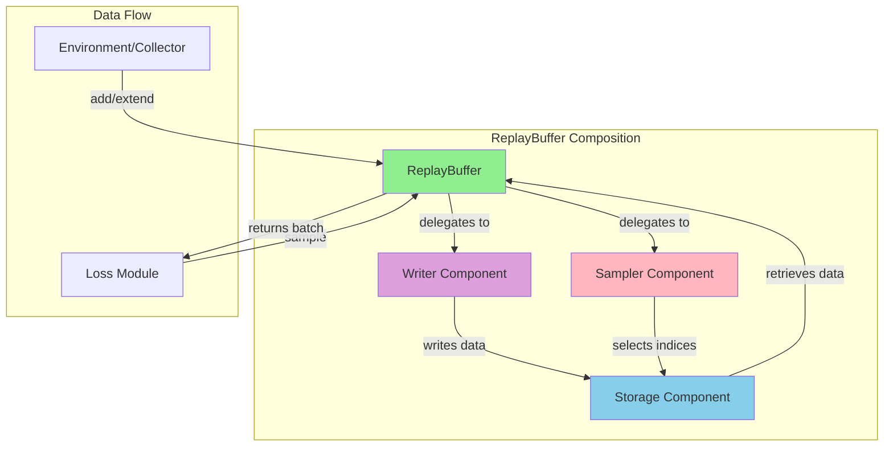

<!-- source: DeepWiki mcp.deepwiki.com · repo pytorch/rl · page 5 Replay Buffers · fetched 2026-10-21 -->

# Replay Buffers

<details>
<summary>Relevant source files</summary>

The following files were used as context for generating this wiki page:

- [benchmarks/test_replaybuffer_benchmark.py](benchmarks/test_replaybuffer_benchmark.py)
- [docs/source/reference/data.rst](docs/source/reference/data.rst)
- [docs/source/reference/data_replaybuffers.rst](docs/source/reference/data_replaybuffers.rst)
- [test/rb/test_rb_core.py](test/rb/test_rb_core.py)
- [test/rb/test_rb_distributed.py](test/rb/test_rb_distributed.py)
- [test/rb/test_storages.py](test/rb/test_storages.py)
- [torchrl/_comm/replay_service.py](torchrl/_comm/replay_service.py)
- [torchrl/data/__init__.py](torchrl/data/__init__.py)
- [torchrl/data/replay_buffers/__init__.py](torchrl/data/replay_buffers/__init__.py)
- [torchrl/data/replay_buffers/ray_buffer.py](torchrl/data/replay_buffers/ray_buffer.py)
- [torchrl/data/replay_buffers/replay_buffers/base.py](torchrl/data/replay_buffers/replay_buffers/base.py)

</details>


Replay buffers are memory structures that store experience data collected during reinforcement learning training. They enable **experience replay**, a fundamental technique in off-policy RL algorithms where the agent samples past experiences to update its policy. TorchRL implements replay buffers as **composable systems** built from three independent components: Storage (where data lives), Sampler (how data is selected), and Writer (how data is inserted).

This page provides an overview of the replay buffer system. For implementation details of the composable architecture, see [ReplayBuffer Architecture](#5.1). For advanced features like prioritization, trajectory storage, and checkpointing, see [Advanced Replay Buffer Features](#5.2). For offline dataset integrations, see [Offline Datasets](#5.3).

## Purpose and Design Philosophy

The replay buffer system in TorchRL is designed around three principles:

1. **Composability**: Storage, sampling, and writing strategies are independent and can be mixed freely
2. **Type Flexibility**: Support for tensors, TensorDicts, PyTrees, and arbitrary Python objects
3. **Efficiency**: Memory-mapped storage, lazy initialization, and optimized C++ data structures

Sources: [torchrl/data/replay_buffers/replay_buffers.py:92-247]()

## Core Architecture

The replay buffer system follows a **strategy pattern** where three components collaborate:



**Core Data Flow**:
1. Environment/Collector produces experience → `ReplayBuffer.add()` / `ReplayBuffer.extend()` [torchrl/data/replay_buffers/replay_buffers.py:92-247]()
2. Writer determines insertion location → `Writer.add()` / `Writer.extend()` [torchrl/data/replay_buffers/writers.py:43-636]()
3. Storage persists the data → `Storage.set()` [torchrl/data/replay_buffers/storages.py:57-2000]()
4. Loss module requests batch → `ReplayBuffer.sample()` [torchrl/data/replay_buffers/replay_buffers.py:92-247]()
5. Sampler selects indices → `Sampler.sample()` [torchrl/data/replay_buffers/samplers.py:45-1010]()
6. Storage retrieves data → `Storage.get()` [torchrl/data/replay_buffers/storages.py:57-2000]()

Sources: [torchrl/data/replay_buffers/replay_buffers.py:92-247](), [torchrl/data/replay_buffers/storages.py:57-2000](), [torchrl/data/replay_buffers/samplers.py:45-1010](), [torchrl/data/replay_buffers/writers.py:43-636]()

## Component Types

TorchRL provides multiple implementations of each component that can be freely combined:

### Storage Backends

| Storage Type | Description | Best For | File Reference |
|-------------|-------------|----------|----------------|
| `ListStorage` | Python list storage | Arbitrary objects, small buffers | [torchrl/data/replay_buffers/storages.py:234-429]() |
| `TensorStorage` | Pre-allocated tensor | Fixed-size buffers, fast access | [torchrl/data/replay_buffers/storages.py:504-971]() |
| `LazyTensorStorage` | Lazy-initialized tensor | Unknown data shapes | [torchrl/data/replay_buffers/storages.py:974-1091]() |
| `LazyMemmapStorage` | Memory-mapped storage | Large buffers, disk persistence | [torchrl/data/replay_buffers/storages.py:1094-1305]() |
| `LazyStackStorage` | Heterogeneous structures | Variable-length trajectories | [torchrl/data/replay_buffers/storages.py:431-502]() |
| `CompressedListStorage` | Compressed storage | Memory-constrained environments | [torchrl/data/replay_buffers/storages.py:1669-1931]() |

### Sampling Strategies

| Sampler Type | Description | Use Case | File Reference |
|--------------|-------------|----------|----------------|
| `RandomSampler` | Uniform random sampling | Standard experience replay | [torchrl/data/replay_buffers/samplers.py:120-151]() |
| `SamplerWithoutReplacement` | Sequential no-replacement | Epoch-based training | [torchrl/data/replay_buffers/samplers.py:153-295]() |
| `PrioritizedSampler` | Priority-based sampling | Prioritized Experience Replay (PER) | [torchrl/data/replay_buffers/samplers.py:297-733]() |
| `SliceSampler` | Trajectory slice sampling | Recurrent networks, temporal structure | [torchrl/data/replay_buffers/samplers.py:736-864]() |
| `PrioritizedSliceSampler` | Prioritized trajectory slices | PER + recurrence | [torchrl/data/replay_buffers/samplers.py:867-1010]() |

### Writing Policies

| Writer Type | Description | Behavior | File Reference |
|-------------|-------------|----------|----------------|
| `RoundRobinWriter` | Circular buffer overwrite | FIFO replacement | [torchrl/data/replay_buffers/writers.py:147-310]() |
| `TensorDictRoundRobinWriter` | TensorDict-aware round-robin | Adds index tracking | [torchrl/data/replay_buffers/writers.py:312-361]() |
| `TensorDictMaxValueWriter` | Top-K based on priority | Keeps highest-priority samples | [torchrl/data/replay_buffers/writers.py:363-636]() |

Sources: [torchrl/data/replay_buffers/storages.py:57-2000](), [torchrl/data/replay_buffers/samplers.py:45-1010](), [torchrl/data/replay_buffers/writers.py:43-636]()

## Class Hierarchy and Code Entities

The following diagram maps natural language concepts to concrete code classes within the codebase:

```mermaid
graph TB
    subgraph "Base Classes"
        RBBase["ReplayBuffer<br/>(replay_buffers.py:92)"]
        StorageBase["Storage<br/>(storages.py:57)"]
        SamplerBase["Sampler<br/>(samplers.py:45)"]
        WriterBase["Writer<br/>(writers.py:43)"]
    end
    
    subgraph "Specialized ReplayBuffers"
        TDRB["TensorDictReplayBuffer<br/>(replay_buffers.py:1244)"]
        PRB["PrioritizedReplayBuffer<br/>(replay_buffers.py:1574)"]
        TDPRB["TensorDictPrioritizedReplayBuffer<br/>(replay_buffers.py:1713)"]
        RemoteRB["RemoteTensorDictReplayBuffer<br/>(replay_buffers.py:1869)"]
        RBEnsemble["ReplayBufferEnsemble<br/>(replay_buffers.py:1956)"]
    end
    
    subgraph "Storage Implementations"
        ListSt["ListStorage<br/>(storages.py:234)"]
        TensorSt["TensorStorage<br/>(storages.py:504)"]
        LazyTensorSt["LazyTensorStorage<br/>(storages.py:974)"]
        LazyMemmapSt["LazyMemmapStorage<br/>(storages.py:1094)"]
        LazyStackSt["LazyStackStorage<br/>(storages.py:431)"]
    end
    
    subgraph "Sampler Implementations"
        RandomSamp["RandomSampler<br/>(samplers.py:120)"]
        NoReplaceSamp["SamplerWithoutReplacement<br/>(samplers.py:153)"]
        PrioSamp["PrioritizedSampler<br/>(samplers.py:297)"]
        SliceSamp["SliceSampler<br/>(samplers.py:736)"]
    end
    
    subgraph "Writer Implementations"
        RRWriter["RoundRobinWriter<br/>(writers.py:147)"]
        TDRRWriter["TensorDictRoundRobinWriter<br/>(writers.py:312)"]
        MaxWriter["TensorDictMaxValueWriter<br/>(writers.py:363)"]
    end
    
    RBBase -.->|"inherits"| TDRB
    RBBase -.->|"inherits"| PRB
    RBBase -.->|"inherits"| TDPRB
    RBBase -.->|"inherits"| RemoteRB
    RBBase -.->|"inherits"| RBEnsemble
    
    StorageBase -.->|"implements"| ListSt
    StorageBase -.->|"implements"| TensorSt
    StorageBase -.->|"implements"| LazyTensorSt
    StorageBase -.->|"implements"| LazyMemmapSt
    StorageBase -.->|"implements"| LazyStackSt
    
    SamplerBase -.->|"implements"| RandomSamp
    SamplerBase -.->|"implements"| NoReplaceSamp
    SamplerBase -.->|"implements"| PrioSamp
    SamplerBase -.->|"implements"| SliceSamp
    
    WriterBase -.->|"implements"| RRWriter
    WriterBase -.->|"implements"| TDRRWriter
    WriterBase -.->|"implements"| MaxWriter
    
    RBBase -->|"contains"| StorageBase
    RBBase -->|"contains"| SamplerBase
    RBBase -->|"contains"| WriterBase
```



Sources: [torchrl/data/replay_buffers/__init__.py:1-100](), [torchrl/data/replay_buffers/replay_buffers.py:92-2200](), [torchrl/data/replay_buffers/storages.py:57-2000](), [torchrl/data/replay_buffers/samplers.py:45-1010](), [torchrl/data/replay_buffers/writers.py:43-636]()

## Basic Usage Patterns

### Simple Replay Buffer

The most basic usage combines default components:

```python
from torchrl.data import ReplayBuffer, LazyTensorStorage

# Default: ListStorage(1000) + RandomSampler + RoundRobinWriter
rb = ReplayBuffer(storage=LazyTensorStorage(10000), batch_size=32)

# Add single transition
data = torch.randn(4)
rb.add(data)

# Add batch of transitions
batch = torch.randn(100, 4)
rb.extend(batch)

# Sample batch
sample = rb.sample()  # Returns batch_size=32
```

Sources: [torchrl/data/replay_buffers/replay_buffers.py:180-246]()

### TensorDict Replay Buffer

For structured RL data, use `TensorDictReplayBuffer`:

```python
from torchrl.data import TensorDictReplayBuffer, LazyMemmapStorage
from tensordict import TensorDict

rb = TensorDictReplayBuffer(
    storage=LazyMemmapStorage(100000),
    batch_size=256
)

# Add structured data
data = TensorDict({
    "observation": torch.randn(32, 4),
    "action": torch.randn(32, 2),
    "next": {
        "observation": torch.randn(32, 4),
        "reward": torch.randn(32, 1),
        "done": torch.zeros(32, 1, dtype=torch.bool),
    }
}, batch_size=[32])

rb.extend(data)
sample = rb.sample()  # Returns TensorDict with batch_size=256
```

Sources: [torchrl/data/replay_buffers/replay_buffers.py:1244-1489]()

### Prioritized Experience Replay

Use `PrioritizedSampler` for importance-weighted sampling:

```python
from torchrl.data import TensorDictReplayBuffer, LazyTensorStorage, PrioritizedSampler

rb = TensorDictReplayBuffer(
    storage=LazyTensorStorage(10000),
    sampler=PrioritizedSampler(
        max_capacity=10000,
        alpha=0.7,  # Prioritization exponent
        beta=0.5,   # Importance sampling correction
    ),
    batch_size=32,
    priority_key="td_error"  # Auto-update priorities from this key
)

# Add data with priorities
data = TensorDict({
    "observation": torch.randn(10, 4),
    "action": torch.randn(10, 2),
    "td_error": torch.rand(10),  # Priority values
}, batch_size=[10])
rb.extend(data)

# Sample returns prioritized batch with importance weights
sample, info = rb.sample(return_info=True)
# info contains: {"priority_weight": array([...]), "index": array([...])}
```

Sources: [torchrl/data/replay_buffers/samplers.py:297-733](), [torchrl/data/replay_buffers/replay_buffers.py:1713-1866]()

## Offline Datasets Integration

TorchRL provides built-in dataset loaders under `torchrl.data.datasets` to download, parse, and wrap standard offline reinforcement learning benchmarks into standard `ReplayBuffer` or PyTorch Dataset instances [docs/source/reference/data.rst:1-159](). These include D4RL, Minari, OpenX, VD4RL, Atari-DQN, Roboset, and OpenML.

For comprehensive details on loading static offline datasets, data transforms, and standard interfaces, see [Offline Datasets](#5.3).

Sources: [docs/source/reference/data.rst:1-159](), [torchrl/data/__init__.py:1-245]()

## Child Page Links

- **[ReplayBuffer Architecture](#5.1)** — Composable ReplayBuffer design with Storage backends (`List`, `Tensor`, `Memmap`, compressed), Sampler strategies (`Random`, `Prioritized`, `Slice`), and Writer policies (`RoundRobin`, `MaxValue`).
- **[Advanced Replay Buffer Features](#5.2)** — Prioritized replay, trajectory storage, checkpointing, ensembles, remote/Ray buffers, rate limiting, and post-processing transforms.
- **[Offline Datasets](#5.3)** — `torchrl/data/datasets`: D4RL, Minari, OpenX, VD4RL, Atari-DQN, Roboset, OpenML and common dataset interfaces.

---

