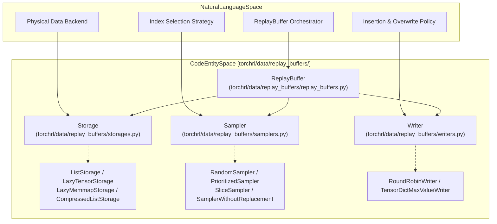
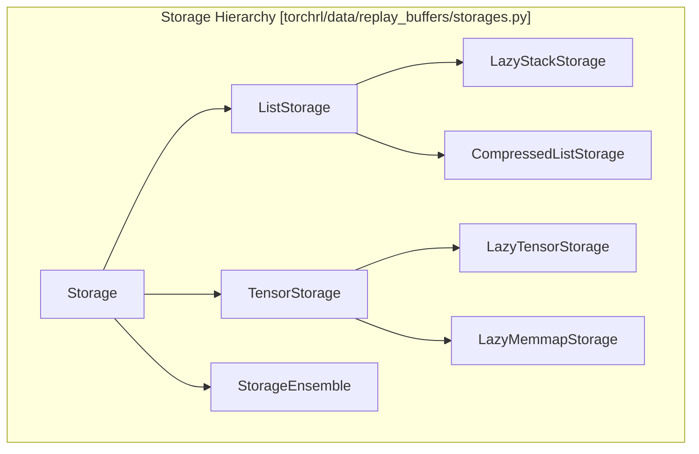
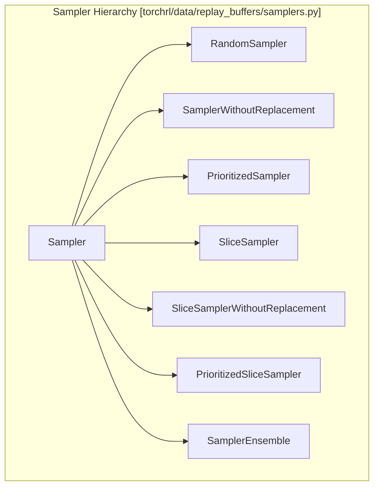
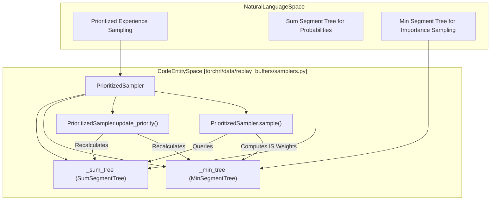
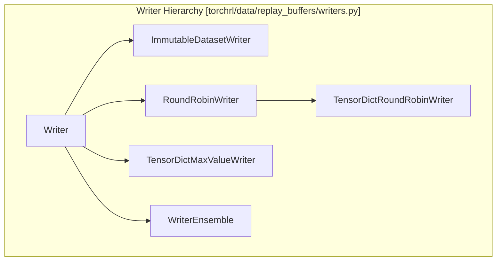

<!-- source: DeepWiki mcp.deepwiki.com · repo pytorch/rl · page 5.1 ReplayBuffer Architecture · fetched 2026-10-21 -->

# ReplayBuffer Architecture

Relevant source files

The following files were used as context for generating this wiki page:

- [benchmarks/test_replaybuffer_benchmark.py](benchmarks/test_replaybuffer_benchmark.py)
- [docs/source/reference/data.rst](docs/source/reference/data.rst)
- [docs/source/reference/data_replaybuffers.rst](docs/source/reference/data_replaybuffers.rst)
- [sota-implementations/offline_to_online/train.py](sota-implementations/offline_to_online/train.py)
- [test/rb/test_prioritized.py](test/rb/test_prioritized.py)
- [test/rb/test_rb_core.py](test/rb/test_rb_core.py)
- [test/rb/test_rb_distributed.py](test/rb/test_rb_distributed.py)
- [test/rb/test_samplers.py](test/rb/test_samplers.py)
- [test/rb/test_storages.py](test/rb/test_storages.py)
- [test/test_offline_to_online.py](test/test_offline_to_online.py)
- [torchrl/_comm/replay_service.py](torchrl/_comm/replay_service.py)
- [torchrl/data/__init__.py](torchrl/data/__init__.py)
- [torchrl/data/replay_buffers/__init__.py](torchrl/data/replay_buffers/__init__.py)
- [torchrl/data/replay_buffers/ray_buffer.py](torchrl/data/replay_buffers/ray_buffer.py)
- [torchrl/data/replay_buffers/replay_buffers/base.py](torchrl/data/replay_buffers/replay_buffers/base.py)
- [torchrl/data/replay_buffers/sample_units.py](torchrl/data/replay_buffers/sample_units.py)
- [torchrl/data/replay_buffers/samplers/base.py](torchrl/data/replay_buffers/samplers/base.py)
- [torchrl/data/replay_buffers/samplers/slice.py](torchrl/data/replay_buffers/samplers/slice.py)
- [torchrl/data/replay_buffers/samplers/slice_without_replacement.py](torchrl/data/replay_buffers/samplers/slice_without_replacement.py)
- [torchrl/data/replay_buffers/scheduler.py](torchrl/data/replay_buffers/scheduler.py)
- [torchrl/data/replay_buffers/utils.py](torchrl/data/replay_buffers/utils.py)
- [torchrl/trainers/algorithms/configs/data.py](torchrl/trainers/algorithms/configs/data.py)

## Purpose and Scope

This document details the architecture of TorchRL's replay buffer system located in `torchrl/data/replay_buffers/`, providing composable, efficient storage and retrieval of experience data for reinforcement learning algorithms [docs/source/reference/data.rst:8-10](). The replay buffer system separates concerns into three primary abstract components—`Storage`, `Sampler`, and `Writer`—which interact under the orchestration of the central `ReplayBuffer` class [torchrl/data/replay_buffers/replay_buffers.py:174-245]().

This page focuses on core component mechanics, data flows, storage backends, sampling strategies, and writer policies. For advanced distribution features (such as Ray actors and distributed transports), see [Advanced Replay Buffer Features](#5.2) and [docs/source/reference/data_replaybuffers.rst:12-21]().

**Sources:** [docs/source/reference/data.rst:8-10](), [torchrl/data/replay_buffers/replay_buffers.py:174-245]()

---

## Core Design Principle: Composability

TorchRL implements a modular design where experience storage, index sampling, and data insertion are handled by decoupled classes [docs/source/reference/data.rst:12-19](). Users mix and match these components to instantiate specialized replay buffers [docs/source/reference/data.rst:31-36]().

Diagram 1 bridges the high-level conceptual modules of the replay buffer system to their concrete code entities defined across `torchrl/data/replay_buffers/`.

**Sources:** [docs/source/reference/data.rst:12-19](), [torchrl/data/replay_buffers/replay_buffers.py:174-245](), [torchrl/data/replay_buffers/storages.py:57-111](), [torchrl/data/replay_buffers/samplers.py:45-118](), [torchrl/data/replay_buffers/writers.py:43-118]()

---

## Component 1: Storage

The `Storage` base class governs physical memory or disk allocation and data retrieval [torchrl/data/replay_buffers/storages.py:57-111]().

### Storage Class Hierarchy

**Sources:** [torchrl/data/replay_buffers/storages.py:57-232](), [torchrl/data/__init__.py:51-61]()

### Storage Interface & Methods

Every storage implementation must adhere to the abstract interface defined in `Storage` [torchrl/data/replay_buffers/storages.py:57-111]():

| Method / Property | Code Entity / Signature | Purpose |
|-------------------|-------------------------|---------|
| `set` | `Storage.set(cursor, data)` | Writes data at specified indices or cursors [test/storages.py:138]() |
| `get` | `Storage.get(index)` | Retrieves stored elements at given indices [test/storages.py:136]() |
| `__len__` | `Storage.__len__()` | Returns current number of stored elements |
| `state_dict` | `Storage.state_dict()` | Serializes internal tensor buffers or pointers [test/storages.py:161]() |
| `load_state_dict` | `Storage.load_state_dict(sd)` | Restores state from a state dictionary [test/storages.py:163]() |

**Sources:** [torchrl/data/replay_buffers/storages.py:112-232](), [test/rb/test_storages.py:136-163]()

### Storage Backend Implementations

- `ListStorage`: Backed by a standard Python list. Suitable for variable-length or non-tensor Python objects [torchrl/data/replay_buffers/storages.py:234-310]().
- `TensorStorage`: Pre-allocated PyTorch tensor storage [torchrl/data/replay_buffers/storages.py:312-380]().
- `LazyTensorStorage`: Dynamically initializes pre-allocated tensors upon the first `extend` or `set` call [torchrl/data/replay_buffers/storages.py:504-580]().
- `LazyMemmapStorage`: Backed by `MemoryMappedTensor` on disk via `scratch_dir`, enabling zero-copy sharing and persistence for large datasets [docs/source/reference/data.rst:97-103](), [torchrl/data/replay_buffers/storages.py:582-700]().
- `CompressedListStorage`: Compresses list-backed records to reduce memory overhead [torchrl/data/replay_buffers/storages.py:702-850]().

**Sources:** [docs/source/reference/data.rst:97-103](), [torchrl/data/replay_buffers/storages.py:234-850]()

---

## Component 2: Sampler

The `Sampler` base class determines how indices are selected during `sample()` calls [torchrl/data/replay_buffers/samplers.py:45-118]().

### Sampler Class Hierarchy

**Sources:** [torchrl/data/replay_buffers/samplers.py:45-118](), [torchrl/data/__init__.py:37-50]()

### PrioritizedSampler Internals

Diagram 2 bridges the conceptual priority sampling model to its implementation classes and segment tree structures in `torchrl/data/replay_buffers/samplers.py`.

**Sources:** [torchrl/data/replay_buffers/samplers.py:297-697]()

---

## Component 3: Writer

The `Writer` base class manages item placement and buffer capacity limits [torchrl/data/replay_buffers/writers.py:43-118]().

### Writer Class Hierarchy

**Sources:** [torchrl/data/replay_buffers/writers.py:43-118](), [torchrl/data/__init__.py:72-79]()

### Writer Behaviors & Policies
- `RoundRobinWriter`: Implements circular buffer overwrites using a rolling `_cursor` and `_write_count` [benchmarks/test_replaybuffer_benchmark.py:92-96]().
- `TensorDictRoundRobinWriter`: Extends `RoundRobinWriter` with automatic TensorDict index injection (`"index"` key) [torchrl/data/replay_buffers/writers.py:312-360]().
- `TensorDictMaxValueWriter`: Retains elements corresponding to the top-$K$ values based on a specified `rank_key` [torchrl/data/replay_buffers/writers.py:363-450]().
- `ImmutableDatasetWriter`: Blocks insertions, turning the buffer into a read-only dataset [torchrl/data/replay_buffers/writers.py:120-145]().

**Sources:** [torchrl/data/replay_buffers/writers.py:120-450](), [benchmarks/test_replaybuffer_benchmark.py:92-96]()

---

## ReplayBuffer Class and Data Flow

The `ReplayBuffer` class coordinates `Storage`, `Sampler`, and `Writer` [torchrl/data/replay_buffers/replay_buffers.py:174-245]().

### Data Insertion Flow (`extend`)
When `ReplayBuffer.extend(data)` is invoked:
1. `ReplayBuffer` delegates insertion to `Writer.extend(data)` [torchrl/data/replay_buffers/replay_buffers.py:724-853]().
2. The `Writer` computes target indices (e.g., via round-robin modulo arithmetic) [torchrl/data/replay_buffers/writers.py:189-216]().
3. Data is written to `Storage.set(indices, data)` [torchrl/data/replay_buffers/replay_buffers.py:780]().
4. Attached samplers are notified via `Sampler.mark_update(indices)` to update their internal tracking structures [torchrl/data/replay_buffers/writers.py:230-234]().

**Sources:** [torchrl/data/replay_buffers/replay_buffers.py:724-853](), [torchrl/data/replay_buffers/writers.py:189-234]()

### Data Sampling Flow (`sample`)
When `ReplayBuffer.sample(batch_size)` is invoked:
1. `ReplayBuffer` invokes `Sampler.sample(storage, batch_size)` to obtain sampled indices and metadata [torchrl/data/replay_buffers/replay_buffers.py:855-1000]().
2. Indices are retrieved from `Storage.get(indices)` [torchrl/data/replay_buffers/replay_buffers.py:910]().
3. Registered `Transform` objects are applied sequentially to the sampled batch [torchrl/data/replay_buffers/replay_buffers.py:472-500]().
4. If `pin_memory=True`, output tensors are pinned before returning to the caller [torchrl/data/replay_buffers/utils.py:164-180]().

**Sources:** [torchrl/data/replay_buffers/replay_buffers.py:472-500](), [torchrl/data/replay_buffers/replay_buffers.py:855-1000](), [torchrl/data/replay_buffers/utils.py:164-180]()

---

## Summary

The TorchRL replay buffer architecture provides modular experience management through decoupled `Storage`, `Sampler`, and `Writer` components [docs/source/reference/data.rst:8-19](). Core classes include `ReplayBuffer` [torchrl/data/replay_buffers/replay_buffers.py:174](), `Storage` [torchrl/data/replay_buffers/storages.py:57](), `Sampler` [torchrl/data/replay_buffers/samplers.py:45](), and `Writer` [torchrl/data/replay_buffers/writers.py:43]().

**Sources:** [docs/source/reference/data.rst:8-19](), [torchrl/data/replay_buffers/replay_buffers.py:174](), [torchrl/data/replay_buffers/storages.py:57](), [torchrl/data/replay_buffers/samplers.py:45](), [torchrl/data/replay_buffers/writers.py:43]()

---

