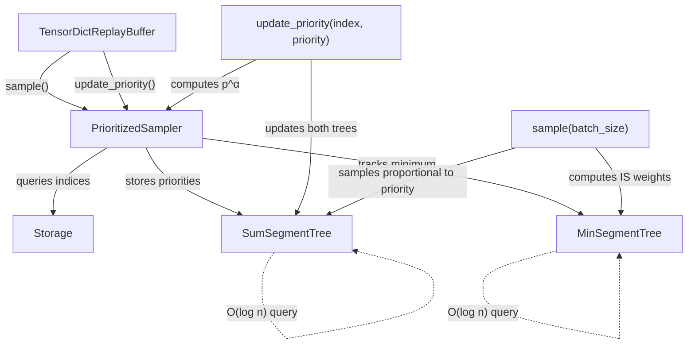
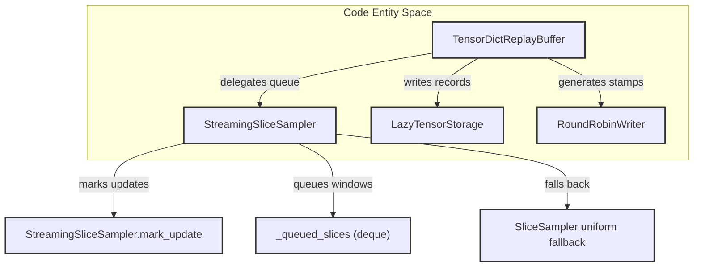
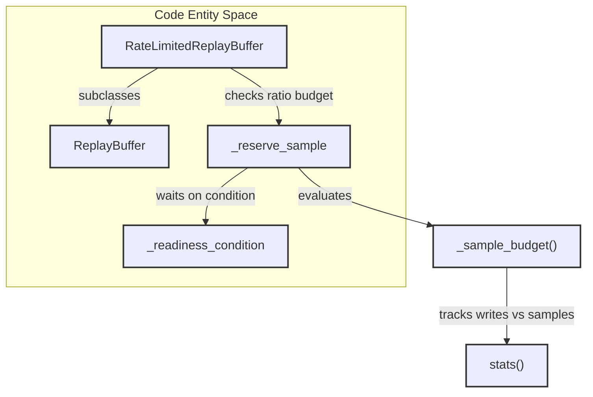
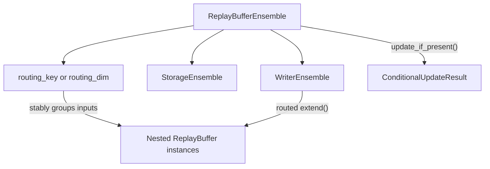

<!-- source: DeepWiki mcp.deepwiki.com · repo pytorch/rl · page 5.2 Advanced Replay Buffer Features · fetched 2026-10-21 -->

# Advanced Replay Buffer Features

<details>
<summary>Relevant source files</summary>

The following files were used as context for generating this wiki page:

- [test/rb/test_ensemble.py](test/rb/test_ensemble.py)
- [test/rb/test_writers.py](test/rb/test_writers.py)
- [test/test_postprocs.py](test/test_postprocs.py)
- [torchrl/data/postprocs/postprocs.py](torchrl/data/postprocs/postprocs.py)
- [torchrl/data/replay_buffers/replay_buffers/__init__.py](torchrl/data/replay_buffers/replay_buffers/__init__.py)
- [torchrl/data/replay_buffers/replay_buffers/deprecated.py](torchrl/data/replay_buffers/replay_buffers/deprecated.py)
- [torchrl/data/replay_buffers/replay_buffers/ensemble.py](torchrl/data/replay_buffers/replay_buffers/ensemble.py)
- [torchrl/data/replay_buffers/replay_buffers/prioritized.py](torchrl/data/replay_buffers/replay_buffers/prioritized.py)
- [torchrl/data/replay_buffers/replay_buffers/prioritized_tensordict.py](torchrl/data/replay_buffers/replay_buffers/prioritized_tensordict.py)
- [torchrl/data/replay_buffers/replay_buffers/rate_limited.py](torchrl/data/replay_buffers/replay_buffers/rate_limited.py)
- [torchrl/data/replay_buffers/replay_buffers/remote.py](torchrl/data/replay_buffers/replay_buffers/remote.py)
- [torchrl/data/replay_buffers/replay_buffers/tensordict.py](torchrl/data/replay_buffers/replay_buffers/tensordict.py)
- [torchrl/data/replay_buffers/samplers/streaming_slice.py](torchrl/data/replay_buffers/samplers/streaming_slice.py)
- [torchrl/data/replay_buffers/writers/max_value.py](torchrl/data/replay_buffers/writers/max_value.py)
- [torchrl/data/replay_buffers/writers/round_robin.py](torchrl/data/replay_buffers/writers/round_robin.py)

</details>


This page documents advanced features of TorchRL's replay buffer system beyond the basic composable architecture. For the foundational replay buffer design with Storage, Sampler, and Writer components, see [ReplayBuffer Architecture](#5.1).

Advanced features covered here include:
- **Prioritized Experience Replay (PER)**: Importance sampling based on TD-error using `PrioritizedSampler`
- **Trajectory Storage & Streaming Slices**: Multi-dimensional buffers and `StreamingSliceSampler`
- **Rate Limiting**: Cumulative sample-to-insert ratio control via `RateLimitedReplayBuffer`
- **Remote & Distributed Buffers**: RPC-friendly buffers via `RemoteTensorDictReplayBuffer`
- **Buffer Ensembles & Routed Writes**: Combining multiple buffers and routing inputs via `ReplayBufferEnsemble`
- **Advanced Writers**: Priority-based and max-value selection via `TensorDictMaxValueWriter` and generation tracking
- **Post-Processing Transforms**: Multi-step returns and reward densification via `MultiStep`

---

## Prioritized Experience Replay

Prioritized Experience Replay (PER) samples experiences based on their importance rather than uniformly. This is implemented through the `PrioritizedSampler` class, which uses segment trees for efficient priority-based sampling.

### Architecture



**Sources:** [torchrl/data/replay_buffers/samplers.py:297-399]()

### Core Components

| Component | Purpose | Implementation |
|-----------|---------|----------------|
| `PrioritizedSampler` | Manages priority-based sampling | [torchrl/data/replay_buffers/samplers.py:297-592]() |
| `SumSegmentTreeFp32/Fp64` | Efficient priority sum queries | C++ extension |
| `MinSegmentTreeFp32/Fp64` | Tracks minimum priority | C++ extension |
| `alpha` | Controls prioritization strength | `P(i) = p_i^α / Σ p_j^α` |
| `beta` | Importance sampling correction | `w_i = (N·P(i))^(-β)` |

**Sources:** [torchrl/data/replay_buffers/samplers.py:297-723]()

---

## Trajectory Storage and Streaming Slices

TorchRL supports storing multi-step trajectories (episodes) in buffers through multi-dimensional storage and specialized samplers such as `StreamingSliceSampler`.

### Streaming Slice Sampler Integration



**Sources:** [torchrl/data/replay_buffers/samplers/streaming_slice.py:20-157]()

The `StreamingSliceSampler` partitions incoming records into non-overlapping, fixed-length windows without crossing trajectory or done boundaries, prioritizing newly completed streaming windows before falling back to uniform slice sampling [torchrl/data/replay_buffers/samplers/streaming_slice.py:20-33]().

**Sources:** [torchrl/data/replay_buffers/samplers/streaming_slice.py:20-157]()

---

## Rate-Limited Replay Buffers

`RateLimitedReplayBuffer` enforces a cumulative sample-to-insert ratio limit, ensuring that at most `samples_per_insert` records are sampled for every record written via `add()` or `extend()` [torchrl/data/replay_buffers/replay_buffers/rate_limited.py:18-25]().

### Rate-Limiting Control Flow



**Sources:** [torchrl/data/replay_buffers/replay_buffers/rate_limited.py:18-166]()

**Sources:** [torchrl/data/replay_buffers/replay_buffers/rate_limited.py:18-257]()

---

## Remote and Distributed Replay Buffers

`RemoteTensorDictReplayBuffer` exposes public buffer methods (`sample()`, `add()`, `extend()`, `update_priority()`) to be invoked remotely by workers via `torch.rpc` or called locally [torchrl/data/replay_buffers/replay_buffers/remote.py:35-38]().

```python
from torchrl.data import RemoteTensorDictReplayBuffer

# Remote buffer wrapper for RPC-based distributed RL setups
remote_rb = RemoteTensorDictReplayBuffer(
    storage=LazyTensorStorage(10000),
    batch_size=256
)
```

**Sources:** [torchrl/data/replay_buffers/replay_buffers/remote.py:35-75]()

---

## Buffer Ensembles and Routed Writes

`ReplayBufferEnsemble` manages multiple replay buffers simultaneously, composing storage ensembles (`StorageEnsemble`), writer ensembles (`WriterEnsemble`), and sampler ensembles (`SamplerEnsemble`) [torchrl/data/replay_buffers/replay_buffers/ensemble.py:57-64]().

### Ensemble Routing and Conditional Updates



**Sources:** [torchrl/data/replay_buffers/replay_buffers/ensemble.py:57-114](), [test/rb/test_ensemble.py:104-162]()

By passing a `routing_key` or `routing_dim`, incoming writes are automatically flattened, grouped by member ID, and routed to the corresponding nested replay buffer [torchrl/data/replay_buffers/replay_buffers/ensemble.py:107-114]().

**Sources:** [torchrl/data/replay_buffers/replay_buffers/ensemble.py:57-146](), [test/rb/test_ensemble.py:104-162]()

---

## Advanced Writers

TorchRL provides advanced writers alongside standard round-robin execution:

- **`TensorDictMaxValueWriter`**: Keeps top-performing elements based on a ranking key (`rank_key`) and reduction method (`"max"`, `"min"`, `"mean"`, `"median"`, `"sum"`) [torchrl/data/replay_buffers/writers/max_value.py:55-62]().
- **`RoundRobinWriter`**: Supports generation tracking (`track_generations=True`) to stamp storage slots with a counter, allowing consumers to detect staleness via `generations_of()` and `index_generation` info fields [torchrl/data/replay_buffers/writers/round_robin.py:66-75]().

**Sources:** [torchrl/data/replay_buffers/writers/max_value.py:55-161](), [torchrl/data/replay_buffers/writers/round_robin.py:56-125]()

---

## Post-Processing Transforms

Data collectors support post-processing transforms such as `MultiStep` to compute multi-step returns and shift observations prior to buffer insertion [torchrl/data/postprocs/postprocs.py:85-141]().

```python
from torchrl.data.postprocs import MultiStep

# Multi-step reward transform with discount gamma and max look-ahead steps
multistep_postproc = MultiStep(gamma=0.99, n_steps=3)
```

**Sources:** [torchrl/data/postprocs/postprocs.py:85-177](), [test/test_postprocs.py:21-64]()

---

## Summary

This page covered advanced replay buffer features in TorchRL:
1. **Prioritized Experience Replay**: `PrioritizedSampler` with C++ segment trees.
2. **Streaming Slices**: `StreamingSliceSampler` for trajectory windows.
3. **Rate Limiting**: `RateLimitedReplayBuffer` for ratio-constrained updates.
4. **Remote Buffers**: `RemoteTensorDictReplayBuffer` for RPC-backed workers.
5. **Ensembles**: `ReplayBufferEnsemble` with routed writes and conditional updates.
6. **Advanced Writers**: `TensorDictMaxValueWriter` and generation-tracked `RoundRobinWriter`.
7. **Post-Processing**: `MultiStep` return calculations.

**Sources:** All sections above.

---

