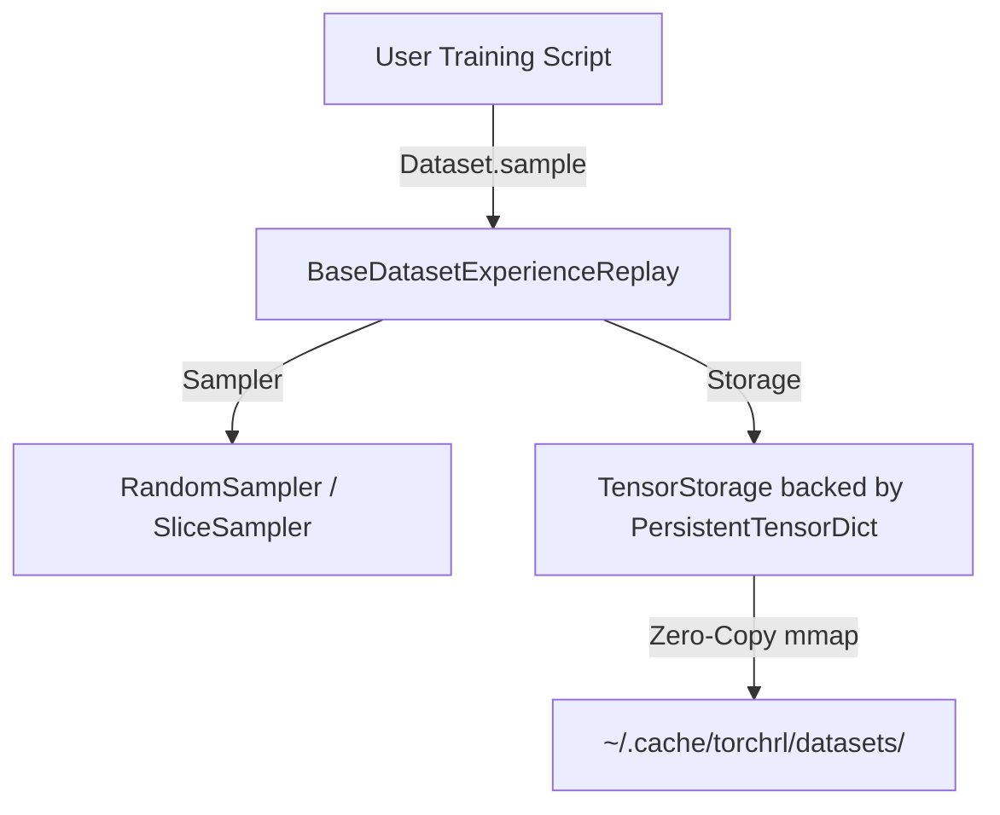

<!-- source: DeepWiki mcp.deepwiki.com · repo pytorch/rl · page 5.3 Offline Datasets · fetched 2026-10-21 -->

# Offline Datasets

<details>
<summary>Relevant source files</summary>

The following files were used as context for generating this wiki page:

- [test/libs/conftest.py](test/libs/conftest.py)
- [test/libs/test_datasets.py](test/libs/test_datasets.py)
- [test/modules/_modules_common.py](test/modules/_modules_common.py)
- [test/objectives/_objectives_common.py](test/objectives/_objectives_common.py)
- [torchrl/data/datasets/atari_dqn.py](torchrl/data/datasets/atari_dqn.py)
- [torchrl/data/datasets/d4rl.py](torchrl/data/datasets/d4rl.py)
- [torchrl/data/datasets/gen_dgrl.py](torchrl/data/datasets/gen_dgrl.py)
- [torchrl/data/datasets/minari_data.py](torchrl/data/datasets/minari_data.py)
- [torchrl/data/datasets/openml.py](torchrl/data/datasets/openml.py)
- [torchrl/data/datasets/openx.py](torchrl/data/datasets/openx.py)
- [torchrl/data/datasets/roboset.py](torchrl/data/datasets/roboset.py)
- [torchrl/data/datasets/vd4rl.py](torchrl/data/datasets/vd4rl.py)
- [torchrl/modules/tensordict_module/_rnn_triton.py](torchrl/modules/tensordict_module/_rnn_triton.py)

</details>


## Purpose and Scope
The `torchrl/data/datasets` package provides a collection of specialized dataset wrappers that bridge standard offline reinforcement learning (RL) benchmarks and machine learning repositories with TorchRL's core data infrastructure. These dataset classes inherit from TorchRL's `ReplayBuffer` abstraction, making offline datasets immediately compatible with TorchRL's training loops, samplers, writers, and `TensorDict` transform pipelines. 

This page documents the common dataset interface, memory-mapped caching strategies, and specific integrations for D4RL, Minari, Open X-Embodiment, VD4RL, Atari-DQN, Roboset, OpenML, and Gen-DGRL.

---

## Common Dataset Interface (`BaseDatasetExperienceReplay`)
All offline dataset classes in TorchRL share a common base class, `BaseDatasetExperienceReplay`, which inherits from `ReplayBuffer` (`[torchrl/data/datasets/common.py]()`). This design ensures that offline datasets support the exact same interaction API as online experience replay buffers.

### Key Features and Conventions
- **TED Convention**: Data conforms to the TorchRL Environment Dataset (TED) convention, structuring observations, actions, rewards, and next-state transitions in a standardized `TensorDict` hierarchy.
- **Memory-Mapped Storage**: Large datasets are automatically downloaded, parsed, and stored as memory-mapped tensors (`PersistentTensorDict` or `MemoryMappedTensor`), allowing zero-copy disk-backed indexing without loading entire datasets into RAM.
- **Immutable Writers**: Datasets use `ImmutableDatasetWriter` by default to prevent accidental data mutation during training `[torchrl/data/datasets/d4rl.py:27-27]()`.
- **Preprocessing Pipeline**: Datasets expose a `.preprocess()` method that streams chunks of data through custom transformation functions and serializes them into new memory-mapped storage backends `[test/libs/test_datasets.py:101-107]()`.


*Sources: [torchrl/data/datasets/common.py](), [torchrl/data/datasets/d4rl.py:27-27](), [test/libs/test_datasets.py:101-107]()*

---

## Benchmark Integrations

### D4RL (`D4RLExperienceReplay`)
The `D4RLExperienceReplay` class wraps datasets from the D4RL offline RL benchmark suite `[torchrl/data/datasets/d4rl.py:30-30]()`.

- **Key Arguments**:
  - `dataset_id` (`str`): Identifier of the D4RL environment (e.g., `"maze2d-umaze-v1"`, `"walker2d-medium-replay-v2"`).
  - `from_env` (`bool`): If `True`, uses `env.get_dataset()`; otherwise uses `d4rl.qlearning_dataset()` `[torchrl/data/datasets/d4rl.py:70-72]()`.
  - `use_truncated_as_done` (`bool`): Computes terminal signals via `done = terminated | truncated` `[torchrl/data/datasets/d4rl.py:95-96]()`.
  - `terminate_on_end` (`bool`): Appends terminal markers to final trajectory steps `[torchrl/data/datasets/d4rl.py:97-100]()`.

```python
from torchrl.data.datasets.d4rl import D4RLExperienceReplay
from torchrl.envs import ObservationNorm

data = D4RLExperienceReplay("maze2d-umaze-v1", batch_size=128)
data.append_transform(ObservationNorm(loc=-1, scale=1.0, in_keys=["observation"]))
batch = data.sample(128)
```
*Sources: [torchrl/data/datasets/d4rl.py:30-119]()*

### Minari (`MinariExperienceReplay`)
`MinariExperienceReplay` integrates Farama Minari offline datasets into TorchRL `[torchrl/data/datasets/minari_data.py:75-76]`.

- **Handling Non-Tensor Data**: Minari datasets often contain dictionary-based metadata and string instructions. Non-tensor fields are isolated using `NonTensorData` and `NonTensorStack` primitives within the underlying `TensorDict` `[torchrl/data/datasets/minari_data.py:22-23]()`.
- **Environment Context**: Utilizes `_minari_datasets_path` to manage local cache directories dynamically `[torchrl/data/datasets/minari_data.py:43-54]()`.

*Sources: [torchrl/data/datasets/minari_data.py:19-76]()*

### Open X-Embodiment (`OpenXExperienceReplay`)
`OpenXExperienceReplay` provides access to the Open X-Embodiment real-robot dataset collection `[torchrl/data/datasets/openx.py:36-41]()`.

- **Advanced Slicing**: Supports `num_slices` and `slice_len` arguments to control trajectory chunking and padding `[torchrl/data/datasets/openx.py:81-107]()`.
- **Streaming Mode**: Can operate in `streaming=True` mode using Hugging Face datasets without pre-downloading the entire multi-terabyte corpus `[torchrl/data/datasets/openx.py:127-128]()`.
- **Language Instructions**: Natural language commands are stored as non-tensor metadata (`language_instruction`) accessible via `data.get_non_tensor("language_instruction")` `[torchrl/data/datasets/openx.py:52-58]()`.

*Sources: [torchrl/data/datasets/openx.py:36-135]()*

### VD4RL & Roboset (`VD4RLExperienceReplay`, `RobosetExperienceReplay`)
Both classes handle HDF5 (`.h5`) based visual and state-based robotic datasets (Visual D4RL and Roboset) `[torchrl/data/datasets/vd4rl.py:38-42]`, `[torchrl/data/datasets/roboset.py:39-43]()`.

- **Preprocessing Flow**: Downloads raw HDF5 archives, extracts observation, action, and reward streams, and flattens them into memory-mapped PyTorch tensors.
- **Image Handling**: `VD4RLExperienceReplay` integrates optional `ToTensorImage` and `Resize` transforms directly into the dataset instantiation pipeline `[torchrl/data/datasets/vd4rl.py:88-95]()`.

*Sources: [torchrl/data/datasets/vd4rl.py:38-98](), [torchrl/data/datasets/roboset.py:39-82]()*

### Atari-DQN (`AtariDQNExperienceReplay`)
The Atari-DQN dataset contains 200 million frames across 55 Atari games `[torchrl/data/datasets/atari_dqn.py:37-42]()`.

- **Partitioned Storage**: Because of its massive size, each game/run is partitioned into 50 memory-mapped chunks of 1 million frames each (`PersistentTensorDict`) `[torchrl/data/datasets/atari_dqn.py:47-50]()`.
- **On-Line Formatting**: Transitions and frame stacks are dynamically formatted at sampling time to minimize disk footprint `[torchrl/data/datasets/atari_dqn.py:44-45]()`.

*Sources: [torchrl/data/datasets/atari_dqn.py:36-50]()*

### OpenML & Gen-DGRL (`OpenMLExperienceReplay`, `GenDGRLExperienceReplay`)
- **OpenML**: `OpenMLExperienceReplay` wraps tabular classification/regression datasets (e.g., `"adult_num"`, `"covertype"`, `"shuttle"`) via scikit-learn (`fetch_openml`), serializing them into `TensorStorage` `[torchrl/data/datasets/openml.py:23-41]`, `[torchrl/data/datasets/openml.py:108-111]()`.
- **Gen-DGRL**: `GenDGRLExperienceReplay` provides access to ProcGen generalization datasets from the Generalization Gap in Offline RL paper, downloading `.tar` archives of `.npy` trajectory files and converting them to memory-mapped buffers `[torchrl/data/datasets/gen_dgrl.py:29-50]()`.

*Sources: [torchrl/data/datasets/openml.py:23-111](), [torchrl/data/datasets/gen_dgrl.py:29-50]()*

---

## Architecture: Natural Language Space to Code Entities

The following diagram bridges benchmark descriptions to their respective TorchRL dataset implementation classes:


*Sources: [torchrl/data/datasets/d4rl.py:30](), [torchrl/data/datasets/minari_data.py:75](), [torchrl/data/datasets/openx.py:36](), [torchrl/data/datasets/vd4rl.py:38](), [torchrl/data/datasets/atari_dqn.py:36](), [torchrl/data/datasets/openml.py:23](), [torchrl/data/datasets/gen_dgrl.py:29광역시]()*

---

## Summary of Dataset Classes

| Dataset Class | Source Format | Storage Backend | Key Module Path |
| :--- | :--- | :--- | :--- |
| `D4RLExperienceReplay` | D4RL / NumPy | `TensorStorage` | `torchrl/data/datasets/d4rl.py` |
| `MinariExperienceReplay` | HDF5 / Minari | `TensorStorage` | `torchrl/data/datasets/minari_data.py` |
| `OpenXExperienceReplay` | TFDS / HuggingFace | `TensorDictReplayBuffer` | `torchrl/data/datasets/openx.py` |
| `VD4RLExperienceReplay` | HDF5 (`.h5`) | `PersistentTensorDict` | `torchrl/data/datasets/vd4rl.py` |
| `RobosetExperienceReplay` | HDF5 (`.h5`) | `PersistentTensorDict` | `torchrl/data/datasets/roboset.py` |
| `AtariDQNExperienceReplay` | Compressed Raw / NumPy | `MemoryMappedTensor` shards | `torchrl/data/datasets/atari_dqn.py` |
| `OpenMLExperienceReplay` | scikit-learn / Pandas | `TensorStorage` | `torchrl/data/datasets/openml.py` |
| `GenDGRLExperienceReplay` | Tar archives / NumPy | `TensorStorage` | `torchrl/data/datasets/gen_dgrl.py` |

*Sources: [torchrl/data/datasets/d4rl.py](), [torchrl/data/datasets/minari_data.py](), [torchrl/data/datasets/openx.py](), [torchrl/data/datasets/vd4rl.py](), [torchrl/data/datasets/roboset.py](), [torchrl/data/datasets/atari_dqn.py](), [torchrl/data/datasets/openml.py](), [torchrl/data/datasets/gen_dgrl.py]()*

---

