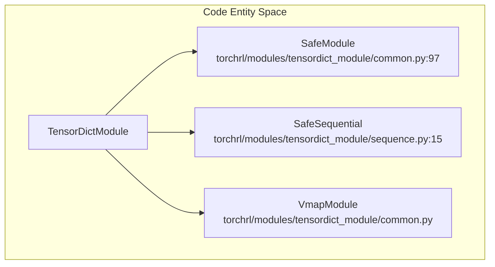
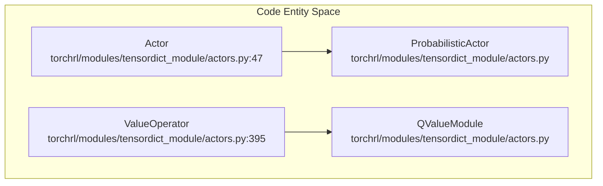
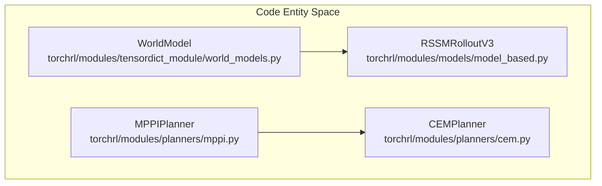

<!-- source: DeepWiki mcp.deepwiki.com · repo pytorch/rl · page 6 Modules and Models · fetched 2026-10-21 -->

# Modules and Models

Relevant source files

The following files were used as context for generating this wiki page:

- [docs/source/reference/modules.rst](docs/source/reference/modules.rst)
- [docs/source/reference/modules_models.rst](docs/source/reference/modules_models.rst)
- [torchrl/modules/__init__.py](torchrl/modules/__init__.py)
- [torchrl/modules/models/__init__.py](torchrl/modules/models/__init__.py)
- [torchrl/modules/tensordict_module/__init__.py](torchrl/modules/tensordict_module/__init__.py)
- [torchrl/modules/tensordict_module/actors.py](torchrl/modules/tensordict_module/actors.py)
- [torchrl/modules/tensordict_module/common.py](torchrl/modules/tensordict_module/common.py)
- [torchrl/modules/tensordict_module/probabilistic.py](torchrl/modules/tensordict_module/probabilistic.py)
- [torchrl/modules/tensordict_module/sequence.py](torchrl/modules/tensordict_module/sequence.py)

The Modules and Models system in TorchRL provides neural network components, policy modules, and model architectures for reinforcement learning. Built on top of PyTorch's `nn.Module` and the `tensordict.nn` ecosystem, this system defines the building blocks for policies, value functions, world models, and planners used throughout TorchRL algorithms [docs/source/reference/modules.rst:9-12]().

As a parent page, this document provides a high-level overview of the module hierarchy and design patterns. For deep technical details, implementations, and advanced usage, refer to the child pages linked below.

Sources:
- [docs/source/reference/modules.rst:1-22]()
- [torchrl/modules/__init__.py:1-262]()

---

## 6.1. TensorDictModule System

TorchRL extends standard PyTorch neural networks via the `TensorDictModule` abstraction [docs/source/reference/modules.rst:9-12](). Modules declare which keys to read from a `TensorDict` (`in_keys`) and which keys to write to (`out_keys`) [torchrl/modules/tensordict_module/common.py:97-126](). 

Key components include `SafeModule` [torchrl/modules/tensordict_module/common.py:97-126]() for spec-based domain projection, `SafeSequential` [torchrl/modules/tensordict_module/sequence.py:15-132]() for chaining modules, and `VmapModule` [torchrl/modules/tensordict_module/__init__.py:35-35]() for vectorized batch execution.

For details, see [TensorDictModule System](#6.1).

Sources:
- [torchrl/modules/tensordict_module/common.py:97-126]()
- [torchrl/modules/tensordict_module/sequence.py:15-132]()
- [torchrl/modules/tensordict_module/__init__.py:35-35]()

---

## 6.2. Actors, Critics, and Value Networks

Specialized wrappers unify policies and value functions under the `TensorDictModule` interface [torchrl/modules/tensordict_module/actors.py:47-156](). The `Actor` class handles deterministic policies, while `ProbabilisticActor` combines neural network parameter extractors with distribution wrappers for stochastic control [torchrl/modules/tensordict_module/actors.py:47-156](). `ValueOperator` and `QValueModule` implement state-value and state-action value estimators for actor-critic and Q-learning architectures [torchrl/modules/tensordict_module/actors.py:395-466]().

For details, see [Actors, Critics, and Value Networks](#6.2).

Sources:
- [torchrl/modules/tensordict_module/actors.py:47-174]()
- [torchrl/modules/tensordict_module/actors.py:395-466]()

---

## 6.3. Probability Distributions

TorchRL provides custom probability distributions tailored for RL, such as `TanhNormal` for bounded continuous action spaces, `TruncatedNormal`, and `MaskedCategorical` for discrete actions with invalid action masks [torchrl/modules/__init__.py:9-25](). These distributions integrate seamlessly with `SafeProbabilisticModule` to compute log-probabilities, sample actions, and maintain reparameterization gradients [torchrl/modules/tensordict_module/probabilistic.py:36-129]().

For details, see [Probability Distributions](#6.3).

Sources:
- [torchrl/modules/__init__.py:9-25]()
- [torchrl/modules/tensordict_module/probabilistic.py:36-129]()

---

## 6.4. Neural Network Architectures

TorchRL includes modular architectures optimized for RL, such as fully-connected MLPs (`MLP`), convolutional networks (`ConvNet`), recurrent units (`LSTMModule`, `GRUModule`), and multi-agent network bases [torchrl/modules/models/__init__.py:45-65](). Many of these support lazy initialization to automatically infer input dimensions from environment specs [torchrl/modules/models/__init__.py:45-65]().

For details, see [Neural Network Architectures](#6.4).

Sources:
- [torchrl/modules/models/__init__.py:45-65]()

---

## 6.5. Exploration Strategies

To promote exploration during training, TorchRL offers wrapper modules and policies such as `EGreedyModule`, `AdditiveGaussianModule`, `OrnsteinUhlenbeckProcessModule`, `gSDE` (Generalized State-Dependent Exploration), and parameter-space noise (`NoisyLinear`) [torchrl/modules/__init__.py:81-107](). These handle noise generation, scheduling, and automatic state resets on environment boundaries [torchrl/modules/tensordict_module/exploration.py:33-44]().

For details, see [Exploration Strategies](#6.5).

Sources:
- [torchrl/modules/__init__.py:81-107]()
- [torchrl/modules/tensordict_module/exploration.py:33-44]()

---

## 6.6. Planners and Model-Based Modules

Model-based RL and planning modules are implemented under `torchrl/modules/models/model_based.py` and planners under `torchrl/modules/planners/` [torchrl/modules/__init__.py:148-149](). This includes Recurrent State-Space Models (RSSM) for DreamerV3, world models, and online planning algorithms like CEM (Cross-Entropy Method) and MPPI [torchrl/modules/__init__.py:40-69,148-149]().

For details, see [Planners and Model-Based Modules](#6.6).

Sources:
- [torchrl/modules/__init__.py:27-75,148-149]()
- [torchrl/modules/tensordict_module/world_models.py:1-69]()

---

