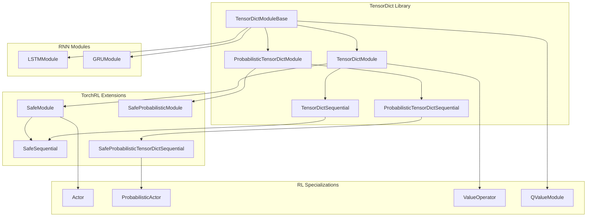
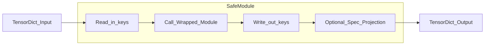

<!-- source: DeepWiki mcp.deepwiki.com · repo pytorch/rl · page 6.1 TensorDictModule System · fetched 2026-10-21 -->

# TensorDictModule System

<details>
<summary>Relevant source files</summary>

The following files were used as context for generating this wiki page:

- [docs/source/reference/data_specs.rst](docs/source/reference/data_specs.rst)
- [docs/source/reference/modules.rst](docs/source/reference/modules.rst)
- [docs/source/reference/modules_models.rst](docs/source/reference/modules_models.rst)
- [test/transforms/test_module_transforms.py](test/transforms/test_module_transforms.py)
- [torchrl/envs/llm/transforms/browser.py](torchrl/envs/llm/transforms/browser.py)
- [torchrl/envs/llm/transforms/tools.py](torchrl/envs/llm/transforms/tools.py)
- [torchrl/envs/transforms/module.py](torchrl/envs/transforms/module.py)
- [torchrl/envs/transforms/ray_service.py](torchrl/envs/transforms/ray_service.py)
- [torchrl/envs/transforms/utils.py](torchrl/envs/transforms/utils.py)
- [torchrl/modules/__init__.py](torchrl/modules/__init__.py)
- [torchrl/modules/models/__init__.py](torchrl/modules/models/__init__.py)
- [torchrl/modules/tensordict_module/__init__.py](torchrl/modules/tensordict_module/__init__.py)
- [torchrl/modules/tensordict_module/actors.py](torchrl/modules/tensordict_module/actors.py)
- [torchrl/modules/tensordict_module/common.py](torchrl/modules/tensordict_module/common.py)
- [torchrl/modules/tensordict_module/probabilistic.py](torchrl/modules/tensordict_module/probabilistic.py)
- [torchrl/modules/tensordict_module/sequence.py](torchrl/modules/tensordict_module/sequence.py)
- [torchrl/testing/modules.py](torchrl/testing/modules.py)
- [tutorials/sphinx-tutorials/llm_browser.py](tutorials/sphinx-tutorials/llm_browser.py)

</details>


## Purpose and Scope

The TensorDictModule System provides a standardized interface for wrapping PyTorch `nn.Module` objects to work seamlessly with TensorDict data structures. This system enables composable, type-safe neural network modules where inputs and outputs are accessed via named keys rather than positional arguments. The core abstraction uses `in_keys` and `out_keys` to define module I/O, with optional spec-based validation for enforcing output constraints.

This document covers the core TensorDictModule wrappers (`SafeModule`, `SafeProbabilisticModule`, `SafeSequential`) and their specialized variants for RL use cases (`Actor`, `ValueOperator`, `QValueModule`, RNN modules). For information about the underlying TensorDict data structure, see [TensorDict System](#2.1). For model architectures (MLP, ConvNet), see [Neural Network Architectures](#6.4). For probability distributions, see [Probability Distributions](#6.3).

Sources: [torchrl/modules/tensordict_module/common.py:97-192](), [torchrl/modules/tensordict_module/actors.py:47-156]()

---

## Core Concepts

### TensorDict Integration

TensorDictModules bridge standard PyTorch modules with TensorDict-based data flow. Instead of calling `output = module(input_tensor)`, modules operate on TensorDict objects by reading inputs via `in_keys` and writing outputs via `out_keys`:

```python
# Standard PyTorch
output = linear(input_tensor)

# TensorDictModule
tensordict = TensorDict({"observation": input_tensor}, batch_size=[...])
tensordict = td_module(tensordict)
# tensordict now contains both "observation" and "action" keys
```

This design enables:
- **Named I/O**: Clear, self-documenting interfaces
- **Composability**: Modules can be chained without manual key management
- **Batching**: Automatic batch dimension handling via TensorDict
- **Functional programming**: Support for vmap, functional modules, parameter sharing

Sources: [torchrl/modules/tensordict_module/common.py:97-192]()

### in_keys and out_keys Interface

The fundamental interface for TensorDictModules consists of two attributes:

| Attribute | Type | Description |
|-----------|------|-------------|
| `in_keys` | `List[NestedKey]` | Keys to read from input TensorDict and pass to the wrapped module |
| `out_keys` | `List[NestedKey]` | Keys to write to the TensorDict with the module's outputs |

**NestedKey** format supports hierarchical access: `"key"` or `("parent", "child")` for nested TensorDicts.

```python
# Single input/output
module = SafeModule(nn.Linear(4, 3), in_keys=["observation"], out_keys=["action"])

# Multiple inputs
module = SafeModule(CustomNet(), in_keys=["obs", "action"], out_keys=["q_value"])

# Nested keys
module = SafeModule(nn.Linear(4, 3), in_keys=[("data", "state")], out_keys=[("data", "output")])
```

Sources: [torchrl/modules/tensordict_module/common.py:97-192]()

### Spec-based Safety

TorchRL's `SafeModule` extends `TensorDictModule` with optional **spec-based output validation**. When `safe=True`, outputs are automatically projected back into the valid domain using `TensorSpec.project()`:

```python
spec = Bounded(low=-1.0, high=1.0, shape=(4,))
module = SafeModule(
    nn.Linear(10, 4),
    in_keys=["observation"],
    out_keys=["action"],
    spec=spec,
    safe=True  # Enforces output in [-1, 1]
)
```

The spec system supports:
- **Bounded**: Continuous ranges with low/high bounds
- **Unbounded**: No constraints
- **Composite**: Multiple specs for multiple outputs
- **OneHot/Categorical**: Discrete action spaces

Sources: [torchrl/modules/tensordict_module/common.py:97-192](), [torchrl/modules/tensordict_module/common.py:55-94]()

---

## Architecture Overview

### Class Hierarchy

Title: "TensorDictModule Class Hierarchy"

Sources: [torchrl/modules/tensordict_module/common.py:97-192](), [torchrl/modules/tensordict_module/actors.py:47-136](), [torchrl/modules/tensordict_module/probabilistic.py:36-120](), [torchrl/modules/tensordict_module/sequence.py:15-132]()

### Data Flow Pattern

Title: "SafeModule Execution Data Flow"

Sources: [torchrl/modules/tensordict_module/common.py:55-94](), [torchrl/modules/tensordict_module/common.py:97-192]()

---

## Core Classes

### SafeModule

`SafeModule` is the foundational TensorDictModule wrapper with spec-based validation.

**Key Parameters:**

| Parameter | Type | Description |
|-----------|------|-------------|
| `module` | `nn.Module` | The PyTorch module to wrap |
| `in_keys` | `List[NestedKey]` | Input keys to read from TensorDict |
| `out_keys` | `List[NestedKey]` | Output keys to write to TensorDict |
| `spec` | `TensorSpec \| Composite \| None` | Output domain specification |
| `safe` | `bool` | If True, validates and projects outputs (default: False) |
| `inplace` | `bool \| str` | Whether to modify TensorDict in-place (default: True) |

**Spec Handling:**
- Single `TensorSpec`: Automatically wrapped in `Composite` with first `out_key`
- `Composite`: Must have keys matching `out_keys`
- `None`: No validation (even if `safe=True`, raises error)

Sources: [torchrl/modules/tensordict_module/common.py:97-293]()

### SafeProbabilisticModule

`SafeProbabilisticModule` extends `ProbabilisticTensorDictModule` for stochastic policies with spec-based safety.

**Key Additions:**

| Parameter | Type | Description |
|-----------|------|-------------|
| `distribution_class` | `Type` | Distribution class (e.g., `Normal`, `Categorical`) |
| `distribution_kwargs` | `dict` | Additional kwargs for distribution |
| `default_interaction_type` | `InteractionType` | How to sample: MODE, MEAN, RANDOM (default: MODE) |
| `return_log_prob` | `bool` | Whether to compute and store log-probabilities |
| `log_prob_key` | `NestedKey` | Key for storing log-prob (default: "sample_log_prob") |

Sources: [torchrl/modules/tensordict_module/probabilistic.py:36-129]()

### SafeSequential

`SafeSequential` chains multiple TensorDictModules, automatically managing key dependencies.

**Features:**
- Aggregates specs from all submodules into a `Composite`
- Infers execution order from `in_keys`/`out_keys` dependencies
- Supports `partial_tolerant` mode for optional keys
- Implements `__getitem__`, `__setitem__`, `__delitem__` for module access

Sources: [torchrl/modules/tensordict_module/sequence.py:15-132]()

---

## Specialized RL Modules

### Actor and ProbabilisticActor

High-level wrappers for RL policies with sensible defaults.

**Actor (Deterministic):**
```python
class Actor(SafeModule):
    # Defaults:
    # - in_keys = ["observation"]
    # - out_keys = ["action"]
    # - spec wrapped in Composite(action=spec)
```

**ProbabilisticActor (Stochastic):**
```python
class ProbabilisticActor(SafeProbabilisticTensorDictSequential):
    # Combines:
    # 1. A module producing distribution parameters
    # 2. SafeProbabilisticModule for sampling
```

Sources: [torchrl/modules/tensordict_module/actors.py:47-156](), [torchrl/modules/tensordict_module/probabilistic.py:36-120]()

### ValueOperator

Wrapper for value functions (V or Q) with automatic key naming.

**Key Naming:**
- Input includes `"action"` → output is `"state_action_value"` (Q-function)
- Input excludes `"action"` → output is `"state_value"` (V-function)

Sources: [torchrl/modules/tensordict_module/actors.py:395-466]()

### QValueModule

Specialized module for discrete action selection from Q-values.

**Supported Action Spaces:**
- `"one_hot"`: One-hot encoded actions
- `"categorical"`: Integer action indices
- `"mult_one_hot"`: Multiple one-hot vectors

**Outputs:**
1. `action`: Selected action
2. `action_value`: Input Q-values (unchanged)
3. `chosen_action_value`: Q-value of selected action

Sources: [torchrl/modules/tensordict_module/actors.py:468-672]()

---

## RNN Modules

### LSTMModule

TensorDict-compatible LSTM wrapper with automatic hidden state management.

**Key Features:**
- Automatically reshapes hidden states to match TensorDict batch size
- Supports both single-step and multi-step (recurrent) execution via `set_recurrent_mode()`
- Handles trajectory resets via `is_init` key
- Compatible with `torch.vmap` when using `python_based=True`

Sources: [torchrl/modules/tensordict_module/rnn.py:311-660]()

### GRUModule

Similar to `LSTMModule` but for GRU cells. Identical API except for a single hidden state structure.

Sources: [torchrl/modules/tensordict_module/rnn.py:661-1020]()

---

## Helper Functions

### is_tensordict_compatible()

Checks if a module can be used as a TensorDictModule by inspecting interface attributes and forward signature.

Sources: [torchrl/modules/tensordict_module/common.py:295-358]()

### ensure_tensordict_compatible()

Wraps a standard `nn.Module` in `TensorDictModule` (or specified wrapper type) if not already compatible.

Sources: [torchrl/modules/tensordict_module/common.py:361-412]()

### VmapModule

Wrapper to vmap over a batch dimension, enabling functional programming patterns with TensorDict modules.

Sources: [torchrl/modules/tensordict_module/common.py:415-476]()

---

## Usage Patterns

### Basic Module Wrapping

```python
# 1. Create a standard PyTorch module
net = nn.Sequential(
    nn.Linear(obs_dim, 64),
    nn.ReLU(),
    nn.Linear(64, action_dim)
)

# 2. Wrap in SafeModule
actor = SafeModule(
    module=net,
    in_keys=["observation"],
    out_keys=["action"],
    spec=Bounded(-1, 1, shape=(action_dim,)),
    safe=True
)

# 3. Use with TensorDict
td = TensorDict({"observation": torch.randn(32, obs_dim)}, [32])
td = actor(td)
```
Sources: [torchrl/modules/tensordict_module/common.py:97-293]()

---

## Summary

The TensorDictModule System provides a unified interface for integrating PyTorch modules with TensorDict-based RL workflows:

| Component | Purpose |
|-----------|---------|
| **SafeModule** | Base wrapper with spec-based validation |
| **SafeProbabilisticModule** | Stochastic policies with distribution sampling |
| **SafeSequential** | Chain modules with automatic dependency resolution |
| **Actor/ProbabilisticActor** | High-level policy abstractions with RL defaults |
| **ValueOperator** | Value/Q-function wrapper with automatic naming |
| **QValueModule** | Discrete action selection from Q-values |
| **LSTMModule/GRUModule** | Recurrent modules with hidden state management |

Sources: [torchrl/modules/tensordict_module/common.py:1-529](), [torchrl/modules/tensordict_module/actors.py:1-800](), [torchrl/modules/tensordict_module/probabilistic.py:1-322](), [torchrl/modules/tensordict_module/sequence.py:1-132](), [torchrl/modules/tensordict_module/rnn.py:1-1020]()

---

