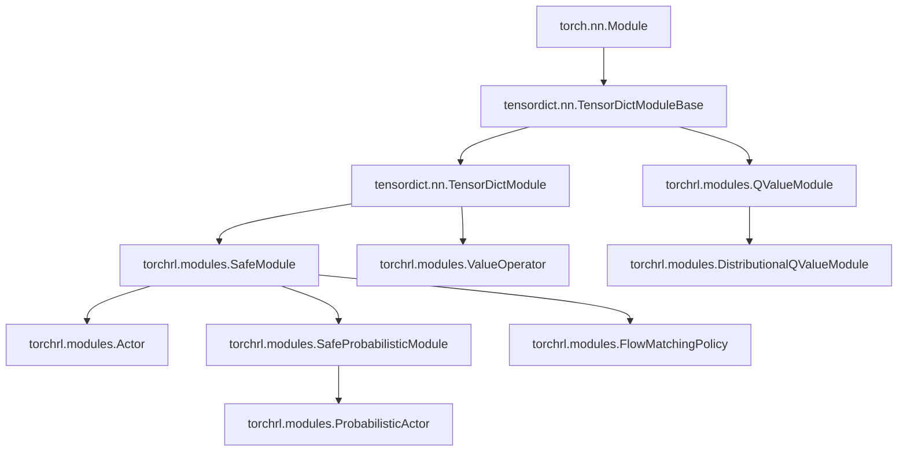
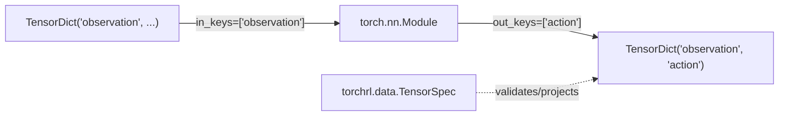
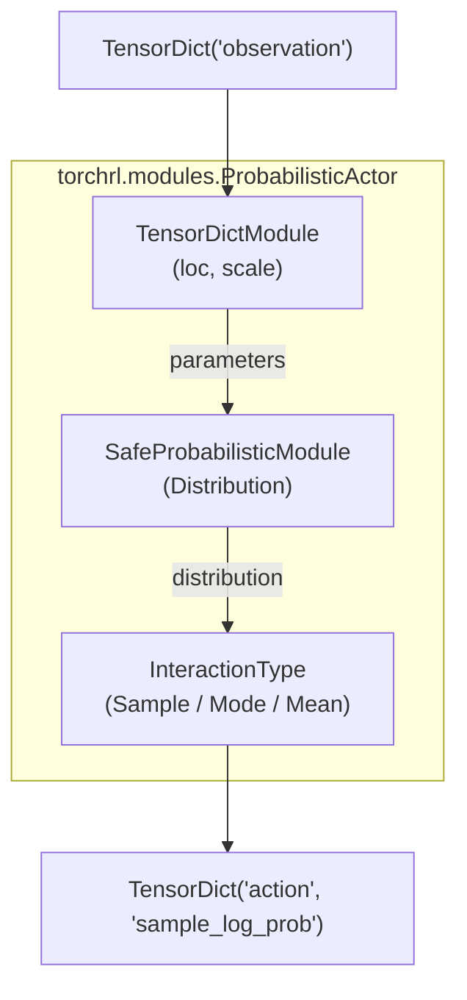
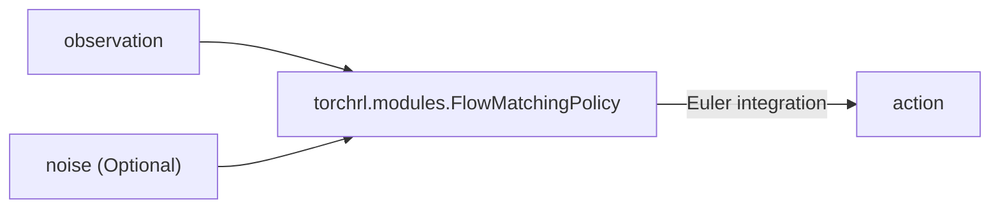
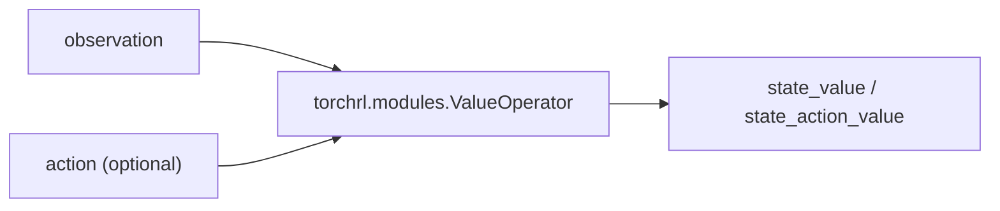
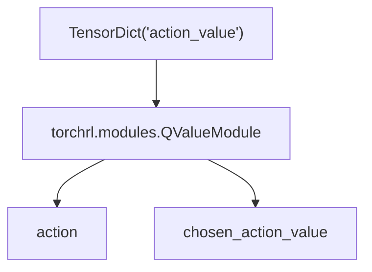

<!-- source: DeepWiki mcp.deepwiki.com · repo pytorch/rl · page 6.2 Actors, Critics, and Value Networks · fetched 2026-10-21 -->

# Actors, Critics, and Value Networks

<details>
<summary>Relevant source files</summary>

The following files were used as context for generating this wiki page:

- [benchmarks/test_flow_benchmark.py](benchmarks/test_flow_benchmark.py)
- [docs/source/reference/modules.rst](docs/source/reference/modules.rst)
- [docs/source/reference/modules_actors.rst](docs/source/reference/modules_actors.rst)
- [docs/source/reference/modules_models.rst](docs/source/reference/modules_models.rst)
- [test/modules/test_actor.py](test/modules/test_actor.py)
- [torchrl/modules/__init__.py](torchrl/modules/__init__.py)
- [torchrl/modules/models/__init__.py](torchrl/modules/models/__init__.py)
- [torchrl/modules/models/flow.py](torchrl/modules/models/flow.py)
- [torchrl/modules/tensordict_module/__init__.py](torchrl/modules/tensordict_module/__init__.py)
- [torchrl/modules/tensordict_module/actors.py](torchrl/modules/tensordict_module/actors.py)
- [torchrl/modules/tensordict_module/common.py](torchrl/modules/tensordict_module/common.py)
- [torchrl/modules/tensordict_module/probabilistic.py](torchrl/modules/tensordict_module/probabilistic.py)
- [torchrl/modules/tensordict_module/sequence.py](torchrl/modules/tensordict_module/sequence.py)

</details>


## Purpose and Scope

This page documents the actor and critic network modules in TorchRL that form the core of policy and value function architectures in reinforcement learning algorithms. These modules provide standardized interfaces for:

- **Actors**: Neural networks that map observations to actions (deterministic, stochastic, or continuous flow-based)
- **Critics**: Neural networks that estimate value functions (state values or state-action values)
- **Q-Value Networks**: Specialized modules for discrete action spaces in Q-learning algorithms

All these components are built on TorchRL's `TensorDict`-based module system, enabling seamless integration with environments, collectors, and loss functions. For information about the underlying `TensorDictModule` system, see [TensorDictModule System](#6.1). For exploration strategies that wrap actors, see [Exploration Strategies](#6.5). For how these modules integrate with loss functions, see [Learning Algorithms](#7).

Sources: [torchrl/modules/tensordict_module/actors.py:1-120](), [torchrl/modules/tensordict_module/common.py:97-150]()

---

## Module Hierarchy and Design Philosophy

### Core Architecture

TorchRL's actor-critic modules follow a layered architecture where each layer adds specific functionality:



**Diagram: Actor-Critic Class Hierarchy**

Sources: [torchrl/modules/tensordict_module/actors.py:47-174](), [torchrl/modules/tensordict_module/common.py:97-126]()

The hierarchy reflects three design principles:

1. **Spec-based safety**: `SafeModule` adds optional validation that outputs conform to action/value specifications [torchrl/modules/tensordict_module/common.py:97-122]()
2. **Key-based interface**: All modules use `in_keys` and `out_keys` to read from and write to `TensorDict` objects [torchrl/modules/tensordict_module/actors.py:110-136]()
3. **Composability**: Modules can be chained using `SafeSequential` or wrapped with exploration/normalization transforms [torchrl/modules/tensordict_module/sequence.py:15-132]()

Sources: [torchrl/modules/tensordict_module/common.py:97-126](), [torchrl/modules/tensordict_module/sequence.py:15-132]()

---

## SafeModule: Spec-Based Validation

`SafeModule` extends `TensorDictModule` with optional output specification and projection. This is the foundation for most actor-critic modules in TorchRL.

### Key Features

| Feature | Description |
|---------|-------------|
| **Spec validation** | Checks outputs against `TensorSpec` if `safe=True` [torchrl/modules/tensordict_module/common.py:97-122]() |
| **Projection** | Projects out-of-bounds values back into valid space using `spec.project()` [torchrl/modules/tensordict_module/common.py:55-84]() |
| **Composite specs** | Supports multiple outputs with `Composite` spec [torchrl/modules/tensordict_module/common.py:55-70]() |
| **Lazy initialization** | Compatible with `nn.LazyLinear` and similar lazy modules [torchrl/modules/tensordict_module/common.py:97-126]() |

Sources: [torchrl/modules/tensordict_module/common.py:55-126]()

---

## Deterministic Actors

### Actor Class

The `Actor` class wraps a deterministic neural network for action selection. It provides default values optimized for RL use cases.



**Diagram: Actor Data Flow**

Sources: [torchrl/modules/tensordict_module/actors.py:47-137]()

### Example Usage

```python
import torch
from torch import nn
from torchrl.modules import Actor
from torchrl.data import Bounded
from tensordict import TensorDict

action_spec = Bounded(low=-1.0, high=1.0, shape=(4,))

actor = Actor(
    module=nn.Linear(3, 4),
    spec=action_spec,
    safe=False
)

td = TensorDict({"observation": torch.randn(10, 3)}, batch_size=[10])
td = actor(td)
```

Sources: [torchrl/modules/tensordict_module/actors.py:47-137]()

---

## Probabilistic Actors

### ProbabilisticActor Class

`ProbabilisticActor` implements stochastic policies by wrapping a module that produces distribution parameters. It handles sampling, mode computation, and log-probability calculation.



**Diagram: ProbabilisticActor Pipeline**

Sources: [torchrl/modules/tensordict_module/actors.py:109-125](), [torchrl/modules/tensordict_module/probabilistic.py:36-120]()

---

## Flow-Matching Policies

### FlowMatchingPolicy Class

TorchRL provides flow-matching policies for continuous action spaces via `FlowMatchingPolicy` and `OneStepModel`. These policies generate actions by integrating a velocity field learned through flow matching (e.g., via ordinary differential equations using Euler integration).



**Diagram: FlowMatchingPolicy Data Flow**

Sources: [torchrl/modules/tensordict_module/actors.py:157-174](), [torchrl/modules/models/flow.py:1-50]()

### Example: Flow-Matching Policy

```python
import torch
from tensordict import TensorDict
from torchrl.modules import FlowMatchingPolicy, MLP

velocity_net = MLP(in_features=6, out_features=2, num_cells=[64, 64])
flow_policy = FlowMatchingPolicy(velocity_network=velocity_net, action_dim=2, num_steps=10)

td = TensorDict(
    observation=torch.randn(4, 3),
    noise=torch.randn(4, 2),
    batch_size=[4]
)
td_out = flow_policy(td)
# td_out contains 'action'
```

Sources: [torchrl/modules/tensordict_module/actors.py:157-174](), [docs/source/reference/modules_actors.rst:53-84]()

---

## Value Networks

### ValueOperator Class

`ValueOperator` wraps a neural network for value function estimation. It automatically determines the output key (`state_value` vs `state_action_value`) based on whether actions are present in `in_keys`.



**Diagram: ValueOperator Operation**

Sources: [torchrl/modules/tensordict_module/actors.py:390-466]()

---

## Q-Value Networks for Discrete Actions

### QValueModule Class

`QValueModule` handles the requirements of discrete Q-learning algorithms (like DQN) by mapping raw Q-value tensor outputs to greedy action selections and extracting chosen action values.



**Diagram: QValueModule Flow**

Sources: [torchrl/modules/tensordict_module/actors.py:468-672]()

---

## Summary: Key Classes Reference

| Class | Base | Purpose | Default Keys |
|-------|------|---------|--------------|
| `SafeModule` | `TensorDictModule` | Adds spec validation and projection [torchrl/modules/tensordict_module/common.py:97-122]() | User-defined |
| `Actor` | `SafeModule` | Deterministic policy [torchrl/modules/tensordict_module/actors.py:47-137]() | `in=["observation"]`, `out=["action"]` |
| `ProbabilisticActor` | `SafeProbabilisticTensorDictSequential` | Stochastic policy with distributions [torchrl/modules/tensordict_module/actors.py:109-125]() | `out=["action"]` |
| `FlowMatchingPolicy` | `TensorDictModule` | ODE-integrated flow matching policy [torchrl/modules/tensordict_module/actors.py:157-174]() | `in=["observation", "noise"]`, `out=["action"]` |
| `ValueOperator` | `TensorDictModule` | Value function estimator [torchrl/modules/tensordict_module/actors.py:390-466]() | `in=["observation"]`, `out=["state_value"]` |
| `QValueModule` | `TensorDictModuleBase` | Q-value to action converter [torchrl/modules/tensordict_module/actors.py:468-672]() | `in=["action_value"]`, `out=["action", "action_value", "chosen_action_value"]` |

Sources: [torchrl/modules/tensordict_module/actors.py:47-817](), [torchrl/modules/tensordict_module/common.py:97-126]()

---

