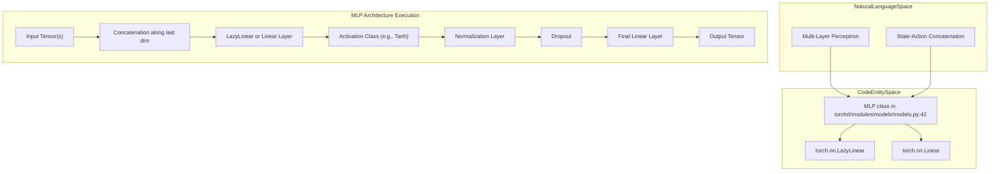
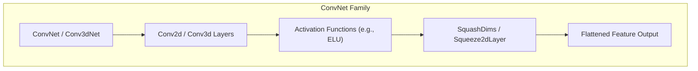
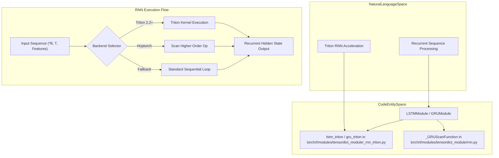
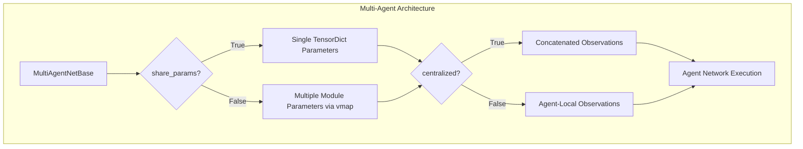
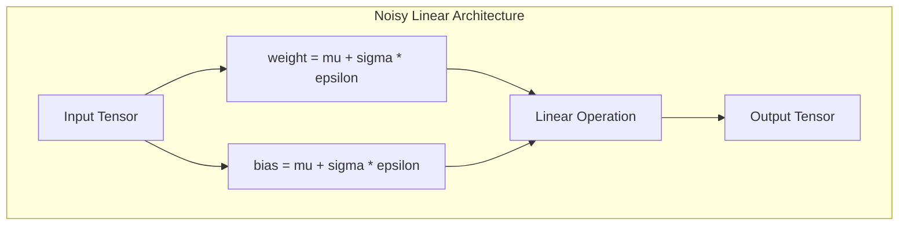
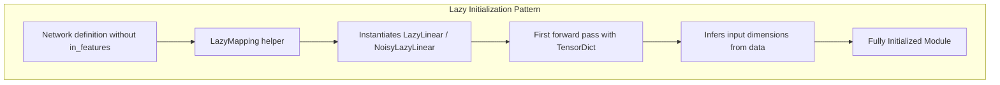

<!-- source: DeepWiki mcp.deepwiki.com · repo pytorch/rl · page 6.4 Neural Network Architectures · fetched 2026-10-21 -->

# Neural Network Architectures

Relevant source files

The following files were used as context for generating this wiki page:

- [benchmarks/test_transformer_module_benchmark.py](benchmarks/test_transformer_module_benchmark.py)
- [docs/source/reference/modules_critics.rst](docs/source/reference/modules_critics.rst)
- [docs/source/reference/modules_rnn.rst](docs/source/reference/modules_rnn.rst)
- [docs/source/reference/recurrent_state_lifecycle.rst](docs/source/reference/recurrent_state_lifecycle.rst)
- [examples/agents/transformer_actor.py](examples/agents/transformer_actor.py)
- [test/modules/test_multiagent_models.py](test/modules/test_multiagent_models.py)
- [test/modules/test_rnn.py](test/modules/test_rnn.py)
- [test/modules/test_transformer.py](test/modules/test_transformer.py)
- [test/objectives/test_values.py](test/objectives/test_values.py)
- [test/test_exploration.py](test/test_exploration.py)
- [test/test_helpers.py](test/test_helpers.py)
- [torchrl/envs/custom/mujoco/microduck_controller.py](torchrl/envs/custom/mujoco/microduck_controller.py)
- [torchrl/modules/models/cross_group_critic.py](torchrl/modules/models/cross_group_critic.py)
- [torchrl/modules/models/exploration.py](torchrl/modules/models/exploration.py)
- [torchrl/modules/models/models.py](torchrl/modules/models/models.py)
- [torchrl/modules/models/multiagent.py](torchrl/modules/models/multiagent.py)
- [torchrl/modules/models/utils.py](torchrl/modules/models/utils.py)
- [torchrl/modules/tensordict_module/controllers.py](torchrl/modules/tensordict_module/controllers.py)
- [torchrl/modules/tensordict_module/exploration.py](torchrl/modules/tensordict_module/exploration.py)
- [torchrl/modules/tensordict_module/rnn.py](torchrl/modules/tensordict_module/rnn.py)
- [torchrl/modules/tensordict_module/zoo/microduck_policy.py](torchrl/modules/tensordict_module/zoo/microduck_policy.py)
- [torchrl/objectives/value/advantages.py](torchrl/objectives/value/advantages.py)
- [torchrl/record/recorder.py](torchrl/record/recorder.py)
- [torchrl/trainers/helpers/envs.py](torchrl/trainers/helpers/envs.py)
- [torchrl/trainers/helpers/models.py](torchrl/trainers/helpers/models.py)
- [tutorials/sphinx-tutorials/recurrent_sequence_training.py](tutorials/sphinx-tutorials/recurrent_sequence_training.py)

This page documents the neural network building blocks, recurrent modules, multi-agent networks, and lazy initialization patterns available in TorchRL for reinforcement learning applications. These components provide the foundation for policy networks, value functions, world models, and other neural network structures used in RL algorithms.

For information about higher-level policy and critic implementations that use these architectures, see [Actors and Critics](#2.3.2). For probability distributions used with these networks, see [Probability Distributions](#2.3.3).

---

## 1. Core Network Building Blocks

TorchRL provides several fundamental neural network architectures that serve as building blocks for more complex RL networks, offering support for lazy initialization, customized activations, normalization, and dropout.

### Multi-Layer Perceptrons (MLPs)

The `MLP` class [torchrl/modules/models/models.py:42-42]() provides a flexible multi-layer perceptron implementation inheriting from `nn.Sequential`. If an `MLP` receives more than one input tensor during a forward pass, it automatically concatenates them along the last dimension before passing the resulting tensor through the network, allowing seamless state-action value queries like `model(state, action)`.

**Sources:** [torchrl/modules/models/models.py:42-1740]()

### Convolutional Networks

TorchRL provides 2D and 3D convolutional network implementations (`ConvNet`) optimized for processing visual inputs, coupled with flattening and squeezing utility layers (`SquashDims`, `SqueezeLayer`, `Squeeze2dLayer`) [torchrl/modules/models/models.py:19-26]().

**Sources:** [torchrl/modules/models/models.py:19-26]()

---

## 2. Recurrent Neural Networks & Triton Kernels

TorchRL provides specialized recurrent neural network wrappers and modules (`LSTM`, `GRU`, `LSTMCell`, `GRUCell`, `LSTMModule`, `GRUModule`) designed to handle temporal dependencies in partial observability or POMDP settings [test/modules/test_rnn.py:42-57]().

### Recurrent Modules and Backends

Recurrent modules support multiple execution backends (such as standard loops, scan-based higher-order ops via `hoptorch`, and high-performance `Triton` kernels) [torchrl/modules/tensordict_module/rnn.py:50-85]().

**Sources:** [torchrl/modules/tensordict_module/rnn.py:35-178](), [test/modules/test_rnn.py:42-62]()

---

## 3. Multi-Agent Networks

TorchRL provides structured architectures for Multi-Agent Reinforcement Learning (MARL) through `MultiAgentNetBase`, supporting both homogeneous and heterogeneous agent configurations with centralized or decentralized execution [torchrl/modules/models/multiagent.py:34-128]().

### Multi-Agent Base and Mixing Networks

Multi-agent networks manage parameter sharing via `TensorDict` serialization from modules, using `torch.vmap` for unshared parameter execution across agents [torchrl/modules/models/multiagent.py:119-185](). Value decomposition mixing networks (`VDNMixer`, `QMixer`) combine individual agent utilities into global returns [torchrl/modules/models/multiagent.py:610-846]().

**Sources:** [torchrl/modules/models/multiagent.py:34-185]()

---

## 4. Exploration-Enhanced Networks & Modules

### Noisy Networks and gSDE

Exploration models include `NoisyLinear` layers (adding parametric noise to weights and biases) and generalized state-dependent exploration (`gSDEModule`, `LazygSDEModule`) [test/test_exploration.py:39-44]().

**Sources:** [torchrl/modules/models/exploration.py:29-234]()

---

## 5. Utility Components & Lazy Initialization

TorchRL incorporates lazy initialization patterns through utility mappings (`LazyMapping`) that convert standard layers into lazy variants (such as `nn.LazyLinear` and `NoisyLazyLinear`), enabling network definition prior to environment spec introspection [torchrl/modules/models/utils.py:16-22]().

**Sources:** [torchrl/modules/models/utils.py:16-139]()

---

