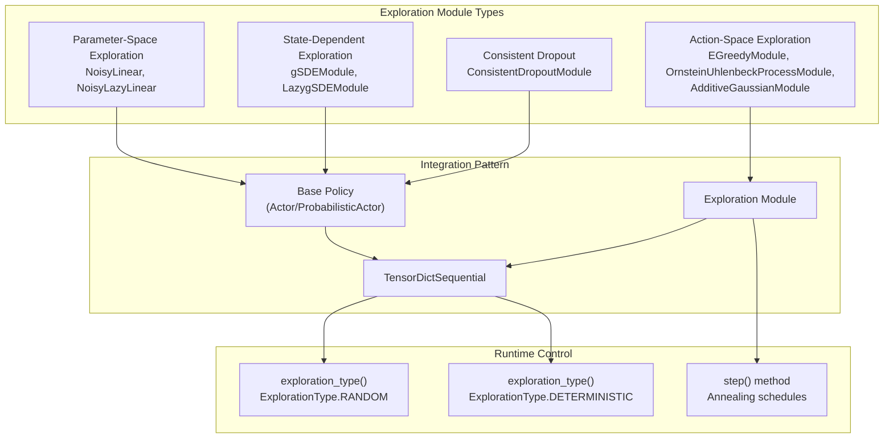
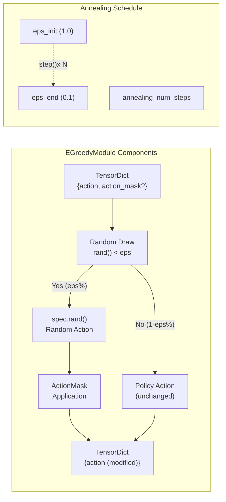
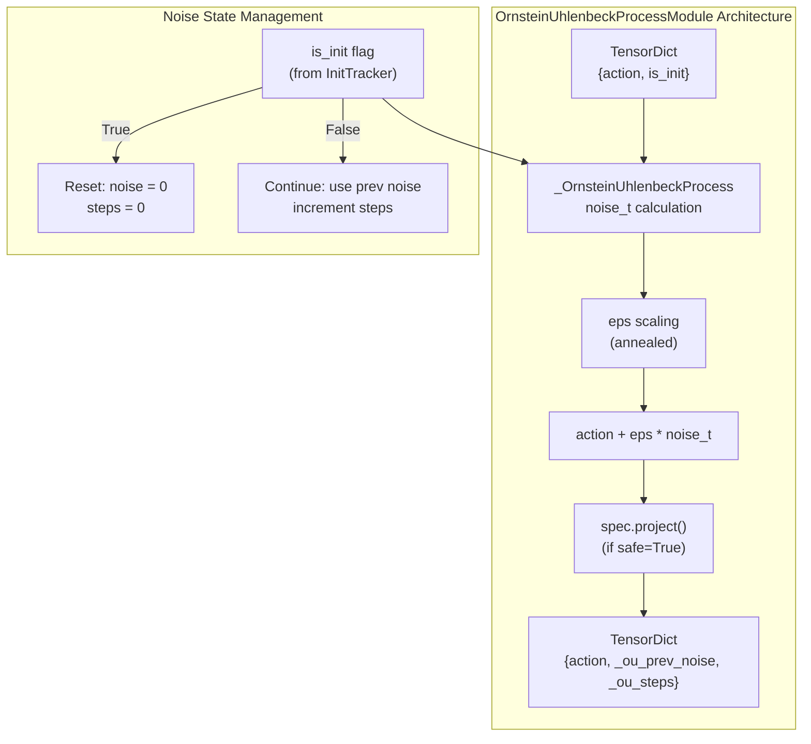
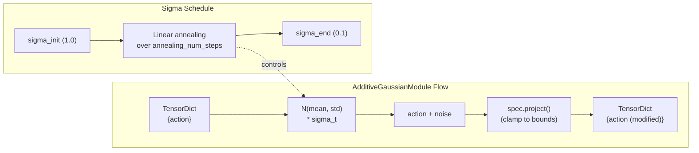
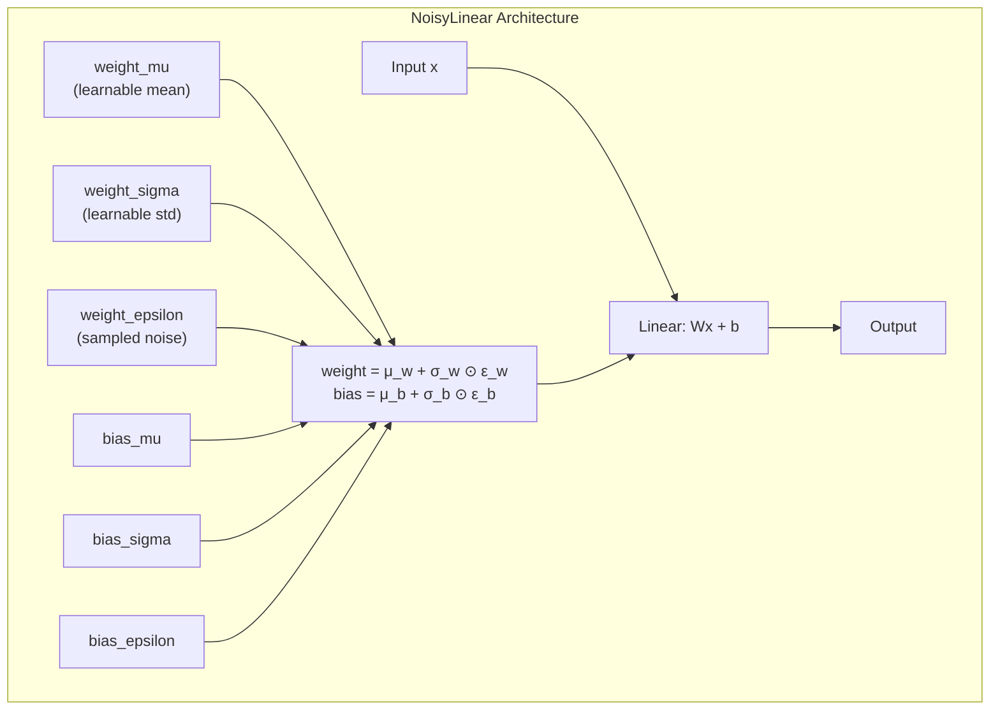
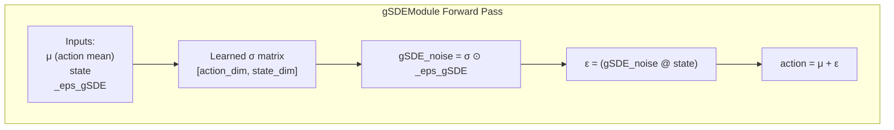
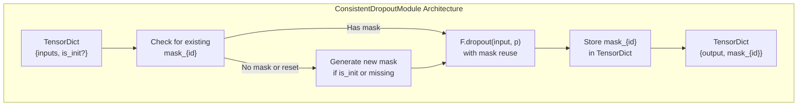

<!-- source: DeepWiki mcp.deepwiki.com · repo pytorch/rl · page 6.5 Exploration Strategies · fetched 2026-10-21 -->

# Exploration Strategies

<details>
<summary>Relevant source files</summary>

The following files were used as context for generating this wiki page:

- [test/modules/test_multiagent_models.py](test/modules/test_multiagent_models.py)
- [test/test_exploration.py](test/test_exploration.py)
- [test/test_helpers.py](test/test_helpers.py)
- [torchrl/modules/models/cross_group_critic.py](torchrl/modules/models/cross_group_critic.py)
- [torchrl/modules/models/exploration.py](torchrl/modules/models/exploration.py)
- [torchrl/modules/models/models.py](torchrl/modules/models/models.py)
- [torchrl/modules/models/multiagent.py](torchrl/modules/models/multiagent.py)
- [torchrl/modules/models/utils.py](torchrl/modules/models/utils.py)
- [torchrl/modules/tensordict_module/exploration.py](torchrl/modules/tensordict_module/exploration.py)
- [torchrl/record/recorder.py](torchrl/record/recorder.py)
- [torchrl/trainers/helpers/envs.py](torchrl/trainers/helpers/envs.py)
- [torchrl/trainers/helpers/models.py](torchrl/trainers/helpers/models.py)

</details>


## Purpose and Scope

This document covers exploration modules in TorchRL that add stochastic behavior to deterministic policies for improved learning in reinforcement learning environments. Exploration strategies modify action selection during training to encourage discovery of better policies while maintaining the ability to switch to deterministic evaluation mode.

For policy network architectures themselves, see [Actors, Critics, and Value Networks](#6.2). For probability distributions used in stochastic policies, see [Probability Distributions](#6.3).

Sources: `[torchrl/modules/tensordict_module/exploration.py:38-608]()`, `[torchrl/modules/models/exploration.py:29-426]()`

---

## Architecture Overview

Exploration modules in TorchRL follow a modular design pattern where exploration behavior is added as a composable layer that wraps or follows a base policy. All exploration modules inherit from `TensorDictModuleBase` and operate on `TensorDict` inputs, allowing them to be seamlessly integrated into policy chains using `TensorDictSequential`.



**Exploration Module Taxonomy:**

| Type | Classes / Modules | Modifies | Use Case |
|------|---------|----------|----------|
| Action-Space | `EGreedyModule`, `OrnsteinUhlenbeckProcessModule`, `AdditiveGaussianModule` | Actions after policy | Post-processing continuous/discrete actions |
| Parameter-Space | `NoisyLinear`, `NoisyLazyLinear` | Network weights | Built into network architecture |
| State-Dependent | `gSDEModule`, `LazygSDEModule` | Actions based on state | Smooth, structured exploration |
| Dropout-Based | `ConsistentDropoutModule` | Network activations | Ensemble-like exploration |

Sources: `[torchrl/modules/tensordict_module/exploration.py:38-40]`, `[torchrl/modules/models/exploration.py:29]()`

---

## Action-Space Exploration: Epsilon-Greedy

### EGreedyModule

`EGreedyModule` implements epsilon-greedy exploration for discrete and continuous action spaces `[torchrl/modules/tensordict_module/exploration.py:38-132]()`. With probability `eps`, it replaces the policy's action with a random sample from the action spec. The epsilon value anneals from `eps_init` to `eps_end` over `annealing_num_steps`.



**Key Implementation Details:**

1. **Action Masking Support**: When `action_mask_key` is provided, random actions respect the mask by applying the mask during sampling `[test/test_exploration.py:111-174]()`.
2. **Spec Expansion**: Automatically expands unbatched specs to match batched action shapes for parallel environments.
3. **Exploration Type Gating**: Only applies randomization when `exploration_type()` returns `ExplorationType.RANDOM` `[torchrl/modules/tensordict_module/exploration.py:157-160]()`.

**Usage Pattern:**

```python
# Example from test_exploration.py
from torchrl.modules import EGreedyModule, Actor
from torchrl.data import Bounded

spec = Bounded(-1, 1, torch.Size([4]))
policy = Actor(spec=spec, module=torch.nn.Linear(4, 4))
explorative_policy = TensorDictSequential(
    policy, 
    EGreedyModule(eps_init=0.5, eps_end=0.1, annealing_num_steps=1000, spec=spec)
)
```

**Annealing:** The `step()` method must be called after each training iteration to decay epsilon `[torchrl/modules/tensordict_module/exploration.py:137-156]()`:

```python
for _ in range(num_iterations):
    tensordict = collector.rollout()
    loss = loss_module(tensordict)
    explorative_policy[-1].step(frames=tensordict.numel())
```

Sources: `[torchrl/modules/tensordict_module/exploration.py:38-204]()`, `[test/test_exploration.py:67-200]()`

---

## Action-Space Exploration: Ornstein-Uhlenbeck Process

### OrnsteinUhlenbeckProcessModule

`OrnsteinUhlenbeckProcessModule` adds temporally-correlated noise to continuous actions using the Ornstein-Uhlenbeck process `[torchrl/modules/tensordict_module/exploration.py:405-608]()`. This creates structured exploration where actions vary smoothly across timesteps.



**State Tracking:** OU requires maintaining noise state across timesteps using `_ou_prev_noise`, `_ou_steps`, and `is_init`.

**Critical Usage Requirement:** The environment must be wrapped with `InitTracker` to provide the `is_init` key.

Sources: `[torchrl/modules/tensordict_module/exploration.py:405-608]()`, `[test/test_exploration.py:213-425]()`

---

## Action-Space Exploration: Additive Gaussian Noise

### AdditiveGaussianModule

`AdditiveGaussianModule` adds i.i.d. Gaussian noise to continuous actions with annealing variance `[torchrl/modules/tensordict_module/exploration.py:247-374]()`.



**Noise Addition Implementation:**
```python
noise = torch.normal(mean=mean, std=std)
action = action + noise * sigma
action = spec.project(action)
```

Sources: `[torchrl/modules/tensordict_module/exploration.py:247-374]()`, `[test/test_exploration.py:429-635]()`

---

## Parameter-Space Exploration: Noisy Networks

### NoisyLinear and NoisyLazyLinear

`NoisyLinear` adds learnable parametric noise directly to network weights, enabling the policy to learn both mean parameters and exploration magnitude `[torchrl/modules/models/exploration.py:29-240]()`.



**Key Properties:**
1. **Learnable Exploration**: Both `weight_sigma` and `bias_sigma` are optimized via gradient descent.
2. **Factorized Noise**: Uses outer product of two noise vectors to reduce computational complexity.
3. **Noise Reset**: Call `layer.reset_noise()` or `model.apply(reset_noise)` to resample factorized noise buffers `[torchrl/modules/models/exploration.py:51-71]()`.

Sources: `[torchrl/modules/models/exploration.py:29-240]()`, `[test/test_exploration.py:346-365]()`

---

## State-Dependent Exploration: gSDE

### gSDEModule and LazygSDEModule

`gSDEModule` adds exploration noise that depends on the current state, ensuring smooth and structured exploration in continuous control tasks `[torchrl/modules/models/exploration.py:242-426]()`.



**Environment Setup:** Must use `gSDENoise` transform to initialize `_eps_gSDE` states on environment reset `[torchrl/envs/transforms/transforms.py:40-40]()`.

Sources: `[torchrl/modules/models/exploration.py:242-426]()`, `[torchrl/envs/transforms/transforms.py:40-40]()`

---

## Consistent Dropout for Exploration

### ConsistentDropoutModule

`ConsistentDropoutModule` applies consistent dropout masks across trajectories to achieve ensemble-like exploration behaviors `[torchrl/modules/models/exploration.py:428-631]`. The same dropout mask is reused until episode reset.



Sources: `[torchrl/modules/models/exploration.py:428-631]()`, `[test/test_exploration.py:741-869]()`

---

## Integration Patterns and Best Practices

### Policy Construction with Exploration

Combining base policies with exploration modules is performed via `TensorDictSequential`:

```python
from torchrl.modules import ProbabilisticActor, AdditiveGaussianModule
from tensordict.nn import TensorDictSequential

base_policy = ProbabilisticActor(...)
exploration = AdditiveGaussianModule(spec=action_spec, sigma_init=1.0, sigma_end=0.1)
explorative_policy = TensorDictSequential(base_policy, exploration)
```

### Exploration Type Control

TorchRL manages global exploration mode through `set_exploration_type` context manager `[torchrl/envs/utils.py:22-32]()`:

```python
from torchrl.envs.utils import set_exploration_type, ExplorationType

with set_exploration_type(ExplorationType.RANDOM):
    data = collector.rollout()

with set_exploration_type(ExplorationType.DETERMINISTIC):
    eval_reward = evaluate_policy(env, policy)
```

Sources: `[torchrl/envs/utils.py:22-32]()`, `[test/test_exploration.py:300-356]()`

---

## Annealing Schedules and Step Management

### Frame Counting and Step Execution

Exploration modules that anneal parameters (`EGreedyModule`, `AdditiveGaussianModule`, `OrnsteinUhlenbeckProcessModule`) require calling `.step(frames)` after environment interactions:

```python
for data in collector:
    loss = loss_module(data)
    loss.backward()
    optimizer.step()
    exploration.step(frames=data.numel())
```

Sources: `[torchrl/modules/tensordict_module/exploration.py:137-156]`, `[torchrl/modules/tensordict_module/exploration.py:332-350]()`

---

