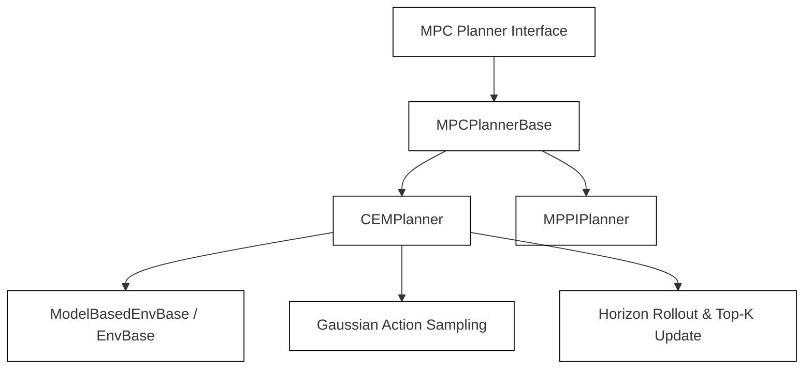
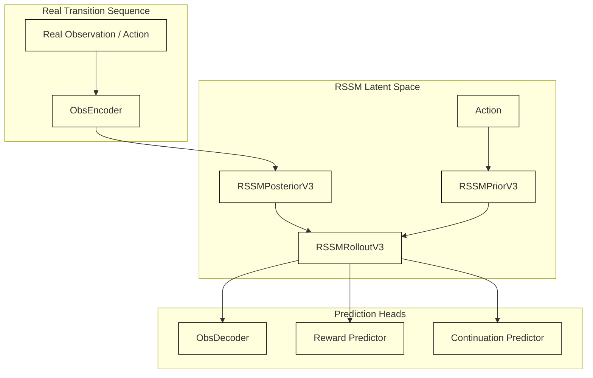

<!-- source: DeepWiki mcp.deepwiki.com · repo pytorch/rl · page 6.6 Planners and Model-Based Modules · fetched 2026-10-21 -->

# Planners and Model-Based Modules

Relevant source files

The following files were used as context for generating this wiki page:

- [benchmarks/ad_hoc/bench_dreamer_v3_learner.py](benchmarks/ad_hoc/bench_dreamer_v3_learner.py)
- [docs/source/reference/dreamer_v3.rst](docs/source/reference/dreamer_v3.rst)
- [sota-implementations/dreamer_v3/README.md](sota-implementations/dreamer_v3/README.md)
- [sota-implementations/dreamer_v3/config.yaml](sota-implementations/dreamer_v3/config.yaml)
- [sota-implementations/dreamer_v3/dreamer_v3_agent.py](sota-implementations/dreamer_v3/dreamer_v3_agent.py)
- [sota-implementations/dreamer_v3/dreamer_v3_replay.py](sota-implementations/dreamer_v3/dreamer_v3_replay.py)
- [sota-implementations/dreamer_v3/dreamer_v3_utils.py](sota-implementations/dreamer_v3/dreamer_v3_utils.py)
- [sota-implementations/dreamer_v3/reproduce_dmc_walker.sh](sota-implementations/dreamer_v3/reproduce_dmc_walker.sh)
- [sota-implementations/dreamer_v3/train.py](sota-implementations/dreamer_v3/train.py)
- [test/modules/conftest.py](test/modules/conftest.py)
- [test/modules/test_decision_transformer.py](test/modules/test_decision_transformer.py)
- [test/modules/test_dreamer_components.py](test/modules/test_dreamer_components.py)
- [test/modules/test_mlp_conv.py](test/modules/test_mlp_conv.py)
- [test/modules/test_planners.py](test/modules/test_planners.py)
- [test/objectives/test_dreamer_v3.py](test/objectives/test_dreamer_v3.py)
- [torchrl/modules/models/_dreamer_v3_block_gru_triton.py](torchrl/modules/models/_dreamer_v3_block_gru_triton.py)
- [torchrl/modules/models/model_based.py](torchrl/modules/models/model_based.py)
- [torchrl/modules/planners/cem.py](torchrl/modules/planners/cem.py)
- [torchrl/modules/planners/common.py](torchrl/modules/planners/common.py)
- [torchrl/modules/planners/mppi.py](torchrl/modules/planners/mppi.py)
- [torchrl/objectives/dreamer_v3.py](torchrl/objectives/dreamer_v3.py)
- [torchrl/trainers/algorithms/configs/hooks.py](torchrl/trainers/algorithms/configs/hooks.py)
- [torchrl/trainers/algorithms/dreamer_v3.py](torchrl/trainers/algorithms/dreamer_v3.py)

## Purpose and Scope
This page documents TorchRL's model-based reinforcement learning infrastructure located under `torchrl/modules/planners/` and `torchrl/modules/models/model_based.py`. It covers Model Predictive Control (MPC) planners—specifically the Cross-Entropy Method (`CEMPlanner`) and Model Predictive Path Integral (`MPPIPlanner`) algorithms—alongside world model components, Recurrent State-Space Models (RSSM) for continuous and categorical latent dynamics, and specialized DreamerV3 neural network building blocks (such as block-diagonal linear layers, RMS normalization, and block GRU recurrent cores).

---

## 1. Model-Based Planners (CEM and MPPI)

TorchRL provides model-based planning modules that wrap model-based environments or world models to select actions via online optimization. The foundational base class `MPCPlannerBase` handles interaction loops and reward aggregation across horizons [torchrl/modules/planners/common.py:14]().

### CEMPlanner
The Cross-Entropy Method planner (`CEMPlanner`) samples candidate action trajectories from a Gaussian distribution, evaluates them over a specified `planning_horizon` within an environment model, filters out rewards occurring after environment termination or truncation, and updates the sampling distribution using the top-performing candidate actions (`top_k`) [torchrl/modules/planners/cem.py:21-36]().

- **Initialization**: Configured with an environment `env`, `planning_horizon`, number of optimization iterations `optim_steps`, `num_candidates`, and `top_k` [torchrl/modules/planners/cem.py:124-140]().
- **Planning Forward Pass**: Executed via the `planning()` method, which returns the optimal action sequence maximizing cumulative simulated returns [torchrl/modules/planners/cem.py:141-158]().

### Planner Architecture to Code Mapping
The following diagram maps high-level planning concepts to TorchRL code entities:

*Sources: [torchrl/modules/planners/cem.py:21-140](), [torchrl/modules/planners/common.py:14]()*, [torchrl/modules/planners/mppi.py:1-15]()

---

## 2. World Models and RSSM Architecture

Recurrent State-Space Models (RSSMs) maintain a compact representation of the environment combining a deterministic recurrent hidden state (`belief`, $h_t$) and a stochastic latent state (`state`, $z_t$) [docs/source/reference/dreamer_v3.rst:58-66]().

### RSSM Components
- **Prior Model (`RSSMPriorV3`)**: Predicts the next categorical latent state distribution from the previous stochastic state, belief, and action, advancing the model dynamics without observing real environment feedback [docs/source/reference/dreamer_v3.rst:67-70]() [test/objectives/test_dreamer_v3.py:58]().
- **Posterior Model (`RSSMPosteriorV3`)**: Corrects the prior using encoded representations of the next observation during training on real transition sequences [docs/source/reference/dreamer_v3.rst:71-74]() [test/objectives/test_dreamer_v3.py:57]().
- **Rollout Module (`RSSMRolloutV3`)**: Carries posterior states and beliefs through sequential time steps, managing resets at episode boundaries [docs/source/reference/dreamer_v3.rst:110-114]() [test/objectives/test_dreamer_v3.py:59]().

### World Model Data Flow

*Sources: [docs/source/reference/dreamer_v3.rst:25-45](), [test/objectives/test_dreamer_v3.py:55-60]()*, [torchrl/modules/models/model_based.py:1-8]()

---

## 3. DreamerV3 Architectural Building Blocks

The module `torchrl/modules/models/model_based.py` defines core primitive layers implementing DreamerV3 architectural specifics:

- **RMS Normalization (`_DreamerV3RMSNorm`)**: Computes root-mean-square normalization with a learned scale parameter and no shift offset [torchrl/modules/models/model_based.py:57-67]().
- **Block-Diagonal Linear Layers (`_DreamerV3BlockLinear`)**: Applies independent linear projections over equally-sized feature blocks, enforcing isolated parameter blocks to scale efficiently across large networks [torchrl/modules/models/model_based.py:69-108]().
- **Block GRU (`DreamerV3BlockGRU` / `DreamerV3BlockGRUCell`)**: Executes block-diagonal gated recurrent unit updates across time dimensions, supporting reference, higher-order scan (`"scan"`), and fused Triton execution backends (`"triton"`) [test/modules/test_dreamer_components.py:39-40]() [docs/source/reference/dreamer_v3.rst:124-142]().
- **MLP Trunks (`DreamerV3MLP`)**: Combines RMS normalization, SiLU activations, and block-linear projections into deep networks for observation encoders, decoders, actors, and critics [test/modules/test_dreamer_components.py:43]() [docs/source/reference/dreamer_v3.rst:120-122]().

### Sources
- [torchrl/modules/models/model_based.py:1-194]()
- [torchrl/modules/planners/cem.py:21-140]()
- [test/modules/test_dreamer_components.py:34-52]()
- [test/objectives/test_dreamer_v3.py:53-60]()
- [docs/source/reference/dreamer_v3.rst:46-128]()

---

