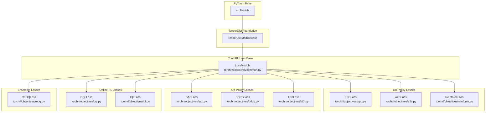
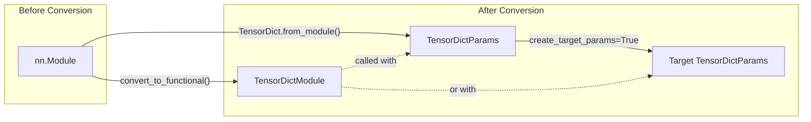
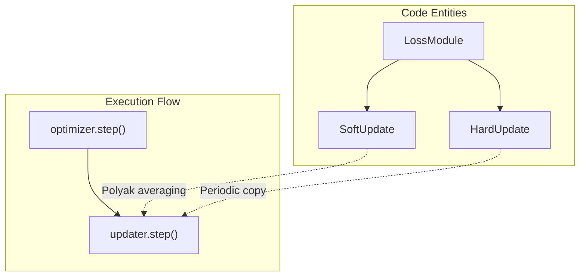
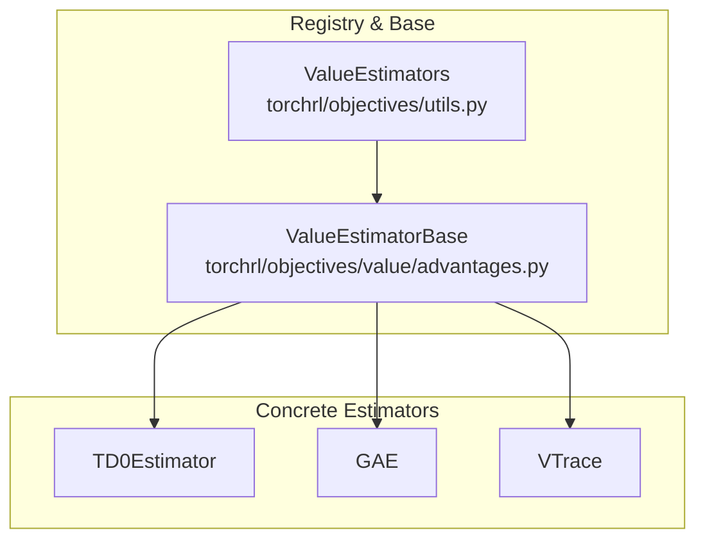
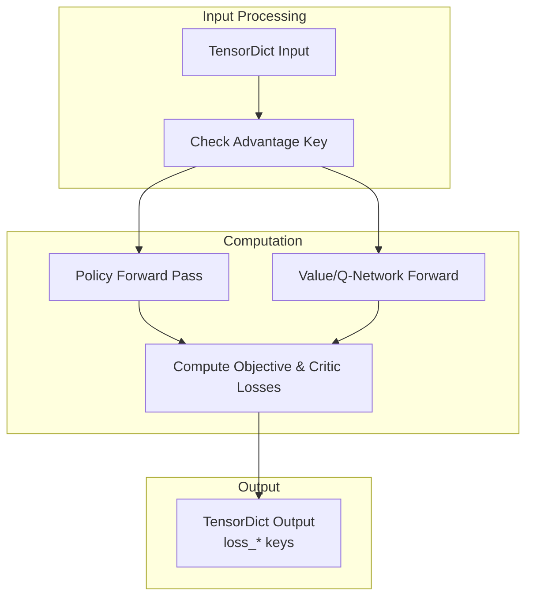

<!-- source: DeepWiki mcp.deepwiki.com · repo pytorch/rl · page 7.1 Loss Module Architecture · fetched 2026-10-21 -->

# Loss Module Architecture

<details>
<summary>Relevant source files</summary>

The following files were used as context for generating this wiki page:

- [torchrl/objectives/a2c.py](torchrl/objectives/a2c.py)
- [torchrl/objectives/common.py](torchrl/objectives/common.py)
- [torchrl/objectives/cql.py](torchrl/objectives/cql.py)
- [torchrl/objectives/crossq.py](torchrl/objectives/crossq.py)
- [torchrl/objectives/ddpg.py](torchrl/objectives/ddpg.py)
- [torchrl/objectives/decision_transformer.py](torchrl/objectives/decision_transformer.py)
- [torchrl/objectives/deprecated.py](torchrl/objectives/deprecated.py)
- [torchrl/objectives/iql.py](torchrl/objectives/iql.py)
- [torchrl/objectives/ppo.py](torchrl/objectives/ppo.py)
- [torchrl/objectives/redq.py](torchrl/objectives/redq.py)
- [torchrl/objectives/reinforce.py](torchrl/objectives/reinforce.py)
- [torchrl/objectives/sac.py](torchrl/objectives/sac.py)
- [torchrl/objectives/td3.py](torchrl/objectives/td3.py)
- [torchrl/objectives/td3_bc.py](torchrl/objectives/td3_bc.py)
- [torchrl/objectives/utils.py](torchrl/objectives/utils.py)

</details>


## Purpose and Scope

This document describes the architecture of the loss module system in TorchRL, which provides the computational backbone for implementing reinforcement learning algorithms. Loss modules compute training objectives (policy loss, value loss, entropy bonus, etc.) from batched trajectory data and coordinate the interaction between neural networks, value estimators, and target networks.

For information about individual RL algorithms (PPO, SAC, DQN, etc.), see [On-Policy Algorithms](#7.2), [Off-Policy Algorithms](#7.3), and [Value-Based Algorithms](#7.4). For value estimation methods (GAE, TD-Lambda, etc.), see [Value Estimators](#7.5).

---

## Base Class: LossModule

The `LossModule` class `[torchrl/objectives/common.py:87-151]()` is the abstract parent class for all RL loss modules. It inherits from `TensorDictModuleBase` and implements a standardized interface for computing losses from trajectory data stored in TensorDicts.

### Key Design Principles

1. **TensorDict-Based I/O**: All inputs and outputs are TensorDicts, enabling structured data flow
2. **Functional Modules**: Neural networks are converted to functional form, separating parameters from computation
3. **Target Networks**: Automatic management of target network parameters for stability
4. **Value Estimators**: Pluggable advantage/value target computation
5. **Key Configurability**: TensorDict keys are customizable via `set_keys()`

### LossModule Class Hierarchy



Sources: `[torchrl/objectives/common.py:87-151]()`, `[torchrl/objectives/ppo.py:119]()`, `[torchrl/objectives/sac.py:59]()`, `[torchrl/objectives/a2c.py:47]()`, `[torchrl/objectives/ddpg.py:27]()`, `[torchrl/objectives/td3.py:27]()`, `[torchrl/objectives/cql.py:38]()`, `[torchrl/objectives/iql.py:43]`, `[torchrl/objectives/redq.py:33]()`, `[torchrl/objectives/reinforce.py:32]()`

### Core LossModule Attributes

| Attribute | Type | Purpose |
|-----------|------|---------|
| `tensor_keys` | `_AcceptedKeys` | Dataclass holding configurable TensorDict key names |
| `default_value_estimator` | `ValueEstimators` | Default value estimator type (e.g., `GAE`, `TD0`) |
| `deterministic_sampling_mode` | `ExplorationType` | Exploration mode during loss computation (default: `DETERMINISTIC`) |
| `functional` | `bool` | Whether modules have been converted to functional form |
| `_value_estimator` | `ValueEstimatorBase` | Instance of the value estimator |
| `_has_update_associated` | `dict` | Tracks which target parameters have associated updaters |

Sources: `[torchrl/objectives/common.py:153-165]()`

### Core LossModule Methods

| Method | Purpose |
|--------|---------|
| `forward(tensordict)` | Main entry point: computes losses from trajectory data |
| `convert_to_functional(module, name, ...)` | Converts a stateful module to functional form with separate parameters |
| `make_value_estimator(type, **kwargs)` | Creates and configures a value estimator |
| `set_keys(**kwargs)` | Configures TensorDict key names used by the loss |

Sources: `[torchrl/objectives/common.py:87-165]()`

---

## Functional Module Conversion

Loss modules convert neural networks to **functional form**, separating the stateless computation graph from the learnable parameters. This design enables:
- Meta-learning and parameter-space optimization
- Efficient target network management
- Gradient control for shared parameters
- Batched/vmapped execution over parameter ensembles

### Conversion Process



Sources: `[torchrl/objectives/common.py:87-165]()`, `[torchrl/objectives/sac.py:59-135]()`

### Parameter Expansion for Ensembles

When ensemble structures are used (such as in `REDQLoss` `[torchrl/objectives/redq.py:33]()` or `SACLoss` `[torchrl/objectives/sac.py:59]()`), parameters are replicated along dimension 0 to support multiple Q-networks.

Sources: `[torchrl/objectives/redq.py:33-93]()`, `[torchrl/objectives/sac.py:59-135]()`

---

## Target Network System

Target networks are a stabilization technique used in off-policy RL algorithms. They provide slowly-updated reference values for bootstrapping, preventing the moving target problem.

### Target Parameter Creation and Updaters

The `TargetNetUpdater` utility hierarchy provides concrete update implementations:

- `SoftUpdate` `[torchrl/objectives/common.py:44-54]()`: Performs exponential moving average updates (`θ_target ← (1 - ε) · θ_target + ε · θ_source`).
- `HardUpdate`: Performs periodic full copies (`θ_target ← θ_source` every $N$ steps).



Sources: `[torchrl/objectives/common.py:44-54]()`, `[torchrl/objectives/utils.py:111-200]()`

---

## Value Estimator Integration

Value estimators compute advantage estimates and value targets from trajectory data. Loss modules integrate value estimators to support algorithms that require advantage-based policy updates (`PPOLoss`, `A2CLoss`, `ReinforceLoss`) or value bootstrapping (`SACLoss`, `DQNLoss`, etc.).

### Value Estimator Architecture



Sources: `[torchrl/objectives/utils.py:53-84]`, `[torchrl/objectives/common.py:87-165]()`

### Creating a Value Estimator

Loss modules provide `make_value_estimator()` to create and configure value estimators using the `ValueEstimators` enum `[torchrl/objectives/utils.py:53-72]()`:

```python
loss = PPOLoss(actor, critic)
loss.make_value_estimator(ValueEstimators.GAE, gamma=0.99, lmbda=0.95)
```

Sources: `[torchrl/objectives/utils.py:53-84]()`, `[torchrl/objectives/ppo.py:119-150]()`

---

## Key Management System

Loss modules use a configurable key system via the `_AcceptedKeys` dataclass pattern to read from and write to TensorDicts.

### Customizing Keys with set_keys()

The `set_keys()` method allows runtime key customization across the loss module and its associated value estimator:

```python
loss = PPOLoss(actor, critic)
loss.set_keys(advantage="custom_advantage")
```

Sources: `[torchrl/objectives/common.py:87-165]`, `[torchrl/objectives/ppo.py:351-396]()`

---

## Loss Module Data Flow

### Forward Pass Architecture



Sources: `[torchrl/objectives/common.py:87-165]()`, `[torchrl/objectives/ppo.py:119-200]()`

---

## Common Loss Patterns

### Actor-Critic Pattern
Most continuous control and on-policy losses (`PPOLoss` `[torchrl/objectives/ppo.py:119]()`, `A2CLoss` `[torchrl/objectives/a2c.py:47]()`, `SACLoss` `[torchrl/objectives/sac.py:59]()`, `DDPGLoss` `[torchrl/objectives/ddpg.py:27]`, `TD3Loss` `[torchrl/objectives/td3.py:27]()`) combine a stochastic or deterministic actor network with one or more value/critic networks.

Sources: `[torchrl/objectives/ppo.py:119]()`, `[torchrl/objectives/sac.py:59]()`, `[torchrl/objectives/a2c.py:47]()`, `[torchrl/objectives/ddpg.py:27]()`, `[torchrl/objectives/td3.py:27]()`

### Ensemble Q-Network Pattern
Off-policy and offline algorithms such as `SACLoss` `[torchrl/objectives/sac.py:59]()`, `REDQLoss` `[torchrl/objectives/redq.py:33]()`, `TD3Loss` `[torchrl/objectives/td3.py:27]()`, and `CQLLoss` `[torchrl/objectives/cql.py:38]()` manage multiple Q-value networks or ensemble weights to mitigate overestimation bias.

Sources: `[torchrl/objectives/sac.py:59]()`, `[torchrl/objectives/redq.py:33]()`, `[torchrl/objectives/td3.py:27]()`, `[torchrl/objectives/cql.py:38]()`

---

## File Organization

| File | Purpose |
|------|---------|
| `torchrl/objectives/common.py` | Base `LossModule` class and shared utilities |
| `torchrl/objectives/utils.py` | Helper functions, `ValueEstimators`, and registry |
| `torchrl/objectives/ppo.py` | PPO loss implementations (`PPOLoss`) |
| `torchrl/objectives/sac.py` | Soft Actor-Critic loss (`SACLoss`) |
| `torchrl/objectives/dqn.py` | Deep Q-Network loss |
| `torchrl/objectives/cql.py` | Conservative Q-Learning loss (`CQLLoss`) |
| `torchrl/objectives/iql.py` | Implicit Q-Learning loss (`IQLLoss`) |
| `torchrl/objectives/redq.py` | Randomized Ensembled Double Q-Learning loss (`REDQLoss`) |

Sources: `[torchrl/objectives/common.py:1-50]()`, `[torchrl/objectives/utils.py:1-50]()`, `[torchrl/objectives/ppo.py:1-50]()`, `[torchrl/objectives/sac.py:1-50]()`

---

