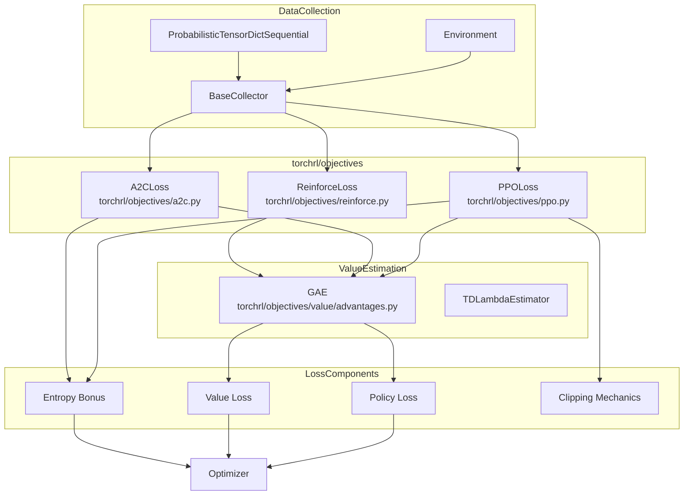
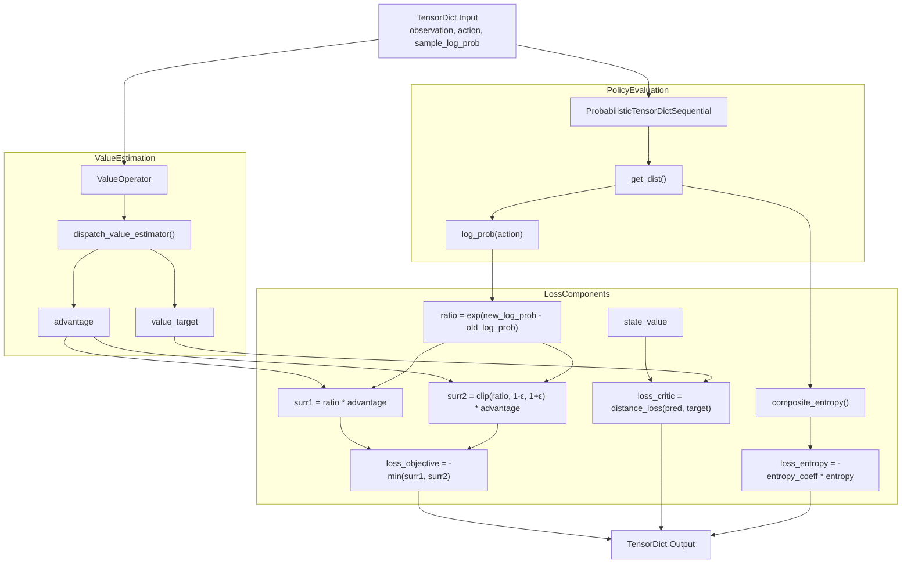
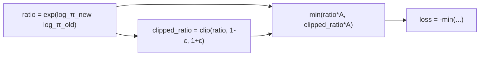
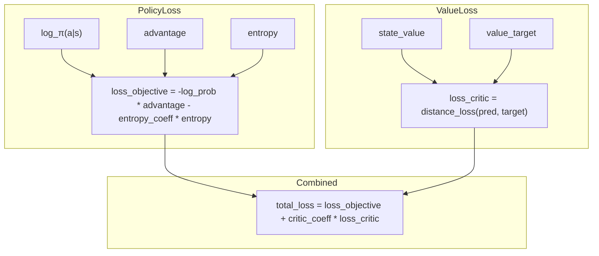
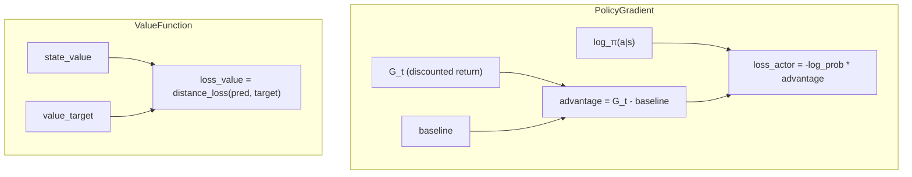
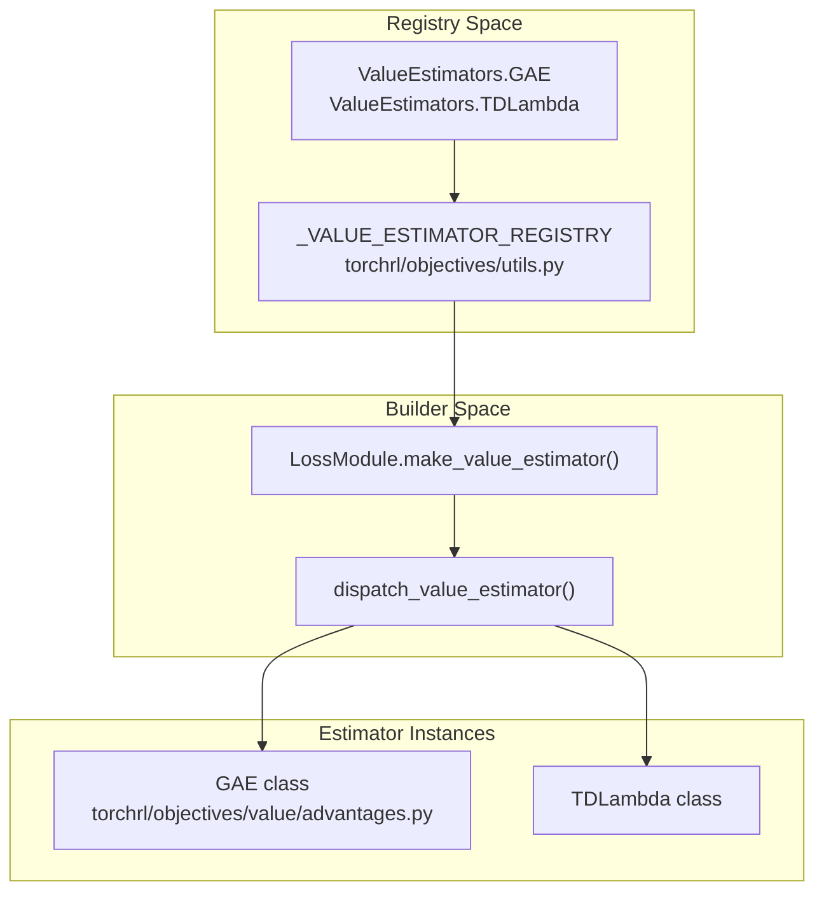

<!-- source: DeepWiki mcp.deepwiki.com · repo pytorch/rl · page 7.2 On-Policy Algorithms · fetched 2026-10-21 -->

# On-Policy Algorithms

Relevant source files

The following files were used as context for generating this wiki page:

- [sota-implementations/vla_grpo/README.md](sota-implementations/vla_grpo/README.md)
- [sota-implementations/vla_grpo/compare_simplevla_rollouts.py](sota-implementations/vla_grpo/compare_simplevla_rollouts.py)
- [sota-implementations/vla_grpo/config/vla_grpo_libero.yaml](sota-implementations/vla_grpo/config/vla_grpo_libero.yaml)
- [sota-implementations/vla_grpo/config/vla_grpo_toy.yaml](sota-implementations/vla_grpo/config/vla_grpo_toy.yaml)
- [sota-implementations/vla_grpo/openvla.py](sota-implementations/vla_grpo/openvla.py)
- [sota-implementations/vla_grpo/test_openvla.py](sota-implementations/vla_grpo/test_openvla.py)
- [sota-implementations/vla_grpo/utils.py](sota-implementations/vla_grpo/utils.py)
- [sota-implementations/vla_grpo/vla-grpo.py](sota-implementations/vla_grpo/vla-grpo.py)
- [sota-implementations/vla_grpo/vla-grpo.sbatch](sota-implementations/vla_grpo/vla-grpo.sbatch)
- [test/objectives/test_ppo.py](test/objectives/test_ppo.py)
- [torchrl/objectives/a2c.py](torchrl/objectives/a2c.py)
- [torchrl/objectives/common.py](torchrl/objectives/common.py)
- [torchrl/objectives/cql.py](torchrl/objectives/cql.py)
- [torchrl/objectives/crossq.py](torchrl/objectives/crossq.py)
- [torchrl/objectives/ddpg.py](torchrl/objectives/ddpg.py)
- [torchrl/objectives/decision_transformer.py](torchrl/objectives/decision_transformer.py)
- [torchrl/objectives/deprecated.py](torchrl/objectives/deprecated.py)
- [torchrl/objectives/iql.py](torchrl/objectives/iql.py)
- [torchrl/objectives/ppo.py](torchrl/objectives/ppo.py)
- [torchrl/objectives/redq.py](torchrl/objectives/redq.py)
- [torchrl/objectives/reinforce.py](torchrl/objectives/reinforce.py)
- [torchrl/objectives/sac.py](torchrl/objectives/sac.py)
- [torchrl/objectives/td3.py](torchrl/objectives/td3.py)
- [torchrl/objectives/td3_bc.py](torchrl/objectives/td3_bc.py)
- [torchrl/objectives/utils.py](torchrl/objectives/utils.py)

This document covers on-policy reinforcement learning algorithms in TorchRL: PPO (Proximal Policy Optimization), A2C (Advantage Actor-Critic), and REINFORCE. These algorithms update policies using trajectories collected from the current policy, distinguishing them from off-policy methods that can use historical data.

On-policy algorithms share common features: advantage computation (typically GAE), entropy bonuses for exploration, and actor-critic architectures. TorchRL's implementation provides configurable clipping mechanisms, flexible value estimation, and efficient functional programming support.

For off-policy algorithms, see [Off-Policy Algorithms](#7.3). For base loss module features, see [Loss Module Architecture](#7.1). For value estimation details, see [Value Estimators](#7.5).

## Architecture Overview

On-policy algorithms in TorchRL inherit from the `LossModule` base class and integrate with the value estimation system for advantage computation. The primary distinction is the use of current policy data for updates.

**On-Policy Algorithm Architecture**

Sources: [torchrl/objectives/ppo.py:119-150](), [torchrl/objectives/a2c.py:47-110](), [torchrl/objectives/reinforce.py:32-80](), [torchrl/objectives/common.py:87-151]()

## PPOLoss

`PPOLoss` implements Proximal Policy Optimization, the most widely used on-policy algorithm. PPO constrains policy updates using either clipping (ClipPPO) or KL penalty (KLPENPPO) to prevent destructive updates.

**PPO Loss Computation Flow**

Sources: [torchrl/objectives/ppo.py:58-117](), [torchrl/objectives/ppo.py:119-160]()

### PPO Configuration

The `PPOLoss` class is defined in [torchrl/objectives/ppo.py:119-160]() and accepts:

**Constructor Arguments:**
- `actor_network`: `ProbabilisticTensorDictSequential` - policy operator
- `critic_network`: `ValueOperator` - value operator

**Key Arguments:**
- `clip_epsilon`: `float` (ClipPPO only) - clipping range for importance sampling ratio, typically 0.2
- `entropy_bonus`: `bool` - whether to add entropy term for exploration
- `entropy_coeff`: `float | Mapping[NestedKey, float]` - entropy multiplier (scalar or per-head)
- `critic_coeff`: `float` - value loss weight
- `normalize_advantage`: `bool` - standardize advantages before use
- `clip_value`: `float` - optional value prediction clipping
- `loss_critic_type`: `str` - value loss function ("l1", "l2", "smooth_l1")
- `separate_losses`: `bool` - isolate shared parameter gradients

**Configurable Keys** (via `_AcceptedKeys` dataclass):
- `advantage`: advantage input key (default: `"advantage"`)
- `value_target`: target value key (default: `"value_target"`)
- `value`: state value key (default: `"state_value"`)
- `sample_log_prob`: log probability key (default: `"sample_log_prob"` or `"action_log_prob"`)
- `action`: action key (default: `"action"`)
- `reward`, `done`, `terminated`: environment keys

Sources: [torchrl/objectives/ppo.py:58-160]()

### ClipPPO vs KLPENPPO

TorchRL provides two PPO variants:

- **ClipPPOLoss**: Clips importance sampling ratio: `clip(ratio, 1-ε, 1+ε)` with default `clip_epsilon=0.2`. More stable and widely used.
- **KLPENPPOLoss**: Adds adaptive KL penalty: `loss + β * KL(π_old || π_new)` with dynamic `β` adjustment based on observed KL divergence.

**PPO Clipping Mechanism**

Sources: [torchrl/objectives/ppo.py:58-117]()

### Entropy Coefficient Configuration

PPO supports both scalar and per-head entropy coefficients for composite action spaces via `composite_entropy` [torchrl/objectives/ppo.py:35-36](). When using per-head dictionaries, outputs include total entropy, composite entropy breakdowns, and weighted entropy losses.

Sources: [torchrl/objectives/ppo.py:35-36](), [torchrl/objectives/ppo.py:119-160]()

## A2CLoss

`A2CLoss` implements Advantage Actor-Critic, performing single-step updates without clipping mechanisms, relying on parallel rollouts and the REINFORCE gradient estimator [torchrl/objectives/a2c.py:47-53]().

**A2C Loss Components**

Sources: [torchrl/objectives/a2c.py:47-110]()

### A2C Configuration

The `A2CLoss` class is defined in [torchrl/objectives/a2c.py:47-110]() and accepts:
- `actor_network`: `ProbabilisticTensorDictSequential`
- `critic_network`: `ValueOperator`
- `entropy_coeff`: float (default `0.01`)
- `critic_coeff`: float (default `1.0`)
- `loss_critic_type`: str (default `"smooth_l1"`)

Sources: [torchrl/objectives/a2c.py:47-110]()

## ReinforceLoss

`ReinforceLoss` implements the classic REINFORCE algorithm (Williams, 1992) using Monte Carlo policy gradients [torchrl/objectives/reinforce.py:32-36]().

**REINFORCE Loss Computation**

Sources: [torchrl/objectives/reinforce.py:32-80]()

### REINFORCE Configuration

Defined in [torchrl/objectives/reinforce.py:32-80](), taking `actor_network` and `critic_network`, supporting optional value delay, critic loss types, advantage and value target keys, and separate parameter losses.

Sources: [torchrl/objectives/reinforce.py:32-80]()

## Advantage Computation

On-policy algorithms rely on advantage estimation to reduce gradient variance. The advantage `A(s,a) = Q(s,a) - V(s)` measures how much better an action is compared to the average.

**Value Estimator Registry Integration**

Sources: [torchrl/objectives/utils.py:53-147](), [torchrl/objectives/common.py:87-151]()

### Default Value Estimators

Each on-policy loss uses `ValueEstimators.GAE` by default via `dispatch_value_estimator` [torchrl/objectives/utils.py:53-84](). Custom estimators can be instantiated via `.make_value_estimator(ValueEstimators.TDLambda, gamma=0.99, lmbda=0.95)` [torchrl/objectives/utils.py:53-63]().

Sources: [torchrl/objectives/utils.py:53-84]()

## Entropy Bonus

Entropy bonuses encourage exploration by adding the policy's entropy to the loss function (`loss_entropy = -entropy_coeff * entropy`) [torchrl/objectives/ppo.py:119-160](). Monte-Carlo estimation (`samples_mc_entropy`) is supported for distributions lacking closed-form analytic entropy [torchrl/objectives/a2c.py:62-67]().

Sources: [torchrl/objectives/ppo.py:119-160](), [torchrl/objectives/a2c.py:47-110]()

---

