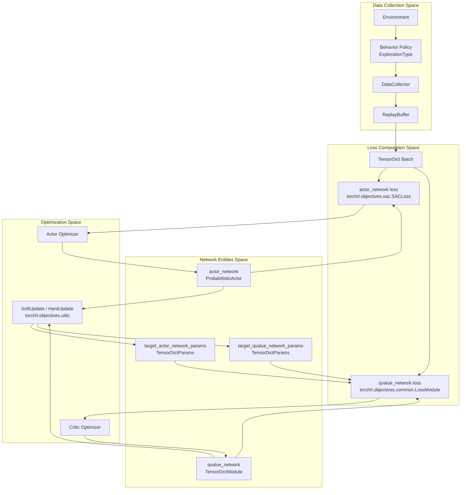
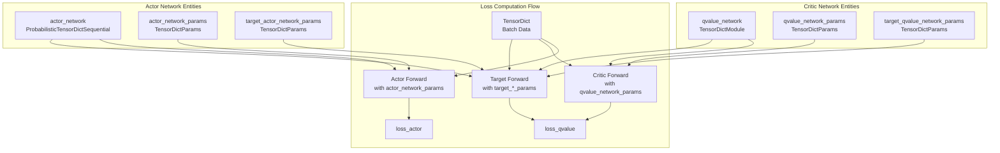
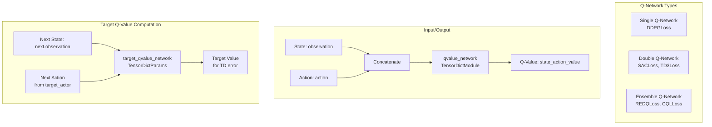
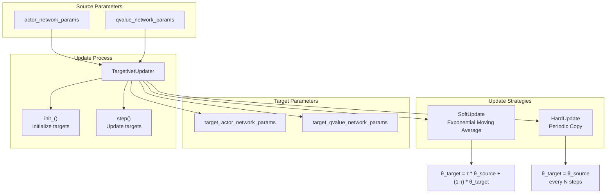

<!-- source: DeepWiki mcp.deepwiki.com · repo pytorch/rl · page 7.3 Off-Policy Algorithms · fetched 2026-10-21 -->

# Off-Policy Algorithms

Relevant source files

The following files were used as context for generating this wiki page:

- [torchrl/objectives/a2c.py](torchrl/objectives/a2c.py)
- [torchrl/objectives/common.py](torchrl/objectives/common.py)
- [torchrl/objectives/cql.py](torchrl/objectives/cql.py)
- [torchrl/objectives/crossq.py](torchrl/objectives/crossq.py)
- [torchrl/objectives/ddpg.py](torchrl/objectives/ddpg.py)
- [torchrl/objectives/decision_transformer.py](torchrl/objectives/decision_transformer.py)
- [torchrl/objectives/deprecated.py](torchrl/objectives/deprecated.py)
- [torchrl/objectives/iql.py](torchrl/objectives/iql.py)
- [torchrl/objectives/ppo.py](torchrl/objectives/ppo.py)
- [torchrl/objectives/redq.py](torchrl/objectives/redq.py)
- [torchrl/objectives/reinforce.py](torchrl/objectives/reinforce.py)
- [torchrl/objectives/sac.py](torchrl/objectives/sac.py)
- [torchrl/objectives/td3.py](torchrl/objectives/td3.py)
- [torchrl/objectives/td3_bc.py](torchrl/objectives/td3_bc.py)
- [torchrl/objectives/utils.py](torchrl/objectives/utils.py)

This document covers off-policy reinforcement learning algorithms in TorchRL, including SAC (Soft Actor-Critic), DDPG (Deep Deterministic Policy Gradient), TD3 (Twin Delayed DDPG), REDQ, CQL, and IQL. Off-policy methods learn from replay buffers containing past experience, enabling sample-efficient training through repeated learning from stored transitions.

Off-policy methods separate the behavior policy (used for data collection) from the target policy (being optimized). This separation requires careful management of Q-value networks, target networks, and actor-critic coordination patterns.

For on-policy algorithms, see [On-Policy Algorithms](#7.2). For the loss module architecture, see [Loss Module Architecture](#7.1). For value estimation methods, see [Value Estimators](#7.5).

## Off-Policy Training Architecture

Off-policy algorithms share a common training pattern where data is collected into a replay buffer and then sampled for iterative updates. The key distinction from on-policy methods is the use of target networks to stabilize learning.

**Off-Policy Training Flow and Code Entities**

Sources: [torchrl/objectives/sac.py:62-256](), [torchrl/objectives/ddpg.py:29-143](), [torchrl/objectives/td3.py:29-81](), [torchrl/objectives/common.py:87-151]()

## Actor-Critic Coordination

Off-policy algorithms use actor-critic architectures where the actor (policy network) and critic (Q-value network) are trained with different objectives. The actor maximizes expected return while the critic estimates the value of state-action pairs.

**Actor-Critic Component Structure**

The `convert_to_functional` method in `LossModule` isolates parameters into separate `TensorDictParams` objects, enabling independent optimization of actor and critic while sharing computation graphs when beneficial [torchrl/objectives/common.py:276-432]().

Sources: [torchrl/objectives/common.py:276-432](), [torchrl/objectives/sac.py:318-398](), [torchrl/objectives/ddpg.py:195-252]()

### Parameter Sharing and Separation

Off-policy losses support a `separate_losses` flag that controls gradient flow to shared parameters:

- `separate_losses=False` (default): Shared parameters receive gradients from both actor and critic losses [torchrl/objectives/sac.py:318-398]()
- `separate_losses=True`: Shared parameters only train on actor loss, preventing critic updates from affecting shared layers [torchrl/objectives/sac.py:318-398]()

This is implemented via the `compare_against` parameter in `convert_to_functional`, which identifies shared parameters between networks.

Sources: [torchrl/objectives/sac.py:318-398](), [torchrl/objectives/ddpg.py:224-240](), [torchrl/objectives/td3.py:138-161]()

## Q-Value Networks

Q-value networks estimate the expected return of taking action `a` in state `s`. In off-policy algorithms, Q-networks are trained via temporal difference (TD) learning using the Bellman equation:

$$Q(s, a) = r + \gamma \max_{a'} Q(s', a')$$

**Q-Value Network Architecture**

Sources: [torchrl/objectives/sac.py:62-256](), [torchrl/objectives/ddpg.py:27-143](), [torchrl/objectives/td3.py:27-81]()

### Double Q-Learning

SAC and TD3 use two Q-networks to reduce overestimation bias. The minimum of the two Q-values is used for the policy update target:

$$Q_{\text{target}} = r + \gamma \min(Q_1(s', a'), Q_2(s', a'))$$

This is implemented via `num_qvalue_nets=2` and the `_vmap_func` utility for efficient parallel computation across Q-networks [torchrl/objectives/sac.py:318-398]().

Sources: [torchrl/objectives/sac.py:318-398](), [torchrl/objectives/td3.py:138-259](), [torchrl/objectives/utils.py:1-43]()

### Q-Value Loss Computation

The critic loss minimizes the TD error between predicted and target Q-values using `distance_loss` [torchrl/objectives/utils.py:1-43](). The utility supports multiple loss functions: `"l1"`, `"l2"`, `"smooth_l1"` (Huber loss).

Sources: [torchrl/objectives/sac.py:667-777](), [torchrl/objectives/ddpg.py:257-345](), [torchrl/objectives/utils.py:109-143]()

## Target Network Updates

Target networks stabilize off-policy learning by providing slowly-changing targets for TD error computation. Without target networks, the Q-value estimates and targets would both shift during training, leading to instability.

**Target Network Update Mechanisms**

Sources: [torchrl/objectives/utils.py:297-389]()

### Soft Updates (Polyak Averaging)

`SoftUpdate` performs exponential moving average updates at every optimization step:

$$\theta_{\text{target}} \leftarrow \tau \theta_{\text{source}} + (1 - \tau) \theta_{\text{target}}$$

This is the default for SAC and recommended for continuous control [torchrl/objectives/sac.py:318-449]().

Sources: [torchrl/objectives/utils.py:297-353]()

### Hard Updates (Periodic Copy)

`HardUpdate` copies parameters at fixed intervals (e.g., every 1000 steps). This is used across standard DDPG and TD3 variants [torchrl/objectives/ddpg.py:27-143](), [torchrl/objectives/td3.py:27-81]().

Sources: [torchrl/objectives/utils.py:356-389]()

## SAC (Soft Actor-Critic)

SAC is an off-policy actor-critic algorithm that maximizes both expected return and policy entropy [torchrl/objectives/sac.py:59-65]().

### SAC Loss Computation

The actor loss maximizes Q-value while encouraging entropy:
$$\mathcal{L}_{\text{actor}} = \mathbb{E}[\alpha \log \pi(a|s) - Q(s,a)]$$ [torchrl/objectives/sac.py:549-668]()

The critic loss minimizes TD error using the minimum of two Q-networks [torchrl/objectives/sac.py:667-777]().

### Entropy Temperature (Alpha)

SAC uses a temperature parameter `α` to control the entropy-return tradeoff [torchrl/objectives/sac.py:318-449](). When `fixed_alpha=False`, alpha is learned to match a `target_entropy` [torchrl/objectives/sac.py:779-866]().

Sources: [torchrl/objectives/sac.py:318-449](), [torchrl/objectives/sac.py:779-866]()

## DDPG, TD3, and Advanced Off-Policy Variants

TorchRL implements several extensions and alternative off-policy losses:
- **DDPGLoss**: Standard deterministic policy gradient loss with Q-value mapping [torchrl/objectives/ddpg.py:27-143]().
- **TD3Loss**: Twin Delayed DDPG adding target policy smoothing noise and clipped double Q-learning [torchrl/objectives/td3.py:27-81]().
- **REDQLoss**: Randomized Ensembled Double Q-Learning using subsampled ensembles [torchrl/objectives/redq.py:33-93]().
- **CQLLoss**: Conservative Q-Learning for offline RL, penalizing out-of-distribution actions [torchrl/objectives/cql.py:38-97]().
- **IQLLoss**: Implicit Q-Learning, using expectile regression to avoid querying unseen actions [torchrl/objectives/iql.py:43-85]().

Sources: [torchrl/objectives/ddpg.py:27-143](), [torchrl/objectives/td3.py:27-81](), [torchrl/objectives/redq.py:33-93](), [torchrl/objectives/cql.py:38-97](), [torchrl/objectives/iql.py:43-85]()

## Key Features and Utilities

### Reduction and Output Management

Loss modules support configurable output reduction (`"none"`, `"mean"`, `"sum"`) and selective output key filtering through `select_out_keys()` [torchrl/objectives/common.py:87-151]().

### Performance Optimizations

The system includes several performance optimizations:
- `vmap` support for vectorized operations across ensemble members [torchrl/objectives/utils.py:1-43]()
- Functional programming via `TensorDictParams` to enable parameter sharing [torchrl/objectives/common.py:276-432]()
- Efficient target network updates with minimal memory overhead [torchrl/objectives/utils.py:297-389]()

Sources: [torchrl/objectives/utils.py:1-43](), [torchrl/objectives/common.py:276-461]()

---

