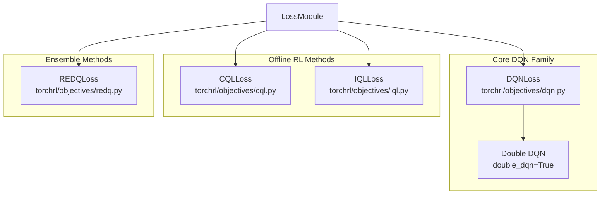
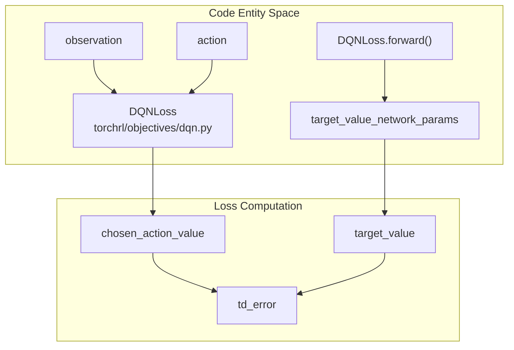
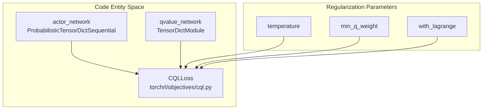

<!-- source: DeepWiki mcp.deepwiki.com · repo pytorch/rl · page 7.4 Value-Based Algorithms · fetched 2026-10-21 -->

# Value-Based Algorithms

<details>
<summary>Relevant source files</summary>

The following files were used as context for generating this wiki page:

- [torchrl/objectives/a2c.py](torchrl/objectives/a2c.py)
- [torchrl/objectives/common.py](torchrl/objectives/common.py)
- [torchrl/objectives/cql.py](torchrl/objectives/cql.py)
- [torchrl/objectives/crossq.py](torchrl/objectives/crossq.py)
- [torchrl/objectives/ddpg.py](torchrl/objectives/ddpg.py)
- [torchrl/objectives/decision_transformer.py](torchrl/objectives/decision_transformer.py)
- [torchrl/objectives/deprecated.py](torchrl/objectives/deprecated.py)
- [torchrl/objectives/dqn.py](torchrl/objectives/dqn.py)
- [torchrl/objectives/iql.py](torchrl/objectives/iql.py)
- [torchrl/objectives/ppo.py](torchrl/objectives/ppo.py)
- [torchrl/objectives/redq.py](torchrl/objectives/redq.py)
- [torchrl/objectives/reinforce.py](torchrl/objectives/reinforce.py)
- [torchrl/objectives/sac.py](torchrl/objectives/sac.py)
- [torchrl/objectives/td3.py](torchrl/objectives/td3.py)
- [torchrl/objectives/td3_bc.py](torchrl/objectives/td3_bc.py)
- [torchrl/objectives/utils.py](torchrl/objectives/utils.py)

</details>


This document covers value-based reinforcement learning algorithms in TorchRL, which learn Q-value functions to determine optimal actions. Unlike policy gradient methods (see [On-Policy Algorithms](#7.2) and [Off-Policy Algorithms](#7.3)), value-based algorithms directly estimate action-values $Q(s,a)$ and select actions by maximizing these values. The core algorithm is DQN (Deep Q-Network), with extensions including distributional RL, offline RL methods, and ensemble approaches.

For the base loss module architecture, see [Loss Module Architecture](#7.1). For value estimation methods used by these algorithms, see [Value Estimators](#7.5).

Sources: [torchrl/objectives/dqn.py:34-121](), [torchrl/objectives/cql.py:38-97](), [torchrl/objectives/iql.py:43-85](), [torchrl/objectives/redq.py:33-93]()

## Overview of Value-Based Methods

Value-based algorithms estimate the action-value function $Q(s,a)$ representing the expected return from taking action $a$ in state $s$. Unlike actor-critic methods that maintain separate policy and value networks, value-based methods derive the policy implicitly through action selection (typically $\varepsilon$-greedy or greedy).

**Value-Based Algorithm Hierarchy**


Sources: [torchrl/objectives/common.py:87-165](), [torchrl/objectives/dqn.py:34-48](), [torchrl/objectives/cql.py:38-42](), [torchrl/objectives/iql.py:43-46](), [torchrl/objectives/redq.py:33-38]()

**Key Characteristics:**
- **Off-policy**: Learn from any experience, enabling replay buffers [5.1]()
- **Discrete/Continuous**: Most value-based methods target discrete action spaces, while offline variants like CQL and IQL extend to continuous actions via actor integration.
- **Target Networks**: Use delayed parameter updates for stability via `TargetNetUpdater` [7.1]().
- **Bootstrap**: Use value estimates to compute TD targets [7.5]().

Sources: [torchrl/objectives/dqn.py:34-47](), [torchrl/objectives/cql.py:38-54](), [torchrl/objectives/iql.py:43-60](), [torchrl/objectives/redq.py:33-50]()

## DQN and Core Algorithms

### DQN Loss

The `DQNLoss` class implements Deep Q-Network training, the foundational value-based algorithm [torchrl/objectives/dqn.py:34-35](). DQN approximates the optimal action-value function $Q^*(s,a)$ using a neural network and trains it via temporal difference learning.

**DQN Architecture and Code Mapping**


Sources: [torchrl/objectives/dqn.py:34-145](), [torchrl/objectives/dqn.py:122-145]()

**Key Features:**
- **Action Space**: Supports `"one_hot"`, `"categorical"`, and `"mult_one_hot"` action specs [torchrl/objectives/dqn.py:48-52]()
- **Target Networks**: Optional delayed updates via `delay_value=True` [torchrl/objectives/dqn.py:43-45]()
- **Double DQN**: Decouples action selection from evaluation with `double_dqn=True` [torchrl/objectives/dqn.py:46-47]()
- **Value Estimators**: Configurable TD learning (TD0, TD1, TD-Lambda) via `make_value_estimator()` [torchrl/objectives/utils.py:53-84]()

**Key Parameters:**

| Parameter | Type | Default | Description |
|-----------|------|---------|-------------|
| `value_network` | `QValueActor` or `nn.Module` | Required | Q-value network [torchrl/objectives/dqn.py:38]() |
| `loss_function` | `str` | `"l2"` | Loss function: `"l1"`, `"l2"`, `"smooth_l1"` [torchrl/objectives/dqn.py:41-42]() |
| `delay_value` | `bool` | `True` | Use separate target network [torchrl/objectives/dqn.py:43-45]() |
| `double_dqn` | `bool` | `False` | Enable Double DQN [torchrl/objectives/dqn.py:46-47]() |
| `action_space` | `str` or `TensorSpec` | `None` | Action space specification [torchrl/objectives/dqn.py:48-52]() |
| `reduction` | `str` | `"mean"` | Loss reduction method [torchrl/objectives/dqn.py:59-62]() |

Sources: [torchrl/objectives/dqn.py:34-63]()

### Double DQN

Double DQN addresses overestimation bias in standard DQN by using the online network to select actions and the target network to evaluate them [torchrl/objectives/dqn.py:46-47]():

```
Standard DQN:  Q_target = r + γ * max_{a'} Q_target(s', a')
Double DQN:    Q_target = r + γ * Q_target(s', argmax_{a'} Q_online(s', a'))
```

Enable with `double_dqn=True` in `DQNLoss` constructor [torchrl/objectives/dqn.py:46-47]().

Sources: [torchrl/objectives/dqn.py:34-47]()

## Offline RL Methods

Offline RL algorithms learn from fixed datasets without environment interaction. Value-based offline methods address distribution shift and overestimation through conservative value estimation.

### Conservative Q-Learning (CQL)

`CQLLoss` implements Conservative Q-Learning for continuous and discrete action spaces [torchrl/objectives/cql.py:38-41](). CQL adds a regularization term that penalizes Q-values at out-of-distribution actions while maximizing values at dataset actions.

**CQL Code Entity Architecture**


Sources: [torchrl/objectives/cql.py:38-96]()

**Key Features:**
- **Conservative Bias**: Underestimates Q-values for actions outside training distribution [torchrl/objectives/cql.py:38-42]()
- **Temperature**: `temperature` parameter controls the penalty magnitude [torchrl/objectives/cql.py:81]()
- **Min Q-Weight**: `min_q_weight` scales the CQL regularization term [torchrl/objectives/cql.py:82]()
- **Lagrange Multiplier**: Optional automatic tuning with `with_lagrange=True` [torchrl/objectives/cql.py:88-89]()

**CQL Parameters:**

| Parameter | Type | Default | Description |
|-----------|------|---------|-------------|
| `actor_network` | `ProbabilisticTensorDictSequential` | Required | Policy network [torchrl/objectives/cql.py:44]() |
| `qvalue_network` | `TensorDictModule` or list | Required | Q-value network(s) [torchrl/objectives/cql.py:45-53]() |
| `temperature` | `float` | `1.0` | CQL temperature [torchrl/objectives/cql.py:81]() |
| `min_q_weight` | `float` | `1.0` | CQL penalty weight [torchrl/objectives/cql.py:82]() |
| `max_q_backup` | `bool` | `False` | Use max Q-value backup [torchrl/objectives/cql.py:83-84]() |
| `num_random` | `int` | `10` | Number of random action samples [torchrl/objectives/cql.py:86-87]() |
| `with_lagrange` | `bool` | `False` | Use Lagrangian constraint [torchrl/objectives/cql.py:88-90]() |

Sources: [torchrl/objectives/cql.py:38-97]()

### Implicit Q-Learning (IQL)

`IQLLoss` implements Implicit Q-Learning, which avoids explicit policy optimization and instead learns Q-values, V-values, and the policy separately using expectile regression [torchrl/objectives/iql.py:43-46]().

**Key Features:**
- **Expectile Regression**: V-network uses asymmetric loss with expectile $\tau$ [torchrl/objectives/iql.py:70-71]()
- **Decoupled Learning**: Q, V, and policy updated independently [torchrl/objectives/iql.py:43-60]()
- **No Q-Value Maximization**: Avoids overestimation through implicit policy
- **Temperature**: Controls advantage weighting via `temperature` parameter [torchrl/objectives/iql.py:66-69]()

**IQL Parameters:**

| Parameter | Type | Default | Description |
|-----------|------|---------|-------------|
| `actor_network` | `ProbabilisticTensorDictSequential` | Required | Policy network [torchrl/objectives/iql.py:49]() |
| `qvalue_network` | `TensorDictModule` | Required | Q-value network(s) [torchrl/objectives/iql.py:50-58]() |
| `value_network` | `TensorDictModule` | Required | State-value network [torchrl/objectives/iql.py:59-60]() |
| `temperature` | `float` | `3.0` | Advantage weighting ($\beta$) [torchrl/objectives/iql.py:66-69]() |
| `expectile` | `float` | `0.7` | Expectile for V-learning ($\tau$) [torchrl/objectives/iql.py:70-71]() |
| `num_qvalue_nets` | `int` | `2` | Number of Q-networks [torchrl/objectives/iql.py:62-63]() |

Sources: [torchrl/objectives/iql.py:43-85]()

## Ensemble and Multi-Network Methods

### REDQ Loss

`REDQLoss` (Randomized Ensembled Double Q-Learning) extends SAC with an ensemble of Q-networks and random subsampling for improved sample efficiency [torchrl/objectives/redq.py:33-38]().

**Key Features:**
- **Ensemble Size**: Maintains `num_qvalue_nets` Q-networks (default 10) [torchrl/objectives/redq.py:52-53]()
- **Subsampling**: Uses `sub_sample_len` networks (default 2) for target computation [torchrl/objectives/redq.py:54-56]()
- **SAC Integration**: Combines ensemble with entropy regularization [torchrl/objectives/redq.py:33-38]()
- **High UTD**: Enables high update-to-data (UTD) ratios

**REDQ Parameters:**

| Parameter | Type | Default | Description |
|-----------|------|---------|-------------|
| `actor_network` | `TensorDictModule` | Required | Policy network [torchrl/objectives/redq.py:41]() |
| `qvalue_network` | `TensorDictModule` or `list` | Required | Q-network(s) to ensemble [torchrl/objectives/redq.py:42-50]() |
| `num_qvalue_nets` | `int` | `10` | Ensemble size [torchrl/objectives/redq.py:52-53]() |
| `sub_sample_len` | `int` | `2` | Number of Q-nets for target [torchrl/objectives/redq.py:54-56]() |
| `target_entropy` | `float` or `"auto"` | `"auto"` | Entropy target [torchrl/objectives/redq.py:71-73]() |
| `fixed_alpha` | `bool` | `False` | Fix entropy coefficient [torchrl/objectives/redq.py:69-70]() |

Sources: [torchrl/objectives/redq.py:33-93]()

## Implementation Details

### Target Networks and Updates

Value-based algorithms require target networks for stable TD learning. TorchRL provides automatic target network management through loss modules and updaters [torchrl/objectives/common.py:44-54]().

**Usage Example:**
```python
# Create DQN loss with target network
loss = DQNLoss(value_network, delay_value=True)
```
Sources: [torchrl/objectives/dqn.py:34-45]()

### Action Selection and Spec Compatibility

Value-based losses work with `QValueActor` or `DistributionalQValueActor` modules that handle action selection [torchrl/objectives/dqn.py:19-22](). The `action_space` parameter accepts strings (`"one_hot"`, `"categorical"`, `"mult_one_hot"`) or explicit `TensorSpec` instances [torchrl/objectives/dqn.py:48-52]().

Sources: [torchrl/objectives/dqn.py:19-22](), [torchrl/objectives/dqn.py:48-52]()

### Value Estimation for Q-Learning

Value-based algorithms use value estimators to compute TD targets via `ValueEstimators` enums [torchrl/objectives/utils.py:53-71](). The default is typically `TD0` (1-step bootstrap), but multi-step variants (`TD1`, `TDLambda`) are supported [torchrl/objectives/utils.py:65-67]().

Sources: [torchrl/objectives/utils.py:53-84]()

### Priority and Replay Buffer Integration

Value-based losses compute TD errors that can be written to a designated priority key for prioritized experience replay [torchrl/objectives/dqn.py:55-58](). The `priority` key defaults to `"td_error"` [torchrl/objectives/dqn.py:140-141]().

Sources: [torchrl/objectives/dqn.py:55-58](), [torchrl/objectives/dqn.py:140-141]()

## Key Features and Utilities

### Reduction and Output Management

Loss modules support configurable output reduction (`"none"`, `"mean"`, `"sum"`) and selective output key filtering via `LossModule` [torchrl/objectives/common.py:87-126]().

Sources: [torchrl/objectives/common.py:87-126]()

### Compatibility Modes

Loss modules operate in TensorDict mode or non-TensorDict mode, automatically handling tensor unpacking and packing for standalone PyTorch modules [torchrl/objectives/dqn.py:89-93]().

Sources: [torchrl/objectives/dqn.py:89-93]()

---

