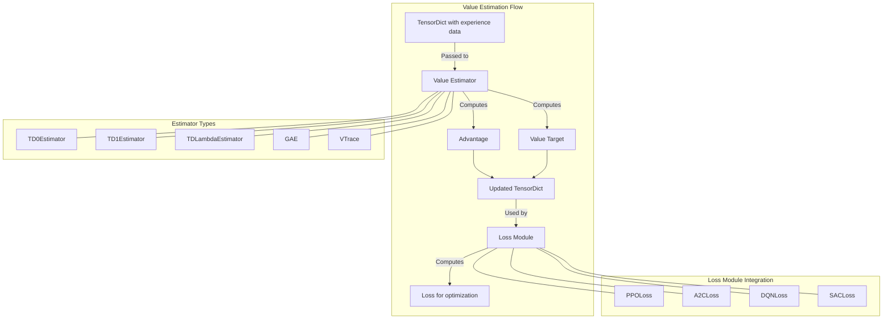
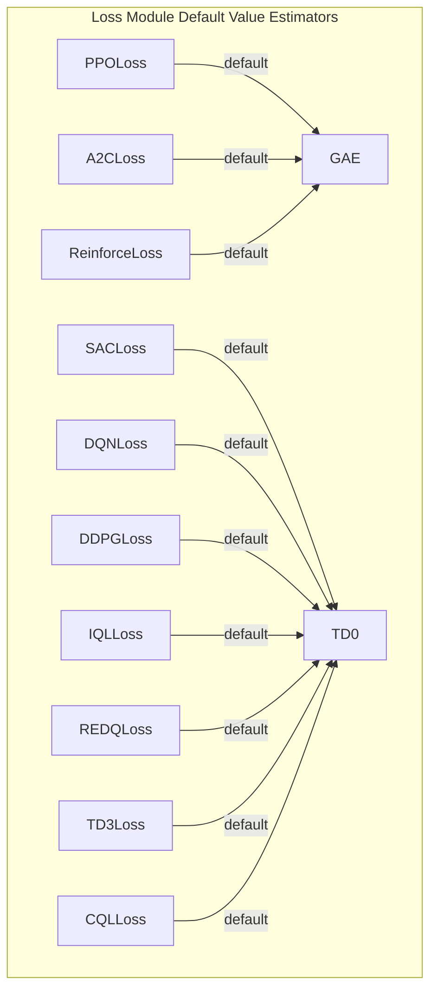

<!-- source: DeepWiki mcp.deepwiki.com · repo pytorch/rl · page 7.5 Value Estimators · fetched 2026-10-21 -->

# Value Estimators

<details>
<summary>Relevant source files</summary>

The following files were used as context for generating this wiki page:

- [.github/unittest/linux_libs/scripts_gym/run_all.sh](.github/unittest/linux_libs/scripts_gym/run_all.sh)
- [.github/unittest/tutorials/scripts/run_all.sh](.github/unittest/tutorials/scripts/run_all.sh)
- [.github/unittest/tutorials/scripts/run_test.sh](.github/unittest/tutorials/scripts/run_test.sh)
- [.github/unittest/tutorials/scripts/test_tutorials.py](.github/unittest/tutorials/scripts/test_tutorials.py)
- [.github/workflows/test-linux-tutorials.yml](.github/workflows/test-linux-tutorials.yml)
- [benchmarks/ad_hoc/bench_rnn_reset_backends.py](benchmarks/ad_hoc/bench_rnn_reset_backends.py)
- [benchmarks/bench_gru_reset_backends.py](benchmarks/bench_gru_reset_backends.py)
- [benchmarks/test_transformer_module_benchmark.py](benchmarks/test_transformer_module_benchmark.py)
- [docs/source/reference/modules_critics.rst](docs/source/reference/modules_critics.rst)
- [docs/source/reference/modules_rnn.rst](docs/source/reference/modules_rnn.rst)
- [docs/source/reference/recurrent_state_lifecycle.rst](docs/source/reference/recurrent_state_lifecycle.rst)
- [examples/agents/transformer_actor.py](examples/agents/transformer_actor.py)
- [test/modules/test_transformer.py](test/modules/test_transformer.py)
- [test/objectives/test_values.py](test/objectives/test_values.py)
- [torchrl/objectives/value/advantages.py](torchrl/objectives/value/advantages.py)
- [torchrl/objectives/value/functional.py](torchrl/objectives/value/functional.py)
- [torchrl/objectives/value/utils.py](torchrl/objectives/value/utils.py)
- [tutorials/sphinx-tutorials/recurrent_sequence_training.py](tutorials/sphinx-tutorials/recurrent_sequence_training.py)

</details>


Value estimators in TorchRL are components that compute target values, value estimates, and advantage functions for reinforcement learning algorithms. They serve as the bridge between rewards received from the environment and the value/policy optimization targets used by various algorithms. This page covers the architecture, implementations, and usage of value estimators in TorchRL. For information about the loss modules that use these estimators, see [Learning Algorithms](#2.4) and [Loss Modules](#2.4.1).

## Architecture Overview

Value estimators follow a common interface defined by the `ValueEstimatorBase` class, which provides a unified API for computing advantages and value targets. Different algorithms require different estimation techniques, and TorchRL provides several implementations optimized for specific use cases.

**Value Estimator Class Hierarchy**
```mermaid
classDiagram
    class "ValueEstimatorBase" {
        +tensor_keys: _AcceptedKeys
        +value_network: TensorDictModule
        +differentiable: bool
        +forward(tensordict): TensorDictBase
        +value_estimate(tensordict): Tensor
        +set_keys(**kwargs): None
        +_call_value_nets(): Tensor
    }
    
    class "TD0Estimator" {
        +gamma: Tensor
        +average_rewards: bool
        +forward(tensordict): TensorDictBase
        +value_estimate(tensordict): Tensor
    }
    
    class "TD1Estimator" {
        +gamma: Tensor
        +average_rewards: bool
        +forward(tensordict): TensorDictBase  
        +value_estimate(tensordict): Tensor
    }
    
    class "TDLambdaEstimator" {
        +gamma: Tensor
        +lmbda: Tensor
        +average_rewards: bool
        +forward(tensordict): TensorDictBase
        +value_estimate(tensordict): Tensor
    }
    
    class "GAE" {
        +gamma: Tensor
        +lmbda: Tensor
        +average_rewards: bool
        +forward(tensordict): TensorDictBase
        +value_estimate(tensordict): Tensor
    }
    
    class "VTrace" {
        +gamma: Tensor
        +rho_bar: float
        +c_bar: float
        +actor_network: TensorDictModule
        +forward(tensordict): TensorDictBase
        +value_estimate(tensordict): Tensor
    }
    
    "ValueEstimatorBase" <|-- "TD0Estimator"
    "ValueEstimatorBase" <|-- "TD1Estimator" 
    "ValueEstimatorBase" <|-- "TDLambdaEstimator"
    "ValueEstimatorBase" <|-- "GAE"
    "ValueEstimatorBase" <|-- "VTrace"
```

Sources: [torchrl/objectives/value/advantages.py:160-556](), [torchrl/objectives/utils.py:41-43]()

## Value Estimator Types

TorchRL provides an enum `ValueEstimators` that defines the available estimator types:

```python
class ValueEstimators(Enum):
    TD0 = "Bootstrapped TD (1-step return)"
    TD1 = "TD(1) (infinity-step return)"
    TDLambda = "TD(lambda)"
    GAE = "Generalized advantage estimate"
    VTrace = "V-trace"
```

Each estimator type has different characteristics and is suitable for different use cases:

| Estimator | Description | Primary Use Cases | Key Parameters |
|-----------|-------------|-------------------|----------------|
| TD0 | Single-step temporal difference estimate | Q-learning, DDPG, SAC | gamma |
| TD1 | Full return estimate (Monte Carlo) | Various algorithms when full episodes are available | gamma |
| TDLambda | Multi-step return with exponential weighting | PPO, A2C, general policy gradient methods | gamma, lambda |
| GAE | Generalized Advantage Estimation | PPO, A2C, TRPO | gamma, lambda |
| VTrace | Off-policy correction with importance sampling | IMPALA, distributed RL systems | gamma, rho_bar, c_bar |

Sources: [torchrl/objectives/utils.py:41-43](), [torchrl/objectives/value/advantages.py:160-556]()

## Integration with Loss Modules

Value estimators are typically used within loss modules to compute advantages and target values for optimization. The following diagram illustrates how value estimators integrate with loss modules and the overall reinforcement learning training loop:



Sources: [torchrl/objectives/value/advantages.py:41-43]()

## Major Value Estimator Implementations

### TD0Estimator

The `TD0Estimator` implements one-step temporal difference learning, using the Bellman equation to compute target values:

```
V_target = r + γ * V(s')
```

This is the simplest form of bootstrapping and is used in many algorithms including DQN and SAC. It estimates the expected return by combining the immediate reward and the estimated value of the next state. The functional implementation is `td0_return_estimate` [torchrl/objectives/value/functional.py:230-244]().

Sources: [torchrl/objectives/value/advantages.py:557-609](), [torchrl/objectives/value/functional.py:230-244]()

### TD1Estimator

The `TD1Estimator` computes a full return estimate, equivalent to Monte Carlo estimation when working with complete episodes:

```
V_target = r + γ * r' + γ² * r'' + ... + γⁿ * V(s_n)
```

This provides an unbiased but potentially high-variance estimate of returns. The functional implementation is `vec_td1_return_estimate` [torchrl/objectives/value/functional.py:247-270]().

Sources: [torchrl/objectives/value/advantages.py:612-664](), [torchrl/objectives/value/functional.py:247-270]()

### TDLambdaEstimator

The `TDLambdaEstimator` implements TD(λ), which blends between one-step TD and full Monte Carlo returns using a geometric weighting controlled by λ:

```
V_target = (1-λ) * Σᵏ λᵏ⁻¹ * Vₖ
```

where Vₖ is the k-step return. This balances between bias and variance in the estimate. The functional implementation is `td_lambda_return_estimate` [torchrl/objectives/value/functional.py:273-300]() and `vec_td_lambda_return_estimate` [torchrl/objectives/value/functional.py:303-360]().

Sources: [torchrl/objectives/value/advantages.py:667-722](), [torchrl/objectives/value/functional.py:273-360]()

### GAE (Generalized Advantage Estimation)

GAE, introduced by Schulman et al., provides a way to estimate advantages for policy gradient methods that balances bias and variance:

```
A_GAE(s_t) = Σₖ (γλ)ᵏ δ_{t+k}
```

where δₜ = rₜ + γV(s_{t+1}) - V(s_t) is the TD error at time t. GAE is widely used in PPO and other policy gradient algorithms. The functional implementation is `generalized_advantage_estimate` [torchrl/objectives/value/functional.py:119-180]() and `vec_generalized_advantage_estimate` [torchrl/objectives/value/functional.py:363-420]().

Sources: [torchrl/objectives/value/advantages.py:725-780](), [torchrl/objectives/value/functional.py:119-180](), [torchrl/objectives/value/functional.py:363-420]()

### VTrace

VTrace is an off-policy advantage estimation method that uses importance sampling with truncated importance sampling ratios to provide stable off-policy learning:

```
V_target(s_t) = V(s_t) + Σₖ γᵏ Π_{i=0}^{k-1} c_i δ_{t+k}
```

where c_i are truncated importance sampling ratios. This is used in distributed RL algorithms like IMPALA. The functional implementation is `vtrace_advantage_estimate` [torchrl/objectives/value/functional.py:423-500]().

Sources: [torchrl/objectives/value/advantages.py:783-840](), [torchrl/objectives/value/functional.py:423-500]()

## Implementation Details

Each value estimator in TorchRL is implemented as a `TensorDictModule`, taking a `TensorDict` containing experience data and computing the appropriate advantage and value target estimates. The estimators follow these common patterns:

1. They use a value network to compute state values.
2. They process reward, done, and terminated signals to compute returns.
3. They use configurable discount factors (gamma) and other hyperparameters.
4. They write outputs to configurable tensordict keys.

### Key Configuration and Customization

Value estimators can be customized through several mechanisms:

1. Initialization parameters:
   - `gamma`: Discount factor
   - `lmbda`: Exponential weighting factor (for GAE, TDLambda)
   - `value_network`: Network that computes state values
   - `differentiable`: Whether to compute differentiable estimates
   - `value_chunk_size`, `num_chunks`, `num_chunk`, `value_chunk_dim`: Parameters for chunking value network calls to manage memory or improve performance [torchrl/objectives/value/advantages.py:170-185]().
   - `shifted_budget`: Number of extra value-network time slots used when `shifted=True` [torchrl/objectives/value/advantages.py:182-185]().

2. Key configuration via `set_keys()`:
   - `advantage`: Key where advantage will be written
   - `value_target`: Key where value target will be written
   - `value`: Key where state value is expected
   - `reward`: Key where reward is expected
   - `done`: Key where done flag is expected
   - `terminated`: Key where terminated flag is expected

Example of configuring keys:
```python
value_estimator = GAE(value_network=critic, gamma=0.99, lmbda=0.95)
value_estimator.set_keys(
    advantage="custom_advantage_key",
    value="critic_value",
    reward="env_reward"
)
```

Sources: [torchrl/objectives/value/advantages.py:170-185](), [torchrl/objectives/value/advantages.py:304-338]()

### Recurrent Value Estimation

For recurrent policies, value estimators need to handle sequences and trajectory boundaries correctly. The `GAE.for_recurrent` factory method is provided for this purpose [torchrl/objectives/value/advantages.py:750-780](). It configures the GAE estimator to work with recurrent data, disabling `vmap` and standardizing advantages by default. It also ensures that `is_init` and recurrent state tensors are correctly handled during replay.

When using recurrent modules, the `is_init` key is crucial. It's a boolean per batch element that indicates the start of a new trajectory, preventing hidden state leakage across episode boundaries [docs/source/reference/recurrent_state_lifecycle.rst:149-152](). The collector automatically registers `InitTracker` and `TensorDictPrimer` to manage `is_init` and initial recurrent states [docs/source/reference/recurrent_state_lifecycle.rst:101-110]().

The `set_recurrent_mode` context manager [torchrl/modules/tensordict_module/common.py:100-102]() is used to switch recurrent modules between single-step mode (for collection) and full-sequence mode (for training). In full-sequence mode, `is_init=True` entries reset the hidden state, allowing a flat batch of concatenated trajectory slices to behave like independent sequences without explicit padding [docs/source/reference/modules_rnn.rst:40-46]().

Sources: [torchrl/objectives/value/advantages.py:750-780](), [docs/source/reference/recurrent_state_lifecycle.rst:149-152](), [docs/source/reference/recurrent_state_lifecycle.rst:101-110](), [docs/source/reference/modules_rnn.rst:40-46]()

## Integration with Loss Modules

Most loss modules in TorchRL have a default value estimator type, but allow customization through the `make_value_estimator` method:



Loss modules typically use value estimators in this way:

```python
# Default initialization
loss_module = PPOLoss(actor_network, critic_network)
# The default value estimator (GAE) is created implicitly

# Custom value estimator initialization
loss_module = PPOLoss(actor_network, critic_network)
loss_module.make_value_estimator(
    ValueEstimators.GAE,
    gamma=0.99,
    lmbda=0.95
)
```

Sources: [torchrl/objectives/value/advantages.py:41-43]()

## Using Value Estimators

Value estimators can be used directly or through loss modules. Here are the typical usage patterns:

### Direct Usage

```python
# Create a value estimator
value_estimator = GAE(
    value_network=critic_network,
    gamma=0.99,
    lmbda=0.95
)

# Apply to a tensordict with experience data
tensordict = collect_experience()  # Contains observations, actions, rewards, etc.
value_estimator(tensordict)  # Computes advantages and value targets in-place

# The tensordict now contains advantages and value targets
advantages = tensordict.get("advantage")
value_targets = tensordict.get("value_target")
```

### Through Loss Modules

```python
# Create a loss module
loss_module = PPOLoss(actor_network, critic_network)

# Customize the value estimator (optional)
loss_module.make_value_estimator(
    ValueEstimators.GAE,
    gamma=0.99,
    lmbda=0.95
)

# Loss computation will internally use the value estimator
loss = loss_module(tensordict)
```

Sources: [torchrl/objectives/value/advantages.py:160-187]()

## Default Hyperparameter Values

TorchRL provides default hyperparameter values for each estimator type through the `default_value_kwargs` function:

| Estimator Type | Default Parameters |
|----------------|-------------------|
| TD0 | gamma=0.99, differentiable=True |
| TD1 | gamma=0.99, differentiable=True |
| TDLambda | gamma=0.99, lmbda=0.95, differentiable=True |
| GAE | gamma=0.99, lmbda=0.95, differentiable=True |
| VTrace | gamma=0.99, differentiable=True |

These defaults can be overridden when creating estimators or calling `make_value_estimator`.

Sources: [torchrl/objectives/utils.py:64-88]()

## Conclusion

Value estimators are a core component of reinforcement learning implementations in TorchRL, providing flexible and reusable implementations of various advantage and value target estimation techniques. They integrate seamlessly with loss modules and support extensive customization to accommodate different algorithms and use cases.

When implementing a reinforcement learning algorithm with TorchRL, selecting the appropriate value estimator and configuring it correctly can significantly impact learning performance and stability. The modular design allows for experimentation with different estimators and hyperparameters to find the best configuration for a specific task.

---

