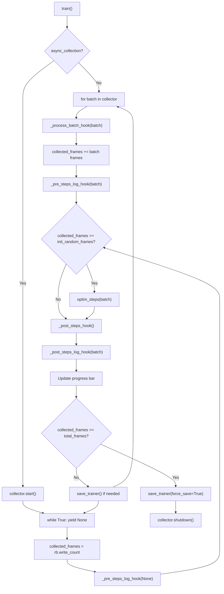
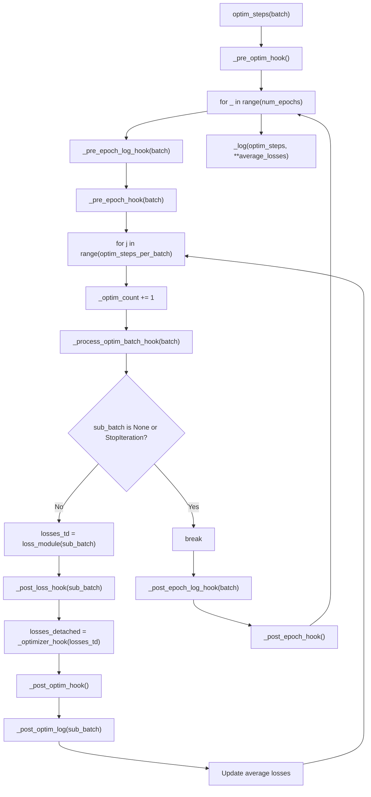
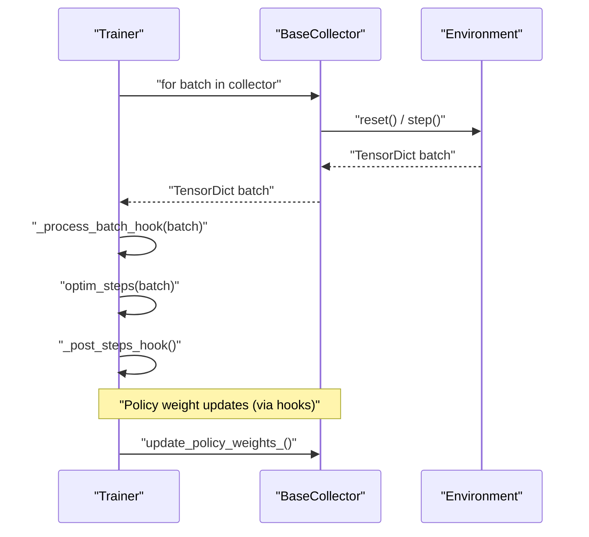
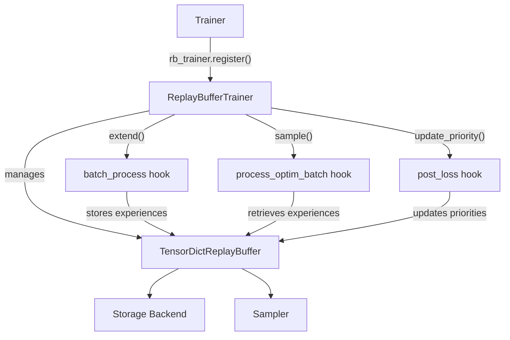
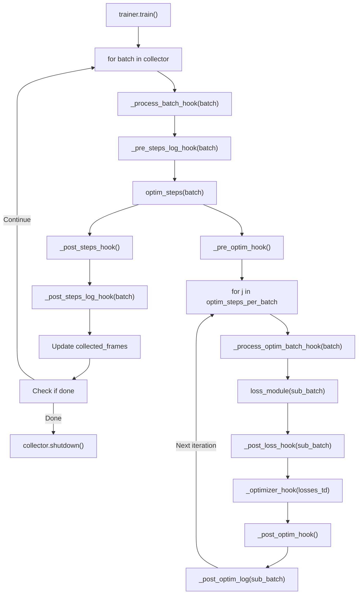

<!-- source: DeepWiki mcp.deepwiki.com · repo pytorch/rl · page 8 Training Infrastructure · fetched 2026-10-21 -->

# Training Infrastructure

<details>
<summary>Relevant source files</summary>

The following files were used as context for generating this wiki page:

- [docs/source/reference/trainers.rst](docs/source/reference/trainers.rst)
- [docs/source/reference/trainers_basics.rst](docs/source/reference/trainers_basics.rst)
- [sota-implementations/ppo_trainer/config/config.yaml](sota-implementations/ppo_trainer/config/config.yaml)
- [sota-implementations/ppo_trainer/config/config_ewma.yaml](sota-implementations/ppo_trainer/config/config_ewma.yaml)
- [sota-implementations/ppo_trainer/train.py](sota-implementations/ppo_trainer/train.py)
- [test/test_trainer.py](test/test_trainer.py)
- [torchrl/trainers/__init__.py](torchrl/trainers/__init__.py)
- [torchrl/trainers/algorithms/on_policy.py](torchrl/trainers/algorithms/on_policy.py)
- [torchrl/trainers/algorithms/ppo.py](torchrl/trainers/algorithms/ppo.py)
- [torchrl/trainers/helpers/collectors.py](torchrl/trainers/helpers/collectors.py)
- [torchrl/trainers/helpers/losses.py](torchrl/trainers/helpers/losses.py)
- [torchrl/trainers/helpers/trainers.py](torchrl/trainers/helpers/trainers.py)
- [torchrl/trainers/trainers.py](torchrl/trainers/trainers.py)

</details>


This page documents TorchRL's training infrastructure, which provides the framework for orchestrating reinforcement learning agent training. The infrastructure separates training loop management from algorithm-specific implementations, enabling flexible and modular training workflows.

The training infrastructure handles data collection orchestration, experience processing, optimization coordination, and training workflow management through a hook-based system.

## Overview

The training infrastructure in TorchRL consists of several key components:

1.  **Trainer** (`torchrl.trainers.Trainer`): The central orchestrator that manages the training loop
2.  **TrainerHookBase**: Base class for extensible training operations
3.  **Built-in Hooks**: Common operations like logging, replay buffer management, and optimization
4.  **Helper Modules**: Utilities for creating environments, models, collectors, and losses

**Training Infrastructure Module Structure**

```mermaid
graph TB
    TrainersModule["torchrl.trainers"]
    
    TrainersModule --> TrainersCore["trainers.py"]
    TrainersModule --> HelpersModule["helpers/"]
    
    TrainersCore --> Trainer["Trainer"]
    TrainersCore --> TrainerHookBase["TrainerHookBase"]
    TrainersCore --> BuiltInHooks["Built-in Hooks"]
    
    BuiltInHooks --> SelectKeys["SelectKeys"]
    BuiltInHooks --> ReplayBufferTrainer["ReplayBufferTrainer"]
    BuiltInHooks --> OptimizerHook["OptimizerHook"]
    BuiltInHooks --> LogScalar["LogScalar"]
    BuiltInHooks --> CountFramesLog["CountFramesLog"]
    BuiltInHooks --> LogValidationReward["LogValidationReward"]
    BuiltInHooks --> UpdateWeights["UpdateWeights"]
    BuiltInHooks --> RewardNormalizer["RewardNormalizer"]
    BuiltInHooks --> BatchSubSampler["BatchSubSampler"]
    BuiltInHooks --> ClearCudaCache["ClearCudaCache"]
    BuiltInHooks --> LogTiming["LogTiming"]
    
    HelpersModule --> TrainersHelper["trainers.py"]
    HelpersModule --> EnvsHelper["envs.py"]
    HelpersModule --> ModelsHelper["models.py"]
    HelpersModule --> LossesHelper["losses.py"]
    HelpersModule --> CollectorsHelper["collectors.py"]
    
    TrainersHelper --> MakeTrainer["make_trainer()"]
    TrainersHelper --> TrainerConfig["TrainerConfig"]
    
    EnvsHelper --> TransformedEnvConstructor["transformed_env_constructor()"]
    EnvsHelper --> ParallelEnvConstructor["parallel_env_constructor()"]
    EnvsHelper --> EnvConfig["EnvConfig"]
    
    ModelsHelper --> MakeDQNActor["make_dqn_actor()"]
    ModelsHelper --> MakeDreamer["make_dreamer()"]
    ModelsHelper --> DiscreteModelConfig["DiscreteModelConfig"]
    ModelsHelper --> DreamerConfig["DreamerConfig"]
    
    LossesHelper --> MakeDQNLoss["make_dqn_loss()"]
    LossesHelper --> MakeTargetUpdater["make_target_updater()"]
    LossesHelper --> LossConfig["LossConfig"]
    
    CollectorsHelper --> MakeCollectorOffpolicy["make_collector_offpolicy()"]
    CollectorsHelper --> MakeCollectorOnpolicy["make_collector_onpolicy()"]
    CollectorsHelper --> CollectorConfig["CollectorConfig"]
```



**High-level Training Loop Architecture**

```mermaid
graph TD
    Trainer["Trainer"]
    Trainer --> Components["Core Components"]
    Trainer --> HookSystem["Hook System"]
    Trainer --> StateManagement["State Management"]
    
    Components --> Collector["collector: BaseCollector"]
    Components --> LossModule["loss_module: LossModule"]
    Components --> Optimizer["optimizer: optim.Optimizer"]
    Components --> Logger["logger: Logger"]
    
    HookSystem --> BatchProcessOps["_batch_process_ops"]
    HookSystem --> PreOptimOps["_pre_optim_ops"]
    HookSystem --> ProcessOptimBatchOps["_process_optim_batch_ops"]
    HookSystem --> PostLossOps["_post_loss_ops"]
    HookSystem --> OptimizerOps["_optimizer_ops"]
    HookSystem --> PostOptimOps["_post_optim_ops"]
    HookSystem --> PostStepsOps["_post_steps_ops"]
    HookSystem --> LoggingOps["Logging Hooks"]
    HookSystem --> EpochOps["Epoch Hooks"]
    
    LoggingOps --> PreStepsLog["_pre_steps_log_ops"]
    LoggingOps --> PostStepsLog["_post_steps_log_ops"]
    LoggingOps --> PostOptimLog["_post_optim_log_ops"]
    LoggingOps --> PreEpochLog["_pre_epoch_log_ops"]
    LoggingOps --> PostEpochLog["_post_epoch_log_ops"]
    
    EpochOps --> PreEpochOps["_pre_epoch_ops"]
    EpochOps --> PostEpochOps["_post_epoch_ops"]
    
    StateManagement --> CollectedFrames["collected_frames"]
    StateManagement --> OptimCount["_optim_count"]
    StateManagement --> LastLog["_last_log"]
    StateManagement --> LastSave["_last_save"]
    StateManagement --> StateDictMethod["state_dict() / load_state_dict()"]
```



Sources:
- [torchrl/trainers/trainers.py:1-210]()
- [torchrl/trainers/helpers/trainers.py:1-159]()
- [torchrl/trainers/helpers/losses.py:1-132]()
- [torchrl/trainers/helpers/collectors.py:1-130]()

## Trainer Class

The `Trainer` class is the central orchestrator of the training infrastructure. It coordinates data collection, batch processing, optimization steps, and logging through a flexible hook system. For details, see [Trainer System](#8.1).

### Key Components and Workflow

The Trainer manages the following required components:
-   **collector**: A `BaseCollector` that gathers experiences from environments
-   **loss_module**: A `LossModule` that computes losses from collected data
-   **optimizer**: An `optim.Optimizer` that updates model parameters (optional, can be provided via hooks)
-   **logger**: A `Logger` for recording metrics during training (optional)

**Trainer Execution Flow (Synchronous Collection)**



**Optimization Steps Flow (optim_steps method)**



Sources:
- [torchrl/trainers/trainers.py:447-479]()
- [torchrl/trainers/trainers.py:491-520]()

### Trainer Hook System

The Trainer provides a flexible hook system through the `register_op()` method (alias: `register_hook()`) that allows customizing the training loop without modifying core functionality. Hooks can be registered at various points in the training process. For details, see [Trainer System](#8.1).

| Hook Point | Description | Input Type | Output Type | When Called |
|:-----------|:------------|:-----------|:------------|:------------|
| `batch_process` | Process batches of data after collection | `TensorDictBase` | `TensorDictBase` | After data collection, before optimization |
| `pre_optim_steps` | Operations before optimization loop | `None` | `None` | Before `optim_steps()` method |
| `process_optim_batch` | Process batches before loss computation | `TensorDictBase` | `TensorDictBase` | Within optimization loop, before loss computation |
| `post_loss` | Operations after loss computation | `TensorDictBase` | `TensorDictBase` | After loss computation, before optimizer step |
| `optimizer` | Custom optimization steps | `TensorDictBase, bool, float, int` | `TensorDictBase` | During optimization (gradient computation and parameter updates) |
| `post_steps` | Operations after all optimization steps | `None` | `None` | After `optim_steps()` completes |
| `post_optim` | Operations after each optimization step | `None` | `None` | After each individual optimization step |
| `pre_steps_log` | Logging before optimization steps | `TensorDictBase` | `Tuple[str, float]` | Before `optim_steps()`, logs collection metrics |
| `post_steps_log` | Logging after optimization steps | `TensorDictBase` | `Tuple[str, float]` | After `optim_steps()`, logs evaluation metrics |
| `post_optim_log` | Logging after each optimization step | `TensorDictBase` | `Tuple[str, float]` | After each optimization step, logs training metrics |
| `pre_epoch` | Operations before each epoch | `TensorDictBase` | `TensorDictBase` | Before each epoch in `optim_steps()` when `num_epochs > 1` |
| `post_epoch` | Operations after each epoch | `None` | `None` | After each epoch in `optim_steps()` when `num_epochs > 1` |
| `pre_epoch_log` | Logging before each epoch | `TensorDictBase` | `Tuple[str, float]` | Before each epoch, logs epoch-specific metrics |
| `post_epoch_log` | Logging after each epoch | `TensorDictBase` | `Tuple[str, float]` | After each epoch, logs epoch completion metrics |

**Hook Registration Example**

```python
# Register a hook to select specific keys from batches
trainer.register_op("batch_process", SelectKeys(["observation", "action", "reward"]))

# Register a hook to log rewards
trainer.register_op("pre_steps_log", LogScalar(logname="reward"))

# Register a hook to update policy weights in the collector
update_weights = UpdateWeights(collector, update_weights_interval=1)
trainer.register_op("post_steps", update_weights)
```

**Hook Timing Measurement**

All hooks are automatically wrapped with timing measurement when registered. The timing information is stored using the `timeit` utility and can be accessed via `timeit.todict()`. When `log_timings=True` is passed to the Trainer constructor, a `LogTiming` hook is automatically registered to log timing metrics.

Sources:
- [torchrl/trainers/trainers.py:202-209]()
- [torchrl/trainers/trainers.py:280-313]()
- [torchrl/trainers/trainers.py:39-40]()

### Creating a Trainer

A Trainer can be created manually or using the `make_trainer` helper function. For details, see [Helper Utilities](#8.2).

```python
from torchrl.trainers import Trainer
from torchrl.trainers.helpers import make_trainer

# Manual creation
trainer = Trainer(
    collector=collector,
    total_frames=total_frames,
    frame_skip=frame_skip,
    optim_steps_per_batch=optim_steps_per_batch,
    loss_module=loss_module,
    optimizer=optimizer,           # Optional - can be provided via OptimizerHook
    logger=logger,                 # Optional
    clip_grad_norm=True,           # Whether to clip gradient norms
    clip_norm=1.0,                 # Gradient clipping threshold
    progress_bar=True,             # Show progress bar during training
    seed=42,                       # Random seed
    save_trainer_interval=10000,   # How often to save trainer state (in frames)
    log_interval=10000,            # How often to log metrics (in frames)
    save_trainer_file="trainer.pt", # Path to save trainer checkpoint
    num_epochs=1,                  # Number of epochs per optimization step
    async_collection=False,        # Whether to collect data asynchronously
    log_timings=False,             # Whether to log hook timing information
)

# Using helper function (recommended)
trainer = make_trainer(
    collector=collector,
    loss_module=loss_module,
    recorder=recorder,
    target_net_updater=target_net_updater,
    policy_exploration=policy_exploration,
    replay_buffer=replay_buffer,
    logger=logger,
    cfg=cfg,
)
```

**Trainer State Tracking**

The Trainer maintains several state variables for tracking training progress:

| State Variable | Type | Description |
|:---------------|:-----|:------------|
| `collected_frames` | `int` | Total number of frames collected during training |
| `_optim_count` | `int` | Total number of optimization steps completed |
| `_last_log` | `dict[str, int]` | Tracks when each metric was last logged (for log_interval control) |
| `_last_save` | `int` | Tracks when trainer was last saved (for save_interval control) |

**Asynchronous Collection**

When `async_collection=True`, the trainer runs data collection in a background process while performing optimization. This requires the replay buffer to be registered with the collector. The trainer monitors the replay buffer's `write_count` to track progress and logs the Update-to-Data (UTD) ratio.

Sources:
- [torchrl/trainers/trainers.py:133-147]()
- [torchrl/trainers/trainers.py:150-175]()
- [torchrl/trainers/trainers.py:447-479]()
- [torchrl/trainers/helpers/trainers.py:80-159]()

## Data Collection Integration

The Trainer integrates with TorchRL's data collection system through the `BaseCollector` interface. The collector is responsible for gathering experiences from environments and providing them to the training loop.

### Collector Interface

The Trainer expects a collector that implements the `BaseCollector` interface with the following key methods:

| Method | Purpose |
|:--------|:--------|
| `__iter__()` | Provides batches of collected data |
| `set_seed()` | Sets random seed for reproducibility |
| `shutdown()` | Cleanly shuts down collection processes |
| `state_dict()` / `load_state_dict()` | Saves/loads collector state |

**Data Collection Flow**



Sources:
- [torchrl/trainers/trainers.py:50]()
- [torchrl/trainers/trainers.py:447-479]()
- [test/test_trainer.py:113-115]()
- [test/test_trainer.py:136-141]()

## Replay Buffer Integration

### ReplayBufferTrainer Hook

The `ReplayBufferTrainer` class integrates replay buffers with the Trainer through a set of hooks. It provides three main operations:

1.  **extend()**: Stores new experiences in the buffer
2.  **sample()**: Retrieves batches for optimization
3.  **update_priority()**: Updates priorities for prioritized replay buffers

**ReplayBufferTrainer Hook Integration**



### ReplayBufferTrainer Configuration

The `ReplayBufferTrainer` supports several configuration options:

| Parameter | Type | Description |
|:----------|:-----|:------------|
| `replay_buffer` | `TensorDictReplayBuffer` | The replay buffer instance |
| `batch_size` | `int` | Batch size for sampling (optional) |
| `memmap` | `bool` | Whether to use memory mapping |
| `device` | `torch.device` | Device to move sampled data to |
| `flatten_tensordicts` | `bool` | Whether to flatten trajectory data |
| `max_dims` | `Sequence[int]` | Maximum dimensions for padding |

```python
# Create and register a ReplayBufferTrainer
rb_trainer = ReplayBufferTrainer(
    replay_buffer=replay_buffer,
    batch_size=256,
    device=device,
    flatten_tensordicts=False
)
rb_trainer.register(trainer, name="replay_buffer")
```

Sources:
- [torchrl/trainers/trainers.py:53-54]()
- [torchrl/trainers/trainers.py:1003-1254]()
- [torchrl/trainers/__init__.py:21]()

## Built-in Training Hooks

TorchRL provides several built-in hooks that inherit from `TrainerHookBase` for common training operations. For details, see [Trainer System](#8.1).

### Data Processing Hooks

| Hook Class | Purpose | Hook Point | Key Methods |
|:-----------|:--------|:-----------|:------------|
| `SelectKeys` | Filters specific keys from batched data | `batch_process` | `__call__(batch)` |
| `mask_batch` | Masks valid events in padded trajectories | `batch_process` | Function (not a class) |
| `BatchSubSampler` | Subsamples data for online RL algorithms | `process_optim_batch` | `__call__(batch)` |

**SelectKeys Implementation**

`SelectKeys` filters the input TensorDict to only include specified keys. Useful for reducing memory usage by discarding unnecessary data before storing in replay buffers.

**BatchSubSampler Implementation**

`BatchSubSampler` randomly subsamples batches for on-policy algorithms. When `sub_traj_len > 0`, it also splits trajectories into fixed-length sub-trajectories.

Sources:
- [torchrl/trainers/__init__.py:7, 17, 23]()
- [torchrl/trainers/trainers.py:1003-1254]()
- [torchrl/trainers/trainers.py:1257-1300]()

### Optimization Hooks

| Hook Class | Purpose | Hook Point | Key Parameters |
|:-----------|:--------|:-----------|:---------------|
| `OptimizerHook` | Manages optimizer steps for specific loss components | `optimizer` | `optimizer`, `loss_components`, `clip_grad_norm` |
| `ClearCudaCache` | Clears CUDA cache periodically | `pre_optim_steps` | `interval` |
| `DefaultOptimizationStepper` | Default optimization stepper | `optimizer` | `optimizer`, `loss_module`, `clip_grad_norm`, `clip_norm`, `grad_scaler` |
| `MixedPrecisionOptimizationStepper` | Optimization stepper with mixed precision | `optimizer` | `optimizer`, `loss_module`, `clip_grad_norm`, `clip_norm`, `grad_scaler` |
| `LRSchedulerHook` | Manages learning rate scheduler steps | `post_optim` | `lr_scheduler` |
| `TargetNetUpdaterHook` | Manages target network updates | `post_optim` | `target_net_updater` |
| `ValueEstimatorHook` | Manages value estimator updates | `post_optim` | `value_estimator` |

**OptimizerHook Implementation**

The `OptimizerHook` provides fine-grained control over optimization:
-   Supports multiple optimizers for different model components
-   Allows selective backpropagation through specific loss components via `loss_components` parameter
-   Computes and logs gradient norms
-   Can be registered multiple times with different optimizers

```python
# Example: Separate optimizers for actor and critic
optimizer_actor = torch.optim.Adam(actor.parameters(), lr=1e-3)
optimizer_critic = torch.optim.Adam(critic.parameters(), lr=3e-4)

OptimizerHook(optimizer_actor, loss_components=["loss_actor"]).register(trainer, "optimizer_actor")
OptimizerHook(optimizer_critic, loss_components=["loss_critic"]).register(trainer, "optimizer_critic")
```

Sources:
- [torchrl/trainers/__init__.py:8, 12, 18, 19, 20, 24, 25, 29]()
- [torchrl/trainers/trainers.py:1303-1399]()
- [torchrl/trainers/trainers.py:1402-1460]()
- [torchrl/trainers/trainers.py:1463-1500]()
- [torchrl/trainers/trainers.py:1503-1530]()
- [torchrl/trainers/trainers.py:1533-1560]()
- [torchrl/trainers/trainers.py:1563-1590]()

### Logging Hooks

| Hook Class | Purpose | Hook Point | Key Parameters |
|:-----------|:--------|:-----------|:---------------|
| `LogScalar` | Logs scalar values from TensorDict | `pre_steps_log` | `in_key`, `logname`, `log_pbar` |
| `CountFramesLog` | Logs frame count and FPS | `pre_steps_log` | `frame_skip` |
| `LogValidationReward` | Evaluates and logs validation performance | `post_steps_log` | `environment`, `policy_exploration`, `record_frames`, `record_interval` |
| `LogTiming` | Logs hook execution timing | Any hook point | `prefix`, `percall`, `erase` |
| `EarlyStopping` | Stops training if a metric plateaus or degrades | `post_steps_log` | `metric_key`, `patience`, `delta`, `mode` |

**LogScalar Implementation**

`LogScalar` extracts scalar values from the collected batch and logs them. Common use cases include logging rewards, episode lengths, and custom metrics.

**CountFramesLog Implementation**

`CountFramesLog` logs the total number of frames collected and the collection FPS. It uses the `frame_skip` parameter to account for frame skipping in the environment.

**LogValidationReward Implementation**

`LogValidationReward` periodically evaluates the policy on a validation environment and logs the performance. This is useful for monitoring generalization and avoiding overfitting.

**LogTiming Implementation**

`LogTiming` logs the execution time of all registered hooks. It uses the `timeit` utility to measure timing and can log either per-call average time or total time. When registered, it automatically wraps all hooks with timing measurement.

Sources:
- [torchrl/trainers/__init__.py:9, 13, 14, 15]()
- [torchrl/trainers/trainers.py:1593-1640]()
- [torchrl/trainers/trainers.py:1643-1680]()
- [torchrl/trainers/trainers.py:1683-1720]()
- [torchrl/trainers/trainers.py:1723-1760]()
- [torchrl/trainers/trainers.py:1763-1800]()

### Weight Update Hooks

| Hook Class | Purpose | Hook Point | Key Parameters |
|:-----------|:--------|:-----------|:---------------|
| `UpdateWeights` | Updates policy weights in the collector | `post_steps` | `collector`, `update_weights_interval` |
| `UTDRHook` | Updates the policy in the collector based on the Update-to-Data Ratio (UTDR) | `post_optim` | `collector`, `utdr_ratio` |

**UpdateWeights Implementation**

`UpdateWeights` synchronizes the policy weights between the trainer and the collector. This is important when the collector runs on a different device or in a separate process. The `update_weights_interval` parameter controls how often the weights are updated (in terms of optimization steps).

Sources:
- [torchrl/trainers/__init__.py:26, 28]()
- [torchrl/trainers/trainers.py:1803-1840]()
- [torchrl/trainers/trainers.py:1843-1880]()

### Normalization Hooks

| Hook Class | Purpose | Hook Points |
|:-----------|:--------|:------------|
| `RewardNormalizer` | Normalizes rewards using running statistics | `batch_process` (update_reward_stats), `process_optim_batch` (normalize_reward) |

**RewardNormalizer Implementation**

`RewardNormalizer` maintains running statistics of rewards and normalizes them before passing to the loss module. This can improve training stability but should be used cautiously with algorithms like SAC that depend on reward scale.

Sources:
- [torchrl/trainers/__init__.py:22]()
- [torchrl/trainers/trainers.py:1883-1920]()

### Hook State Management

All hooks inherit from `TrainerHookBase` and must implement:

| Method | Purpose | Details |
|:-------|:--------|:--------|
| `state_dict()` | Return hook state for checkpointing | Returns a dictionary containing the hook's state |
| `load_state_dict(state_dict)` | Load hook state from checkpoint | Restores the hook's state from a dictionary |
| `register(trainer, name)` | Register hook with trainer at default location | Calls `trainer.register_op()` and `trainer.register_module()` with appropriate hook points |

**Hook Registration Flow**

1.  Hook calls `trainer.register_module(name, self)` to register itself in `trainer._modules`
2.  Hook calls `trainer.register_op(dest, method, **kwargs)` to register specific methods at hook points
3.  Trainer wraps the method with timing measurement via `_wrap_hook_with_timing()`
4.  Trainer stores the wrapped method in the appropriate hook list (e.g., `_batch_process_ops`)

Sources:
- [torchrl/trainers/trainers.py:202-209]()
- [torchrl/trainers/trainers.py:280-313]()

## Training Orchestration

### Complete Training Setup Example

Here's how to set up a complete training workflow using the Trainer and hooks:

```python
from torchrl.trainers import Trainer
from torchrl.trainers.trainers import ReplayBufferTrainer, OptimizerHook, LogScalar

# Create core components
collector = SyncDataCollector(...)
loss_module = DQNLoss(...)
optimizer = torch.optim.Adam(loss_module.parameters(), lr=3e-4)
replay_buffer = TensorDictReplayBuffer(...)

# Create trainer
trainer = Trainer(
    collector=collector,
    loss_module=loss_module,
    optimizer=optimizer,  # Optional - can use OptimizerHook instead
    frame_skip=1,
    total_frames=100000,
    optim_steps_per_batch=50,
    clip_grad_norm=True,
    clip_norm=1.0,
)

# Register hooks
ReplayBufferTrainer(replay_buffer, batch_size=256).register(trainer)
LogScalar(logname="reward", log_pbar=True).register(trainer)

# Start training
trainer.train()
```

**Training Workflow with Hooks**



Sources:
- [torchrl/trainers/trainers.py:447-479]()
- [torchrl/trainers/trainers.py:491-520]()

## Helper Modules

TorchRL provides several helper modules to simplify the creation of training components. For details, see [Helper Utilities](#8.2).

### trainers.py Helper Module

**make_trainer Function**

The `make_trainer` function creates a fully configured Trainer with common hooks pre-registered:

```python
from torchrl.trainers.helpers import make_trainer

trainer = make_trainer(
    collector=collector,
    loss_module=loss_module,
    recorder=recorder,                      # For evaluation (optional)
    target_net_updater=target_net_updater,  # For target network updates (optional)
    policy_exploration=policy_exploration,   # For exploration scheduling (optional)
    replay_buffer=replay_buffer,            # For experience replay (optional)
    logger=logger,                          # For logging (optional)
    cfg=cfg,                                # TrainerConfig object
)
```

**TrainerConfig**

The `TrainerConfig` dataclass provides configuration options for training:

| Parameter | Type | Default | Description |
|:----------|:-----|:--------|:------------|
| `optim_steps_per_batch` | `int` | `500` | Number of optimization steps per data batch |
| `optimizer` | `str` | `"adam"` | Optimizer type ("adam", "sgd", "adamax") |
| `lr` | `float` | `3e-4` | Learning rate |
| `weight_decay` | `float` | `0.0` | Weight decay for optimizer |
| `lr_scheduler` | `str` | `"cosine"` | Learning rate scheduler type |
| `batch_size` | `int` | `256` | Batch size for optimization |
| `clip_grad_norm` | `bool` | `False` | Whether to clip gradient norms |
| `clip_norm` | `float` | `1000.0` | Gradient clipping threshold |
| `normalize_rewards_online` | `bool` | `False` | Whether to normalize rewards |
| `normalize_rewards_online_scale` | `float` | `1.0` | Final scale of normalized rewards |
| `normalize_rewards_online_decay` | `float` | `0.9999` | Decay of reward moving average |
| `sub_traj_len` | `int` | `-1` | Trajectory length for subsampling |
| `selected_keys` | `list` | `None` | Keys to keep from collected data |

**Hooks Registered by make_trainer**

The `make_trainer` function automatically registers hooks based on configuration:

```python
# CUDA cache clearing (if GPU available)
if torch.cuda.device_count() > 0:
    trainer.register_op("pre_optim_steps", ClearCudaCache(1))

# Key selection
if cfg.selected_keys:
    trainer.register_op("batch_process", SelectKeys(cfg.selected_keys))

# Move batch to CPU
trainer.register_op("batch_process", lambda batch: batch.cpu())

# Replay buffer or batch subsampling
if replay_buffer is not None:
    rb_trainer = ReplayBufferTrainer(replay_buffer, cfg.batch_size)
    rb_trainer.register(trainer)
else:
    trainer.register_op("process_optim_batch", 
        BatchSubSampler(batch_size=cfg.batch_size, sub_traj_len=cfg.sub_traj_len))
    trainer.register_op("process_optim_batch", lambda batch: batch.to(device))

# Learning rate scheduler
if optim_scheduler is not None:
    trainer.register_op("post_optim", optim_scheduler.step)

# Target network updates
if target_net_updater is not None:
    trainer.register_op("post_optim", target_net_updater.step)

# Reward normalization
if cfg.normalize_rewards_online:
    reward_normalizer = RewardNormalizer(scale=cfg.normalize_rewards_online_scale, 
                                          decay=cfg.normalize_rewards_online_decay)
    trainer.register_op("batch_process", reward_normalizer.update_reward_stats)
    trainer.register_op("process_optim_batch", reward_normalizer.normalize_reward)

# Exploration scheduling
if policy_exploration is not None and hasattr(policy_exploration, "step"):
    trainer.register_op("post_steps", policy_exploration.step, frames=cfg.frames_per_batch)

# Validation/Recorder
if recorder is not None:
    recorder_obj = LogValidationReward(...)
    trainer.register_op("post_steps_log", recorder_obj)
    
    recorder_obj_explore = LogValidationReward(..., exploration_type=ExplorationType.RANDOM)
    trainer.register_op("post_steps_log", recorder_obj_explore)

# Weight updates
trainer.register_op("post_steps", UpdateWeights(collector, update_weights_interval=1))

# Logging
trainer.register_op("pre_steps_log", LogScalar())
trainer.register_op("pre_steps_log", CountFramesLog(frame_skip=cfg.frame_skip))
trainer.register_op("post_steps_log", lambda *cfg: {"lr": optimizer.param_groups[0]["lr"]})
```

Sources:
- [torchrl/trainers/helpers/trainers.py:44-78]()
- [torchrl/trainers/helpers/trainers.py:80-159]()

### envs.py Helper Module

The `envs.py` module provides utilities for creating and configuring environments. For details, see [Helper Utilities](#8.2).

**Key Functions**

| Function | Purpose |
|:---------|:--------|
| `transformed_env_constructor(cfg, ...)` | Creates environment with transforms |
| `parallel_env_constructor(cfg, ...)` | Creates parallel environments |
| `get_stats_random_rollout(cfg, ...)` | Computes observation statistics |
| `initialize_observation_norm_transforms(env, ...)` | Initializes observation normalization |
| `correct_for_frame_skip(cfg)` | Adjusts frame counts for frame skip |

**EnvConfig**

Configuration dataclass for environment creation:

| Parameter | Type | Default | Description |
|:----------|:-----|:--------|:------------|
| `env_library` | `str` | `"gym"` | Environment library ("gym", "dm_control") |
| `env_name` | `str` | `"Humanoid-v2"` | Environment name |
| `env_task` | `str` | `""` | Task name (for DMControl) |
| `from_pixels` | `bool` | `False` | Whether to use pixel observations |
| `frame_skip` | `int` | `1` | Frame skip factor |
| `vecnorm` | `bool` | `False` | Use VecNorm transform |
| `catframes` | `int` | `0` | Number of frames to concatenate |
| `max_frames_per_traj` | `int` | `1000` | Maximum frames per trajectory |

### models.py Helper Module

The `models.py` module provides utilities for creating model architectures. For details, see [Helper Utilities](#8.2).

**Key Functions**

| Function | Purpose |
|:---------|:--------|
| `make_dqn_actor(proof_environment, cfg, device)` | Creates DQN actor |
| `make_dreamer(cfg, proof_environment, device, ...)` | Creates Dreamer components |

**Model Configuration**

| Config Class | Purpose |
|:-------------|:--------|
| `DiscreteModelConfig` | Configuration for discrete action models (DQN) |
| `DreamerConfig` | Configuration for Dreamer world model |
| `REDQModelConfig` | Configuration for REDQ model |

### losses.py Helper Module

The `losses.py` module provides utilities for creating loss modules. For details, see [Helper Utilities](#8.2).

**Key Functions**

| Function | Purpose |
|:---------|:--------|
| `make_dqn_loss(model, cfg)` | Creates DQN loss module |
| `make_target_updater(cfg, loss_module)` | Creates target network updater |

**Loss Configuration**

| Config Class | Purpose |
|:-------------|:--------|
| `LossConfig` | Generic loss configuration |
| `A2CLossConfig` | A2C-specific loss configuration |
| `PPOLossConfig` | PPO-specific loss configuration |

Sources:
- [torchrl/trainers/helpers/losses.py:15-36]()
- [torchrl/trainers/helpers/losses.py:39-53]()
- [torchrl/trainers/helpers/losses.py:56-79]()
- [torchrl/trainers/helpers/losses.py:82-92]()
- [torchrl/trainers/helpers/losses.py:95-132]()

### collectors.py Helper Module

The `collectors.py` module provides utilities for creating data collectors. For details, see [Helper Utilities](#8.2).

**Key Functions**

| Function | Purpose |
|:---------|:--------|
| `make_collector_offpolicy(make_env, actor_model_explore, cfg, ...)` | Creates off-policy collector |
| `make_collector_onpolicy(make_env, actor_model_explore, cfg, ...)` | Creates on-policy collector |
| `sync_async_collector(env_fns, env_kwargs, ...)` | Creates async multi-collector |
| `sync_sync_collector(env_fns, env_kwargs, ...)` | Creates sync multi-collector |

**Collector Configuration**

| Config Class | Purpose |
|:-------------|:--------|
| `OnPolicyCollectorConfig` | Configuration for on-policy collectors |
| `OffPolicyCollectorConfig` | Configuration for off-policy collectors |

Sources:
- [torchrl/trainers/helpers/collectors.py:27-84]()
- [torchrl/trainers/helpers/collectors.py:87-130]()

## Hydra Configuration System

TorchRL leverages Hydra for flexible and declarative configuration of training pipelines. This system allows users to define complex training setups using YAML files and easily override parameters from the command line. For details, see [Hydra Configuration System](#8.3).

**Example Hydra Configuration for PPO**

```yaml
# PPO Trainer Configuration for Pendulum-v1
# This configuration uses the new configurable trainer system

defaults:
  
  - transform@transform0: noop_reset
  - transform@transform1: step_counter
  - transform@transform2: reward_sum
  
  - env@training_env: batched_env
  - env@training_env.create_env_fn: transformed_env
  - env@training_env.create_env_fn.base_env: gym
  - transform@training_env.create_env_fn.transform: compose
  
  - model@models.policy_model: tanh_normal
  - model@models.value_model: value
  
  - network@networks.policy_network: mlp
  - network@networks.value_network: mlp
  
  - collector@collector: multi_async

  - replay_buffer@replay_buffer: base
  - storage@replay_buffer.storage: lazy_tensor
  - writer@replay_buffer.writer: round_robin
  - sampler@replay_buffer.sampler: without_replacement
  - trainer@trainer: ppo
  - optimizer@optimizer: adam
  - loss@loss: ppo
  - logger@logger: csv
  - checkpoint@checkpoint: base
  - checkpoint_rotation@checkpoint_rotation: base
  - _self_

# Network configurations
networks:
  policy_network:
    out_features: 2  # Pendulum action space is 1-dimensional
    in_features: 3   # Pendulum observation space is 3-dimensional
    num_cells: [128, 128]

  value_network:
    out_features: 1  # Value output
    in_features: 3   # Pendulum observation space
    num_cells: [128, 128]

# Model configurations
models:
  policy_model:
    return_log_prob: true
    in_keys: ["observation"]
    param_keys: ["loc", "scale"]
    out_keys: ["action"]
    network: ${networks.policy_network}
    # Pendulum-v1 accepts torques in [-2, 2]; TanhNormal defaults to [-1, 1]
    low: -2.0
    high: 2.0
    # floor on the policy std: without it the std collapses after ~300k
    # frames and the log-prob ratios overflow to NaN
    scale_lb: 0.1
    # bound the location too: an unbounded loc saturates the tanh and the
    # log-probability of actions at the bound overflows
    tanh_loc: true

  value_model:
    in_keys: ["observation"]
    out_keys: ["state_value"]
    network: ${networks.value_network}

# Environment configuration
transform0:
  noops: 30
  random: true

transform1:
  max_steps: 200
  step_count_key: "step_count"

transform2:
  in_keys: ["reward"]
  out_keys: ["reward_sum"]

training_env:
  num_workers: 1
  create_env_fn:
    base_env:
      env_name: Pendulum-v1
    transform:
      transforms:
        - ${transform0}
        - ${transform1}
        - ${transform2}
    _partial_: true

# Loss configuration
loss:
  actor_network: ${models.policy_model}
  critic_network: ${models.value_model}
  entropy_coeff: 1.0e-4

# Optimizer configuration
optimizer:
  lr: 3.0e-4

# Collector configuration
collector:
  create_env_fn: ${training_env}
  policy: ${models.policy_model}
  total_frames: 1_000_000
  frames_per_batch: 1024
  num_workers: 2
  _partial_: true

# Replay buffer configuration
replay_buffer:
  storage:
    max_size: 1024
    device: cpu
    ndim: 1
  sampler:
    drop_last: true
    shuffle: true
  writer:
    compilable: false
  batch_size: 64

logger:
  exp_name: ppo_pendulum_v1

# Checkpoints are saved every trainer.save_trainer_interval frames under the run
# directory; pass resume=<checkpoint or rotation directory> to continue a run.
resume: null

checkpoint_rotation:
  directory: checkpoints
  keep_last: 2

# Trainer configuration
trainer:
  collector: ${collector}
  optimizer: ${optimizer}
  replay_buffer: ${replay_buffer}
  loss_module: ${loss}
  logger: ${logger}
  total_frames: 1_000_000
  frame_skip: 1
  clip_grad_norm: true
  clip_norm: 1.0
  progress_bar: true
  seed: 42
  save_trainer_interval: 100
  log_interval: 100
  save_trainer_file: null
  checkpoint: ${checkpoint}
  checkpoint_rotation: ${checkpoint_rotation}
  optim_steps_per_batch: null
  num_epochs: 10
  async_collection: false
  # the multi-process collector syncs weights through weight-sync schemes;
  # map its "policy" destination to the trainer's actor
  weight_update_map:
    policy: loss_module.actor_network

hydra:
  job:
    chdir: true
```

Sources:
- [sota-implementations/ppo_trainer/config/config.yaml:1-166]()
- [sota-implementations/ppo_trainer/train.py:1-25]()

## Logging and Recording

TorchRL provides comprehensive logging and recording capabilities to monitor training progress and visualize results. This includes integration with various logging backends and tools for recording environment interactions. For details, see [Logging and Recording](#8.4).

Sources:
- [torchrl/record/loggers/__init__.py]()
- [torchrl/trainers/trainers.py:62]()

## Checkpointing

The training infrastructure includes a unified checkpointing system to save and resume training progress. This system supports various backends and provides mechanisms for checkpoint rotation and state management. For details, see [Checkpointing](#8.5).

**Checkpointing Components**

| Class | Purpose |
|:------|:--------|
| `Checkpoint` | Manages saving and loading of trainer state |
| `CheckpointRotation` | Manages rotation of checkpoints to keep only the latest N |
| `GlobalRNGState` | Captures and restores the global random number generator state |
| `StopOnSignal` | Context manager to gracefully stop training on OS signals |

**Trainer Checkpoint State**

The `Trainer` class exposes its internal state for checkpointing through `_TrainerCheckpointState` and `_ExecutionCheckpointState` classes, which provide `state_dict()` and `load_state_dict()` methods.

Sources:
- [torchrl/checkpoint/__init__.py]()
- [torchrl/trainers/trainers.py:43-49]()
- [torchrl/trainers/trainers.py:133-147]()
- [torchrl/trainers/trainers.py:150-175]()

## Conclusion

TorchRL's training infrastructure provides a flexible and modular system for training reinforcement learning agents. The core `Trainer` class orchestrates the process, while a rich hook system enables customization at various points in the training loop. Collectors handle data gathering, while replay buffers provide experience storage and sampling.

By separating these concerns and providing helper functions, TorchRL makes it easy to set up complex training workflows while maintaining control over the specifics of data collection, storage, and optimization.

Sources:
- [torchrl/trainers/trainers.py]()
- [torchrl/trainers/helpers/trainers.py]()
- [torchrl/collectors/collectors.py]()

---

