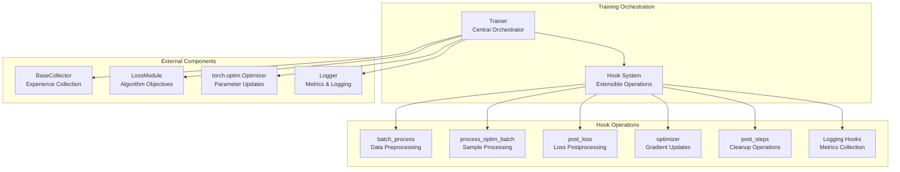
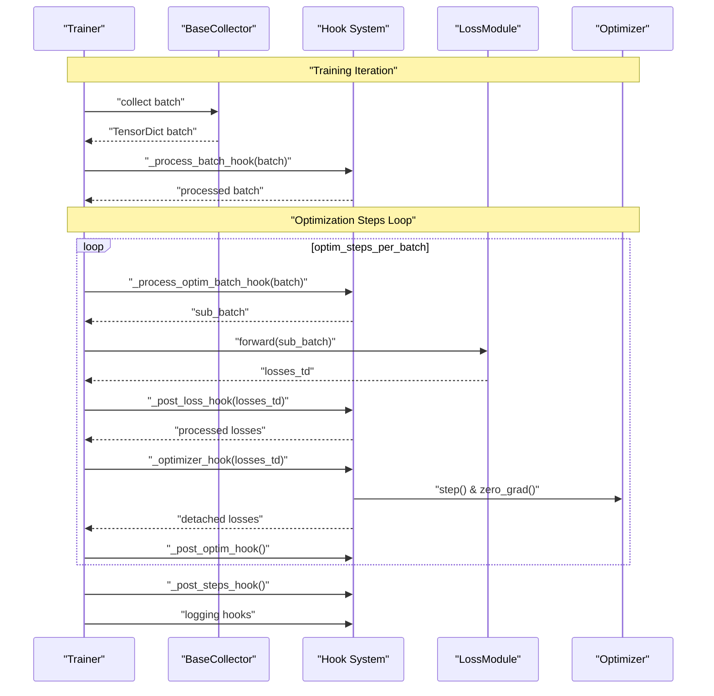
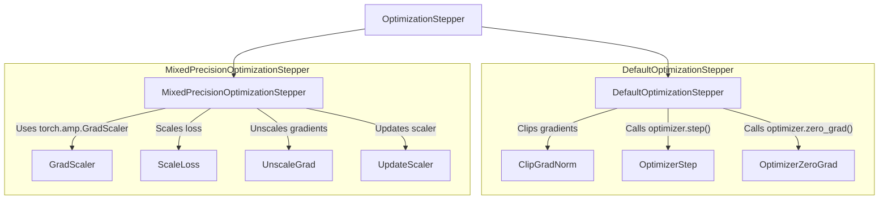
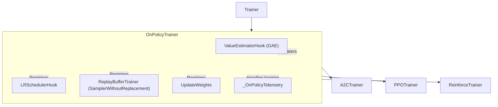
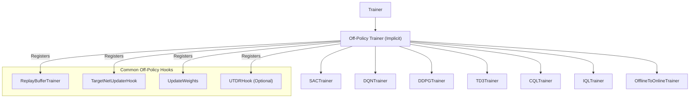

<!-- source: DeepWiki mcp.deepwiki.com · repo pytorch/rl · page 8.1 Trainer System · fetched 2026-10-21 -->

# Training Orchestration

<details>
<summary>Relevant source files</summary>

The following files were used as context for generating this wiki page:

- [docs/source/reference/trainers.rst](docs/source/reference/trainers.rst)
- [docs/source/reference/trainers_basics.rst](docs/source/reference/trainers_basics.rst)
- [sota-implementations/ppo_trainer/config/config.yaml](sota-implementations/ppo_trainer/config/config.yaml)
- [sota-implementations/ppo_trainer/config/config_ewma.yaml](sota-implementations/ppo_trainer/config/config_ewma.yaml)
- [sota-implementations/ppo_trainer/train.py](sota-implementations/ppo_trainer/train.py)
- [test/test_trainer.py](test/test_trainer.py)
- [torchrl/trainers/__init__.py](torchrl/trainers/__init__.py)
- [torchrl/trainers/algorithms/cql.py](torchrl/trainers/algorithms/cql.py)
- [torchrl/trainers/algorithms/ddpg.py](torchrl/trainers/algorithms/ddpg.py)
- [torchrl/trainers/algorithms/dqn.py](torchrl/trainers/algorithms/dqn.py)
- [torchrl/trainers/algorithms/iql.py](torchrl/trainers/algorithms/iql.py)
- [torchrl/trainers/algorithms/on_policy.py](torchrl/trainers/algorithms/on_policy.py)
- [torchrl/trainers/algorithms/ppo.py](torchrl/trainers/algorithms/ppo.py)
- [torchrl/trainers/algorithms/sac.py](torchrl/trainers/algorithms/sac.py)
- [torchrl/trainers/algorithms/td3.py](torchrl/trainers/algorithms/td3.py)
- [torchrl/trainers/helpers/collectors.py](torchrl/trainers/helpers/collectors.py)
- [torchrl/trainers/helpers/losses.py](torchrl/trainers/helpers/losses.py)
- [torchrl/trainers/helpers/trainers.py](torchrl/trainers/helpers/trainers.py)
- [torchrl/trainers/trainers.py](torchrl/trainers/trainers.py)

</details>


This document covers the training orchestration system in TorchRL, which provides a unified framework for coordinating reinforcement learning training loops. The system centers around the `Trainer` class and its extensible hook system that orchestrates data collection, optimization, logging, and checkpointing.

For information about data collection mechanics, see [Data Collection](). For details about loss computation and algorithms, see [Learning Algorithms](). For environment interaction patterns, see [Environments]().

## Core Architecture Overview

The training orchestration system provides a modular framework that coordinates the main components of RL training through a hook-based architecture.

### Training System Architecture



**Sources:** [torchrl/trainers/trainers.py:202-3891]()

### Training Loop Flow



**Sources:** [torchrl/trainers/trainers.py:202-3891]()

## Trainer Class

The `Trainer` class serves as the central orchestrator for RL training, managing the coordination between data collection, optimization, and logging.

### Key Components

| Component | Type | Purpose |
|-----------|------|---------|
| `collector` | `BaseCollector` | Provides training data from environment interaction |
| `loss_module` | `LossModule` | Computes algorithm-specific loss functions |
| `optimizer` | `torch.optim.Optimizer` | Updates model parameters |
| `logger` | `Logger` | Handles metrics logging and visualization |
| `total_frames` | `int` | Total training frames target |
| `optim_steps_per_batch` | `int` | Optimization steps per data collection |

### Constructor Parameters

The `Trainer` constructor accepts comprehensive configuration for training orchestration:

```python
Trainer(
    collector: BaseCollector,
    total_frames: int,
    frame_skip: int,
    optim_steps_per_batch: int,
    loss_module: LossModule | Callable[[TensorDictBase], TensorDictBase],
    optimizer: optim.Optimizer | None = None,
    logger: Logger | None = None,
    clip_grad_norm: bool = True,
    clip_norm: float | None = None,
    progress_bar: bool = True,
    seed: int | None = None,
    save_trainer_interval: int = 10000,
    log_interval: int = 10000,
    save_trainer_file: str | pathlib.Path | None = None,
    checkpoint: Checkpoint | None = None,
    checkpoint_rotation: CheckpointRotation | None = None,
    checkpoint_metadata: Callable[[Trainer], Mapping[str, Any]] | None = None,
    replay_buffer: ReplayBuffer | None = None,
    batch_size: int | None = None,
    learner_backend: Literal["local", "ray"] = "local",
    learner_backend_options: dict | None = None,
    learner_poll_interval: float = 0.05,
    enable_logging: bool = True,
    log_rewards: bool = True,
    log_actions: bool = True,
    log_observations: bool = False,
    done_key: NestedKey = "done",
    terminated_key: NestedKey = "terminated",
    reward_key: NestedKey = "reward",
    episode_reward_key: NestedKey = "reward_sum",
    action_key: NestedKey = "action",
    observation_key: NestedKey = "observation",
    log_timings: bool = False,
    telemetry: Literal["standard", "minimal"] = "standard",
)
```

**Sources:** [torchrl/trainers/trainers.py:1000-1040]()

## Hook System

The hook system provides extensibility by allowing operations to be registered at specific points in the training loop. This enables modular composition of training behaviors.

### Hook Points

The `TrainerHookBase` class [torchrl/trainers/trainers.py:202-210]() defines the interface for hooks. The `Trainer` class provides 18 different points in the training loop where hooks can be registered [docs/source/reference/trainers.rst:15-16]().

| Hook Point | Input Type | Output Type | Purpose |
|------------|------------|-------------|---------|
| `batch_process` | `TensorDictBase` | `TensorDictBase` | Data preprocessing after collection |
| `pre_optim_steps` | `None` | `None` | Setup before optimization |
| `process_optim_batch` | `TensorDictBase` | `TensorDictBase` | Process batch for optimization |
| `post_loss` | `TensorDictBase` | `TensorDictBase` | Post-loss processing |
| `optimizer` | `TensorDictBase` | `TensorDictBase` | Gradient computation and updates |
| `post_optim` | `None` | `None` | Cleanup after optimization |
| `post_steps` | `None` | `None` | Operations after training step |
| `pre_steps_log` | `TensorDictBase` | `Tuple[str, float]` | Pre-step logging |
| `post_steps_log` | `TensorDictBase` | `Tuple[str, float]` | Post-step logging |
| `post_optim_log` | `TensorDictBase` | `Tuple[str, float]` | Post-optimization logging |

### Hook Registration

Operations are registered using the `register_op` method:

```python
trainer.register_op("batch_process", SelectKeys(["observation", "action"]))
trainer.register_op("optimizer", OptimizerHook(optimizer))
trainer.register_op("post_steps_log", LogScalar("reward"))
```

**Sources:** [torchrl/trainers/trainers.py:1042-1050]()

## Built-in Hook Implementations

TorchRL provides several built-in hook implementations for common training operations.

### Data Processing Hooks

| Hook Class | Purpose | Registration Point |
|------------|---------|-------------------|
| `SelectKeys` | Filter TensorDict keys | `batch_process` |
| `mask_batch` | Apply validity masks | `batch_process` |
| `BatchSubSampler` | Subsample trajectory segments | `process_optim_batch` |

**Sources:** [torchrl/trainers/trainers.py:1052-1054](), [torchrl/trainers/trainers.py:1056-1058](), [torchrl/trainers/trainers.py:1060-1062]()

### Optimization Hooks

| Hook Class | Purpose | Registration Point |
|------------|---------|-------------------|
| `OptimizerHook` | Gradient computation and parameter updates | `optimizer` |
| `ClearCudaCache` | CUDA memory management | `pre_optim_steps` |
| `LRSchedulerHook` | Learning rate scheduling | `post_optim` |
| `TargetNetUpdaterHook` | Target network updates | `post_optim` |
| `ValueEstimatorHook` | Value estimation (e.g., GAE) | `batch_process` |
| `MixedPrecisionOptimizationStepper` | Mixed precision training | `optimizer` |

**Sources:** [torchrl/trainers/trainers.py:1064-1066](), [torchrl/trainers/trainers.py:1068-1070](), [torchrl/trainers/trainers.py:1072-1074](), [torchrl/trainers/trainers.py:1076-1078](), [torchrl/trainers/trainers.py:1080-1082](), [torchrl/trainers/trainers.py:1084-1086]()

### Replay Buffer Hooks

The `ReplayBufferTrainer` class provides comprehensive replay buffer integration:

```python
rb_trainer = ReplayBufferTrainer(
    replay_buffer=replay_buffer,
    batch_size=256,
    flatten_tensordicts=False,
    device=device
)
rb_trainer.register(trainer)  # Registers extend, sample, update_priority
```

**Sources:** [torchrl/trainers/trainers.py:1088-1090]()

### Logging Hooks

| Hook Class | Purpose | Registration Point |
|------------|---------|-------------------|
| `LogScalar` | Log scalar metrics | `pre_steps_log`, `post_steps_log` |
| `LogValidationReward` | Validation rollouts and recording | `post_steps_log` |
| `CountFramesLog` | Frame count tracking | `pre_steps_log` |
| `LogTiming` | Log timing information for hooks | `pre_optim_steps`, `post_optim`, `post_steps` |

**Sources:** [torchrl/trainers/trainers.py:1092-1094](), [torchrl/trainers/trainers.py:1096-1098](), [torchrl/trainers/trainers.py:1100-1102](), [torchrl/trainers/trainers.py:1104-1106]()

### Utility Hooks

| Hook Class | Purpose | Registration Point |
|------------|---------|-------------------|
| `RewardNormalizer` | Online reward normalization | `batch_process`, `process_optim_batch` |
| `UpdateWeights` | Policy weight synchronization | `post_steps` |
| `EarlyStopping` | Stop training based on a metric | `post_steps` |
| `UTDRHook` | Unified Trajectory Distribution Reweighting | `batch_process` |

**Sources:** [torchrl/trainers/trainers.py:1108-1110](), [torchrl/trainers/trainers.py:1112-1114](), [torchrl/trainers/trainers.py:1116-1118](), [torchrl/trainers/trainers.py:1120-1122]()

## Training Loop Implementation

The core training loop in the `train()` method orchestrates the complete training process:

### Main Training Loop

```python
def train(self):
    for batch in self.collector:
        # Process collected batch
        batch = self._process_batch_hook(batch)
        
        # Update frame count
        current_frames = self._calculate_frames(batch)
        self.collected_frames += current_frames
        
        # Pre-optimization logging
        self._pre_steps_log_hook(batch)
        
        # Optimization steps
        if self.collected_frames > self.collector.init_random_frames:
            self.optim_steps(batch)
            
        # Post-step operations
        self._post_steps_hook()
        self._post_steps_log_hook(batch)
        
        # Progress tracking and checkpointing
        self._update_progress_bar(current_frames)
        self.save_trainer()
        
        # Termination check
        if self.collected_frames >= self.total_frames:
            break
```

### Optimization Steppers

The `OptimizationStepper` class [torchrl/trainers/trainers.py:1124-1126]() manages the optimization process, including gradient clipping and mixed precision training.



**Sources:** [torchrl/trainers/trainers.py:1124-1126](), [torchrl/trainers/trainers.py:1128-1130](), [torchrl/trainers/trainers.py:1132-1134]()

### Optimization Steps

```python
def optim_steps(self, batch: TensorDictBase):
    self._pre_optim_hook()
    
    for j in range(self.optim_steps_per_batch):
        # Process batch for optimization
        sub_batch = self._process_optim_batch_hook(batch)
        
        # Compute loss
        losses_td = self.loss_module(sub_batch)
        self._post_loss_hook(sub_batch)
        
        # Optimize parameters
        losses_detached = self._optimizer_hook(losses_td)
        self._post_optim_hook()
        self._post_optim_log(sub_batch)
        
        # Track average losses
        self._update_average_losses(losses_detached, j)
```

**Sources:** [torchrl/trainers/trainers.py:202-3891]()

## Configuration and Helpers

The training orchestration system provides helper functions and configuration classes for simplified setup.

### TrainerConfig

The `TrainerConfig` dataclass provides structured configuration:

```python
@dataclass
class TrainerConfig:
    optim_steps_per_batch: int = 500
    optimizer: str = "adam"
    lr_scheduler: str = "cosine"
    selected_keys: list | None = None
    batch_size: int = 256
    log_interval: int = 10000
    lr: float = 3e-4
    weight_decay: float = 0.0
    clip_norm: float = 1000.0
    clip_grad_norm: bool = False
    normalize_rewards_online: bool = False
    normalize_rewards_online_scale: float = 1.0
    normalize_rewards_online_decay: float = 0.9999
    sub_traj_len: int = -1
```

**Sources:** [torchrl/trainers/helpers/trainers.py:45-78]()

### Trainer Factory Function

The `make_trainer` function provides a high-level interface for trainer construction:

```python
def make_trainer(
    collector: BaseCollector,
    loss_module: LossModule,
    recorder: EnvBase | None = None,
    target_net_updater: TargetNetUpdater | None = None,
    policy_exploration: None | (TensorDictModuleWrapper | TensorDictModule) = None,
    replay_buffer: ReplayBuffer | None = None,
    logger: Logger | None = None,
    cfg: DictConfig = None,
) -> Trainer:
    # Creates optimizer from config
    # Registers standard hooks
    # Configures logging and recording
    # Returns configured trainer
```

**Sources:** [torchrl/trainers/helpers/trainers.py:80-159]()

## Checkpointing and State Management

The training orchestration system provides comprehensive state management for training resumption and model deployment.

### State Dictionary Structure

```python
{
    "collector": collector.state_dict(),
    "loss_module": loss_module.state_dict(),
    "state": {
        "collected_frames": self.collected_frames,
        "_last_log": self._last_log,
        "_last_save": self._last_save,
        "_optim_count": self._optim_count,
    },
    **{k: module.state_dict() for k, module in self._modules.items()},
}
```

**Sources:** [torchrl/trainers/trainers.py:139-147]()

### Checkpoint Backends

The system supports multiple checkpoint backends:

| Backend | Environment Variable | Features |
|---------|---------------------|----------|
| `torch` | `CKPT_BACKEND=torch` | Standard PyTorch checkpointing |
| `torchsnapshot` | `CKPT_BACKEND=torchsnapshot` | Distributed checkpointing support |

**Sources:** [torchrl/trainers/trainers.py:34-35]()

### Automatic Saving

```python
trainer = Trainer(
    save_trainer_interval=10000,  # Save every 10k frames
    save_trainer_file="checkpoint.pt"
)

# Automatic saving during training
trainer.train()  # Saves periodically and at completion

# Manual saving
trainer.save_trainer(force_save=True)

# Loading from checkpoint
trainer.load_from_file("checkpoint.pt")
```

**Sources:** [torchrl/trainers/trainers.py:224-311]()

## Algorithm Trainers

TorchRL provides specialized trainer classes for various reinforcement learning algorithms, inheriting from the base `Trainer` class and pre-configuring hooks and components for specific algorithms.

### On-Policy Trainers

On-policy trainers, such as `PPOTrainer`, `A2CTrainer`, and `ReinforceTrainer`, are designed for algorithms that learn directly from data collected by the current policy. They typically involve a fixed number of optimization epochs per collected batch.



**Sources:**
- [torchrl/trainers/algorithms/on_policy.py:54-706]()
- [torchrl/trainers/algorithms/ppo.py:29-53]()
- [docs/source/reference/trainers_basics.rst:52-54]()

#### PPOTrainer

The `PPOTrainer` [torchrl/trainers/algorithms/ppo.py:29-53]() implements the Proximal Policy Optimization algorithm. It extends `OnPolicyTrainer` with PPO-specific defaults, such as multiple optimization epochs per batch (defaulting to 4).

It provides a convenient `from_env` class method [torchrl/trainers/algorithms/ppo.py:60-121]() to construct a PPO trainer from an environment, actor, and critic, automatically setting up the collector, `ClipPPOLoss`, Adam optimizer, GAE, and minibatch sampling.

```python
trainer = PPOTrainer.from_env(
    env, actor=actor, critic=critic,
    total_frames=1_000_000,
    frames_per_batch=4096,
    minibatch_size=256,
)
trainer.train()
```

**Sources:** [torchrl/trainers/algorithms/ppo.py:60-121]()

### Off-Policy Trainers

Off-policy trainers, including `SACTrainer`, `DQNTrainer`, `DDPGTrainer`, `TD3Trainer`, `CQLTrainer`, and `IQLTrainer`, are designed for algorithms that can learn from data collected by older policies, typically utilizing a replay buffer.



**Sources:**
- [torchrl/trainers/algorithms/sac.py:37-88]()
- [torchrl/trainers/algorithms/dqn.py:39-109]()
- [docs/source/reference/trainers_basics.rst:56-62]()

#### SACTrainer

The `SACTrainer` [torchrl/trainers/algorithms/sac.py:37-88]() implements the Soft Actor-Critic algorithm. It handles replay buffer management, target network updates (typically `SoftUpdate`), policy weight synchronization, and logging.

```python
trainer = SACTrainer(
    collector=collector,
    total_frames=1000000,
    frame_skip=1,
    optim_steps_per_batch=100,
    loss_module=loss_module,
    optimizer=optimizer,
    replay_buffer=replay_buffer,
    target_net_updater=target_net_updater,
)
trainer.train()
```

**Sources:** [torchrl/trainers/algorithms/sac.py:90-115]()

#### DQNTrainer

The `DQNTrainer` [torchrl/trainers/algorithms/dqn.py:39-109]() implements the Deep Q-Network algorithm. It manages replay buffer, target network updates (typically `HardUpdate`), and policy weight updates. It also supports epsilon-greedy exploration annealing via `EGreedyModule`.

```python
trainer = DQNTrainer(
    collector=collector,
    total_frames=500000,
    # ... other parameters
)
trainer.train()
```

**Sources:** [torchrl/trainers/algorithms/dqn.py:111-126]()

#### CQLTrainer and IQLTrainer

`CQLTrainer` and `IQLTrainer` are specialized trainers for offline reinforcement learning algorithms, building upon the off-policy trainer structure to incorporate their respective loss functions and training methodologies.

**Sources:**
- [torchrl/trainers/algorithms/cql.py]()
- [torchrl/trainers/algorithms/iql.py]()

---

