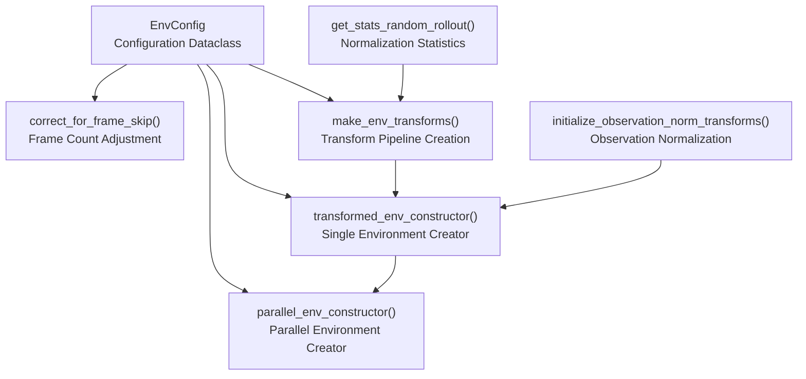
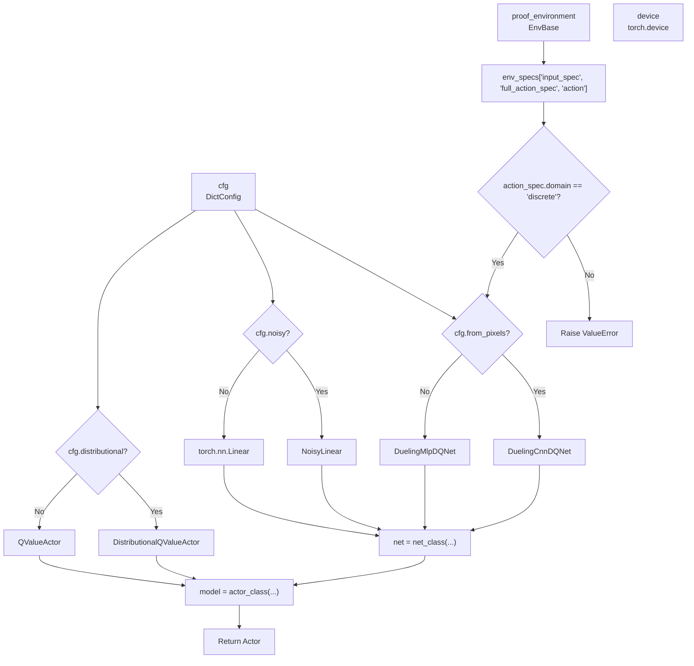
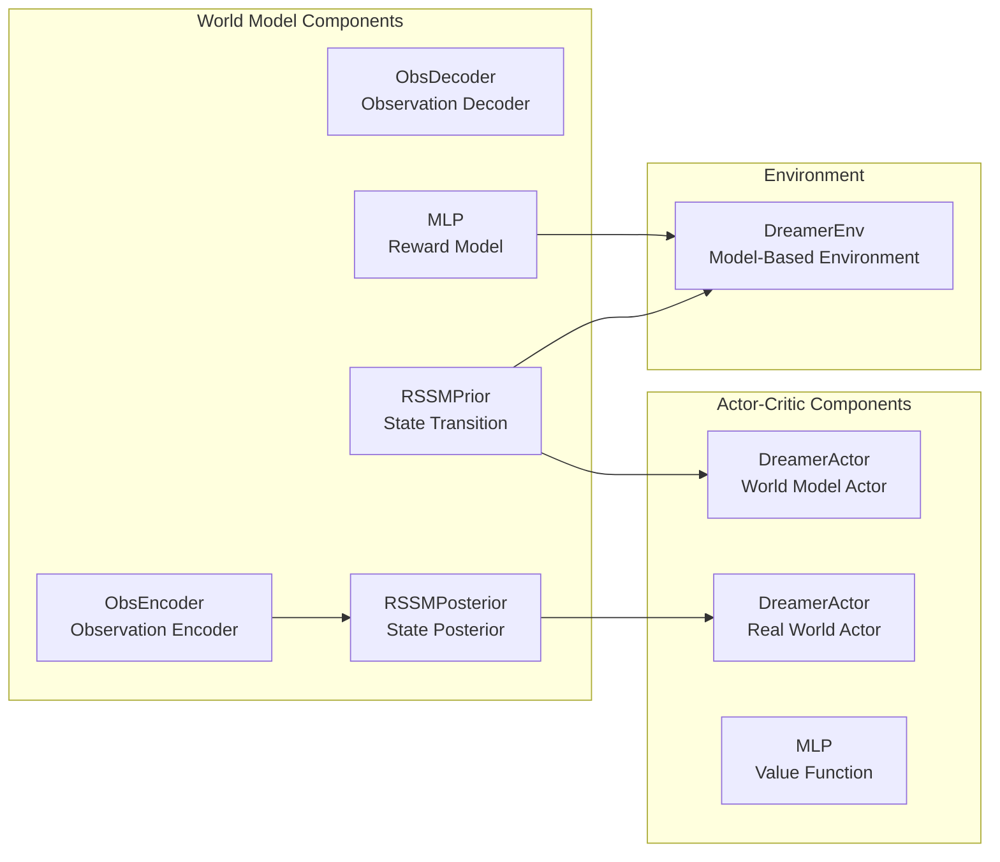
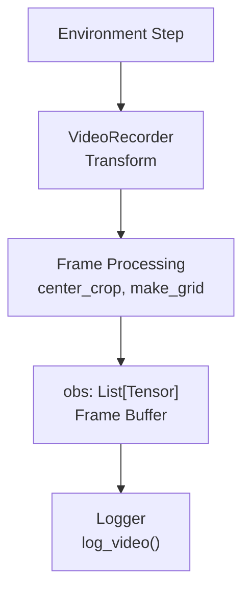
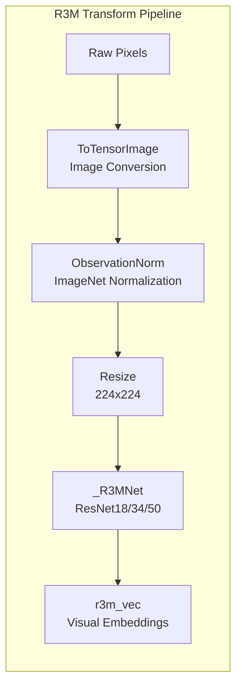
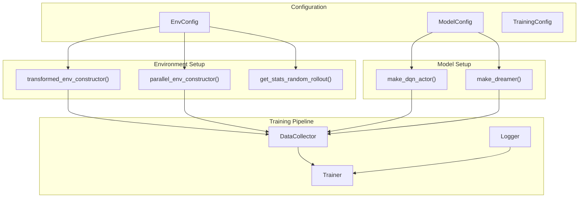

<!-- source: DeepWiki mcp.deepwiki.com · repo pytorch/rl · page 8.2 Helper Utilities · fetched 2026-10-21 -->

# Helper Utilities

Relevant source files

The following files were used as context for generating this wiki page:

- [test/modules/test_multiagent_models.py](test/modules/test_multiagent_models.py)
- [test/test_exploration.py](test/test_exploration.py)
- [test/test_helpers.py](test/test_helpers.py)
- [torchrl/modules/models/cross_group_critic.py](torchrl/modules/models/cross_group_critic.py)
- [torchrl/modules/models/exploration.py](torchrl/modules/models/exploration.py)
- [torchrl/modules/models/models.py](torchrl/modules/models/models.py)
- [torchrl/modules/models/multiagent.py](torchrl/modules/models/multiagent.py)
- [torchrl/modules/models/utils.py](torchrl/modules/models/utils.py)
- [torchrl/modules/tensordict_module/exploration.py](torchrl/modules/tensordict_module/exploration.py)
- [torchrl/record/recorder.py](torchrl/record/recorder.py)
- [torchrl/trainers/helpers/envs.py](torchrl/trainers/helpers/envs.py)
- [torchrl/trainers/helpers/models.py](torchrl/trainers/helpers/models.py)

Helper utilities provide convenient functions and classes for constructing environments, creating models, and setting up training pipelines. These utilities abstract common configuration patterns and provide standardized ways to instantiate TorchRL components with consistent parameter handling.

For distributed training coordination, see [Distributed Collection](#3.1.1). For the main training orchestration system, see [Environment Transforms](#3.2).

## Environment Construction Utilities

The environment construction utilities in [torchrl/trainers/helpers/envs.py](torchrl/trainers/helpers/envs.py) provide functions to create fully configured environments with appropriate transforms, normalization, and parallel execution capabilities.

### Core Environment Constructors

The `transformed_env_constructor()` function [torchrl/trainers/helpers/envs.py:223-338]() serves as the primary entry point for creating configured environments. It accepts an `EnvConfig` dataclass and returns either a callable environment creator or an `EnvCreator` instance.

Key parameters handled by the constructor include:
- **Environment Library Selection**: Supports `gym`, `dm_control`, and other backends via the `LIBS` dictionary [torchrl/trainers/helpers/envs.py:46-49]()
- **Pixel vs Vector Observations**: Configured via `from_pixels` parameter
- **Frame Skip Handling**: Automatic adjustment of frame counts via `correct_for_frame_skip()` [torchrl/trainers/helpers/envs.py:60-91]()
- **Transform Pipeline**: Applied through `make_env_transforms()` [torchrl/trainers/helpers/envs.py:93-209]()

### Transform Pipeline Construction

The `make_env_transforms()` function [torchrl/trainers/helpers/envs.py:93-209]() creates a comprehensive transform pipeline including:

| Transform Category | Components | Purpose |
|-------------------|------------|---------|
| **Video Recording** | `VideoRecorder` | Captures environment interactions |
| **Visual Processing** | `ToTensorImage`, `CenterCrop`, `Resize`, `GrayScale` | Image preprocessing |
| **Observation Handling** | `CatTensors`, `FlattenObservation`, `CatFrames` | Observation structuring |
| **Normalization** | `ObservationNorm`, `VecNorm`, `RewardScaling` | Data normalization |
| **Utility Transforms** | `StepCounter`, `InitTracker`, `DoubleToFloat` | Tracking and type conversion |

**VideoRecorder** [torchrl/record/recorder.py:43-137]() is appended if `video_tag` is provided, allowing for visual logging of environment rollouts.
**Pixel-based Transforms** are applied if `from_pixels` is true, including `ToTensorImage` [torchrl/envs/transforms/transforms.py](), `CenterCrop` [torchrl/envs/transforms/transforms.py](), `Resize` [torchrl/envs/transforms/transforms.py](), `GrayScale` [torchrl/envs/transforms/transforms.py](), `FlattenObservation` [torchrl/envs/transforms/transforms.py:39](), and `CatFrames` [torchrl/envs/transforms/transforms.py](). An `ObservationNorm` [torchrl/envs/transforms/transforms.py](), specifically for pixels, is also added.
**Reward Scaling** [torchrl/envs/transforms/transforms.py]() is applied if `reward_scaling` is configured.
**Vector-based Transforms** are applied if `from_pixels` is false, including `CatTensors` [torchrl/envs/transforms/transforms.py]() to combine observation keys, `ObservationNorm` [torchrl/envs/transforms/transforms.py]() or `VecNorm` [torchrl/envs/transforms/transforms.py]() for normalization, and `DoubleToFloat` [torchrl/envs/transforms/transforms.py](). `CatFrames` [torchrl/envs/transforms/transforms.py]() can also be applied to vector observations.
**gSDE Noise** [torchrl/envs/transforms/transforms.py:40]() is added if `gSDE` is enabled in the configuration.
Finally, `StepCounter` [torchrl/envs/transforms/transforms.py:42]() and `InitTracker` [torchrl/envs/transforms/transforms.py:41]() are always appended for episode tracking.

### Parallel Environment Support

The `parallel_env_constructor()` function [torchrl/trainers/helpers/envs.py:341-381]() creates vectorized environments using `ParallelEnv` [torchrl/envs/parallel_envs.py]() with support for:
- **Batch Transform Application**: Transforms applied to the entire parallel environment
- **Individual Environment Transforms**: Transforms applied to each sub-environment
- **Shared Memory Statistics**: For normalization statistics across workers

**Sources:**
[torchrl/trainers/helpers/envs.py:1-210]()
[torchrl/record/recorder.py:43-137]()
[test/test_exploration.py:31]()

## Model Construction Utilities

The model construction utilities in [torchrl/trainers/helpers/models.py](torchrl/trainers/helpers/models.py) provide factory functions for creating standard RL models with appropriate architectures and configurations.

### DQN Actor Construction

The `make_dqn_actor()` function [torchrl/trainers/helpers/models.py:64-192]() creates DQN actors with automatic architecture selection:

- **Action Space Validation**: Ensures the environment has a discrete action space [torchrl/trainers/helpers/models.py:118-124]().
- **Network Class Selection**: Uses `DuelingCnnDQNet` [torchrl/modules/models/models.py]() for pixel-based observations (`cfg.from_pixels=True`) [torchrl/trainers/helpers/models.py:127-130]() and `DuelingMlpDQNet` [torchrl/modules/models/models.py]() for vector observations [torchrl/trainers/helpers/models.py:141-142]().
- **Noisy Layers**: Integrates `NoisyLinear` [torchrl/modules/models/exploration.py:29-89]() layers if `cfg.noisy=True` [torchrl/trainers/helpers/models.py:115]().
- **Distributional Support**: Uses `DistributionalQValueActor` [torchrl/modules/tensordict_module/actors.py]() if `cfg.distributional=True` [torchrl/trainers/helpers/models.py:172](), otherwise `QValueActor` [torchrl/modules/tensordict_module/actors.py]().
- **Input Key Inference**: Automatically infers the input key for the network based on `from_pixels` [torchrl/trainers/helpers/models.py:138]() or environment specs [torchrl/trainers/helpers/models.py:147-149]().
- **Initialization**: The model is initialized by performing a forward pass with a fake tensordict from the `proof_environment` [torchrl/trainers/helpers/models.py:190-192]().

### Dreamer Model Construction

The `make_dreamer()` function [torchrl/trainers/helpers/models.py:197-298]() creates complete Dreamer model-based RL systems:

The function returns a complete set of Dreamer components configured for both imagination-based training and real-world execution. It constructs:
- `ObsEncoder` [torchrl/modules/models/model_based.py]() and `ObsDecoder` [torchrl/modules/models/model_based.py]() for processing observations.
- `RSSMPrior` [torchrl/modules/models/model_based.py]() and `RSSMPosterior` [torchrl/modules/models/model_based.py]() for the Recurrent State-Space Model.
- `MLP` [torchrl/modules/models/models.py:42-150]() for the reward model and value function.
- `DreamerActor` [torchrl/modules/models/model_based.py]() for both the real-world and world-model actors.
These components are then wrapped into a `WorldModelWrapper` [torchrl/modules/tensordict_module/world_models.py]() and a `DreamerEnv` [torchrl/envs/model_based/dreamer.py]() for the model-based environment.

### Configuration Dataclasses

Model configuration is handled through specialized dataclasses:

- **`DiscreteModelConfig`**: DQN and discrete action algorithms [torchrl/trainers/helpers/models.py:647-658]()
- **`ContinuousModelConfig`**: SAC, PPO, and continuous control [torchrl/trainers/helpers/models.py:603-645]()
- **`DreamerConfig`**: Dreamer-specific hyperparameters [torchrl/trainers/helpers/models.py:545-561]()
- **`REDQModelConfig`**: REDQ algorithm configuration [torchrl/trainers/helpers/models.py:563-601]()

**Sources:**
[torchrl/trainers/helpers/models.py:1-192]()
[torchrl/modules/models/models.py:42-150]()
[torchrl/modules/models/exploration.py:29-89]()
[test/test_helpers.py:43-46]()

## Recording and Logging Utilities

The recording utilities in [torchrl/record/recorder.py](torchrl/record/recorder.py) provide transforms for capturing and logging environment interactions.

### Video Recording

The `VideoRecorder` transform [torchrl/record/recorder.py:43-137]() captures visual observations and writes them to loggers:

- **Frame Skipping**: Configurable frame interval via `skip` parameter [torchrl/record/recorder.py:57]().
- **Grid Creation**: Automatic grid layout for batch observations via `make_grid` [torchrl/record/recorder.py:61]().
- **Center Cropping**: Optional cropping for consistent video dimensions via `center_crop` [torchrl/record/recorder.py:59]().
- **Logger Integration**: Compatible with `CSVLogger`, Wandb, and TensorBoard [torchrl/record/recorder.py:50]().
- **Dump on Done**: Can automatically dump recorded frames when an episode finishes via `dump_on_done` [torchrl/record/recorder.py:73]().
- **Max Frames**: Limits the number of frames held in the buffer to manage memory [torchrl/record/recorder.py:70]().

### TensorDict Recording

The `TensorDictRecorder` [torchrl/record/recorder.py:274-340]() saves complete trajectory data:
- **Selective Recording**: Configurable input keys for partial data saving
- **Frame Skipping**: Reduces storage requirements
- **Batch Processing**: Handles vectorized environment data

### Pixel Rendering Transform

The `PixelRenderTransform` [torchrl/record/recorder.py:342-553]() adds pixel observations to environments without native pixel support:
- **Render Method Integration**: Calls parent environment's render method
- **Preprocessing Support**: Configurable preprocessing functions
- **Batch Environment Support**: Handles both single and parallel environments
- **Dynamic Enabling**: Can be toggled on/off during execution

**Sources:**
[torchrl/record/recorder.py:1-137]()

## Pre-trained Model Integration

TorchRL provides utilities for integrating pre-trained visual models into RL pipelines through specialized transform classes.

### R3M Visual Embeddings

The `R3MTransform` [torchrl/envs/transforms/r3m.py:176-373]() provides pre-trained ResNet embeddings trained on Ego4D data:
- **Model Variants**: ResNet18 (512-dim), ResNet34 (512-dim), ResNet50 (2048-dim)
- **Automatic Preprocessing**: ImageNet normalization and resizing
- **Batch Processing**: Supports both single and stacked image inputs
- **Weight Loading**: Automatic download of pre-trained weights

### VIP Visual Embeddings

The `VIPTransform` [torchrl/envs/transforms/vip.py:162-343]() provides Value-Implicit Pre-training embeddings:
- **ResNet50 Architecture**: 1024-dimensional output embeddings
- **Reward Computation**: `VIPRewardTransform` for goal-conditioned tasks
- **Embedding Similarity**: Distance-based reward shaping

### Transform Configuration

Both R3M and VIP transforms support flexible configuration:

| Parameter | Purpose | Default |
|-----------|---------|---------|
| `in_keys` | Input pixel keys | `["pixels"]` |
| `out_keys` | Output embedding keys | `["r3m_vec"]` / `["vip_vec"]` |
| `size` | Image resize dimension | `244` |
| `stack_images` | Concatenate multiple inputs | `True` |
| `download` | Download pre-trained weights | `False` |
| `tensor_pixels_keys` | Preserve original pixels | `None` |

**Sources:** [torchrl/envs/transforms/r3m.py:1-373](), [torchrl/envs/transforms/vip.py:1-407]()

## Usage Integration

The helper utilities integrate seamlessly with TorchRL's training infrastructure:

The utilities provide consistent interfaces for configuring complex RL training setups while maintaining flexibility for custom modifications and extensions.

**Sources:**
[torchrl/trainers/helpers/envs.py:1-573]()
[torchrl/trainers/helpers/models.py:1-658]()
[test/test_helpers.py:1-373]()

---

