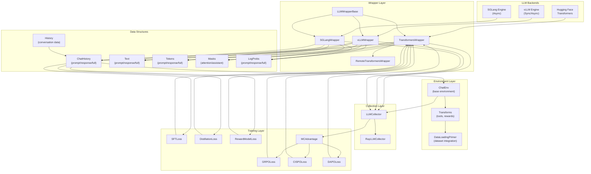
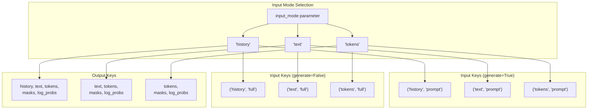

<!-- source: DeepWiki mcp.deepwiki.com · repo pytorch/rl · page 9 LLM Integration · fetched 2026-10-21 -->

# LLM Integration

<details>
<summary>Relevant source files</summary>

The following files were used as context for generating this wiki page:

- [docs/source/reference/llms.rst](docs/source/reference/llms.rst)
- [docs/source/reference/llms_objectives.rst](docs/source/reference/llms_objectives.rst)
- [test/llm/test_llm_objectives.py](test/llm/test_llm_objectives.py)
- [torchrl/modules/llm/__init__.py](torchrl/modules/llm/__init__.py)
- [torchrl/modules/llm/backends/__init__.py](torchrl/modules/llm/backends/__init__.py)
- [torchrl/modules/llm/backends/vllm/__init__.py](torchrl/modules/llm/backends/vllm/__init__.py)
- [torchrl/modules/llm/backends/vllm/vllm_utils.py](torchrl/modules/llm/backends/vllm/vllm_utils.py)
- [torchrl/modules/llm/policies/__init__.py](torchrl/modules/llm/policies/__init__.py)
- [torchrl/objectives/llm/__init__.py](torchrl/objectives/llm/__init__.py)
- [torchrl/objectives/llm/_utils.py](torchrl/objectives/llm/_utils.py)
- [torchrl/objectives/llm/distillation.py](torchrl/objectives/llm/distillation.py)
- [torchrl/objectives/llm/grpo.py](torchrl/objectives/llm/grpo.py)
- [torchrl/objectives/llm/sft.py](torchrl/objectives/llm/sft.py)
- [torchrl/weight_update/llm/__init__.py](torchrl/weight_update/llm/__init__.py)

</details>


## Purpose and Scope

This document provides a comprehensive overview of TorchRL's Large Language Model (LLM) integration system. TorchRL offers a complete framework for LLM reinforcement learning post-training, including fine-tuning with algorithms like GRPO (Group Relative Policy Optimization), SFT (Supervised Fine-Tuning), and CISPO (Conservative Iterative Sequential Policy Optimization).

The LLM integration system consists of four main subsystems:
- **LLM Wrappers** ([LLM Wrapper System](#9.1)): Unified interfaces for Hugging Face Transformers, vLLM, and SGLang backends
- **Data Structures** ([LLM Data Structures](#9.2)): TensorClass objects for managing conversational data (`History`, `ChatHistory`, `Text`, `Tokens`, `Masks`, `LogProbs`)
- **Training Objectives** ([LLM Training Objectives](#9.3)): Loss modules for LLM fine-tuning (`GRPOLoss`, `SFTLoss`, `CISPOLoss`, `DistillationLoss`, `RewardModelLoss`)
- **Environments and Tools** ([LLM Environments and Tools](#9.4)): ChatEnv and transforms for RL-based LLM training

For information about distributed data collection, see [Data Collection](#4). For information about replay buffers, see [Replay Buffers](#5). For general environment concepts, see [Environments](#3).

**Sources:** [docs/source/reference/llms.rst:1-470](), [torchrl/modules/llm/policies/__init__.py:1-24](), [torchrl/objectives/llm/__init__.py:1-31]()

## System Architecture

The LLM integration system follows a modular, composable design where data flows through wrappers, environments, collectors, and loss modules. All components communicate using `TensorDict` as the universal data container and specialized `TensorClass` objects for structured LLM data.

### High-Level Component Diagram



**Sources:** [torchrl/modules/llm/policies/common.py:1-800](), [torchrl/modules/llm/policies/transformers_wrapper.py:1-300](), [torchrl/modules/llm/policies/vllm_wrapper.py:1-300](), [torchrl/modules/llm/policies/sglang_wrapper.py:1-300](), [docs/source/reference/llms.rst:1-470](), [torchrl/objectives/llm/__init__.py:7-21]()

## Core Component Overview

### LLM Wrappers

The wrapper system provides a unified interface for LLM inference across different backends. The base class `LLMWrapperBase` defines the common API, while backend-specific implementations (`TransformersWrapper`, `vLLMWrapper`, `SGLangWrapper`) handle model-specific details.

**Key Classes:**
- `LLMWrapperBase`: Abstract base class defining the wrapper interface [torchrl/modules/llm/policies/common.py:14-14]()
- `TransformersWrapper`: Wrapper for Hugging Face Transformers models [torchrl/modules/llm/policies/transformers_wrapper.py:22-22]()
- `vLLMWrapper`: Wrapper for vLLM models (sync and async) [torchrl/modules/llm/policies/vllm_wrapper.py:20-20]()
- `SGLangWrapper`: Wrapper for SGLang models (async) [torchrl/modules/llm/policies/sglang_wrapper.py:19-19]()
- `RemoteTransformersWrapper`: Distributed wrapper using Ray [torchrl/modules/llm/policies/transformers_wrapper.py:21-21]()

**Input Modes:** All wrappers support three input modes:
- `"history"`: Uses `History`/`ChatHistory` objects for multi-turn conversations
- `"text"`: Uses raw text strings
- `"tokens"`: Uses pre-tokenized token IDs

**Generation Modes:**
- `generate=True`: Generate new text (returns `response`)
- `generate=False`: Compute log-probabilities only (returns `full`)

For detailed information, see [LLM Wrapper System](#9.1).

**Sources:** [torchrl/modules/llm/policies/common.py:800-1000](), [torchrl/modules/llm/policies/transformers_wrapper.py:40-243](), [torchrl/modules/llm/policies/vllm_wrapper.py:56-264](), [torchrl/modules/llm/policies/sglang_wrapper.py:56-264]()

### Data Structures

TorchRL provides specialized `TensorClass` objects for managing LLM data. These structures maintain consistency across the pipeline and support both padded and unpadded (nested tensor) representations.

| Class | Purpose | Key Fields |
|-------|---------|-----------|
| `History` | Raw conversation data | `role`, `content`, `complete` |
| `ChatHistory` | Structured conversation container | `prompt`, `response`, `full` |
| `Text` | Text representation | `prompt`, `response`, `full` |
| `Tokens` | Tokenized representation | `prompt`, `response`, `full`, `padded` |
| `Masks` | Attention and assistant masks | `all_attention_mask`, `all_assistant_mask`, `padded` |
| `LogProbs` | Log-probability values | `prompt`, `response`, `full`, `padded` |

All data structures follow a consistent pattern with `prompt`, `response`, and `full` fields, where `full = prompt + response`. They also support conversion methods like `to_tokens()`, `to_text()`, and `to_history()`.

For detailed information, see [LLM Data Structures](#9.2).

**Sources:** [torchrl/modules/llm/policies/common.py:39-682](), [torchrl/data/llm/history.py:1-300]()

### Training Objectives

TorchRL provides LLM-specific loss modules that implement state-of-the-art fine-tuning algorithms. These losses integrate with the wrapper system to compute gradients for policy optimization.

**Available Losses:**
- `GRPOLoss`: Group Relative Policy Optimization with clipped importance sampling [torchrl/objectives/llm/grpo.py:152-152]()
- `SFTLoss`: Supervised Fine-Tuning loss with optional KL regularization [torchrl/objectives/llm/sft.py:105-105]()
- `CISPOLoss`: Conservative Iterative Sequential Policy Optimization [torchrl/objectives/llm/grpo.py:158-158]()
- `DAPOLoss`: Direct Alignment from Preferences Optimization [torchrl/objectives/llm/grpo.py:154-154]()
- `DistillationLoss`: Token-level knowledge distillation loss [torchrl/objectives/llm/distillation.py:106-106]()
- `RewardModelLoss`: Loss for training reward models [torchrl/objectives/llm/reward.py:20-20]()

**Advantage Estimation:**
- `MCAdvantage`: Monte Carlo advantage estimation for LLM trajectories [torchrl/objectives/llm/grpo.py:160-160]()

**Key Features:**
- Token-level masking strategies (`"sft"`, `"rlhf"`, `"generic"`)
- KL divergence regularization to reference models
- Asymmetric clipping thresholds (DAPO-style)
- Token-wise trust region filtering (KL-Mask)
- `k3_kl_token_estimate`: Per-token k3 estimate of KL divergence [torchrl/objectives/llm/distillation.py:25-74]()

For detailed information, see [LLM Training Objectives](#9.3).

**Sources:** [torchrl/objectives/llm/grpo.py:1-400](), [torchrl/objectives/llm/sft.py:1-234](), [torchrl/objectives/llm/distillation.py:1-157](), [torchrl/objectives/llm/reward.py:1-100](), [docs/source/reference/llms.rst:429-461]()

### Environments and Tools

The environment layer orchestrates data loading, tool execution, and reward computation. `ChatEnv` serves as the base environment, extended by transforms for specific functionality.

**Core Environment:**
- `ChatEnv`: Base conversational environment supporting history/text/token modes [docs/source/reference/llms.rst:141-141]()

**Key Transforms:**
- `RetrieveLogProb`: Retrieve reference model log-probabilities [docs/source/reference/llms.rst:168-168]()
- `KLComputation`: Compute KL divergence rewards [docs/source/reference/llms.rst:168-168]()
- `PythonInterpreter`: Execute Python code in conversations [docs/source/reference/llms.rst:169-169]()
- `MCPToolTransform`: General tool calling support [docs/source/reference/llms.rst:169-169]()
- `DataLoadingPrimer`: Load prompts from datasets [docs/source/reference/llms.rst:170-170]()
- `PolicyVersion`: Tracks the version of the policy [docs/source/reference/llms.rst:71-71]()

For detailed information, see [LLM Environments and Tools](#9.4).

**Sources:** [docs/source/reference/llms.rst:112-427](), [torchrl/envs/llm/transforms/kl.py:1-300]()

## Data Flow Pipeline

The following diagram illustrates how data flows through the LLM training pipeline, from raw conversation data through wrappers, environments, collectors, and finally to loss computation.

### End-to-End Training Pipeline

```mermaid
graph LR
    subgraph "Input Data"
        RawHistory["History<br/>from_chats()"]
        Dataset["Dataset<br/>(GSM8K, IFEval)"]
    end
    
    subgraph "Environment"
        ChatEnvNode["ChatEnv<br/>reset()"]
        Transforms["Transforms<br/>(tools, rewards)"]
    end
    
    subgraph "Policy Wrapper"
        Wrapper["TransformersWrapper<br/>or vLLMWrapper or SGLangWrapper"]
        GenMode{"generate?"}
        GenTrue["generate=True<br/>(produce response)"]
        GenFalse["generate=False<br/>(compute logprobs)"]
    end
    
    subgraph "Data Structures"
        ChatHistOut["ChatHistory<br/>(prompt, response, full)"]
        TokensOut["Tokens<br/>(prompt, response, full)"]
        MasksOut["Masks<br/>(attention, assistant)"]
        LogProbsOut["LogProbs<br/>(prompt, response, full)"]
    end
    
    subgraph "Collection"
        Collector["LLMCollector<br/>collect()"]
        ReplayBuffer["ReplayBuffer"]
    end
    
    subgraph "Advantage Estimation"
        MCAdv["MCAdvantage<br/>compute advantages"]
    end
    
    subgraph "Loss Computation"
        Loss["GRPOLoss or SFTLoss<br/>forward()"]
        Backward["loss.backward()"]
    end
    
    RawHistory --> ChatEnvNode
    Dataset --> Transforms
    ChatEnvNode --> Transforms
    Transforms --> Wrapper
    
    Wrapper --> GenMode
    GenMode -->|True| GenTrue
    GenMode -->|False| GenFalse
    
    GenTrue --> ChatHistOut
    GenTrue --> TokensOut
    GenTrue --> MasksOut
    GenTrue --> LogProbsOut
    
    GenFalse --> TokensOut
    GenFalse --> MasksOut
    GenFalse --> LogProbsOut
    
    ChatHistOut --> Collector
    TokensOut --> Collector
    MasksOut --> Collector
    LogProbsOut --> Collector
    
    Collector --> ReplayBuffer
    ReplayBuffer --> MCAdv
    MCAdv --> Loss
    Loss --> Backward
```



**Sources:** [docs/source/reference/llms.rst:1-100](), [torchrl/modules/llm/policies/transformers_wrapper.py:638-750](), [torchrl/objectives/llm/grpo.py:320-400]()

## Input and Output Modes

The wrapper system supports three input modes that determine how data is structured throughout the pipeline. The mode is set during wrapper initialization and affects both input and output keys.

### Input Mode Configuration



### Mode Comparison Table

| Input Mode | Input Type | Generated Output | Use Case |
|------------|------------|------------------|----------|
| `"history"` | `History` or `ChatHistory` | `history`, `text`, `tokens`, `masks`, `log_probs` | Multi-turn conversations, RL environments |
| `"text"` | `str` or `Text` | `text`, `tokens`, `masks`, `log_probs` | Simple text generation, SFT |
| `"tokens"` | `torch.Tensor` or `Tokens` | `tokens`, `masks`, `log_probs` | Pre-tokenized data, custom preprocessing |

**Key Differences:**
- **History mode** preserves conversation structure and supports multi-turn interactions
- **Text mode** is simpler but loses conversation structure
- **Tokens mode** provides maximum control but requires manual tokenization

**Sources:** [torchrl/modules/llm/policies/transformers_wrapper.py:173-200](), [torchrl/modules/llm/policies/vllm_wrapper.py:195-223](), [torchrl/modules/llm/policies/common.py:220-284]()

## Getting Started Example

The following example demonstrates a complete LLM fine-tuning workflow using GRPO with the recommended components.

### Basic GRPO Training Setup

```python
from torchrl.data.llm import History
from torchrl.modules.llm import vLLMWrapper, AsyncVLLM
from torchrl.envs.llm import ChatEnv
from torchrl.envs.llm.transforms import RetrieveLogProb, KLComputation, MCAdvantage
from torchrl.collectors.llm import LLMCollector
from torchrl.objectives.llm import GRPOLoss
from torchrl.data import ReplayBuffer, LazyStackStorage
from transformers import AutoTokenizer
import torch

# 1. Create vLLM engines (recommended for performance)
training_engine = AsyncVLLM.from_pretrained(
    "Qwen/Qwen2.5-7B",
    num_replicas=2,
    max_model_len=2048
)
reference_engine = AsyncVLLM.from_pretrained(
    "Qwen/Qwen2.5-7B", 
    num_replicas=1,
    max_model_len=2048
)

tokenizer = AutoTokenizer.from_pretrained("Qwen/Qwen2.5-7B")

# 2. Create policy wrappers
policy = vLLMWrapper(
    training_engine,
    tokenizer=tokenizer,
    input_mode="history",
    generate=True,
    return_log_probs=True,
    generate_kwargs={
        "max_new_tokens": 512,
        "temperature": 0.7,
        "top_p": 0.9
    }
)

ref_policy = vLLMWrapper(
    reference_engine,
    tokenizer=tokenizer,
    input_mode="history",
    generate=False,  # Only compute log-probs
    return_log_probs=True
)

# 3. Create environment with transforms
env = ChatEnv(
    tokenizer=tokenizer,
    system_prompt="You are a helpful assistant.",
    batch_size=(8,)
)

# Add transforms for KL computation and advantage estimation
env = env.append_transform(
    RetrieveLogProb(ref_policy, assistant_only=True)
)
env = env.append_transform(
    KLComputation(kl_coeff=0.1)
)

# 4. Create collector
collector = LLMCollector(
    env,
    policy=policy,
    dialog_turns_per_batch=256,
    frames_per_batch=1024
)

# 5. Create replay buffer with advantage estimation
replay_buffer = ReplayBuffer(
    storage=LazyStackStorage(10000),
)
replay_buffer.append_transform(MCAdvantage(grpo_size=4))

# 6. Create loss module
loss_fn = GRPOLoss(
    policy,
    clip_epsilon=0.2,
    entropy_coeff=0.01,
    kl_to_ref_coeff=0.1,
    masking_strategy="rlhf"  # Use assistant token masking
)

# 7. Training loop
optimizer = torch.optim.Adam(policy.parameters(), lr=1e-5)

for i in range(num_iterations):
    # Collect data
    batch = collector.collect()
    
    # Store in replay buffer
    replay_buffer.extend(batch)
    
    # Sample and compute loss
    for _ in range(num_updates_per_iteration):
        sample = replay_buffer.sample(batch_size=32)
        
        # Compute loss
        loss_vals = loss_fn(sample)
        
        # Backward and optimize
        optimizer.zero_grad()
        loss_vals.loss_objective.backward()
        optimizer.step()
        
        # Log metrics
        print(f"Loss: {loss_vals.loss_objective.item():.4f}")
        print(f"ESS: {loss_vals.ESS.item():.2f}")
        print(f"Clip Fraction: {loss_vals.clip_fraction.item():.3f}")
```

**Key Components Explained:**

1. **AsyncVLLM engines**: Use `AsyncVLLM` for better GPU utilization and throughput [torchrl/modules/llm/backends/__init__.py:25-25]()
2. **Input mode**: `"history"` mode preserves conversation structure for multi-turn
3. **Generate modes**: Training policy generates text (`generate=True`), reference computes log-probs only (`generate=False`)
4. **Transforms**: `RetrieveLogProb` gets reference log-probs, `KLComputation` adds KL rewards
5. **MCAdvantage**: Computes advantages from rewards using Monte Carlo estimation [torchrl/objectives/llm/grpo.py:160-160]()
6. **Masking strategy**: `"rlhf"` masks assistant tokens only for multi-turn conversations

**Sources:** [docs/source/reference/llms.rst:20-38](), [test/llm/test_llm_objectives.py:96-180](), [torchrl/objectives/llm/grpo.py:70-150]()

## Advanced Features

### Batching for Multi-Threaded Environments

Both `TransformersWrapper` and `vLLMWrapper` support automatic batching for multi-threaded data collection, which improves throughput when using parallel environments.

**Configuration:**
```python
wrapper = vLLMWrapper(
    model,
    tokenizer=tokenizer,
    batching=True,
    min_batch_size=4,
    max_batch_size=16,
    batching_timeout=10.0
)
```

**Behavior:**
- Threads add requests to a queue
- When queue reaches `min_batch_size`, batch is processed
- Maximum batch size is capped at `max_batch_size`
- If timeout expires, partial batch is processed

**Sources:** [torchrl/modules/llm/policies/transformers_wrapper.py:152-172](), [torchrl/modules/llm/policies/vllm_wrapper.py:174-194]()

### Parameter Standardization

Wrappers accept both backend-specific and standardized parameter names for generation configuration, providing cross-backend compatibility.

**Standardized Parameters:**

| Standard Name | Transformers | vLLM | Description |
|---------------|--------------|------|-------------|
| `max_new_tokens` | `max_new_tokens` | `max_tokens` | Maximum tokens to generate |
| `num_return_sequences` | `num_return_sequences` | `n` | Number of sequences |
| `temperature` | `temperature` | `temperature` | Sampling temperature |
| `top_p` | `top_p` | `top_p` | Nucleus sampling |
| `top_k` | `top_k` | `top_k` | Top-k sampling |
| `repetition_penalty` | `repetition_penalty` | `repetition_penalty` | Repetition penalty |
| `do_sample` | `do_sample` | N/A | Enable sampling |

**Legacy Support:**
- vLLM: `max_tokens` and `n` are automatically converted
- Transformers: `max_tokens` is converted to `max_new_tokens`

**Sources:** [torchrl/modules/llm/policies/transformers_wrapper.py:80-126](), [torchrl/modules/llm/policies/vllm_wrapper.py:107-154]()

### Distributed Inference with Ray

`RemoteTransformersWrapper` enables distributed LLM inference using Ray, useful for large models that don't fit on a single GPU.

```python
from torchrl.modules.llm import RemoteTransformersWrapper

# Create distributed wrapper
wrapper = RemoteTransformersWrapper(
    "Qwen/Qwen2.5-7B",
    tokenizer=tokenizer,
    num_gpus=1,
    input_mode="history"
)
```

**Sources:** [torchrl/modules/llm/policies/transformers_wrapper.py:1-50]()

### Asymmetric Clipping (DAPO)

`GRPOLoss` supports asymmetric clipping thresholds for more stable training, as proposed in the DAPO paper.

```python
loss_fn = GRPOLoss(
    policy,
    clip_epsilon=(0.20, 0.28),  # (eps_low, eps_high)
    # Results in clipping range [0.80, 1.28]
)
```

This allows the policy to increase probability more than decrease it, which can improve training stability.

**Sources:** [torchrl/objectives/llm/grpo.py:195-253](), [docs/source/reference/llms.rst:148-149]()

### Token-Wise Trust Region (KL-Mask)

Enable per-token KL divergence filtering to stabilize training by masking tokens that drift too far from the reference model.

```python
loss_fn = GRPOLoss(
    policy,
    kl_mask_threshold=0.1,  # Mask tokens with KL > 0.1
)
```

Tokens where `0.5 * (log(pi_theta/pi_ref))^2 > kl_mask_threshold` are excluded from loss computation.

**Sources:** [torchrl/objectives/llm/grpo.py:99-107](), [test/llm/test_llm_objectives.py:249-316]()

### MinorSFT Loss

`SFTLoss` supports the MinorSFT variant, which provides implicit KL regularization without requiring explicit reference log-probabilities.

```python
loss_fn = SFTLoss(
    policy,
    tokenizer=tokenizer,
    loss_function="minor_sft",
    beta=0.1  # Controls regularization strength
)
```

MinorSFT computes `-log_sigmoid(beta * (log_probs - ref_log_probs))`, making fine-tuning less aggressive than standard SFT.

**Sources:** [torchrl/objectives/llm/sft.py:38-74](), [torchrl/objectives/llm/sft.py:104-233]()

## File Reference Index

### Core Wrapper Files
- [torchrl/modules/llm/policies/common.py:1-800]() - Base classes and data structures
- [torchrl/modules/llm/policies/transformers_wrapper.py:1-2000]() - Hugging Face wrapper
- [torchrl/modules/llm/policies/vllm_wrapper.py:1-2000]() - vLLM wrapper
- [torchrl/modules/llm/policies/sglang_wrapper.py:1-871]() - SGLang wrapper

### Loss Module Files
- [torchrl/objectives/llm/grpo.py:1-700]() - GRPO, CISPO, DAPO losses
- [torchrl/objectives/llm/sft.py:1-493]() - SFT loss
- [torchrl/objectives/llm/distillation.py:1-511]() - Distillation loss
- [torchrl/objectives/llm/reward.py:1-305]() - Reward model loss
- [torchrl/objectives/llm/__init__.py:7-21]() - LLM objective imports

### Environment Files
- [torchrl/envs/llm/transforms/kl.py:1-600]() - KL transforms

### Weight Synchronization Files
- [torchrl/weight_update/llm/__init__.py:6-43]() - LLM weight synchronization schemes

### Test Files
- [test/llm/test_wrapper.py:1-2000]() - Wrapper tests
- [test/llm/test_llm_objectives.py:1-1915]() - Loss module tests

### Documentation Files
- [docs/source/reference/llms.rst:1-470]() - API reference documentation
- [docs/source/reference/llms_objectives.rst:1-53]() - LLM objectives documentation

---

