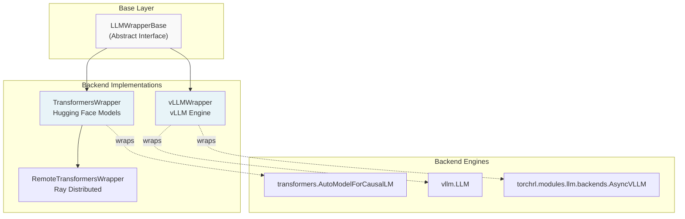
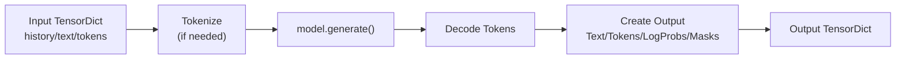
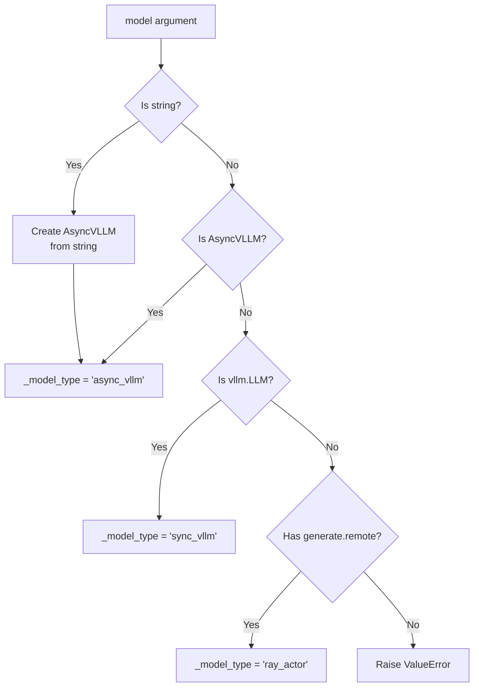
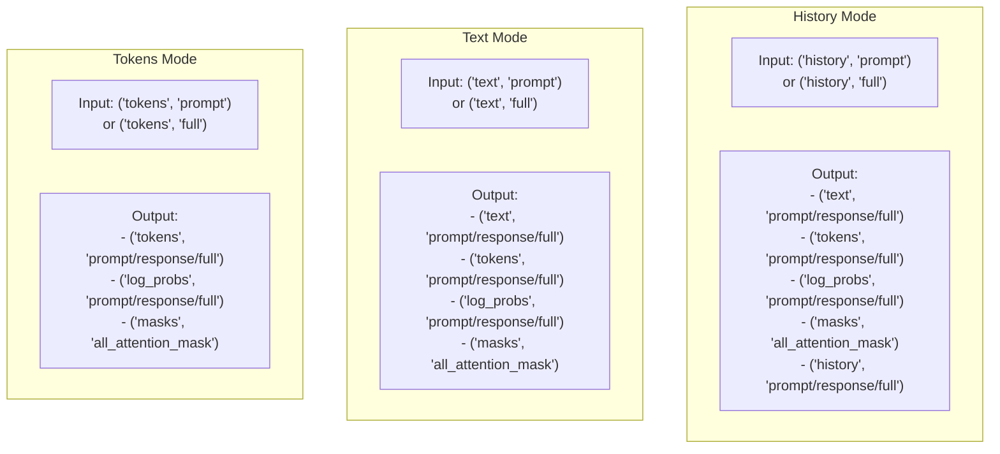
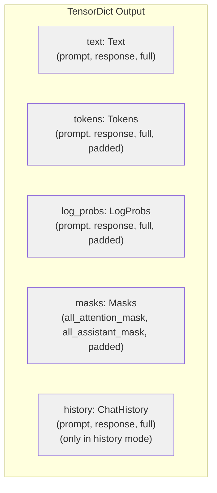
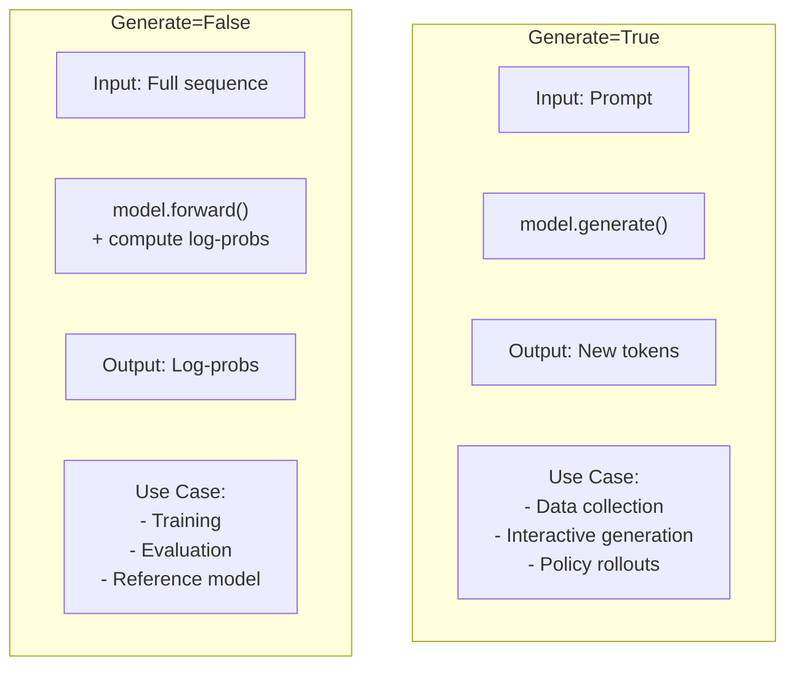
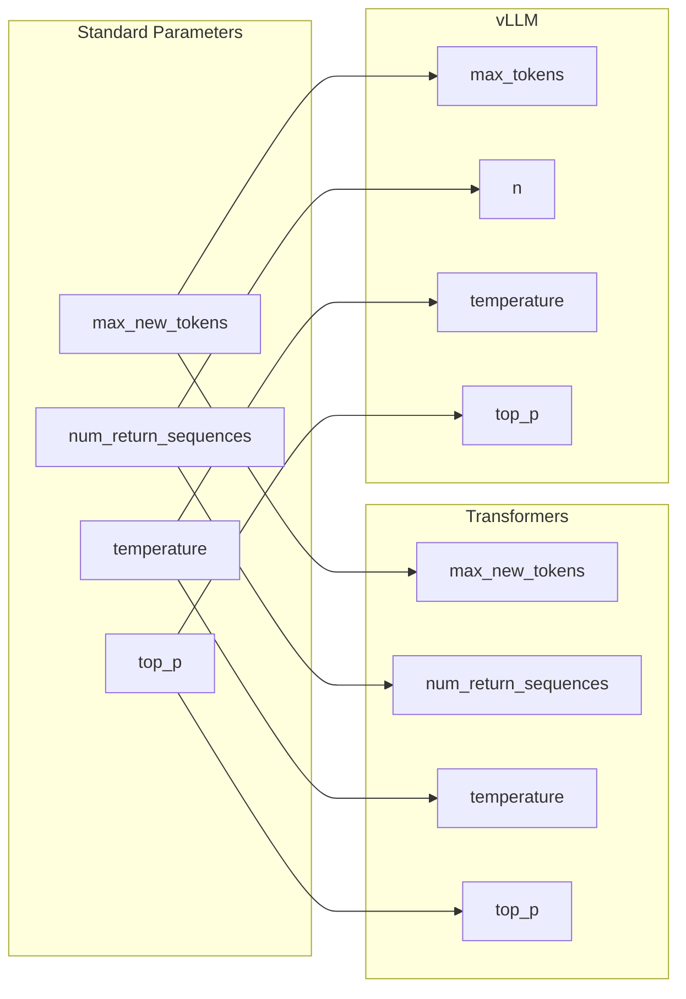
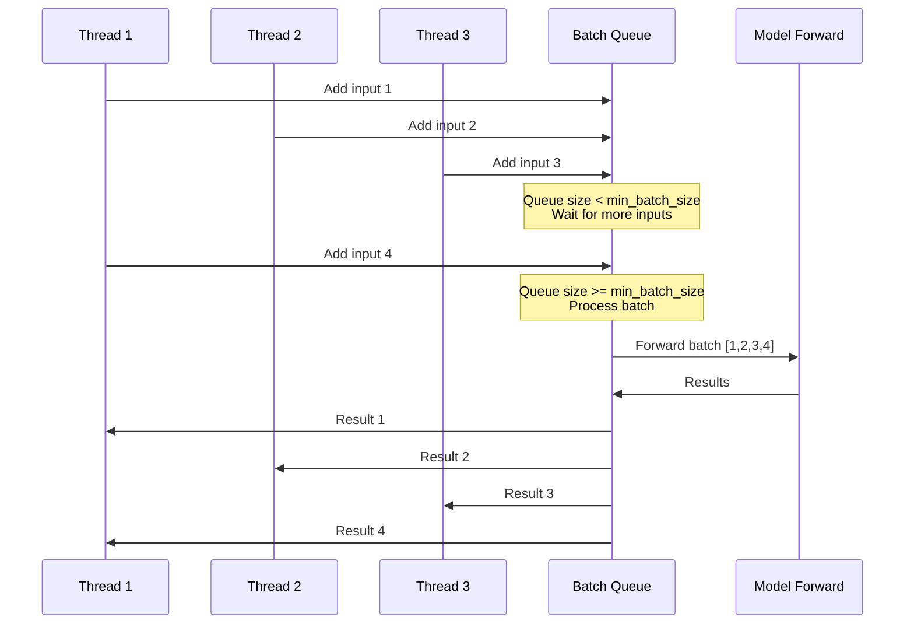
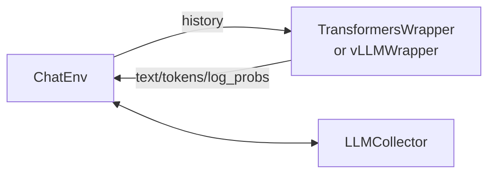

<!-- source: DeepWiki mcp.deepwiki.com · repo pytorch/rl · page 9.1 LLM Wrapper System · fetched 2026-10-21 -->

# LLM Wrapper System

<details>
<summary>Relevant source files</summary>

The following files were used as context for generating this wiki page:

- [test/llm/test_llm_envs.py](test/llm/test_llm_envs.py)
- [test/llm/test_llm_updaters.py](test/llm/test_llm_updaters.py)
- [test/llm/test_vllm.py](test/llm/test_vllm.py)
- [test/llm/test_vllm_plugin.py](test/llm/test_vllm_plugin.py)
- [test/llm/test_wrapper.py](test/llm/test_wrapper.py)
- [test/objectives/test_vla.py](test/objectives/test_vla.py)
- [test/transforms/test_reward_transforms.py](test/transforms/test_reward_transforms.py)
- [torchrl/data/llm/history.py](torchrl/data/llm/history.py)
- [torchrl/envs/llm/envs.py](torchrl/envs/llm/envs.py)
- [torchrl/envs/llm/libs/mlgym.py](torchrl/envs/llm/libs/mlgym.py)
- [torchrl/envs/llm/transforms/kl.py](torchrl/envs/llm/transforms/kl.py)
- [torchrl/modules/llm/backends/vllm/vllm_async.py](torchrl/modules/llm/backends/vllm/vllm_async.py)
- [torchrl/modules/llm/backends/vllm/vllm_plugin.py](torchrl/modules/llm/backends/vllm/vllm_plugin.py)
- [torchrl/modules/llm/backends/vllm/vllm_sync.py](torchrl/modules/llm/backends/vllm/vllm_sync.py)
- [torchrl/modules/llm/policies/common.py](torchrl/modules/llm/policies/common.py)
- [torchrl/modules/llm/policies/transformers_wrapper.py](torchrl/modules/llm/policies/transformers_wrapper.py)
- [torchrl/modules/llm/policies/vllm_wrapper.py](torchrl/modules/llm/policies/vllm_wrapper.py)

</details>


## Purpose and Scope

The LLM Wrapper System provides a unified interface for integrating Large Language Models from different backends (Hugging Face Transformers, vLLM) into TorchRL's reinforcement learning pipeline. The system standardizes:

- **Input handling** across three modalities: conversation history, text, and tokens
- **Output format** using structured TensorClass objects
- **Generation parameters** with cross-backend compatible naming
- **Batching and device management** for efficient inference

This page covers the wrapper classes and their interfaces. For information about:
- LLM data structures (History, ChatHistory, Text, Tokens, etc.), see [LLM Data Structures](#9.2)
- LLM training objectives (GRPO, SFT), see [LLM Training Objectives](#9.3)
- LLM environments and tools, see [LLM Environments and Tools](#9.4)

## Architecture Overview

The wrapper system follows a class hierarchy with `LLMWrapperBase` as the abstract base class and backend-specific implementations.



**Sources:** [torchrl/modules/llm/policies/common.py:773-847](), [torchrl/modules/llm/policies/transformers_wrapper.py:40-241](), [torchrl/modules/llm/policies/vllm_wrapper.py:56-264]()

## Base Class: LLMWrapperBase

`LLMWrapperBase` defines the abstract interface that all wrapper implementations must follow. It inherits from `TensorDictModuleBase` to integrate with TorchRL's module system.

### Core Interface

| Method/Property | Purpose |
|----------------|---------|
| `in_keys` | Input key configuration (e.g., `("history", "prompt")`) |
| `out_keys` | Output key configuration (e.g., `"text"`, `"tokens"`, `"log_probs"`) |
| `forward(tensordict)` | Main inference method |
| `get_dist(tensordict)` | Returns probability distribution over tokens |
| `COMMON_GENERATION_PARAMS` | Standardized parameter names |
| `batching` | Whether multi-threaded batching is enabled |

### Parameter Standardization

The base class defines a mapping between common parameter names and backend-specific equivalents:

```python
COMMON_GENERATION_PARAMS = {
    "max_new_tokens",      # Maximum tokens to generate
    "num_return_sequences", # Number of sequences to return
    "temperature",         # Sampling temperature
    "top_p",              # Nucleus sampling
    "top_k",              # Top-k sampling
    "repetition_penalty",  # Repetition penalty
    "do_sample",          # Whether to use sampling
    "num_beams",          # Beam search width
    "length_penalty",     # Length penalty for beam search
    "early_stopping",     # Early stopping in beam search
    "stop_sequences",     # Sequences that stop generation
    "skip_special_tokens", # Skip special tokens in output
    "logprobs",           # Return log probabilities
}
```

**Sources:** [torchrl/modules/llm/policies/common.py:849-981]()

## TransformersWrapper

`TransformersWrapper` integrates Hugging Face Transformers models into TorchRL. It supports both text generation and log-probability computation.

### Initialization

The wrapper accepts either a model instance or a model name string:

```python
# From model instance
from transformers import AutoModelForCausalLM
model = AutoModelForCausalLM.from_pretrained("gpt2")
wrapper = TransformersWrapper(
    model,
    tokenizer=tokenizer,
    input_mode="history",
    generate=True,
    generate_kwargs={"max_new_tokens": 50}
)

# From model name (auto-loads model)
wrapper = TransformersWrapper(
    "gpt2",
    input_mode="text",
    generate=False  # For log-prob computation only
)
```

### Key Features

| Feature | Description |
|---------|-------------|
| **Packing vs Padding** | `pad_model_input=False` enables memory-efficient packing for variable-length sequences |
| **Output Padding** | `pad_output=True` returns padded tensors; `False` returns nested tensors |
| **Batching** | `batching=True` enables multi-threaded input batching |
| **Chat Templates** | `chat_template_name` and `chat_template` for conversation formatting |
| **Multiple Samples** | `num_samples` for generating multiple responses per input |

### Generation Flow



**Sources:** [torchrl/modules/llm/policies/transformers_wrapper.py:40-241](), [torchrl/modules/llm/policies/transformers_wrapper.py:638-750]()

## vLLMWrapper

`vLLMWrapper` provides integration with vLLM, a high-performance inference engine optimized for LLM serving. It supports both synchronous (`vllm.LLM`) and asynchronous (`AsyncVLLM`) engines.

### Backend Detection

The wrapper automatically detects the engine type:


**Sources:** [torchrl/modules/llm/policies/vllm_wrapper.py:266-327]()

### AsyncVLLM Recommendation

For distributed inference and better resource utilization, use `AsyncVLLM`:

```python
from torchrl.modules.llm.backends import AsyncVLLM

# Recommended: AsyncVLLM with multiple replicas
async_engine = AsyncVLLM.from_pretrained(
    "Qwen/Qwen2.5-3B", # Changed from 7B to 3B for consistency with test files
    num_replicas=2,
    max_model_len=32768
)

wrapper = vLLMWrapper(
    async_engine,
    input_mode="history",
    generate=True
)
```
**Sources:** [torchrl/modules/llm/policies/vllm_wrapper.py:99-109](), [test/llm/test_wrapper.py:136-143]()

### vLLM-Specific Parameters

vLLM extends the standard parameters with additional options:

| Parameter | Description |
|-----------|-------------|
| `presence_penalty` | Penalty for token presence |
| `frequency_penalty` | Penalty for token frequency |
| `ignore_eos` | Whether to ignore EOS token |
| `prompt_logprobs` | Return prompt log probabilities |
| `detokenize` | Whether to detokenize output |
| `sampling_type` | Type of sampling to use |

**Sources:** [torchrl/modules/llm/policies/vllm_wrapper.py:329-365]()

### vLLM Plugin for FP32 Overrides

TorchRL provides a vLLM plugin to enable FP32 model overrides for specific architectures. This is useful for models that might encounter precision issues with vLLM's default FP16/BF16 inference.

The plugin is activated by setting the `TORCHRL_VLLM_FP32_OVERRIDES` environment variable to `1`, `true`, or `yes`. When enabled, it registers FP32 versions of certain models (e.g., `Qwen3ForCausalLM`) with vLLM's `ModelRegistry`.

```python
import os
from torchrl.modules.llm.backends.vllm.vllm_plugin import enable_fp32_overrides

# Enable FP32 overrides before initializing vLLM engine
enable_fp32_overrides()

# Now, when vLLM initializes, it will use the registered FP32 models
# for supported architectures if TORCHRL_VLLM_FP32_OVERRIDES is set.
# For example, if using a Qwen3 model, it will use Qwen3ForCausalLMFP32.
```

This mechanism ensures that TorchRL's FP32 overrides are only applied when explicitly opted in, preventing unintended modifications to other vLLM projects.

**Sources:** [torchrl/modules/llm/backends/vllm/vllm_plugin.py:16-59]()

## Input Modes

Both wrappers support three input modes, each with different input and output key configurations.

### Input Mode Configuration



### Mode Selection

| Mode | Input Type | Use Case | Output Includes |
|------|-----------|----------|----------------|
| `"history"` | `History` object | Multi-turn conversations, RL environments | Text, Tokens, LogProbs, Masks, ChatHistory |
| `"text"` | String or list of strings | Single prompts, text generation | Text, Tokens, LogProbs, Masks |
| `"tokens"` | Token IDs | Pre-tokenized data, fine-grained control | Tokens, LogProbs, Masks |

The input key changes based on whether generation is enabled:
- **Generate=True**: Uses `"prompt"` key (e.g., `("history", "prompt")`)
- **Generate=False**: Uses `"full"` key (e.g., `("history", "full")`) for log-prob computation

**Sources:** [torchrl/modules/llm/policies/transformers_wrapper.py:359-394](), [torchrl/modules/llm/policies/vllm_wrapper.py:395-430]()

## Output Structure

All wrappers return a `TensorDict` with standardized keys containing `TensorClass` objects.

### Output Components



### TensorClass Structure

Each output component is a `TensorClass` with consistent fields:

| TensorClass | Fields | Description |
|-------------|--------|-------------|
| `Text` | `prompt`, `response`, `full` | String data at different stages |
| `Tokens` | `prompt`, `response`, `full`, `padded` | Token IDs with padding flag |
| `LogProbs` | `prompt`, `response`, `full`, `padded` | Log-probabilities per token |
| `Masks` | `all_attention_mask`, `all_assistant_mask`, `padded` | Attention and assistant masks |
| `ChatHistory` | `prompt`, `response`, `full` | History objects for conversations |

### Padded vs Unpadded Output

The `pad_output` parameter controls tensor representation:

| `pad_output=True` | `pad_output=False` |
|-------------------|-------------------|
| Returns standard tensors | Returns nested tensors or lists |
| Shape: `(batch, max_length)` | Shape: Variable per sample |
| Easy to work with | More memory efficient |
| Padding value: `tokenizer.pad_token_id` | No padding |

**Sources:** [torchrl/modules/llm/policies/common.py:39-565](), [torchrl/modules/llm/policies/transformers_wrapper.py:183-200]()

## Generation vs Log-Probability Computation

The `generate` parameter determines the wrapper's operating mode.

### Mode Comparison



### Configuration Differences

| Aspect | `generate=True` | `generate=False` |
|--------|----------------|------------------|
| Input key default | `("history", "prompt")` | `("history", "full")` |
| Model operation | `model.generate()` | `model.forward()` + log-prob extraction |
| Output includes | Generated text/tokens | Only log-probabilities |
| `return_log_probs` | Optional (default `False`) | Required (forced to `True`) |
| `pad_model_input` | Not supported | Supported (packing vs padding) |

### TransformersWrapper-Specific: Packing vs Padding

When `generate=False`, TransformersWrapper supports efficient input packing:

```python
# Padding (default): Wastes memory for variable-length sequences
wrapper = TransformersWrapper(
    model,
    generate=False,
    pad_model_input=True  # All sequences padded to max length
)

# Packing: Memory efficient for variable lengths
wrapper = TransformersWrapper(
    model,
    generate=False,
    pad_model_input=False  # Sequences packed together
)
```

**Sources:** [torchrl/modules/llm/policies/transformers_wrapper.py:75-76](), [torchrl/modules/llm/policies/transformers_wrapper.py:326-329](), [torchrl/modules/llm/policies/vllm_wrapper.py:103-104]()

## Parameter Standardization

The wrapper system provides cross-backend compatible parameter naming through automatic conversion.

### Standard to Backend Mapping



### Legacy Parameter Support

Both wrappers automatically convert legacy parameter names:

| Legacy Name | Standard Name | Backend |
|------------|---------------|---------|
| `max_tokens` | `max_new_tokens` | vLLM → Transformers |
| `n` | `num_return_sequences` | vLLM → Transformers |

### Parameter Validation

The wrappers validate parameters to catch common errors:

```python
# Temperature validation
if temperature < 0:
    raise ValueError("Temperature must be non-negative")

# Conflict detection: do_sample=False with temperature > 0
if not do_sample and temperature != 0:
    raise ValueError("When do_sample=False, temperature must be 0")

# Range validation: top_p
if not (0 <= top_p <= 1):
    raise ValueError("top_p must be between 0 and 1")
```

**Sources:** [torchrl/modules/llm/policies/common.py:849-981](), [torchrl/modules/llm/policies/transformers_wrapper.py:441-475](), [test/llm/test_wrapper.py:478-586]()

## Batching Support

The wrapper system supports multi-threaded batching for efficient concurrent inference.

### Batching Configuration

```python
wrapper = TransformersWrapper(
    model,
    batching=True,           # Enable batching
    min_batch_size=4,        # Minimum batch size to process
    max_batch_size=16,       # Maximum batch size
    batching_timeout=10.0    # Timeout in seconds
)
```

### Batching Flow



### Batching Parameters

| Parameter | Description | Default |
|-----------|-------------|---------|
| `batching` | Enable batching | `False` |
| `min_batch_size` | Minimum inputs before processing | `1` (if `batching=True`) |
| `max_batch_size` | Maximum batch size | `None` (unlimited) |
| `batching_timeout` | Max wait time before processing | `10.0` seconds |

### Implementation Details

The `_batching` decorator handles concurrent access:

```python
@_batching
def forward(self, tensordict):
    # Decorated method automatically batches inputs
    # from multiple threads
    ...
```

The decorator:
1. Accumulates inputs in a thread-safe queue
2. Processes batch when `min_batch_size` is reached or timeout expires
3. Distributes results back to waiting threads using futures

**Sources:** [torchrl/modules/llm/policies/common.py:983-1211](), [torchrl/modules/llm/policies/transformers_wrapper.py:268-299](), [test/llm/test_wrapper.py:328-412]()

## Integration with TorchRL Components

The wrapper system integrates seamlessly with other TorchRL components.

### With Environments



The environment provides conversation state, and the wrapper generates responses:

```python
from torchrl.envs.llm import ChatEnv
from torchrl.modules.llm import vLLMWrapper

wrapper = vLLMWrapper(model, input_mode="history")
env = ChatEnv(tokenizer=tokenizer)

# Environment step receives wrapper output
td = env.reset()
td = wrapper(td)  # Adds text, tokens, log_probs
td = env.step(td)
```
**Sources:** [test/llm/test_llm_envs.py:109-164]()

### With Loss Modules

Loss modules like `GRPOLoss` and `SFTLoss` consume wrapper outputs:

```python
from torchrl.objectives.llm import GRPOLoss

loss_fn = GRPOLoss(
    actor_network=wrapper,
    masking_strategy="sft"  # Use response tokens only
)

# Loss expects log_probs and tokens from wrapper
loss_output = loss_fn(tensordict)
```
**Sources:** [test/llm/test_wrapper.py:56]()

### With Collectors

Collectors orchestrate data collection using the wrapper:

```python
from torchrl.collectors.llm import LLMCollector

collector = LLMCollector(
    env=env,
    policy=wrapper,
    dialog_turns_per_batch=256
)

# Collector handles wrapper calls internally
for batch in collector:
    # batch contains wrapper outputs
    ...
```
**Sources:** [test/llm/test_llm_envs.py:29-30]()

## Remote and Distributed Wrappers

For distributed inference, use `RemoteTransformersWrapper` with Ray.

### RemoteTransformersWrapper

```python
from torchrl.modules.llm import RemoteTransformersWrapper

# Create distributed wrapper
wrapper = RemoteTransformersWrapper(
    model_name="Qwen/Qwen2.5-3B", # Changed from 7B to 3B for consistency with test files
    num_actors=4,           # Number of Ray actors
    gpus_per_actor=1,       # GPUs per actor
    input_mode="history",
    generate=True
)
```

This creates multiple Ray actors, each running a separate instance of the model, enabling parallel inference across multiple GPUs or machines.

**Sources:** [torchrl/modules/llm/policies/remote_transformers_wrapper.py:1](), [test/llm/test_wrapper.py:36]()

## Best Practices

### Choosing a Wrapper

| Use Case | Recommended Wrapper | Reason |
|----------|-------------------|--------|
| Single GPU, small models | `TransformersWrapper` | Simple, well-tested |
| Multi-GPU, large models | `vLLMWrapper` with `AsyncVLLM` | Optimized for throughput |
| Distributed across machines | `RemoteTransformersWrapper` | Ray-based distribution |
| Training (log-probs only) | Either with `generate=False` | Memory efficient |

### Memory Management

```python
# For training: disable generation, enable packing
wrapper = TransformersWrapper(
    model,
    generate=False,
    pad_model_input=False,  # Use packing
    pad_output=False        # Use nested tensors
)

# For inference: enable generation, use batching
wrapper = vLLMWrapper(
    async_engine,
    generate=True,
    batching=True,
    max_batch_size=32
)
```

### Error Handling

Common issues and solutions:

| Error | Cause | Solution |
|-------|-------|----------|
| Shape mismatch in loss | Wrong masking strategy | Match `masking_strategy` in loss to wrapper's input mode |
| OOM during generation | Too large batch/sequence | Reduce `max_batch_size` or `max_new_tokens` |
| Slow inference | No batching | Enable `batching=True` with appropriate `min_batch_size` |

**Sources:** [torchrl/modules/llm/policies/transformers_wrapper.py:40-241](), [torchrl/modules/llm/policies/vllm_wrapper.py:56-264]()

---

