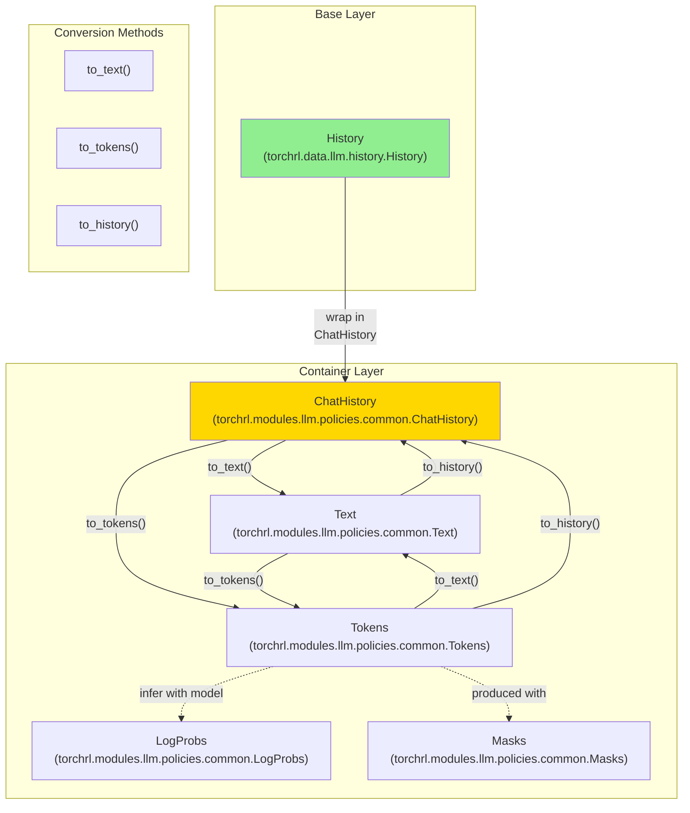
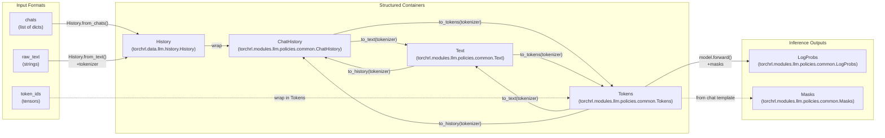

<!-- source: DeepWiki mcp.deepwiki.com · repo pytorch/rl · page 9.2 LLM Data Structures · fetched 2026-10-21 -->

# LLM Data Structures

<details>
<summary>Relevant source files</summary>

The following files were used as context for generating this wiki page:

- [.github/unittest/llm/scripts_llm/environment.yml](.github/unittest/llm/scripts_llm/environment.yml)
- [.github/unittest/llm/scripts_llm/install.sh](.github/unittest/llm/scripts_llm/install.sh)
- [.github/unittest/llm/scripts_llm/run_test.sh](.github/unittest/llm/scripts_llm/run_test.sh)
- [.github/unittest/llm/scripts_sglang/install.sh](.github/unittest/llm/scripts_sglang/install.sh)
- [.github/unittest/llm/scripts_sglang/post_process.sh](.github/unittest/llm/scripts_sglang/post_process.sh)
- [.github/unittest/llm/scripts_sglang/run_test.sh](.github/unittest/llm/scripts_sglang/run_test.sh)
- [.github/unittest/llm/scripts_sglang/setup_env.sh](.github/unittest/llm/scripts_sglang/setup_env.sh)
- [.github/workflows/test-linux-llm.yml](.github/workflows/test-linux-llm.yml)
- [docs/source/_static/img/mcts_forest.png](docs/source/_static/img/mcts_forest.png)
- [test/llm/test_data.py](test/llm/test_data.py)
- [test/llm/test_sglang.py](test/llm/test_sglang.py)
- [torchrl/data/datasets/common.py](torchrl/data/datasets/common.py)
- [torchrl/data/llm/__init__.py](torchrl/data/llm/__init__.py)
- [torchrl/data/llm/utils.py](torchrl/data/llm/utils.py)
- [torchrl/data/map/__init__.py](torchrl/data/map/__init__.py)
- [torchrl/data/map/hash.py](torchrl/data/map/hash.py)
- [torchrl/data/map/query.py](torchrl/data/map/query.py)
- [torchrl/data/map/tdstorage.py](torchrl/data/map/tdstorage.py)
- [torchrl/data/map/tree.py](torchrl/data/map/tree.py)
- [torchrl/data/map/utils.py](torchrl/data/map/utils.py)

</details>


This page documents the structured data containers used throughout TorchRL's LLM training pipeline. These TensorClass-based objects provide type-safe, composable representations of conversational data, tokens, masks, and log-probabilities.

For information about LLM wrappers that produce these structures, see [LLM Wrapper System](#9.1). For LLM training objectives that consume these structures, see [LLM Training Objectives](#9.3). For environment integration, see [LLM Environments and Tools](#9.4).

## Overview

TorchRL's LLM integration uses a modular data structure system built on `TensorClass` from tensordict. The core principle is **separation of modalities**: conversation history, text, tokens, masks, and log-probabilities are represented as distinct but interconvertible objects. This design enables:

- **Type safety**: Each structure has explicit fields with expected shapes
- **Modality conversion**: Built-in methods transform between representations
- **Composability**: Structures stack, batch, and nest naturally with TensorDict
- **Pipeline integration**: Wrappers, environments, and losses exchange standardized formats

The data flow follows a consistent pattern: `History` → `ChatHistory` → `Text` or `Tokens` → model inference → `LogProbs` and `Masks`.

**Sources:** [torchrl/modules/llm/policies/common.py:1-724]()

## Data Structure Hierarchy



**Diagram: LLM Data Structure Hierarchy**

All container-layer structures share a common `prompt/response/full` pattern, enabling consistent access patterns across modalities. The `History` object is the foundation, representing raw conversation data.

**Sources:** [torchrl/modules/llm/policies/common.py:39-724](), [torchrl/data/llm/history.py:1-1500]()

## History

`History` is the base conversation data structure from `torchrl.data.llm.history`. It stores conversation messages as parallel arrays of roles and content.

### Structure

```python
class History(TensorClass):
    role: list[str] | str          # Message roles (e.g., "user", "assistant", "system")
    content: list[str] | str       # Message content
    complete: bool | None          # Whether conversation is complete
```

### Key Characteristics

| Property | Description |
|----------|-------------|
| **Shape** | Batch dimensions represent conversation turns: `(*batch, num_turns)` |
| **Storage** | Stored as `NonTensorStack` - efficient for variable-length conversations |
| **Batching** | Supports lazy stacking for batched conversations |
| **Serialization** | JSON-compatible via `to_dict()` / `from_dict()` |

### Primary Methods

| Method | Purpose | Returns |
|--------|---------|---------|
| `from_chats(chats)` | Create from list of conversation dicts | `History` |
| `apply_chat_template(tokenizer, ...)` | Apply tokenizer's chat template | Formatted text or token dict |
| `append(other, inplace=False, dim=0)` | Appends a single `History` instance to the current one. | `History` |
| `extend(other, inplace=False, dim=0)` | Extends the current `History` with multiple `History` instances. | `History` |
| `from_text(text, tokenizer, ...)` | Parse formatted text back to History | `History` |

### Usage Pattern

```python
from torchrl.data.llm import History

# Create from conversation
hst0 = History(role="user", content="a message")
hst1 = History(role="user", content="another message")
hst0 = hst0.unsqueeze(0) # Add batch dimension
hst0.append(hst1) # In-place append
# hst0.content is now ["a message", "another message"]
```

**Sources:** [torchrl/data/llm/history.py:249-1500](), [test/llm/test_data.py:111-133](), [test/llm/test_data.py:148-167]()

## ChatHistory

`ChatHistory` wraps `History` objects with the `prompt/response/full` structure used throughout the LLM pipeline. This is the primary interface for conversation data in environments and wrappers.

### Structure

```python
class ChatHistory(TensorClass["nocast"]):
    prompt: History | None    # Conversation up to current point
    response: History | None  # New response (typically from LLM)
    full: History | None      # Complete conversation (prompt + response)
```

### Shape Requirements

`ChatHistory` enforces a critical invariant: the contained `History` objects must have **one more batch dimension** than the `ChatHistory` itself. This extra dimension represents conversation turns:

- `ChatHistory` shape: `(*batch,)`
- Contained `History` shape: `(*batch, num_turns)`

This design enables multi-turn conversations while maintaining clean batch semantics.

### Conversion Methods

| Method | Input | Output | Use Case |
|--------|---------|--------|----------|
| `to_tokens(tokenizer, ...)` | `ChatHistory` | `Tokens` | Prepare for model input |
| `to_text(tokenizer, ...)` | `ChatHistory` | `Text` | Human-readable format |

### Integration with Wrappers

When `input_mode="history"`, both `TransformersWrapper` and `vLLMWrapper` expect `ChatHistory` objects:

```python
# Input structure
input_td = TensorDict({
    "history": ChatHistory(prompt=history_prompt),
    "batch_size": (batch_size,)
})

# Output structure
output_td = wrapper(input_td)
# Returns: text, tokens, masks, log_probs, history (all updated)
```

**Sources:** [torchrl/modules/llm/policies/common.py:220-494](), [torchrl/modules/llm/policies/transformers_wrapper.py:752-810]()

## Text

`Text` represents conversation data as raw strings, supporting the `input_mode="text"` interface for wrappers.

### Structure

```python
class Text(TensorClass["nocast"]):
    prompt: str | None     # Prompt text
    response: str | None   # Response text  
    full: str | None       # Complete text (prompt + response)
```

### Storage and Batching

- **Batch representation**: Lists of strings for batched data
- **NonTensor spec**: Uses `NonTensor` spec with `example_data="a string"`
- **Serialization**: Stored directly as strings in TensorDict

### Conversion Methods

| Method | Input | Output | Notes |
|--------|-------|--------|-------|
| `to_tokens(tokenizer, padding=False)` | `Text` | `Tokens` | Tokenizes strings; padding not yet supported |
| `to_history(tokenizer, chat_template_name)` | `Text` | `ChatHistory` | Parses formatted text back to conversations |

### Usage with Wrappers

```python
# Text input mode
wrapper = TransformersWrapper(
    model,
    tokenizer=tokenizer,
    input_mode="text",
    generate=True
)

input_td = TensorDict({
    "text": Text(prompt=["Hello, how are you?"]),
    "batch_size": (1,)
})

output_td = wrapper(input_td)
# output_td["text"].response contains generated text
```

**Sources:** [torchrl/modules/llm/policies/common.py:537-724](), [torchrl/modules/llm/policies/transformers_wrapper.py:708-714]()

## Tokens

`Tokens` represents tokenized conversation data, the primary format for model inference and loss computation.

### Structure

```python
class Tokens(TensorClass["nocast"]):
    prompt: torch.Tensor | None    # Shape: (*batch, prompt_len)
    response: torch.Tensor | None  # Shape: (*batch, response_len)
    full: torch.Tensor | None      # Shape: (*batch, prompt_len + response_len)
    padded: bool | None            # Whether sequences are padded
```

### Padding Modes

| Mode | Storage | Shape | Access |
|------|---------|-------|--------|
| **Padded** | Dense `torch.Tensor` | `(*batch, max_seq_len)` | Direct indexing |
| **Unpadded** | Nested tensor or list | Variable per sample | `get(..., as_list=True)` |

The `padded` field indicates which mode is active. Unpadded tokens are memory-efficient for variable-length sequences.

### Padding Details

When `padded=True`:
- **Prompt tokens**: Padded on the **left** with `tokenizer.pad_token_id`
- **Response tokens**: Padded on the **right** 
- **Full tokens**: Padded as needed (left for prompt, right for response)

This padding strategy ensures correct attention masking during model inference.

### Conversion Methods

| Method | Input | Output | Use Case |
|--------|-------|--------|----------|
| `to_text(tokenizer, skip_special_tokens)` | `Tokens` | `Text` | Decode tokens to strings |
| `to_history(tokenizer, chat_template_name)` | `Tokens` | `ChatHistory` | Decode and parse conversations |

### Access Patterns

```python
# Padded tokens - direct access
if tokens.padded:
    full_tokens = tokens.full  # torch.Tensor(*batch, seq_len)
    
# Unpadded tokens - list access
else:
    full_tokens_list = tokens.get("full", as_list=True)  # List[torch.Tensor]
    # Each tensor has different length
```

### Integration with Loss Modules

Loss modules like `GRPOLoss` expect tokens with specific keys:

```python
# Default keys for GRPO
loss.set_keys(
    action=("tokens", "full"),              # Full token sequence
    sample_log_prob=("log_probs", "full")   # Corresponding log-probs
)
```

**Sources:** [torchrl/modules/llm/policies/common.py:39-179](), [torchrl/objectives/llm/grpo.py:155-167]()

## Masks

`Masks` provides attention and assistant masks for controlling which tokens participate in loss computation.

### Structure

```python
class Masks(TensorClass["nocast"]):
    all_attention_mask: torch.Tensor | None  # Shape: (*batch, seq_len)
    all_assistant_mask: torch.Tensor | None  # Shape: (*batch, seq_len)
    padded: bool | None
```

### Mask Types

| Mask | Purpose | Values |
|------|---------|--------|
| `all_attention_mask` | Valid (non-padding) tokens | `1` = valid, `0` = padding |
| `all_assistant_mask` | Tokens generated by assistant | `1` = assistant, `0` = user/system |

### Shape Alignment

Masks always have the **same shape** as `tokens.full` and `log_probs.full`, ensuring element-wise compatibility:

```python
# All have shape (*batch, seq_len)
tokens.full       # Token IDs
masks.all_attention_mask  # Attention mask
log_probs.full    # Log probabilities
```

### Masking Strategies

Different training objectives use different masking strategies, configured via the `masking_strategy` parameter:

| Strategy | Mask Used | Use Case | Typical Scenario |
|----------|-----------|----------|------------------|
| `"sft"` | Prompt mask (response tokens only) | Single-turn SFT | `prompt → response` |
| `"rlhf"` | Assistant mask (all assistant tokens) | Multi-turn RLHF | Multi-turn dialogues |
| `"generic"` | Attention mask (all valid tokens) | Generic training | All non-padding tokens |

### Generating Masks

Masks are automatically generated by wrappers when using `input_mode="history"`:

```python
# Automatic mask generation
wrapper = TransformersWrapper(
    model,
    input_mode="history",
    generate=False
)

output = wrapper(input_td)
# output["masks"].all_assistant_mask computed from chat template
```

For `input_mode="text"` or `input_mode="tokens"`, assistant masks may not be available (set to `None`).

### Usage in Loss Computation

```python
# GRPOLoss with masking strategy
loss = GRPOLoss(
    actor_network,
    masking_strategy="sft"  # Use response tokens only
)

# Loss internally applies the appropriate mask
loss_output = loss(batch_td)
```

**Sources:** [torchrl/modules/llm/policies/common.py:181-218](), [torchrl/objectives/llm/grpo.py:336-360]()

## LogProbs

`LogProbs` stores log-probabilities for each token, essential for importance sampling in policy gradient methods.

### Structure

```python
class LogProbs(TensorClass["nocast"]):
    prompt: torch.Tensor | None    # Shape: (*batch, prompt_len)
    response: torch.Tensor | None  # Shape: (*batch, response_len)
    full: torch.Tensor | None      # Shape: (*batch, full_len)
    padded: bool | None
```

### Value Semantics

Each element `log_probs[i, j]` represents `log P(token[i, j] | token[i, :j])` - the log-probability of the token at position `j` given all previous tokens.

### Padding Behavior

- **Padded positions** have undefined log-probs (typically set to 0)
- **Masks must be applied** before any computation
- Shape invariant: `log_probs.shape == tokens.shape == masks.shape`

### Production by Wrappers

Log-probabilities are computed when `return_log_probs=True`:

```python
wrapper = TransformersWrapper(
    model,
    generate=False,  # Compute log-probs, don't generate
    return_log_probs=True
)

output = wrapper(input_td)
log_probs = output["log_probs"].full  # Shape: (*batch, seq_len)
```

### Reference Log-Probabilities

In policy gradient methods, reference log-probs are stored separately:

```python
# Typical structure in training data
batch = TensorDict({
    "log_probs": LogProbs(full=current_model_logprobs),
    "next": {
        "ref_log_probs": LogProbs(full=reference_model_logprobs)
    }
})

# Used for KL computation in GRPO/CISPO
loss = GRPOLoss(actor_network, kl_to_ref_coeff=0.1)
loss_output = loss(batch)  # Computes KL(current || reference)
```

### Masked Log-Probability Computation

```python
# Example from SFTLoss
log_probs_list = output.get("log_probs", "full", as_list=True)
assistant_masks = masks.get("all_assistant_mask", as_list=True)

# Apply mask and sum
masked_log_probs = [
    lp.masked_fill(~mask, 0.0) 
    for lp, mask in zip(log_probs_list, assistant_masks)
]
summed_log_probs = [lp.sum() for lp in masked_log_probs]
```

**Sources:** [torchrl/modules/llm/policies/common.py:496-535](), [torchrl/objectives/llm/sft.py:337-424]()

## Data Structure Conversion Graph



**Diagram: Conversion Graph Between LLM Data Structures**

This graph shows all supported conversions between data structures. Solid arrows indicate built-in methods, dashed arrows indicate manual construction.

**Sources:** [torchrl/modules/llm/policies/common.py:79-494]()

## Prompt/Response/Full Pattern

All text-based structures (`ChatHistory`, `Text`, `Tokens`, `LogProbs`) follow a consistent three-field pattern:

### Field Semantics

| Field | Contains | Used For |
|-------|----------|----------|
| `prompt` | Input to the model | Context, user messages, prior conversation |
| `response` | Output from the model | Generated text, assistant messages |
| `full` | `prompt + response` | Complete sequence for loss computation |

### Structural Invariants

When all three fields are present:

```python
# Length invariant
len(full) == len(prompt) + len(response)

# Concatenation invariant (for tokens)
full == torch.cat([prompt, response], dim=-1)

# Slicing invariant
prompt == full[..., :prompt_len]
response == full[..., prompt_len:]
```

### Typical Usage Patterns

#### Generation Mode (`generate=True`)

```python
# Input: only prompt
input_td = TensorDict({
    "history": ChatHistory(prompt=history_prompt)
})

# Output: prompt + response + full
output_td = wrapper(input_td)
assert output_td["tokens"].prompt is not None
assert output_td["tokens"].response is not None
assert output_td["tokens"].full is not None
```

#### Log-Prob Mode (`generate=False`)

```python
# Input: full conversation
input_td = TensorDict({
    "history": ChatHistory(full=history_full)
})

# Output: log-probs for full sequence
output_td = wrapper(input_td)
assert output_td["log_probs"].full is not None
# prompt and response may be None or computed by slicing
```

**Sources:** [torchrl/modules/llm/policies/transformers_wrapper.py:174-200](), [torchrl/modules/llm/policies/common.py:220-265]()

## Default Specs for Environments

Each data structure provides a `default_spec()` classmethod for creating TensorSpecs compatible with TorchRL environments:

### Spec Generation

```python
from torchrl.modules.llm.policies.common import Tokens, Masks, Text, LogProbs, ChatHistory

# Create specs for environment observation space
tokens_spec = Tokens.default_spec(shape=(4,), keys=["prompt", "full"])
masks_spec = Masks.default_spec(shape=(4,))
text_spec = Text.default_spec(shape=(4,), keys=["prompt", "response"])
logprobs_spec = LogProbs.default_spec(shape=(4,), keys=["full"])
history_spec = ChatHistory.default_spec(shape=(4,))
```

### Spec Structure

All specs are `Composite` specs containing:
- **Tensor fields**: `Unbounded(shape=(*shape, -1))` for variable-length sequences
- **Metadata fields**: `NonTensor` for `padded` booleans and string data

### Integration with Environments

```python
from torchrl.envs.llm import ChatEnv

env = ChatEnv(tokenizer=tokenizer, batch_size=[4])

# Specs are automatically configured
print(env.observation_spec)
# Contains: history, text, tokens, masks specs
```

**Sources:** [torchrl/modules/llm/policies/common.py:63-77](), [torchrl/modules/llm/policies/common.py:203-217]()

## Batching and Stacking

All LLM data structures support TensorDict's lazy stacking operations for efficient batching:

### Lazy Stacking

```python
from tensordict import lazy_stack

# Stack multiple conversations
histories = [
    ChatHistory(prompt=history1),
    ChatHistory(prompt=history2),
    ChatHistory(prompt=history3)
]
batched_history = lazy_stack(histories)  # Shape: (3,)

# Stack tokens
tokens_list = [tokens1, tokens2, tokens3]
batched_tokens = lazy_stack(tokens_list)
```

### Access Patterns for Batched Data

```python
# Padded: direct tensor access
if batched_tokens.padded:
    all_tokens = batched_tokens.full  # Shape: (batch, max_seq_len)

# Unpadded: list access
else:
    tokens_list = batched_tokens.get("full", as_list=True)
    # Returns List[torch.Tensor] with variable lengths
```

### Batch Dimension Semantics

| Structure | Batch Dims | Extra Dims | Example Shape |
|-----------|------------|------------|---------------|
| `History` | Variable | Turn dimension | `(batch, num_turns)` |
| `ChatHistory` | Variable | None | `(batch,)` |
| `Text` | Variable | None | `(batch,)` |
| `Tokens` | Variable | Sequence | `(batch, seq_len)` |
| `Masks` | Same as tokens | Sequence | `(batch, seq_len)` |
| `LogProbs` | Same as tokens | Sequence | `(batch, seq_len)` |

**Sources:** [torchrl/modules/llm/policies/transformers_wrapper.py:638-668](), [test/llm/test_data.py:183-199]()

## Common Pitfalls and Best Practices

### Shape Mismatches

**Problem**: Different masking strategies lead to shape mismatches between advantages and log-probs.

**Solution**: Ensure masking strategy matches between advantage computation and loss:

```python
# In advantage computation
advantage_transform = MCAdvantage(grpo_size=4, masking_strategy="sft")

# In loss computation (must match!)
loss = GRPOLoss(actor_network, masking_strategy="sft")
```

### Padding Inconsistencies

**Problem**: Mixing padded and unpadded data causes access errors.

**Solution**: Check `padded` field before access:

```python
def safe_access(tokens_obj):
    if tokens_obj.padded:
        return tokens_obj.full  # Tensor
    else:
        return tokens_obj.get("full", as_list=True)  # List
```

### Missing Assistant Masks

**Problem**: `input_mode="text"` doesn't produce assistant masks, causing SFT failures.

**Solution**: Use `input_mode="history"` for training, or manually compute masks:

```python
# Preferred: use history mode
wrapper = TransformersWrapper(model, input_mode="history")

# Alternative: manually tokenize with mask generation
token_struct = history.apply_chat_template(
    tokenizer=tokenizer,
    return_assistant_tokens_mask=True
)
```

### Device Mismatches

**Problem**: Data structures on different devices cause CUDA errors.

**Solution**: Use wrapper's `device` parameter and TensorDict's device management:

```python
wrapper = TransformersWrapper(model, device=torch.device("cuda"))
input_td = input_td.to("cuda")
output_td = wrapper(input_td)  # All outputs on CUDA
```

**Sources:** [torchrl/objectives/llm/grpo.py:322-360](), [torchrl/objectives/llm/sft.py:342-369]()

## Integration Examples

### Example 1: History to Tokens Pipeline

```python
from torchrl.data.llm import History
from torchrl.modules.llm.policies.common import ChatHistory

# Create conversation
history = History.from_chats([[
    {"role": "user", "content": "Hello"},
    {"role": "assistant", "content": "Hi!"}
]])

# Wrap in ChatHistory
chat_history = ChatHistory(prompt=history)

# Convert to tokens
tokens = chat_history.to_tokens(tokenizer)

# tokens.prompt: tokenized conversation
# tokens.padded: False (nested tensors)
```

### Example 2: Wrapper Output Processing

```python
from torchrl.modules.llm import TransformersWrapper
from tensordict import TensorDict

wrapper = TransformersWrapper(
    model,
    tokenizer=tokenizer,
    input_mode="history",
    generate=True,
    return_log_probs=True
)

input_td = TensorDict({
    "history": ChatHistory(prompt=prompt_history),
    "batch_size": (batch_size,)
})

output_td = wrapper(input_td)

# Access structured outputs
text_response = output_td["text"].response
tokens_full = output_td["tokens"].full
log_probs = output_td["log_probs"].full
attention_mask = output_td["masks"].all_attention_mask
assistant_mask = output_td["masks"].all_assistant_mask
```

### Example 3: Loss Computation with Masks

```python
from torchrl.objectives.llm import GRPOLoss

# Setup loss with masking strategy
loss_fn = GRPOLoss(
    actor_network,
    masking_strategy="sft",  # Use response tokens only
    clip_epsilon=0.2
)

# Prepare batch with required keys
batch = TensorDict({
    "tokens": Tokens(full=token_ids),
    "log_probs": LogProbs(full=log_prob_values),
    "masks": Masks(all_attention_mask=attention_mask),
    "advantage": advantages,
    "next": {
        "ref_log_probs": LogProbs(full=ref_log_prob_values)
    },
    "batch_size": (batch_size,)
})

# Compute loss
loss_output = loss_fn(batch)
loss_output.loss_objective.backward()
```

**Sources:** [torchrl/modules/llm/policies/common.py:318-411](), [test/llm/test_objectives.py:96-180](), [test/llm/test_wrapper.py:680-740]()

---

