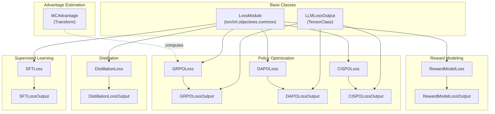
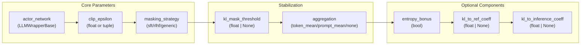
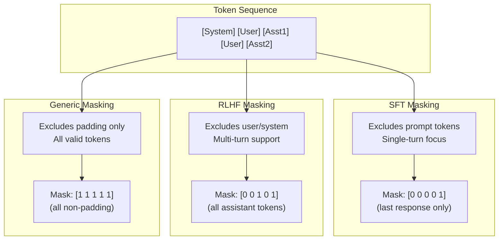
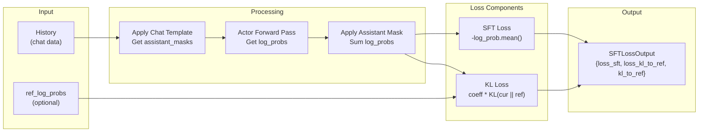
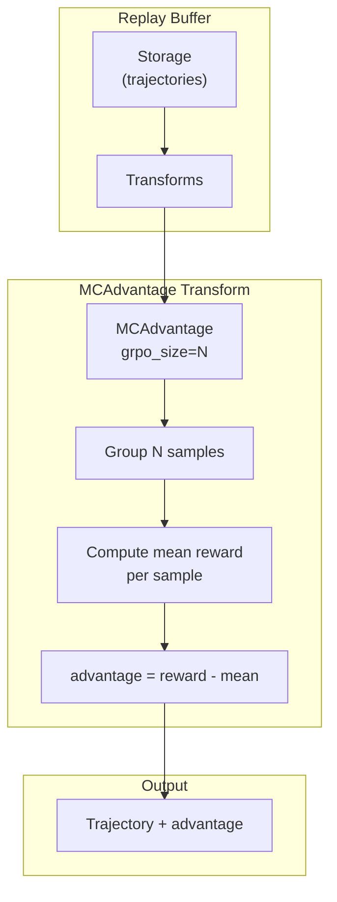
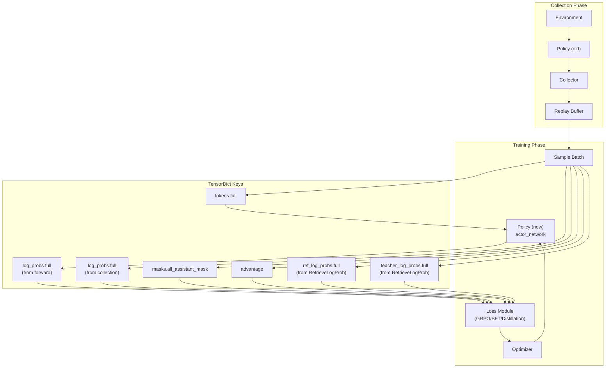

<!-- source: DeepWiki mcp.deepwiki.com · repo pytorch/rl · page 9.3 LLM Training Objectives · fetched 2026-10-21 -->

# LLM Training Objectives

<details>
<summary>Relevant source files</summary>

The following files were used as context for generating this wiki page:

- [docs/source/reference/llms.rst](docs/source/reference/llms.rst)
- [docs/source/reference/llms_objectives.rst](docs/source/reference/llms_objectives.rst)
- [sota-check/README.md](sota-check/README.md)
- [sota-check/run_reward_model_training.sh](sota-check/run_reward_model_training.sh)
- [sota-check/submitit-release-check.sh](sota-check/submitit-release-check.sh)
- [sota-implementations/reward_model_training/README.md](sota-implementations/reward_model_training/README.md)
- [sota-implementations/reward_model_training/config.yaml](sota-implementations/reward_model_training/config.yaml)
- [sota-implementations/reward_model_training/requirements.txt](sota-implementations/reward_model_training/requirements.txt)
- [sota-implementations/reward_model_training/reward_model.py](sota-implementations/reward_model_training/reward_model.py)
- [sota-implementations/reward_model_training/utils.py](sota-implementations/reward_model_training/utils.py)
- [test/assets/generate.py](test/assets/generate.py)
- [test/assets/tldr_batch.zip](test/assets/tldr_batch.zip)
- [test/llm/test_llm_objectives.py](test/llm/test_llm_objectives.py)
- [test/objectives/test_controllers.py](test/objectives/test_controllers.py)
- [test/test_rlhf.py](test/test_rlhf.py)
- [torchrl/data/llm/reward.py](torchrl/data/llm/reward.py)
- [torchrl/modules/models/llm.py](torchrl/modules/models/llm.py)
- [torchrl/objectives/llm/__init__.py](torchrl/objectives/llm/__init__.py)
- [torchrl/objectives/llm/_utils.py](torchrl/objectives/llm/_utils.py)
- [torchrl/objectives/llm/distillation.py](torchrl/objectives/llm/distillation.py)
- [torchrl/objectives/llm/grpo.py](torchrl/objectives/llm/grpo.py)
- [torchrl/objectives/llm/reward.py](torchrl/objectives/llm/reward.py)
- [torchrl/objectives/llm/sft.py](torchrl/objectives/llm/sft.py)

</details>


This page documents the training objectives (loss functions) for Large Language Model fine-tuning in TorchRL. These specialized loss modules implement state-of-the-art algorithms for policy optimization (GRPO, DAPO, CISPO), supervised fine-tuning (SFT), knowledge distillation, and reward model training in the context of reinforcement learning from human feedback (RLHF).

For information about the LLM wrappers that compute log probabilities, see [LLM Wrapper System](#9.1). For data structures used by these objectives, see [LLM Data Structures](#9.2). For the complete LLM training pipeline including collectors and environments, see [LLM Integration](#9).

---

## Loss Module Architecture

All LLM training objectives inherit from `LossModule` and produce structured outputs using `TensorClass` objects. This design allows for modular composition of loss components and clear separation between differentiable loss terms and logging metrics.

### Base Classes and Output Types

The architecture is built around key abstractions:



**Sources:** [torchrl/objectives/llm/grpo.py:36-68](), [torchrl/objectives/llm/sft.py:76-102](), [torchrl/objectives/llm/distillation.py:87-104](), [torchrl/objectives/llm/reward.py:67-95]()

### Loss Output Structure

All policy optimization losses return `LLMLossOutput` (or subclass) with the following fields:

| Field | Type | Description |
|-------|------|-------------|
| `loss_objective` | `torch.Tensor` | Main policy loss (differentiable) |
| `clip_fraction` | `torch.Tensor` | Fraction of importance weights clipped |
| `kl_approx` | `torch.Tensor` | KL divergence approximation between old/new policy |
| `ESS` | `torch.Tensor` | Effective Sample Size (diagnostic metric) |
| `entropy` | `torch.Tensor \| None` | Policy entropy (optional) |
| `loss_entropy` | `torch.Tensor \| None` | Entropy bonus term (optional, differentiable) |
| `loss_kl_to_ref` | `torch.Tensor \| None` | KL penalty to reference model (optional, differentiable) |
| `kl_to_ref` | `torch.Tensor \| None` | KL divergence to reference (optional, for logging) |
| `loss_kl_to_inference` | `torch.Tensor \| None` | KL penalty to inference policy (optional, differentiable) |
| `kl_to_inference` | `torch.Tensor \| None` | KL divergence to inference (optional, for logging) |

The `SFTLoss` returns `SFTLossOutput` with simplified structure:

| Field | Type | Description |
|-------|------|-------------|
| `loss_sft` | `torch.Tensor` | Supervised fine-tuning loss (differentiable) |
| `loss_kl_to_ref` | `torch.Tensor \| None` | KL regularization term (optional, differentiable) |
| `kl_to_ref` | `torch.Tensor \| None` | KL divergence for logging (optional) |

`DistillationLoss` returns `DistillationLossOutput`:

| Field | Type | Description |
|-------|------|-------------|
| `loss_distill` | `torch.Tensor` | The differentiable distillation loss. |
| `kl_to_teacher` | `torch.Tensor` | The detached mean per-sequence KL estimate, for logging. |

`RewardModelLoss` returns `RewardModelLossOutput`:

| Field | Type | Description |
|-------|------|-------------|
| `loss_reward_model` | `torch.Tensor` | The Bradley-Terry pairwise loss. |
| `loss_center` | `torch.Tensor \| None` | The score-centering regularization loss (optional). |
| `accuracy` | `torch.Tensor \| None` | The fraction of pairs for which the chosen score exceeds the rejected score (detached metric). |

**Sources:** [torchrl/objectives/llm/grpo.py:36-68](), [torchrl/objectives/llm/sft.py:76-102](), [torchrl/objectives/llm/distillation.py:87-104](), [torchrl/objectives/llm/reward.py:67-95]()

---

## Policy Optimization Losses

Policy optimization losses implement clipped importance sampling for LLM fine-tuning. These losses are designed to stabilize training by limiting how much the policy can change in a single update.

### GRPO Loss

`GRPOLoss` implements Group Relative Policy Optimization with clipped importance sampling:

```
loss = -min(weight * advantage, clip(weight, 1-eps, 1+eps) * advantage)
```

where `weight = exp(log_prob_new - log_prob_old)` is the importance sampling weight.

#### Key Parameters



| Parameter | Type | Default | Description |
|-----------|------|---------|-------------|
| `clip_epsilon` | `float \| tuple[float, float]` | `0.2` | Clipping threshold(s). Tuple for asymmetric clipping (DAPO) |
| `kl_mask_threshold` | `float \| None` | `None` | Token-wise trust region threshold |
| `aggregation` | `str` | `"token_mean"` | Loss aggregation: `"token_mean"`, `"prompt_mean"`, `"none"` |
| `masking_strategy` | `str` | `"sft"` | Masking mode: `"sft"`, `"rlhf"`, `"generic"` |
| `entropy_bonus` | `bool` | `True` | Add entropy bonus to loss |
| `entropy_coeff` | `float` | `0.01` | Entropy multiplier |
| `kl_to_ref_coeff` | `float \| None` | `None` | KL penalty coefficient for reference model |
| `kl_to_inference_coeff` | `float \| None` | `None` | KL penalty coefficient for inference policy |

**Sources:** [torchrl/objectives/llm/grpo.py:70-263]()

#### Masking Strategies

The `masking_strategy` parameter determines which tokens contribute to the loss:



**Important:** The masking strategy must match the strategy used for advantage computation to avoid shape mismatches.

**Sources:** [torchrl/objectives/llm/grpo.py:92-143](), [torchrl/objectives/llm/grpo.py:321-386]()

#### KL Mask Threshold

When `kl_mask_threshold` is set, tokens with high KL divergence are masked from the loss:

```python
# Pseudo-code for KL masking
kl_per_token = 0.5 * (log(pi_new / pi_old))**2
mask_out = kl_per_token > kl_mask_threshold
loss = loss * (~mask_out)  # Exclude high-KL tokens
```

This implements per-token trust regions, preventing the policy from drifting too far on individual tokens.

**Sources:** [torchrl/objectives/llm/grpo.py:104-107](), [torchrl/objectives/llm/grpo.py:423-436]()

#### Aggregation Strategies

| Strategy | Formula | Use Case |
|----------|---------|----------|
| `token_mean` | `loss.sum() / num_valid_tokens` | Weights longer sequences more heavily |
| `prompt_mean` | `(loss.sum(dim=-1) / seq_lengths).mean()` | Equal weight per sample regardless of length |
| `none` | No aggregation | Custom reduction in training loop |

**Sources:** [torchrl/objectives/llm/grpo.py:108-110](), [torchrl/objectives/llm/grpo.py:491-537]()

### DAPO and CISPO Variants

`DAPOLoss` and `CISPOLoss` are aliases/variants of `GRPOLoss` with different default configurations:

```python
# DAPO: Asymmetric clipping
dapo = GRPOLoss(actor_network, clip_epsilon=(0.20, 0.28))

# CISPO: Conservative importance sampling
cispo = CISPOLoss(actor_network, clip_epsilon=0.2)
```

**DAPO (Dual-Asymmetric Policy Optimization)** uses asymmetric clipping thresholds `[1 - eps_low, 1 + eps_high]` to allow different penalties for over/under-shooting the old policy.

**Sources:** [torchrl/objectives/llm/grpo.py:148-149](), [torchrl/objectives/llm/grpo.py:232-253]()

---

## Supervised Fine-Tuning Loss

`SFTLoss` implements standard supervised learning on language model outputs, with optional KL regularization to prevent drift from a reference model.

### Loss Computation



**Sources:** [torchrl/objectives/llm/sft.py:25-74](), [torchrl/objectives/llm/sft.py:337-454]()

### Standard SFT

```python
loss = -mean(sum(log_probs[assistant_mask]))
```

Optionally normalized by sequence length:
```python
loss = -mean(sum(log_probs[assistant_mask]) / num_assistant_tokens)
```

**Sources:** [torchrl/objectives/llm/sft.py:25-35]()

### MinorSFT Variant

MinorSFT is a less aggressive variant inspired by DPO:

```python
loss = -log_sigmoid(beta * (log_probs - ref_log_probs))
```

This naturally regularizes toward the reference model without explicit KL terms.

**Sources:** [torchrl/objectives/llm/sft.py:38-74]()

### Key Parameters

| Parameter | Type | Default | Description |
|-----------|------|---------|-------------|
| `actor_network` | `TensorDictModule` | Required | Policy model (usually `TransformersWrapper`) |
| `tokenizer` | `AutoTokenizer` | From actor | Tokenizer for masking |
| `reduction` | `str` | `"mean"` | Loss reduction: `"mean"`, `"sum"`, `"none"` |
| `normalize_by_seq_length` | `bool` | `True` | Divide by number of assistant tokens |
| `kl_to_ref_coeff` | `float \| None` | `None` | KL regularization coefficient |
| `loss_function` | `str` | `"sft"` | Loss type: `"sft"` or `"minor_sft"` |
| `beta` | `float` | `0.1` | Beta for MinorSFT |

**Sources:** [torchrl/objectives/llm/sft.py:104-298]()

### Usage Pattern

```python
from torchrl.objectives.llm import SFTLoss
from torchrl.envs.llm.transforms import RetrieveLogProb

# Create reference log-prob transform
ref_transform = RetrieveLogProb(
    ref_model, 
    assistant_only=True,
    tokenizer=tokenizer
)

# Create SFT loss with KL regularization
loss_fn = SFTLoss(
    actor_network=policy_train,
    tokenizer=tokenizer,
    reduction="mean",
    normalize_by_seq_length=True,
    kl_to_ref_coeff=0.1,
    loss_function="sft"
)

# Apply transform to get reference log-probs
data = ref_transform(data)

# Compute loss
loss_vals = loss_fn(data)
total_loss = loss_vals.loss_sft + loss_vals.loss_kl_to_ref
```

**Sources:** [torchrl/objectives/llm/sft.py:139-232](), [test/llm/test_llm_objectives.py:1-31]()

---

## Distillation Loss

`DistillationLoss` implements token-level knowledge distillation for LLM policies, minimizing the KL divergence between a student policy and a (typically frozen) teacher policy.

### KL Divergence Computation

The loss uses the k3 estimator for KL divergence: `exp(d) - 1 - d` where `d = target_log_prob - log_prob`. This estimator is direction-neutral and its direction (`KL(student || teacher)` or `KL(teacher || student)`) is determined by which log-probabilities are passed as `target_log_prob` and `log_prob`.

The `k3_kl_token_estimate` function computes this per-token KL estimate.
[torchrl/objectives/llm/distillation.py:25-74]()

#### `kl_direction` Parameter

The `kl_direction` parameter controls the direction of distillation:

- **`"reverse"` (default):** Minimizes `KL(student || teacher)`. The scored tokens should be sampled from the student for the estimate to be accurate.
- **`"forward"`:** Minimizes `KL(teacher || student)`. The scored tokens should be sampled from the teacher (teacher-generated completions) for the estimate to be accurate.

**Sources:** [torchrl/objectives/llm/distillation.py:117-125]()

### Key Parameters

| Parameter | Type | Default | Description |
|-----------|------|---------|-------------|
| `actor_network` | `TensorDictModule` | Required | The student network to train. |
| `tokenizer` | `AutoTokenizer` | From actor | Tokenizer for re-tokenization. |
| `kl_direction` | `str` | `"reverse"` | Direction of KL divergence: `"reverse"` or `"forward"`. |
| `reduction` | `str` | `"mean"` | Loss reduction: `"mean"`, `"sum"`, `"none"`. |
| `masking_strategy` | `str` | `"rlhf"` | Masking mode: `"sft"`, `"rlhf"`, `"generic"`. |
| `kl_mask_threshold` | `float \| None` | `None` | Token-wise trust region threshold. |

**Sources:** [torchrl/objectives/llm/distillation.py:159-200]()

### Usage Pattern

```python
from torchrl.objectives.llm import DistillationLoss
from torchrl.envs.llm.transforms import RetrieveLogProb

# Assume `student_policy` and `teacher_policy` are TransformersWrapper instances
# and `data` contains the input history.

# Add teacher log-probabilities to the data
data = RetrieveLogProb(teacher_policy, tokenizer=tokenizer)(data)

# Create distillation loss
loss_fn = DistillationLoss(
    actor_network=student_policy,
    tokenizer=tokenizer,
    kl_direction="reverse", # KL(student || teacher)
    masking_strategy="rlhf"
)

# Compute loss
loss_output = loss_fn(data)
total_loss = loss_output.loss_distill
total_loss.backward()
```

**Sources:** [torchrl/objectives/llm/distillation.py:106-511]()

---

## Reward Model Training

`RewardModelLoss` implements the Bradley-Terry pairwise loss for training scalar reward models from human preference data.

### Bradley-Terry Loss

The core loss function is:
```
loss = -log_sigmoid(chosen_scores - rejected_scores)
```
This loss encourages the reward model to assign a higher score to the chosen response than to the rejected one.
[torchrl/objectives/llm/reward.py:23-64]()

### Key Parameters

| Parameter | Type | Default | Description |
|-----------|------|---------|-------------|
| `score_network` | `TensorDictModule` | `None` | Module mapping tokenized responses to scalar scores. |
| `reduction` | `str` | `"mean"` | Loss reduction: `"mean"`, `"sum"`, `"none"`. |
| `center_coeff` | `float \| None` | `None` | Coefficient for score-centering regularization. |

**Sources:** [torchrl/objectives/llm/reward.py:96-125]()

### Input Data Structure

The input `TensorDict` is expected to contain:
- `"chosen"`: A sub-TensorDict with inputs for the chosen response (e.g., `input_ids`, `attention_mask`).
- `"rejected"`: A sub-TensorDict with inputs for the rejected response.

If `score_network` is `None`, then `"chosen"` and `"rejected"` should directly contain the precomputed `score` key.

**Sources:** [torchrl/objectives/llm/reward.py:126-136]()

### Usage Pattern

```python
from torchrl.objectives.llm import RewardModelLoss
from tensordict.nn import TensorDictModule
from transformers import AutoModelForSequenceClassification, AutoTokenizer
import torch

# 1. Define a score network (e.g., using Hugging Face AutoModelForSequenceClassification)
model_name = "gpt2"
tokenizer = AutoTokenizer.from_pretrained(model_name)
tokenizer.pad_token = tokenizer.eos_token # Set pad token if not already set

# A simple backbone for sequence classification
backbone = AutoModelForSequenceClassification.from_pretrained(model_name, num_labels=1)
# Wrap it in a TensorDictModule
score_network = TensorDictModule(
    backbone,
    in_keys=["input_ids", "attention_mask"],
    out_keys=["logits"], # AutoModelForSequenceClassification outputs logits
)

# 2. Create the RewardModelLoss
loss_fn = RewardModelLoss(
    score_network=score_network,
    reduction="mean",
    center_coeff=0.01 # Optional centering regularization
)

# 3. Prepare dummy data (replace with actual preference data)
# In a real scenario, this data would come from a dataset like PairwiseDataset
# or a custom data loader that provides 'chosen' and 'rejected' sub-TensorDicts.
chosen_input_ids = torch.randint(0, tokenizer.vocab_size, (4, 10))
chosen_attention_mask = torch.ones_like(chosen_input_ids)
rejected_input_ids = torch.randint(0, tokenizer.vocab_size, (4, 10))
rejected_attention_mask = torch.ones_like(rejected_input_ids)

data = TensorDict({
    "chosen": TensorDict({
        "input_ids": chosen_input_ids,
        "attention_mask": chosen_attention_mask,
    }, batch_size=[4]),
    "rejected": TensorDict({
        "input_ids": rejected_input_ids,
        "attention_mask": rejected_attention_mask,
    }, batch_size=[4]),
}, batch_size=[4])

# 4. Compute loss
loss_output = loss_fn(data)
total_loss = loss_output.loss_reward_model
if loss_output.loss_center is not None:
    total_loss = total_loss + loss_output.loss_center

print(f"Reward Model Loss: {total_loss.item()}")
print(f"Accuracy: {loss_output.accuracy.item()}")

# Backpropagate
total_loss.backward()
```

**Sources:** [torchrl/objectives/llm/reward.py:96-305](), [sota-implementations/reward_model_training/reward_model.py](), [sota-check/run_reward_model_training.sh]()

---

## Advantage Estimation

`MCAdvantage` is a replay buffer transform that computes Monte Carlo advantage estimates for policy optimization.

### Architecture



**Sources:** [torchrl/objectives/llm/grpo.py:544-750]()

### Key Concepts

The Monte Carlo advantage estimates advantages by grouping samples and computing:

```python
# For each group of size grpo_size:
mean_reward = rewards.mean(dim=0)  # Average across samples in group
advantage = rewards - mean_reward   # Deviation from group mean
```

This group-relative approach reduces variance compared to using a learned value function.

**Parameters:**

| Parameter | Type | Default | Description |
|-----------|------|---------|-------------|
| `grpo_size` | `int` | `4` | Number of samples per group for advantage computation |
| `normalize_advantage` | `bool` | `True` | Normalize advantages to zero mean, unit variance |
| `in_keys` | `list[str]` | `["reward"]` | Keys to read rewards from |
| `out_keys` | `list[str]` | `["advantage"]` | Keys to write advantages to |

**Sources:** [torchrl/objectives/llm/grpo.py:544-590]()

### Usage Pattern

```python
from torchrl.objectives.llm import MCAdvantage
from torchrl.data import ReplayBuffer, LazyStackStorage

# Create replay buffer with MCAdvantage transform
rb = ReplayBuffer(storage=LazyStackStorage(1000))
rb.append_transform(MCAdvantage(grpo_size=4))

# Add trajectories
for trajectory in trajectories:
    rb.extend(trajectory)

# Sample with computed advantages
batch = rb.sample(32)
assert "advantage" in batch.keys()
```

**Sources:** [test/llm/test_llm_objectives.py:50-91]()

---

## Integration with LLM Wrappers

Loss modules integrate with LLM wrappers to compute log probabilities and create distributions for token-level losses.

### Data Flow



**Sources:** [torchrl/objectives/llm/grpo.py:272-320](), [torchrl/objectives/llm/sft.py:337-454](), [torchrl/objectives/llm/distillation.py:202-300]()

### TensorDict Keys

The loss modules use configurable keys via the `tensor_keys` property:

**For GRPO:**
```python
loss.tensor_keys = {
    "advantage": "advantage",
    "action": ("tokens", "full"),
    "sample_log_prob": ("log_probs", "full"),
    "ref_log_probs": ("next", "ref_log_probs", "full")
}

# Customize keys:
loss.set_keys(advantage="my_advantage_key")
```

**For SFT:**
```python
loss.tensor_keys = {
    "history": ("history", "full"),
    "ref_log_prob": ("next", "ref_log_probs", "full"),
    "log_probs": ("log_probs", "full")
}
```

**For Distillation:**
```python
loss.tensor_keys = {
    "history": ("history", "full"),
    "teacher_log_prob": ("next", "teacher_log_probs", "full"),
    "log_probs": ("log_probs", "full"),
}
```

**Sources:** [torchrl/objectives/llm/grpo.py:155-193](), [torchrl/objectives/llm/sft.py:236-256](), [torchrl/objectives/llm/distillation.py:202-222]()

### Distribution Creation

The loss modules use wrapper-specific methods to create distributions with proper masking:

```python
# GRPO calls wrapper methods based on masking_strategy
if masking_strategy == "sft":
    dist = actor_network._get_sft_dist(tensordict)
elif masking_strategy == "rlhf":
    dist = actor_network._get_rlhf_dist(tensordict)
elif masking_strategy == "generic":
    dist = actor_network._get_generic_dist(tensordict)
```

These methods create `LLMMaskedCategorical` distributions that efficiently handle token-level masking for large vocabularies.

**Sources:** [torchrl/objectives/llm/grpo.py:321-386]()

---

## Diagnostic Metrics

Loss outputs include several diagnostic metrics for monitoring training stability:

### Effective Sample Size (ESS)

ESS measures the effective number of samples after importance weighting:

```python
ESS = 1 / sum(importance_weights**2)
```

- **Value of 1:** All importance weights are equal (ideal)
- **Low ESS:** Few samples dominate; possible train/eval mode mismatch
- **High ESS:** Good diversity in importance weights

**Sources:** [torchrl/objectives/llm/grpo.py:82-88](), [torchrl/objectives/llm/grpo.py:475-479]()

### Clip Fraction

Fraction of importance weights that were clipped:

```python
clip_fraction = mean(abs(log_weight) > log(1 + clip_epsilon))
```

- **Low (<0.1):** Policy updates are conservative
- **High (>0.3):** Policy changes significantly; may need smaller learning rate

**Sources:** [torchrl/objectives/llm/grpo.py:470-474]()

### KL Approximation

Approximate KL divergence between old and new policy:

```python
kl_approx = 0.5 * (log_weight**2)
```

Monitors how much the policy has shifted during the update.

**Sources:** [torchrl/objectives/llm/grpo.py:465-469]()

---

## Complete Training Example

```python
from torchrl.objectives.llm import GRPOLoss, MCAdvantage
from torchrl.modules.llm import TransformersWrapper
from torchrl.data import ReplayBuffer, LazyStackStorage
from torchrl.envs.llm.transforms import RetrieveLogProb

# 1. Create policy
policy = TransformersWrapper(
    model,
    tokenizer=tokenizer,
    input_mode="history",
    generate=False,
    return_log_probs=True,
    pad_output=True
)

# 2. Create loss function
loss_fn = GRPOLoss(
    actor_network=policy,
    clip_epsilon=0.2,
    masking_strategy="sft",
    entropy_bonus=True,
    entropy_coeff=0.01,
    kl_to_ref_coeff=0.1
)

# 3. Create replay buffer with advantage estimation
rb = ReplayBuffer(storage=LazyStackStorage(10000))
rb.append_transform(MCAdvantage(grpo_size=4))
rb.append_transform(RetrieveLogProb(ref_model, assistant_only=True))

# 4. Training loop
for batch in rb:
    # Compute loss
    loss_output = loss_fn(batch)
    
    # Total loss includes all differentiable components
    total_loss = (
        loss_output.loss_objective +
        loss_output.loss_entropy +
        loss_output.loss_kl_to_ref
    )
    
    # Log diagnostics
    print(f"ESS: {loss_output.ESS}")
    print(f"Clip fraction: {loss_output.clip_fraction}")
    print(f"KL approx: {loss_output.kl_approx}")
    
    # Backprop and update
    total_loss.backward()
    optimizer.step()
    optimizer.zero_grad()
```

**Sources:** [test/llm/test_llm_objectives.py:182-360](), [torchrl/objectives/llm/grpo.py:70-263]()

---

