<!-- source: DeepWiki mcp.deepwiki.com · repo pytorch/rl · page 9.4 LLM Environments and Tools · fetched 2026-10-21 -->

# LLM Environments and Tools

<details>
<summary>Relevant source files</summary>

The following files were used as context for generating this wiki page:

- [docs/source/reference/llms_transforms.rst](docs/source/reference/llms_transforms.rst)
- [test/llm/test_llm_transforms.py](test/llm/test_llm_transforms.py)
- [test/transforms/test_key_transforms.py](test/transforms/test_key_transforms.py)
- [torchrl/collectors/_single_async.py](torchrl/collectors/_single_async.py)
- [torchrl/envs/custom/llm.py](torchrl/envs/custom/llm.py)
- [torchrl/envs/llm/__init__.py](torchrl/envs/llm/__init__.py)
- [torchrl/envs/llm/chat.py](torchrl/envs/llm/chat.py)
- [torchrl/envs/llm/datasets/gsm8k.py](torchrl/envs/llm/datasets/gsm8k.py)
- [torchrl/envs/llm/datasets/ifeval.py](torchrl/envs/llm/datasets/ifeval.py)
- [torchrl/envs/llm/reward/gsm8k.py](torchrl/envs/llm/reward/gsm8k.py)
- [torchrl/envs/llm/transforms/__init__.py](torchrl/envs/llm/transforms/__init__.py)
- [torchrl/envs/llm/transforms/dataloading.py](torchrl/envs/llm/transforms/dataloading.py)
- [torchrl/envs/llm/transforms/policy_version.py](torchrl/envs/llm/transforms/policy_version.py)
- [torchrl/envs/llm/transforms/reason.py](torchrl/envs/llm/transforms/reason.py)
- [torchrl/envs/llm/transforms/tokenizer.py](torchrl/envs/llm/transforms/tokenizer.py)
- [torchrl/envs/transforms/_tensor.py](torchrl/envs/transforms/_tensor.py)

</details>


## Purpose and Scope

This page documents the environment layer for LLM reinforcement learning, including the core `ChatEnv` class, tool integration mechanisms, and task-specific environment implementations. Environments orchestrate conversation state management, tool execution, data loading, and reward computation.

For information about LLM wrappers (TransformersWrapper, vLLMWrapper), see [LLM Wrapper System](#9.1). For data structures like History, ChatHistory, Tokens, see [LLM Data Structures](#9.2). For training objectives (GRPOLoss, SFTLoss), see [LLM Training Objectives](#9.3).

---

## ChatEnv: The Base Environment

### Design Philosophy

`ChatEnv` is a minimal base environment designed to be extended through transforms. It provides the fundamental structure for managing conversation state but intentionally lacks specific functionality like tool execution or reward computation, which are added via the transform system.

**ChatEnv Architecture**

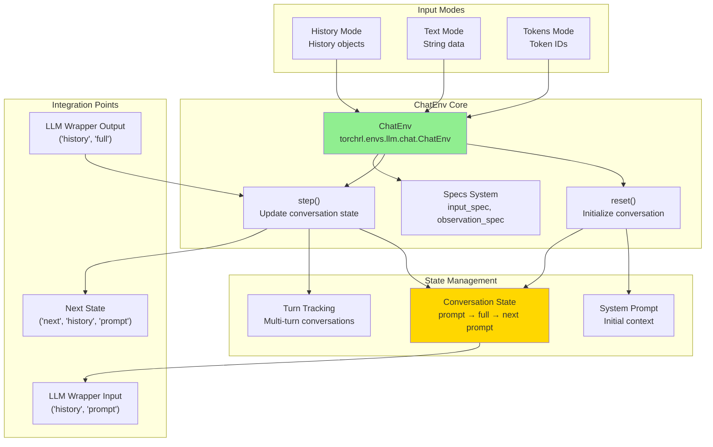

Sources: [torchrl/envs/llm/chat.py:103-148](), [torchrl/envs/llm/chat.py:150-157]()

### Input and Output Modes

`ChatEnv` operates in three modes that correspond to the LLM wrapper modes:

| Mode | Input Type | Output Type | Use Case |
|------|-----------|-------------|----------|
| `history` | `History` objects via `ChatHistory` | `History` objects via `ChatHistory` | Full conversation management with role tracking |
| `text` | Raw strings via `Text` | Raw strings via `Text` | Simple text-to-text generation |
| `tokens` | Token IDs via `Tokens` | Token IDs via `Tokens` | Low-level token manipulation |

The mode is set during initialization and must match the LLM wrapper's `input_mode`. [torchrl/envs/llm/chat.py:150-157]()

**State Flow in ChatEnv**

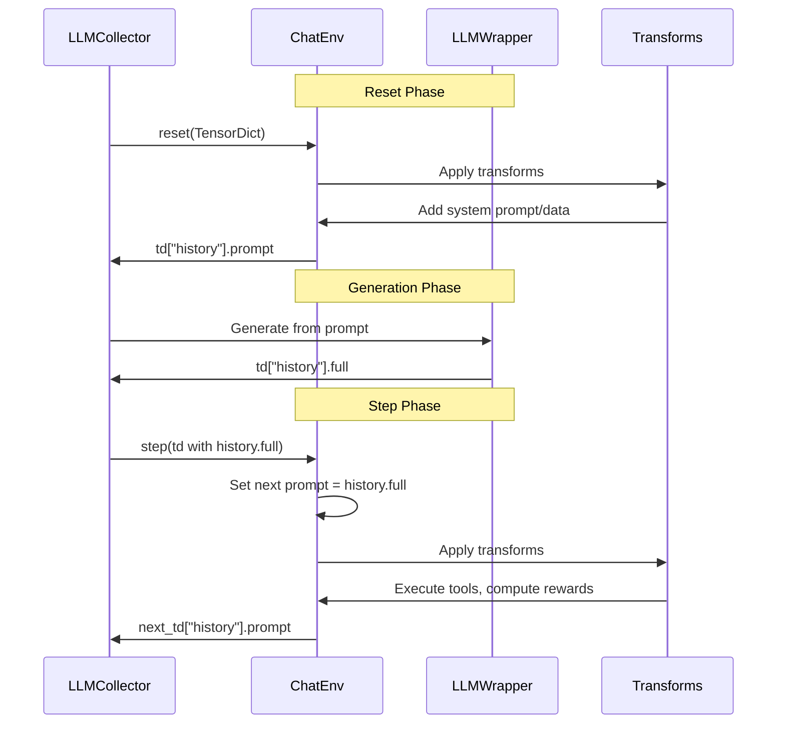

Sources: [torchrl/envs/llm/chat.py:103-148]()

### Conversation State Management

The key insight of `ChatEnv` is how it manages multi-turn conversations:

1.  **Reset**: Initializes `("history", "prompt")` with optional system prompt [torchrl/envs/llm/chat.py:118-128]()
2.  **Step**: Takes LLM output at `("history", "full")` containing the entire conversation including the new response [torchrl/envs/llm/chat.py:130-135]()
3.  **Update**: Sets `("next", "history", "prompt")` to the full history, preparing for the next turn [torchrl/envs/llm/chat.py:130-135]()
4.  **Transforms**: Can inject new user messages, tool responses, or modifications between turns [torchrl/envs/llm/chat.py:136-148]()

This creates a natural loop where each turn's output becomes the next turn's input, with transforms able to modify the conversation at each step.

Sources: [torchrl/envs/llm/chat.py:118-148]()

---

## Tool Integration via Transforms

### Transform-Based Tool Architecture

Tools in TorchRL's LLM system are implemented as transforms that wrap `ChatEnv`. This design provides:
-   **Modularity**: Tools can be added/removed independently
-   **Composability**: Multiple tools can be chained
-   **State Management**: Tools maintain their own state
-   **Service Sharing**: Tools can share resources via the service registry

**Tool Transform Pattern**

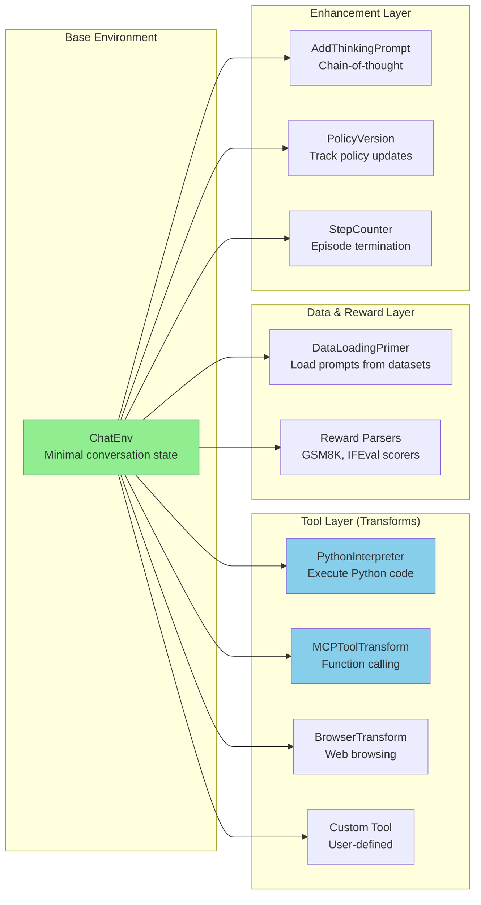

Sources: [torchrl/envs/llm/chat.py:136-148](), [torchrl/envs/llm/transforms/__init__.py:6-29]()

### PythonInterpreter: Code Execution Tool

The `PythonInterpreter` transform enables LLMs to execute Python code blocks found in their responses. It demonstrates the core tool pattern:

**Key Features:**
-   Detects Python code blocks using markdown fencing (```` ```python ````)
-   Executes code in isolated namespace
-   Captures stdout/stderr
-   Returns results as tool response messages
-   Supports shared `PythonExecutorService` for resource efficiency

**Execution Flow:**

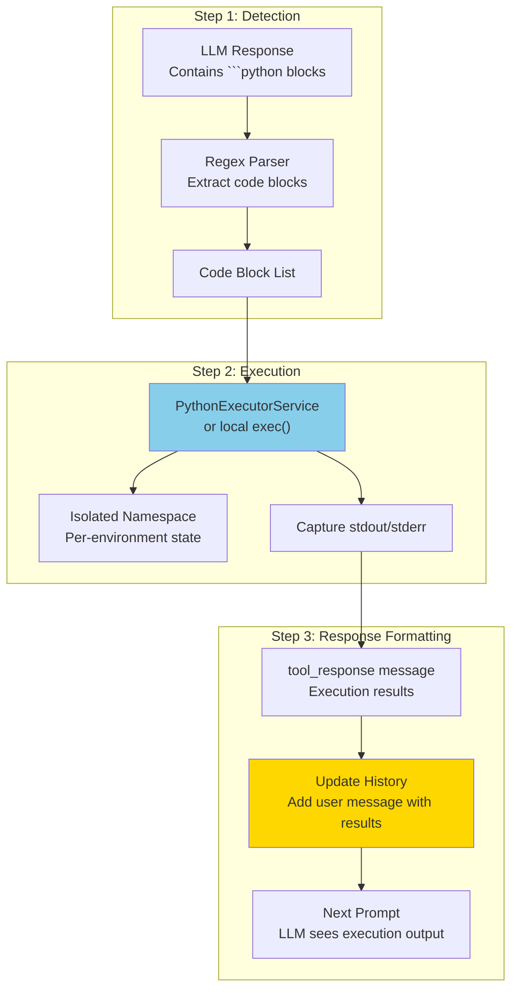

Sources: [torchrl/envs/llm/transforms/__init__.py:28](), [test/llm/test_llm_transforms.py:28]()

**Example Usage:**

The `PythonInterpreter` is typically used in a multi-turn setup where:
1.  User asks for computation
2.  LLM responds with Python code
3.  `PythonInterpreter` executes code
4.  Result is appended as tool response
5.  LLM sees result and can continue

Sources: [test/llm/test_llm_transforms.py:28]()

### MCPToolTransform: Model Context Protocol Integration

`MCPToolTransform` provides a unified interface for tool calling using the Model Context Protocol (MCP). It supports:
-   **Function Registration**: Register Python functions as callable tools
-   **Schema Generation**: Automatic JSON schema generation from type hints
-   **Execution Management**: Parse tool calls, execute functions, return results
-   **Multi-Tool Support**: Multiple tools can be registered simultaneously

**Tool Call Flow:**

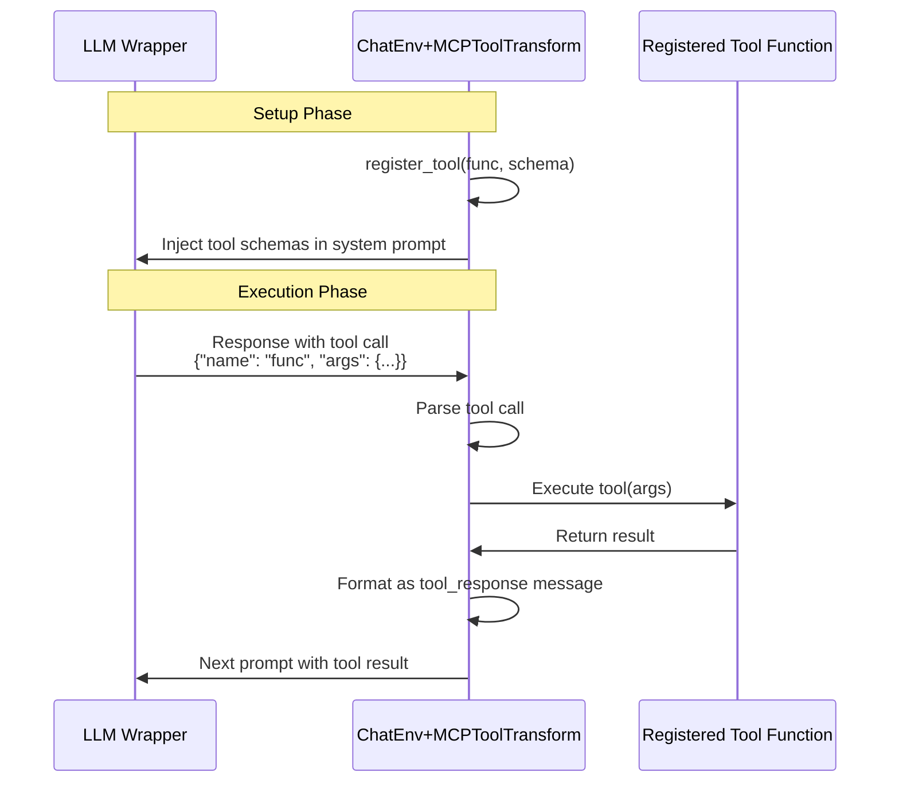

Sources: [torchrl/envs/llm/transforms/__init__.py:27]()

### Service Registry System

The service registry enables sharing expensive resources across multiple environments:

**PythonExecutorService Architecture:**

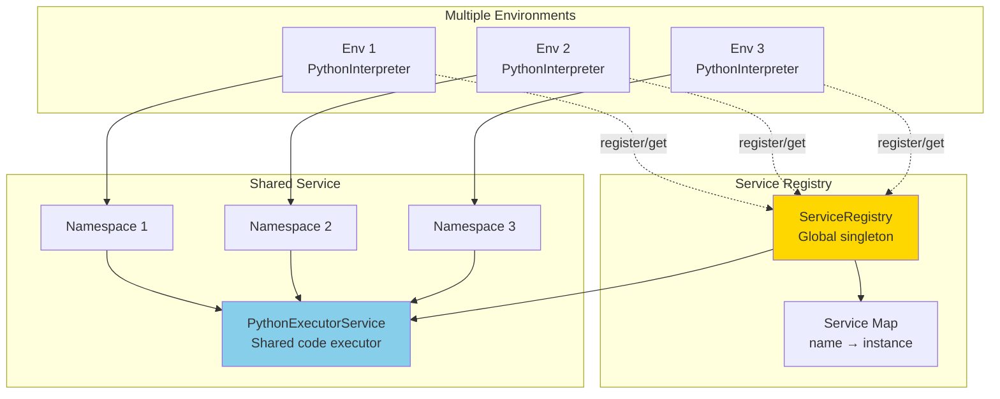

Sources: [torchrl/envs/llm/transforms/__init__.py:28]()

**Key Benefits:**
-   **Resource Efficiency**: Single service instance serves multiple environments
-   **Isolation**: Each environment maintains its own namespace/state
-   **Lazy Initialization**: Services created on first use
-   **Cleanup**: Automatic resource cleanup via context managers

---

## Task-Specific Environments

### Design Pattern

Task-specific environments follow a consistent pattern: they wrap `ChatEnv` with domain-specific transforms in a `TransformedEnv`:

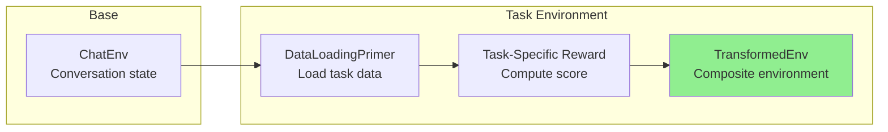

Sources: [torchrl/envs/llm/chat.py:41-45](), [torchrl/envs/llm/transforms/__init__.py:10]()

### GSM8KEnv: Math Problem Solving

`GSM8KEnv` wraps `ChatEnv` to provide:
-   **Data Loading**: Loads GSM8K math problems via `DataLoadingPrimer` [torchrl/envs/llm/datasets/gsm8k.py]()
-   **Answer Parsing**: Extracts answers from `<answer>` XML tags [torchrl/envs/llm/reward/gsm8k.py]()
-   **Reward Computation**: Compares extracted answer with ground truth [torchrl/envs/llm/reward/gsm8k.py]()
-   **Thinking Support**: Can use `AddThinkingPrompt` for chain-of-thought [torchrl/envs/llm/transforms/reason.py:116-127]()

**GSM8K Environment Stack:**

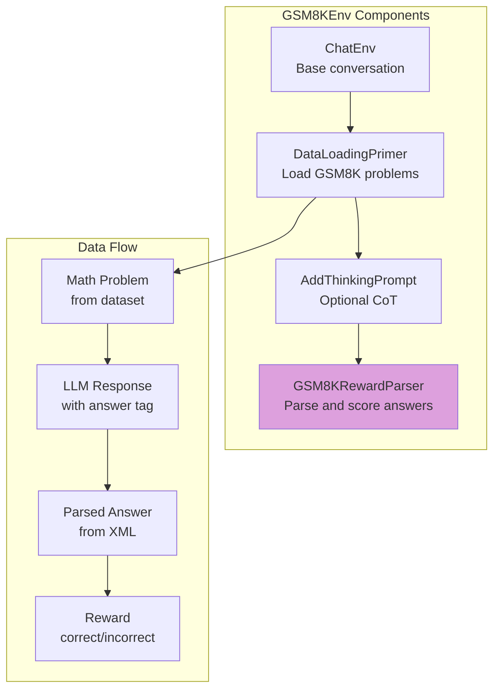

Sources: [torchrl/envs/llm/datasets/gsm8k.py](), [torchrl/envs/llm/reward/gsm8k.py](), [torchrl/envs/llm/transforms/reason.py:50-96]()

**Key Classes:**
-   `GSM8KEnv`: Main environment class [torchrl/envs/llm/datasets/gsm8k.py]()
-   `make_gsm8k_env()`: Factory function with common configurations [torchrl/envs/llm/datasets/gsm8k.py]()
-   `GSM8KPrepareQuestion`: Transform for question formatting [torchrl/envs/llm/datasets/gsm8k.py]()
-   `GSM8KRewardParser`: Reward computation from answer tags [torchrl/envs/llm/reward/gsm8k.py]()

Sources: [torchrl/envs/llm/datasets/gsm8k.py](), [torchrl/envs/llm/reward/gsm8k.py]()

### IFEvalEnv: Instruction Following Evaluation

`IFEvalEnv` evaluates instruction-following capabilities using the IFEval dataset: [torchrl/envs/llm/datasets/ifeval.py]()

**IFEval Scoring Components:**

| Component | Purpose | Output Keys |
|-----------|---------|-------------|
| Format Score | Checks format constraints (length, bullets, etc.) | `reward_format_*` |
| Structure Score | Validates thinking/answer tags | `reward_think`, `reward_answer` |
| Completion Bonus | Rewards properly structured responses | `reward_completion` |
| Aggregate Score | Combined score | `reward` |

**IFEval Architecture:**

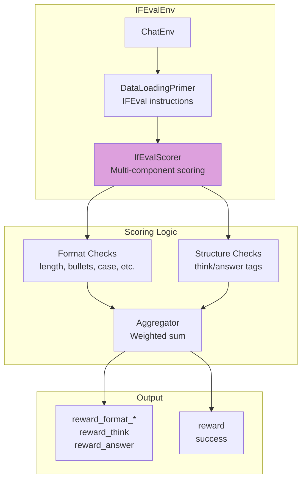

Sources: [torchrl/envs/llm/datasets/ifeval.py]()

**Key Features:**
-   Multiple format validators (length, bullet points, case sensitivity)
-   XML tag structure validation
-   Configurable aggregation function
-   Optional automatic episode termination when answer is detected

Sources: [torchrl/envs/llm/datasets/ifeval.py]()

### MLGymEnv: MLGym Integration

`MLGymEnv` provides integration with the MLGym benchmark for code generation and machine learning tasks:

```python
# Created via make_mlgym() factory
env = make_mlgym(
    tokenizer=tokenizer,
    dataset_name="mlgym_dataset",
    input_mode="history"
)
```

The environment wraps `ChatEnv` with:
-   `MLGymWrapper`: Task-specific formatting and evaluation
-   `DataLoadingPrimer`: Loads MLGym tasks
-   Code execution and scoring logic

Sources: [torchrl/envs/llm/__init__.py]()

---

## Common Transform Patterns

### DataLoadingPrimer: Dataset Integration

`DataLoadingPrimer` loads data from datasets and injects it into the environment on reset: [torchrl/envs/llm/transforms/dataloading.py:20-22]()

**DataLoadingPrimer Flow:**

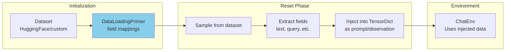

Sources: [torchrl/envs/llm/transforms/dataloading.py:20-22]()

**Configuration:**
-   `dataset_field`: Field name in dataset to read
-   `output_key`: TensorDict key to write to
-   `split`: Dataset split to use (train/test/validation)
-   Custom processing functions

Sources: [torchrl/envs/llm/transforms/dataloading.py:20-22]()

### IncrementalTokenizer: Tokenization for LLM Environments

The `IncrementalTokenizer` transform is a specialized `Tokenizer` for LLM environments, particularly useful when `ChatEnv` is initialized with `with_tokenizer=True`. [torchrl/envs/llm/chat.py:37-44]() It handles the conversion between raw text and token IDs, and crucially, manages attention masks. [torchrl/envs/llm/transforms/tokenizer.py:26-68]()

**Key Features:**
-   **Text to Tokens**: Converts input text (e.g., from `ChatEnv`'s `text` mode) into token IDs and an attention mask. [torchrl/envs/llm/transforms/tokenizer.py:121-136]()
-   **Tokens to Text (Inverse)**: Decodes token IDs back into human-readable text. [torchrl/envs/llm/transforms/tokenizer.py:153-158]()
-   **Attention Mask Handling**: Automatically generates and manages attention masks, which are critical for LLM inference. [torchrl/envs/llm/transforms/tokenizer.py:128-131]()
-   **`out_device` Property**: Allows specifying the device for token tensors and attention masks, defaulting to the parent environment's device. [torchrl/envs/llm/transforms/tokenizer.py:99-108]()
-   **`add_special_tokens`**: Controls whether special tokens (like `[CLS]`, `[SEP]`) are added during tokenization. [torchrl/envs/llm/transforms/tokenizer.py:79]()
-   **`skip_special_tokens`**: Controls whether special tokens are skipped during decoding. [torchrl/envs/llm/transforms/tokenizer.py:80]()

**Tokenizer Transform Flow:**

```mermaid
graph TD
    A[Input Text/Tokens] --> B{Tokenizer Transform<br/>torchrl.envs.llm.transforms.IncrementalTokenizer};
    B -- Tokenize --> C{Token IDs};
    B -- Generate --> D{Attention Mask};
    C --> E[Output TensorDict<br/>(e.g., "tokens", "attention_mask")];
    D --> E;
    E -- Inverse Transform --> F[Decoded Text];
```

Sources: [torchrl/envs/llm/transforms/tokenizer.py:26-68](), [torchrl/envs/llm/transforms/tokenizer.py:121-136](), [torchrl/envs/llm/transforms/tokenizer.py:153-158](), [torchrl/envs/llm/transforms/tokenizer.py:99-108](), [torchrl/envs/llm/chat.py:37-44]()

### AddThinkingPrompt: Chain-of-Thought

`AddThinkingPrompt` injects prompts that encourage step-by-step reasoning: [torchrl/envs/llm/transforms/reason.py:20-23]()

```python
transform = AddThinkingPrompt(
    cond=lambda td: td["reward"] < 50, # Example condition
    prompt="Let's think step by step.",
    role="assistant",
    edit_last_turn=True,
    zero_reward=True,
    undo_done=True
)
```

This transform:
1.  Adds thinking instruction to system prompt or edits the last assistant response. [torchrl/envs/llm/transforms/reason.py:138-146]()
2.  Can be conditioned on the current `TensorDict` state (e.g., low reward). [torchrl/envs/llm/transforms/reason.py:119]()
3.  Optionally zeros the reward and undoes the `done` flag to allow for further reasoning. [torchrl/envs/llm/transforms/reason.py:124-125]()

Sources: [torchrl/envs/llm/transforms/reason.py:20-146]()

### PolicyVersion: Version Tracking

`PolicyVersion` tracks which version of the policy generated each data sample: [torchrl/envs/llm/transforms/policy_version.py:7]()

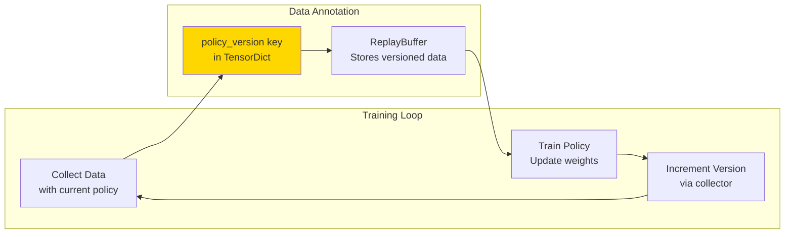

Sources: [torchrl/envs/llm/transforms/policy_version.py:7](), [torchrl/envs/transforms/_tensor.py:41](), [test/transforms/test_key_transforms.py:42]()

**Use Cases:**
-   Off-policy corrections
-   Staleness detection
-   Debugging policy updates
-   Data provenance tracking

Sources: [torchrl/envs/llm/transforms/policy_version.py:7]()

---

## Designing Custom Reward Transforms

### Reward Transform Requirements

When creating custom reward transforms for LLM environments, several requirements must be met:

**Critical Design Constraints:**

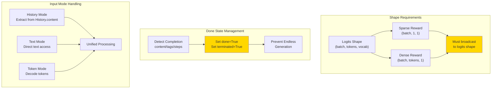

Sources: [torchrl/envs/llm/chat.py:150-157]()

### Shape Requirements

Rewards must have the same number of dimensions as logits:

```python
# Logits shape: (batch_size, seq_len, vocab_size)
# Reward must be: (batch_size, *, 1) where * broadcasts to seq_len

# For sparse rewards (single value per sequence)
reward = reward.unsqueeze(-1).unsqueeze(-1)  # (batch,) -> (batch, 1, 1)

# For dense rewards (per-token rewards)
reward = reward.unsqueeze(-1)  # (batch, seq_len) -> (batch, seq_len, 1)
```

This ensures compatibility with loss computation in `GRPOLoss` and other objectives.

Sources: [torchrl/envs/llm/reward/gsm8k.py]()

### Done State Management

**Critical**: Rewards must set the done state to prevent endless generation:

```python
def _step(self, tensordict, next_tensordict):
    # Compute reward
    reward = self._compute_reward(next_tensordict)
    
    # ALWAYS set done when appropriate
    if self.set_done_if_answer and answer_detected:
        next_tensordict.set("done", torch.ones(...))
        next_tensordict.set("terminated", torch.ones(...))
    
    return next_tensordict
```

**Common Done Strategies:**

| Strategy | When to Use | Implementation |
|----------|-------------|----------------|
| Content-based | Specific tags detected | Check for `<answer>`, completion markers |
| History-based | Conversation complete | Check `History.complete=True` |
| Step-based | Fixed episode length | Use `StepCounter` transform |
| Combined | Multiple conditions | Logical OR of conditions |

Sources: [torchrl/envs/llm/reward/gsm8k.py]()

### Input Mode Handling

Reward transforms must handle all input modes:

```python
def _extract_text(self, tensordict):
    input_mode = self.input_mode
    
    if input_mode == "history":
        # Extract from History objects
        history = tensordict[("history", "full")]
        responses = lazy_stack([h[..., -1] for h in history.unbind(0)])
        text = responses.content
        
    elif input_mode == "text":
        # Direct text access
        text = tensordict[("text", "full")]
        
    elif input_mode == "tokens":
        # Decode tokens
        tokens = tensordict[("tokens", "full")]
        text = self.tokenizer.decode(tokens.flatten(0, 1).tolist())
    
    return text
```

Sources: [torchrl/envs/llm/chat.py:150-157]()

### Specification Management

Accurate specs are essential for environment initialization:

```python
def transform_reward_spec(self, reward_spec: Composite) -> Composite:
    # Add two dimensions for broadcasting to logits
    shape = reward_spec.shape + (1, 1)
    
    reward_spec.update(Composite(
        reward_answer=Unbounded(shape),
        reward_think=Unbounded(shape),
        reward=Unbounded(shape),
        success=Unbounded(shape, dtype=torch.bool),
    ))
    return reward_spec

def transform_observation_spec(self, observation_spec: Composite) -> Composite:
    # Add any new observation keys
    observation_spec.update(Composite(
        parsed_answer=NonTensor(shape=observation_spec.shape, example_data="")
    ))
    return observation_spec
```

Sources: [torchrl/envs/llm/reward/gsm8k.py]()

### Example: GSM8K Reward Parser

The `GSM8KRewardParser` demonstrates the complete pattern: [torchrl/envs/llm/reward/gsm8k.py]()

**GSM8K Reward Flow:**

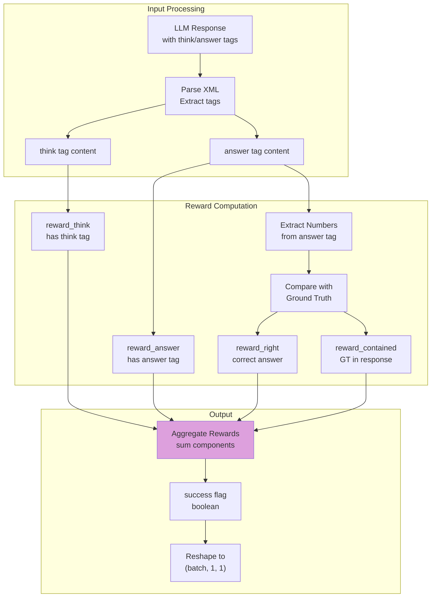

Sources: [torchrl/envs/llm/reward/gsm8k.py]()

**Key Implementation Details:**
-   Uses `xml.etree.ElementTree` for robust XML parsing
-   Handles parse errors gracefully (returns empty strings)
-   Extracts numeric answers using regex
-   Computes multiple reward components for analysis
-   Properly shapes rewards for loss computation
-   Sets done state when answer tag is detected

Sources: [torchrl/envs/llm/reward/gsm8k.py]()

---

## Integration with LLM Wrappers

### Environment-Wrapper Coordination

`ChatEnv` and LLM wrappers coordinate through a well-defined contract:

**Integration Contract:**

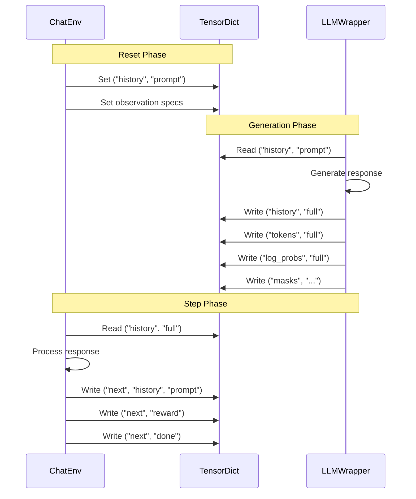

Sources: [torchrl/envs/llm/chat.py:118-148]()

### Key Design Points

1.  **Prompt Source**: Environment controls `("history", "prompt")` or equivalent [torchrl/envs/llm/chat.py:118-128]()
2.  **Response Format**: Wrapper writes complete conversation to `("history", "full")` [torchrl/envs/llm/chat.py:130-135]()
3.  **State Propagation**: `full` becomes next `prompt` in multi-turn setup [torchrl/envs/llm/chat.py:130-135]()
4.  **Transform Injection**: Transforms modify conversation between wrapper output and next prompt [torchrl/envs/llm/chat.py:136-148]()
5.  **Mode Consistency**: Environment and wrapper must use same `input_mode` [torchrl/envs/llm/chat.py:150-157]()

Sources: [torchrl/envs/llm/chat.py:118-157]()

---

## Summary

The LLM environment system provides a modular, extensible architecture for building RL tasks with language models:

-   `ChatEnv` provides minimal conversation state management [torchrl/envs/llm/chat.py:103-148]()
-   **Transforms** add functionality (tools, data loading, rewards) [torchrl/envs/llm/transforms/__init__.py:6-29]()
-   **Services** enable resource sharing across environments [torchrl/envs/llm/transforms/__init__.py:28]()
-   **Task Environments** combine base + transforms for specific benchmarks [torchrl/envs/llm/__init__.py]()
-   **Reward Transforms** follow strict requirements for shape, done state, and input handling [torchrl/envs/llm/reward/gsm8k.py]()
-   **Integration** with wrappers follows clear contracts for data flow [torchrl/envs/llm/chat.py:118-157]()

This design enables rapid prototyping of new tasks while maintaining consistency across the codebase.

Sources: [torchrl/envs/llm/chat.py](), [torchrl/envs/llm/transforms/__init__.py](), [torchrl/envs/llm/datasets/gsm8k.py](), [torchrl/envs/llm/reward/gsm8k.py](), [torchrl/envs/llm/datasets/ifeval.py]()

---

