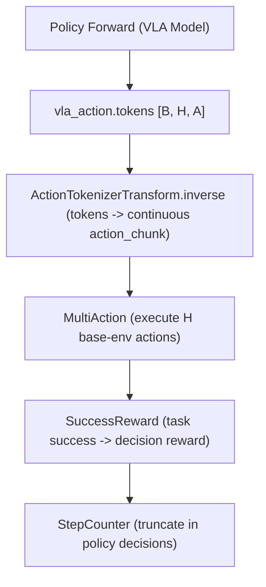

<!-- source: DeepWiki mcp.deepwiki.com · repo pytorch/rl · page 9.6 Vision-Language-Action (VLA) Models · fetched 2026-10-21 -->

# Vision-Language-Action (VLA) Models

<details>
<summary>Relevant source files</summary>

The following files were used as context for generating this wiki page:

- [benchmarks/test_vla_preprocessing_benchmark.py](benchmarks/test_vla_preprocessing_benchmark.py)
- [docs/source/reference/vla.rst](docs/source/reference/vla.rst)
- [sota-implementations/vla_grpo/README.md](sota-implementations/vla_grpo/README.md)
- [sota-implementations/vla_grpo/compare_simplevla_rollouts.py](sota-implementations/vla_grpo/compare_simplevla_rollouts.py)
- [sota-implementations/vla_grpo/config/vla_grpo_libero.yaml](sota-implementations/vla_grpo/config/vla_grpo_libero.yaml)
- [sota-implementations/vla_grpo/config/vla_grpo_toy.yaml](sota-implementations/vla_grpo/config/vla_grpo_toy.yaml)
- [sota-implementations/vla_grpo/openvla.py](sota-implementations/vla_grpo/openvla.py)
- [sota-implementations/vla_grpo/test_openvla.py](sota-implementations/vla_grpo/test_openvla.py)
- [sota-implementations/vla_grpo/utils.py](sota-implementations/vla_grpo/utils.py)
- [sota-implementations/vla_grpo/vla-grpo.py](sota-implementations/vla_grpo/vla-grpo.py)
- [sota-implementations/vla_grpo/vla-grpo.sbatch](sota-implementations/vla_grpo/vla-grpo.sbatch)
- [test/data/test_vla.py](test/data/test_vla.py)
- [test/objectives/test_ppo.py](test/objectives/test_ppo.py)
- [test/test_custom_envs.py](test/test_custom_envs.py)
- [torchrl/data/vla/__init__.py](torchrl/data/vla/__init__.py)
- [torchrl/data/vla/preprocessing.py](torchrl/data/vla/preprocessing.py)
- [torchrl/data/vla/tokenizers.py](torchrl/data/vla/tokenizers.py)
- [torchrl/envs/custom/pendulum.py](torchrl/envs/custom/pendulum.py)
- [torchrl/envs/custom/tictactoeenv.py](torchrl/envs/custom/tictactoeenv.py)
- [torchrl/envs/custom/vla.py](torchrl/envs/custom/vla.py)
- [torchrl/modules/vla/common.py](torchrl/modules/vla/common.py)
- [torchrl/modules/vla/models.py](torchrl/modules/vla/models.py)
- [tutorials/sphinx-tutorials/vla.py](tutorials/sphinx-tutorials/vla.py)

</details>


Vision-Language-Action (VLA) models are a class of models that map one or more camera images, optional proprioceptive state, and a natural-language instruction to robot actions. In TorchRL, VLAs are treated as standard TensorDict-first policies, leveraging existing components like `TensorDictModule` for policies, `LossModule` for training, and collectors for rollouts. This page details the data schema, transforms, policies, and objectives that enable VLA workflows within TorchRL.

The VLA stack in TorchRL is designed to be lightweight, with external dependencies like `transformers`, `lerobot`, or simulator backends being optional and lazily imported [docs/source/reference/vla.rst:18-21]().

## Canonical TensorDict Schema

VLA components in TorchRL adhere to a consistent `TensorDict` schema, ensuring seamless interoperability between datasets, transforms, policies, and losses. This schema is inspired by `OpenXExperienceReplay` and the LeRobot dataset format [docs/source/reference/vla.rst:26-29]().

```
TensorDict(
    observation: TensorDict(
        image: {<camera>: uint8/float [*B, T, C, H, W]},  # or a single tensor
        state: float [*B, T, state_dim],                  # proprioception
    ),
    language_instruction: NonTensorData | Text,           # raw or tokenized (per-traj)
    action: float [*B, T, action_dim],                    # raw, per-step
    vla_action: VLAAction(
        chunk: float [*B, T, chunk, action_dim],          # built for training
        tokens: long [*B, T, chunk, action_dim],          # tokenized actions
        log_probs: float [*B, T] or [*B, T, chunk, action_dim],
        logits: float [*B, T, chunk, action_dim, vocab],
        mask: bool [*B, T, chunk, action_dim, vocab],
    ),
    action_is_pad: bool [*B, T, chunk],                   # chunk validity mask
    next: TensorDict(...),                                 # TED layout
)
```

The `image` and `state` are nested under `observation`, while `language_instruction` and `action` reside at the `TensorDict` root [docs/source/reference/vla.rst:46-48]().

Key definitions are exported from `torchrl.data.vla` [docs/source/reference/vla.rst:50-53]():
- `OBSERVATION_KEY`
- `IMAGE_KEY`
- `STATE_KEY`
- `INSTRUCTION_KEY`
- `ACTION_KEY`
- `ACTION_CHUNK_KEY`
- `ACTION_IS_PAD_KEY`
- `ACTION_TOKENS_KEY`

These keys serve as shared defaults, but can be overridden by individual components [docs/source/reference/vla.rst:53-54]().

Sources:
- `docs/source/reference/vla.rst`
- `torchrl/data/vla/__init__.py`

## Data and Metadata

The `torchrl.data.vla` module provides specialized `TensorClass` structures for VLA data and metadata.

### `RobotDatasetMetadata`

The `RobotDatasetMetadata` class [torchrl/data/vla/tokenizers.py:10-11]() is a `TensorClass` that stores metadata about a robot dataset, such as `action_dim`, `action_space`, `gripper_mode`, and action statistics (`action_mean`, `action_std`) [test/data/test_vla.py:52-59](). It can be initialized from a JSON string or file [test/data/test_vla.py:166-170]().

```python
class RobotDatasetMetadata(TensorClass):
    dataset_id: str
    embodiment_id: str | None = None
    action_dim: int | None = None
    action_names: tuple[str, ...] | None = None
    action_space: Literal["eef_delta", "eef_abs"] = "eef_delta"
    gripper_mode: Literal["binary", "continuous"] = "binary"
    control_frequency_hz: float | None = None
    camera_keys: tuple[NestedKey, ...] = ()
    action_mean: torch.Tensor | None = None
    action_std: torch.Tensor | None = None
    action_low: torch.Tensor | None = None
    action_high: torch.Tensor | None = None
```

It provides methods to create action specifications (`make_action_spec`) based on the stored metadata [test/data/test_vla.py:78-82]().

### `VLAAction`

The `VLAAction` `TensorClass` [torchrl/data/vla/__init__.py:10-11]() encapsulates action-related data within the VLA schema, including `chunk`, `tokens`, `log_probs`, `logits`, and `mask` [docs/source/reference/vla.rst:38-42]().

### `VLAImages` and `VLAObservation`

`VLAImages` [torchrl/data/vla/__init__.py:10-11]() and `VLAObservation` [torchrl/data/vla/__init__.py:10-11]() are `TensorClass` structures for organizing image and observation data, respectively.

### `validate_vla_tensordict`

The `validate_vla_tensordict` function [torchrl/data/vla/__init__.py:10-11]() checks if a given `TensorDict` conforms to the canonical VLA schema [test/data/test_vla.py:181-182]().

Sources:
- `docs/source/reference/vla.rst`
- `test/data/test_vla.py`
- `torchrl/data/vla/__init__.py`
- `torchrl/data/vla/tokenizers.py`

## Transforms

TorchRL's VLA data path utilizes general `Transform` subclasses, applicable to any action-based pipeline [docs/source/reference/vla.rst:81-84]().

### `ActionChunkTransform`

This transform [docs/source/reference/vla.rst:86-91]() constructs fixed-length action chunks (`[*B, T, H, action_dim]`) and a padding mask from a sampled trajectory window. It's built on `CatFrames` and handles trajectory boundaries by padding and masking [docs/source/reference/vla.rst:88-91]().

### `ActionScaling`

`ActionScaling` [docs/source/reference/vla.rst:92-99]() performs affine action normalization. It can be initialized from metadata or statistics and is used to normalize expert actions during replay buffer sampling and denormalize policy-predicted actions for environment interaction [docs/source/reference/vla.rst:94-99]().

### `ActionTokenizerTransform`

The `ActionTokenizerTransform` [docs/source/reference/vla.rst:100-102]() encodes continuous actions into discrete tokens using an action tokenizer, which is crucial for autoregressive token VLAs [docs/source/reference/vla.rst:100-102]().

### `SuccessReward`

`SuccessReward` [docs/source/reference/vla.rst:103-104]() provides a sparse 0/1 success reward, useful for RL fine-tuning [docs/source/reference/vla.rst:103-104]().

Sources:
- `docs/source/reference/vla.rst`
- `sota-implementations/vla_grpo/utils.py`

## Action Representations

Action tokenizers are key for VLA models that emit discrete tokens. They map continuous actions to discrete token IDs and vice-versa, enabling autoregressive VLA policies (like RT-2 or OpenVLA-style models) to use a language-model head for action generation [docs/source/reference/vla.rst:109-113]().

### `ActionTokenizerBase`

The `ActionTokenizerBase` [torchrl/data/vla/tokenizers.py:10-11]() is the abstract base class for action tokenizers.

### `UniformActionTokenizer`

`UniformActionTokenizer` [torchrl/data/vla/tokenizers.py:10-11]() discretizes continuous actions into a fixed number of bins uniformly across the action space [torchrl/data/vla/tokenizers.py:10-11]().

### `VocabTailActionTokenizer`

`VocabTailActionTokenizer` [torchrl/data/vla/tokenizers.py:10-11]() maps continuous actions to a specific range of token IDs at the tail of a larger vocabulary, often used in models that combine action tokens with language tokens [torchrl/data/vla/tokenizers.py:10-11]().

Sources:
- `docs/source/reference/vla.rst`
- `torchrl/data/vla/tokenizers.py`

## Image Preprocessing

The `torchrl.data.vla.OpenVLAImagePreprocessor` [torchrl/data/vla/preprocessing.py:24-24]() implements OpenVLA-style image preprocessing [docs/source/reference/vla.rst:127-128]().

### `OpenVLAImagePreprocessor`

This class [torchrl/data/vla/preprocessing.py:24-24]() supports different backends for image processing:
- `torch_reference` (default): Uses `torchvision` for JPEG round-trip, antialiased Lanczos3 resize (`_lanczos3_resize` [torchrl/data/vla/preprocessing.py:119-134]()), and optional fractional 0.9-area center crop (`_fractional_center_crop` [torchrl/data/vla/preprocessing.py:176-179]()). It mimics TensorFlow's operation order and interpolation semantics without requiring TensorFlow [docs/source/reference/vla.rst:129-133]().
- `torchvision`: Employs a faster bicubic tensor path [docs/source/reference/vla.rst:133-134]().
- `tensorflow`: Available for reference comparisons [docs/source/reference/vla.rst:134-135]().

Sources:
- `docs/source/reference/vla.rst`
- `torchrl/data/vla/preprocessing.py`

## Policy and Environment Contract

TorchRL maintains a simple environment boundary for VLAs. Base environments do not need to be aware of model-specific VLA wrappers or `TensorClass` structures [docs/source/reference/vla.rst:145-147](). The default environment/policy contract uses a flat `TensorDict` [docs/source/reference/vla.rst:147-148]():

- **Environment `reset` / `step`**: Writes observations under canonical keys, typically `("observation", "image")`, optional `("observation", "state")`, and `"language_instruction"` [docs/source/reference/vla.rst:150-152]().
- **Environment `step`**: Consumes one continuous action under `"action"` with shape `[*B, action_dim]` [docs/source/reference/vla.rst:153-154]().
- **Datasets and replay buffers**: May carry additional training targets like `("vla_action", "chunk")` and `("vla_action", "tokens")` [docs/source/reference/vla.rst:155-157]().

Sources:
- `docs/source/reference/vla.rst`

## VLA Environments

TorchRL provides environments specifically designed for VLA research and development.

### `ToyVLAEnv`

`ToyVLAEnv` [torchrl/envs/custom/vla.py:10-11]() is a lightweight, dependency-free environment that simulates a VLA task. It uses the same `TensorDict` schema as real robot VLA environments, providing `("observation", "image")`, `("observation", "state")`, and `"language_instruction"` [sota-implementations/vla_grpo/README.md:56-62](). The environment's task involves tracking a target action, with success defined by staying within a tolerance of the target for several consecutive steps [sota-implementations/vla_grpo/README.md:64-67](). This environment is ideal for understanding and testing the VLA stack without requiring a robot simulator [sota-implementations/vla_grpo/README.md:54-55]().

### `LiberoEnv`

`LiberoEnv` [sota-implementations/vla_grpo/utils.py:48-48]() integrates with the LIBERO benchmark, providing simulated robot manipulation tasks. It receives camera observations and instructions, and task success is measured by a simulator task checker [sota-implementations/vla_grpo/README.md:98-102]().

Sources:
- `sota-implementations/vla_grpo/README.md`
- `sota-implementations/vla_grpo/utils.py`
- `torchrl/envs/custom/vla.py`
- `test/test_custom_envs.py`

## VLA Modules

TorchRL offers modules tailored for VLA models, including a tiny reference model and wrappers for state-of-the-art implementations.

### `VLAWrapperBase`

`VLAWrapperBase` [torchrl/modules/vla/common.py:10-11]() is the abstract base class for VLA policy wrappers. It defines the common interface for VLA models, including methods for getting action logits and distributions.

### `TinyVLA`

`TinyVLA` [torchrl/modules/vla/models.py:10-11]() is a small, dependency-light VLA policy designed for testing and understanding the data flow. It features a convolutional encoder for images, an MLP for state, a hashed embedding for instructions, and an action-token head [sota-implementations/vla_grpo/README.md:73-79](). `TinyVLA` predicts tokens, which are then decoded into continuous actions by a tokenizer transform [sota-implementations/vla_grpo/README.md:80-82]().

### OpenVLA Wrappers

The `sota-implementations/vla_grpo/openvla.py` module provides wrappers for OpenVLA-OFT models.

#### `OpenVLAOFTWrapper`

This wrapper [sota-implementations/vla_grpo/openvla.py:98-100]() handles OpenVLA-OFT token policies. It emits the entire action chunk (parallel decoding of `chunk_size * action_dim` tokens) from a 256-way categorical distribution over action tokens at the tail of the LLaMA-2 vocabulary [sota-implementations/vla_grpo/openvla.py:7-11](). It manages all model-side preprocessing, including prompt construction and image transforms [sota-implementations/vla_grpo/openvla.py:18-22]().

#### `OpenVLAOFTL1Wrapper`

This wrapper [sota-implementations/vla_grpo/openvla.py:102-105]() provides a continuous L1-head for OpenVLA-OFT checkpoints, primarily for reference and evaluation rollouts [sota-implementations/vla_grpo/openvla.py:13-16]().

#### `OpenVLAInputTransform`

`OpenVLAInputTransform` [sota-implementations/vla_grpo/openvla.py:176-176]() is a `Transform` that prepares input for OpenVLA models. It reads TorchRL's canonical VLA observation keys and generates the preprocessed prompt/image entries required by the OpenVLA model [sota-implementations/vla_grpo/openvla.py:178-181]().

Sources:
- `sota-implementations/vla_grpo/README.md`
- `sota-implementations/vla_grpo/openvla.py`
- `torchrl/modules/vla/common.py`
- `torchrl/modules/vla/models.py`

## VLA GRPO SOTA Implementation (OpenVLA)

The `sota-implementations/vla_grpo` directory contains an implementation of Vision-Language-Action (VLA) Grouped Policy Optimization (GRPO), which is a method to improve supervised VLA policies using reinforcement learning from environment success [sota-implementations/vla_grpo/README.md:1-5]().

### Core Idea

The VLA GRPO recipe involves:
1. Starting with a VLA policy that can process images, language instructions, and robot states [sota-implementations/vla_grpo/README.md:7-8]().
2. Sampling multiple attempts from the same initial state [sota-implementations/vla_grpo/README.md:9]().
3. Retaining attempts that show a useful success/failure contrast [sota-implementations/vla_grpo/README.md:10-11]().
4. Updating action-token probabilities to make successful attempts more likely [sota-implementations/vla_grpo/README.md:12-13]().

This approach addresses the limitations of Supervised Fine-Tuning (SFT), which optimizes for next-action imitation rather than task success [sota-implementations/vla_grpo/README.md:20-21]().

### Data Flow and Components

The VLA GRPO pipeline integrates several TorchRL components:

#### Environment Setup

One outer TorchRL environment step corresponds to one policy decision, where the policy emits an action chunk [sota-implementations/vla_grpo/README.md:111-112]().


**Diagram: VLA GRPO Environment and Policy Interaction**

Sources:
- `sota-implementations/vla_grpo/README.md`
- `sota-implementations/vla_grpo/utils.py`

#### `MCAdvantage`

`MCAdvantage` [sota-implementations/vla_grpo/utils.py:63-63]() is used on the replay buffer path. It groups trajectories that originated from the same initial state and computes a Monte-Carlo advantage based on the group-normalized return [sota-implementations/vla_grpo/README.md:131-133](). With `trajectory_return="sum"`, the trajectory-level success return is broadcast to every chunk decision, aligning with PPO requirements [sota-implementations/vla_grpo/README.md:133-135]().

#### Loss Function

The loss used is `ClipPPOLoss` [sota-implementations/vla_grpo/utils.py:63-63](), configured for GRPO-style policy updates. This involves no critic, no entropy bonus, no KL-to-reference term, and asymmetric DAPO Clip-Higher bounds [sota-implementations/vla_grpo/README.md:137-139](). For token policies, the importance ratio can be computed per token, matching the SimpleVLA-RL semantics [sota-implementations/vla_grpo/README.md:139-141]().

#### `GripperPostProcessTransform`

This transform [sota-implementations/vla_grpo/openvla.py:110-111]() is used for post-processing gripper actions, particularly for binarization and inversion, as seen in the OpenVLA context [sota-implementations/vla_grpo/test_openvla.py:145-146]().

### Training Pipeline

The `vla-grpo.py` script [sota-implementations/vla_grpo/vla-grpo.py]() orchestrates the training. It supports both a toy-scale setup (`TinyVLA` on `ToyVLAEnv`) and a LIBERO-scale setup (OpenVLA-OFT token policy on `LiberoEnv`) [sota-implementations/vla_grpo/README.md:51-52]().

```mermaid
graph TD
    subgraph "Data Collection"
        Env[Environment (ToyVLAEnv / LiberoEnv)] --> Policy[VLA Policy (TinyVLA / OpenVLA)];
        Policy --> ActionTokenizer[ActionTokenizerTransform];
        ActionTokenizer --> MultiAction[MultiAction];
        MultiAction --> SuccessReward[SuccessReward];
        SuccessReward --> StepCounter[StepCounter];
        StepCounter --> ReplayBuffer[Replay Buffer];
    end

    subgraph "Training Loop"
        ReplayBuffer --> MCAdvantage[MCAdvantage (Grouped Trajectories)];
        MCAdvantage --> Loss[ClipPPOLoss];
        Loss --> Optimizer[Optimizer];
        Optimizer --> Policy;
    end

    subgraph "Evaluation"
        Policy --> Evaluator[Evaluator];
        Evaluator --> VideoRecorder[VideoRecorder];
    end
```
**Diagram: VLA GRPO Training Pipeline**

Sources:
- `sota-implementations/vla_grpo/README.md`
- `sota-implementations/vla_grpo/openvla.py`
- `sota-implementations/vla_grpo/test_openvla.py`
- `sota-implementations/vla_grpo/utils.py`
- `sota-implementations/vla_grpo/vla-grpo.py`

---

