# Page: Overview

# Overview

<details>
<summary>Relevant source files</summary>

The following files were used as context for generating this wiki page:

- [.github/scripts/ci_timing_dashboard.html](.github/scripts/ci_timing_dashboard.html)
- [.github/scripts/track_ci_timing.py](.github/scripts/track_ci_timing.py)
- [.github/unittest/examples/scripts/run_all.sh](.github/unittest/examples/scripts/run_all.sh)
- [.github/unittest/examples/scripts/run_test.sh](.github/unittest/examples/scripts/run_test.sh)
- [.github/workflows/ci-timing-tracker.yml](.github/workflows/ci-timing-tracker.yml)
- [.github/workflows/docs.yml](.github/workflows/docs.yml)
- [.python-version](.python-version)
- [AGENTS.md](AGENTS.md)
- [CLAUDE.md](CLAUDE.md)
- [CONTRIBUTING.md](CONTRIBUTING.md)
- [README.md](README.md)
- [docs/requirements.txt](docs/requirements.txt)
- [docs/source/conf.py](docs/source/conf.py)
- [docs/source/index.rst](docs/source/index.rst)
- [docs/source/reference/objectives.rst](docs/source/reference/objectives.rst)
- [docs/source/reference/objectives_other.rst](docs/source/reference/objectives_other.rst)
- [examples/collectors/collector_device.py](examples/collectors/collector_device.py)
- [sota-check/run_rnd_mujoco.sh](sota-check/run_rnd_mujoco.sh)
- [sota-implementations/rnd/config_mujoco.yaml](sota-implementations/rnd/config_mujoco.yaml)
- [sota-implementations/rnd/utils_mujoco.py](sota-implementations/rnd/utils_mujoco.py)
- [torchrl/objectives/__init__.py](torchrl/objectives/__init__.py)

</details>


TorchRL is an open-source Reinforcement Learning (RL) library for PyTorch that provides a modular, efficient, and composable framework for RL research, decision-making, robotics, and simulation [README.md:23-26](), [docs/source/index.rst:6-12](). This page introduces TorchRL's architecture, design philosophy, core components, and provides a roadmap for navigating the documentation.

## What is TorchRL?

TorchRL solves the heterogeneity problem in RL codebases—where algorithms are difficult to reuse across different settings (online vs. offline, state-based vs. pixel-based, single-agent vs. multi-agent). TorchRL addresses this through:

- **`TensorDict`**: A universal, dictionary-like tensor container that standardizes data flow across all components [README.md:31-44]();
- **Modular components**: Independent building blocks (environments, policies, replay buffers, objectives, collectors) with consistent interfaces [README.md:31-37]();
- **PyTorch-native design**: Seamless integration with PyTorch primitives, `torch.compile`, and ecosystem tooling [README.md:23-26](), [docs/source/index.rst:21-29]().

Sources: [README.md:23-45](), [docs/source/index.rst:12-23]()

## Design Principles

TorchRL is built around three core design principles:

1. **Named, Structured, Batched Data**: Data should carry names, structures, batch dimensions, and device placements all the way through the training loop [README.md:33-34]().
2. **Modular Independence**: Environments, policies, replay buffers, objectives, and collectors are independent modules that can be swapped without rewriting the rest of the stack [README.md:35-37]().
3. **Seamless Scaling**: Research code scales from a local prototype to vectorized, multiprocess, distributed, compiled, recurrent, multi-agent, model-based, or offline workflows without changing the underlying data model [README.md:38-40]().

Sources: [README.md:31-41]()

## System Architecture

TorchRL's architecture connects all components through `TensorDict` as the universal data container.

### Core Architecture Diagram

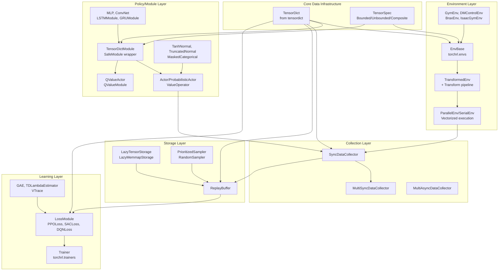

Sources: [README.md:71-82](), [torchrl/objectives/__init__.py:61-121]()

## Core Components

- **TensorDict**: Central data container supporting batch operations (`stack`, `reshape`, indexing) and device transfers [README.md:41-44]().
- **Environment System**: Unified environment abstractions (`EnvBase`, `TransformedEnv`, `ParallelEnv`) supporting Gym/Gymnasium, DMControl, and custom backends [README.md:99-102]().
- **Module and Policy System**: Wraps PyTorch modules with explicit `in_keys` and `out_keys` via `TensorDictModule`, `Actor`, `ProbabilisticActor`, and `ValueOperator` [README.md:104-114]().
- **Data Collection**: Synchronous and asynchronous collectors (`SyncDataCollector`, `MultiSyncDataCollector`) that gather trajectories into `TensorDict` batches [README.md:76-79]().
- **Replay Buffers**: Composable storage backend architecture combining `Storage`, `Sampler`, and `Writer` components [README.md:78-79]().
- **Loss Modules**: Stateful PyTorch modules implementing RL objectives (e.g., `PPOLoss`, `SACLoss`, `DQNLoss`, `DDPGLoss`) using the TensorDict convention [torchrl/objectives/__init__.py:61-121](), [docs/source/reference/objectives.rst:8-18]().

Sources: [README.md:41-114](), [torchrl/objectives/__init__.py:61-121](), [docs/source/reference/objectives.rst:8-18]()

---

## Roadmap & Child Pages

### 1.1. Getting Started

For details on installation options (including PyPI, nightly builds, and editable installs with `uv` or `pip`), optional dependency groups, your first rollout code, and pointers to the getting-started tutorial series and knowledge base installation guides, see [Getting Started](#1.1).

Sources: [README.md:46-51](), [docs/source/index.rst:14-95](), [CONTRIBUTING.md:5-43]()

### 1.2. Repository Layout

For details on the structure and organization of the repository (`torchrl/` library packages, `test/`, `sota-implementations/`, `examples/`, `benchmarks/`, `sota-check/`, `docs/`, and `knowledge_base/`) and how they interrelate, see [Repository Layout](#1.2).

Sources: [README.md:46-51](), [docs/source/index.rst:86-158]()

---

# Page: Getting Started

# Getting Started

<details>
<summary>Relevant source files</summary>

The following files were used as context for generating this wiki page:

- [.github/RELEASE_AGENT_PROMPT.md](.github/RELEASE_AGENT_PROMPT.md)
- [.github/scripts/pre-build-script-win.sh](.github/scripts/pre-build-script-win.sh)
- [.github/scripts/pre-build-script.sh](.github/scripts/pre-build-script.sh)
- [.github/scripts/td_script.sh](.github/scripts/td_script.sh)
- [.github/scripts/version_script.bat](.github/scripts/version_script.bat)
- [.github/unittest/linux_olddeps/scripts_gym_0_13/install.sh](.github/unittest/linux_olddeps/scripts_gym_0_13/install.sh)
- [.github/workflows/build-wheels-aarch64-linux.yml](.github/workflows/build-wheels-aarch64-linux.yml)
- [.github/workflows/build-wheels-linux.yml](.github/workflows/build-wheels-linux.yml)
- [.github/workflows/build-wheels-m1.yml](.github/workflows/build-wheels-m1.yml)
- [.github/workflows/build-wheels-windows.yml](.github/workflows/build-wheels-windows.yml)
- [.github/workflows/release.yml](.github/workflows/release.yml)
- [docs/source/reference/knowledge_base.rst](docs/source/reference/knowledge_base.rst)
- [knowledge_base/DM_CONTROL_INSTALLATION.md](knowledge_base/DM_CONTROL_INSTALLATION.md)
- [knowledge_base/GYM.md](knowledge_base/GYM.md)
- [knowledge_base/HABITAT.md](knowledge_base/HABITAT.md)
- [knowledge_base/MUJOCO_INSTALLATION.md](knowledge_base/MUJOCO_INSTALLATION.md)
- [knowledge_base/PRO-TIPS.md](knowledge_base/PRO-TIPS.md)
- [knowledge_base/README.md](knowledge_base/README.md)
- [knowledge_base/RESOURCES.md](knowledge_base/RESOURCES.md)
- [knowledge_base/VIDEO_CUSTOMISATION.md](knowledge_base/VIDEO_CUSTOMISATION.md)
- [pyproject.toml](pyproject.toml)
- [setup.py](setup.py)
- [tutorials/sphinx-tutorials/export.py](tutorials/sphinx-tutorials/export.py)
- [tutorials/sphinx-tutorials/getting-started-0.py](tutorials/sphinx-tutorials/getting-started-0.py)
- [tutorials/sphinx-tutorials/getting-started-1.py](tutorials/sphinx-tutorials/getting-started-1.py)
- [tutorials/sphinx-tutorials/getting-started-2.py](tutorials/sphinx-tutorials/getting-started-2.py)
- [tutorials/sphinx-tutorials/getting-started-4.py](tutorials/sphinx-tutorials/getting-started-4.py)
- [tutorials/sphinx-tutorials/getting-started-5.py](tutorials/sphinx-tutorials/getting-started-5.py)
- [tutorials/sphinx-tutorials/memory_efficient_rl.py](tutorials/sphinx-tutorials/memory_efficient_rl.py)
- [version.txt](version.txt)

</details>


## Purpose and Scope
This page covers the foundational setup for TorchRL, including core and optional dependency installation, build configurations for C++/CUDA extensions, a minimal first rollout and training loop pattern, and navigation pointers to the getting-started tutorial series and knowledge base installation guides.

Sources: [setup.py:1-49](), [pyproject.toml:1-48]()

---

## 1. Installation and Core Requirements

TorchRL is a modular, python-first PyTorch library for reinforcement learning. Its core dependencies are lightweight, centering around PyTorch and `tensordict`.

### Core Requirements
- `torch>=2.1.0` [pyproject.toml:41-41]()
- `tensordict>=0.14.2,<0.15.0` [pyproject.toml:47-47]()
- Supporting utilities: `numpy`, `packaging`, `cloudpickle`, `pyvers`, `hoptorch` [pyproject.toml:40-48]()

### Installing Core Packages
You can install TorchRL directly from PyPI or build it from source. Building from source invokes `setup.py`, which validates the presence of `pybind11` to compile high-performance C++ and CUDA extensions:

```bash
pip install torchrl
```

For editable installs from source:
```bash
git clone https://github.com/pytorch/rl.git
cd rl
pip install -e .
```

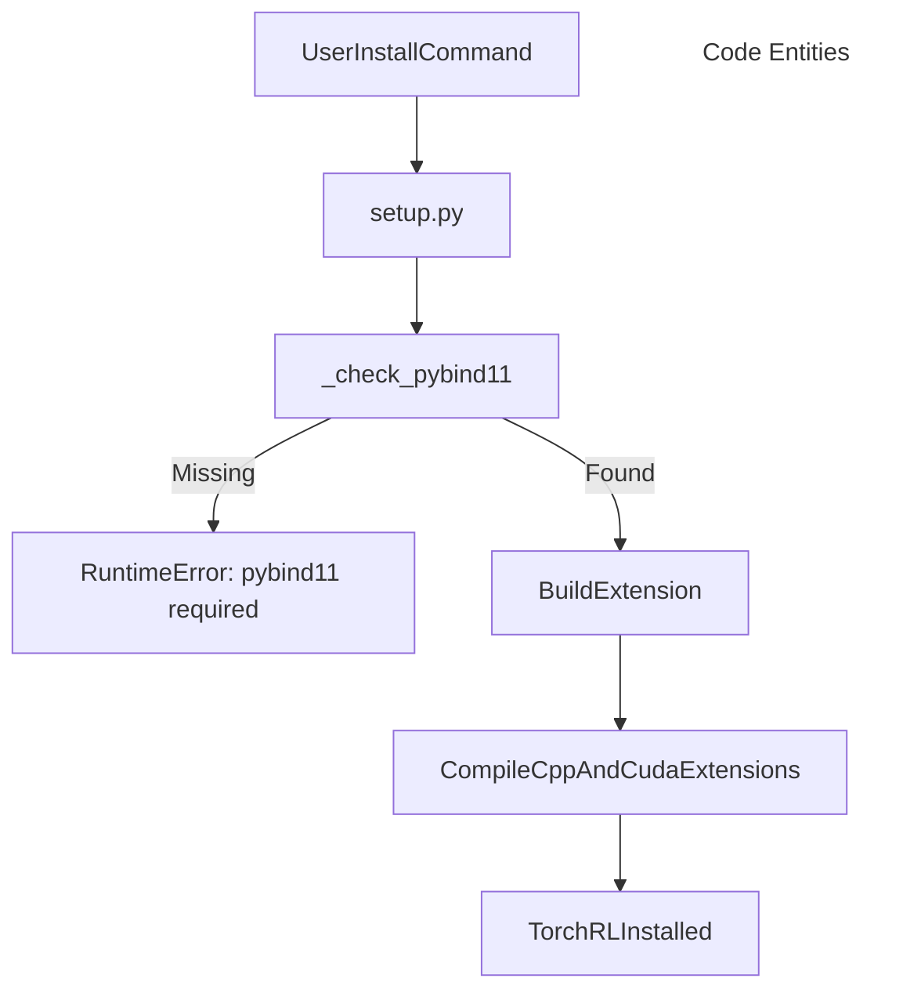
*Figure 1: TorchRL Build and Installation Dataflow.*

Sources: [setup.py:31-49](), [pyproject.toml:40-48]()

---

## 2. Optional Dependency Groups

TorchRL organizes optional backends, environments, and specialized workloads into explicit optional-dependency groups defined in `pyproject.toml`. You can install these groups using bracket notation (e.g., `pip install torchrl[atari,gym_continuous]`).

| Dependency Group | Key Packages Included | Target Workload / Domain |
| :--- | :--- | :--- |
| `atari` | `gymnasium[atari]` [pyproject.toml:93-93]() | Atari 2600 environments |
| `dm_control` | `dm_control` [pyproject.toml:94-94]() | DeepMind Control Suite |
| `gym_continuous` | `gymnasium<1.0`, `mujoco` [pyproject.toml:96-96]() | Continuous control benchmarks |
| `marl` | `vmas`, `pettingzoo`, `dm-meltingpot` [pyproject.toml:145-145]() | Multi-Agent RL |
| `llm` / `llm-vllm` / `grpo` | `transformers`, `vllm`, `ray`, `peft` [pyproject.toml:161-203]() | RLHF and LLM alignment (GRPO) |
| `vla` | `lerobot`, `torchvision` [pyproject.toml:101-101]() | Vision-Language-Action models |
| `checkpointing` | `torchsnapshot` [pyproject.toml:133-133]() | Distributed snapshotting |

Sources: [pyproject.toml:92-203]()

---

## 3. First Rollout and Training Loop

TorchRL decouples environment interaction from policy evaluation using the `TransformedEnv`, `Collector`, and `ReplayBuffer` abstractions. Below is a minimal code pattern demonstrating how environments and collectors are assembled.

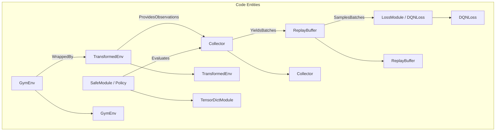
*Figure 2: Component Interaction in TorchRL Training Loops.*

### Rollout Implementation Reference
The standard pattern for setting up an environment with transforms, a policy module, and a synchronous collector is illustrated in TorchRL's Sphinx tutorials:

1. **Environment Wrapping**: Wrap standard Gym environments with `TransformedEnv` and sequence observation preprocessing steps via `Compose` [tutorials/sphinx-tutorials/export.py:86-91]().
2. **Policy Construction**: Combine neural network modules (`ConvNet`) with operator wrappers (`QValueModule`) into a `TensorDictSequential` container [tutorials/sphinx-tutorials/export.py:94-96]().
3. **Data Collection**: Instantiate a `Collector` to coordinate environment steps and policy inference [tutorials/sphinx-tutorials/export.py:105-112]().

Sources: [tutorials/sphinx-tutorials/export.py:50-144]()

---

## 4. Documentation Series and Knowledge Base Guides

When encountering environment-specific installation challenges or aiming to deepen your understanding, consult the official learning resources:

- **Getting Started Tutorials**: Step-by-step guides covering basic Q-learning, PPO, and module export under `tutorials/sphinx-tutorials/` [tutorials/sphinx-tutorials/export.py:1-40]().
- **Knowledge Base Install Guides**: Detailed system dependency setups for complex simulators:
  - MuJoCo rendering and EGL backend configurations (`knowledge_base/MUJOCO_INSTALLATION.md`) [knowledge_base/MUJOCO_INSTALLATION.md:1-61]().
  - DMControl and Gym backend integrations (`knowledge_base/DM_CONTROL_INSTALLATION.md`, `knowledge_base/GYM.md`) [docs/source/reference/knowledge_base.rst]().
  - Troubleshooting tips and environment acceleration (`knowledge_base/PRO-TIPS.md`) [docs/source/reference/knowledge_base.rst]().

Sources: [docs/source/reference/knowledge_base.rst](), [knowledge_base/MUJOCO_INSTALLATION.md:1-61]()

---

# Page: Repository Layout

# Repository Layout

<details>
<summary>Relevant source files</summary>

The following files were used as context for generating this wiki page:

- [.github/unittest/linux_sota/scripts/test_sota.py](.github/unittest/linux_sota/scripts/test_sota.py)
- [.github/workflows/docs.yml](.github/workflows/docs.yml)
- [README.md](README.md)
- [docs/requirements.txt](docs/requirements.txt)
- [docs/source/conf.py](docs/source/conf.py)
- [docs/source/index.rst](docs/source/index.rst)
- [docs/source/reference/objectives.rst](docs/source/reference/objectives.rst)
- [docs/source/reference/objectives_other.rst](docs/source/reference/objectives_other.rst)
- [examples/distributed/collectors/multi_nodes/delayed_dist.py](examples/distributed/collectors/multi_nodes/delayed_dist.py)
- [examples/distributed/collectors/multi_nodes/delayed_rpc.py](examples/distributed/collectors/multi_nodes/delayed_rpc.py)
- [examples/distributed/collectors/multi_nodes/generic.py](examples/distributed/collectors/multi_nodes/generic.py)
- [examples/distributed/collectors/multi_nodes/ray_train.py](examples/distributed/collectors/multi_nodes/ray_train.py)
- [examples/distributed/collectors/multi_nodes/rpc.py](examples/distributed/collectors/multi_nodes/rpc.py)
- [examples/distributed/collectors/multi_nodes/sync.py](examples/distributed/collectors/multi_nodes/sync.py)
- [examples/distributed/collectors/single_machine/generic.py](examples/distributed/collectors/single_machine/generic.py)
- [examples/distributed/collectors/single_machine/rpc.py](examples/distributed/collectors/single_machine/rpc.py)
- [examples/distributed/collectors/single_machine/sync.py](examples/distributed/collectors/single_machine/sync.py)
- [examples/distributed/replay_buffers/distributed_replay_buffer.py](examples/distributed/replay_buffers/distributed_replay_buffer.py)
- [sota-implementations/cql/cql_online.py](sota-implementations/cql/cql_online.py)
- [sota-implementations/cql/discrete_cql_online.py](sota-implementations/cql/discrete_cql_online.py)
- [sota-implementations/crossq/crossq.py](sota-implementations/crossq/crossq.py)
- [sota-implementations/ddpg/ddpg.py](sota-implementations/ddpg/ddpg.py)
- [sota-implementations/discrete_sac/discrete_sac.py](sota-implementations/discrete_sac/discrete_sac.py)
- [sota-implementations/iql/discrete_iql.py](sota-implementations/iql/discrete_iql.py)
- [sota-implementations/iql/iql_online.py](sota-implementations/iql/iql_online.py)
- [sota-implementations/sac/sac.py](sota-implementations/sac/sac.py)
- [sota-implementations/td3/td3.py](sota-implementations/td3/td3.py)
- [torchrl/collectors/distributed/utils.py](torchrl/collectors/distributed/utils.py)
- [torchrl/objectives/__init__.py](torchrl/objectives/__init__.py)

</details>


This page provides a comprehensive technical map of the `pytorch/rl` repository structure. It breaks down the internal library packages under `torchrl/`, reference implementations under `sota-implementations/`, standalone examples under `examples/`, validation suites under `sota-check/` and `test/`, performance benchmarks under `benchmarks/`, and documentation assets under `docs/` and `knowledge_base/`.

---

## 1. Top-Level Repository Architecture

The repository is organized around a modular PyTorch-native reinforcement learning paradigm. The core library lives inside the `torchrl/` directory, while surrounding directories provide documentation, verification scripts, SOTA reference algorithms, and tests.

```mermaid
graph TD
    Root["pytorch/rl Root"] --> TorchRL["torchrl/ (Core Library)"]
    Root --> SotaImp["sota-implementations/ (Reference Algorithms)"]
    Root --> Examples["examples/ (Standalone & Distributed Code)"]
    Root --> TestDir["test/ (Unit Test Suite)"]
    Root --> Benchmarks["benchmarks/ (Performance Suite)"]
    Root --> Docs["docs/ (Sphinx Documentation)"]
    Root --> KB["knowledge_base/ (Guides & Troubleshooting)"]

    TorchRL --> Envs["torchrl/envs/"]
    TorchRL --> Collectors["torchrl/collectors/"]
    TorchRL --> Data["torchrl/data/"]
    TorchRL --> Modules["torchrl/modules/"]
    TorchRL --> Objectives["torchrl/objectives/"]
    TorchRL --> Checkpoint["torchrl/checkpoint/"]

    SotaImp --> SAC["sac/sac.py"]
    SotaImp --> DDPG["sota-implementations/ddpg/ddpg.py"]
    SotaImp --> TD3["sota-implementations/td3/td3.py"]
    SotaImp --> CQL["sota-implementations/cql/cql_online.py"]

    style Root fill:none,stroke:#000,stroke-width:2px
    style TorchRL fill:none,stroke:#000,stroke-width:1px
    style SotaImp fill:none,stroke:#000,stroke-width:1px
```

*Sources: [README.md:1-142](), [docs/source/index.rst:1-164]()*

---

## 2. Core Library Layout (`torchrl/`)

The `torchrl/` package implements the foundational primitives for reinforcement learning, exposing modular APIs built around `TensorDict`.

### Library Submodules
- **`torchrl/envs/`**: Implements environment abstractions (`EnvBase`, `TransformedEnv`), environment wrappers for backends like Gym/Gymnasium, DMControl, Brax, VMAS, and vectorized execution via `ParallelEnv` and `SerialEnv`.
- **`torchrl/collectors/`**: Houses synchronous, asynchronous, and multi-worker rollout collectors (`BaseCollector`, `SyncCollector`, `MultiThreadCollector`) along with distributed weight synchronization schemes (`WeightSyncScheme`).
- **`torchrl/data/`**: Manages experience storage and dataset abstractions, including composable replay buffers (`ReplayBuffer`, storages, samplers, writers) and offline dataset pipelines (D4RL, Minari, Atari-DQN).
- **`torchrl/modules/`**: Contains neural network utilities, including `TensorDictModule`, `SafeModule`, actors, critics, exploration modules (`EGreedy`, `OrnsteinUhlenbeck`), and model-based RSSM/Dreamer components.
- **`torchrl/objectives/`**: Provides stateful, modular loss computation classes (`LossModule`, `ClipPPOLoss`, `SACLoss`, `DDPGLoss`, `DreamerV3Loss`) and advantage estimation methods (`ValueEstimators`, GAE).
- **`torchrl/checkpoint/`**: Implements unified run state checkpointing, resumption workflows, and manifest management via `Checkpoint` and `RunCheckpointer`.
- **`torchrl/record/`**: Handles metric logging (WandB, TensorBoard, CSV, MLflow) and video recording transforms (`VideoRecorder`).

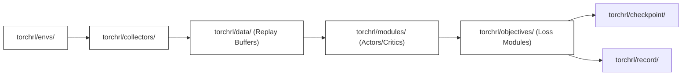

*Sources: [README.md:1-142](), [torchrl/objectives/__init__.py:1-121]()*

---

## 3. Reference Implementations (`sota-implementations/`)

The `sota-implementations/` directory contains self-contained, production-grade training scripts for modern reinforcement learning algorithms. Each subdirectory typically includes a primary execution script (e.g., `sac.py`, `ddpg.py`, `cql_online.py`) and a `utils.py` file handling environment construction, agent creation, and logging setup.

### Key Algorithm Folders
- `sota-implementations/sac/`: Off-policy maximum entropy reinforcement learning via `sota-implementations/sac/sac.py`.
- `sota-implementations/ddpg/`: Deterministic policy gradients via `sota-implementations/ddpg/ddpg.py`.
- `sota-implementations/td3/`: Twin Delayed DDPG via `sota-implementations/td3/td3.py`.
- `sota-implementations/cql/`: Conservative Q-Learning via `sota-implementations/cql/cql_online.py`.
- `sota-implementations/ppo/`: On-policy clipped surrogate loss optimization (`ppo_mujoco.py`, `ppo_atari.py`).
- `sota-implementations/vla_grpo/`: Vision-Language-Action Group Relative Policy Optimization pipelines.

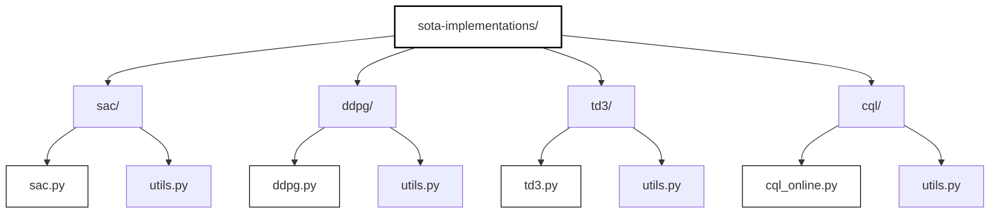

*Sources: [sota-implementations/sac/sac.py:1-204](), [sota-implementations/ddpg/ddpg.py:1-203](), [sota-implementations/td3/td3.py:1-206](), [sota-implementations/cql/cql_online.py:1-206]()*

---

## 4. Standalone Examples, Testing, and Verification

### Standalone Examples (`examples/`)
The `examples/` directory houses decoupled example scripts demonstrating advanced features such as distributed collectors, RPC-based multi-node execution, offline dataset ingestion, and custom environment menageries.

### Unit Tests and Verification (`test/` and `sota-check/`)
- **`test/`**: Comprehensive pytest unit test suite validating individual library modules (envs, collectors, data structures, losses, and modules).
- **SOTA Verification**: Automated integration testing of state-of-the-art scripts is coordinated via `.github/unittest/linux_sota/scripts/test_sota.py`, which executes short-horizon training sanity checks across algorithms like `dqn_trainer_resume`, `sac_resume`, `td3_resume`, `ddpg_resume`, and `vla_grpo`.

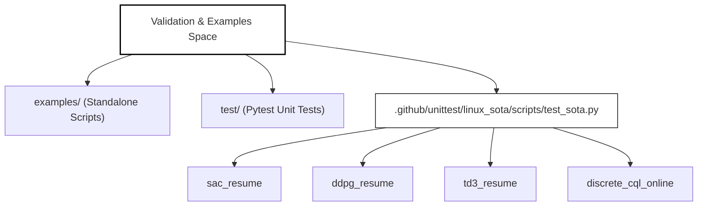

*Sources: [.github/unittest/linux_sota/scripts/test_sota.py:1-211]()*

---

## 5. Documentation and Knowledge Base (`docs/` and `knowledge_base/`)

### Documentation System (`docs/`)
- **`docs/source/conf.py`**: Configuration file for the Sphinx documentation builder, setting up extensions (`sphinx.ext.autodoc`, `myst_parser`, `sphinx_gallery`), intersphinx mappings, and release version sanitization [docs/source/conf.py:1-196]().
- **`docs/requirements.txt`**: Specifies external documentation dependencies, rendering tools, and integration packages [docs/requirements.txt:1-39]().
- **CI Documentation Workflow**: Defined in `.github/workflows/docs.yml`, handling Linux container provisioning, system library installations (GLFW, OpenGL, FFmpeg), environment setup, and Sphinx HTML generation [-.github/workflows/docs.yml:1-139]().

### Knowledge Base (`knowledge_base/`)
Contains troubleshooting guides, environment setup notes (MuJoCo, DMControl, Habitat), platform-specific build instructions, and developer best practices referenced in the main index [docs/source/index.rst:1-164]().

*Sources: [.github/workflows/docs.yml:1-139](), [docs/source/conf.py:1-196](), [docs/requirements.txt:1-39](), [docs/source/index.rst:1-164]()*

---

# Page: Core Data Infrastructure

# Core Data Infrastructure

<details>
<summary>Relevant source files</summary>

The following files were used as context for generating this wiki page:

- [benchmarks/test_replaybuffer_benchmark.py](benchmarks/test_replaybuffer_benchmark.py)
- [docs/source/reference/data.rst](docs/source/reference/data.rst)
- [docs/source/reference/data_replaybuffers.rst](docs/source/reference/data_replaybuffers.rst)
- [test/rb/test_rb_core.py](test/rb/test_rb_core.py)
- [test/rb/test_rb_distributed.py](test/rb/test_rb_distributed.py)
- [test/rb/test_storages.py](test/rb/test_storages.py)
- [test/test_specs.py](test/test_specs.py)
- [test/test_utils.py](test/test_utils.py)
- [torchrl/_comm/replay_service.py](torchrl/_comm/replay_service.py)
- [torchrl/_utils.py](torchrl/_utils.py)
- [torchrl/collectors/collectors.py](torchrl/collectors/collectors.py)
- [torchrl/data/__init__.py](torchrl/data/__init__.py)
- [torchrl/data/replay_buffers/__init__.py](torchrl/data/replay_buffers/__init__.py)
- [torchrl/data/replay_buffers/ray_buffer.py](torchrl/data/replay_buffers/ray_buffer.py)
- [torchrl/data/replay_buffers/replay_buffers/base.py](torchrl/data/replay_buffers/replay_buffers/base.py)
- [torchrl/data/tensor_specs.py](torchrl/data/tensor_specs.py)
- [torchrl/envs/batched_envs.py](torchrl/envs/batched_envs.py)
- [torchrl/envs/common.py](torchrl/envs/common.py)
- [torchrl/envs/gym_like.py](torchrl/envs/gym_like.py)
- [torchrl/envs/libs/gym.py](torchrl/envs/libs/gym.py)
- [torchrl/envs/transforms/transforms.py](torchrl/envs/transforms/transforms.py)
- [torchrl/envs/utils.py](torchrl/envs/utils.py)

</details>


TorchRL's core data infrastructure provides foundational, type-safe data containers, type validation systems, and specialized memory maps that all modular RL components use for communication. The system revolves around three primary pillars: universal tensor dictionaries (`TensorDict`), structural and type validation specifications (`TensorSpec`), and specialized tensor maps and tree structures for planning (`torchrl/data/map`).

**Scope**: As a parent page, this section introduces the high-level architecture of TorchRL's data infrastructure. For deep technical implementation details, operations, and advanced usage patterns, refer to the child pages:
- [TensorDict System](#2.1) — Explain TensorDict as the universal data container, its operations, and how it enables composable RL components
- [TensorSpec System](#2.2) — Document the TensorSpec type system for defining tensor properties, validating data, and ensuring spec compatibility across environments and models
- [MCTS Forests and Tensor Maps](#2.3) — Document `torchrl/data/map`: `TensorDictMap`, hashing, query modules and the MCTS Forest/Tree structures.

---

## Architecture Overview

The core data infrastructure establishes a unified data contract between environments, collectors, replay buffers, policy modules, and planning algorithms.

Title: Core Data Infrastructure Architecture
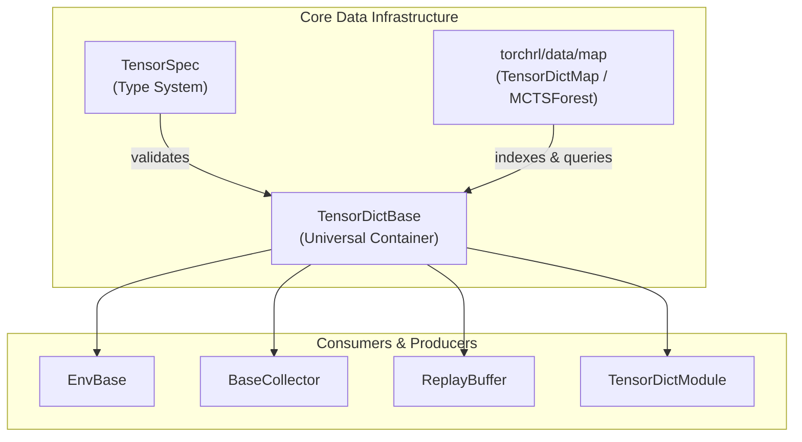
Sources: [torchrl/data/__init__.py:22-32](), [torchrl/data/tensor_specs.py:589-615]()

---

## 2.1 TensorDict System

`TensorDict` (provided by the underlying `tensordict` library) acts as the universal data container across TorchRL. It behaves like a dictionary whose values are tensors (or tensor-like collections) that share a common batch size. This abstraction allows environment transitions, rollout trajectories, and batched policy inputs to be manipulated as unified batch-aware structures.

For complete documentation on container operations, hierarchical nesting, concatenation, and memory efficiency, see [TensorDict System](#2.1).

Sources: [torchrl/envs/common.py:20-25](), [torchrl/data/__init__.py:68-98]()

---

## 2.2 TensorSpec System

The `TensorSpec` type system defines structural and domain constraints (shape, dtype, device, bounds) for tensor data exchanged between TorchRL components. Every environment, policy, and loss module declares its input/output expectations using specs.

Title: TensorSpec Hierarchy and Validation
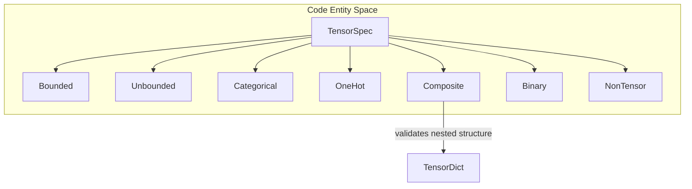
Sources: [torchrl/data/tensor_specs.py:589-615](), [torchrl/data/__init__.py:99-117]()

For detailed documentation on spec validation (`is_in`), encoding (`encode`), projection (`project`), and Gym interoperability, see [TensorSpec System](#2.2).

---

## 2.3 MCTS Forests and Tensor Maps

TorchRL includes specialized mapping and tree structures under `torchrl/data/map` designed for Monte Carlo Tree Search (MCTS) and embedding-based retrieval. These structures integrate closely with `TensorDict` to store and query trajectories or search nodes efficiently.

Title: Tensor Map and MCTS Forest Architecture
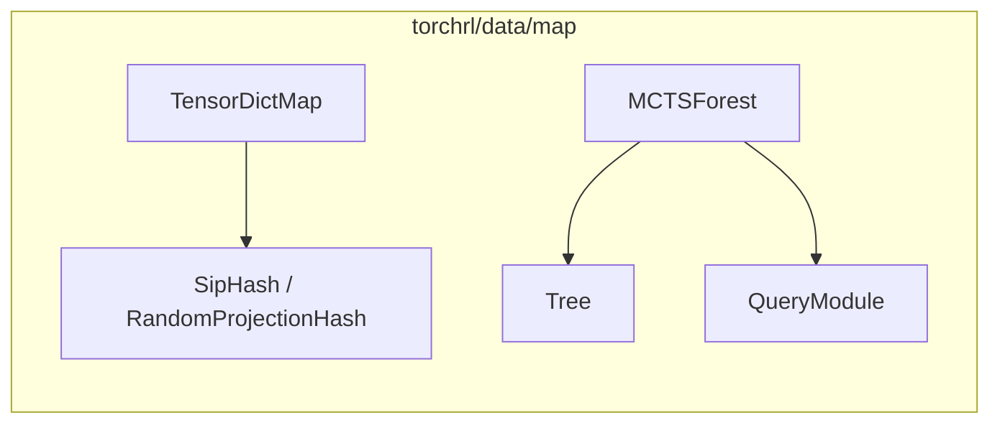
Sources: [torchrl/data/__init__.py:22-32]()

Key components exposed in `torchrl.data`:
- **`TensorDictMap` & `TensorMap`**: Map keys/hashes to structured `TensorDict` nodes [torchrl/data/__init__.py:22-32]().
- **`MCTSForest` & `Tree`**: Specialized tree structures for managing search nodes during planning algorithms [torchrl/data/__init__.py:22-32]().
- **`QueryModule` & Hashing (`SipHash`, `RandomProjectionHash`)**: Modules for state hashing and similarity queries [torchrl/data/__init__.py:22-32]().

For detailed documentation on MCTS node management, hashing strategies, and query modules, see [MCTS Forests and Tensor Maps](#2.3).

---

# Page: TensorDict System

# TensorDict System

<details>
<summary>Relevant source files</summary>

The following files were used as context for generating this wiki page:

- [.github/workflows/docs.yml](.github/workflows/docs.yml)
- [README.md](README.md)
- [docs/requirements.txt](docs/requirements.txt)
- [docs/source/conf.py](docs/source/conf.py)
- [docs/source/index.rst](docs/source/index.rst)
- [docs/source/reference/objectives.rst](docs/source/reference/objectives.rst)
- [docs/source/reference/objectives_other.rst](docs/source/reference/objectives_other.rst)
- [torchrl/data/utils.py](torchrl/data/utils.py)
- [torchrl/objectives/__init__.py](torchrl/objectives/__init__.py)

</details>


## Purpose and Scope

This document details **TensorDict** as TorchRL's universal data container, its core operations, and how it enables composable, type-safe reinforcement learning components. TensorDict is a dictionary-like tensor container provided by the [`tensordict`](https://github.com/pytorch/tensordict/) library and used across TorchRL for environment states, observations, actions, rewards, and multi-agent rollouts [README.md:42-44]().

This page covers:
- TensorDict's structural invariants (batch size consistency and nested keys)
- Core tensor operations (indexing, stacking, concatenation, device transfers)
- Composable module integration via `in_keys` and `out_keys` (`tensordict.nn.TensorDictModule`) [README.md:104-114]()
- Data flow across environments (`EnvBase`), collectors, replay buffers, and loss modules
- Utility functions for spec manipulation and consolidation (`torchrl/data/utils.py`) [torchrl/data/utils.py:74-183]()

For the type validation system that verifies TensorDict contents, refer to [TensorSpec System](#2.2).

---

## What is TensorDict

TensorDict provides a dictionary-like interface where values are PyTorch tensors or nested TensorDicts sharing a common leading batch dimension. This design removes ad-hoc tuple or dictionary unpacking glue code in RL pipelines [README.md:85-88]().

### System Architecture and Code Entity Mapping

The following diagram bridges the natural language concept of the universal data container to its concrete code entities and files across TorchRL:

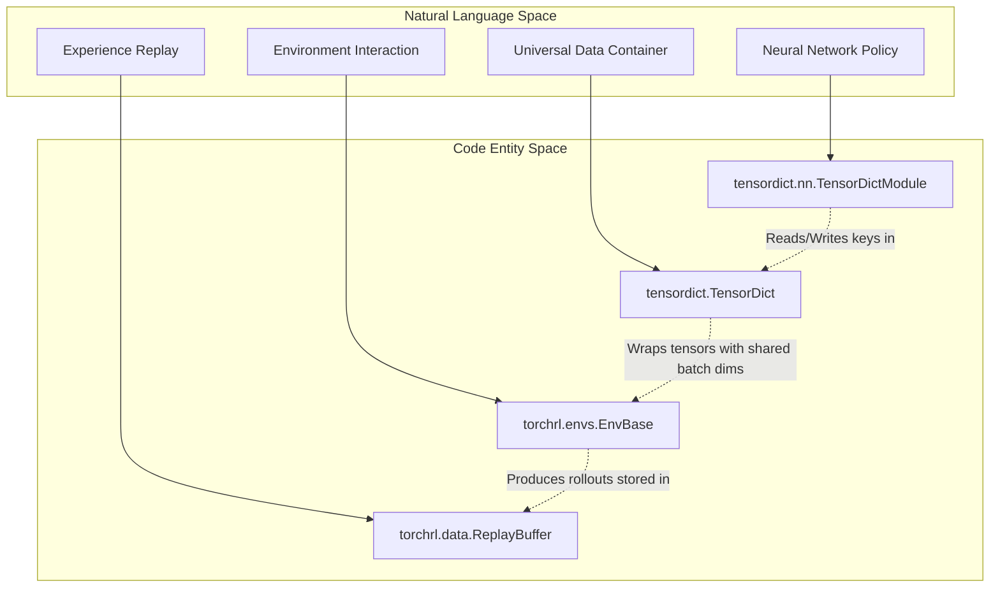

Sources: `README.md:31-45`, `torchrl/objectives/__init__.py:9`

---

## Core Concepts

### Batch Dimensions and Nested Keys

Every TensorDict maintains a `batch_size` attribute (a `torch.Size` tuple). All top-level and nested tensors must have leading dimensions matching or broadcasting with this batch size. Hierarchical organization is achieved via tuple keys (e.g., `("next", "observation")` or `("agents", "agent_0", "action")`) [README.md:75-87]().

---

## Key Operations and Utilities

TensorDict supports standard PyTorch operations while preserving dictionary keys:
- **Indexing and Slicing**: Returns zero-copy views (`td[0]`, `td[5:10]`) [README.md:136-142]()
- **Stacking and Concatenation**: `torch.stack([td1, td2], dim=0)` and `torch.cat([td1, td2], dim=0)`
- **Device Transfers**: `td.to("cuda")` moves all contained tensors simultaneously

### Spec Consolidation Utilities

When working with lazy stacked containers or heterogeneous environment observations, TorchRL provides utility functions in `torchrl/data/utils.py` to normalize and consolidate composite specs [torchrl/data/utils.py:74-139]().

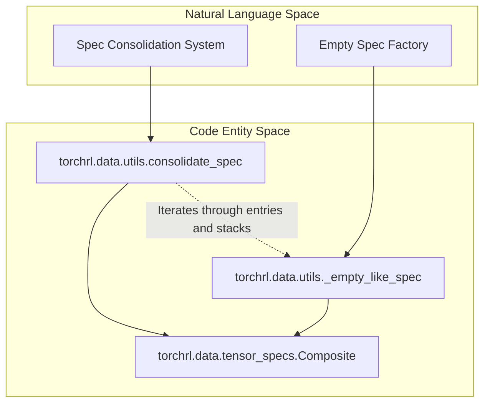

Sources: `torchrl/data/utils.py:74-183`

---

## Integration with TorchRL Modules

Modules interface with TensorDict via `in_keys` and `out_keys`. A `TensorDictModule` reads specified input keys, applies an underlying `nn.Module`, and writes outputs back into the same TensorDict in-place [README.md:104-114]().

```python
policy = TensorDictModule(
    nn.Sequential(nn.LazyLinear(64), nn.Tanh(), nn.Linear(64, 1)),
    in_keys=["observation"],
    out_keys=["action"],
)
```

Sources: `README.md:104-114`

---

## Role in Data Flow

TensorDict flows through the primary pillars of TorchRL:
1. **Environments (`EnvBase`)**: `reset()` returns a TensorDict observation; `step()` accepts an action TensorDict and returns a nested `("next", ...)` TensorDict [README.md:75-82]().
2. **Collectors**: Aggregate trajectories across environments into multi-dimensional rollout TensorDicts [README.md:78]().
3. **Replay Buffers**: Store and sample batches of TensorDicts [README.md:79]().
4. **Loss Modules**: Consume sampled batches, read named keys, and output differentiable loss values [README.md:80]().

Sources: `README.md:71-82`, `docs/source/reference/objectives.rst:8-19`

---

## Summary

TensorDict serves as the universal data container across TorchRL, providing shape consistency, nested hierarchy via tuple keys, zero-copy slicing, and seamless integration with `TensorDictModule` and `LossModule`.

Sources: `README.md:31-45`, `torchrl/data/utils.py:74-183`, `docs/source/reference/objectives.rst:8-19`

---

# Page: TensorSpec System

# TensorSpec System

<details>
<summary>Relevant source files</summary>

The following files were used as context for generating this wiki page:

- [docs/source/reference/data_specs.rst](docs/source/reference/data_specs.rst)
- [test/test_specs.py](test/test_specs.py)
- [test/test_utils.py](test/test_utils.py)
- [test/transforms/test_module_transforms.py](test/transforms/test_module_transforms.py)
- [torchrl/_utils.py](torchrl/_utils.py)
- [torchrl/collectors/collectors.py](torchrl/collectors/collectors.py)
- [torchrl/data/tensor_specs.py](torchrl/data/tensor_specs.py)
- [torchrl/envs/batched_envs.py](torchrl/envs/batched_envs.py)
- [torchrl/envs/common.py](torchrl/envs/common.py)
- [torchrl/envs/gym_like.py](torchrl/envs/gym_like.py)
- [torchrl/envs/libs/gym.py](torchrl/envs/libs/gym.py)
- [torchrl/envs/llm/transforms/browser.py](torchrl/envs/llm/transforms/browser.py)
- [torchrl/envs/llm/transforms/tools.py](torchrl/envs/llm/transforms/tools.py)
- [torchrl/envs/transforms/module.py](torchrl/envs/transforms/module.py)
- [torchrl/envs/transforms/ray_service.py](torchrl/envs/transforms/ray_service.py)
- [torchrl/envs/transforms/transforms.py](torchrl/envs/transforms/transforms.py)
- [torchrl/envs/transforms/utils.py](torchrl/envs/transforms/utils.py)
- [torchrl/envs/utils.py](torchrl/envs/utils.py)
- [torchrl/testing/modules.py](torchrl/testing/modules.py)
- [tutorials/sphinx-tutorials/llm_browser.py](tutorials/sphinx-tutorials/llm_browser.py)

</details>


## Purpose and Scope

The TensorSpec system provides a type-checking, property-definition, and data-validation framework across TorchRL environments, collectors, replay buffers, and neural network modules. `TensorSpec` subclasses define shapes, dtypes, and domain boundaries (such as continuous bounds or discrete categories) for tensor and non-tensor data. This page details the implementation of spec classes, encoding and validation pipelines, memoization strategies, spec consolidation for batched and stacked structures, and integration with environment metadata.

---

## TensorSpec Core Hierarchy and Base Classes

The foundation of the type system is the abstract base class `TensorSpec` in `torchrl/data/tensor_specs.py`. Specialized subclasses extend this base class to represent continuous spaces, discrete categories, binary flags, composite dictionaries, and non-tensor data structures.

### Hierarchy Bridge: Natural Language Space to Code Entity Space

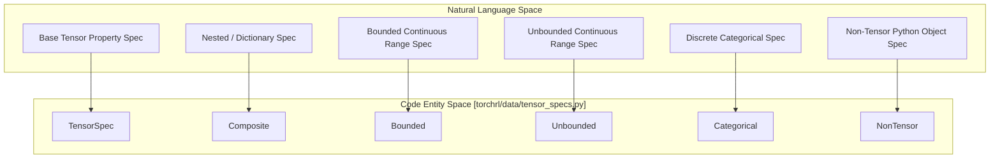

Sources: [torchrl/data/tensor_specs.py:1-41]()

### Key Classes and Roles

- `TensorSpec`: Abstract base class defining shape, device, dtype, and abstract methods like `is_in()`, `encode()`, `rand()`, and `to_numpy()` [torchrl/data/tensor_specs.py:1-120]().
- `Bounded`: Represents continuous tensor domains constrained between lower and upper bounds. Supports projection via `_project()` and random sampling within bounds [test/test_specs.py:52-79]().
- `Unbounded`: Represents unconstrained continuous domains across arbitrary dtypes and shapes [test/test_specs.py:107-124]().
- `Categorical`: Represents discrete integer choices up to a given cardinality [test/test_specs.py:80-106]().
- `Composite`: Manages nested mappings of `TensorSpec` instances, mirroring `TensorDict` data structures [torchrl/envs/common.py:39-45]().
- `NonTensor`: Handles non-tensor Python objects and metadata within spec hierarchies [test/test_specs.py:35]().

Sources: [torchrl/data/tensor_specs.py:1-41](), [test/test_specs.py:25-41]()

---

## Data Validation and Encoding Pipeline

`TensorSpec` implementations provide methods for validating domain membership (`is_in`), converting external data formats into tensors (`encode`), and projecting out-of-bounds values back into valid domains (`_project`).

### Validation and Encoding Flow

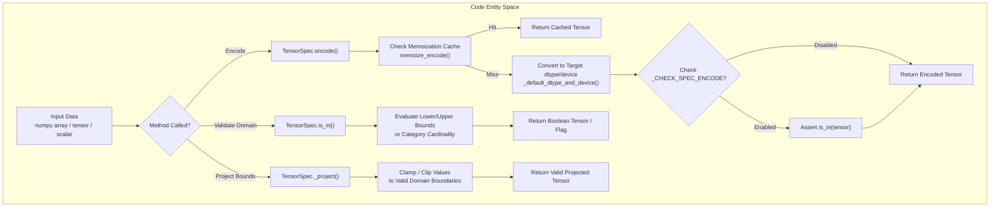

Sources: [torchrl/data/tensor_specs.py:77-126](), [test/test_specs.py:52-106]()

### Core Validation Methods

- `encode(val)`: Converts numpy arrays, lists, or scalars to torch tensors matching the spec's dtype, shape, and device, optionally verifying bounds if `_CHECK_SPEC_ENCODE` is active [test/test_specs.py:70-78]().
- `is_in(val)`: Checks whether a tensor or value falls strictly within the defined domain boundaries [test/test_specs.py:72]().
- `memoize_encode(memo: bool)`: Toggles caching on encoding operations to accelerate repeated conversions of identical numpy structures [test/test_specs.py:56-78]().

Sources: [torchrl/data/tensor_specs.py:77-79](), [test/test_specs.py:52-106]()

---

## Spec Consolidation and Batched Specifications

When handling vectorized environments or heterogeneous parallel rollouts, sub-environments can expose differing keys within their observation or action specs. The consolidation system aligns these specifications.

### Consolidation Bridge: Natural Language Space to Code Entity Space

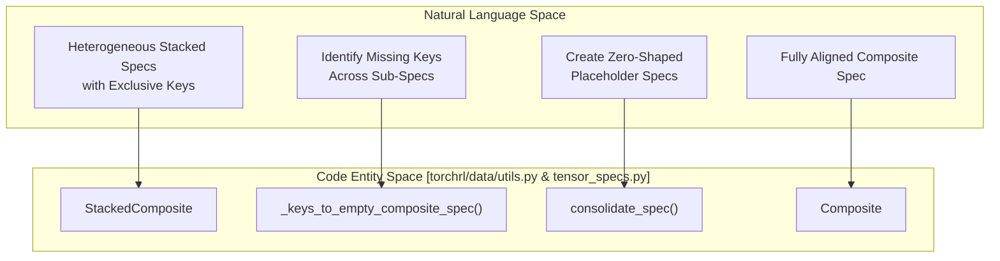

Sources: [test/test_specs.py:25-42]()

### Consolidation Algorithm

The `consolidate_spec` utility ensures uniform keys across stacked specifications by inspecting all sub-specs, identifying keys present in only a subset of members, and injecting zero-shaped placeholder specs for missing entries.

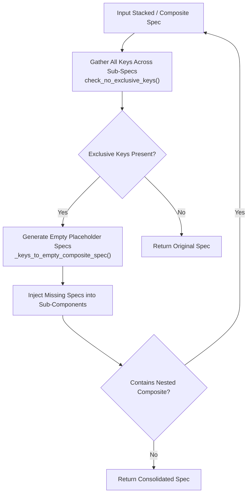

Sources: [test/test_specs.py:25-42]()

---

## Environment Integration and Metadata

Specifications act as the schema contract for `EnvBase` environments. They govern observation, action, reward, and state spaces, validated during environment initialization or rollout generation.

### Environment Metadata and Specification Validation

`EnvMetaData` captures environment specs, batch dimensions, and device mappings to serialize environment configuration across multiprocessing workers and parallel collectors [torchrl/envs/common.py:124-217]().

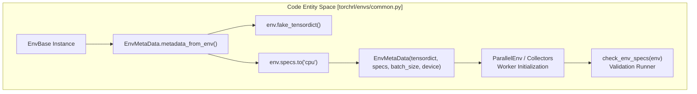

Sources: [torchrl/envs/common.py:124-217](), [torchrl/envs/utils.py:56]()

### Key Integration Utilities

- `EnvMetaData`: Stores environment structure, batch sizes, and device topologies for transfer to subprocess workers [torchrl/envs/common.py:124-148]().
- `metadata_from_env(env)`: Instantiates a fake rollout trajectory using `fake_tensordict()` to infer and extract all specification boundaries [torchrl/envs/common.py:180-216]().
- `check_env_specs(env)`: Validates that environment step and reset operations conform strictly to declared observation and action specifications [torchrl/envs/utils.py:56]().

Sources: [torchrl/envs/common.py:124-217](), [torchrl/envs/utils.py:56]()

---

# Page: MCTS Forests and Tensor Maps

# MCTS Forests and Tensor Maps

<details>
<summary>Relevant source files</summary>

The following files were used as context for generating this wiki page:

- [docs/source/_static/img/mcts_forest.png](docs/source/_static/img/mcts_forest.png)
- [torchrl/data/datasets/common.py](torchrl/data/datasets/common.py)
- [torchrl/data/llm/__init__.py](torchrl/data/llm/__init__.py)
- [torchrl/data/llm/utils.py](torchrl/data/llm/utils.py)
- [torchrl/data/map/__init__.py](torchrl/data/map/__init__.py)
- [torchrl/data/map/hash.py](torchrl/data/map/hash.py)
- [torchrl/data/map/query.py](torchrl/data/map/query.py)
- [torchrl/data/map/tdstorage.py](torchrl/data/map/tdstorage.py)
- [torchrl/data/map/tree.py](torchrl/data/map/tree.py)
- [torchrl/data/map/utils.py](torchrl/data/map/utils.py)

</details>


## Purpose and Scope
This page documents the components under `torchrl/data/map`, which provide state-action hashing, storage indexing, and Monte Carlo Tree Search (MCTS) tree and forest structures built on top of the `TensorDict` and `TensorClass` ecosystems. These modules enable efficient state lookup, replay mapping, and tree-based planning algorithms within TorchRL.

---

## 1. Hashing and Feature Transformation
The hashing submodule (`torchrl/data/map/hash.py`) provides neural network modules designed to convert continuous or discrete tensor observations and states into hash values or compact representations suitable for dictionary-like lookups.

- **`BinaryToDecimal`**: Converts binary-encoded tensors into decimal integer representations [torchrl/data/map/hash.py:13-40](). It reshapes features and uses dot products over pre-computed bases to aggregate bits [torchrl/data/map/hash.py:54-72]().
- **`SipHash`**: Computes `SipHash` values for given input tensors [torchrl/data/map/hash.py:75-80](). It serializes input batches into byte strings and maps them via Python's built-in `hash` function into `int64` tensors [torchrl/data/map/hash.py:106-116]().
- **`RandomProjectionHash`**: Combines random projections with `SipHash` to project high-dimensional inputs into a low-dimensional space before hashing [torchrl/data/map/hash.py:119-138]().

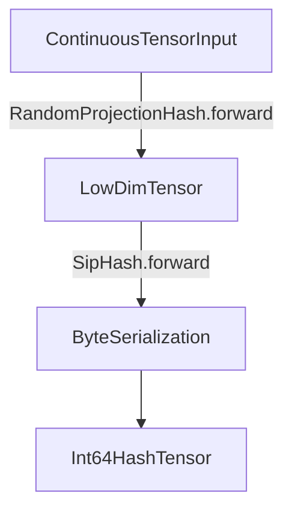
Sources: `torchrl/data/map/hash.py:13-171()`

---

## 2. Query Modules and Indexing
Query modules (`torchrl/data/map/query.py`) bridge raw `TensorDict` inputs with storage indices by orchestrating hashing and mapping steps.

- **`HashToInt`**: Statefully maps hash integer values to contiguous non-negative integer indices used for indexing storage backends [torchrl/data/map/query.py:23-42](). It maintains an internal `_index_to_index` mapping dictionary and supports state saving/loading [torchrl/data/map/query.py:28-57]().
- **`QueryModule`**: A `TensorDictModuleBase` subclass that reads specified `in_keys` from a `TensorDict`, computes hashes via `hash_module` or `aggregator`, and converts them to storage indices via `hash_to_int` [torchrl/data/map/query.py:59-124](). The resulting index and hash are written back to designated output keys (`index_key` and `hash_key`) [torchrl/data/map/query.py:117-134]().

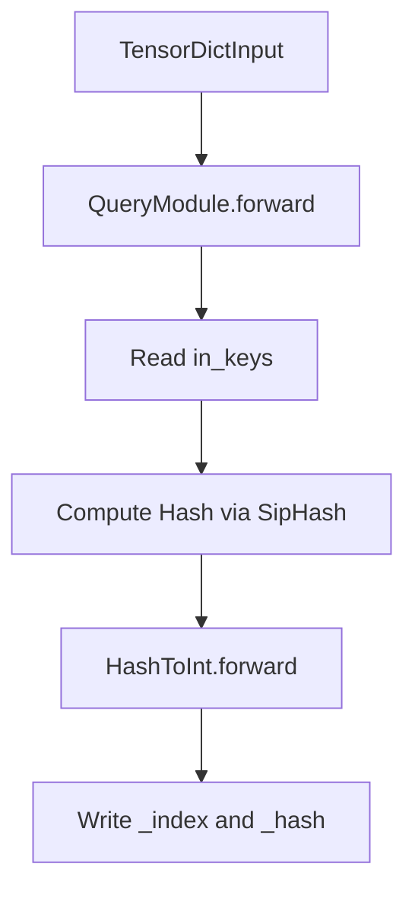
Sources: `torchrl/data/map/query.py:23-165()`

---

## 3. TensorDictMap and Storages
The `torchrl/data/map/tdstorage.py` module defines abstract and concrete map storages for `TensorDict` objects.

- **`TensorMap`**: An abstract base class defining the interface (`clear`, `__getitem__`, `__setitem__`, `__len__`, `contains`) for key-value maps [torchrl/data/map/tdstorage.py:29-57]().
- **`TensorDictMap`**: A `TensorDictModuleBase` and `TensorMap` implementation that combines a `QueryModule` with one or more tensor storage backends (e.g., `TensorStorage`, `LazyTensorStorage`) [torchrl/data/map/tdstorage.py:59-136](). It allows indexing storage data directly using structured `TensorDict` query keys [torchrl/data/map/tdstorage.py:93-116]().

Sources: `torchrl/data/map/tdstorage.py:29-190()`

---

## 4. MCTS Trees and Forests
The `torchrl/data/map/tree.py` module implements data structures for Monte Carlo Tree Search algorithms using `TensorClass`.

- **`Tree`**: Represents a single MCTS node or tree structure [torchrl/data/map/tree.py:30-43](). Key attributes include:
  - `count`: Visit count [torchrl/data/map/tree.py:77]()
  - `wins`: Cumulative reward or win statistic [torchrl/data/map/tree.py:78]()
  - `index`: Child node indices in the data map [torchrl/data/map/tree.py:80]()
  - `hash`: Unique hash for the node state-action pair [torchrl/data/map/tree.py:82]()
  - `rollout`: Trajectory rollout data following the node observation [torchrl/data/map/tree.py:85-86]()
  - `node_data`: Tensor data defining the node state before branching [torchrl/data/map/tree.py:89]()
  - `subtree`: Stack of subtrees representing branches taken from actions [torchrl/data/map/tree.py:91-92]()
  - `_parent`: Weak reference(s) to parent nodes [torchrl/data/map/tree.py:95]()
- **`Tree.make_node`**: Class method that initializes a new `Tree` instance from rollout data or observation tensordicts [torchrl/data/map/tree.py:105-132]().

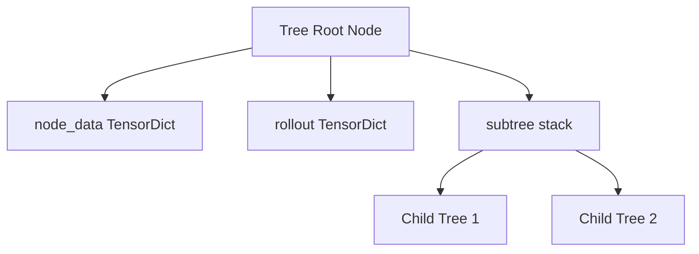
Sources: `torchrl/data/map/tree.py:30-132()`

---

# Page: Environments

# Environments

<details>
<summary>Relevant source files</summary>

The following files were used as context for generating this wiki page:

- [docs/source/reference/envs.rst](docs/source/reference/envs.rst)
- [docs/source/reference/envs_transforms.rst](docs/source/reference/envs_transforms.rst)
- [test/test_specs.py](test/test_specs.py)
- [test/test_utils.py](test/test_utils.py)
- [test/transforms/test_action_transforms.py](test/transforms/test_action_transforms.py)
- [torchrl/_utils.py](torchrl/_utils.py)
- [torchrl/collectors/collectors.py](torchrl/collectors/collectors.py)
- [torchrl/data/tensor_specs.py](torchrl/data/tensor_specs.py)
- [torchrl/envs/__init__.py](torchrl/envs/__init__.py)
- [torchrl/envs/batched_envs.py](torchrl/envs/batched_envs.py)
- [torchrl/envs/common.py](torchrl/envs/common.py)
- [torchrl/envs/gym_like.py](torchrl/envs/gym_like.py)
- [torchrl/envs/libs/gym.py](torchrl/envs/libs/gym.py)
- [torchrl/envs/transforms/__init__.py](torchrl/envs/transforms/__init__.py)
- [torchrl/envs/transforms/_action.py](torchrl/envs/transforms/_action.py)
- [torchrl/envs/transforms/transforms.py](torchrl/envs/transforms/transforms.py)
- [torchrl/envs/utils.py](torchrl/envs/utils.py)
- [torchrl/trainers/algorithms/configs/transforms.py](torchrl/trainers/algorithms/configs/transforms.py)

</details>


## Purpose and Scope

This page provides an overview of TorchRL's environment abstraction layer, which enables uniform interaction with reinforcement learning environments from different backends (Gym, DMControl, Brax, etc.). The environment system is built around foundational base classes, a robust specification system, transform pipelines, backend wrappers, and vectorized execution engines.

**Scoping Note:** As a parent page, this section introduces high-level concepts and architecture. For deep technical details, refer to the following child pages:
- For `EnvBase` internals, the reset/step/rollout interface, and the `TensorSpec` system, see [EnvBase and Environment Specifications](#3.1).
- For the `Transform` system, `TransformedEnv`, and the `Compose` pattern, see [Environment Transforms](#3.2).
- For integrations with external libraries like Gym/Gymnasium, DMControl, Brax, Jumanji, VMAS, and others, see [Backend Integrations](#3.3).
- For vectorized execution via `ParallelEnv`, `SerialEnv`, `AsyncEnvPool`, and shared memory management, see [Batched and Parallel Environments](#3.4).
- For built-in and custom environments such as Pendulum, Chess, TicTacToe, and model-based/Dreamer environments, see [Custom and Built-in Environments](#3.5).

Sources: [torchrl/envs/common.py:1-220](), [torchrl/envs/transforms/transforms.py:1-39]()

## Overview

TorchRL's environment system provides a unified API for interacting with RL environments regardless of their underlying implementation. All environments inherit from `EnvBase` [torchrl/envs/common.py:8()]() and communicate using `TensorDict` objects, which serve as the universal data container throughout the library. This design allows environments to handle arbitrary numbers of inputs and outputs, nested data structures, and batched execution without changing the interface.

The environment system consists of core abstraction layers:
1. **Base Layer**: `EnvBase` defines the core interface (`reset()`, `step()`, `rollout()`) and manages environment specifications. For details, see [EnvBase and Environment Specifications](#3.1).
2. **Transform Layer**: `Transform` and `TransformedEnv` modify environment behavior by preprocessing observations, shaping rewards, or altering actions. For details, see [Environment Transforms](#3.2).
3. **Backend Layer**: Wrapper classes adapt external environment libraries to the TorchRL interface. For details, see [Backend Integrations](#3.3).
4. **Batching Layer**: `ParallelEnv` and `SerialEnv` enable vectorized execution of multiple environment instances. For details, see [Batched and Parallel Environments](#3.4).
5. **Custom and Built-in Environments**: Native PyTorch implementations and model-based environments. For details, see [Custom and Built-in Environments](#3.5).

Sources: [torchrl/envs/common.py:1-220](), [torchrl/envs/batched_envs.py:1-50]()

## EnvBase and Environment Specifications

```mermaid
graph TB
    subgraph "EnvBase Core Interface"
        EnvBase["EnvBase<br/>(common.py)"]
        reset["reset(tensordict) → TensorDict"]
        step["step(tensordict) → TensorDict"]
        rollout["rollout(policy, max_steps) → TensorDict"]
    end
    
    subgraph "Spec Properties"
        input_spec["input_spec: Composite"]
        output_spec["output_spec: Composite"]
        action_spec["action_spec: TensorSpec"]
        observation_spec["observation_spec: Composite"]
    end
    
    EnvBase --> reset
    EnvBase --> step
    EnvBase --> rollout
    EnvBase --> input_spec
    EnvBase --> output_spec
    input_spec --> action_spec
    output_spec --> observation_spec
```

`EnvBase` is the abstract base class that all TorchRL environments inherit from [torchrl/envs/common.py:8()](). It defines the contract for state management, execution control, and specification handling. Every environment maintains `input_spec` and `output_spec` dictionaries built from `TensorSpec` subclasses (such as `Bounded`, `Unbounded`, `Categorical`, and `Composite`) [torchrl/data/tensor_specs.py:25-45](). These specifications validate data types, shapes, and domains during environment interactions.

For detailed documentation on the `EnvBase` API, reset/step semantics, rollout generation, and specification validation, see [EnvBase and Environment Specifications](#3.1).

Sources: [torchrl/envs/common.py:1-220](), [torchrl/data/tensor_specs.py:25-45]()

## Environment Transforms

```mermaid
graph TB
    subgraph "Transform System"
        Transform["Transform"]
        TransformedEnv["TransformedEnv"]
        Compose["Compose"]
    end
    
    subgraph "Categories"
        Obs["Observation Transforms<br/>ObservationNorm, ToTensorImage, CatFrames"]
        Act["Action Transforms<br/>ClipTransform, ActionMask"]
        Rew["Reward Transforms<br/>RewardSum, RewardClipping"]
    end
    
    TransformedEnv --> Compose
    Compose --> Transform
    Transform --> Obs
    Transform --> Act
    Transform --> Rew
```

The transform system enables modular preprocessing of environment interactions without modifying the underlying simulation code. `TransformedEnv` wraps any `EnvBase` instance with one or more `Transform` objects using the `Compose` pattern [torchrl/envs/transforms/transforms.py:27-39](). Transforms can modify observations (e.g., normalization, resizing), actions (e.g., clipping, masking), and rewards (e.g., scaling, accumulation) while automatically keeping the environment specs in sync.

For comprehensive guides on observation, action, and reward transforms, custom transform implementation, and spec transformation rules, see [Environment Transforms](#3.2).

Sources: [torchrl/envs/transforms/transforms.py:27-39]()

## Backend Integrations

```mermaid
graph TB
    subgraph "Backend Wrappers"
        GymEnv["GymEnv / GymWrapper"]
        DMControlEnv["DMControlEnv"]
        BraxEnv["BraxEnv"]
        JumanjiEnv["JumanjiEnv"]
        VmasEnv["VmasEnv"]
        PettingZooEnv["PettingZooEnv"]
    end
    
    subgraph "Core Base"
        GymLikeEnv["GymLikeEnv<br/>(gym_like.py)"]
        EnvBase["EnvBase"]
    end
    
    GymEnv --> GymLikeEnv
    DMControlEnv --> GymLikeEnv
    GymLikeEnv --> EnvBase
    BraxEnv --> EnvBase
    JumanjiEnv --> EnvBase
    VmasEnv --> EnvBase
    PettingZooEnv --> EnvBase
```

TorchRL provides extensive integration wrappers for popular RL libraries and simulation backends [docs/source/reference/envs.rst:8-10](). Wrappers like `GymEnv`, `DMControlEnv`, `BraxEnv`, `JumanjiEnv`, `VmasEnv`, and `PettingZooEnv` bridge external environment APIs to TorchRL's unified `EnvBase` interface [torchrl/envs/__init__.py:45-95](). They handle automatic spec conversion, tensor device placement, and info dictionary extraction via `GymLikeEnv` and `BaseInfoDictReader` [torchrl/envs/gym_like.py:26-40]().

For detailed instructions on backend-specific setup, wrapper configurations, and data conversion utilities, see [Backend Integrations](#3.3).

Sources: [torchrl/envs/gym_like.py:26-40](), [torchrl/envs/__init__.py:45-95](), [docs/source/reference/envs.rst:8-10]()

## Batched and Parallel Environments

```mermaid
graph TB
    subgraph "Vectorization"
        BatchedEnvBase["BatchedEnvBase"]
        SerialEnv["SerialEnv<br/>(Sequential)"]
        ParallelEnv["ParallelEnv<br/>(Multiprocessing)"]
        AsyncEnvPool["AsyncEnvPool"]
    end
    
    subgraph "Execution"
        Workers["Worker Processes / Threads"]
        SharedMem["Shared Memory TensorDict"]
    end
    
    BatchedEnvBase --> SerialEnv
    BatchedEnvBase --> ParallelEnv
    BatchedEnvBase --> AsyncEnvPool
    ParallelEnv --> Workers
    Workers --> SharedMem
```

To maximize data collection throughput, TorchRL supports vectorized environment execution through `SerialEnv`, `ParallelEnv`, and `AsyncEnvPool` [torchrl/envs/__init__.py:6-7](). These classes execute multiple environment instances concurrently either across subprocesses or threads, presenting a single batched environment interface with an expanded batch dimension. Shared memory management ensures zero-copy or low-overhead tensor transfer between worker processes.

For in-depth explanations of vectorization strategies, start methods, worker coordination, and memory sharing, see [Batched and Parallel Environments](#3.4).

Sources: [torchrl/envs/__init__.py:6-7](), [torchrl/envs/batched_envs.py:1-50]()

## Custom and Built-in Environments

TorchRL includes a rich set of built-in environments implemented natively in PyTorch, ranging from classic control tasks (Pendulum) and board games (TicTacToe, Chess) to complex continuous control domains (MuJoCo microduck and cube-bowl tasks) and model-based environment blocks [torchrl/envs/__init__.py:9-30]() [torchrl/envs/__init__.py:96-102](). These environments serve as self-contained benchmarks and testing grounds for reinforcement learning algorithms without requiring external library dependencies.

For detailed documentation on built-in task suites, environment creation helpers, and model-based environment wrappers, see [Custom and Built-in Environments](#3.5).

Sources: [torchrl/envs/__init__.py:9-30](), [torchrl/envs/__init__.py:96-102]()

---

# Page: EnvBase and Environment Specifications

# EnvBase and Environment Specifications

<details>
<summary>Relevant source files</summary>

The following files were used as context for generating this wiki page:

- [benchmarks/test_storage_write_benchmark.py](benchmarks/test_storage_write_benchmark.py)
- [test/envs/test_env_base.py](test/envs/test_env_base.py)
- [test/envs/test_model_based.py](test/envs/test_model_based.py)
- [test/libs/test_isaac.py](test/libs/test_isaac.py)
- [test/modules/test_qvalue_actor.py](test/modules/test_qvalue_actor.py)
- [test/objectives/test_dreamer.py](test/objectives/test_dreamer.py)
- [test/test_specs.py](test/test_specs.py)
- [test/test_utils.py](test/test_utils.py)
- [torchrl/_utils.py](torchrl/_utils.py)
- [torchrl/collectors/collectors.py](torchrl/collectors/collectors.py)
- [torchrl/data/tensor_specs.py](torchrl/data/tensor_specs.py)
- [torchrl/envs/batched_envs.py](torchrl/envs/batched_envs.py)
- [torchrl/envs/common.py](torchrl/envs/common.py)
- [torchrl/envs/env_creator.py](torchrl/envs/env_creator.py)
- [torchrl/envs/gym_like.py](torchrl/envs/gym_like.py)
- [torchrl/envs/libs/gym.py](torchrl/envs/libs/gym.py)
- [torchrl/envs/libs/isaac_lab.py](torchrl/envs/libs/isaac_lab.py)
- [torchrl/envs/transforms/transforms.py](torchrl/envs/transforms/transforms.py)
- [torchrl/envs/utils.py](torchrl/envs/utils.py)
- [torchrl/testing/__init__.py](torchrl/testing/__init__.py)
- [torchrl/testing/env_helper.py](torchrl/testing/env_helper.py)
- [torchrl/testing/mocking_classes.py](torchrl/testing/mocking_classes.py)

</details>


This page documents `EnvBase`, the foundational abstract class for all environments in TorchRL, and the specification system that enables type-safe, validated environment interactions.

## Overview

`EnvBase` is an abstract base class (subclass of `torch.nn.Module`) defined in `torch.envs.common` that defines the standard interface all TorchRL environments must implement [torchrl/envs/common.py:314](). It provides three key components:

1. **Core Interface**: Abstract methods `_reset()`, `_step()`, and `_set_seed()` that subclasses must implement [torchrl/envs/common.py:1579-1641]()
2. **Specification System**: Comprehensive `TensorSpec` objects that define the structure, dtype, shape, and constraints of all environment inputs/outputs [torchrl/envs/common.py:510-538]()
3. **Validation Framework**: Automatic validation of data against specs via `run_type_checks` and `check_env_specs()` [torchrl/envs/common.py:481-543](), [torchrl/envs/utils.py:653-909]()

All data exchange uses `TensorDict` as the standardized container, enabling consistent behavior across different environment types.

```mermaid
graph TD
    EnvBase["torchrl.envs.EnvBase"] --> Interface["Core Interface methods"]
    EnvBase --> Specs["Specification System properties"]
    EnvBase --> Validation["Validation Framework"]
    
    Interface --> reset["_reset() subclass hook"]
    Interface --> step["_step() subclass hook"]
    Interface --> set_seed["_set_seed() subclass hook"]
    
    Specs --> input_spec["input_spec (Composite)"]
    Specs --> output_spec["output_spec (Composite)"]
    
    input_spec --> full_action_spec["full_action_spec"]
    input_spec --> full_state_spec["full_state_spec"]
    
    output_spec --> full_observation_spec["full_observation_spec"]
    output_spec --> full_reward_spec["full_reward_spec"]
    output_spec --> full_done_spec["full_done_spec"]
    
    Validation --> check_env_specs["check_env_specs() utility"]
    Validation --> run_type_checks["run_type_checks flag"]
```

*EnvBase Architecture: Mapping Natural Language Concepts to Code Entities (`torchrl.envs.EnvBase`, `_reset`, `_step`, `input_spec`, `output_spec`)*

Sources: [torchrl/envs/common.py:314-475](), [torchrl/envs/common.py:481-543]()

## EnvBase Class Definition

`EnvBase` inherits from `torch.nn.Module` and utilizes the `_EnvPostInit` metaclass [torchrl/envs/common.py:258-311]() to perform post-initialization tasks such as locking specs and validating key consistency.

### Constructor Arguments

```python
EnvBase(
    device: DEVICE_TYPING | None = None,
    batch_size: tuple | torch.Size | None = None,
    run_type_checks: bool = False,
    allow_done_after_reset: bool = False,
    spec_locked: bool = True,
    auto_reset: bool = False,
)
```

Key initialization parameters accepted by `EnvBase.__init__`:
- `device`: Device where input/output tensors should reside [torchrl/envs/common.py:481-543]()
- `batch_size`: Leading dimensions for batched environments [torchrl/envs/common.py:481-543]()
- `run_type_checks`: If `True`, performs dtype/shape validation on every `reset()` and `step()` [torchrl/envs/common.py:481-543]()
- `spec_locked`: If `True`, specs are locked and cached for performance [torchrl/envs/common.py:562-606]()
- `auto_reset`: If `True`, automatically wraps the environment in an auto-reset mechanism [torchrl/envs/common.py:258-311]()

Sources: [torchrl/envs/common.py:481-543]()

### Abstract Methods (Must Implement)

Subclasses must implement three abstract methods as part of their backend integration:

| Method | Signature | Purpose |
|--------|-----------|---------|
| `_reset()` | `_reset(self, tensordict: TensorDictBase, **kwargs) -> TensorDictBase` | Initialize or reinitialize the environment and return initial observations [torchrl/envs/common.py:1579-1641]() |
| `_step()` | `_step(self, tensordict: TensorDictBase) -> TensorDictBase` | Execute one step given actions and return next observations, rewards, and done flags [torchrl/envs/common.py:1579-1641]() |
| `_set_seed()` | `_set_seed(self, seed: int \| None) -> None` | Set the random seed of the environment for reproducibility [torchrl/envs/common.py:1579-1641]() |

Sources: [torchrl/envs/common.py:1579-1641]()

### Public Interface Methods

Public methods invoked by users and collectors that wrap the abstract methods with validation and preprocessing:

| Method | Purpose |
|--------|---------|
| `reset(tensordict=None, **kwargs)` | Public reset method with validation and post-processing [torchrl/envs/common.py:1579-2057]() |
| `step(tensordict)` | Public step method with input validation and key routing [torchrl/envs/common.py:1579-2057]() |
| `rollout(max_steps, policy, ...)` | Execute a multi-step rollout trajectory using a given policy [torchrl/envs/common.py:1579-2057]() |
| `set_seed(seed)` | Set the seed and return the next seed value for distributed chains [torchrl/envs/common.py:1579-2057]() |
| `rand_step(tensordict=None)` | Execute a step using a randomly sampled action from `action_spec` [torchrl/envs/common.py:1579-2057]() |
| `step_and_maybe_reset(tensordict)` | Step the environment and automatically reset any terminated sub-environments [torchrl/envs/common.py:1579-2057]() |

Sources: [torchrl/envs/common.py:1579-2057]()

## Environment Specifications

The specification system defines and validates the structure of environment inputs and outputs using `Composite` and `TensorSpec` instances [torchrl/envs/common.py:510-538]().

### Specification Hierarchy

```mermaid
graph TD
    EnvBase["torchrl.envs.EnvBase"] --> input_spec["input_spec (Composite)"]
    EnvBase --> output_spec["output_spec (Composite)"]
    
    input_spec --> full_action_spec["full_action_spec (Composite)"]
    input_spec --> full_state_spec["full_state_spec (Composite)"]
    
    output_spec --> full_observation_spec["full_observation_spec (Composite)"]
    output_spec --> full_reward_spec["full_reward_spec (Composite)"]
    output_spec --> full_done_spec["full_done_spec (Composite)"]
    
    full_action_spec --> action_leaf["action (TensorSpec)"]
    full_observation_spec --> obs_leaf["observation (TensorSpec)"]
    full_reward_spec --> reward_leaf["reward (TensorSpec)"]
    full_done_spec --> done_leaf["done (Categorical)"]
    full_done_spec --> terminated_leaf["terminated (Categorical)"]
    full_done_spec --> truncated_leaf["truncated (Categorical)"]
```

*Specification Hierarchy and Code Structures (`input_spec`, `output_spec`, `Composite`, `TensorSpec`)*

Sources: [torchrl/envs/common.py:510-538](), [torchrl/envs/common.py:901-1119]()

### Spec Properties

`EnvBase` exposes property accessors for managing specs [torchrl/envs/common.py:901-1119]():

| Property | Type | Description |
|----------|------|-------------|
| `input_spec` | `Composite` | Parent spec containing all input specs |
| `output_spec` | `Composite` | Parent spec containing all output specs |
| `full_action_spec` | `Composite` | All action tensor specs |
| `full_state_spec` | `Composite` | All state tensor specs (non-action inputs) |
| `full_observation_spec` | `Composite` | All observation tensor specs |
| `full_reward_spec` | `Composite` | All reward tensor specs |
| `full_done_spec` | `Composite` | All done signal specs (`done`, `terminated`, `truncated`) |

Convenience properties return single leaf specs when unambiguous:
- `action_spec`: Leaf action spec if single action, otherwise `full_action_spec` [torchrl/envs/common.py:901-1119]()
- `observation_spec`: Leaf observation spec if single observation, otherwise `full_observation_spec` [torchrl/envs/common.py:901-1119]()
- `reward_spec`: Leaf reward spec if single reward, otherwise `full_reward_spec` [torchrl/envs/common.py:901-1119]()
- `done_spec`: Returns `full_done_spec` [torchrl/envs/common.py:901-1119]()
- `state_spec`: Returns `full_state_spec` [torchrl/envs/common.py:901-1119]()

Sources: [torchrl/envs/common.py:901-1119]()

### Spec Locking and Caching

Specifications are locked by default (`spec_locked=True`) to cache derived properties and prevent unauthorized modifications [torchrl/envs/common.py:562-606](). Modifying specs requires temporarily disabling the lock using `set_spec_lock_(False)` [torchrl/envs/common.py:562-606](). Caching is managed via `@_cache_value` [torchrl/envs/common.py:90-104]() and `@_clear_cache_when_set` [torchrl/envs/common.py:107-121]() decorators.

Sources: [torchrl/envs/common.py:562-606](), [torchrl/envs/common.py:88-121]()

## Spec Validation

Validation can be executed dynamically or statically:
- **Runtime Validation**: Enabled via `run_type_checks=True` in the constructor, validating tensors on every `reset()` and `step()` [torchrl/envs/common.py:481-543]().
- **Static Validation**: Performed using `check_env_specs(env)` from `torchrl.envs.utils`, which executes test rollouts and verifies shapes, dtypes, and bounds [torchrl/envs/utils.py:653-909]().

Sources: [torchrl/envs/common.py:481-543](), [torchrl/envs/utils.py:653-909]()

## EnvMetaData and Metaclass Initialization

`EnvMetaData` stores environment metadata (`tensordict`, `specs`, `batch_size`, `device`, etc.) for passing across multiprocessing boundaries in parallel environments [torchrl/envs/common.py:122-256](). The `_EnvPostInit` metaclass handles post-initialization configuration, spec locking, and done-spec creation [torchrl/envs/common.py:258-311]().

Sources: [torchrl/envs/common.py:122-256](), [torchrl/envs/common.py:258-311]()

---

# Page: Environment Transforms

# Environment Transforms

<details>
<summary>Relevant source files</summary>

The following files were used as context for generating this wiki page:

- [benchmarks/benchmark_parallel_env_startup.py](benchmarks/benchmark_parallel_env_startup.py)
- [docs/source/reference/envs.rst](docs/source/reference/envs.rst)
- [docs/source/reference/envs_transforms.rst](docs/source/reference/envs_transforms.rst)
- [docs/source/reference/modules_utils.rst](docs/source/reference/modules_utils.rst)
- [sota-implementations/multiagent/utils/utils.py](sota-implementations/multiagent/utils/utils.py)
- [test/envs/test_auto_reset.py](test/envs/test_auto_reset.py)
- [test/envs/test_parallel.py](test/envs/test_parallel.py)
- [test/transforms/test_action_transforms.py](test/transforms/test_action_transforms.py)
- [test/transforms/test_compose_and_env.py](test/transforms/test_compose_and_env.py)
- [test/transforms/test_env_transforms.py](test/transforms/test_env_transforms.py)
- [torchrl/envs/__init__.py](torchrl/envs/__init__.py)
- [torchrl/envs/transforms/__init__.py](torchrl/envs/transforms/__init__.py)
- [torchrl/envs/transforms/_action.py](torchrl/envs/transforms/_action.py)
- [torchrl/envs/transforms/_base.py](torchrl/envs/transforms/_base.py)
- [torchrl/envs/transforms/_clip.py](torchrl/envs/transforms/_clip.py)
- [torchrl/envs/transforms/_env.py](torchrl/envs/transforms/_env.py)
- [torchrl/envs/transforms/_misc.py](torchrl/envs/transforms/_misc.py)
- [torchrl/envs/transforms/_reward.py](torchrl/envs/transforms/_reward.py)
- [torchrl/envs/transforms/r3m.py](torchrl/envs/transforms/r3m.py)
- [torchrl/envs/transforms/vecnorm.py](torchrl/envs/transforms/vecnorm.py)
- [torchrl/envs/transforms/vip.py](torchrl/envs/transforms/vip.py)
- [torchrl/modules/utils/__init__.py](torchrl/modules/utils/__init__.py)
- [torchrl/modules/utils/utils.py](torchrl/modules/utils/utils.py)
- [torchrl/trainers/algorithms/configs/transforms.py](torchrl/trainers/algorithms/configs/transforms.py)

</details>


## Purpose and Scope

Environment transforms modify or create data in `TensorDict` instances during environment interactions. This page covers the `Transform` base class (`[torchrl/envs/transforms/_base.py:179]()`), the `TransformedEnv` wrapper (`[torchrl/envs/transforms/_base.py:101]()`), transform composition with `Compose` (`[torchrl/envs/transforms/_base.py:98]()`), and the complete library of built-in transforms for observation processing, action modification, reward shaping, and state management.

For information about the base environment interface that transforms operate on, see [EnvBase and Environment Specifications](#3.1). For specific environment backend integrations, see [Backend Integrations](#3.3).

Sources: [torchrl/envs/transforms/__init__.py:179-180](), [docs/source/reference/envs.rst:1-63]()

---

## Core Architecture

### Transform Base Class

The `Transform` class (`[torchrl/envs/transforms/_base.py:179]()`) is an `nn.Module` that receives a `TensorDict` as input and returns a modified `TensorDict` as output. Transforms define which keys they read from (`in_keys`) and write to (`out_keys`), enabling precise control over data flow.

```mermaid
graph TB
    subgraph "TransformClassStructure"
        Transform["Transform<br/>(nn.Module)"]
        Properties["Properties<br/>in_keys: read keys<br/>out_keys: write keys<br/>in_keys_inv: inverse read<br/>out_keys_inv: inverse write<br/>parent: parent env<br/>container: wrapper env"]
        Methods["Core Methods<br/>_apply_transform(): leaf operation<br/>_inv_apply_transform(): inverse leaf<br/>_call(): forward on TensorDict<br/>_inv_call(): inverse on TensorDict<br/>_step(): with action context<br/>forward(): standalone usage<br/>inv(): standalone inverse"]
        SpecMethods["Spec Transform Methods<br/>transform_observation_spec()<br/>transform_action_spec()<br/>transform_reward_spec()<br/>transform_done_spec()<br/>transform_state_spec()"]
        
        Transform --> Properties
        Transform --> Methods
        Transform --> SpecMethods
    end
    
    subgraph "KeyProperties"
        invertible["invertible: bool<br/>Can transform be reversed?"]
        enable_inv_on_reset["enable_inv_on_reset: bool<br/>Apply inverse during reset?"]
        missing_tolerance["missing_tolerance: bool<br/>Tolerate missing keys?"]
    end
    
    Transform --> invertible
    Transform --> enable_inv_on_reset
    Transform --> missing_tolerance
```

**Key Attributes:**

| Attribute | Type | Description |
|-----------|------|-------------|
| `in_keys` | `Sequence[NestedKey]` | Keys to read from input TensorDict |
| `out_keys` | `Sequence[NestedKey]` | Keys to write to output TensorDict |
| `in_keys_inv` | `Sequence[NestedKey]` | Keys for inverse transform input |
| `out_keys_inv` | `Sequence[NestedKey]` | Keys for inverse transform output |
| `parent` | `TransformedEnv \| None` | Parent environment up to this transform |
| `container` | `EnvBase \| None` | Top-level environment containing this transform |
| `invertible` | `bool` | Whether transform supports inverse operations |

Sources: [torchrl/envs/transforms/_base.py:179-346]()

### TransformedEnv Wrapper

`TransformedEnv` (`[torchrl/envs/transforms/_base.py:101]()`) wraps an `EnvBase` (`[torchrl/envs/common.py:8]()`) with a transform or `Compose` chain (`[torchrl/envs/transforms/_base.py:98]()`). It intercepts `step()` and `reset()` calls, applying transforms to observations and inverse transforms to actions.

```mermaid
graph LR
    subgraph "TransformedEnvStructure"
        TEinit["TransformedEnv<br/>(base_env, transform)"]
        base_env["base_env: EnvBase<br/>Underlying environment"]
        transform["transform: Transform | Compose<br/>Transform pipeline"]
        
        TEinit --> base_env
        TEinit --> transform
    end
    
    subgraph "DataFlowDuringStep"
        action_in["Action<br/>TensorDict"]
        inv_transform["Inverse Transform<br/>_inv_call()"]
        env_step["base_env.step()"]
        forward_transform["Forward Transform<br/>_step() or _call()"]
        obs_out["Observation<br/>TensorDict"]
        
        action_in --> inv_transform
        inv_transform --> env_step
        env_step --> forward_transform
        forward_transform --> obs_out
    end
    
    TEinit -.controls.-> inv_transform
    TEinit -.controls.-> forward_transform
```

**Key Features:**
- **Auto-unwrap**: When wrapping a `TransformedEnv` in another `TransformedEnv`, transforms are automatically merged into a single chain (configurable via `auto_unwrap` parameter).
- **Spec caching**: Transformed specs are cached by default for performance.
- **Transform composition**: Multiple transforms can be chained using `Compose` (`[torchrl/envs/transforms/_base.py:98]()`).

Sources: [torchrl/envs/transforms/_base.py:865-1010]()

---

## Transform Execution Flow

Transforms have three distinct execution contexts with different method hooks:

```mermaid
graph TB
    subgraph "ExecutionStepContext"
        step_td["tensordict at time t<br/>(includes action)"]
        inv_call["_inv_call()<br/>Transform action before env"]
        base_step["base_env.step()"]
        step_method["_step(td, next_td)<br/>Access to both t and t+1"]
        call_method["_call(next_td)<br/>Transform observations"]
        step_out["next_tensordict<br/>(transformed)"]
        
        step_td --> inv_call
        inv_call --> base_step
        base_step --> step_method
        step_method --> call_method
        call_method --> step_out
    end
    
    subgraph "ExecutionResetContext"
        reset_in["reset tensordict<br/>(optional)"]
        reset_inv["_reset_env_preprocess()<br/>Inverse if enable_inv_on_reset"]
        base_reset["base_env.reset()"]
        reset_call["_call()<br/>Transform initial observation"]
        reset_out["initial tensordict"]
        
        reset_in --> reset_inv
        reset_inv --> base_reset
        base_reset --> reset_call
        reset_call --> reset_out
    end
    
    subgraph "StandaloneContext"
        standalone_td["TensorDict"]
        forward_apply["forward()<br/>Calls _apply_transform"]
        inv_apply["inv()<br/>Calls _inv_apply_transform"]
        standalone_out["Transformed TensorDict"]
        
        standalone_td --> forward_apply
        standalone_td --> inv_apply
        forward_apply --> standalone_out
        inv_apply --> standalone_out
    end
```

**Method Hierarchy:**

| Context | Public Method | Internal Hook | Leaf Operation |
|---------|---------------|---------------|----------------|
| Environment step | `step()` → transforms | `_step(td, next_td)` → `_call(next_td)` | `_apply_transform(tensor)` |
| Environment reset | `reset()` → transforms | `_call(td)` | `_apply_transform(tensor)` |
| Action preprocessing | Before `step()` | `_inv_call(td)` | `_inv_apply_transform(tensor)` |
| Standalone forward | `forward(td)` or `__call__(td)` | `_apply_transform(tensor)` | Direct application |
| Standalone inverse | `inv(td)` | `_inv_apply_transform(tensor)` | Direct application |

Sources: [torchrl/envs/transforms/_base.py:405-576]()

---

## Key-Based Transform System

Transforms use an explicit key mapping system to define their data dependencies and outputs:

```mermaid
graph LR
    subgraph "ForwardTransformKeys"
        in_keys["in_keys<br/>['observation', 'reward']"]
        apply_fn["_apply_transform()<br/>Applied to each key"]
        out_keys["out_keys<br/>['observation', 'reward_scaled']"]
        
        in_keys --> apply_fn
        apply_fn --> out_keys
    end
    
    subgraph "InverseTransformKeys"
        in_keys_inv["in_keys_inv<br/>['action']"]
        inv_apply_fn["_inv_apply_transform()<br/>Applied to each key"]
        out_keys_inv["out_keys_inv<br/>['action']"]
        
        in_keys_inv --> inv_apply_fn
        inv_apply_fn --> out_keys_inv
    end
    
    subgraph "KeyPatterns"
        pattern1["Same key:<br/>in='obs', out='obs'<br/>Overwrites in-place"]
        pattern2["New key:<br/>in='obs', out='obs_processed'<br/>Preserves original"]
        pattern3["Nested key:<br/>in=('agents', 'obs')<br/>Hierarchical access"]
    end
```

**Example: RewardScaling Transform**
```python
from torchrl.envs.transforms import RewardScaling

# Scales rewards by a factor
transform = RewardScaling(
    in_keys=["reward"],          # Read from "reward" key
    out_keys=["reward"],          # Write back to "reward" key (overwrite)
    scale=0.1,
    loc=0.0
)
```

**Example: Multiple Keys with Different Names**
```python
from torchrl.envs.transforms import ClipTransform

transform = ClipTransform(
    in_keys=["observation", "reward"],
    out_keys=["observation_clipped", "reward_clipped"],
    low=-1.0,
    high=1.0
)
```

Sources: [torchrl/envs/transforms/_base.py:289-346](), [torchrl/envs/transforms/_base.py:439-548]()

---

## Composing Transforms

The `Compose` class (`[torchrl/envs/transforms/_base.py:98]()`) chains multiple transforms into a sequential pipeline:

```mermaid
graph TB
    subgraph "ComposeTransformChain"
        compose["Compose([<br/>  Transform1,<br/>  Transform2,<br/>  Transform3<br/>])"]
        
        t1["Transform1<br/>e.g., ToTensorImage"]
        t2["Transform2<br/>e.g., Resize(84, 84)"]
        t3["Transform3<br/>e.g., GrayScale"]
        
        compose --> t1
        t1 --> t2
        t2 --> t3
    end
    
    subgraph "ComposeDataFlow"
        td_in["Input TensorDict"]
        td1["After Transform1"]
        td2["After Transform2"]
        td_out["Output TensorDict"]
        
        td_in --> td1
        td1 --> td2
        td2 --> td_out
    end
    
    t1 -.applies.-> td1
    t2 -.applies.-> td2
    t3 -.applies.-> td_out
```

**Usage Pattern:**
```python
from torchrl.envs import TransformedEnv, Compose
from torchrl.envs.transforms import (
    ToTensorImage,
    Resize,
    GrayScale,
    CatFrames,
    RewardSum,
)

env = TransformedEnv(
    base_env,
    Compose(
        ToTensorImage(),
        Resize(84, 84),
        GrayScale(),
        CatFrames(N=4, dim=-3),
        RewardSum(),
    ),
)
```

Sources: [torchrl/envs/transforms/_base.py:1372-1900]()

---

## Transform Categories

### Observation Transforms

Modify or preprocess observation data. Common use cases include image processing, normalization, and frame stacking.

| Transform | Purpose | Key Parameters |
|-----------|---------|----------------|
| `ObservationNorm` | Normalize observations using running statistics | `loc` (mean), `scale` (std) |
| `ToTensorImage` | Convert numpy images to PyTorch tensors | - |
| `Resize` | Resize images to target dimensions | `w` (width), `h` (height) |
| `GrayScale` | Convert RGB images to grayscale | - |
| `CenterCrop` | Center crop images | `w`, `h` |
| `CatFrames` | Stack consecutive frames along a dimension | `N` (frame count), `dim` (stack dimension) |
| `FlattenObservation` | Flatten observation tensors | `start_dim`, `end_dim` |

```mermaid
graph LR
    subgraph "ImageProcessingPipeline"
        raw["Raw Observation<br/>numpy (210, 160, 3)"]
        totensor["ToTensorImage<br/>→ torch (3, 210, 160)"]
        resize["Resize(84, 84)<br/>→ (3, 84, 84)"]
        gray["GrayScale<br/>→ (1, 84, 84)"]
        catframes["CatFrames(N=4)<br/>→ (4, 84, 84)"]
        
        raw --> totensor
        totensor --> resize
        resize --> gray
        gray --> catframes
    end
```

Sources: [torchrl/envs/transforms/__init__.py:1-100]()

### Action Transforms

Modify actions before they are passed to the base environment, including clipping, discretization, and masking.

| Transform | Purpose | Key Parameters |
|-----------|---------|----------------|
| `ClipTransform` | Clip actions to valid range | `low`, `high` |
| `ActionMask` | Apply action masks for discrete actions | `action_key`, `mask_key` |
| `ActionDiscretizer` | Convert continuous actions to discrete | `num_intervals`, `action_space` |
| `DiscreteActionProjection` | Project discrete actions (`[torchrl/envs/transforms/_action.py:79]()`) | `num_actions`, `max_actions` |

Sources: [torchrl/envs/transforms/_action.py:65-76]()

### Reward Shaping

Shape or modify reward signals to improve learning performance.

| Transform | Purpose | Key Parameters |
|-----------|---------|----------------|
| `RewardSum` | Accumulate rewards over episode | - |
| `RewardScaling` | Scale and shift rewards | `scale`, `loc` |
| `RewardClipping` | Clip rewards to range | `clip_min`, `clip_max` |
| `BinarizeReward` | Convert rewards to {0, 1} | - |

Sources: [torchrl/envs/transforms/__init__.py:1-100]()

### State Management Transforms

Track and manage episode state information (`[torchrl/envs/transforms/_env.py:59]()`).

| Transform | Purpose | Output Keys |
|-----------|---------|-------------|
| `StepCounter` | Count steps in episode (`[torchrl/envs/transforms/_env.py:67]()`) | `"step_count"`, `"truncated"` |
| `TrajCounter` | Count completed trajectories (`[torchrl/envs/transforms/_env.py:69]()`) | `"traj_count"` |
| `InitTracker` | Track environment resets (`[torchrl/envs/transforms/_env.py:64]()`) | `"is_init"` |
| `TensorDictPrimer` | Initialize keys with default values (`[torchrl/envs/transforms/_env.py:68]()`) | Configured keys |

Sources: [torchrl/envs/transforms/_env.py:59-71]()

---

## Spec Transformation

Transforms update environment specs to reflect changes in data structure. The spec transformation system ensures that the transformed environment's specs match its actual outputs.

```mermaid
graph TB
    subgraph "SpecTransformationPipeline"
        original_spec["Original Specs<br/>observation_spec<br/>action_spec<br/>reward_spec<br/>done_spec"]
        
        transform_output["transform_output_spec()<br/>Top-level orchestration"]
        transform_obs["transform_observation_spec()"]
        transform_action["transform_action_spec()"]
        transform_reward["transform_reward_spec()"]
        transform_done["transform_done_spec()"]
        
        transformed_spec["Transformed Specs<br/>Updated shapes/dtypes/bounds"]
        
        original_spec --> transform_output
        transform_output --> transform_obs
        transform_output --> transform_action
        transform_output --> transform_reward
        transform_output --> transform_done
        transform_obs --> transformed_spec
        transform_action --> transformed_spec
        transform_reward --> transformed_spec
        transform_done --> transformed_spec
    end
    
    subgraph "SpecTransformMethods"
        method1["transform_observation_spec()<br/>Modify observation structure"]
        method2["transform_action_spec()<br/>Modify action constraints"]
        method3["transform_reward_spec()<br/>Modify reward range/dtype"]
        method4["transform_input_spec()<br/>Modify full input spec"]
    end
```

**Key Methods:**

| Method | Purpose | When to Override |
|--------|---------|------------------|
| `transform_observation_spec()` | Modify observation specs | Transform changes observation shape/dtype/bounds |
| `transform_action_spec()` | Modify action specs | Transform changes action constraints |
| `transform_reward_spec()` | Modify reward specs | Transform changes reward range/dtype |
| `transform_done_spec()` | Modify done specs | Transform adds/modifies termination signals |
| `transform_input_spec()` | Modify input specs | Combination of action and state changes |

Sources: [torchrl/envs/transforms/_base.py:586-704]()

---

## Subclassing Transforms

Creating custom transforms requires subclassing `Transform` (`[torchrl/envs/transforms/_base.py:179]()`) and implementing specific hooks:

1. **Per-Key Transform**: Override `_apply_transform(self, tensor)` for element-wise or tensor-wise transformations on `in_keys`.
2. **TensorDict-Level Transform**: Override `_call(self, tensordict)` for multi-key dependencies.
3. **Action Preprocessing**: Implement `_inv_apply_transform(self, action)` and set `in_keys_inv`/`out_keys_inv`.
4. **Spec Modification**: Implement `transform_observation_spec()` or related spec methods.

Sources: [torchrl/envs/transforms/_base.py:179-230]()

---

## Usage Patterns

### With Environments
```python
from torchrl.envs import GymEnv, TransformedEnv, Compose
from torchrl.envs.transforms import RewardSum, StepCounter

env = TransformedEnv(
    GymEnv("Pendulum-v1"),
    Compose(RewardSum(), StepCounter(max_steps=200)),
)
rollout = env.rollout(100)
```

### With Replay Buffers
```python
from torchrl.data import ReplayBuffer, LazyTensorStorage
from torchrl.envs.transforms import CatFrames

catframes = CatFrames(N=4, in_keys=["observation", ("next", "observation")], dim=-1)
rb = ReplayBuffer(storage=LazyTensorStorage(1000))
rb.append_transform(catframes)
```

Sources: [test/test_transforms.py:323-370](), [test/test_transforms.py:1041-1091]()

---

# Page: Backend Integrations

# Backend Integrations

<details>
<summary>Relevant source files</summary>

The following files were used as context for generating this wiki page:

- [.github/labeler.yml](.github/labeler.yml)
- [.github/labels.yml](.github/labels.yml)
- [.github/unittest/linux_libs/scripts_pettingzoo/environment.yml](.github/unittest/linux_libs/scripts_pettingzoo/environment.yml)
- [.github/unittest/linux_libs/scripts_pettingzoo/post_process.sh](.github/unittest/linux_libs/scripts_pettingzoo/post_process.sh)
- [.github/unittest/linux_libs/scripts_pettingzoo/run_test.sh](.github/unittest/linux_libs/scripts_pettingzoo/run_test.sh)
- [.github/unittest/linux_libs/scripts_pettingzoo/setup_env.sh](.github/unittest/linux_libs/scripts_pettingzoo/setup_env.sh)
- [.github/workflows/test-linux-habitat.yml](.github/workflows/test-linux-habitat.yml)
- [.github/workflows/test-linux-libs.yml](.github/workflows/test-linux-libs.yml)
- [docs/source/reference/envs_libraries.rst](docs/source/reference/envs_libraries.rst)
- [docs/source/reference/isaaclab.rst](docs/source/reference/isaaclab.rst)
- [docs/source/reference/objectives_common.rst](docs/source/reference/objectives_common.rst)
- [docs/source/reference/objectives_value.rst](docs/source/reference/objectives_value.rst)
- [examples/collectors/isaaclab_rnn_ppo_memory.py](examples/collectors/isaaclab_rnn_ppo_memory.py)
- [examples/collectors/isaaclab_rnn_ppo_memory_utils.py](examples/collectors/isaaclab_rnn_ppo_memory_utils.py)
- [examples/microduck/ppo_mjlab.py](examples/microduck/ppo_mjlab.py)
- [knowledge_base/ISAACLAB.md](knowledge_base/ISAACLAB.md)
- [test/libs/test_brax.py](test/libs/test_brax.py)
- [test/libs/test_dm_control.py](test/libs/test_dm_control.py)
- [test/libs/test_genesis.py](test/libs/test_genesis.py)
- [test/libs/test_gym.py](test/libs/test_gym.py)
- [test/libs/test_habitat.py](test/libs/test_habitat.py)
- [test/libs/test_libero.py](test/libs/test_libero.py)
- [test/libs/test_mjlab.py](test/libs/test_mjlab.py)
- [test/libs/test_mujoco_playground.py](test/libs/test_mujoco_playground.py)
- [test/libs/test_multiagent.py](test/libs/test_multiagent.py)
- [test/objectives/test_dqn.py](test/objectives/test_dqn.py)
- [torchrl/envs/libs/__init__.py](torchrl/envs/libs/__init__.py)
- [torchrl/envs/libs/brax.py](torchrl/envs/libs/brax.py)
- [torchrl/envs/libs/dm_control.py](torchrl/envs/libs/dm_control.py)
- [torchrl/envs/libs/envpool.py](torchrl/envs/libs/envpool.py)
- [torchrl/envs/libs/habitat.py](torchrl/envs/libs/habitat.py)
- [torchrl/envs/libs/isaacgym.py](torchrl/envs/libs/isaacgym.py)
- [torchrl/envs/libs/jax_utils.py](torchrl/envs/libs/jax_utils.py)
- [torchrl/envs/libs/jumanji.py](torchrl/envs/libs/jumanji.py)
- [torchrl/envs/libs/lbforaging.py](torchrl/envs/libs/lbforaging.py)
- [torchrl/envs/libs/mjlab.py](torchrl/envs/libs/mjlab.py)
- [torchrl/envs/libs/openml.py](torchrl/envs/libs/openml.py)
- [torchrl/envs/libs/pettingzoo.py](torchrl/envs/libs/pettingzoo.py)
- [torchrl/envs/libs/robohive.py](torchrl/envs/libs/robohive.py)
- [torchrl/envs/libs/smacv2.py](torchrl/envs/libs/smacv2.py)
- [torchrl/envs/libs/vmas.py](torchrl/envs/libs/vmas.py)
- [torchrl/trainers/algorithms/configs/envs_libs.py](torchrl/trainers/algorithms/configs/envs_libs.py)

</details>


This document covers TorchRL's integration with external reinforcement learning environment libraries. It explains how TorchRL provides unified interfaces to popular RL environment ecosystems including OpenAI Gym/Gymnasium, DMControl, Brax, Jumanji, VMAS, PettingZoo, IsaacLab, MuJoCo/mjlab, and others through wrapper classes and spec conversion systems.

For information about the base environment interface that all environments conform to, see [EnvBase and Environment Specifications](#3.1). For details about environment transforms and data preprocessing, see [Environment Transforms](#3.2).

## 1. Architecture Overview & Integration Pattern

TorchRL integrates with external environment libraries through a layered architecture that provides unified interfaces while preserving library-specific functionality and performance features (such as GPU vectorization, JAX JIT compilation, or parallel subprocess execution).

### Integration Architecture

```mermaid
graph TB
    subgraph "ExternalLibraries"
        GYM["gym/gymnasium"]
        VMAS["vmas"]
        BRAX["brax"]
        JUMANJI["jumanji"]
        ISAAC["isaacgym"]
        DMC["dm_control"]
        PETTINGZOO["pettingzoo"]
        MJLAB["mjlab/isaac_lab"]
    end
    
    subgraph "TorchRLWrapperLayer"
        GYMWRAP["GymWrapper"]
        VMASWRAP["VmasWrapper"] 
        BRAXWRAP["BraxWrapper"]
        JUMANJIWRAP["JumanjiWrapper"]
        ISAACWRAP["IsaacGymWrapper"]
        DMCWRAP["DMControlWrapper"]
        PZWRAP["PettingZooWrapper"]
        MJWRAP["MJLabWrapper/IsaacLabWrapper"]
    end
    
    subgraph "TorchRLEnvironmentClasses"
        GYMENV["GymEnv"]
        VMASENV["VmasEnv"]
        BRAXENV["BraxEnv"]
        JUMANJIENV["JumanjiEnv"]
        ISAACENV["IsaacGymEnv"]
        DMCENV["DMControlEnv"]
        PZENV["PettingZooEnv"]
    end
    
    subgraph "CommonInterface"
        ENVBASE["EnvBase"]
        GYMLIKE["GymLikeEnv"]
        ENVWRAPPER["_EnvWrapper"]
    end
    
    GYM --> GYMWRAP
    VMAS --> VMASWRAP
    BRAX --> BRAXWRAP
    JUMANJI --> JUMANJIWRAP
    ISAAC --> ISAACWRAP
    DMC --> DMCWRAP
    PETTINGZOO --> PZWRAP
    MJLAB --> MJWRAP
    
    GYMWRAP --> GYMENV
    VMASWRAP --> VMASENV
    BRAXWRAP --> BRAXENV
    JUMANJIWRAP --> JUMANJIENV
    ISAACWRAP --> ISAACENV
    DMCWRAP --> DMCENV
    PZWRAP --> PZENV
    
    ENVBASE --> ENVWRAPPER
    ENVWRAPPER --> GYMLIKE
```

Sources: [torchrl/envs/libs/__init__.py:1-96](), [torchrl/envs/libs/gym.py:1-50](), [torchrl/envs/libs/vmas.py:111-159]()

### Wrapper to Code Entities Bridge

The following diagram bridges natural language references of external environment ecosystems to their concrete Python class implementations within `torchrl/envs/libs/`.

```mermaid
graph LR
    subgraph "NaturalLanguageSpace"
        N1["Gym / Gymnasium"]
        N2["DeepMind Control"]
        N3["Google Brax"]
        N4["Jumanji"]
        N5["VMAS Simulator"]
        N6["PettingZoo"]
        N7["IsaacLab & IsaacGym"]
        N8["MuJoCo mjlab"]
    end
    
    subgraph "CodeEntitySpace"
        C1["torchrl.envs.libs.gym.GymWrapper"]
        C2["torchrl.envs.libs.dm_control.DMControlWrapper"]
        C3["torchrl.envs.libs.brax.BraxWrapper"]
        C4["torchrl.envs.libs.jumanji.JumanjiWrapper"]
        C5["torchrl.envs.libs.vmas.VmasWrapper"]
        C6["torchrl.envs.libs.pettingzoo.PettingZooWrapper"]
        C7["torchrl.envs.libs.isaac_lab.IsaacLabWrapper"]
        C8["torchrl.envs.libs.mjlab.MJLabWrapper"]
    end
    
    N1 --> C1
    N2 --> C2
    N3 --> C3
    N4 --> C4
    N5 --> C5
    N6 --> C6
    N7 --> C7
    N8 --> C8
```

Sources: [torchrl/envs/libs/__init__.py:44-92](), [torchrl/envs/libs/gym.py:42-43](), [torchrl/envs/libs/dm_control.py:37-37](), [torchrl/envs/libs/brax.py:6-7](), [torchrl/envs/libs/jumanji.py:23-23](), [torchrl/envs/libs/vmas.py:37-37](), [torchrl/envs/libs/pettingzoo.py:36-36](), [torchrl/envs/libs/isaac_lab.py:21-21](), [torchrl/envs/libs/mjlab.py:27-27]()

---

## 2. Gym and Gymnasium Integration

The Gym integration is foundational, supporting both the legacy `gym` library and the modern `gymnasium` library via a dynamic backend selection system.

### Backend Management and Wrappers

TorchRL provides `set_gym_backend()` and `gym_backend()` to control whether `gym` or `gymnasium` is targeted [torchrl/envs/libs/gym.py:12-18]().
- `GymWrapper`: Wraps any standard gym-like environment instance into a TorchRL `EnvBase` [test/libs/test_gym.py:43-43]().
- `GymEnv`: Instantiates a gym environment by string name [test/libs/test_gym.py:42-42]().
- `MOGymWrapper` / `MOGymEnv`: Multi-objective extensions for gym [test/libs/test_gym.py:44-45]().

### Spec Conversion Registry

Gym/Gymnasium spaces are mapped to TorchRL's `TensorSpec` system using a conversion registry [test/libs/test_gym.py:36-48]`:
- `gym.spaces.Box` $\rightarrow$ `Bounded` or `Unbounded`
- `gym.spaces.Discrete` $\rightarrow$ `Categorical` or `OneHot`
- `gym.spaces.MultiDiscrete` $\rightarrow$ `MultiCategorical` or `MultiOneHot`
- `gym.spaces.Dict` $\rightarrow$ `Composite`

Sources: [test/libs/test_gym.py:21-48](), [torchrl/envs/libs/gym.py:12-18]()

---

## 3. DeepMind Control (DMControl) Integration

DeepMind Control Suite environments are wrapped via `DMControlWrapper` and `DMControlEnv` [torchrl/envs/libs/dm_control.py:37-37]().

### Metaclass Spawning and Specs
- `_DMControlMeta`: Intercepts instantiation of `DMControlEnv` when `num_workers > 1`, returning a `ParallelEnv` directly without spawning unnecessary local parent environment instances [torchrl/envs/libs/dm_control.py:119-155]().
- `_dmcontrol_to_torchrl_spec_transform`: Converts `dm_env.specs` (`DiscreteArray`, `BoundedArray`, `Array`, and nested `OrderedDict`) into TorchRL `Categorical`, `Bounded`, `Unbounded`, and `Composite` specs [torchrl/envs/libs/dm_control.py:40-93]().

Sources: [torchrl/envs/libs/dm_control.py:37-156]()

---

## 4. JAX-Based Environments: Brax and Jumanji

Brax and Jumanji provide hardware-accelerated physics and combinatorial simulation built on JAX. TorchRL wraps them while supporting batched rollouts via `vmap` and gradient backpropagation through trajectories.

### JAX-Torch Data Flow and Utilities

```mermaid
graph LR
    subgraph "JAXDomain"
        JAXSTATE["jax.State"]
        JAXOBS["jax.Observation"]
        JAXACTION["jax.Action"]
    end
    
    subgraph "ConversionLayer"
        OBJ2TD["_object_to_tensordict()"]
        TD2OBJ["_tensordict_to_object()"]
        TENSOR2ND["_tensor_to_ndarray()"]
        ND2TENSOR["_ndarray_to_tensor()"]
    end
    
    subgraph "TorchRLDomain"
        TENSORDICT["TensorDict"]
        OBSSPEC["observation_spec"]
        ACTSPEC["action_spec"]
    end
    
    JAXSTATE --> OBJ2TD
    JAXOBS --> OBJ2TD
    OBJ2TD --> TENSORDICT
    
    TENSORDICT --> TD2OBJ
    TD2OBJ --> JAXACTION
    
    JAXACTION --> TENSOR2ND
    TENSOR2ND --> ND2TENSOR
    ND2TENSOR --> TENSORDICT
```

- `BraxWrapper` / `BraxEnv`: Integrates Google Brax, supporting batch sizes mapped to JAX `vmap` execution [torchrl/envs/libs/brax.py:69-108]().
- `JumanjiWrapper` / `JumanjiEnv`: Integrates Instadeep's Jumanji, supporting JIT compilation (`env.jit = True`) and dynamic batching [torchrl/envs/libs/jumanji.py:116-171]().
- `jax_utils.py`: Provides zero-copy or efficient conversion helpers (`_ndarray_to_tensor`, `_tensor_to_ndarray`, `_object_to_tensordict`, `_tensordict_to_object`) [torchrl/envs/libs/brax.py:17-25](), [torchrl/envs/libs/jumanji.py:33-40]().

Sources: [torchrl/envs/libs/brax.py:69-142](), [torchrl/envs/libs/jumanji.py:51-171](), [torchrl/envs/libs/jax_utils.py:1-165]()

---

## 5. Multi-Agent and Vectorized Integrations: VMAS and PettingZoo

TorchRL provides native support for multi-agent reinforcement learning (MARL) through specialized wrappers that group agent observations, actions, and rewards into structured `TensorDict` hierarchies.

### Agent Grouping and Masking
- `VmasWrapper` / `VmasEnv`: Wraps VMAS (Vectorized Multi-Agent Simulator), executing vectorized multi-agent simulations directly in PyTorch [torchrl/envs/libs/vmas.py:111-159](). Uses `group_map` to cluster agents following naming conventions (e.g. `"<name>_<int>"` grouped by `"<name>"`) [torchrl/envs/libs/vmas.py:137-142]().
- `PettingZooWrapper` / `PettingZooEnv`: Wraps both `AECEnv` (Agent-Environment Cycle) and `ParallelEnv` from PettingZoo [torchrl/envs/libs/pettingzoo.py:86-93](). Automatically constructs `"mask"`, `"terminated"`, `"truncated"`, and `"action_mask"` tensors for each agent group [torchrl/envs/libs/pettingzoo.py:96-110]().

Sources: [torchrl/envs/libs/vmas.py:111-159](), [torchrl/envs/libs/pettingzoo.py:86-144]()

---

## 6. Robotics and Advanced Simulators: IsaacLab, IsaacGym, MuJoCo / mjlab, Habitat, and RoboHive

TorchRL integrates with modern GPU-accelerated robotics simulators and vision-navigation platforms.

### Simulator Wrappers
- `IsaacLabWrapper`: Integrates NVIDIA Isaac Lab environments, leveraging GPU-accelerated PhysX and tensor-based state exchange [torchrl/envs/libs/__init__.py:21-21]().
- `IsaacGymWrapper` / `IsaacGymEnv`: Wraps IsaacGymEnvs with single-process per environment constraints due to CUDA context management [torchrl/envs/libs/isaacgym.py:22-52]().
- `MJLabWrapper` / `MJLabEnv`: Integrates MuJoCo-based GPU simulation frameworks (`mjlab`) [torchrl/envs/libs/__init__.py:27-27]().
- `HabitatEnv`: Integrates AI Habitat for embodied AI and navigation tasks, supporting per-worker GPU assignment for parallel instances [torchrl/envs/libs/habitat.py:90-139]().
- `RoboHiveEnv`: Wraps RoboHive MuJoCo-based robotics task suites [torchrl/envs/libs/robohive.py:69-126]().

Sources: [torchrl/envs/libs/isaac_lab.py:1-50](), [torchrl/envs/libs/isaacgym.py:22-52](), [torchrl/envs/libs/mjlab.py:1-40](), [torchrl/envs/libs/habitat.py:90-139](), [torchrl/envs/libs/robohive.py:69-126]()

---

# Page: Batched and Parallel Environments

# Batched and Parallel Environments

<details>
<summary>Relevant source files</summary>

The following files were used as context for generating this wiki page:

- [benchmarks/benchmark_batched_envs.py](benchmarks/benchmark_batched_envs.py)
- [benchmarks/test_envs_benchmark.py](benchmarks/test_envs_benchmark.py)
- [docs/source/reference/envs_vectorized.rst](docs/source/reference/envs_vectorized.rst)
- [test/envs/test_special.py](test/envs/test_special.py)
- [test/test_shared.py](test/test_shared.py)
- [test/test_specs.py](test/test_specs.py)
- [test/test_utils.py](test/test_utils.py)
- [torchrl/_utils.py](torchrl/_utils.py)
- [torchrl/collectors/collectors.py](torchrl/collectors/collectors.py)
- [torchrl/data/tensor_specs.py](torchrl/data/tensor_specs.py)
- [torchrl/envs/_async_exchange.py](torchrl/envs/_async_exchange.py)
- [torchrl/envs/async_envs.py](torchrl/envs/async_envs.py)
- [torchrl/envs/batched_envs.py](torchrl/envs/batched_envs.py)
- [torchrl/envs/common.py](torchrl/envs/common.py)
- [torchrl/envs/gym_like.py](torchrl/envs/gym_like.py)
- [torchrl/envs/libs/gym.py](torchrl/envs/libs/gym.py)
- [torchrl/envs/transforms/transforms.py](torchrl/envs/transforms/transforms.py)
- [torchrl/envs/utils.py](torchrl/envs/utils.py)
- [torchrl/trainers/algorithms/configs/envs.py](torchrl/trainers/algorithms/configs/envs.py)

</details>


This document describes TorchRL's system for running multiple environment instances simultaneously, either in parallel across processes, asynchronously, or serially on a single process. These vectorized environments enable efficient data collection by executing multiple rollouts concurrently.

**Scope**: This page covers `BatchedEnvBase`, `ParallelEnv`, `SerialEnv`, `AsyncEnvPool`, `EnvCreator`, `EnvMetaData`, and shared memory management. For single environment instances, see [EnvBase and Environment Specifications](#3.1). For environment transforms applied to batched environments, see [Environment Transforms](#3.2). For data collection strategies, see [Collector Architecture](#4.1).

---

## 1. Overview

Batched environments execute multiple environment copies simultaneously. The primary benefit is **vectorization**: instead of stepping through experiences sequentially from a single environment, you collect `N` experiences concurrently, maximizing hardware utilization and data throughput.

TorchRL provides three primary batched abstractions:
- **`ParallelEnv`**: Executes environments in separate worker processes using inter-process communication (`multiprocessing.Pipe`) [torchrl/envs/batched_envs.py:1248]()
- **`SerialEnv`**: Executes environments sequentially in the main process, sharing the same batched API for debugging and gradient-based workflows [torchrl/envs/batched_envs.py:1874]()
- **`AsyncEnvPool`**: Manages environments asynchronously via threading or multiprocessing pools (`AsyncEnvPool`, `ThreadingAsyncEnvPool`, `ProcessorAsyncEnvPool`), allowing asynchronous stepping and resetting [torchrl/envs/async_envs.py:74-98]()

Sources: `[torchrl/envs/batched_envs.py:140-287]`, `[torchrl/envs/async_envs.py:74-98]()`

---

## 2. Class Hierarchy and Core Architecture

All batched environments inherit from `EnvBase` via `BatchedEnvBase` or `AsyncEnvPool`.

```mermaid
graph TB
    EnvBase["EnvBase<br/>(torchrl.envs.common.EnvBase)"]
    BatchedEnvBase["BatchedEnvBase<br/>(batched_envs.py:BatchedEnvBase)"]
    ParallelEnv["ParallelEnv<br/>(batched_envs.py:ParallelEnv)"]
    SerialEnv["SerialEnv<br/>(batched_envs.py:SerialEnv)"]
    AsyncEnvPool["AsyncEnvPool<br/>(async_envs.py:AsyncEnvPool)"]
    ThreadingPool["ThreadingAsyncEnvPool<br/>(async_envs.py:ThreadingAsyncEnvPool)"]
    ProcessorPool["ProcessorAsyncEnvPool<br/>(async_envs.py:ProcessorAsyncEnvPool)"]
    EnvCreator["EnvCreator<br/>(env_creator.py:EnvCreator)"]
    EnvMetaData["EnvMetaData<br/>(common.py:EnvMetaData)"]

    EnvBase --> BatchedEnvBase
    EnvBase --> AsyncEnvPool
    BatchedEnvBase --> ParallelEnv
    BatchedEnvBase --> SerialEnv
    AsyncEnvPool --> ThreadingPool
    AsyncEnvPool --> ProcessorPool

    EnvCreator -.creates.-> EnvBase
    EnvMetaData -.describes.-> EnvBase
    BatchedEnvBase -.uses.-> EnvCreator
    BatchedEnvBase -.uses.-> EnvMetaData
    AsyncEnvPool -.uses.-> EnvCreator
```

Sources: `[torchrl/envs/batched_envs.py:140]`, `[torchrl/envs/batched_envs.py:1248]`, `[torchrl/envs/batched_envs.py:1874]`, `[torchrl/envs/async_envs.py:74-98]`, `[torchrl/envs/common.py:122]`, `[torchrl/envs/env_creator.py:19]()`

---

## 3. ParallelEnv: Multi-Process Execution

`ParallelEnv` spawns individual worker processes for each environment instance. The main process dispatches commands (`step`, `reset`, `seed`, `close`) via `multiprocessing.Pipe` and synchronizes data through shared memory buffers.

### Process Architecture and Control Flow

```mermaid
graph TB
    subgraph "Main Process"
        MainThread["MainThread<br/>(ParallelEnv)"]
        ParentChannels["parent_channels<br/>(multiprocessing.Pipe)"]
        SharedTD["shared_tensordict_parent<br/>(Shared Memory Buffers)"]
    end

    subgraph "Worker Process 1"
        ChildChannel1["child_channels[0]<br/>(multiprocessing.Pipe)"]
        Worker1["_run_worker()<br/>(batched_envs.py)"]
        Env1["EnvBase Instance 1"]
        LocalTD1["local tensordict"]
    end

    MainThread -->|"send(cmd)"| ParentChannels
    ParentChannels -->|"Pipe"| ChildChannel1
    ChildChannel1 --> Worker1
    Worker1 --> Env1
    Env1 -.->|"update"| LocalTD1
    LocalTD1 -.->|"sync buffer"| SharedTD
    SharedTD -->|"read tensors"| MainThread
```

### Worker Lifecycle
The worker loop is implemented in `_run_worker` (`[torchrl/envs/batched_envs.py:854-1093]()`):
1. **Instantiation**: The worker loads its environment from `EnvCreator` or a constructor callable.
2. **Command Polling**: It blocks on its pipe waiting for instructions (`_reset`, `_step`, `_set_seed`, `_close`).
3. **Buffer Synchronization**: When stepping or resetting, outputs are written directly into pre-allocated shared memory slots (`use_buffers=True`) or returned via pipe (`use_buffers=False`).

Sources: `[torchrl/envs/batched_envs.py:854-1093]`, `[torchrl/envs/batched_envs.py:1248-1872]()`

---

## 4. SerialEnv: Sequential Execution

`SerialEnv` (`[torchrl/envs/batched_envs.py:1874]()`) executes multiple environment instances sequentially in a single process while exposing the identical batched interface as `ParallelEnv`.

- **Use Cases**: Debugging without multiprocessing overhead, tracking gradient flow through environment dynamics, or low worker counts.
- **API Parity**: Returns batched `TensorDict` instances whose leading dimension equals `num_workers`.

Sources: `[torchrl/envs/batched_envs.py:1874-2119]()`

---

## 5. AsyncEnvPool: Asynchronous Environment Pools

`AsyncEnvPool` (`[torchrl/envs/async_envs.py:74-98]()`) provides asynchronous stepping and resetting across multiple environments. It supports multiple backends via its metaclass `_AsyncEnvMeta`:
- **`"threading"`**: Uses `ThreadingAsyncEnvPool` backed by thread pools and thread-safe queues.
- **`"multiprocessing"`**: Uses `ProcessorAsyncEnvPool` backed by separate processes and inter-process exchange mechanisms (`exchange="queue"` or `exchange="shm"` via `_SharedSlotExchange`) [torchrl/envs/_async_exchange.py]().

### Async Data Exchange
When using `exchange="shm"`, fixed-shape tensor data is written to shared memory slots, and lightweight readiness descriptors are passed through queues, minimizing serialization overhead.

Sources: `[torchrl/envs/async_envs.py:74-146]`, `[torchrl/envs/_async_exchange.py]()`

---

## 6. EnvCreator and Shared State Management

`EnvCreator` (`[torchrl/envs/env_creator.py:19]()`) wraps an environment constructor function to manage shared state across workers (e.g., global normalization statistics in `VecNorm`).

```mermaid
graph TB
    CreateFn["create_env_fn<br/>(Callable)"]
    EnvCreator["EnvCreator<br/>(env_creator.py)"]
    ShadowEnv["Shadow Environment<br/>(init_())"]
    SharedState["Shared State Dict<br/>(Shared Memory)"]
    Worker1["Worker 1 Environment"]
    Worker2["Worker 2 Environment"]

    CreateFn --> EnvCreator
    EnvCreator -->|"init_()"| ShadowEnv
    ShadowEnv -->|"extract state"| SharedState
    SharedState -.->|"share_memory_()"| SharedState
    EnvCreator -->|"__call__()"| Worker1
    EnvCreator -->|"__call__()"| Worker2
    Worker1 -.->|"load_state_dict()"| SharedState
    Worker2 -.->|"load_state_dict()"| SharedState
```

Sources: `[torchrl/envs/env_creator.py:19-228]`, `[test/test_collector.py:646-726]()`

---

## 7. EnvMetaData and Specifications

`EnvMetaData` (`[torchrl/envs/common.py:122]()`) captures static environment descriptors (fake tensordict templates, input/output specs, batch sizes, device mappings, and dynamic spec flags) so that batched wrappers can initialize buffers without instantiating full worker environments prematurely.

Sources: `[torchrl/envs/common.py:122-256]`, `[torchrl/envs/batched_envs.py:506-554]()`

---

## 8. Memory Management Strategies

`BatchedEnvBase` supports three memory management modes:
1. **Shared Memory (`shared_memory=True`)**: Tensors are allocated in shared memory via `tensor.share_memory_()`, enabling zero-copy IPC between worker processes and the main process [torchrl/envs/batched_envs.py:353-368]().
2. **Memory-Mapped Files (`memmap=True`)**: Tensors are backed by disk files, suitable for massive observation spaces or persistence.
3. **Standard Memory (`shared_memory=False`)**: Tensors are serialized and transferred via pipes.

When `use_buffers=True` and specs are static, pre-allocated circular buffers (`shared_tensordict_parent` [torchrl/envs/batched_envs.py:746]()) eliminate runtime allocation overhead during rollouts.

Sources: `[torchrl/envs/batched_envs.py:353-368]`, `[torchrl/envs/batched_envs.py:745-783]()`

---

## 9. Common Usage Patterns

### Pattern 1: Parallel Data Collection
```python
from torchrl.envs import ParallelEnv
from torchrl.collectors import Collector
from torchrl.envs.libs.gym import GymWrapper
import gym

def make_env():
    return GymWrapper(gym.make("CartPole-v1"))

env = ParallelEnv(num_workers=4, create_env_fn=make_env)
collector = Collector(env, policy=policy, frames_per_batch=1000)

for batch in collector:
    loss = loss_fn(batch)
    loss.backward()
```
Sources: `[test/test_env.py:355-374]`, `[torchrl/collectors/collectors.py:8-30]()`

### Pattern 2: Shared Transforms with EnvCreator
```python
from torchrl.envs import EnvCreator, ParallelEnv, TransformedEnv
from torchrl.envs.transforms import VecNorm
import gym

def make_env():
    return TransformedEnv(GymWrapper(gym.make("Pendulum-v1")), VecNorm())

env_creator = EnvCreator(make_env)
parallel_env = ParallelEnv(num_workers=4, create_env_fn=env_creator)
```
Sources: `[torchrl/envs/env_creator.py:19-228]`, `[test/test_collector.py:646-726]()`

---

# Page: Custom and Built-in Environments

# Custom and Built-in Environments

<details>
<summary>Relevant source files</summary>

The following files were used as context for generating this wiki page:

- [.github/unittest/linux_libs/scripts_ataridqn/setup_env.sh](.github/unittest/linux_libs/scripts_ataridqn/setup_env.sh)
- [.github/unittest/linux_libs/scripts_brax/setup_env.sh](.github/unittest/linux_libs/scripts_brax/setup_env.sh)
- [.github/unittest/linux_libs/scripts_chess/environment.yml](.github/unittest/linux_libs/scripts_chess/environment.yml)
- [.github/unittest/linux_libs/scripts_chess/install.sh](.github/unittest/linux_libs/scripts_chess/install.sh)
- [.github/unittest/linux_libs/scripts_chess/post_process.sh](.github/unittest/linux_libs/scripts_chess/post_process.sh)
- [.github/unittest/linux_libs/scripts_chess/run_test.sh](.github/unittest/linux_libs/scripts_chess/run_test.sh)
- [.github/unittest/linux_libs/scripts_chess/setup_env.sh](.github/unittest/linux_libs/scripts_chess/setup_env.sh)
- [.github/unittest/linux_libs/scripts_envpool/setup_env.sh](.github/unittest/linux_libs/scripts_envpool/setup_env.sh)
- [.github/unittest/linux_libs/scripts_jumanji/setup_env.sh](.github/unittest/linux_libs/scripts_jumanji/setup_env.sh)
- [benchmarks/test_vla_preprocessing_benchmark.py](benchmarks/test_vla_preprocessing_benchmark.py)
- [docs/source/reference/envs_api.rst](docs/source/reference/envs_api.rst)
- [docs/source/reference/vla.rst](docs/source/reference/vla.rst)
- [examples/microduck/README.md](examples/microduck/README.md)
- [examples/microduck/config.yaml](examples/microduck/config.yaml)
- [examples/microduck/heuristic_gait.py](examples/microduck/heuristic_gait.py)
- [examples/microduck/ppo_mujoco.py](examples/microduck/ppo_mujoco.py)
- [test/data/test_vla.py](test/data/test_vla.py)
- [test/libs/test_mujoco.py](test/libs/test_mujoco.py)
- [test/objectives/test_mappo.py](test/objectives/test_mappo.py)
- [test/test_custom_envs.py](test/test_custom_envs.py)
- [torchrl/data/vla/__init__.py](torchrl/data/vla/__init__.py)
- [torchrl/data/vla/preprocessing.py](torchrl/data/vla/preprocessing.py)
- [torchrl/data/vla/tokenizers.py](torchrl/data/vla/tokenizers.py)
- [torchrl/envs/custom/__init__.py](torchrl/envs/custom/__init__.py)
- [torchrl/envs/custom/chess.py](torchrl/envs/custom/chess.py)
- [torchrl/envs/custom/mujoco/__init__.py](torchrl/envs/custom/mujoco/__init__.py)
- [torchrl/envs/custom/mujoco/_backends.py](torchrl/envs/custom/mujoco/_backends.py)
- [torchrl/envs/custom/mujoco/base.py](torchrl/envs/custom/mujoco/base.py)
- [torchrl/envs/custom/mujoco/cube_bowl.py](torchrl/envs/custom/mujoco/cube_bowl.py)
- [torchrl/envs/custom/mujoco/microduck.py](torchrl/envs/custom/mujoco/microduck.py)
- [torchrl/envs/custom/pendulum.py](torchrl/envs/custom/pendulum.py)
- [torchrl/envs/custom/tictactoeenv.py](torchrl/envs/custom/tictactoeenv.py)
- [torchrl/envs/custom/vla.py](torchrl/envs/custom/vla.py)
- [torchrl/envs/model_based/common.py](torchrl/envs/model_based/common.py)
- [torchrl/envs/model_based/dreamer.py](torchrl/envs/model_based/dreamer.py)
- [torchrl/modules/vla/common.py](torchrl/modules/vla/common.py)
- [torchrl/modules/vla/models.py](torchrl/modules/vla/models.py)
- [tutorials/sphinx-tutorials/vla.py](tutorials/sphinx-tutorials/vla.py)

</details>


## Purpose and Scope

The `torchrl/envs/custom` package and model-based environment wrappers provide native, high-performance, and extensible implementations of reinforcement learning environments written directly in PyTorch and TensorDict. Unlike standard library wrappers (e.g., Gymnasium or DMControl), these environments leverage TensorDict as their native data structure, supporting vectorized execution via `torch.vmap`, custom physics backends, complex state-action spaces, and model-based world-model rollouts. This page documents the core built-in custom environments, including control tasks (`PendulumEnv`), board games (`TicTacToeEnv`, `ChessEnv`), robotic and MuJoCo-backed environments (`MujocoEnv`, `MicroDuckEnv`, `CubeBowlEnv`), and model-based environments (`ModelBasedEnvBase`).

Sources: `torchrl/envs/custom/__init__.py:1-50` [torchrl/envs/custom/__init__.py](), `torchrl/envs/model_based/common.py:17-30` [torchrl/envs/model_based/common.py]()

---

## 1. Classic Control and Board Game Environments

TorchRL implements lightweight, pure-PyTorch environments for classic control benchmarks and discrete grid/board games. These environments do not require external simulator runtimes, enabling rapid prototyping, custom parameterization, and gradient-based workflows.

### Pendulum Environment
`PendulumEnv` implements the classical inverted pendulum continuous control task [torchrl/envs/custom/pendulum.py:16-18](). 
- **Observations**: Contains angular position (`th` via cosine/sine or angle bounds), angular velocity (`thdot`), and a nested `params` composite spec holding physical constants (`max_speed`, `max_torque`, `dt`, `g`, `m`, `l`) [torchrl/envs/custom/pendulum.py:27-95]().
- **Actions**: Bounded continuous torque commands.
- **Data Flow**: Stateless environment design where physical updates are computed tensorwise using PyTorch operations, permitting dynamic parameterization per batch element.

### TicTacToe and Chess Environments
- `TicTacToeEnv`: Implements a multi-agent grid game with built-in action masking and tensor-based board representations [torchrl/envs/custom/tictactoeenv.py]().
- `ChessEnv`: Wraps the `python-chess` library into the TorchRL `EnvBase` API [torchrl/envs/custom/chess.py:88-94](). 
  - **Metaclass Injection**: `_ChessMeta` automatically appends transforms such as `ActionMask` and `Hash` (for FEN, PGN, and SAN representations) during initialization [torchrl/envs/custom/chess.py:45-86]().
  - **Action Masking**: Exposes legal move filters via `action_mask` tensors, ensuring exploration and evaluation policies only select valid moves [torchrl/envs/custom/chess.py:29-43]().

Sources: `torchrl/envs/custom/pendulum.py:16-120` [torchrl/envs/custom/pendulum.py](), `torchrl/envs/custom/chess.py:45-141` [torchrl/envs/custom/chess.py]()

---

## 2. MuJoCo Custom and Robotic Environments

TorchRL provides a unified MuJoCo environment architecture (`MujocoEnv`) that dispatches physics execution across three selectable backends through a shared `_PhysicsBackend` interface [torchrl/envs/custom/mujoco/base.py:5-12](), [torchrl/envs/custom/mujoco/_backends.py:7-16]().

### Physics Backends
1. `mujoco-torch`: Pure PyTorch physics implementation batched via `torch.vmap` [torchrl/envs/custom/mujoco/_backends.py:9-9]().
2. `mjx`: JAX-accelerated physics via `jax.vmap` and `jax.jit`, bridged to PyTorch tensors via DLPack [torchrl/envs/custom/mujoco/_backends.py:10-11]().
3. `mujoco`: Official MuJoCo C-bindings, batched via Python loops or parallel worker pools (`ParallelEnv` / `SerialEnv`) [torchrl/envs/custom/mujoco/_backends.py:12-13](), [torchrl/envs/custom/mujoco/base.py:108-169]().

```
Diagram: Natural Language to Code Mapping for MuJoCo Physics Backends

[NaturalLanguageSpace]                  [CodeEntitySpace]
"Torch-Native Backend"               --> torchrl.envs.custom.mujoco._backends.MujocoTorchBackend
"JAX / MJX Backend"                  --> torchrl.envs.custom.mujoco._backends.MJXBackend
"C-Bindings Backend"                 --> torchrl.envs.custom.mujoco._backends.MujocoBindingsBackend
"Unified Environment Base"           --> torchrl.envs.custom.mujoco.base.MujocoEnv
"Physics Engine Abstraction"         --> torchrl.envs.custom.mujoco._backends._PhysicsBackend
```
Sources: `torchrl/envs/custom/mujoco/_backends.py:7-200` [torchrl/envs/custom/mujoco/_backends.py](), `torchrl/envs/custom/mujoco/base.py:108-169` [torchrl/envs/custom/mujoco/base.py]()

### Specialized Robotic Environments
- **Locomotion Envs**: `HumanoidEnv`, `AntEnv`, `Walker2dEnv`, and `HopperEnv` provide multi-backend locomotion tasks with standardized observation and reward specs [test/libs/test_mujoco.py:91-91]().
- **MicroDuckEnv**: A bipedal locomotion task suite based on the Pollen Robotics MicroDuck robot [torchrl/envs/custom/mujoco/microduck.py:5-12](). 
  - **Task Parameterization**: `MicroDuckTask` (a tensorclass) encapsulates command boxes, gait clocks, reset noise distributions, and reward term weights [torchrl/envs/custom/mujoco/microduck.py:14-19]().
  - **Reward Registry**: Computes velocity tracking, uprightness, joint limits, contact timing, and gait phase synchronization across per-step features [torchrl/envs/custom/mujoco/microduck.py:20-37]().
- **CubeBowlEnv & SatelliteEnv**: Advanced robotic manipulation and orientation tracking environments utilizing MuJoCo Menagerie assets [torchrl/envs/custom/mujoco/__init__.py:8-23]().

Sources: `torchrl/envs/custom/mujoco/microduck.py:5-43` [torchrl/envs/custom/mujoco/microduck.py](), `test/libs/test_mujoco.py:91-144` [test/libs/test_mujoco.py]()

---

## 3. Model-Based Environments

Model-based reinforcement learning in TorchRL utilizes the `ModelBasedEnvBase` abstract class, which wraps learned world models (e.g., RSSM blocks, transition dynamics networks, reward functions) inside the standard `EnvBase` interface [torchrl/envs/model_based/common.py:17-22]().

### ModelBasedEnvBase Implementation
- **Role**: Allows a world model to behave as a standard environment, executing rollouts, computing state transitions, and generating reward/done signals entirely within latent or observation spaces [torchrl/envs/model_based/common.py:17-22]().
- **Key Attributes**:
  - `world_model`: A `TensorDictModule` or `WorldModelWrapper` predicting next states and rewards [torchrl/envs/model_based/common.py:52-64](), [torchrl/envs/model_based/common.py:112-131]().
  - `world_model_params` / `world_model_buffers`: Parameter tensors for functional execution during gradient-based planning or policy optimization [torchrl/envs/model_based/common.py:115-130]().

```
Diagram: Natural Language to Code Mapping for Model-Based Environments

[NaturalLanguageSpace]                  [CodeEntitySpace]
"Model-Based Environment Base"       --> torchrl.envs.model_based.common.ModelBasedEnvBase
"World Model Container"              --> torchrl.modules.WorldModelWrapper
"Latent State Dynamics Module"       --> torchrl.modules.TensorDictModule
"Environment Rollout Executor"       --> torchrl.envs.common.EnvBase.rollout
"Dreamer Environment Variant"        --> torchrl.envs.model_based.dreamer.DreamerEnv
```
Sources: `torchrl/envs/model_based/common.py:17-131` [torchrl/envs/model_based/common.py](), `torchrl/envs/model_based/dreamer.py` [torchrl/envs/model_based/dreamer.py]()

- **Step Execution**: The `_step` method feeds current latent states and actions into `self.world_model`, returning a `TensorDict` populated with predicted observations, rewards, and termination flags [torchrl/envs/model_based/common.py:150-180]().

Sources: `torchrl/envs/model_based/common.py:17-181` [torchrl/envs/model_based/common.py]()

---

# Page: Data Collection

# Data Collection

<details>
<summary>Relevant source files</summary>

The following files were used as context for generating this wiki page:

- [docs/source/reference/collectors_distributed.rst](docs/source/reference/collectors_distributed.rst)
- [docs/source/reference/collectors_replay.rst](docs/source/reference/collectors_replay.rst)
- [docs/source/reference/data_layout.rst](docs/source/reference/data_layout.rst)
- [test/test_collectors.py](test/test_collectors.py)
- [torchrl/collectors/_base.py](torchrl/collectors/_base.py)
- [torchrl/collectors/_multi_base.py](torchrl/collectors/_multi_base.py)
- [torchrl/collectors/_runner.py](torchrl/collectors/_runner.py)
- [torchrl/collectors/_single.py](torchrl/collectors/_single.py)
- [torchrl/collectors/distributed/ray.py](torchrl/collectors/distributed/ray.py)
- [torchrl/collectors/utils.py](torchrl/collectors/utils.py)
- [torchrl/trainers/algorithms/configs/collectors.py](torchrl/trainers/algorithms/configs/collectors.py)
- [tutorials/sphinx-tutorials/getting-started-3.py](tutorials/sphinx-tutorials/getting-started-3.py)
- [tutorials/sphinx-tutorials/rb_tutorial.py](tutorials/sphinx-tutorials/rb_tutorial.py)

</details>


Data collection is the core infrastructure component responsible for gathering experience from reinforcement learning environments using policies. This system provides the bridge between environment interaction and training data, handling rollout execution, data aggregation, and policy weight synchronization across both single-node and distributed setups [tutorials/sphinx-tutorials/getting-started-3.py:23-37]().

This is a parent page providing a high-level overview of TorchRL's data collection framework. For in-depth technical details, implementation specifics, and advanced configurations, please refer to the child pages:
- [Collector Architecture](#4.1)
- [Distributed Collection Strategies](#4.2)
- [Weight Synchronization](#4.3)
- [Inference Server](#4.4)

## Purpose and High-Level Architecture

The data collection system serves as the reinforcement learning equivalent of PyTorch `DataLoader`, with the key distinction that it interacts with dynamic, stateful environments rather than static datasets [tutorials/sphinx-tutorials/getting-started-3.py:23-37](). The unified entry point `Collector` (and its base class `BaseCollector`) handles direct, multi-process, Ray, RPC, and distributed execution backends transparently through a metaclass dispatch mechanism [torchrl/collectors/_single.py:80-184]().

**Core Data Collection Architecture**

```mermaid
graph TB
    subgraph "Data Collection System"
        DC["Collector<br/>torchrl.collectors.Collector"]
        SDC["Single-Process Collector<br/>torchrl.collectors._single"]
        MDCC["Multi-Process Collector<br/>torchrl.collectors._multi_base"]
        RDC["Distributed Collectors<br/>torchrl.collectors.distributed"]
    end
    
    subgraph "Input Components"
        ENV["Environment(s)<br/>EnvBase instances"]
        POLICY["Policy<br/>TensorDictModuleBase"]
        ENVFACTORY["create_env_fn<br/>Environment Factories"]
    end
    
    subgraph "Output & Processing"
        TD["TensorDict<br/>Collected Data Rollout"]
        SPLIT["split_trajectories<br/>Trajectory Separation"]
    end
    
    DC --> SDC
    DC --> MDCC
    DC --> RDC
    
    ENVFACTORY --> ENV
    ENV --> SDC
    ENV --> MDCC
    ENV --> RDC
    
    POLICY --> SDC
    POLICY --> MDCC
    POLICY --> RDC
    
    SDC --> TD
    MDCC --> TD
    RDC --> TD
    
    TD --> SPLIT
```

Sources: [torchrl/collectors/_single.py:80-184](), [torchrl/collectors/_multi_base.py:58-82]()

## Sub-Topics and Child Pages Overview

### 4.1 Collector Architecture
The foundational architecture centers around `BaseCollector`, the concrete `Collector` class, and multi-worker variants (`MultiSyncCollector`, `MultiAsyncCollector`) [torchrl/collectors/_single.py:80-184](), [torchrl/collectors/_multi_base.py:58-82](). The runner process model manages worker lifecycles, environment execution, and policy interaction.

For full details, see [Collector Architecture](#4.1).

### 4.2 Distributed Collection Strategies
TorchRL supports scalable distributed collection using Ray (`RayCollector`), PyTorch RPC (`RPCCollector`), and generic process-group distributed backends (`DistributedCollector`) [docs/source/reference/collectors_distributed.rst:1-47](). These backends support both synchronous and asynchronous iteration patterns, submitit integration, and direct-to-replay-buffer writing topologies [docs/source/reference/collectors_distributed.rst:48-66]().

For full details, see [Distributed Collection Strategies](#4.2).

### 4.3 Weight Synchronization
To keep worker policies up-to-date with the learner, TorchRL implements various `WeightSyncScheme` classes (such as shared memory, multiprocessing, RPC, distributed, and Ray schemes) [test/test_collectors.py:175-190](). These schemes handle weight extraction, transport, updates, and CPU staging fallbacks for devices without cross-process sharing support (such as MPS or Windows CUDA) [test/test_collectors.py:205-210]().

For full details, see [Weight Synchronization](#4.3).

### 4.4 Inference Server
The `torchrl/modules/inference_server` package implements a dedicated server-client architecture with process slots, custom transports, and shared memory support to run async batched collectors efficiently without duplicating model weights across every worker thread or process.

For full details, see [Inference Server](#4.4).

Sources: [torchrl/collectors/_single.py:80-184](), [torchrl/collectors/_multi_base.py:58-82](), [docs/source/reference/collectors_distributed.rst:1-66](), [test/test_collectors.py:175-210]()

---

# Page: Collector Architecture

# Collector Architecture

<details>
<summary>Relevant source files</summary>

The following files were used as context for generating this wiki page:

- [.github/unittest/linux_libs/scripts_isaaclab/isaac.sh](.github/unittest/linux_libs/scripts_isaaclab/isaac.sh)
- [docs/source/reference/collectors_distributed.rst](docs/source/reference/collectors_distributed.rst)
- [docs/source/reference/collectors_replay.rst](docs/source/reference/collectors_replay.rst)
- [docs/source/reference/collectors_weightsync.rst](docs/source/reference/collectors_weightsync.rst)
- [docs/source/reference/data_layout.rst](docs/source/reference/data_layout.rst)
- [test/collectors/test_evaluator.py](test/collectors/test_evaluator.py)
- [test/test_collectors.py](test/test_collectors.py)
- [test/transforms/test_timer_video.py](test/transforms/test_timer_video.py)
- [torchrl/collectors/_base.py](torchrl/collectors/_base.py)
- [torchrl/collectors/_evaluator.py](torchrl/collectors/_evaluator.py)
- [torchrl/collectors/_multi_async.py](torchrl/collectors/_multi_async.py)
- [torchrl/collectors/_multi_base.py](torchrl/collectors/_multi_base.py)
- [torchrl/collectors/_multi_sync.py](torchrl/collectors/_multi_sync.py)
- [torchrl/collectors/_runner.py](torchrl/collectors/_runner.py)
- [torchrl/collectors/_single.py](torchrl/collectors/_single.py)
- [torchrl/collectors/distributed/_ray_eval_runtime.py](torchrl/collectors/distributed/_ray_eval_runtime.py)
- [torchrl/collectors/distributed/ray.py](torchrl/collectors/distributed/ray.py)
- [torchrl/collectors/distributed/ray_eval_worker.py](torchrl/collectors/distributed/ray_eval_worker.py)
- [torchrl/collectors/utils.py](torchrl/collectors/utils.py)
- [torchrl/trainers/algorithms/configs/collectors.py](torchrl/trainers/algorithms/configs/collectors.py)
- [torchrl/weight_update/_ray.py](torchrl/weight_update/_ray.py)
- [torchrl/weight_update/weight_sync_schemes.py](torchrl/weight_update/weight_sync_schemes.py)
- [tutorials/sphinx-tutorials/getting-started-3.py](tutorials/sphinx-tutorials/getting-started-3.py)
- [tutorials/sphinx-tutorials/rb_tutorial.py](tutorials/sphinx-tutorials/rb_tutorial.py)

</details>


## Purpose and Scope

This document describes the collector architecture in TorchRL, which is responsible for gathering environment interactions during reinforcement learning training. Collectors orchestrate the interaction loop between policies and environments, producing batches of experience data (observations, actions, rewards, done flags) packaged as `TensorDict` objects.

For details on the foundational environment abstractions, see [Environments](#3). For replay buffer integration, see [Replay Buffers](#5). For distributed collection strategies and weight synchronization, see [Distributed Collection Strategies](#4.2) and [Weight Synchronization](#4.3).

---

## Collector Hierarchy and Metaclass Dispatch

TorchRL collectors are built upon an abstract base class `BaseCollector` [torchrl/collectors/_base.py](), with specialized implementations dispatched dynamically through custom metaclasses like `_CollectorMeta` [torchrl/collectors/_single.py:80-88]() and `_MultiCollectorMeta` [torchrl/collectors/_multi_base.py:58-65]().

```mermaid
graph TB
    BaseCollector["BaseCollector"]
    Collector["Collector"]
    AsyncCollector["AsyncCollector"]
    MultiCollector["MultiCollector"]
    MultiSyncCollector["MultiSyncCollector"]
    MultiAsyncCollector["MultiAsyncCollector"]
    
    BaseCollector --> Collector
    BaseCollector --> AsyncCollector
    BaseCollector --> MultiCollector
    MultiCollector --> MultiSyncCollector
    MultiCollector --> MultiAsyncCollector
    
    style BaseCollector fill:none
    style MultiCollector fill:none
```
Sources: [torchrl/collectors/_base.py:1](), [torchrl/collectors/_single.py:80](), [torchrl/collectors/_multi_base.py:58]()

The `_CollectorMeta` metaclass intercepts public `Collector` instantiations to dispatch across backends such as `"direct"`, `"process"`, `"ray"`, `"rpc"`, `"distributed"`, and `"submitit"` [torchrl/collectors/_single.py:80-88](). Similarly, `_MultiCollectorMeta` dispatches `MultiCollector` instances to either `MultiSyncCollector` or `MultiAsyncCollector` based on the boolean `sync` flag [torchrl/collectors/_multi_base.py:58-79]().

---

## Core Components: BaseCollector

`BaseCollector` defines the standardized iterator protocol and state management interface required by all collector variants [torchrl/collectors/_base.py]().

**Key Responsibilities:**
- Implement iterator protocols (`__iter__`, `__next__`) yielding experience batches.
- Manage global frame counts (`_frames`) and iteration counters (`_iter`) [torchrl/collectors/_base.py]().
- Handle random seed propagation and state checkpointing via `state_dict()` and `load_state_dict()`.
- Coordinate pre-collect hooks (`pre_collect_hook`) and post-collect hooks (`post_collect_hook`) [torchrl/collectors/_runner.py:95-96]().

Sources: [torchrl/collectors/_base.py:1-1726](), [torchrl/collectors/_runner.py:36-100]()

---

## Collector Variants (Sync / Async / Multi)

### Synchronous Single Collectors (`Collector`)
The synchronous single-environment collector executes policy evaluation and environment stepping sequentially within the calling process [torchrl/collectors/_single.py](). It accumulates steps until `frames_per_batch` is satisfied, returning a flat or trajectory-split `TensorDict`.

```mermaid
graph LR
    subgraph "CollectorExecution"
        EnvReset["EnvBase.reset()"]
        PolicyCall["TensorDictModule"]
        EnvStep["EnvBase.step()"]
        BufferAcc["AccumulateBatch"]
    end
    EnvReset --> PolicyCall
    PolicyCall --> EnvStep
    EnvStep --> BufferAcc
    BufferAcc -->|Frames < Target| PolicyCall
    BufferAcc -->|Frames >= Target| YieldBatch["Yield TensorDict"]
    
    style EnvReset fill:none
    style YieldBatch fill:none
```
Sources: [torchrl/collectors/_single.py:1](), [torchrl/collectors/_runner.py:142-171]()

### Asynchronous Collectors (`AsyncCollector`)
`AsyncCollector` runs the inner collector inside a separate background worker process, communicating via pipes and queues (`_main_async_collector`) while the main thread or process continues training [torchrl/collectors/_runner.py:36-60]().

### Multi-Environment Collectors (`MultiSyncCollector` & `MultiAsyncCollector`)
Multi-environment collectors manage multiple worker environments simultaneously:
- **`MultiSyncCollector`**: Dispatches policy execution across parallel workers, waiting for all workers to finish their designated slice of `frames_per_batch` before stacking and yielding the combined batch.
- **`MultiAsyncCollector`**: Asynchronously consumes rollouts from a worker pool as individual environments complete their trajectories, maximizing throughput under heterogeneous workload conditions [torchrl/collectors/_multi_async.py]().

Sources: [torchrl/collectors/_multi_base.py:1](), [torchrl/collectors/_multi_sync.py:1](), [torchrl/collectors/_multi_async.py:1]()

---

## The Runner Process Model

When multi-process or asynchronous collectors launch workers, they invoke the runner process entrypoint function `_main_async_collector` and its implementation `_main_async_collector_impl` [torchrl/collectors/_runner.py:36-100]().

```mermaid
graph TB
    subgraph "MainProcess"
        Parent["Collector.iterator()"]
        PipeWrite["Connection.send()"]
    end
    subgraph "WorkerProcess"
        RunnerEntry["_main_async_collector()"]
        ImplRunner["_main_async_collector_impl()"]
        InnerCol["Collector instance"]
        PipeRead["Connection.recv()"]
    end
    Parent -.->|Commands/Weights| PipeWrite
    PipeWrite -.-> PipeRead
    PipeRead --> RunnerEntry
    RunnerEntry --> ImplRunner
    ImplRunner --> InnerCol
    
    style Parent fill:none
    style InnerCol fill:none
```
Sources: [torchrl/collectors/_runner.py:36-171]()

**Lifecycle of `_main_async_collector_impl`:**
1. Executes an optional process-level initialization hook (`init_fn`), such as Isaac Lab's `AppLauncher` [torchrl/collectors/_runner.py:101-104]().
2. Wraps the policy with `_make_policy_factory` to support synchronization schemes and worker-specific weights [torchrl/collectors/_runner.py:112-121]().
3. Instantiates the inner `Collector` class with environment factories, storage devices, and replay buffer integrations [torchrl/collectors/_runner.py:142-171]().
4. Intercepts exceptions like `EOFError` or `BrokenPipeError` during clean shutdowns [torchrl/collectors/_runner.py:43-55]().

Sources: [torchrl/collectors/_runner.py:36-171]()

---

## Relationship Between Collectors, Policies, and Environments

Collectors serve as the orchestration boundary tying together environments (`EnvBase`), policies (`TensorDictModuleBase`), and experience storage (`ReplayBuffer`).

```mermaid
graph TB
    subgraph "CollectorSpace"
        BaseCollector["BaseCollector"]
    end
    subgraph "EnvironmentSpace"
        EnvBase["EnvBase / TransformedEnv"]
        EnvCreator["EnvCreator"]
    end
    subgraph "PolicySpace"
        PolicyModule["TensorDictModuleBase"]
        PolicyFactory["policy_factory"]
    end
    subgraph "StorageSpace"
        ReplayBuffer["ReplayBuffer"]
    end
    
    BaseCollector -->|Instantiates| EnvBase
    BaseCollector -->|Executes| PolicyModule
    BaseCollector -->|Extends| ReplayBuffer
    EnvCreator -->|Builds| EnvBase
    PolicyFactory -->|Builds| PolicyModule
    
    style BaseCollector fill:none
    style ReplayBuffer fill:none
```
Sources: [torchrl/collectors/_base.py:1](), [torchrl/collectors/_runner.py:60-86](), [torchrl/collectors/_single.py:51]()

**Integration Protocols:**
- **Environments**: Registered via `env.register_collector(self)`, ensuring transforms, specs, and device allocations are properly synchronized.
- **Policies**: Treated as black-box `TensorDict` transformers. Policies accept a `TensorDict` containing observation keys and append action keys [torchrl/collectors/_single.py:96-113]().
- **Replay Buffers**: Collectors can directly extend a provided `ReplayBuffer` (`replay_buffer` argument) during rollout collection, supporting both rollout-mode and trajectory-mode writes [torchrl/collectors/_runner.py:134-141]().

Sources: [torchrl/collectors/_base.py:1](), [torchrl/collectors/_single.py:80-140](), [torchrl/collectors/_runner.py:60-171]()

---

# Page: Distributed Collection Strategies

# Distributed Collection Strategies

<details>
<summary>Relevant source files</summary>

The following files were used as context for generating this wiki page:

- [docs/source/reference/collectors.rst](docs/source/reference/collectors.rst)
- [examples/distributed/collectors/multi_nodes/delayed_dist.py](examples/distributed/collectors/multi_nodes/delayed_dist.py)
- [examples/distributed/collectors/multi_nodes/delayed_rpc.py](examples/distributed/collectors/multi_nodes/delayed_rpc.py)
- [examples/distributed/collectors/multi_nodes/generic.py](examples/distributed/collectors/multi_nodes/generic.py)
- [examples/distributed/collectors/multi_nodes/ray_train.py](examples/distributed/collectors/multi_nodes/ray_train.py)
- [examples/distributed/collectors/multi_nodes/rpc.py](examples/distributed/collectors/multi_nodes/rpc.py)
- [examples/distributed/collectors/multi_nodes/sync.py](examples/distributed/collectors/multi_nodes/sync.py)
- [examples/distributed/collectors/single_machine/generic.py](examples/distributed/collectors/single_machine/generic.py)
- [examples/distributed/collectors/single_machine/rpc.py](examples/distributed/collectors/single_machine/rpc.py)
- [examples/distributed/collectors/single_machine/sync.py](examples/distributed/collectors/single_machine/sync.py)
- [examples/distributed/replay_buffers/distributed_replay_buffer.py](examples/distributed/replay_buffers/distributed_replay_buffer.py)
- [test/test_distributed.py](test/test_distributed.py)
- [torchrl/collectors/__init__.py](torchrl/collectors/__init__.py)
- [torchrl/collectors/distributed/__init__.py](torchrl/collectors/distributed/__init__.py)
- [torchrl/collectors/distributed/generic.py](torchrl/collectors/distributed/generic.py)
- [torchrl/collectors/distributed/rpc.py](torchrl/collectors/distributed/rpc.py)
- [torchrl/collectors/distributed/sync.py](torchrl/collectors/distributed/sync.py)
- [torchrl/collectors/distributed/utils.py](torchrl/collectors/distributed/utils.py)
- [torchrl/collectors/weight_update.py](torchrl/collectors/weight_update.py)
- [torchrl/trainers/_ray_execution.py](torchrl/trainers/_ray_execution.py)

</details>


This page covers TorchRL's distributed data collection strategies for multi-node and large-scale multi-process setups, including Ray-based collectors, `torch.distributed.rpc` collectors, generic `torch.distributed` sync collectors (`DistributedSyncCollector`), submitit launching, and coordination patterns with replay buffers. For local multi-process collection (`MultiSyncCollector` and `MultiAsyncCollector`), see [Collector Architecture](#4.1). For weight synchronization schemes across workers, see [Weight Synchronization](#4.3).

---

## 1. Overview of Distributed Collectors

When scaling reinforcement learning workloads beyond a single machine, TorchRL provides three primary distributed collection backends wrapped by the unified `Collector` class (`torchrl/collectors/collectors.py`) or specialized classes:

1. **Ray Collectors (`RayCollector`)**: Built on Ray actors, supporting asynchronous execution, custom placement groups, and direct object-store or replay buffer integration `[torchrl/collectors/distributed/ray.py]`.
2. **RPC Collectors (`RPCCollector`)**: Uses `torch.distributed.rpc` (TensorPipe backend) for remote procedure calls and weight/data transport `[torchrl/collectors/distributed/rpc.py]`.
3. **Generic Distributed Collectors (`DistributedSyncCollector`, `DistributedCollector`)**: Uses native `torch.distributed` process groups and collective operations (such as `isend`/`irecv` or `torch.distributed` process groups) for high-performance cluster collection `[torchrl/collectors/distributed/sync.py, torchrl/collectors/distributed/generic.py]`.

```mermaid
graph TB
    subgraph "Driver / Main Node"
        Trainer["Training Loop / Trainer"]
        RB["ReplayBuffer"]
    end

    subgraph "Distributed Backend Options"
        Ray["RayCollector<br/>(ray.py)"]
        RPC["RPCCollector<br/>(rpc.py)"]
        DistSync["DistributedSyncCollector<br/>(sync.py)"]
    end

    subgraph "Worker Nodes / Processes"
        W1["Worker Node 1<br/>Env + Policy"]
        W2["Worker Node 2<br/>Env + Policy"]
        WN["Worker Node N<br/>Env + Policy"]
    end

    Trainer -->|constructs| Ray
    Trainer -->|constructs| RPC
    Trainer -->|constructs| DistSync

    Ray -.->|Ray Actors| W1
    RPC -.->|RPC / TensorPipe| W2
    DistSync -.->|torch.distributed| WN

    W1 -.->|TensorDict data| RB
    W2 -.->|TensorDict data| RB
    WN -.->|TensorDict data| RB
```

Sources: `[torchrl/collectors/distributed/ray.py]`, `[torchrl/collectors/distributed/rpc.py]`, `[torchrl/collectors/distributed/sync.py]`, `[docs/source/reference/collectors.rst:1-131]()`

---

## 2. Ray-Based Collectors (`RayCollector`)

`RayCollector` manages collection across distributed Ray actors. It integrates seamlessly with Ray clusters, allowing fine-grained specification of CPU, GPU, and memory resources per worker `[examples/distributed/collectors/multi_nodes/ray_train.py:113-134]()`.

### Architecture and Execution Flow

```mermaid
sequenceDiagram
    participant Driver as Main Driver Process
    participant RC as RayCollector
    participant RA1 as Ray Worker Actor 1
    participant RA2 as Ray Worker Actor 2
    participant RB as Replay Buffer / Driver

    Driver->>RC: Initialize with create_env_fn, policy, remote_configs
    RC->>RA1: Spawn actor (env + policy)
    RC->>RA2: Spawn actor (env + policy)
    
    loop Training / Collection Loop
        RC->>RA1: async_collect() / next batch
        RC->>RA2: async_collect() / next batch
        RA1-->>RC: Yield TensorDict chunk
        RA2-->>RC: Yield TensorDict chunk
        Note over RC: Aggregates or streams<br/>to Replay Buffer
        RC-->>Driver: Combined TensorDict batch
        
        opt Weight Update
            Driver->>RC: push_weights(policy)
            RC->>RA1: update_policy_weights_()
            RC->>RA2: update_policy_weights_()
        end
    end
```

Sources: `[examples/distributed/collectors/multi_nodes/ray_train.py:113-196]()`, `[torchrl/trainers/_ray_execution.py:117-185]()`

### Key Configuration Parameters

- `create_env_fn`: A list of environment callables or an environment factory replicated across workers `[examples/distributed/collectors/multi_nodes/ray_train.py:120]()`.
- `policy`: The policy module executed inside the workers `[examples/distributed/collectors/multi_nodes/ray_train.py:121]()`.
- `remote_configs`: A dictionary specifying Ray actor resource allocation (e.g., `{"num_cpus": 1, "num_gpus": 0.1, "memory": 1024**3}`) `[examples/distributed/collectors/multi_nodes/ray_train.py:113-118]()`.
- `sync`: Boolean flag determining whether collection is synchronous (`True`) or asynchronous (`False`) `[examples/distributed/collectors/multi_nodes/ray_train.py:130]()`.

---

## 3. RPC-Based Collectors (`RPCCollector`)

`RPCCollector` utilizes PyTorch's native `torch.distributed.rpc` framework with the `TensorPIPE` backend `[torchrl/collectors/distributed/rpc.py:24-105]()`. It is well-suited for cross-node setups where workers communicate via TCP and TensorPipe channels.

### Initialization and Handshake

When an `RPCCollector` starts, nodes initialize their process groups for weight transfers and establish TensorPipe RPC endpoints:

```mermaid
graph TB
    subgraph "Master Node (Rank 0)"
        MasterInit["_rpc_init_collection_node()<br/>MASTER_ADDR & MASTER_PORT"]
        MasterRPC["rpc.init_rpc('COLLECTOR_NODE_0')"]
    end

    subgraph "Worker Node (Rank > 0)"
        WorkerInit["_rpc_init_collection_node()<br/>Connect to Master IP/Port"]
        WorkerRPC["rpc.init_rpc('COLLECTOR_NODE_rank')"]
    end

    MasterInit -->|torch.distributed.init_process_group| WorkerInit
    MasterRPC -.->|TensorPipe RpcBackendOptions| WorkerRPC
```

Sources: `[torchrl/collectors/distributed/rpc.py:55-105]()`

---

## 4. Generic Distributed Collectors (`DistributedSyncCollector`)

`DistributedSyncCollector` (`torchrl/collectors/distributed/sync.py`) and generic distributed launchers (`torchrl/collectors/distributed/generic.py`) coordinate distributed training nodes using standard `torch.distributed` process groups without requiring Ray or RPC infrastructure.

### Synchronous Iteration Pattern

In `DistributedSyncCollector`, each rank runs an independent sub-collector (`Collector` or `MultiSyncCollector`), collects its portion of `frames_per_batch`, and uses non-blocking communication (`data.isend(dst=0)`) to send collected `TensorDict` batches back to rank 0 `[torchrl/collectors/sync.py:117-124]()`.

```mermaid
sequenceDiagram
    participant Master as Master Rank 0 (Learner)
    participant Node1 as Worker Rank 1
    participant Node2 as Worker Rank 2

    Note over Master,Node2: Process Group Initialized (gloo / nccl)
    
    loop Iteration over Collector
        Node1->>Node1: Execute envs & collect batch
        Node2->>Node2: Execute envs & collect batch
        
        Node1->>Master: data.isend(dst=0)
        Node2->>Master: data.isend(dst=0)
        
        Note over Master: Wait & receive batches from all ranks
        Master->>Master: Aggregate into training batch
    end
```

Sources: `[torchrl/collectors/distributed/sync.py:116-125]()`, `[examples/distributed/collectors/single_machine/sync.py:129-144]()`

---

## 5. Submitit Launching for Distributed Clusters

TorchRL's distributed collectors integrate directly with **Submitit** (`launcher="submitit"`), enabling seamless submission of multi-node RL jobs to cluster schedulers such as SLURM `[examples/distributed/collectors/multi_nodes/rpc.py:68-101]()`.

### Slurm Job Configuration

When launching with Submitit, cluster parameters are passed via `slurm_kwargs`:

```python
slurm_conf = {
    "timeout_min": 100,
    "slurm_partition": "train",
    "slurm_cpus_per_gpu": 8,
    "slurm_gpus_per_task": 1,
}
collector = RPCCollector(
    [make_env] * num_nodes,
    RandomPolicy(action_spec),
    num_workers_per_collector=num_workers,
    frames_per_batch=frames_per_batch,
    total_frames=args.total_frames,
    slurm_kwargs=slurm_conf,
    launcher="submitit",
)
```
Sources: `[examples/distributed/collectors/multi_nodes/rpc.py:70-101]()`

---

## 6. Coordination with Replay Buffers

Distributed collectors coordinate with replay buffers using two primary patterns: **Driver-side aggregation** and **Distributed/Ray-owned replay buffers**.

### Driver-Side vs Remote Replay Coordination

```mermaid
graph TB
    subgraph "Pattern A: Driver-Side Replay Buffer"
        RC[RayCollector / DistributedCollector] -->|Yields TensorDict batch| Driver[Driver Process]
        Driver -->|replay_buffer.extend| RB[Local ReplayBuffer]
    end

    subgraph "Pattern B: Distributed / Ray-Owned Replay Buffer"
        RC2[RayCollector actors] -->|transport='distributed'<br/>Writes directly over Gloo/NCCL| RayRB[RayReplayBuffer / Service RB]
        Learner[Learner Worker] -->|samples dataset| RayRB
    end
```

Sources: `[docs/source/reference/collectors.rst:117-130]()`, `[examples/distributed/collectors/multi_nodes/ray_train.py:137-177]()`

1. **Driver-Side Aggregation**: The distributed collector yields a complete batch to the driver loop, which then pushes the data into a local or shared replay buffer (e.g., standard PPO training loops) `[examples/distributed/collectors/multi_nodes/ray_train.py:169-177]()`.
2. **High-Throughput Ray Data Path**: For fixed-layout TensorDict payloads, collectors write directly to a Ray-owned replay buffer (`service_backend="ray"` and `transport="distributed"`), bypassing driver-side bottlenecks `[docs/source/reference/collectors.rst:117-130]()`.

---

## Sources
- `[test/test_distributed.py:1-213]()`
- `[torchrl/collectors/distributed/rpc.py:1-166]()`
- `[docs/source/reference/collectors.rst:1-165]()`
- `[torchrl/collectors/distributed/generic.py:1-211]()`
- `[torchrl/collectors/distributed/sync.py:1-174]()`
- `[torchrl/collectors/weight_update.py:1-159]()`
- `[torchrl/collectors/__init__.py:1-47]()`
- `[examples/distributed/collectors/multi_nodes/ray_train.py:1-196]()`
- `[torchrl/collectors/distributed/__init__.py:1-25]()`
- `[torchrl/trainers/_ray_execution.py:1-185]()`
- `[examples/distributed/collectors/multi_nodes/rpc.py:1-115]()`
- `[examples/distributed/collectors/single_machine/sync.py:1-158]()`

---

# Page: Weight Synchronization

# Weight Synchronization

<details>
<summary>Relevant source files</summary>

The following files were used as context for generating this wiki page:

- [.github/unittest/linux_libs/scripts_isaaclab/isaac.sh](.github/unittest/linux_libs/scripts_isaaclab/isaac.sh)
- [docs/source/reference/collectors_weightsync.rst](docs/source/reference/collectors_weightsync.rst)
- [test/collectors/test_evaluator.py](test/collectors/test_evaluator.py)
- [test/transforms/test_timer_video.py](test/transforms/test_timer_video.py)
- [torchrl/collectors/_constants.py](torchrl/collectors/_constants.py)
- [torchrl/collectors/_evaluator.py](torchrl/collectors/_evaluator.py)
- [torchrl/collectors/distributed/_ray_eval_runtime.py](torchrl/collectors/distributed/_ray_eval_runtime.py)
- [torchrl/collectors/distributed/ray_eval_worker.py](torchrl/collectors/distributed/ray_eval_worker.py)
- [torchrl/weight_update/_distributed.py](torchrl/weight_update/_distributed.py)
- [torchrl/weight_update/_mp.py](torchrl/weight_update/_mp.py)
- [torchrl/weight_update/_ray.py](torchrl/weight_update/_ray.py)
- [torchrl/weight_update/_rpc.py](torchrl/weight_update/_rpc.py)
- [torchrl/weight_update/_shared.py](torchrl/weight_update/_shared.py)
- [torchrl/weight_update/weight_sync_schemes.py](torchrl/weight_update/weight_sync_schemes.py)

</details>


The weight synchronization subsystem in TorchRL bridges the computational split between the training pipeline (which computes gradients and updates model parameters) and the inference/data collection pipeline (which gathers experience rollouts using policy weights). Because collectors [docs/source/reference/collectors_weightsync.rst:12-14]() can run across multiple threads, separate operating system processes, Ray actors, or distributed cluster nodes, TorchRL provides an extensible abstraction layer under `torchrl.weight_update` to propagate parameter updates efficiently.

This document details the core architectural components (`WeightSyncScheme`, `TransportBackend`, and `WeightStrategy`), concrete backend implementations (shared memory, multiprocessing, distributed, and Ray), CPU staging fallbacks, and the synchronization lifecycle.

---

## Architecture of the `weight_update` Module

TorchRL decouples weight synchronization into three primary abstractions defined in `torchrl.weight_update.weight_sync_schemes`:
1. **`WeightSyncScheme`**: Orchestrates the synchronization lifecycle, including initialization, connection setup, and transmission coordination [docs/source/reference/collectors_weightsync.rst:29-30]().
2. **`TransportBackend`**: Implements the data-plane protocol for transferring raw weight values across process or network boundaries (`shared`, `process`, `distributed`, `ray`) [docs/source/reference/collectors_weightsync.rst:31-32]().
3. **`WeightStrategy`**: Manages weight extraction and application, translating between PyTorch modules, `TensorDict` instances, and state dictionaries [docs/source/reference/collectors_weightsync.rst:33-34]().

```mermaid
graph TD
    User["Collector / Trainer"] --> Scheme["WeightSyncScheme (torchrl.weight_update.WeightSyncScheme)"]
    Scheme --> Strategy["WeightStrategy (torchrl.weight_update.WeightStrategy)"]
    Scheme --> Transport["TransportBackend (torchrl.weight_update.TransportBackend)"]
    Transport --> Shared["SharedMemTransport (torchrl.weight_update._shared.SharedMemTransport)"]
    Transport --> RayT["RayTransport (torchrl.weight_update._ray.RayTransport)"]
```

Sources: `torchrl/weight_update/weight_sync_schemes.py:39-68`(), `torchrl/weight_update/_shared.py:59-81`(), `torchrl/weight_update/_ray.py:84-104`(), `docs/source/reference/collectors_weightsync.rst:26-36`()

---

## `WeightSyncScheme` Implementations

TorchRL provides several backend implementations registered via `register_weight_sync_backend` [torchrl/weight_update/weight_sync_schemes.py:114-123]().

### 1. Shared Memory (`shared` / `thread`)
Implemented via `SharedMemTransport` in `torchrl/weight_update/_shared.py`, this scheme creates shared-memory tensors during initialization and updates them in-place [torchrl/weight_update/_shared.py:59-69]().
* **Data Flow**: Workers receive references to shared memory blocks via per-worker queues during connection setup. Subsequent updates are pure in-place writes with zero copy overhead [torchrl/weight_update/_shared.py:66-69]().
* **Target Scenarios**: Single-machine multi-thread or multi-process environments where shared memory is natively supported.

### 2. Multiprocessing (`process` / `multiprocessing`)
Implemented via `MultiProcessWeightSyncScheme` in `torchrl/weight_update/_mp.py`, this scheme extends `SharedMemWeightSyncScheme` but sends explicit weight copies through queues rather than mutating shared memory in-place [torchrl/weight_update/_mp.py:18-24]().
* **Data Flow**: A background thread on the receiver listens for update instructions, reads from the weight queue, and applies the weights to the local model [torchrl/weight_update/_mp.py:25-28]().
* **Memory Management**: Weights are created on-demand during `synchronize_weights()`, allowing Python garbage collection between workers to minimize peak memory consumption [torchrl/weight_update/_mp.py:31-38]().

### 3. Distributed (`distributed`)
Implemented via `DistributedWeightSyncScheme` in `torchrl/weight_update/_distributed.py`, this scheme leverages `torch.distributed` primitives (`send`/`recv`) paired with a `TCPStore` rendezvous server [torchrl/weight_update/_distributed.py:35-44]().
* **Coordination**: The scheme automatically provisions a `TCPStore` (offset from the collector's port to prevent collisions) to coordinate ranks [torchrl/weight_update/_distributed.py:127-132]().
* **Operation Mode**: Supports both synchronous blocking updates (`sync=True`) and asynchronous background monitoring (`sync=False`) [torchrl/weight_update/_distributed.py:48-50]().

### 4. Ray (`ray`)
Implemented via `RayTransport` in `torchrl/weight_update/_ray.py`, this backend uses Ray for signaling and process coordination while transferring tensor payloads over a dedicated `torch.distributed` process group [torchrl/weight_update/_ray.py:84-90]().
* **Connection Handling**: Uses `ConnectionInfo` dataclasses to exchange master addresses, ports, and world sizes across Ray actors without signature introspection failures [torchrl/weight_update/_ray.py:55-68]().

Sources: `torchrl/weight_update/_shared.py:59-81`(), `torchrl/weight_update/_mp.py:18-70`(), `torchrl/weight_update/_distributed.py:35-64`(), `torchrl/weight_update/_ray.py:84-114`()

---

## Weight Strategies & CPU Staging Fallbacks

### `WeightStrategy`
The `WeightStrategy` class (`torchrl/weight_update/weight_sync_schemes.py`) handles model serialization and deserialization [torchrl/weight_update/weight_sync_schemes.py:145-148](). It supports two extraction targets:
* `"tensordict"` (default): Extracts weights using `TensorDict.from_module(source)` and captures extra state (e.g., running statistics in `VecNormV2`) under `__extra_state__` [torchrl/weight_update/weight_sync_schemes.py:160-196]().
* `"state_dict"`: Experimental extraction as standard PyTorch state dictionaries [torchrl/weight_update/weight_sync_schemes.py:161-165]().

### CPU Staging Fallbacks
Sharing CUDA tensors across processes relies on CUDA Inter-Process Communication (IPC). CUDA IPC is restricted to native Linux platforms and is unavailable on Windows, WSL2, or alternative hardware backends like Apple Silicon (MPS). 
* **Fallback Behavior**: When CUDA IPC or shared memory across distinct hardware contexts is unavailable, the shared memory and multiprocessing schemes stage weight tensors through **CPU shared memory** [torchrl/weight_update/_shared.py:73-79]().
* **Device Migration**: Senders serialize and place tensors into CPU shared buffers; receivers read from the CPU buffer and asynchronously transfer parameters back to their assigned local device (`cpu` or `cuda:X`) [torchrl/weight_update/_shared.py:76-79]().

Sources: `torchrl/weight_update/weight_sync_schemes.py:145-202`(), `torchrl/weight_update/_shared.py:71-79`()

---

## Lifecycle of Weight Synchronization

Weight synchronization follows a strict two-phase initialization and update lifecycle separating local setup from inter-process transport initialization [docs/source/reference/collectors_weightsync.rst:67-71]().

```mermaid
sequenceDiagram
    participant Sender as "Sender (Main Process)"
    participant Scheme as "WeightSyncScheme"
    participant Transport as "TransportBackend"
    participant Receiver as "Receiver (Worker)"

    Note over Sender,Receiver: "Phase 1: Local Setup & Initialization (No Comms)"
    Sender->>Scheme: "_init_on_sender_impl(model_id, context, ...)"
    Receiver->>Scheme: "init_on_receiver(model_id, context, ...)"

    Note over Sender,Receiver: "Phase 2: Connection Rendez-vous & Updates"
    Sender->>Transport: "send_weights(weights)"
    Transport->>Receiver: "receive_weights(timeout, model, strategy)"
    Receiver->>Receiver: "Apply weights in-place or via queue handler"
```

1. **Phase 1 (Initialization)**: `init_on_sender` configures local mappings, devices, and transport handles without triggering network communication [docs/source/reference/collectors_weightsync.rst:85-87](). Simultaneously, workers invoke `init_on_receiver` to resolve target model structures [docs/source/reference/collectors_weightsync.rst:103-105]().
2. **Phase 2 (Rendezvous & Sync)**: Transports establish connections (e.g., via `TCPStore`, Ray actors, or queues) and execute initial weight distribution [docs/source/reference/collectors_weightsync.rst:91-93](). Ongoing updates are dispatched via `send_weights()` and consumed by background loops or remote handlers on workers [docs/source/reference/collectors_weightsync.rst:95-98]().

Sources: `docs/source/reference/collectors_weightsync.rst:67-114`()

---

# Page: Inference Server

# Inference Server

<details>
<summary>Relevant source files</summary>

The following files were used as context for generating this wiki page:

- [benchmarks/ad_hoc/bench_inference_server_cudagraph.py](benchmarks/ad_hoc/bench_inference_server_cudagraph.py)
- [benchmarks/bench_collectors.py](benchmarks/bench_collectors.py)
- [benchmarks/bench_inference_server.py](benchmarks/bench_inference_server.py)
- [docs/source/reference/collectors_single.rst](docs/source/reference/collectors_single.rst)
- [docs/source/reference/modules_inference_server.rst](docs/source/reference/modules_inference_server.rst)
- [docs/source/reference/services_workflow.rst](docs/source/reference/services_workflow.rst)
- [test/test_inference_server.py](test/test_inference_server.py)
- [torchrl/_comm/mailbox.py](torchrl/_comm/mailbox.py)
- [torchrl/collectors/_async_batched.py](torchrl/collectors/_async_batched.py)
- [torchrl/modules/inference_server/__init__.py](torchrl/modules/inference_server/__init__.py)
- [torchrl/modules/inference_server/_client.py](torchrl/modules/inference_server/_client.py)
- [torchrl/modules/inference_server/_config.py](torchrl/modules/inference_server/_config.py)
- [torchrl/modules/inference_server/_factory.py](torchrl/modules/inference_server/_factory.py)
- [torchrl/modules/inference_server/_mp.py](torchrl/modules/inference_server/_mp.py)
- [torchrl/modules/inference_server/_process_slot.py](torchrl/modules/inference_server/_process_slot.py)
- [torchrl/modules/inference_server/_queue_transport.py](torchrl/modules/inference_server/_queue_transport.py)
- [torchrl/modules/inference_server/_server.py](torchrl/modules/inference_server/_server.py)
- [torchrl/modules/inference_server/_shared_memory.py](torchrl/modules/inference_server/_shared_memory.py)
- [torchrl/modules/inference_server/_slot.py](torchrl/modules/inference_server/_slot.py)
- [torchrl/modules/inference_server/_slot_utils.py](torchrl/modules/inference_server/_slot_utils.py)
- [torchrl/modules/inference_server/_threading.py](torchrl/modules/inference_server/_threading.py)
- [torchrl/modules/inference_server/_transport.py](torchrl/modules/inference_server/_transport.py)

</details>


The inference server subsystem in TorchRL (`torchrl/modules/inference_server`) provides auto-batching model serving for reinforcement learning actors [docs/source/reference/modules_inference_server.rst:8-10](). Multiple worker threads or processes submit individual `TensorDict` observation payloads; the server transparently aggregates them into a single batched tensor, executes a forward pass through a neural network policy, and routes the corresponding outputs back to the originating clients [docs/source/reference/modules_inference_server.rst:8-10]().

---

## 1. Core Server and Client Architecture

The server-client architecture decouples environment execution from policy evaluation. The primary entry points are `InferenceServer`, `InferenceClient`, and `PolicyClientModule` [torchrl/modules/inference_server/__init__.py:16-19]().

### `InferenceServer` and `InferenceClient`
`InferenceServer` manages the background inference loop, pulling requests from a configured transport layer, grouping them into batches up to `max_batch_size`, running the model, and dispatching replies [docs/source/reference/modules_inference_server.rst:8-10](). `InferenceClient` (or transport-specific equivalents) runs on the actor side, providing a submission interface that returns a `concurrent.futures.Future` or equivalent future proxy [torchrl/modules/inference_server/_transport.py:33-44]().

### `PolicyClientModule`
`PolicyClientModule` wraps an inference client to duck-type a standard TorchRL policy module (`TensorDictModuleBase`) [torchrl/modules/inference_server/_client.py:146-154](). It accepts a `TensorDictBase` observation, submits it to the remote inference server, and returns the resulting `TensorDict` containing actions [torchrl/modules/inference_server/_client.py:149-167]().

```mermaid
graph TD
    subgraph "ActorSpace"
        Env["AsyncEnvPool / EnvWorker"] -->|submit td| PCM["PolicyClientModule"]
        PCM -->|call| IC["InferenceClient"]
    end
    subgraph "TransportBoundary"
        IC -->|InferenceTransport.submit| Trans["InferenceTransport / SlotTransport"]
    end
    subgraph "ServerSpace"
        Trans -->|drain / gather| IS["InferenceServer"]
        IS -->|forward pass| Model["nn.Module / Policy"]
        IS -->|resolve / scatter| Trans
    end
    
    classDef default fill:#fff,stroke:#333,stroke-width:1px;
```
*Figure 1: Data flow bridging actor environment workers to the batched inference server via `InferenceTransport` [docs/source/reference/modules_inference_server.rst:8-10]().*

Sources: `torchrl/modules/inference_server/__init__.py:16-19](), `torchrl/modules/inference_server/_client.py:146-167](), `torchrl/modules/inference_server/_transport.py:33-44]()`.

---

## 2. Transport Backends

Communication between clients and servers is mediated by `InferenceTransport` subclasses [torchrl/modules/inference_server/_transport.py:13-14](). The transport abstraction defines methods for request submission, server-side draining (`drain`), work notification (`wait_for_work`), and result resolution (`resolve`) [torchrl/modules/inference_server/_transport.py:32-92]().

| Transport Class | Scope | Description |
| :--- | :--- | :--- |
| `ThreadingTransport` | In-process | Thread-safe queue-based transport for threads within the same process [docs/source/reference/modules_inference_server.rst:57-58](). |
| `SlotTransport` | In-process | Lock-free, pre-allocated slot transport eliminating mutex contention for thread pools [torchrl/modules/inference_server/_slot.py:96-109](). |
| `MPTransport` | Cross-process | Multiprocessing queue transport for separate OS processes. |
| `SharedMemoryTransport` | Cross-process | Preallocated shared-memory slot banks for zero-copy or low-overhead tensor exchange [docs/source/reference/modules_inference_server.rst:157-167](). |
| `ProcessSlotTransport` | Cross-process | Fixed process-shared slot transport using semaphores and shared byte arrays [torchrl/modules/inference_server/_process_slot.py:33-77](). |
| `RayTransport` | Distributed | Ray actor RPC transport for distributed workers [docs/source/reference/modules_inference_server.rst:35-36](). |
| `MonarchTransport` | Specialized | Specialized transport backend for Monarch runtimes [torchrl/modules/inference_server/_monarch.py](). |

```mermaid
graph TD
    IT["InferenceTransport"] --> TT["ThreadingTransport"]
    IT --> ST["SlotTransport"]
    IT --> MPT["MPTransport"]
    IT --> SMT["SharedMemoryTransport"]
    IT --> PST["ProcessSlotTransport"]
    IT --> RT["RayTransport"]
    IT --> MT["MonarchTransport"]
    
    classDef default fill:#fff,stroke:#333,stroke-width:1px;
```
*Figure 2: Inheritance hierarchy of `InferenceTransport` implementations in `torchrl.modules.inference_server` [torchrl/modules/inference_server/__init__.py:25-40]().*

Sources: `torchrl/modules/inference_server/_transport.py:13-107](), `torchrl/modules/inference_server/_slot.py:96-128](), `torchrl/modules/inference_server/_process_slot.py:33-77]()`.

---

## 3. Auto-Batching and Static CUDA-Graph Acceleration

`InferenceServer` automatically collects pending requests into a single batched tensor up to `max_batch_size`. For CUDA policies, overhead can be further minimized using static CUDA graphs [docs/source/reference/modules_inference_server.rst:87-95]().

### Static Batches and `CudaGraphModule`
When `static_batch_size` and an explicit CUDA `policy_device` are configured, the server captures a CUDA graph via `tensordict.nn.CudaGraphModule` [docs/source/reference/modules_inference_server.rst:87-91](). Incoming batches smaller than `static_batch_size` are padded by cloning the final real request into pad rows [docs/source/reference/modules_inference_server.rst:87-95](). The server replays the captured graph at the fixed size, discards the padded outputs, and returns owned copies to each client [docs/source/reference/modules_inference_server.rst:87-95]().

```mermaid
graph TD
    Reqs["IncomingRequests"] --> Pad["PadToStaticSize"]
    Pad --> Graph["CudaGraphModule.forward"]
    Graph --> Strip["DiscardPadding"]
    Strip --> Replies["ReturnClientResults"]
    
    classDef default fill:#fff,stroke:#333,stroke-width:1px;
```
*Figure 3: Execution pipeline for static CUDA graph batching in `InferenceServer` [docs/source/reference/modules_inference_server.rst:87-95]().*

Sources: `torchrl/modules/inference_server/_server.py:82-90](), `docs/source/reference/modules_inference_server.rst:87-132]()`.

---

## 4. Async Batched Collectors

`AsyncBatchedCollector` (`torchrl.collectors._async_batched`) integrates `AsyncEnvPool` with `InferenceServer` to pipeline environment stepping and batched GPU inference [docs/source/reference/modules_inference_server.rst:123-125](), `docs/source/reference/collectors_single.rst:93-96]().

### Execution Loop
Each worker thread owns a slot in the environment pool and an inference client [torchrl/collectors/_async_batched.py:135-156](). The worker thread alternates between resetting/stepping environments and querying the policy server asynchronously [torchrl/collectors/_async_batched.py:153-188]().

```mermaid
graph TD
    WorkerLoop["_env_loop"] --> Reset["pool.async_reset_recv"]
    Reset --> Infer["client(obs)"]
    Infer --> StepSend["pool.async_step_and_maybe_reset_send"]
    StepSend --> StepRecv["pool.async_step_and_maybe_reset_recv"]
    StepRecv --> Put["result_queue.put(transition)"]
    Put --> WorkerLoop
    
    classDef default fill:#fff,stroke:#333,stroke-width:1px;
```
*Figure 4: Per-environment worker thread loop executing asynchronous step-inference cycles [torchrl/collectors/_async_batched.py:135-188]().*

Sources: `torchrl/collectors/_async_batched.py:71-189]()`.

---

## 5. Device Configuration

Device placement across the policy server, environment workers, and storage buffers is managed by `InferenceDeviceConfig` and resolved via `_resolve_device_config` [torchrl/modules/inference_server/_config.py:36-108]().

### `InferenceDeviceConfig` Fields
* `policy_device`: Device holding the policy weights and processing server inputs [torchrl/modules/inference_server/_config.py:46-47]().
* `output_device`: Device for inference results returned by the server [torchrl/modules/inference_server/_config.py:48-49]().
* `env_device`: Device used when stepping environments [torchrl/modules/inference_server/_config.py:50-52]().
* `storing_device`: Device used for collected transitions yielded by the collector [torchrl/modules/inference_server/_config.py:53-54]().

Sources: `torchrl/modules/inference_server/_config.py:36-97]()`.

---

# Page: Replay Buffers

# Replay Buffers

<details>
<summary>Relevant source files</summary>

The following files were used as context for generating this wiki page:

- [benchmarks/test_replaybuffer_benchmark.py](benchmarks/test_replaybuffer_benchmark.py)
- [docs/source/reference/data.rst](docs/source/reference/data.rst)
- [docs/source/reference/data_replaybuffers.rst](docs/source/reference/data_replaybuffers.rst)
- [test/rb/test_rb_core.py](test/rb/test_rb_core.py)
- [test/rb/test_rb_distributed.py](test/rb/test_rb_distributed.py)
- [test/rb/test_storages.py](test/rb/test_storages.py)
- [torchrl/_comm/replay_service.py](torchrl/_comm/replay_service.py)
- [torchrl/data/__init__.py](torchrl/data/__init__.py)
- [torchrl/data/replay_buffers/__init__.py](torchrl/data/replay_buffers/__init__.py)
- [torchrl/data/replay_buffers/ray_buffer.py](torchrl/data/replay_buffers/ray_buffer.py)
- [torchrl/data/replay_buffers/replay_buffers/base.py](torchrl/data/replay_buffers/replay_buffers/base.py)

</details>


Replay buffers are memory structures that store experience data collected during reinforcement learning training. They enable **experience replay**, a fundamental technique in off-policy RL algorithms where the agent samples past experiences to update its policy. TorchRL implements replay buffers as **composable systems** built from three independent components: Storage (where data lives), Sampler (how data is selected), and Writer (how data is inserted).

This page provides an overview of the replay buffer system. For implementation details of the composable architecture, see [ReplayBuffer Architecture](#5.1). For advanced features like prioritization, trajectory storage, and checkpointing, see [Advanced Replay Buffer Features](#5.2). For offline dataset integrations, see [Offline Datasets](#5.3).

## Purpose and Design Philosophy

The replay buffer system in TorchRL is designed around three principles:

1. **Composability**: Storage, sampling, and writing strategies are independent and can be mixed freely
2. **Type Flexibility**: Support for tensors, TensorDicts, PyTrees, and arbitrary Python objects
3. **Efficiency**: Memory-mapped storage, lazy initialization, and optimized C++ data structures

Sources: [torchrl/data/replay_buffers/replay_buffers.py:92-247]()

## Core Architecture

The replay buffer system follows a **strategy pattern** where three components collaborate:

```mermaid
graph TB
    subgraph "ReplayBuffer Composition"
        RB["ReplayBuffer"]
        Storage["Storage Component"]
        Sampler["Sampler Component"]
        Writer["Writer Component"]
    end
    
    subgraph "Data Flow"
        Env["Environment/Collector"]
        Loss["Loss Module"]
    end
    
    Env -->|"add/extend"| RB
    RB -->|"delegates to"| Writer
    Writer -->|"writes data"| Storage
    
    Loss -->|"sample"| RB
    RB -->|"delegates to"| Sampler
    Sampler -->|"selects indices"| Storage
    Storage -->|"retrieves data"| RB
    RB -->|"returns batch"| Loss
    
    style RB fill:#90ee90
    style Storage fill:#87ceeb
    style Sampler fill:#ffb6c1
    style Writer fill:#dda0dd
```

**Core Data Flow**:
1. Environment/Collector produces experience → `ReplayBuffer.add()` / `ReplayBuffer.extend()` [torchrl/data/replay_buffers/replay_buffers.py:92-247]()
2. Writer determines insertion location → `Writer.add()` / `Writer.extend()` [torchrl/data/replay_buffers/writers.py:43-636]()
3. Storage persists the data → `Storage.set()` [torchrl/data/replay_buffers/storages.py:57-2000]()
4. Loss module requests batch → `ReplayBuffer.sample()` [torchrl/data/replay_buffers/replay_buffers.py:92-247]()
5. Sampler selects indices → `Sampler.sample()` [torchrl/data/replay_buffers/samplers.py:45-1010]()
6. Storage retrieves data → `Storage.get()` [torchrl/data/replay_buffers/storages.py:57-2000]()

Sources: [torchrl/data/replay_buffers/replay_buffers.py:92-247](), [torchrl/data/replay_buffers/storages.py:57-2000](), [torchrl/data/replay_buffers/samplers.py:45-1010](), [torchrl/data/replay_buffers/writers.py:43-636]()

## Component Types

TorchRL provides multiple implementations of each component that can be freely combined:

### Storage Backends

| Storage Type | Description | Best For | File Reference |
|-------------|-------------|----------|----------------|
| `ListStorage` | Python list storage | Arbitrary objects, small buffers | [torchrl/data/replay_buffers/storages.py:234-429]() |
| `TensorStorage` | Pre-allocated tensor | Fixed-size buffers, fast access | [torchrl/data/replay_buffers/storages.py:504-971]() |
| `LazyTensorStorage` | Lazy-initialized tensor | Unknown data shapes | [torchrl/data/replay_buffers/storages.py:974-1091]() |
| `LazyMemmapStorage` | Memory-mapped storage | Large buffers, disk persistence | [torchrl/data/replay_buffers/storages.py:1094-1305]() |
| `LazyStackStorage` | Heterogeneous structures | Variable-length trajectories | [torchrl/data/replay_buffers/storages.py:431-502]() |
| `CompressedListStorage` | Compressed storage | Memory-constrained environments | [torchrl/data/replay_buffers/storages.py:1669-1931]() |

### Sampling Strategies

| Sampler Type | Description | Use Case | File Reference |
|--------------|-------------|----------|----------------|
| `RandomSampler` | Uniform random sampling | Standard experience replay | [torchrl/data/replay_buffers/samplers.py:120-151]() |
| `SamplerWithoutReplacement` | Sequential no-replacement | Epoch-based training | [torchrl/data/replay_buffers/samplers.py:153-295]() |
| `PrioritizedSampler` | Priority-based sampling | Prioritized Experience Replay (PER) | [torchrl/data/replay_buffers/samplers.py:297-733]() |
| `SliceSampler` | Trajectory slice sampling | Recurrent networks, temporal structure | [torchrl/data/replay_buffers/samplers.py:736-864]() |
| `PrioritizedSliceSampler` | Prioritized trajectory slices | PER + recurrence | [torchrl/data/replay_buffers/samplers.py:867-1010]() |

### Writing Policies

| Writer Type | Description | Behavior | File Reference |
|-------------|-------------|----------|----------------|
| `RoundRobinWriter` | Circular buffer overwrite | FIFO replacement | [torchrl/data/replay_buffers/writers.py:147-310]() |
| `TensorDictRoundRobinWriter` | TensorDict-aware round-robin | Adds index tracking | [torchrl/data/replay_buffers/writers.py:312-361]() |
| `TensorDictMaxValueWriter` | Top-K based on priority | Keeps highest-priority samples | [torchrl/data/replay_buffers/writers.py:363-636]() |

Sources: [torchrl/data/replay_buffers/storages.py:57-2000](), [torchrl/data/replay_buffers/samplers.py:45-1010](), [torchrl/data/replay_buffers/writers.py:43-636]()

## Class Hierarchy and Code Entities

The following diagram maps natural language concepts to concrete code classes within the codebase:

```mermaid
graph TB
    subgraph "Base Classes"
        RBBase["ReplayBuffer<br/>(replay_buffers.py:92)"]
        StorageBase["Storage<br/>(storages.py:57)"]
        SamplerBase["Sampler<br/>(samplers.py:45)"]
        WriterBase["Writer<br/>(writers.py:43)"]
    end
    
    subgraph "Specialized ReplayBuffers"
        TDRB["TensorDictReplayBuffer<br/>(replay_buffers.py:1244)"]
        PRB["PrioritizedReplayBuffer<br/>(replay_buffers.py:1574)"]
        TDPRB["TensorDictPrioritizedReplayBuffer<br/>(replay_buffers.py:1713)"]
        RemoteRB["RemoteTensorDictReplayBuffer<br/>(replay_buffers.py:1869)"]
        RBEnsemble["ReplayBufferEnsemble<br/>(replay_buffers.py:1956)"]
    end
    
    subgraph "Storage Implementations"
        ListSt["ListStorage<br/>(storages.py:234)"]
        TensorSt["TensorStorage<br/>(storages.py:504)"]
        LazyTensorSt["LazyTensorStorage<br/>(storages.py:974)"]
        LazyMemmapSt["LazyMemmapStorage<br/>(storages.py:1094)"]
        LazyStackSt["LazyStackStorage<br/>(storages.py:431)"]
    end
    
    subgraph "Sampler Implementations"
        RandomSamp["RandomSampler<br/>(samplers.py:120)"]
        NoReplaceSamp["SamplerWithoutReplacement<br/>(samplers.py:153)"]
        PrioSamp["PrioritizedSampler<br/>(samplers.py:297)"]
        SliceSamp["SliceSampler<br/>(samplers.py:736)"]
    end
    
    subgraph "Writer Implementations"
        RRWriter["RoundRobinWriter<br/>(writers.py:147)"]
        TDRRWriter["TensorDictRoundRobinWriter<br/>(writers.py:312)"]
        MaxWriter["TensorDictMaxValueWriter<br/>(writers.py:363)"]
    end
    
    RBBase -.->|"inherits"| TDRB
    RBBase -.->|"inherits"| PRB
    RBBase -.->|"inherits"| TDPRB
    RBBase -.->|"inherits"| RemoteRB
    RBBase -.->|"inherits"| RBEnsemble
    
    StorageBase -.->|"implements"| ListSt
    StorageBase -.->|"implements"| TensorSt
    StorageBase -.->|"implements"| LazyTensorSt
    StorageBase -.->|"implements"| LazyMemmapSt
    StorageBase -.->|"implements"| LazyStackSt
    
    SamplerBase -.->|"implements"| RandomSamp
    SamplerBase -.->|"implements"| NoReplaceSamp
    SamplerBase -.->|"implements"| PrioSamp
    SamplerBase -.->|"implements"| SliceSamp
    
    WriterBase -.->|"implements"| RRWriter
    WriterBase -.->|"implements"| TDRRWriter
    WriterBase -.->|"implements"| MaxWriter
    
    RBBase -->|"contains"| StorageBase
    RBBase -->|"contains"| SamplerBase
    RBBase -->|"contains"| WriterBase
```

Sources: [torchrl/data/replay_buffers/__init__.py:1-100](), [torchrl/data/replay_buffers/replay_buffers.py:92-2200](), [torchrl/data/replay_buffers/storages.py:57-2000](), [torchrl/data/replay_buffers/samplers.py:45-1010](), [torchrl/data/replay_buffers/writers.py:43-636]()

## Basic Usage Patterns

### Simple Replay Buffer

The most basic usage combines default components:

```python
from torchrl.data import ReplayBuffer, LazyTensorStorage

# Default: ListStorage(1000) + RandomSampler + RoundRobinWriter
rb = ReplayBuffer(storage=LazyTensorStorage(10000), batch_size=32)

# Add single transition
data = torch.randn(4)
rb.add(data)

# Add batch of transitions
batch = torch.randn(100, 4)
rb.extend(batch)

# Sample batch
sample = rb.sample()  # Returns batch_size=32
```

Sources: [torchrl/data/replay_buffers/replay_buffers.py:180-246]()

### TensorDict Replay Buffer

For structured RL data, use `TensorDictReplayBuffer`:

```python
from torchrl.data import TensorDictReplayBuffer, LazyMemmapStorage
from tensordict import TensorDict

rb = TensorDictReplayBuffer(
    storage=LazyMemmapStorage(100000),
    batch_size=256
)

# Add structured data
data = TensorDict({
    "observation": torch.randn(32, 4),
    "action": torch.randn(32, 2),
    "next": {
        "observation": torch.randn(32, 4),
        "reward": torch.randn(32, 1),
        "done": torch.zeros(32, 1, dtype=torch.bool),
    }
}, batch_size=[32])

rb.extend(data)
sample = rb.sample()  # Returns TensorDict with batch_size=256
```

Sources: [torchrl/data/replay_buffers/replay_buffers.py:1244-1489]()

### Prioritized Experience Replay

Use `PrioritizedSampler` for importance-weighted sampling:

```python
from torchrl.data import TensorDictReplayBuffer, LazyTensorStorage, PrioritizedSampler

rb = TensorDictReplayBuffer(
    storage=LazyTensorStorage(10000),
    sampler=PrioritizedSampler(
        max_capacity=10000,
        alpha=0.7,  # Prioritization exponent
        beta=0.5,   # Importance sampling correction
    ),
    batch_size=32,
    priority_key="td_error"  # Auto-update priorities from this key
)

# Add data with priorities
data = TensorDict({
    "observation": torch.randn(10, 4),
    "action": torch.randn(10, 2),
    "td_error": torch.rand(10),  # Priority values
}, batch_size=[10])
rb.extend(data)

# Sample returns prioritized batch with importance weights
sample, info = rb.sample(return_info=True)
# info contains: {"priority_weight": array([...]), "index": array([...])}
```

Sources: [torchrl/data/replay_buffers/samplers.py:297-733](), [torchrl/data/replay_buffers/replay_buffers.py:1713-1866]()

## Offline Datasets Integration

TorchRL provides built-in dataset loaders under `torchrl.data.datasets` to download, parse, and wrap standard offline reinforcement learning benchmarks into standard `ReplayBuffer` or PyTorch Dataset instances [docs/source/reference/data.rst:1-159](). These include D4RL, Minari, OpenX, VD4RL, Atari-DQN, Roboset, and OpenML.

For comprehensive details on loading static offline datasets, data transforms, and standard interfaces, see [Offline Datasets](#5.3).

Sources: [docs/source/reference/data.rst:1-159](), [torchrl/data/__init__.py:1-245]()

## Child Page Links

- **[ReplayBuffer Architecture](#5.1)** — Composable ReplayBuffer design with Storage backends (`List`, `Tensor`, `Memmap`, compressed), Sampler strategies (`Random`, `Prioritized`, `Slice`), and Writer policies (`RoundRobin`, `MaxValue`).
- **[Advanced Replay Buffer Features](#5.2)** — Prioritized replay, trajectory storage, checkpointing, ensembles, remote/Ray buffers, rate limiting, and post-processing transforms.
- **[Offline Datasets](#5.3)** — `torchrl/data/datasets`: D4RL, Minari, OpenX, VD4RL, Atari-DQN, Roboset, OpenML and common dataset interfaces.

---

# Page: ReplayBuffer Architecture

# ReplayBuffer Architecture

<details>
<summary>Relevant source files</summary>

The following files were used as context for generating this wiki page:

- [benchmarks/test_replaybuffer_benchmark.py](benchmarks/test_replaybuffer_benchmark.py)
- [docs/source/reference/data.rst](docs/source/reference/data.rst)
- [docs/source/reference/data_replaybuffers.rst](docs/source/reference/data_replaybuffers.rst)
- [sota-implementations/offline_to_online/train.py](sota-implementations/offline_to_online/train.py)
- [test/rb/test_prioritized.py](test/rb/test_prioritized.py)
- [test/rb/test_rb_core.py](test/rb/test_rb_core.py)
- [test/rb/test_rb_distributed.py](test/rb/test_rb_distributed.py)
- [test/rb/test_samplers.py](test/rb/test_samplers.py)
- [test/rb/test_storages.py](test/rb/test_storages.py)
- [test/test_offline_to_online.py](test/test_offline_to_online.py)
- [torchrl/_comm/replay_service.py](torchrl/_comm/replay_service.py)
- [torchrl/data/__init__.py](torchrl/data/__init__.py)
- [torchrl/data/replay_buffers/__init__.py](torchrl/data/replay_buffers/__init__.py)
- [torchrl/data/replay_buffers/ray_buffer.py](torchrl/data/replay_buffers/ray_buffer.py)
- [torchrl/data/replay_buffers/replay_buffers/base.py](torchrl/data/replay_buffers/replay_buffers/base.py)
- [torchrl/data/replay_buffers/sample_units.py](torchrl/data/replay_buffers/sample_units.py)
- [torchrl/data/replay_buffers/samplers/base.py](torchrl/data/replay_buffers/samplers/base.py)
- [torchrl/data/replay_buffers/samplers/slice.py](torchrl/data/replay_buffers/samplers/slice.py)
- [torchrl/data/replay_buffers/samplers/slice_without_replacement.py](torchrl/data/replay_buffers/samplers/slice_without_replacement.py)
- [torchrl/data/replay_buffers/scheduler.py](torchrl/data/replay_buffers/scheduler.py)
- [torchrl/data/replay_buffers/utils.py](torchrl/data/replay_buffers/utils.py)
- [torchrl/trainers/algorithms/configs/data.py](torchrl/trainers/algorithms/configs/data.py)

</details>


## Purpose and Scope

This document details the architecture of TorchRL's replay buffer system located in `torchrl/data/replay_buffers/`, providing composable, efficient storage and retrieval of experience data for reinforcement learning algorithms [docs/source/reference/data.rst:8-10](). The replay buffer system separates concerns into three primary abstract components—`Storage`, `Sampler`, and `Writer`—which interact under the orchestration of the central `ReplayBuffer` class [torchrl/data/replay_buffers/replay_buffers.py:174-245]().

This page focuses on core component mechanics, data flows, storage backends, sampling strategies, and writer policies. For advanced distribution features (such as Ray actors and distributed transports), see [Advanced Replay Buffer Features](#5.2) and [docs/source/reference/data_replaybuffers.rst:12-21]().

**Sources:** [docs/source/reference/data.rst:8-10](), [torchrl/data/replay_buffers/replay_buffers.py:174-245]()

---

## Core Design Principle: Composability

TorchRL implements a modular design where experience storage, index sampling, and data insertion are handled by decoupled classes [docs/source/reference/data.rst:12-19](). Users mix and match these components to instantiate specialized replay buffers [docs/source/reference/data.rst:31-36]().

Diagram 1 bridges the high-level conceptual modules of the replay buffer system to their concrete code entities defined across `torchrl/data/replay_buffers/`.

```mermaid
graph TB
    subgraph "NaturalLanguageSpace"
        UserAPI["ReplayBuffer Orchestrator"]
        StorageConcept["Physical Data Backend"]
        SamplerConcept["Index Selection Strategy"]
        WriterConcept["Insertion & Overwrite Policy"]
    end
    
    subgraph "CodeEntitySpace [torchrl/data/replay_buffers/]"
        RB["ReplayBuffer<br/>(torchrl/data/replay_buffers/replay_buffers.py)"]
        
        StorageBase["Storage<br/>(torchrl/data/replay_buffers/storages.py)"]
        ListStor["ListStorage / LazyTensorStorage<br/>LazyMemmapStorage / CompressedListStorage"]
        
        SamplerBase["Sampler<br/>(torchrl/data/replay_buffers/samplers.py)"]
        RandSamp["RandomSampler / PrioritizedSampler<br/>SliceSampler / SamplerWithoutReplacement"]
        
        WriterBase["Writer<br/>(torchrl/data/replay_buffers/writers.py)"]
        RRWriter["RoundRobinWriter / TensorDictMaxValueWriter"]
    end
    
    UserAPI --> RB
    StorageConcept --> StorageBase
    SamplerConcept --> SamplerBase
    WriterConcept --> WriterBase
    
    RB --> StorageBase
    RB --> SamplerBase
    RB --> WriterBase
    
    StorageBase -.-> ListStor
    SamplerBase -.-> RandSamp
    WriterBase -.-> RRWriter
```

**Sources:** [docs/source/reference/data.rst:12-19](), [torchrl/data/replay_buffers/replay_buffers.py:174-245](), [torchrl/data/replay_buffers/storages.py:57-111](), [torchrl/data/replay_buffers/samplers.py:45-118](), [torchrl/data/replay_buffers/writers.py:43-118]()

---

## Component 1: Storage

The `Storage` base class governs physical memory or disk allocation and data retrieval [torchrl/data/replay_buffers/storages.py:57-111]().

### Storage Class Hierarchy

```mermaid
graph TB
    subgraph "Storage Hierarchy [torchrl/data/replay_buffers/storages.py]"
        Storage["Storage"]
        ListStorage["ListStorage"]
        TensorStorage["TensorStorage"]
        StorageEnsemble["StorageEnsemble"]
        
        LazyStackStorage["LazyStackStorage"]
        CompressedListStorage["CompressedListStorage"]
        
        LazyTensorStorage["LazyTensorStorage"]
        LazyMemmapStorage["LazyMemmapStorage"]
        
        Storage --> ListStorage
        Storage --> TensorStorage
        Storage --> StorageEnsemble
        
        ListStorage --> LazyStackStorage
        ListStorage --> CompressedListStorage
        
        TensorStorage --> LazyTensorStorage
        TensorStorage --> LazyMemmapStorage
    end
```

**Sources:** [torchrl/data/replay_buffers/storages.py:57-232](), [torchrl/data/__init__.py:51-61]()

### Storage Interface & Methods

Every storage implementation must adhere to the abstract interface defined in `Storage` [torchrl/data/replay_buffers/storages.py:57-111]():

| Method / Property | Code Entity / Signature | Purpose |
|-------------------|-------------------------|---------|
| `set` | `Storage.set(cursor, data)` | Writes data at specified indices or cursors [test/storages.py:138]() |
| `get` | `Storage.get(index)` | Retrieves stored elements at given indices [test/storages.py:136]() |
| `__len__` | `Storage.__len__()` | Returns current number of stored elements |
| `state_dict` | `Storage.state_dict()` | Serializes internal tensor buffers or pointers [test/storages.py:161]() |
| `load_state_dict` | `Storage.load_state_dict(sd)` | Restores state from a state dictionary [test/storages.py:163]() |

**Sources:** [torchrl/data/replay_buffers/storages.py:112-232](), [test/rb/test_storages.py:136-163]()

### Storage Backend Implementations

- `ListStorage`: Backed by a standard Python list. Suitable for variable-length or non-tensor Python objects [torchrl/data/replay_buffers/storages.py:234-310]().
- `TensorStorage`: Pre-allocated PyTorch tensor storage [torchrl/data/replay_buffers/storages.py:312-380]().
- `LazyTensorStorage`: Dynamically initializes pre-allocated tensors upon the first `extend` or `set` call [torchrl/data/replay_buffers/storages.py:504-580]().
- `LazyMemmapStorage`: Backed by `MemoryMappedTensor` on disk via `scratch_dir`, enabling zero-copy sharing and persistence for large datasets [docs/source/reference/data.rst:97-103](), [torchrl/data/replay_buffers/storages.py:582-700]().
- `CompressedListStorage`: Compresses list-backed records to reduce memory overhead [torchrl/data/replay_buffers/storages.py:702-850]().

**Sources:** [docs/source/reference/data.rst:97-103](), [torchrl/data/replay_buffers/storages.py:234-850]()

---

## Component 2: Sampler

The `Sampler` base class determines how indices are selected during `sample()` calls [torchrl/data/replay_buffers/samplers.py:45-118]().

### Sampler Class Hierarchy

```mermaid
graph TB
    subgraph "Sampler Hierarchy [torchrl/data/replay_buffers/samplers.py]"
        Sampler["Sampler"]
        RandomSampler["RandomSampler"]
        SamplerWithoutReplacement["SamplerWithoutReplacement"]
        PrioritizedSampler["PrioritizedSampler"]
        SliceSampler["SliceSampler"]
        SliceSamplerWithoutReplacement["SliceSamplerWithoutReplacement"]
        PrioritizedSliceSampler["PrioritizedSliceSampler"]
        SamplerEnsemble["SamplerEnsemble"]
        
        Sampler --> RandomSampler
        Sampler --> SamplerWithoutReplacement
        Sampler --> PrioritizedSampler
        Sampler --> SliceSampler
        Sampler --> SliceSamplerWithoutReplacement
        Sampler --> PrioritizedSliceSampler
        Sampler --> SamplerEnsemble
    end
```

**Sources:** [torchrl/data/replay_buffers/samplers.py:45-118](), [torchrl/data/__init__.py:37-50]()

### PrioritizedSampler Internals

Diagram 2 bridges the conceptual priority sampling model to its implementation classes and segment tree structures in `torchrl/data/replay_buffers/samplers.py`.

```mermaid
graph TB
    subgraph "NaturalLanguageSpace"
        PriorityConcept["Prioritized Experience Sampling"]
        SumTreeConcept["Sum Segment Tree for Probabilities"]
        MinTreeConcept["Min Segment Tree for Importance Sampling"]
    end

    subgraph "CodeEntitySpace [torchrl/data/replay_buffers/samplers.py]"
        PS["PrioritizedSampler"]
        SumTree["_sum_tree (SumSegmentTree)"]
        MinTree["_min_tree (MinSegmentTree)"]
        UpdateMethod["PrioritizedSampler.update_priority()"]
        SampleMethod["PrioritizedSampler.sample()"]
    end

    PriorityConcept --> PS
    SumTreeConcept --> SumTree
    MinTreeConcept --> MinTree
    
    PS --> SumTree
    PS --> MinTree
    PS --> UpdateMethod
    PS --> SampleMethod
    
    UpdateMethod -->|Recalculates| SumTree
    UpdateMethod -->|Recalculates| MinTree
    SampleMethod -->|Queries| SumTree
    SampleMethod -->|Computes IS Weights| MinTree
```

**Sources:** [torchrl/data/replay_buffers/samplers.py:297-697]()

---

## Component 3: Writer

The `Writer` base class manages item placement and buffer capacity limits [torchrl/data/replay_buffers/writers.py:43-118]().

### Writer Class Hierarchy

```mermaid
graph TB
    subgraph "Writer Hierarchy [torchrl/data/replay_buffers/writers.py]"
        Writer["Writer"]
        ImmutableDatasetWriter["ImmutableDatasetWriter"]
        RoundRobinWriter["RoundRobinWriter"]
        TensorDictRoundRobinWriter["TensorDictRoundRobinWriter"]
        TensorDictMaxValueWriter["TensorDictMaxValueWriter"]
        WriterEnsemble["WriterEnsemble"]
        
        Writer --> ImmutableDatasetWriter
        Writer --> RoundRobinWriter
        Writer --> TensorDictMaxValueWriter
        Writer --> WriterEnsemble
        
        RoundRobinWriter --> TensorDictRoundRobinWriter
    end
```

**Sources:** [torchrl/data/replay_buffers/writers.py:43-118](), [torchrl/data/__init__.py:72-79]()

### Writer Behaviors & Policies
- `RoundRobinWriter`: Implements circular buffer overwrites using a rolling `_cursor` and `_write_count` [benchmarks/test_replaybuffer_benchmark.py:92-96]().
- `TensorDictRoundRobinWriter`: Extends `RoundRobinWriter` with automatic TensorDict index injection (`"index"` key) [torchrl/data/replay_buffers/writers.py:312-360]().
- `TensorDictMaxValueWriter`: Retains elements corresponding to the top-$K$ values based on a specified `rank_key` [torchrl/data/replay_buffers/writers.py:363-450]().
- `ImmutableDatasetWriter`: Blocks insertions, turning the buffer into a read-only dataset [torchrl/data/replay_buffers/writers.py:120-145]().

**Sources:** [torchrl/data/replay_buffers/writers.py:120-450](), [benchmarks/test_replaybuffer_benchmark.py:92-96]()

---

## ReplayBuffer Class and Data Flow

The `ReplayBuffer` class coordinates `Storage`, `Sampler`, and `Writer` [torchrl/data/replay_buffers/replay_buffers.py:174-245]().

### Data Insertion Flow (`extend`)
When `ReplayBuffer.extend(data)` is invoked:
1. `ReplayBuffer` delegates insertion to `Writer.extend(data)` [torchrl/data/replay_buffers/replay_buffers.py:724-853]().
2. The `Writer` computes target indices (e.g., via round-robin modulo arithmetic) [torchrl/data/replay_buffers/writers.py:189-216]().
3. Data is written to `Storage.set(indices, data)` [torchrl/data/replay_buffers/replay_buffers.py:780]().
4. Attached samplers are notified via `Sampler.mark_update(indices)` to update their internal tracking structures [torchrl/data/replay_buffers/writers.py:230-234]().

**Sources:** [torchrl/data/replay_buffers/replay_buffers.py:724-853](), [torchrl/data/replay_buffers/writers.py:189-234]()

### Data Sampling Flow (`sample`)
When `ReplayBuffer.sample(batch_size)` is invoked:
1. `ReplayBuffer` invokes `Sampler.sample(storage, batch_size)` to obtain sampled indices and metadata [torchrl/data/replay_buffers/replay_buffers.py:855-1000]().
2. Indices are retrieved from `Storage.get(indices)` [torchrl/data/replay_buffers/replay_buffers.py:910]().
3. Registered `Transform` objects are applied sequentially to the sampled batch [torchrl/data/replay_buffers/replay_buffers.py:472-500]().
4. If `pin_memory=True`, output tensors are pinned before returning to the caller [torchrl/data/replay_buffers/utils.py:164-180]().

**Sources:** [torchrl/data/replay_buffers/replay_buffers.py:472-500](), [torchrl/data/replay_buffers/replay_buffers.py:855-1000](), [torchrl/data/replay_buffers/utils.py:164-180]()

---

## Summary

The TorchRL replay buffer architecture provides modular experience management through decoupled `Storage`, `Sampler`, and `Writer` components [docs/source/reference/data.rst:8-19](). Core classes include `ReplayBuffer` [torchrl/data/replay_buffers/replay_buffers.py:174](), `Storage` [torchrl/data/replay_buffers/storages.py:57](), `Sampler` [torchrl/data/replay_buffers/samplers.py:45](), and `Writer` [torchrl/data/replay_buffers/writers.py:43]().

**Sources:** [docs/source/reference/data.rst:8-19](), [torchrl/data/replay_buffers/replay_buffers.py:174](), [torchrl/data/replay_buffers/storages.py:57](), [torchrl/data/replay_buffers/samplers.py:45](), [torchrl/data/replay_buffers/writers.py:43]()

---

# Page: Advanced Replay Buffer Features

# Advanced Replay Buffer Features

<details>
<summary>Relevant source files</summary>

The following files were used as context for generating this wiki page:

- [test/rb/test_ensemble.py](test/rb/test_ensemble.py)
- [test/rb/test_writers.py](test/rb/test_writers.py)
- [test/test_postprocs.py](test/test_postprocs.py)
- [torchrl/data/postprocs/postprocs.py](torchrl/data/postprocs/postprocs.py)
- [torchrl/data/replay_buffers/replay_buffers/__init__.py](torchrl/data/replay_buffers/replay_buffers/__init__.py)
- [torchrl/data/replay_buffers/replay_buffers/deprecated.py](torchrl/data/replay_buffers/replay_buffers/deprecated.py)
- [torchrl/data/replay_buffers/replay_buffers/ensemble.py](torchrl/data/replay_buffers/replay_buffers/ensemble.py)
- [torchrl/data/replay_buffers/replay_buffers/prioritized.py](torchrl/data/replay_buffers/replay_buffers/prioritized.py)
- [torchrl/data/replay_buffers/replay_buffers/prioritized_tensordict.py](torchrl/data/replay_buffers/replay_buffers/prioritized_tensordict.py)
- [torchrl/data/replay_buffers/replay_buffers/rate_limited.py](torchrl/data/replay_buffers/replay_buffers/rate_limited.py)
- [torchrl/data/replay_buffers/replay_buffers/remote.py](torchrl/data/replay_buffers/replay_buffers/remote.py)
- [torchrl/data/replay_buffers/replay_buffers/tensordict.py](torchrl/data/replay_buffers/replay_buffers/tensordict.py)
- [torchrl/data/replay_buffers/samplers/streaming_slice.py](torchrl/data/replay_buffers/samplers/streaming_slice.py)
- [torchrl/data/replay_buffers/writers/max_value.py](torchrl/data/replay_buffers/writers/max_value.py)
- [torchrl/data/replay_buffers/writers/round_robin.py](torchrl/data/replay_buffers/writers/round_robin.py)

</details>


This page documents advanced features of TorchRL's replay buffer system beyond the basic composable architecture. For the foundational replay buffer design with Storage, Sampler, and Writer components, see [ReplayBuffer Architecture](#5.1).

Advanced features covered here include:
- **Prioritized Experience Replay (PER)**: Importance sampling based on TD-error using `PrioritizedSampler`
- **Trajectory Storage & Streaming Slices**: Multi-dimensional buffers and `StreamingSliceSampler`
- **Rate Limiting**: Cumulative sample-to-insert ratio control via `RateLimitedReplayBuffer`
- **Remote & Distributed Buffers**: RPC-friendly buffers via `RemoteTensorDictReplayBuffer`
- **Buffer Ensembles & Routed Writes**: Combining multiple buffers and routing inputs via `ReplayBufferEnsemble`
- **Advanced Writers**: Priority-based and max-value selection via `TensorDictMaxValueWriter` and generation tracking
- **Post-Processing Transforms**: Multi-step returns and reward densification via `MultiStep`

---

## Prioritized Experience Replay

Prioritized Experience Replay (PER) samples experiences based on their importance rather than uniformly. This is implemented through the `PrioritizedSampler` class, which uses segment trees for efficient priority-based sampling.

### Architecture

```mermaid
graph TB
    RB["TensorDictReplayBuffer"]
    PS["PrioritizedSampler"]
    ST["Storage"]
    SumTree["SumSegmentTree"]
    MinTree["MinSegmentTree"]
    
    RB -->|"sample()"| PS
    RB -->|"update_priority()"| PS
    PS -->|"stores priorities"| SumTree
    PS -->|"tracks minimum"| MinTree
    PS -->|"queries indices"| ST
    
    SumTree -.->|"O(log n) query"| SumTree
    MinTree -.->|"O(log n) query"| MinTree
    
    UpdatePath["update_priority(index, priority)"]
    SamplePath["sample(batch_size)"]
    
    UpdatePath -->|"computes p^α"| PS
    UpdatePath -->|"updates both trees"| SumTree
    SamplePath -->|"samples proportional to priority"| SumTree
    SamplePath -->|"computes IS weights"| MinTree
```

**Sources:** [torchrl/data/replay_buffers/samplers.py:297-399]()

### Core Components

| Component | Purpose | Implementation |
|-----------|---------|----------------|
| `PrioritizedSampler` | Manages priority-based sampling | [torchrl/data/replay_buffers/samplers.py:297-592]() |
| `SumSegmentTreeFp32/Fp64` | Efficient priority sum queries | C++ extension |
| `MinSegmentTreeFp32/Fp64` | Tracks minimum priority | C++ extension |
| `alpha` | Controls prioritization strength | `P(i) = p_i^α / Σ p_j^α` |
| `beta` | Importance sampling correction | `w_i = (N·P(i))^(-β)` |

**Sources:** [torchrl/data/replay_buffers/samplers.py:297-723]()

---

## Trajectory Storage and Streaming Slices

TorchRL supports storing multi-step trajectories (episodes) in buffers through multi-dimensional storage and specialized samplers such as `StreamingSliceSampler`.

### Streaming Slice Sampler Integration

```mermaid
graph TB
    subgraph CodeSpace ["Code Entity Space"]
        SRB["TensorDictReplayBuffer"]
        SSS["StreamingSliceSampler"]
        ST["LazyTensorStorage"]
        MW["RoundRobinWriter"]
    end

    SRB -->|"delegates queue"| SSS
    SRB -->|"writes records"| ST
    SRB -->|"generates stamps"| MW
    SSS -->|"marks updates"| SSS_Mark["StreamingSliceSampler.mark_update"]
    SSS -->|"queues windows"| SSS_Queue["_queued_slices (deque)"]
    SSS -->|"falls back"| SSS_Uniform["SliceSampler uniform fallback"]

    classDef default stroke:#333,stroke-width:2px;
```

**Sources:** [torchrl/data/replay_buffers/samplers/streaming_slice.py:20-157]()

The `StreamingSliceSampler` partitions incoming records into non-overlapping, fixed-length windows without crossing trajectory or done boundaries, prioritizing newly completed streaming windows before falling back to uniform slice sampling [torchrl/data/replay_buffers/samplers/streaming_slice.py:20-33]().

**Sources:** [torchrl/data/replay_buffers/samplers/streaming_slice.py:20-157]()

---

## Rate-Limited Replay Buffers

`RateLimitedReplayBuffer` enforces a cumulative sample-to-insert ratio limit, ensuring that at most `samples_per_insert` records are sampled for every record written via `add()` or `extend()` [torchrl/data/replay_buffers/replay_buffers/rate_limited.py:18-25]().

### Rate-Limiting Control Flow

```mermaid
graph TB
    subgraph CodeSpace ["Code Entity Space"]
        RLRB["RateLimitedReplayBuffer"]
        BaseRB["ReplayBuffer"]
        Cond["_readiness_condition"]
        Res["_reserve_sample"]
    end

    RLRB -->|"subclasses"| BaseRB
    RLRB -->|"checks ratio budget"| Res
    Res -->|"evaluates"| RLRB_Budget["_sample_budget()"]
    Res -->|"waits on condition"| Cond
    RLRB_Budget -->|"tracks writes vs samples"| RLRB_Stats["stats()"]

    classDef default stroke:#333,stroke-width:2px;
```

**Sources:** [torchrl/data/replay_buffers/replay_buffers/rate_limited.py:18-166]()

**Sources:** [torchrl/data/replay_buffers/replay_buffers/rate_limited.py:18-257]()

---

## Remote and Distributed Replay Buffers

`RemoteTensorDictReplayBuffer` exposes public buffer methods (`sample()`, `add()`, `extend()`, `update_priority()`) to be invoked remotely by workers via `torch.rpc` or called locally [torchrl/data/replay_buffers/replay_buffers/remote.py:35-38]().

```python
from torchrl.data import RemoteTensorDictReplayBuffer

# Remote buffer wrapper for RPC-based distributed RL setups
remote_rb = RemoteTensorDictReplayBuffer(
    storage=LazyTensorStorage(10000),
    batch_size=256
)
```

**Sources:** [torchrl/data/replay_buffers/replay_buffers/remote.py:35-75]()

---

## Buffer Ensembles and Routed Writes

`ReplayBufferEnsemble` manages multiple replay buffers simultaneously, composing storage ensembles (`StorageEnsemble`), writer ensembles (`WriterEnsemble`), and sampler ensembles (`SamplerEnsemble`) [torchrl/data/replay_buffers/replay_buffers/ensemble.py:57-64]().

### Ensemble Routing and Conditional Updates

```mermaid
graph TB
    RBE["ReplayBufferEnsemble"]
    Routing["routing_key or routing_dim"]
    Members["Nested ReplayBuffer instances"]
    SE["StorageEnsemble"]
    WE["WriterEnsemble"]
    
    RBE --> Routing
    Routing -->|"stably groups inputs"| Members
    RBE --> WE
    RBE --> SE
    WE -->|"routed extend()"| Members
    RBE -->|"update_if_present()"| Conditional["ConditionalUpdateResult"]
```

**Sources:** [torchrl/data/replay_buffers/replay_buffers/ensemble.py:57-114](), [test/rb/test_ensemble.py:104-162]()

By passing a `routing_key` or `routing_dim`, incoming writes are automatically flattened, grouped by member ID, and routed to the corresponding nested replay buffer [torchrl/data/replay_buffers/replay_buffers/ensemble.py:107-114]().

**Sources:** [torchrl/data/replay_buffers/replay_buffers/ensemble.py:57-146](), [test/rb/test_ensemble.py:104-162]()

---

## Advanced Writers

TorchRL provides advanced writers alongside standard round-robin execution:

- **`TensorDictMaxValueWriter`**: Keeps top-performing elements based on a ranking key (`rank_key`) and reduction method (`"max"`, `"min"`, `"mean"`, `"median"`, `"sum"`) [torchrl/data/replay_buffers/writers/max_value.py:55-62]().
- **`RoundRobinWriter`**: Supports generation tracking (`track_generations=True`) to stamp storage slots with a counter, allowing consumers to detect staleness via `generations_of()` and `index_generation` info fields [torchrl/data/replay_buffers/writers/round_robin.py:66-75]().

**Sources:** [torchrl/data/replay_buffers/writers/max_value.py:55-161](), [torchrl/data/replay_buffers/writers/round_robin.py:56-125]()

---

## Post-Processing Transforms

Data collectors support post-processing transforms such as `MultiStep` to compute multi-step returns and shift observations prior to buffer insertion [torchrl/data/postprocs/postprocs.py:85-141]().

```python
from torchrl.data.postprocs import MultiStep

# Multi-step reward transform with discount gamma and max look-ahead steps
multistep_postproc = MultiStep(gamma=0.99, n_steps=3)
```

**Sources:** [torchrl/data/postprocs/postprocs.py:85-177](), [test/test_postprocs.py:21-64]()

---

## Summary

This page covered advanced replay buffer features in TorchRL:
1. **Prioritized Experience Replay**: `PrioritizedSampler` with C++ segment trees.
2. **Streaming Slices**: `StreamingSliceSampler` for trajectory windows.
3. **Rate Limiting**: `RateLimitedReplayBuffer` for ratio-constrained updates.
4. **Remote Buffers**: `RemoteTensorDictReplayBuffer` for RPC-backed workers.
5. **Ensembles**: `ReplayBufferEnsemble` with routed writes and conditional updates.
6. **Advanced Writers**: `TensorDictMaxValueWriter` and generation-tracked `RoundRobinWriter`.
7. **Post-Processing**: `MultiStep` return calculations.

**Sources:** All sections above.

---

# Page: Offline Datasets

# Offline Datasets

<details>
<summary>Relevant source files</summary>

The following files were used as context for generating this wiki page:

- [test/libs/conftest.py](test/libs/conftest.py)
- [test/libs/test_datasets.py](test/libs/test_datasets.py)
- [test/modules/_modules_common.py](test/modules/_modules_common.py)
- [test/objectives/_objectives_common.py](test/objectives/_objectives_common.py)
- [torchrl/data/datasets/atari_dqn.py](torchrl/data/datasets/atari_dqn.py)
- [torchrl/data/datasets/d4rl.py](torchrl/data/datasets/d4rl.py)
- [torchrl/data/datasets/gen_dgrl.py](torchrl/data/datasets/gen_dgrl.py)
- [torchrl/data/datasets/minari_data.py](torchrl/data/datasets/minari_data.py)
- [torchrl/data/datasets/openml.py](torchrl/data/datasets/openml.py)
- [torchrl/data/datasets/openx.py](torchrl/data/datasets/openx.py)
- [torchrl/data/datasets/roboset.py](torchrl/data/datasets/roboset.py)
- [torchrl/data/datasets/vd4rl.py](torchrl/data/datasets/vd4rl.py)
- [torchrl/modules/tensordict_module/_rnn_triton.py](torchrl/modules/tensordict_module/_rnn_triton.py)

</details>


## Purpose and Scope
The `torchrl/data/datasets` package provides a collection of specialized dataset wrappers that bridge standard offline reinforcement learning (RL) benchmarks and machine learning repositories with TorchRL's core data infrastructure. These dataset classes inherit from TorchRL's `ReplayBuffer` abstraction, making offline datasets immediately compatible with TorchRL's training loops, samplers, writers, and `TensorDict` transform pipelines. 

This page documents the common dataset interface, memory-mapped caching strategies, and specific integrations for D4RL, Minari, Open X-Embodiment, VD4RL, Atari-DQN, Roboset, OpenML, and Gen-DGRL.

---

## Common Dataset Interface (`BaseDatasetExperienceReplay`)
All offline dataset classes in TorchRL share a common base class, `BaseDatasetExperienceReplay`, which inherits from `ReplayBuffer` (`[torchrl/data/datasets/common.py]()`). This design ensures that offline datasets support the exact same interaction API as online experience replay buffers.

### Key Features and Conventions
- **TED Convention**: Data conforms to the TorchRL Environment Dataset (TED) convention, structuring observations, actions, rewards, and next-state transitions in a standardized `TensorDict` hierarchy.
- **Memory-Mapped Storage**: Large datasets are automatically downloaded, parsed, and stored as memory-mapped tensors (`PersistentTensorDict` or `MemoryMappedTensor`), allowing zero-copy disk-backed indexing without loading entire datasets into RAM.
- **Immutable Writers**: Datasets use `ImmutableDatasetWriter` by default to prevent accidental data mutation during training `[torchrl/data/datasets/d4rl.py:27-27]()`.
- **Preprocessing Pipeline**: Datasets expose a `.preprocess()` method that streams chunks of data through custom transformation functions and serializes them into new memory-mapped storage backends `[test/libs/test_datasets.py:101-107]()`.

```mermaid
graph TD
    UserCode["User Training Script"] -->|Dataset.sample| ReplayBuf["BaseDatasetExperienceReplay"]
    ReplayBuf -->|Sampler| SamplerClass["RandomSampler / SliceSampler"]
    ReplayBuf -->|Storage| TensorStore["TensorStorage backed by PersistentTensorDict"]
    TensorStore -->|Zero-Copy mmap| DiskCache["~/.cache/torchrl/datasets/"]
```
*Sources: [torchrl/data/datasets/common.py](), [torchrl/data/datasets/d4rl.py:27-27](), [test/libs/test_datasets.py:101-107]()*

---

## Benchmark Integrations

### D4RL (`D4RLExperienceReplay`)
The `D4RLExperienceReplay` class wraps datasets from the D4RL offline RL benchmark suite `[torchrl/data/datasets/d4rl.py:30-30]()`.

- **Key Arguments**:
  - `dataset_id` (`str`): Identifier of the D4RL environment (e.g., `"maze2d-umaze-v1"`, `"walker2d-medium-replay-v2"`).
  - `from_env` (`bool`): If `True`, uses `env.get_dataset()`; otherwise uses `d4rl.qlearning_dataset()` `[torchrl/data/datasets/d4rl.py:70-72]()`.
  - `use_truncated_as_done` (`bool`): Computes terminal signals via `done = terminated | truncated` `[torchrl/data/datasets/d4rl.py:95-96]()`.
  - `terminate_on_end` (`bool`): Appends terminal markers to final trajectory steps `[torchrl/data/datasets/d4rl.py:97-100]()`.

```python
from torchrl.data.datasets.d4rl import D4RLExperienceReplay
from torchrl.envs import ObservationNorm

data = D4RLExperienceReplay("maze2d-umaze-v1", batch_size=128)
data.append_transform(ObservationNorm(loc=-1, scale=1.0, in_keys=["observation"]))
batch = data.sample(128)
```
*Sources: [torchrl/data/datasets/d4rl.py:30-119]()*

### Minari (`MinariExperienceReplay`)
`MinariExperienceReplay` integrates Farama Minari offline datasets into TorchRL `[torchrl/data/datasets/minari_data.py:75-76]`.

- **Handling Non-Tensor Data**: Minari datasets often contain dictionary-based metadata and string instructions. Non-tensor fields are isolated using `NonTensorData` and `NonTensorStack` primitives within the underlying `TensorDict` `[torchrl/data/datasets/minari_data.py:22-23]()`.
- **Environment Context**: Utilizes `_minari_datasets_path` to manage local cache directories dynamically `[torchrl/data/datasets/minari_data.py:43-54]()`.

*Sources: [torchrl/data/datasets/minari_data.py:19-76]()*

### Open X-Embodiment (`OpenXExperienceReplay`)
`OpenXExperienceReplay` provides access to the Open X-Embodiment real-robot dataset collection `[torchrl/data/datasets/openx.py:36-41]()`.

- **Advanced Slicing**: Supports `num_slices` and `slice_len` arguments to control trajectory chunking and padding `[torchrl/data/datasets/openx.py:81-107]()`.
- **Streaming Mode**: Can operate in `streaming=True` mode using Hugging Face datasets without pre-downloading the entire multi-terabyte corpus `[torchrl/data/datasets/openx.py:127-128]()`.
- **Language Instructions**: Natural language commands are stored as non-tensor metadata (`language_instruction`) accessible via `data.get_non_tensor("language_instruction")` `[torchrl/data/datasets/openx.py:52-58]()`.

*Sources: [torchrl/data/datasets/openx.py:36-135]()*

### VD4RL & Roboset (`VD4RLExperienceReplay`, `RobosetExperienceReplay`)
Both classes handle HDF5 (`.h5`) based visual and state-based robotic datasets (Visual D4RL and Roboset) `[torchrl/data/datasets/vd4rl.py:38-42]`, `[torchrl/data/datasets/roboset.py:39-43]()`.

- **Preprocessing Flow**: Downloads raw HDF5 archives, extracts observation, action, and reward streams, and flattens them into memory-mapped PyTorch tensors.
- **Image Handling**: `VD4RLExperienceReplay` integrates optional `ToTensorImage` and `Resize` transforms directly into the dataset instantiation pipeline `[torchrl/data/datasets/vd4rl.py:88-95]()`.

*Sources: [torchrl/data/datasets/vd4rl.py:38-98](), [torchrl/data/datasets/roboset.py:39-82]()*

### Atari-DQN (`AtariDQNExperienceReplay`)
The Atari-DQN dataset contains 200 million frames across 55 Atari games `[torchrl/data/datasets/atari_dqn.py:37-42]()`.

- **Partitioned Storage**: Because of its massive size, each game/run is partitioned into 50 memory-mapped chunks of 1 million frames each (`PersistentTensorDict`) `[torchrl/data/datasets/atari_dqn.py:47-50]()`.
- **On-Line Formatting**: Transitions and frame stacks are dynamically formatted at sampling time to minimize disk footprint `[torchrl/data/datasets/atari_dqn.py:44-45]()`.

*Sources: [torchrl/data/datasets/atari_dqn.py:36-50]()*

### OpenML & Gen-DGRL (`OpenMLExperienceReplay`, `GenDGRLExperienceReplay`)
- **OpenML**: `OpenMLExperienceReplay` wraps tabular classification/regression datasets (e.g., `"adult_num"`, `"covertype"`, `"shuttle"`) via scikit-learn (`fetch_openml`), serializing them into `TensorStorage` `[torchrl/data/datasets/openml.py:23-41]`, `[torchrl/data/datasets/openml.py:108-111]()`.
- **Gen-DGRL**: `GenDGRLExperienceReplay` provides access to ProcGen generalization datasets from the Generalization Gap in Offline RL paper, downloading `.tar` archives of `.npy` trajectory files and converting them to memory-mapped buffers `[torchrl/data/datasets/gen_dgrl.py:29-50]()`.

*Sources: [torchrl/data/datasets/openml.py:23-111](), [torchrl/data/datasets/gen_dgrl.py:29-50]()*

---

## Architecture: Natural Language Space to Code Entities

The following diagram bridges benchmark descriptions to their respective TorchRL dataset implementation classes:

```mermaid
graph TD
    subg_nlp["Natural Language Benchmark Space"]
    NL_D4RL["D4RL Continuous Control Tasks"]
    NL_Minari["Minari Gymnasium Datasets"]
    NL_OpenX["Open X-Embodiment Robot Trajectories"]
    NL_VD4RL["Visual D4RL HDF5 Datasets"]
    NL_Atari["Atari 2600 DQN Replay Logs"]
    NL_OpenML["OpenML Tabular Benchmarks"]
    NL_GenDGRL["ProcGen Generalization Offline RL"]

    subg_code["Code Entity Space"]
    C_D4RL["torchrl/data/datasets/d4rl.py:D4RLExperienceReplay"]
    C_Minari["torchrl/data/datasets/minari_data.py:MinariExperienceReplay"]
    C_OpenX["torchrl/data/datasets/openx.py:OpenXExperienceReplay"]
    C_VD4RL["torchrl/data/datasets/vd4rl.py:VD4RLExperienceReplay"]
    C_Atari["torchrl/data/datasets/atari_dqn.py:AtariDQNExperienceReplay"]
    C_OpenML["torchrl/data/datasets/openml.py:OpenMLExperienceReplay"]
    C_GenDGRL["torchrl/data/datasets/gen_dgrl.py:GenDGRLExperienceReplay"]

    NL_D4RL --> C_D4RL
    NL_Minari --> C_Minari
    NL_OpenX --> C_OpenX
    NL_VD4RL --> C_VD4RL
    NL_Atari --> C_Atari
    NL_OpenML --> C_OpenML
    NL_GenDGRL --> C_GenDGRL
```
*Sources: [torchrl/data/datasets/d4rl.py:30](), [torchrl/data/datasets/minari_data.py:75](), [torchrl/data/datasets/openx.py:36](), [torchrl/data/datasets/vd4rl.py:38](), [torchrl/data/datasets/atari_dqn.py:36](), [torchrl/data/datasets/openml.py:23](), [torchrl/data/datasets/gen_dgrl.py:29광역시]()*

---

## Summary of Dataset Classes

| Dataset Class | Source Format | Storage Backend | Key Module Path |
| :--- | :--- | :--- | :--- |
| `D4RLExperienceReplay` | D4RL / NumPy | `TensorStorage` | `torchrl/data/datasets/d4rl.py` |
| `MinariExperienceReplay` | HDF5 / Minari | `TensorStorage` | `torchrl/data/datasets/minari_data.py` |
| `OpenXExperienceReplay` | TFDS / HuggingFace | `TensorDictReplayBuffer` | `torchrl/data/datasets/openx.py` |
| `VD4RLExperienceReplay` | HDF5 (`.h5`) | `PersistentTensorDict` | `torchrl/data/datasets/vd4rl.py` |
| `RobosetExperienceReplay` | HDF5 (`.h5`) | `PersistentTensorDict` | `torchrl/data/datasets/roboset.py` |
| `AtariDQNExperienceReplay` | Compressed Raw / NumPy | `MemoryMappedTensor` shards | `torchrl/data/datasets/atari_dqn.py` |
| `OpenMLExperienceReplay` | scikit-learn / Pandas | `TensorStorage` | `torchrl/data/datasets/openml.py` |
| `GenDGRLExperienceReplay` | Tar archives / NumPy | `TensorStorage` | `torchrl/data/datasets/gen_dgrl.py` |

*Sources: [torchrl/data/datasets/d4rl.py](), [torchrl/data/datasets/minari_data.py](), [torchrl/data/datasets/openx.py](), [torchrl/data/datasets/vd4rl.py](), [torchrl/data/datasets/roboset.py](), [torchrl/data/datasets/atari_dqn.py](), [torchrl/data/datasets/openml.py](), [torchrl/data/datasets/gen_dgrl.py]()*

---

# Page: Modules and Models

# Modules and Models

<details>
<summary>Relevant source files</summary>

The following files were used as context for generating this wiki page:

- [docs/source/reference/modules.rst](docs/source/reference/modules.rst)
- [docs/source/reference/modules_models.rst](docs/source/reference/modules_models.rst)
- [torchrl/modules/__init__.py](torchrl/modules/__init__.py)
- [torchrl/modules/models/__init__.py](torchrl/modules/models/__init__.py)
- [torchrl/modules/tensordict_module/__init__.py](torchrl/modules/tensordict_module/__init__.py)
- [torchrl/modules/tensordict_module/actors.py](torchrl/modules/tensordict_module/actors.py)
- [torchrl/modules/tensordict_module/common.py](torchrl/modules/tensordict_module/common.py)
- [torchrl/modules/tensordict_module/probabilistic.py](torchrl/modules/tensordict_module/probabilistic.py)
- [torchrl/modules/tensordict_module/sequence.py](torchrl/modules/tensordict_module/sequence.py)

</details>


The Modules and Models system in TorchRL provides neural network components, policy modules, and model architectures for reinforcement learning. Built on top of PyTorch's `nn.Module` and the `tensordict.nn` ecosystem, this system defines the building blocks for policies, value functions, world models, and planners used throughout TorchRL algorithms [docs/source/reference/modules.rst:9-12]().

As a parent page, this document provides a high-level overview of the module hierarchy and design patterns. For deep technical details, implementations, and advanced usage, refer to the child pages linked below.

Sources:
- [docs/source/reference/modules.rst:1-22]()
- [torchrl/modules/__init__.py:1-262]()

---

## 6.1. TensorDictModule System

TorchRL extends standard PyTorch neural networks via the `TensorDictModule` abstraction [docs/source/reference/modules.rst:9-12](). Modules declare which keys to read from a `TensorDict` (`in_keys`) and which keys to write to (`out_keys`) [torchrl/modules/tensordict_module/common.py:97-126](). 

Key components include `SafeModule` [torchrl/modules/tensordict_module/common.py:97-126]() for spec-based domain projection, `SafeSequential` [torchrl/modules/tensordict_module/sequence.py:15-132]() for chaining modules, and `VmapModule` [torchrl/modules/tensordict_module/__init__.py:35-35]() for vectorized batch execution.

```mermaid
graph TD
    subgraph "Code Entity Space"
        TensorDictModule["TensorDictModule"]
        SafeModule["SafeModule<br/>torchrl/modules/tensordict_module/common.py:97"]
        SafeSequential["SafeSequential<br/>torchrl/modules/tensordict_module/sequence.py:15"]
        VmapModule["VmapModule<br/>torchrl/modules/tensordict_module/common.py"]
    end
    
    TensorDictModule --> SafeModule
    TensorDictModule --> SafeSequential
    TensorDictModule --> VmapModule
```

For details, see [TensorDictModule System](#6.1).

Sources:
- [torchrl/modules/tensordict_module/common.py:97-126]()
- [torchrl/modules/tensordict_module/sequence.py:15-132]()
- [torchrl/modules/tensordict_module/__init__.py:35-35]()

---

## 6.2. Actors, Critics, and Value Networks

Specialized wrappers unify policies and value functions under the `TensorDictModule` interface [torchrl/modules/tensordict_module/actors.py:47-156](). The `Actor` class handles deterministic policies, while `ProbabilisticActor` combines neural network parameter extractors with distribution wrappers for stochastic control [torchrl/modules/tensordict_module/actors.py:47-156](). `ValueOperator` and `QValueModule` implement state-value and state-action value estimators for actor-critic and Q-learning architectures [torchrl/modules/tensordict_module/actors.py:395-466]().

```mermaid
graph TD
    subgraph "Code Entity Space"
        Actor["Actor<br/>torchrl/modules/tensordict_module/actors.py:47"]
        ProbabilisticActor["ProbabilisticActor<br/>torchrl/modules/tensordict_module/actors.py"]
        ValueOperator["ValueOperator<br/>torchrl/modules/tensordict_module/actors.py:395"]
        QValueModule["QValueModule<br/>torchrl/modules/tensordict_module/actors.py"]
    end
    
    Actor --> ProbabilisticActor
    ValueOperator --> QValueModule
```

For details, see [Actors, Critics, and Value Networks](#6.2).

Sources:
- [torchrl/modules/tensordict_module/actors.py:47-174]()
- [torchrl/modules/tensordict_module/actors.py:395-466]()

---

## 6.3. Probability Distributions

TorchRL provides custom probability distributions tailored for RL, such as `TanhNormal` for bounded continuous action spaces, `TruncatedNormal`, and `MaskedCategorical` for discrete actions with invalid action masks [torchrl/modules/__init__.py:9-25](). These distributions integrate seamlessly with `SafeProbabilisticModule` to compute log-probabilities, sample actions, and maintain reparameterization gradients [torchrl/modules/tensordict_module/probabilistic.py:36-129]().

For details, see [Probability Distributions](#6.3).

Sources:
- [torchrl/modules/__init__.py:9-25]()
- [torchrl/modules/tensordict_module/probabilistic.py:36-129]()

---

## 6.4. Neural Network Architectures

TorchRL includes modular architectures optimized for RL, such as fully-connected MLPs (`MLP`), convolutional networks (`ConvNet`), recurrent units (`LSTMModule`, `GRUModule`), and multi-agent network bases [torchrl/modules/models/__init__.py:45-65](). Many of these support lazy initialization to automatically infer input dimensions from environment specs [torchrl/modules/models/__init__.py:45-65]().

For details, see [Neural Network Architectures](#6.4).

Sources:
- [torchrl/modules/models/__init__.py:45-65]()

---

## 6.5. Exploration Strategies

To promote exploration during training, TorchRL offers wrapper modules and policies such as `EGreedyModule`, `AdditiveGaussianModule`, `OrnsteinUhlenbeckProcessModule`, `gSDE` (Generalized State-Dependent Exploration), and parameter-space noise (`NoisyLinear`) [torchrl/modules/__init__.py:81-107](). These handle noise generation, scheduling, and automatic state resets on environment boundaries [torchrl/modules/tensordict_module/exploration.py:33-44]().

For details, see [Exploration Strategies](#6.5).

Sources:
- [torchrl/modules/__init__.py:81-107]()
- [torchrl/modules/tensordict_module/exploration.py:33-44]()

---

## 6.6. Planners and Model-Based Modules

Model-based RL and planning modules are implemented under `torchrl/modules/models/model_based.py` and planners under `torchrl/modules/planners/` [torchrl/modules/__init__.py:148-149](). This includes Recurrent State-Space Models (RSSM) for DreamerV3, world models, and online planning algorithms like CEM (Cross-Entropy Method) and MPPI [torchrl/modules/__init__.py:40-69,148-149]().

```mermaid
graph TD
    subgraph "Code Entity Space"
        WorldModel["WorldModel<br/>torchrl/modules/tensordict_module/world_models.py"]
        RSSMRolloutV3["RSSMRolloutV3<br/>torchrl/modules/models/model_based.py"]
        MPPIPlanner["MPPIPlanner<br/>torchrl/modules/planners/mppi.py"]
        CEMPlanner["CEMPlanner<br/>torchrl/modules/planners/cem.py"]
    end
    
    WorldModel --> RSSMRolloutV3
    MPPIPlanner --> CEMPlanner
```

For details, see [Planners and Model-Based Modules](#6.6).

Sources:
- [torchrl/modules/__init__.py:27-75,148-149]()
- [torchrl/modules/tensordict_module/world_models.py:1-69]()

---

# Page: TensorDictModule System

# TensorDictModule System

<details>
<summary>Relevant source files</summary>

The following files were used as context for generating this wiki page:

- [docs/source/reference/data_specs.rst](docs/source/reference/data_specs.rst)
- [docs/source/reference/modules.rst](docs/source/reference/modules.rst)
- [docs/source/reference/modules_models.rst](docs/source/reference/modules_models.rst)
- [test/transforms/test_module_transforms.py](test/transforms/test_module_transforms.py)
- [torchrl/envs/llm/transforms/browser.py](torchrl/envs/llm/transforms/browser.py)
- [torchrl/envs/llm/transforms/tools.py](torchrl/envs/llm/transforms/tools.py)
- [torchrl/envs/transforms/module.py](torchrl/envs/transforms/module.py)
- [torchrl/envs/transforms/ray_service.py](torchrl/envs/transforms/ray_service.py)
- [torchrl/envs/transforms/utils.py](torchrl/envs/transforms/utils.py)
- [torchrl/modules/__init__.py](torchrl/modules/__init__.py)
- [torchrl/modules/models/__init__.py](torchrl/modules/models/__init__.py)
- [torchrl/modules/tensordict_module/__init__.py](torchrl/modules/tensordict_module/__init__.py)
- [torchrl/modules/tensordict_module/actors.py](torchrl/modules/tensordict_module/actors.py)
- [torchrl/modules/tensordict_module/common.py](torchrl/modules/tensordict_module/common.py)
- [torchrl/modules/tensordict_module/probabilistic.py](torchrl/modules/tensordict_module/probabilistic.py)
- [torchrl/modules/tensordict_module/sequence.py](torchrl/modules/tensordict_module/sequence.py)
- [torchrl/testing/modules.py](torchrl/testing/modules.py)
- [tutorials/sphinx-tutorials/llm_browser.py](tutorials/sphinx-tutorials/llm_browser.py)

</details>


## Purpose and Scope

The TensorDictModule System provides a standardized interface for wrapping PyTorch `nn.Module` objects to work seamlessly with TensorDict data structures. This system enables composable, type-safe neural network modules where inputs and outputs are accessed via named keys rather than positional arguments. The core abstraction uses `in_keys` and `out_keys` to define module I/O, with optional spec-based validation for enforcing output constraints.

This document covers the core TensorDictModule wrappers (`SafeModule`, `SafeProbabilisticModule`, `SafeSequential`) and their specialized variants for RL use cases (`Actor`, `ValueOperator`, `QValueModule`, RNN modules). For information about the underlying TensorDict data structure, see [TensorDict System](#2.1). For model architectures (MLP, ConvNet), see [Neural Network Architectures](#6.4). For probability distributions, see [Probability Distributions](#6.3).

Sources: [torchrl/modules/tensordict_module/common.py:97-192](), [torchrl/modules/tensordict_module/actors.py:47-156]()

---

## Core Concepts

### TensorDict Integration

TensorDictModules bridge standard PyTorch modules with TensorDict-based data flow. Instead of calling `output = module(input_tensor)`, modules operate on TensorDict objects by reading inputs via `in_keys` and writing outputs via `out_keys`:

```python
# Standard PyTorch
output = linear(input_tensor)

# TensorDictModule
tensordict = TensorDict({"observation": input_tensor}, batch_size=[...])
tensordict = td_module(tensordict)
# tensordict now contains both "observation" and "action" keys
```

This design enables:
- **Named I/O**: Clear, self-documenting interfaces
- **Composability**: Modules can be chained without manual key management
- **Batching**: Automatic batch dimension handling via TensorDict
- **Functional programming**: Support for vmap, functional modules, parameter sharing

Sources: [torchrl/modules/tensordict_module/common.py:97-192]()

### in_keys and out_keys Interface

The fundamental interface for TensorDictModules consists of two attributes:

| Attribute | Type | Description |
|-----------|------|-------------|
| `in_keys` | `List[NestedKey]` | Keys to read from input TensorDict and pass to the wrapped module |
| `out_keys` | `List[NestedKey]` | Keys to write to the TensorDict with the module's outputs |

**NestedKey** format supports hierarchical access: `"key"` or `("parent", "child")` for nested TensorDicts.

```python
# Single input/output
module = SafeModule(nn.Linear(4, 3), in_keys=["observation"], out_keys=["action"])

# Multiple inputs
module = SafeModule(CustomNet(), in_keys=["obs", "action"], out_keys=["q_value"])

# Nested keys
module = SafeModule(nn.Linear(4, 3), in_keys=[("data", "state")], out_keys=[("data", "output")])
```

Sources: [torchrl/modules/tensordict_module/common.py:97-192]()

### Spec-based Safety

TorchRL's `SafeModule` extends `TensorDictModule` with optional **spec-based output validation**. When `safe=True`, outputs are automatically projected back into the valid domain using `TensorSpec.project()`:

```python
spec = Bounded(low=-1.0, high=1.0, shape=(4,))
module = SafeModule(
    nn.Linear(10, 4),
    in_keys=["observation"],
    out_keys=["action"],
    spec=spec,
    safe=True  # Enforces output in [-1, 1]
)
```

The spec system supports:
- **Bounded**: Continuous ranges with low/high bounds
- **Unbounded**: No constraints
- **Composite**: Multiple specs for multiple outputs
- **OneHot/Categorical**: Discrete action spaces

Sources: [torchrl/modules/tensordict_module/common.py:97-192](), [torchrl/modules/tensordict_module/common.py:55-94]()

---

## Architecture Overview

### Class Hierarchy

Title: "TensorDictModule Class Hierarchy"
```mermaid
graph TB
    subgraph "TensorDict Library"
        TensorDictModuleBase["TensorDictModuleBase"]
        TensorDictModule["TensorDictModule"]
        TensorDictSequential["TensorDictSequential"]
        ProbabilisticTensorDictModule["ProbabilisticTensorDictModule"]
        ProbabilisticTensorDictSequential["ProbabilisticTensorDictSequential"]
    end
    
    subgraph "TorchRL Extensions"
        SafeModule["SafeModule"]
        SafeProbabilisticModule["SafeProbabilisticModule"]
        SafeSequential["SafeSequential"]
        SafeProbabilisticTensorDictSequential["SafeProbabilisticTensorDictSequential"]
    end
    
    subgraph "RL Specializations"
        Actor["Actor"]
        ProbabilisticActor["ProbabilisticActor"]
        ValueOperator["ValueOperator"]
        QValueModule["QValueModule"]
    end
    
    subgraph "RNN Modules"
        LSTMModule["LSTMModule"]
        GRUModule["GRUModule"]
    end
    
    TensorDictModuleBase --> TensorDictModule
    TensorDictModuleBase --> ProbabilisticTensorDictModule
    TensorDictModule --> TensorDictSequential
    ProbabilisticTensorDictModule --> ProbabilisticTensorDictSequential
    
    TensorDictModule --> SafeModule
    ProbabilisticTensorDictModule --> SafeProbabilisticModule
    TensorDictSequential --> SafeSequential
    ProbabilisticTensorDictSequential --> SafeProbabilisticTensorDictSequential
    SafeModule --> SafeSequential
    
    SafeModule --> Actor
    SafeProbabilisticTensorDictSequential --> ProbabilisticActor
    TensorDictModule --> ValueOperator
    TensorDictModuleBase --> QValueModule
    TensorDictModuleBase --> LSTMModule
    TensorDictModuleBase --> GRUModule
```
Sources: [torchrl/modules/tensordict_module/common.py:97-192](), [torchrl/modules/tensordict_module/actors.py:47-136](), [torchrl/modules/tensordict_module/probabilistic.py:36-120](), [torchrl/modules/tensordict_module/sequence.py:15-132]()

### Data Flow Pattern

Title: "SafeModule Execution Data Flow"
```mermaid
graph LR
    Input["TensorDict_Input"]
    
    subgraph "SafeModule"
        ReadKeys["Read_in_keys"]
        CallModule["Call_Wrapped_Module"]
        WriteKeys["Write_out_keys"]
        CheckSpec["Optional_Spec_Projection"]
    end
    
    Output["TensorDict_Output"]
    
    Input --> ReadKeys
    ReadKeys --> CallModule
    CallModule --> WriteKeys
    WriteKeys --> CheckSpec
    CheckSpec --> Output
```
Sources: [torchrl/modules/tensordict_module/common.py:55-94](), [torchrl/modules/tensordict_module/common.py:97-192]()

---

## Core Classes

### SafeModule

`SafeModule` is the foundational TensorDictModule wrapper with spec-based validation.

**Key Parameters:**

| Parameter | Type | Description |
|-----------|------|-------------|
| `module` | `nn.Module` | The PyTorch module to wrap |
| `in_keys` | `List[NestedKey]` | Input keys to read from TensorDict |
| `out_keys` | `List[NestedKey]` | Output keys to write to TensorDict |
| `spec` | `TensorSpec \| Composite \| None` | Output domain specification |
| `safe` | `bool` | If True, validates and projects outputs (default: False) |
| `inplace` | `bool \| str` | Whether to modify TensorDict in-place (default: True) |

**Spec Handling:**
- Single `TensorSpec`: Automatically wrapped in `Composite` with first `out_key`
- `Composite`: Must have keys matching `out_keys`
- `None`: No validation (even if `safe=True`, raises error)

Sources: [torchrl/modules/tensordict_module/common.py:97-293]()

### SafeProbabilisticModule

`SafeProbabilisticModule` extends `ProbabilisticTensorDictModule` for stochastic policies with spec-based safety.

**Key Additions:**

| Parameter | Type | Description |
|-----------|------|-------------|
| `distribution_class` | `Type` | Distribution class (e.g., `Normal`, `Categorical`) |
| `distribution_kwargs` | `dict` | Additional kwargs for distribution |
| `default_interaction_type` | `InteractionType` | How to sample: MODE, MEAN, RANDOM (default: MODE) |
| `return_log_prob` | `bool` | Whether to compute and store log-probabilities |
| `log_prob_key` | `NestedKey` | Key for storing log-prob (default: "sample_log_prob") |

Sources: [torchrl/modules/tensordict_module/probabilistic.py:36-129]()

### SafeSequential

`SafeSequential` chains multiple TensorDictModules, automatically managing key dependencies.

**Features:**
- Aggregates specs from all submodules into a `Composite`
- Infers execution order from `in_keys`/`out_keys` dependencies
- Supports `partial_tolerant` mode for optional keys
- Implements `__getitem__`, `__setitem__`, `__delitem__` for module access

Sources: [torchrl/modules/tensordict_module/sequence.py:15-132]()

---

## Specialized RL Modules

### Actor and ProbabilisticActor

High-level wrappers for RL policies with sensible defaults.

**Actor (Deterministic):**
```python
class Actor(SafeModule):
    # Defaults:
    # - in_keys = ["observation"]
    # - out_keys = ["action"]
    # - spec wrapped in Composite(action=spec)
```

**ProbabilisticActor (Stochastic):**
```python
class ProbabilisticActor(SafeProbabilisticTensorDictSequential):
    # Combines:
    # 1. A module producing distribution parameters
    # 2. SafeProbabilisticModule for sampling
```

Sources: [torchrl/modules/tensordict_module/actors.py:47-156](), [torchrl/modules/tensordict_module/probabilistic.py:36-120]()

### ValueOperator

Wrapper for value functions (V or Q) with automatic key naming.

**Key Naming:**
- Input includes `"action"` → output is `"state_action_value"` (Q-function)
- Input excludes `"action"` → output is `"state_value"` (V-function)

Sources: [torchrl/modules/tensordict_module/actors.py:395-466]()

### QValueModule

Specialized module for discrete action selection from Q-values.

**Supported Action Spaces:**
- `"one_hot"`: One-hot encoded actions
- `"categorical"`: Integer action indices
- `"mult_one_hot"`: Multiple one-hot vectors

**Outputs:**
1. `action`: Selected action
2. `action_value`: Input Q-values (unchanged)
3. `chosen_action_value`: Q-value of selected action

Sources: [torchrl/modules/tensordict_module/actors.py:468-672]()

---

## RNN Modules

### LSTMModule

TensorDict-compatible LSTM wrapper with automatic hidden state management.

**Key Features:**
- Automatically reshapes hidden states to match TensorDict batch size
- Supports both single-step and multi-step (recurrent) execution via `set_recurrent_mode()`
- Handles trajectory resets via `is_init` key
- Compatible with `torch.vmap` when using `python_based=True`

Sources: [torchrl/modules/tensordict_module/rnn.py:311-660]()

### GRUModule

Similar to `LSTMModule` but for GRU cells. Identical API except for a single hidden state structure.

Sources: [torchrl/modules/tensordict_module/rnn.py:661-1020]()

---

## Helper Functions

### is_tensordict_compatible()

Checks if a module can be used as a TensorDictModule by inspecting interface attributes and forward signature.

Sources: [torchrl/modules/tensordict_module/common.py:295-358]()

### ensure_tensordict_compatible()

Wraps a standard `nn.Module` in `TensorDictModule` (or specified wrapper type) if not already compatible.

Sources: [torchrl/modules/tensordict_module/common.py:361-412]()

### VmapModule

Wrapper to vmap over a batch dimension, enabling functional programming patterns with TensorDict modules.

Sources: [torchrl/modules/tensordict_module/common.py:415-476]()

---

## Usage Patterns

### Basic Module Wrapping

```python
# 1. Create a standard PyTorch module
net = nn.Sequential(
    nn.Linear(obs_dim, 64),
    nn.ReLU(),
    nn.Linear(64, action_dim)
)

# 2. Wrap in SafeModule
actor = SafeModule(
    module=net,
    in_keys=["observation"],
    out_keys=["action"],
    spec=Bounded(-1, 1, shape=(action_dim,)),
    safe=True
)

# 3. Use with TensorDict
td = TensorDict({"observation": torch.randn(32, obs_dim)}, [32])
td = actor(td)
```
Sources: [torchrl/modules/tensordict_module/common.py:97-293]()

---

## Summary

The TensorDictModule System provides a unified interface for integrating PyTorch modules with TensorDict-based RL workflows:

| Component | Purpose |
|-----------|---------|
| **SafeModule** | Base wrapper with spec-based validation |
| **SafeProbabilisticModule** | Stochastic policies with distribution sampling |
| **SafeSequential** | Chain modules with automatic dependency resolution |
| **Actor/ProbabilisticActor** | High-level policy abstractions with RL defaults |
| **ValueOperator** | Value/Q-function wrapper with automatic naming |
| **QValueModule** | Discrete action selection from Q-values |
| **LSTMModule/GRUModule** | Recurrent modules with hidden state management |

Sources: [torchrl/modules/tensordict_module/common.py:1-529](), [torchrl/modules/tensordict_module/actors.py:1-800](), [torchrl/modules/tensordict_module/probabilistic.py:1-322](), [torchrl/modules/tensordict_module/sequence.py:1-132](), [torchrl/modules/tensordict_module/rnn.py:1-1020]()

---

# Page: Actors, Critics, and Value Networks

# Actors, Critics, and Value Networks

<details>
<summary>Relevant source files</summary>

The following files were used as context for generating this wiki page:

- [benchmarks/test_flow_benchmark.py](benchmarks/test_flow_benchmark.py)
- [docs/source/reference/modules.rst](docs/source/reference/modules.rst)
- [docs/source/reference/modules_actors.rst](docs/source/reference/modules_actors.rst)
- [docs/source/reference/modules_models.rst](docs/source/reference/modules_models.rst)
- [test/modules/test_actor.py](test/modules/test_actor.py)
- [torchrl/modules/__init__.py](torchrl/modules/__init__.py)
- [torchrl/modules/models/__init__.py](torchrl/modules/models/__init__.py)
- [torchrl/modules/models/flow.py](torchrl/modules/models/flow.py)
- [torchrl/modules/tensordict_module/__init__.py](torchrl/modules/tensordict_module/__init__.py)
- [torchrl/modules/tensordict_module/actors.py](torchrl/modules/tensordict_module/actors.py)
- [torchrl/modules/tensordict_module/common.py](torchrl/modules/tensordict_module/common.py)
- [torchrl/modules/tensordict_module/probabilistic.py](torchrl/modules/tensordict_module/probabilistic.py)
- [torchrl/modules/tensordict_module/sequence.py](torchrl/modules/tensordict_module/sequence.py)

</details>


## Purpose and Scope

This page documents the actor and critic network modules in TorchRL that form the core of policy and value function architectures in reinforcement learning algorithms. These modules provide standardized interfaces for:

- **Actors**: Neural networks that map observations to actions (deterministic, stochastic, or continuous flow-based)
- **Critics**: Neural networks that estimate value functions (state values or state-action values)
- **Q-Value Networks**: Specialized modules for discrete action spaces in Q-learning algorithms

All these components are built on TorchRL's `TensorDict`-based module system, enabling seamless integration with environments, collectors, and loss functions. For information about the underlying `TensorDictModule` system, see [TensorDictModule System](#6.1). For exploration strategies that wrap actors, see [Exploration Strategies](#6.5). For how these modules integrate with loss functions, see [Learning Algorithms](#7).

Sources: [torchrl/modules/tensordict_module/actors.py:1-120](), [torchrl/modules/tensordict_module/common.py:97-150]()

---

## Module Hierarchy and Design Philosophy

### Core Architecture

TorchRL's actor-critic modules follow a layered architecture where each layer adds specific functionality:

```mermaid
graph TB
    NNModule["torch.nn.Module"]
    TDModuleBase["tensordict.nn.TensorDictModuleBase"]
    TDModule["tensordict.nn.TensorDictModule"]
    SafeModule["torchrl.modules.SafeModule"]
    
    Actor["torchrl.modules.Actor"]
    ProbModule["torchrl.modules.SafeProbabilisticModule"]
    ProbActor["torchrl.modules.ProbabilisticActor"]
    ValueOp["torchrl.modules.ValueOperator"]
    QValueMod["torchrl.modules.QValueModule"]
    DistQValue["torchrl.modules.DistributionalQValueModule"]
    FlowPolicy["torchrl.modules.FlowMatchingPolicy"]
    
    NNModule --> TDModuleBase
    TDModuleBase --> TDModule
    TDModule --> SafeModule
    TDModule --> ValueOp
    TDModuleBase --> QValueMod
    
    SafeModule --> Actor
    SafeModule --> ProbModule
    SafeModule --> FlowPolicy
    ProbModule --> ProbActor
    
    QValueMod --> DistQValue
```

**Diagram: Actor-Critic Class Hierarchy**

Sources: [torchrl/modules/tensordict_module/actors.py:47-174](), [torchrl/modules/tensordict_module/common.py:97-126]()

The hierarchy reflects three design principles:

1. **Spec-based safety**: `SafeModule` adds optional validation that outputs conform to action/value specifications [torchrl/modules/tensordict_module/common.py:97-122]()
2. **Key-based interface**: All modules use `in_keys` and `out_keys` to read from and write to `TensorDict` objects [torchrl/modules/tensordict_module/actors.py:110-136]()
3. **Composability**: Modules can be chained using `SafeSequential` or wrapped with exploration/normalization transforms [torchrl/modules/tensordict_module/sequence.py:15-132]()

Sources: [torchrl/modules/tensordict_module/common.py:97-126](), [torchrl/modules/tensordict_module/sequence.py:15-132]()

---

## SafeModule: Spec-Based Validation

`SafeModule` extends `TensorDictModule` with optional output specification and projection. This is the foundation for most actor-critic modules in TorchRL.

### Key Features

| Feature | Description |
|---------|-------------|
| **Spec validation** | Checks outputs against `TensorSpec` if `safe=True` [torchrl/modules/tensordict_module/common.py:97-122]() |
| **Projection** | Projects out-of-bounds values back into valid space using `spec.project()` [torchrl/modules/tensordict_module/common.py:55-84]() |
| **Composite specs** | Supports multiple outputs with `Composite` spec [torchrl/modules/tensordict_module/common.py:55-70]() |
| **Lazy initialization** | Compatible with `nn.LazyLinear` and similar lazy modules [torchrl/modules/tensordict_module/common.py:97-126]() |

Sources: [torchrl/modules/tensordict_module/common.py:55-126]()

---

## Deterministic Actors

### Actor Class

The `Actor` class wraps a deterministic neural network for action selection. It provides default values optimized for RL use cases.

```mermaid
graph LR
    Input["TensorDict('observation', ...)"]
    Module["torch.nn.Module"]
    Spec["torchrl.data.TensorSpec"]
    Output["TensorDict('observation', 'action')"]
    
    Input -->|"in_keys=['observation']"| Module
    Module -->|"out_keys=['action']"| Output
    Spec -.->|"validates/projects"| Output
```

**Diagram: Actor Data Flow**

Sources: [torchrl/modules/tensordict_module/actors.py:47-137]()

### Example Usage

```python
import torch
from torch import nn
from torchrl.modules import Actor
from torchrl.data import Bounded
from tensordict import TensorDict

action_spec = Bounded(low=-1.0, high=1.0, shape=(4,))

actor = Actor(
    module=nn.Linear(3, 4),
    spec=action_spec,
    safe=False
)

td = TensorDict({"observation": torch.randn(10, 3)}, batch_size=[10])
td = actor(td)
```

Sources: [torchrl/modules/tensordict_module/actors.py:47-137]()

---

## Probabilistic Actors

### ProbabilisticActor Class

`ProbabilisticActor` implements stochastic policies by wrapping a module that produces distribution parameters. It handles sampling, mode computation, and log-probability calculation.

```mermaid
graph TB
    Input["TensorDict('observation')"]
    
    subgraph "torchrl.modules.ProbabilisticActor"
        ParamModule["TensorDictModule<br/>(loc, scale)"]
        DistModule["SafeProbabilisticModule<br/>(Distribution)"]
        Sample["InteractionType<br/>(Sample / Mode / Mean)"]
    end
    
    Output["TensorDict('action', 'sample_log_prob')"]
    
    Input --> ParamModule
    ParamModule -->|"parameters"| DistModule
    DistModule -->|"distribution"| Sample
    Sample --> Output
```

**Diagram: ProbabilisticActor Pipeline**

Sources: [torchrl/modules/tensordict_module/actors.py:109-125](), [torchrl/modules/tensordict_module/probabilistic.py:36-120]()

---

## Flow-Matching Policies

### FlowMatchingPolicy Class

TorchRL provides flow-matching policies for continuous action spaces via `FlowMatchingPolicy` and `OneStepModel`. These policies generate actions by integrating a velocity field learned through flow matching (e.g., via ordinary differential equations using Euler integration).

```mermaid
graph LR
    Obs["observation"] --> FMP["torchrl.modules.FlowMatchingPolicy"]
    Noise["noise (Optional)"] --> FMP
    FMP -->|"Euler integration"| Action["action"]
```

**Diagram: FlowMatchingPolicy Data Flow**

Sources: [torchrl/modules/tensordict_module/actors.py:157-174](), [torchrl/modules/models/flow.py:1-50]()

### Example: Flow-Matching Policy

```python
import torch
from tensordict import TensorDict
from torchrl.modules import FlowMatchingPolicy, MLP

velocity_net = MLP(in_features=6, out_features=2, num_cells=[64, 64])
flow_policy = FlowMatchingPolicy(velocity_network=velocity_net, action_dim=2, num_steps=10)

td = TensorDict(
    observation=torch.randn(4, 3),
    noise=torch.randn(4, 2),
    batch_size=[4]
)
td_out = flow_policy(td)
# td_out contains 'action'
```

Sources: [torchrl/modules/tensordict_module/actors.py:157-174](), [docs/source/reference/modules_actors.rst:53-84]()

---

## Value Networks

### ValueOperator Class

`ValueOperator` wraps a neural network for value function estimation. It automatically determines the output key (`state_value` vs `state_action_value`) based on whether actions are present in `in_keys`.

```mermaid
graph LR
    S["observation"] --> VO["torchrl.modules.ValueOperator"]
    A["action (optional)"] --> VO
    VO --> V["state_value / state_action_value"]
```

**Diagram: ValueOperator Operation**

Sources: [torchrl/modules/tensordict_module/actors.py:390-466]()

---

## Q-Value Networks for Discrete Actions

### QValueModule Class

`QValueModule` handles the requirements of discrete Q-learning algorithms (like DQN) by mapping raw Q-value tensor outputs to greedy action selections and extracting chosen action values.

```mermaid
graph TB
    Input["TensorDict('action_value')"] --> QVM["torchrl.modules.QValueModule"]
    QVM --> Action["action"]
    QVM --> ChosenVal["chosen_action_value"]
```

**Diagram: QValueModule Flow**

Sources: [torchrl/modules/tensordict_module/actors.py:468-672]()

---

## Summary: Key Classes Reference

| Class | Base | Purpose | Default Keys |
|-------|------|---------|--------------|
| `SafeModule` | `TensorDictModule` | Adds spec validation and projection [torchrl/modules/tensordict_module/common.py:97-122]() | User-defined |
| `Actor` | `SafeModule` | Deterministic policy [torchrl/modules/tensordict_module/actors.py:47-137]() | `in=["observation"]`, `out=["action"]` |
| `ProbabilisticActor` | `SafeProbabilisticTensorDictSequential` | Stochastic policy with distributions [torchrl/modules/tensordict_module/actors.py:109-125]() | `out=["action"]` |
| `FlowMatchingPolicy` | `TensorDictModule` | ODE-integrated flow matching policy [torchrl/modules/tensordict_module/actors.py:157-174]() | `in=["observation", "noise"]`, `out=["action"]` |
| `ValueOperator` | `TensorDictModule` | Value function estimator [torchrl/modules/tensordict_module/actors.py:390-466]() | `in=["observation"]`, `out=["state_value"]` |
| `QValueModule` | `TensorDictModuleBase` | Q-value to action converter [torchrl/modules/tensordict_module/actors.py:468-672]() | `in=["action_value"]`, `out=["action", "action_value", "chosen_action_value"]` |

Sources: [torchrl/modules/tensordict_module/actors.py:47-817](), [torchrl/modules/tensordict_module/common.py:97-126]()

---

# Page: Probability Distributions

# Probability Distributions

<details>
<summary>Relevant source files</summary>

The following files were used as context for generating this wiki page:

- [docs/source/reference/modules_distributions.rst](docs/source/reference/modules_distributions.rst)
- [test/test_distributions.py](test/test_distributions.py)
- [torchrl/__init__.py](torchrl/__init__.py)
- [torchrl/modules/distributions/__init__.py](torchrl/modules/distributions/__init__.py)
- [torchrl/modules/distributions/continuous.py](torchrl/modules/distributions/continuous.py)
- [torchrl/modules/distributions/discrete.py](torchrl/modules/distributions/discrete.py)
- [torchrl/modules/distributions/truncated_normal.py](torchrl/modules/distributions/truncated_normal.py)
- [torchrl/modules/distributions/utils.py](torchrl/modules/distributions/utils.py)

</details>


Probability distributions represent stochastic policies, drive exploration strategies, and enable entropy regularization in reinforcement learning algorithms. TorchRL extends PyTorch's native distribution classes (`torch.distributions.Distribution`) with features specifically tailored for reinforcement learning workflows, integrating natively with `TensorDict` and `ProbabilisticTensorDictModule`.

Sources: [torchrl/modules/distributions/__init__.py:1-42](), [torchrl/modules/distributions/continuous.py:46-116]()

## Distribution Categories

TorchRL organizes probability distributions into three primary categories to address continuous, discrete, and deterministic action spaces:

```mermaid
graph TD
    title "TorchRL Distribution Class Hierarchy Overview"
    D["TorchRL Distributions"] --> C["Continuous Distributions"]
    D --> DD["Discrete Distributions"]
    D --> DET["Deterministic Distributions"]
    
    C --> IN["IndependentNormal"]
    C --> TN["TanhNormal"]
    C --> TRUNC["TruncatedNormal"]
    
    DD --> OH["OneHotCategorical"]
    DD --> MC["MaskedCategorical"]
    DD --> MOH["MaskedOneHotCategorical"]
    DD --> ORD["Ordinal"]
    DD --> OHO["OneHotOrdinal"]
    DD --> LLMMC["LLMMaskedCategorical"]
    
    DET --> DEL["Delta"]
    DET --> TD["TanhDelta"]
```

Sources: [torchrl/modules/distributions/__init__.py:27-41](), [torchrl/modules/distributions/continuous.py:46-767](), [torchrl/modules/distributions/discrete.py:18-24]()

### Continuous Distributions

Continuous action spaces are handled by specialized subclasses supporting location scaling, bounded outputs, and truncation:

| Distribution | Description | Key Properties |
|--------------|-------------|----------------|
| `IndependentNormal` | Normal distribution with location scaling | Prevents numerical instability via `loc = tanh(loc / upscale) * upscale` [torchrl/modules/distributions/continuous.py:47-56]() |
| `TanhNormal` | Tanh-transformed normal distribution | Bounds continuous outputs to `[low, high]` via `SafeTanhTransform` [torchrl/modules/distributions/continuous.py:138-158]() |
| `TruncatedNormal` | Normal distribution truncated to specific bounds | Hard constraints on output range without uncontrolled density support [torchrl/modules/distributions/truncated_normal.py:137-185]() |

Sources: [torchrl/modules/distributions/continuous.py:46-104](), [torchrl/modules/distributions/continuous.py:138-286](), [torchrl/modules/distributions/truncated_normal.py:137-185]()

### Discrete Distributions

Discrete action spaces utilize categorical and ordinal variants designed for discrete control and language modeling tasks:

| Distribution | Description | Key Properties |
|--------------|-------------|----------------|
| `OneHotCategorical` | One-hot encoded categorical distribution | Returns one-hot tensors; supports `ReparamGradientStrategy` [torchrl/modules/distributions/discrete.py:65-91]() |
| `MaskedCategorical` | Categorical distribution with invalid action masking | Zeros out masked log probabilities or probabilities [torchrl/modules/distributions/discrete.py:175-194]() |
| `MaskedOneHotCategorical` | One-hot encoded masked categorical | Combines invalid action masking with one-hot outputs [torchrl/modules/distributions/__init__.py:20]() |
| `Ordinal` / `OneHotOrdinal` | Distributions for ordered finite sets | Preserves order information for discrete bins [torchrl/modules/distributions/__init__.py:22-23]() |
| `LLMMaskedCategorical` | LLM-optimized masked categorical | Optimized for language model token sampling [torchrl/modules/distributions/discrete.py:45]() |

Sources: [torchrl/modules/distributions/discrete.py:64-173](), [torchrl/modules/distributions/discrete.py:174-194](), [torchrl/modules/distributions/__init__.py:17-25]()

### Deterministic Distributions

Deterministic policies and delta-based loss functions use Dirac delta formulations:

| Distribution | Description | Key Properties |
|--------------|-------------|----------------|
| `Delta` | Deterministic (Dirac delta) distribution | Returns constant mode values with infinite log-probabilities at mode [test/test_distributions.py:79-96]() |
| `TanhDelta` | Tanh-transformed deterministic distribution | Deterministic outputs bounded through `SafeTanhTransform` [test/test_distributions.py:110-118]() |

Sources: [test/test_distributions.py:79-148]()

---

## Natural Language to Code Entity Mapping

The following diagrams bridge conceptual distribution names to their concrete classes in the codebase.

```mermaid
graph TD
    title "Natural Language to Code Mapping - Continuous Distributions"
    "Independent Normal Policy" --> IndependentNormal["IndependentNormal"]
    "Bounded Tanh Normal" --> TanhNormal["TanhNormal"]
    "Truncated Normal Bounds" --> TruncatedNormal["TruncatedNormal"]
    "Safe Tanh Transformation" --> SafeTanhTransform["SafeTanhTransform"]
```
Sources: [torchrl/modules/distributions/continuous.py:47-158](), [torchrl/modules/distributions/truncated_normal.py:137-185]()

```mermaid
graph TD
    title "Natural Language to Code Mapping - Discrete & Deterministic Distributions"
    "One-Hot Categorical" --> OneHotCategorical["OneHotCategorical"]
    "Masked Categorical" --> MaskedCategorical["MaskedCategorical"]
    "Dirac Delta" --> Delta["Delta"]
    "Tanh Delta" --> TanhDelta["TanhDelta"]
```
Sources: [torchrl/modules/distributions/discrete.py:65-194](), [test/test_distributions.py:79-148]()

---

## Architecture and Integration

Distributions interact with network parameters, environment bounds, and loss modules via `ProbabilisticTensorDictModule`:

```mermaid
graph TD
    title "Probability Distribution Data Flow and Integration"
    Actor["ProbabilisticTensorDictModule"] -->|"creates"| Dist["Distribution"]
    Params["Distribution Parameters"] -->|"configure"| Dist
    Dist -->|"sample()"| Action["Action"]
    Dist -->|"log_prob()"| LogProb["Log Probability"]
    Dist -->|"deterministic_sample"| DetAction["Deterministic Action"]
    
    TensorSpec["TensorSpec"] -->|"defines format"| Params
    EnvBounds["Environment Bounds"] -->|"low/high"| Dist
    
    Action -->|"sent to"| Environment["Environment"]
    LogProb -->|"used by"| LossModule["LossModule"]
```

Sources: [torchrl/modules/distributions/continuous.py:304-420](), [torchrl/modules/distributions/discrete.py:103-173]()

---

## Key Features

### Bounded Distributions
`TanhNormal` and `TanhDelta` apply bounded transformations to ensure actions respect environment limits [torchrl/modules/distributions/continuous.py:138-158]():

```python
dist = TanhNormal(
    loc=torch.zeros(3),
    scale=torch.ones(3),
    low=-2.0,
    high=2.0
)
```
Sources: [torchrl/modules/distributions/continuous.py:138-158](), [test/test_distributions.py:158-192]()

### Numerical Stability
TorchRL implements multiple numerical safeguards:
1. **Location scaling** in `IndependentNormal`: `loc = tanh(loc / upscale) * upscale` [torchrl/modules/distributions/continuous.py:47-56]().
2. **Safe transformations** via `SafeTanhTransform` using `safetanh_noeps` and `safeatanh_noeps` [torchrl/modules/distributions/continuous.py:23-28](), [torchrl/modules/distributions/continuous.py:138-146]().
3. **Epsilon clamping** in `TruncatedNormal` (`eps = 1e-6`) [torchrl/modules/distributions/truncated_normal.py:34-34]().

Sources: [torchrl/modules/distributions/continuous.py:23-28](), [torchrl/modules/distributions/continuous.py:47-56](), [torchrl/modules/distributions/truncated_normal.py:34-34]()

### Deterministic Mode
All distributions expose a `deterministic_sample` property or `.mode` attribute for evaluation phases [torchrl/modules/distributions/continuous.py:134-135](), [torchrl/modules/distributions/discrete.py:131-133]():

```python
action = dist.deterministic_sample
```
Sources: [torchrl/modules/distributions/continuous.py:134-135](), [torchrl/modules/distributions/discrete.py:131-133]()

### Masking Support
`MaskedCategorical` supports boolean masks and index tensors to filter invalid actions [torchrl/modules/distributions/discrete.py:187-194]():

```python
mask = torch.tensor([True, False, True, True])
dist = MaskedCategorical(logits=logits, mask=mask)
```
Sources: [torchrl/modules/distributions/discrete.py:175-194]()

### Reparameterization Strategies
`OneHotCategorical` supports gradient propagation via `ReparamGradientStrategy.PassThrough` or `ReparamGradientStrategy.RelaxedOneHot` [torchrl/modules/distributions/discrete.py:60-63](), [torchrl/modules/distributions/discrete.py:154-168]():

```python
dist = OneHotCategorical(
    logits=logits, 
    grad_method=ReparamGradientStrategy.PassThrough
)
```
Sources: [torchrl/modules/distributions/discrete.py:60-63](), [torchrl/modules/distributions/discrete.py:154-168]()

---

## Distribution Implementation Details

### Continuous Class Hierarchies

```mermaid
graph TD
    title "Continuous Distribution Hierarchy"
    TD["torch.distributions.Distribution"] --> ID["Independent"]
    TD --> NO["Normal"]
    TD --> TRANSF["TransformedDistribution"]
    
    ID --> IN["IndependentNormal"]
    TRANSF --> FTD["FasterTransformedDistribution"]
    FTD --> TN["TanhNormal"]
    FTD --> TANHD["TanhDelta"]
    
    NO --> TSN["TruncatedStandardNormal"]
    TSN --> TRN["TruncatedNormal"]
    
    TRANSF --> ST["SafeTanhTransform"]
    ST --> TN
    ST --> TANHD
```
Sources: [torchrl/modules/distributions/continuous.py:46-158](), [torchrl/modules/distributions/truncated_normal.py:23-185]()

### Discrete Class Hierarchies

```mermaid
graph TD
    title "Discrete Distribution Hierarchy"
    TD["torch.distributions.Categorical"] --> OHC["OneHotCategorical"]
    TD --> MC["MaskedCategorical"]
    TD --> ORD["Ordinal"]
    
    MC --> MOHC["MaskedOneHotCategorical"]
    OHC --> MOHC
    
    ORD --> OHO["OneHotOrdinal"]
    MC --> LLMMC["LLMMaskedCategorical"]
```
Sources: [torchrl/modules/distributions/discrete.py:65-194](), [torchrl/modules/distributions/__init__.py:17-25]()

Sources: [torchrl/modules/distributions/__init__.py:17-25](), [torchrl/modules/distributions/discrete.py:65-194]()

---

# Page: Neural Network Architectures

# Neural Network Architectures

<details>
<summary>Relevant source files</summary>

The following files were used as context for generating this wiki page:

- [benchmarks/test_transformer_module_benchmark.py](benchmarks/test_transformer_module_benchmark.py)
- [docs/source/reference/modules_critics.rst](docs/source/reference/modules_critics.rst)
- [docs/source/reference/modules_rnn.rst](docs/source/reference/modules_rnn.rst)
- [docs/source/reference/recurrent_state_lifecycle.rst](docs/source/reference/recurrent_state_lifecycle.rst)
- [examples/agents/transformer_actor.py](examples/agents/transformer_actor.py)
- [test/modules/test_multiagent_models.py](test/modules/test_multiagent_models.py)
- [test/modules/test_rnn.py](test/modules/test_rnn.py)
- [test/modules/test_transformer.py](test/modules/test_transformer.py)
- [test/objectives/test_values.py](test/objectives/test_values.py)
- [test/test_exploration.py](test/test_exploration.py)
- [test/test_helpers.py](test/test_helpers.py)
- [torchrl/envs/custom/mujoco/microduck_controller.py](torchrl/envs/custom/mujoco/microduck_controller.py)
- [torchrl/modules/models/cross_group_critic.py](torchrl/modules/models/cross_group_critic.py)
- [torchrl/modules/models/exploration.py](torchrl/modules/models/exploration.py)
- [torchrl/modules/models/models.py](torchrl/modules/models/models.py)
- [torchrl/modules/models/multiagent.py](torchrl/modules/models/multiagent.py)
- [torchrl/modules/models/utils.py](torchrl/modules/models/utils.py)
- [torchrl/modules/tensordict_module/controllers.py](torchrl/modules/tensordict_module/controllers.py)
- [torchrl/modules/tensordict_module/exploration.py](torchrl/modules/tensordict_module/exploration.py)
- [torchrl/modules/tensordict_module/rnn.py](torchrl/modules/tensordict_module/rnn.py)
- [torchrl/modules/tensordict_module/zoo/microduck_policy.py](torchrl/modules/tensordict_module/zoo/microduck_policy.py)
- [torchrl/objectives/value/advantages.py](torchrl/objectives/value/advantages.py)
- [torchrl/record/recorder.py](torchrl/record/recorder.py)
- [torchrl/trainers/helpers/envs.py](torchrl/trainers/helpers/envs.py)
- [torchrl/trainers/helpers/models.py](torchrl/trainers/helpers/models.py)
- [tutorials/sphinx-tutorials/recurrent_sequence_training.py](tutorials/sphinx-tutorials/recurrent_sequence_training.py)

</details>


This page documents the neural network building blocks, recurrent modules, multi-agent networks, and lazy initialization patterns available in TorchRL for reinforcement learning applications. These components provide the foundation for policy networks, value functions, world models, and other neural network structures used in RL algorithms.

For information about higher-level policy and critic implementations that use these architectures, see [Actors and Critics](#2.3.2). For probability distributions used with these networks, see [Probability Distributions](#2.3.3).

---

## 1. Core Network Building Blocks

TorchRL provides several fundamental neural network architectures that serve as building blocks for more complex RL networks, offering support for lazy initialization, customized activations, normalization, and dropout.

### Multi-Layer Perceptrons (MLPs)

The `MLP` class [torchrl/modules/models/models.py:42-42]() provides a flexible multi-layer perceptron implementation inheriting from `nn.Sequential`. If an `MLP` receives more than one input tensor during a forward pass, it automatically concatenates them along the last dimension before passing the resulting tensor through the network, allowing seamless state-action value queries like `model(state, action)`.

```mermaid
graph TB
    subgraph "NaturalLanguageSpace"
        MLPBuildingBlock["Multi-Layer Perceptron"]
        ForwardPass["State-Action Concatenation"]
    end
    subgraph "CodeEntitySpace"
        MLPClass["MLP class in torchrl/modules/models/models.py:42"]
        LazyLinear["torch.nn.LazyLinear"]
        Linear["torch.nn.Linear"]
    end
    MLPBuildingBlock --> MLPClass
    ForwardPass --> MLPClass
    MLPClass --> LazyLinear
    MLPClass --> Linear

    subgraph "MLP Architecture Execution"
        Input["Input Tensor(s)"] --> Concat["Concatenation along last dim"]
        Concat --> Layer1["LazyLinear or Linear Layer"]
        Layer1 --> Activation1["Activation Class (e.g., Tanh)"]
        Activation1 --> Norm["Normalization Layer"]
        Norm --> Dropout["Dropout"]
        Dropout --> FinalLayer["Final Linear Layer"]
        FinalLayer --> Output["Output Tensor"]
    end
```

**Sources:** [torchrl/modules/models/models.py:42-1740]()

### Convolutional Networks

TorchRL provides 2D and 3D convolutional network implementations (`ConvNet`) optimized for processing visual inputs, coupled with flattening and squeezing utility layers (`SquashDims`, `SqueezeLayer`, `Squeeze2dLayer`) [torchrl/modules/models/models.py:19-26]().

```mermaid
graph TB
    subgraph "ConvNet Family"
        ConvNet["ConvNet / Conv3dNet"] --> ConvLayer["Conv2d / Conv3d Layers"]
        ConvLayer --> Act["Activation Functions (e.g., ELU)"]
        Act --> Squeeze["SquashDims / Squeeze2dLayer"]
        Squeeze --> FlatOut["Flattened Feature Output"]
    end
```

**Sources:** [torchrl/modules/models/models.py:19-26]()

---

## 2. Recurrent Neural Networks & Triton Kernels

TorchRL provides specialized recurrent neural network wrappers and modules (`LSTM`, `GRU`, `LSTMCell`, `GRUCell`, `LSTMModule`, `GRUModule`) designed to handle temporal dependencies in partial observability or POMDP settings [test/modules/test_rnn.py:42-57]().

### Recurrent Modules and Backends

Recurrent modules support multiple execution backends (such as standard loops, scan-based higher-order ops via `hoptorch`, and high-performance `Triton` kernels) [torchrl/modules/tensordict_module/rnn.py:50-85]().

```mermaid
graph TB
    subgraph "NaturalLanguageSpace"
        RecurrentSequence["Recurrent Sequence Processing"]
        FastKernels["Triton RNN Acceleration"]
    end
    subgraph "CodeEntitySpace"
        LSTMModuleClass["LSTMModule / GRUModule"]
        TritonKernel["lstm_triton / gru_triton in torchrl/modules/tensordict_module/_rnn_triton.py"]
        ScanFunction["_GRUScanFunction in torchrl/modules/tensordict_module/rnn.py"]
    end
    RecurrentSequence --> LSTMModuleClass
    FastKernels --> TritonKernel
    LSTMModuleClass --> ScanFunction
    LSTMModuleClass --> TritonKernel

    subgraph "RNN Execution Flow"
        InputSeq["Input Sequence (*B, T, Features)"] --> BackendSelect{"Backend Selector"}
        BackendSelect -->|Triton 2.2+| TritonExec["Triton Kernel Execution"]
        BackendSelect -->|Hoptorch| ScanExec["Scan Higher-Order Op"]
        BackendSelect -->|Fallback| StandardLoop["Standard Sequential Loop"]
        TritonExec --> HiddenState["Recurrent Hidden State Output"]
        ScanExec --> HiddenState
        StandardLoop --> HiddenState
    end
```

**Sources:** [torchrl/modules/tensordict_module/rnn.py:35-178](), [test/modules/test_rnn.py:42-62]()

---

## 3. Multi-Agent Networks

TorchRL provides structured architectures for Multi-Agent Reinforcement Learning (MARL) through `MultiAgentNetBase`, supporting both homogeneous and heterogeneous agent configurations with centralized or decentralized execution [torchrl/modules/models/multiagent.py:34-128]().

### Multi-Agent Base and Mixing Networks

Multi-agent networks manage parameter sharing via `TensorDict` serialization from modules, using `torch.vmap` for unshared parameter execution across agents [torchrl/modules/models/multiagent.py:119-185](). Value decomposition mixing networks (`VDNMixer`, `QMixer`) combine individual agent utilities into global returns [torchrl/modules/models/multiagent.py:610-846]().

```mermaid
graph TB
    subgraph "Multi-Agent Architecture"
        MARLBase["MultiAgentNetBase"] --> ParameterMode{"share_params?"}
        ParameterMode -->|True| SharedParams["Single TensorDict Parameters"]
        ParameterMode -->|False| MultipleParams["Multiple Module Parameters via vmap"]
        
        SharedParams --> CentralizedCheck{"centralized?"}
        MultipleParams --> CentralizedCheck
        
        CentralizedCheck -->|True| ConcatObs["Concatenated Observations"]
        CentralizedCheck -->|False| LocalObs["Agent-Local Observations"]
        
        ConcatObs --> OutputNet["Agent Network Execution"]
        LocalObs --> OutputNet
    end
```

**Sources:** [torchrl/modules/models/multiagent.py:34-185]()

---

## 4. Exploration-Enhanced Networks & Modules

### Noisy Networks and gSDE

Exploration models include `NoisyLinear` layers (adding parametric noise to weights and biases) and generalized state-dependent exploration (`gSDEModule`, `LazygSDEModule`) [test/test_exploration.py:39-44]().

```mermaid
graph TB
    subgraph "Noisy Linear Architecture"
        Input["Input Tensor"] --> WeightSum["weight = mu + sigma * epsilon"]
        Input --> BiasSum["bias = mu + sigma * epsilon"]
        WeightSum --> LinearOp["Linear Operation"]
        BiasSum --> LinearOp
        LinearOp --> Output["Output Tensor"]
    end
```

**Sources:** [torchrl/modules/models/exploration.py:29-234]()

---

## 5. Utility Components & Lazy Initialization

TorchRL incorporates lazy initialization patterns through utility mappings (`LazyMapping`) that convert standard layers into lazy variants (such as `nn.LazyLinear` and `NoisyLazyLinear`), enabling network definition prior to environment spec introspection [torchrl/modules/models/utils.py:16-22]().

```mermaid
graph TB
    subgraph "Lazy Initialization Pattern"
        UserDef["Network definition without in_features"] --> LazyMapping["LazyMapping helper"]
        LazyMapping --> LazyLayers["Instantiates LazyLinear / NoisyLazyLinear"]
        LazyLayers --> FirstForward["First forward pass with TensorDict"]
        FirstForward --> ShapeInference["Infers input dimensions from data"]
        ShapeInference --> MaterializedNet["Fully Initialized Module"]
    end
```

**Sources:** [torchrl/modules/models/utils.py:16-139]()

---

# Page: Exploration Strategies

# Exploration Strategies

<details>
<summary>Relevant source files</summary>

The following files were used as context for generating this wiki page:

- [test/modules/test_multiagent_models.py](test/modules/test_multiagent_models.py)
- [test/test_exploration.py](test/test_exploration.py)
- [test/test_helpers.py](test/test_helpers.py)
- [torchrl/modules/models/cross_group_critic.py](torchrl/modules/models/cross_group_critic.py)
- [torchrl/modules/models/exploration.py](torchrl/modules/models/exploration.py)
- [torchrl/modules/models/models.py](torchrl/modules/models/models.py)
- [torchrl/modules/models/multiagent.py](torchrl/modules/models/multiagent.py)
- [torchrl/modules/models/utils.py](torchrl/modules/models/utils.py)
- [torchrl/modules/tensordict_module/exploration.py](torchrl/modules/tensordict_module/exploration.py)
- [torchrl/record/recorder.py](torchrl/record/recorder.py)
- [torchrl/trainers/helpers/envs.py](torchrl/trainers/helpers/envs.py)
- [torchrl/trainers/helpers/models.py](torchrl/trainers/helpers/models.py)

</details>


## Purpose and Scope

This document covers exploration modules in TorchRL that add stochastic behavior to deterministic policies for improved learning in reinforcement learning environments. Exploration strategies modify action selection during training to encourage discovery of better policies while maintaining the ability to switch to deterministic evaluation mode.

For policy network architectures themselves, see [Actors, Critics, and Value Networks](#6.2). For probability distributions used in stochastic policies, see [Probability Distributions](#6.3).

Sources: `[torchrl/modules/tensordict_module/exploration.py:38-608]()`, `[torchrl/modules/models/exploration.py:29-426]()`

---

## Architecture Overview

Exploration modules in TorchRL follow a modular design pattern where exploration behavior is added as a composable layer that wraps or follows a base policy. All exploration modules inherit from `TensorDictModuleBase` and operate on `TensorDict` inputs, allowing them to be seamlessly integrated into policy chains using `TensorDictSequential`.

```mermaid
graph TB
    subgraph "Exploration Module Types"
        ActionSpace["Action-Space Exploration<br/>EGreedyModule, OrnsteinUhlenbeckProcessModule,<br/>AdditiveGaussianModule"]
        ParamSpace["Parameter-Space Exploration<br/>NoisyLinear, NoisyLazyLinear"]
        StateDep["State-Dependent Exploration<br/>gSDEModule, LazygSDEModule"]
        Dropout["Consistent Dropout<br/>ConsistentDropoutModule"]
    end
    
    subgraph "Integration Pattern"
        Policy["Base Policy<br/>(Actor/ProbabilisticActor)"]
        ExplorationMod["Exploration Module"]
        Sequential["TensorDictSequential"]
        
        Policy --> Sequential
        ExplorationMod --> Sequential
    end
    
    subgraph "Runtime Control"
        ExplorationMode["exploration_type()<br/>ExplorationType.RANDOM"]
        DeterministicMode["exploration_type()<br/>ExplorationType.DETERMINISTIC"]
        Step["step() method<br/>Annealing schedules"]
    end
    
    ActionSpace --> ExplorationMod
    ParamSpace --> Policy
    StateDep --> Policy
    Dropout --> Policy
    
    Sequential --> ExplorationMode
    Sequential --> DeterministicMode
    ExplorationMod --> Step
```

**Exploration Module Taxonomy:**

| Type | Classes / Modules | Modifies | Use Case |
|------|---------|----------|----------|
| Action-Space | `EGreedyModule`, `OrnsteinUhlenbeckProcessModule`, `AdditiveGaussianModule` | Actions after policy | Post-processing continuous/discrete actions |
| Parameter-Space | `NoisyLinear`, `NoisyLazyLinear` | Network weights | Built into network architecture |
| State-Dependent | `gSDEModule`, `LazygSDEModule` | Actions based on state | Smooth, structured exploration |
| Dropout-Based | `ConsistentDropoutModule` | Network activations | Ensemble-like exploration |

Sources: `[torchrl/modules/tensordict_module/exploration.py:38-40]`, `[torchrl/modules/models/exploration.py:29]()`

---

## Action-Space Exploration: Epsilon-Greedy

### EGreedyModule

`EGreedyModule` implements epsilon-greedy exploration for discrete and continuous action spaces `[torchrl/modules/tensordict_module/exploration.py:38-132]()`. With probability `eps`, it replaces the policy's action with a random sample from the action spec. The epsilon value anneals from `eps_init` to `eps_end` over `annealing_num_steps`.

```mermaid
graph LR
    subgraph "EGreedyModule Components"
        Input["TensorDict<br/>{action, action_mask?}"]
        EpsCheck["Random Draw<br/>rand() < eps"]
        SpecSample["spec.rand()<br/>Random Action"]
        PolicyAction["Policy Action<br/>(unchanged)"]
        Mask["ActionMask<br/>Application"]
        Output["TensorDict<br/>{action (modified)}"]
    end
    
    Input --> EpsCheck
    EpsCheck -->|"Yes (eps%)"| SpecSample
    EpsCheck -->|"No (1-eps%)"| PolicyAction
    SpecSample --> Mask
    Mask --> Output
    PolicyAction --> Output
    
    subgraph "Annealing Schedule"
        Init["eps_init (1.0)"]
        End["eps_end (0.1)"]
        Steps["annealing_num_steps"]
        Init -.step()x N.-> End
    end
```

**Key Implementation Details:**

1. **Action Masking Support**: When `action_mask_key` is provided, random actions respect the mask by applying the mask during sampling `[test/test_exploration.py:111-174]()`.
2. **Spec Expansion**: Automatically expands unbatched specs to match batched action shapes for parallel environments.
3. **Exploration Type Gating**: Only applies randomization when `exploration_type()` returns `ExplorationType.RANDOM` `[torchrl/modules/tensordict_module/exploration.py:157-160]()`.

**Usage Pattern:**

```python
# Example from test_exploration.py
from torchrl.modules import EGreedyModule, Actor
from torchrl.data import Bounded

spec = Bounded(-1, 1, torch.Size([4]))
policy = Actor(spec=spec, module=torch.nn.Linear(4, 4))
explorative_policy = TensorDictSequential(
    policy, 
    EGreedyModule(eps_init=0.5, eps_end=0.1, annealing_num_steps=1000, spec=spec)
)
```

**Annealing:** The `step()` method must be called after each training iteration to decay epsilon `[torchrl/modules/tensordict_module/exploration.py:137-156]()`:

```python
for _ in range(num_iterations):
    tensordict = collector.rollout()
    loss = loss_module(tensordict)
    explorative_policy[-1].step(frames=tensordict.numel())
```

Sources: `[torchrl/modules/tensordict_module/exploration.py:38-204]()`, `[test/test_exploration.py:67-200]()`

---

## Action-Space Exploration: Ornstein-Uhlenbeck Process

### OrnsteinUhlenbeckProcessModule

`OrnsteinUhlenbeckProcessModule` adds temporally-correlated noise to continuous actions using the Ornstein-Uhlenbeck process `[torchrl/modules/tensordict_module/exploration.py:405-608]()`. This creates structured exploration where actions vary smoothly across timesteps.

```mermaid
graph TB
    subgraph "OrnsteinUhlenbeckProcessModule Architecture"
        TD["TensorDict<br/>{action, is_init}"]
        OU["_OrnsteinUhlenbeckProcess<br/>noise_t calculation"]
        EpsScale["eps scaling<br/>(annealed)"]
        ActionAdd["action + eps * noise_t"]
        SpecProj["spec.project()<br/>(if safe=True)"]
        OutTD["TensorDict<br/>{action, _ou_prev_noise, _ou_steps}"]
        
        TD --> OU
        OU --> EpsScale
        EpsScale --> ActionAdd
        ActionAdd --> SpecProj
        SpecProj --> OutTD
    end
    
    subgraph "Noise State Management"
        IsInit["is_init flag<br/>(from InitTracker)"]
        Reset["Reset: noise = 0<br/>steps = 0"]
        Continue["Continue: use prev noise<br/>increment steps"]
        
        IsInit -->|"True"| Reset
        IsInit -->|"False"| Continue
    end
    
    IsInit --> OU
```

**State Tracking:** OU requires maintaining noise state across timesteps using `_ou_prev_noise`, `_ou_steps`, and `is_init`.

**Critical Usage Requirement:** The environment must be wrapped with `InitTracker` to provide the `is_init` key.

Sources: `[torchrl/modules/tensordict_module/exploration.py:405-608]()`, `[test/test_exploration.py:213-425]()`

---

## Action-Space Exploration: Additive Gaussian Noise

### AdditiveGaussianModule

`AdditiveGaussianModule` adds i.i.d. Gaussian noise to continuous actions with annealing variance `[torchrl/modules/tensordict_module/exploration.py:247-374]()`.

```mermaid
graph LR
    subgraph "AdditiveGaussianModule Flow"
        Input["TensorDict<br/>{action}"]
        Noise["N(mean, std)<br/>* sigma_t"]
        Add["action + noise"]
        Project["spec.project()<br/>(clamp to bounds)"]
        Output["TensorDict<br/>{action (modified)}"]
    end
    
    Input --> Noise
    Noise --> Add
    Add --> Project
    Project --> Output
    
    subgraph "Sigma Schedule"
        SigmaInit["sigma_init (1.0)"]
        SigmaEnd["sigma_end (0.1)"]
        Linear["Linear annealing<br/>over annealing_num_steps"]
        
        SigmaInit --> Linear
        Linear --> SigmaEnd
    end
    
    Linear -.controls.-> Noise
```

**Noise Addition Implementation:**
```python
noise = torch.normal(mean=mean, std=std)
action = action + noise * sigma
action = spec.project(action)
```

Sources: `[torchrl/modules/tensordict_module/exploration.py:247-374]()`, `[test/test_exploration.py:429-635]()`

---

## Parameter-Space Exploration: Noisy Networks

### NoisyLinear and NoisyLazyLinear

`NoisyLinear` adds learnable parametric noise directly to network weights, enabling the policy to learn both mean parameters and exploration magnitude `[torchrl/modules/models/exploration.py:29-240]()`.

```mermaid
graph TB
    subgraph "NoisyLinear Architecture"
        Input["Input x"]
        WeightMu["weight_mu<br/>(learnable mean)"]
        WeightSigma["weight_sigma<br/>(learnable std)"]
        WeightEps["weight_epsilon<br/>(sampled noise)"]
        BiasMu["bias_mu"]
        BiasSigma["bias_sigma"]
        BiasEps["bias_epsilon"]
        
        Combine["weight = μ_w + σ_w ⊙ ε_w<br/>bias = μ_b + σ_b ⊙ ε_b"]
        Linear["Linear: Wx + b"]
        Output["Output"]
        
        WeightMu --> Combine
        WeightSigma --> Combine
        WeightEps --> Combine
        BiasMu --> Combine
        BiasSigma --> Combine
        BiasEps --> Combine
        
        Input --> Linear
        Combine --> Linear
        Linear --> Output
    end
```

**Key Properties:**
1. **Learnable Exploration**: Both `weight_sigma` and `bias_sigma` are optimized via gradient descent.
2. **Factorized Noise**: Uses outer product of two noise vectors to reduce computational complexity.
3. **Noise Reset**: Call `layer.reset_noise()` or `model.apply(reset_noise)` to resample factorized noise buffers `[torchrl/modules/models/exploration.py:51-71]()`.

Sources: `[torchrl/modules/models/exploration.py:29-240]()`, `[test/test_exploration.py:346-365]()`

---

## State-Dependent Exploration: gSDE

### gSDEModule and LazygSDEModule

`gSDEModule` adds exploration noise that depends on the current state, ensuring smooth and structured exploration in continuous control tasks `[torchrl/modules/models/exploration.py:242-426]()`.

```mermaid
graph TB
    subgraph "gSDEModule Forward Pass"
        Inputs["Inputs:<br/>μ (action mean)<br/>state<br/>_eps_gSDE"]
        Sigma["Learned σ matrix<br/>[action_dim, state_dim]"]
        GSDENoise["gSDE_noise = σ ⊙ _eps_gSDE"]
        Projection["ε = (gSDE_noise @ state)"]
        Action["action = μ + ε"]
        
        Inputs --> Sigma
        Sigma --> GSDENoise
        GSDENoise --> Projection
        Projection --> Action
    end
```

**Environment Setup:** Must use `gSDENoise` transform to initialize `_eps_gSDE` states on environment reset `[torchrl/envs/transforms/transforms.py:40-40]()`.

Sources: `[torchrl/modules/models/exploration.py:242-426]()`, `[torchrl/envs/transforms/transforms.py:40-40]()`

---

## Consistent Dropout for Exploration

### ConsistentDropoutModule

`ConsistentDropoutModule` applies consistent dropout masks across trajectories to achieve ensemble-like exploration behaviors `[torchrl/modules/models/exploration.py:428-631]`. The same dropout mask is reused until episode reset.

```mermaid
graph TB
    subgraph "ConsistentDropoutModule Architecture"
        Input["TensorDict<br/>{inputs, is_init?}"]
        CheckMask["Check for existing<br/>mask_{id}"]
        GenMask["Generate new mask<br/>if is_init or missing"]
        Dropout["F.dropout(input, p)<br/>with mask reuse"]
        SaveMask["Store mask_{id}<br/>in TensorDict"]
        Output["TensorDict<br/>{output, mask_{id}}"]
        
        Input --> CheckMask
        CheckMask -->|"No mask or reset"| GenMask
        CheckMask -->|"Has mask"| Dropout
        GenMask --> Dropout
        Dropout --> SaveMask
        SaveMask --> Output
    end
```

Sources: `[torchrl/modules/models/exploration.py:428-631]()`, `[test/test_exploration.py:741-869]()`

---

## Integration Patterns and Best Practices

### Policy Construction with Exploration

Combining base policies with exploration modules is performed via `TensorDictSequential`:

```python
from torchrl.modules import ProbabilisticActor, AdditiveGaussianModule
from tensordict.nn import TensorDictSequential

base_policy = ProbabilisticActor(...)
exploration = AdditiveGaussianModule(spec=action_spec, sigma_init=1.0, sigma_end=0.1)
explorative_policy = TensorDictSequential(base_policy, exploration)
```

### Exploration Type Control

TorchRL manages global exploration mode through `set_exploration_type` context manager `[torchrl/envs/utils.py:22-32]()`:

```python
from torchrl.envs.utils import set_exploration_type, ExplorationType

with set_exploration_type(ExplorationType.RANDOM):
    data = collector.rollout()

with set_exploration_type(ExplorationType.DETERMINISTIC):
    eval_reward = evaluate_policy(env, policy)
```

Sources: `[torchrl/envs/utils.py:22-32]()`, `[test/test_exploration.py:300-356]()`

---

## Annealing Schedules and Step Management

### Frame Counting and Step Execution

Exploration modules that anneal parameters (`EGreedyModule`, `AdditiveGaussianModule`, `OrnsteinUhlenbeckProcessModule`) require calling `.step(frames)` after environment interactions:

```python
for data in collector:
    loss = loss_module(data)
    loss.backward()
    optimizer.step()
    exploration.step(frames=data.numel())
```

Sources: `[torchrl/modules/tensordict_module/exploration.py:137-156]`, `[torchrl/modules/tensordict_module/exploration.py:332-350]()`

---

# Page: Planners and Model-Based Modules

# Planners and Model-Based Modules

<details>
<summary>Relevant source files</summary>

The following files were used as context for generating this wiki page:

- [benchmarks/ad_hoc/bench_dreamer_v3_learner.py](benchmarks/ad_hoc/bench_dreamer_v3_learner.py)
- [docs/source/reference/dreamer_v3.rst](docs/source/reference/dreamer_v3.rst)
- [sota-implementations/dreamer_v3/README.md](sota-implementations/dreamer_v3/README.md)
- [sota-implementations/dreamer_v3/config.yaml](sota-implementations/dreamer_v3/config.yaml)
- [sota-implementations/dreamer_v3/dreamer_v3_agent.py](sota-implementations/dreamer_v3/dreamer_v3_agent.py)
- [sota-implementations/dreamer_v3/dreamer_v3_replay.py](sota-implementations/dreamer_v3/dreamer_v3_replay.py)
- [sota-implementations/dreamer_v3/dreamer_v3_utils.py](sota-implementations/dreamer_v3/dreamer_v3_utils.py)
- [sota-implementations/dreamer_v3/reproduce_dmc_walker.sh](sota-implementations/dreamer_v3/reproduce_dmc_walker.sh)
- [sota-implementations/dreamer_v3/train.py](sota-implementations/dreamer_v3/train.py)
- [test/modules/conftest.py](test/modules/conftest.py)
- [test/modules/test_decision_transformer.py](test/modules/test_decision_transformer.py)
- [test/modules/test_dreamer_components.py](test/modules/test_dreamer_components.py)
- [test/modules/test_mlp_conv.py](test/modules/test_mlp_conv.py)
- [test/modules/test_planners.py](test/modules/test_planners.py)
- [test/objectives/test_dreamer_v3.py](test/objectives/test_dreamer_v3.py)
- [torchrl/modules/models/_dreamer_v3_block_gru_triton.py](torchrl/modules/models/_dreamer_v3_block_gru_triton.py)
- [torchrl/modules/models/model_based.py](torchrl/modules/models/model_based.py)
- [torchrl/modules/planners/cem.py](torchrl/modules/planners/cem.py)
- [torchrl/modules/planners/common.py](torchrl/modules/planners/common.py)
- [torchrl/modules/planners/mppi.py](torchrl/modules/planners/mppi.py)
- [torchrl/objectives/dreamer_v3.py](torchrl/objectives/dreamer_v3.py)
- [torchrl/trainers/algorithms/configs/hooks.py](torchrl/trainers/algorithms/configs/hooks.py)
- [torchrl/trainers/algorithms/dreamer_v3.py](torchrl/trainers/algorithms/dreamer_v3.py)

</details>


## Purpose and Scope
This page documents TorchRL's model-based reinforcement learning infrastructure located under `torchrl/modules/planners/` and `torchrl/modules/models/model_based.py`. It covers Model Predictive Control (MPC) planners—specifically the Cross-Entropy Method (`CEMPlanner`) and Model Predictive Path Integral (`MPPIPlanner`) algorithms—alongside world model components, Recurrent State-Space Models (RSSM) for continuous and categorical latent dynamics, and specialized DreamerV3 neural network building blocks (such as block-diagonal linear layers, RMS normalization, and block GRU recurrent cores).

---

## 1. Model-Based Planners (CEM and MPPI)

TorchRL provides model-based planning modules that wrap model-based environments or world models to select actions via online optimization. The foundational base class `MPCPlannerBase` handles interaction loops and reward aggregation across horizons [torchrl/modules/planners/common.py:14]().

### CEMPlanner
The Cross-Entropy Method planner (`CEMPlanner`) samples candidate action trajectories from a Gaussian distribution, evaluates them over a specified `planning_horizon` within an environment model, filters out rewards occurring after environment termination or truncation, and updates the sampling distribution using the top-performing candidate actions (`top_k`) [torchrl/modules/planners/cem.py:21-36]().

- **Initialization**: Configured with an environment `env`, `planning_horizon`, number of optimization iterations `optim_steps`, `num_candidates`, and `top_k` [torchrl/modules/planners/cem.py:124-140]().
- **Planning Forward Pass**: Executed via the `planning()` method, which returns the optimal action sequence maximizing cumulative simulated returns [torchrl/modules/planners/cem.py:141-158]().

### Planner Architecture to Code Mapping
The following diagram maps high-level planning concepts to TorchRL code entities:

```mermaid
graph TD
    A["MPC Planner Interface"] --> B["MPCPlannerBase"]
    B --> C["CEMPlanner"]
    B --> D["MPPIPlanner"]
    C --> E["ModelBasedEnvBase / EnvBase"]
    C --> F["Gaussian Action Sampling"]
    C --> G["Horizon Rollout & Top-K Update"]

    classDef default stroke:#000,fill:none;
```
*Sources: [torchrl/modules/planners/cem.py:21-140](), [torchrl/modules/planners/common.py:14]()*, [torchrl/modules/planners/mppi.py:1-15]()

---

## 2. World Models and RSSM Architecture

Recurrent State-Space Models (RSSMs) maintain a compact representation of the environment combining a deterministic recurrent hidden state (`belief`, $h_t$) and a stochastic latent state (`state`, $z_t$) [docs/source/reference/dreamer_v3.rst:58-66]().

### RSSM Components
- **Prior Model (`RSSMPriorV3`)**: Predicts the next categorical latent state distribution from the previous stochastic state, belief, and action, advancing the model dynamics without observing real environment feedback [docs/source/reference/dreamer_v3.rst:67-70]() [test/objectives/test_dreamer_v3.py:58]().
- **Posterior Model (`RSSMPosteriorV3`)**: Corrects the prior using encoded representations of the next observation during training on real transition sequences [docs/source/reference/dreamer_v3.rst:71-74]() [test/objectives/test_dreamer_v3.py:57]().
- **Rollout Module (`RSSMRolloutV3`)**: Carries posterior states and beliefs through sequential time steps, managing resets at episode boundaries [docs/source/reference/dreamer_v3.rst:110-114]() [test/objectives/test_dreamer_v3.py:59]().

### World Model Data Flow
```mermaid
graph TD
    subgraph "Real Transition Sequence"
        RT["Real Observation / Action"] --> ENC["ObsEncoder"]
    end

    subgraph "RSSM Latent Space"
        ENC --> POST["RSSMPosteriorV3"]
        ACT["Action"] --> PRIOR["RSSMPriorV3"]
        POST --> ROLL["RSSMRolloutV3"]
        PRIOR --> ROLL
    end

    subgraph "Prediction Heads"
        ROLL --> DEC["ObsDecoder"]
        ROLL --> RWD["Reward Predictor"]
        ROLL --> CONT["Continuation Predictor"]
    end

    classDef default stroke:#000,fill:none;
```
*Sources: [docs/source/reference/dreamer_v3.rst:25-45](), [test/objectives/test_dreamer_v3.py:55-60]()*, [torchrl/modules/models/model_based.py:1-8]()

---

## 3. DreamerV3 Architectural Building Blocks

The module `torchrl/modules/models/model_based.py` defines core primitive layers implementing DreamerV3 architectural specifics:

- **RMS Normalization (`_DreamerV3RMSNorm`)**: Computes root-mean-square normalization with a learned scale parameter and no shift offset [torchrl/modules/models/model_based.py:57-67]().
- **Block-Diagonal Linear Layers (`_DreamerV3BlockLinear`)**: Applies independent linear projections over equally-sized feature blocks, enforcing isolated parameter blocks to scale efficiently across large networks [torchrl/modules/models/model_based.py:69-108]().
- **Block GRU (`DreamerV3BlockGRU` / `DreamerV3BlockGRUCell`)**: Executes block-diagonal gated recurrent unit updates across time dimensions, supporting reference, higher-order scan (`"scan"`), and fused Triton execution backends (`"triton"`) [test/modules/test_dreamer_components.py:39-40]() [docs/source/reference/dreamer_v3.rst:124-142]().
- **MLP Trunks (`DreamerV3MLP`)**: Combines RMS normalization, SiLU activations, and block-linear projections into deep networks for observation encoders, decoders, actors, and critics [test/modules/test_dreamer_components.py:43]() [docs/source/reference/dreamer_v3.rst:120-122]().

### Sources
- [torchrl/modules/models/model_based.py:1-194]()
- [torchrl/modules/planners/cem.py:21-140]()
- [test/modules/test_dreamer_components.py:34-52]()
- [test/objectives/test_dreamer_v3.py:53-60]()
- [docs/source/reference/dreamer_v3.rst:46-128]()

---

# Page: Learning Algorithms

# Learning Algorithms

<details>
<summary>Relevant source files</summary>

The following files were used as context for generating this wiki page:

- [torchrl/objectives/a2c.py](torchrl/objectives/a2c.py)
- [torchrl/objectives/common.py](torchrl/objectives/common.py)
- [torchrl/objectives/cql.py](torchrl/objectives/cql.py)
- [torchrl/objectives/crossq.py](torchrl/objectives/crossq.py)
- [torchrl/objectives/ddpg.py](torchrl/objectives/ddpg.py)
- [torchrl/objectives/decision_transformer.py](torchrl/objectives/decision_transformer.py)
- [torchrl/objectives/deprecated.py](torchrl/objectives/deprecated.py)
- [torchrl/objectives/iql.py](torchrl/objectives/iql.py)
- [torchrl/objectives/ppo.py](torchrl/objectives/ppo.py)
- [torchrl/objectives/redq.py](torchrl/objectives/redq.py)
- [torchrl/objectives/reinforce.py](torchrl/objectives/reinforce.py)
- [torchrl/objectives/sac.py](torchrl/objectives/sac.py)
- [torchrl/objectives/td3.py](torchrl/objectives/td3.py)
- [torchrl/objectives/td3_bc.py](torchrl/objectives/td3_bc.py)
- [torchrl/objectives/utils.py](torchrl/objectives/utils.py)

</details>


This section documents TorchRL's learning algorithm implementations, specifically loss modules and value estimation methods that enable training of reinforcement learning agents [torchrl/objectives/common.py:87-151](). This covers mathematical objectives, actor-critic coordination, value estimation, and specialized training pipelines.

For information about the neural network components and modules that these learning algorithms operate on, see [Modules and Models](#6). For details about data collection and experience gathering during training, see [Data Collection](#4).

---

## 7.1. Loss Module Architecture

The `LossModule` base class serves as the core abstraction for all RL loss computations in TorchRL [torchrl/objectives/common.py:87-151](). It inherits from `TensorDictModuleBase` and provides a unified interface that reads an input `TensorDict` containing rollouts and returns a collection of scalar loss values (prefixed with `"loss_"`) along with logging metrics [torchrl/objectives/common.py:87-96]().

Key architectural features provided by `LossModule` include automatic functional module conversion for meta-learning and `vmap`, target network lifecycle management via updaters, configurable tensor keys through the `_AcceptedKeys` dataclass pattern, and seamless integration with the `ValueEstimatorBase` framework [torchrl/objectives/common.py:87-114]().

```mermaid
graph TB
    subgraph "Loss Architecture Space"
        LM["LossModule (torchrl/objectives/common.py)"] --> PPO["PPOLoss (torchrl/objectives/ppo.py)"]
        LM --> SAC["SACLoss (torchrl/objectives/sac.py)"]
        LM --> DQN["DQNLoss (test/test_cost.py)"]
        LM --> IQL["IQLLoss (torchrl/objectives/iql.py)"]
        LM --> CQL["CQLLoss (torchrl/objectives/cql.py)"]
        
        LM --> CVT["convert_to_functional()"]
        LM --> MVE["make_value_estimator()"]
        LM --> SK["set_keys()"]
    end

    Sources: [torchrl/objectives/common.py:87-151](), [torchrl/objectives/ppo.py:119-150](), [torchrl/objectives/sac.py:59-64]()
```

For comprehensive details on functional module conversion, target networks, tensor mapping patterns, and custom loss design, see **Loss Module Architecture** (Child Page 7.1).

Sources: [torchrl/objectives/common.py:87-151](), [torchrl/objectives/ppo.py:119-150](), [torchrl/objectives/sac.py:59-64]()

---

## 7.2. On-Policy Algorithms

On-policy algorithms collect rollouts using the latest policy parameters, compute advantage estimates over these trajectories, perform gradient updates, and discard the collected experience. TorchRL implements standard on-policy objectives including `PPOLoss` [torchrl/objectives/ppo.py:119-150](), `A2CLoss` [torchrl/objectives/a2c.py:47-55](), `ReinforceLoss` [torchrl/objectives/reinforce.py:32-36](), and IMPALA losses.

These modules integrate closely with advantage estimation methods, entropy bonuses to prevent premature convergence, and value function clipping to stabilize critic updates [torchrl/objectives/ppo.py:158-160](), [torchrl/objectives/a2c.py:60-108]().

For detailed mathematical formulations, clipping mechanisms, entropy calculation routines, and advantage integration guides, see **On-Policy Algorithms** (Child Page 7.2).

Sources: [torchrl/objectives/ppo.py:119-150](), [torchrl/objectives/a2c.py:47-55](), [torchrl/objectives/reinforce.py:32-36]()

---

## 7.3. Off-Policy Algorithms

Off-policy algorithms reuse historical transitions stored in replay buffers by decoupling data collection from policy optimization. TorchRL provides robust implementations for actor-critic frameworks such as `SACLoss` [torchrl/objectives/sac.py:59-64](), `DDPGLoss` [torchrl/objectives/ddpg.py:27-28](), `TD3Loss` [torchrl/objectives/td3.py:27-28](), as well as ensemble-based variants like CrossQ and TQC.

These loss classes manage actor-critic synchronization, twin Q-networks to mitigate overestimation bias, automatic temperature tuning for maximum entropy objectives, and delayed policy updates [torchrl/objectives/sac.py:89-117](), [torchrl/objectives/td3.py:48-65]().

For deep dives into target network polyak updates, multi-critic coordination, and entropy auto-tuning, see **Off-Policy Algorithms** (Child Page 7.3).

Sources: [torchrl/objectives/sac.py:59-64](), [torchrl/objectives/ddpg.py:27-28](), [torchrl/objectives/td3.py:27-28]()

---

## 7.4. Value-Based Algorithms

Value-based methods learn action-value functions directly without necessarily parameterizing an explicit policy. TorchRL implements foundational and advanced discrete/continuous value algorithms, including DQN, Conservative Q-Learning (`CQLLoss`) [torchrl/objectives/cql.py:38-41](), Implicit Q-Learning (`IQLLoss`) [torchrl/objectives/iql.py:43-46](), and Randomized Ensembled Double Q-Learning (`REDQLoss`) [torchrl/objectives/redq.py:33-38]().

These modules incorporate double Q-learning mechanics, expectile regression for offline value backups, distributional RL components, and penalty regularizers designed to prevent out-of-distribution action overestimation in offline datasets [torchrl/objectives/cql.py:80-90](), [torchrl/objectives/iql.py:66-71]().

For full implementation details on offline regularizers, expectile regression, and ensemble Q-subsampling, see **Value-Based Algorithms** (Child Page 7.4).

Sources: [torchrl/objectives/cql.py:38-41](), [torchrl/objectives/iql.py:43-46](), [torchrl/objectives/redq.py:33-38]()

---

## 7.5. Value Estimators

Value estimators compute advantage functions and target returns required by actor-critic and policy gradient loss modules. The `ValueEstimators` enum defines standard estimation strategies [torchrl/objectives/utils.py:53-71]():

```mermaid
graph TB
    subgraph "Value Estimator Space"
        VE["ValueEstimators (torchrl/objectives/utils.py)"] --> GAE["GAE (Generalized Advantage Estimate)"]
        VE --> TDL["TDLambda (TD(lambda))"]
        VE --> TD0["TD0 (Bootstrapped TD 1-step)"]
        VE --> TD1["TD1 (Infinity-step return)"]
        VE --> VT["VTrace (V-trace off-policy)"]
        
        GAE --> VEM["ValueEstimatorBase (torchrl/objectives/value/advantages.py)"]
        TDL --> VEM
        TD0 --> VEM
    end

    Sources: [torchrl/objectives/utils.py:53-71]()
```

Each estimator inherits from `ValueEstimatorBase` and calculates temporal difference errors, bootstrapped return targets, and advantage tensors directly from rollout `TensorDict` structures [torchrl/objectives/utils.py:53-71]().

For guidance on selecting between GAE, TD-Lambda, and V-Trace based on on-policy or off-policy requirements, see **Value Estimators** (Child Page 7.5).

Sources: [torchrl/objectives/utils.py:53-71]()

---

## 7.6. Model-Based RL: Dreamer and DreamerV3

TorchRL implements state-of-the-art model-based reinforcement learning pipelines centered around Dreamer and DreamerV3. These architectures learn environmental dynamics via Recurrent State Space Models (RSSM), encode observations and rewards using symlog transformations, utilize categorical two-hot value encodings, and perform imagination rollouts in latent space to optimize policy and value networks.

The training framework coordinates world model learning, behavior learning, and specialized optimizers in a unified pipeline. For complete architectural documentation, see **Model-Based RL: Dreamer and DreamerV3** (Child Page 7.6).

Sources: [torchrl/objectives/common.py:87-151]()

---

## 7.7. Imitation and Offline Objectives

To support learning from demonstration and static datasets, TorchRL provides specialized imitation learning and offline objectives. These include Behavior Cloning (BC), Diffusion BC, Architecture for Robotic Manipulation (ACT), Generative Adversarial Imitation Learning (GAIL), and Decision Transformer [torchrl/objectives/decision_transformer.py]().

These objectives bridge offline data loading with online fine-tuning strategies, sequence modeling approaches for trajectory generation, and policy regularization. For implementation details and configuration guides, see **Imitation and Offline Objectives** (Child Page 7.7).

Sources: [torchrl/objectives/common.py:87-151](), [torchrl/objectives/decision_transformer.py:1-20]()

---

# Page: Loss Module Architecture

# Loss Module Architecture

<details>
<summary>Relevant source files</summary>

The following files were used as context for generating this wiki page:

- [torchrl/objectives/a2c.py](torchrl/objectives/a2c.py)
- [torchrl/objectives/common.py](torchrl/objectives/common.py)
- [torchrl/objectives/cql.py](torchrl/objectives/cql.py)
- [torchrl/objectives/crossq.py](torchrl/objectives/crossq.py)
- [torchrl/objectives/ddpg.py](torchrl/objectives/ddpg.py)
- [torchrl/objectives/decision_transformer.py](torchrl/objectives/decision_transformer.py)
- [torchrl/objectives/deprecated.py](torchrl/objectives/deprecated.py)
- [torchrl/objectives/iql.py](torchrl/objectives/iql.py)
- [torchrl/objectives/ppo.py](torchrl/objectives/ppo.py)
- [torchrl/objectives/redq.py](torchrl/objectives/redq.py)
- [torchrl/objectives/reinforce.py](torchrl/objectives/reinforce.py)
- [torchrl/objectives/sac.py](torchrl/objectives/sac.py)
- [torchrl/objectives/td3.py](torchrl/objectives/td3.py)
- [torchrl/objectives/td3_bc.py](torchrl/objectives/td3_bc.py)
- [torchrl/objectives/utils.py](torchrl/objectives/utils.py)

</details>


## Purpose and Scope

This document describes the architecture of the loss module system in TorchRL, which provides the computational backbone for implementing reinforcement learning algorithms. Loss modules compute training objectives (policy loss, value loss, entropy bonus, etc.) from batched trajectory data and coordinate the interaction between neural networks, value estimators, and target networks.

For information about individual RL algorithms (PPO, SAC, DQN, etc.), see [On-Policy Algorithms](#7.2), [Off-Policy Algorithms](#7.3), and [Value-Based Algorithms](#7.4). For value estimation methods (GAE, TD-Lambda, etc.), see [Value Estimators](#7.5).

---

## Base Class: LossModule

The `LossModule` class `[torchrl/objectives/common.py:87-151]()` is the abstract parent class for all RL loss modules. It inherits from `TensorDictModuleBase` and implements a standardized interface for computing losses from trajectory data stored in TensorDicts.

### Key Design Principles

1. **TensorDict-Based I/O**: All inputs and outputs are TensorDicts, enabling structured data flow
2. **Functional Modules**: Neural networks are converted to functional form, separating parameters from computation
3. **Target Networks**: Automatic management of target network parameters for stability
4. **Value Estimators**: Pluggable advantage/value target computation
5. **Key Configurability**: TensorDict keys are customizable via `set_keys()`

### LossModule Class Hierarchy

```mermaid
graph TB
    subgraph "PyTorch Base"
        NNModule["nn.Module"]
    end
    
    subgraph "TensorDict Foundation"
        TDModuleBase["TensorDictModuleBase"]
    end
    
    subgraph "TorchRL Loss Base"
        LossModule["LossModule<br/>torchrl/objectives/common.py"]
    end
    
    subgraph "On-Policy Losses"
        PPOLoss["PPOLoss<br/>torchrl/objectives/ppo.py"]
        A2CLoss["A2CLoss<br/>torchrl/objectives/a2c.py"]
        ReinforceLoss["ReinforceLoss<br/>torchrl/objectives/reinforce.py"]
    end
    
    subgraph "Off-Policy Losses"
        SACLoss["SACLoss<br/>torchrl/objectives/sac.py"]
        DDPGLoss["DDPGLoss<br/>torchrl/objectives/ddpg.py"]
        TD3Loss["TD3Loss<br/>torchrl/objectives/td3.py"]
    end
    
    subgraph "Offline RL Losses"
        CQLLoss["CQLLoss<br/>torchrl/objectives/cql.py"]
        IQLLoss["IQLLoss<br/>torchrl/objectives/iql.py"]
    end
    
    subgraph "Ensemble Losses"
        REDQLoss["REDQLoss<br/>torchrl/objectives/redq.py"]
    end
    
    NNModule --> TDModuleBase
    TDModuleBase --> LossModule
    
    LossModule --> PPOLoss
    LossModule --> A2CLoss
    LossModule --> ReinforceLoss
    LossModule --> SACLoss
    LossModule --> DDPGLoss
    LossModule --> TD3Loss
    LossModule --> CQLLoss
    LossModule --> IQLLoss
    LossModule --> REDQLoss
```

Sources: `[torchrl/objectives/common.py:87-151]()`, `[torchrl/objectives/ppo.py:119]()`, `[torchrl/objectives/sac.py:59]()`, `[torchrl/objectives/a2c.py:47]()`, `[torchrl/objectives/ddpg.py:27]()`, `[torchrl/objectives/td3.py:27]()`, `[torchrl/objectives/cql.py:38]()`, `[torchrl/objectives/iql.py:43]`, `[torchrl/objectives/redq.py:33]()`, `[torchrl/objectives/reinforce.py:32]()`

### Core LossModule Attributes

| Attribute | Type | Purpose |
|-----------|------|---------|
| `tensor_keys` | `_AcceptedKeys` | Dataclass holding configurable TensorDict key names |
| `default_value_estimator` | `ValueEstimators` | Default value estimator type (e.g., `GAE`, `TD0`) |
| `deterministic_sampling_mode` | `ExplorationType` | Exploration mode during loss computation (default: `DETERMINISTIC`) |
| `functional` | `bool` | Whether modules have been converted to functional form |
| `_value_estimator` | `ValueEstimatorBase` | Instance of the value estimator |
| `_has_update_associated` | `dict` | Tracks which target parameters have associated updaters |

Sources: `[torchrl/objectives/common.py:153-165]()`

### Core LossModule Methods

| Method | Purpose |
|--------|---------|
| `forward(tensordict)` | Main entry point: computes losses from trajectory data |
| `convert_to_functional(module, name, ...)` | Converts a stateful module to functional form with separate parameters |
| `make_value_estimator(type, **kwargs)` | Creates and configures a value estimator |
| `set_keys(**kwargs)` | Configures TensorDict key names used by the loss |

Sources: `[torchrl/objectives/common.py:87-165]()`

---

## Functional Module Conversion

Loss modules convert neural networks to **functional form**, separating the stateless computation graph from the learnable parameters. This design enables:
- Meta-learning and parameter-space optimization
- Efficient target network management
- Gradient control for shared parameters
- Batched/vmapped execution over parameter ensembles

### Conversion Process

```mermaid
graph LR
    subgraph "Before Conversion"
        StatefulModule["nn.Module"]
    end
    
    subgraph "After Conversion"
        FunctionalModule["TensorDictModule"]
        ParamTD["TensorDictParams"]
        TargetParamTD["Target TensorDictParams"]
    end
    
    StatefulModule -->|"convert_to_functional()"| FunctionalModule
    StatefulModule -->|"TensorDict.from_module()"| ParamTD
    ParamTD -->|"create_target_params=True"| TargetParamTD
    
    FunctionalModule -.->|"called with"| ParamTD
    FunctionalModule -.->|"or with"| TargetParamTD
```

Sources: `[torchrl/objectives/common.py:87-165]()`, `[torchrl/objectives/sac.py:59-135]()`

### Parameter Expansion for Ensembles

When ensemble structures are used (such as in `REDQLoss` `[torchrl/objectives/redq.py:33]()` or `SACLoss` `[torchrl/objectives/sac.py:59]()`), parameters are replicated along dimension 0 to support multiple Q-networks.

Sources: `[torchrl/objectives/redq.py:33-93]()`, `[torchrl/objectives/sac.py:59-135]()`

---

## Target Network System

Target networks are a stabilization technique used in off-policy RL algorithms. They provide slowly-updated reference values for bootstrapping, preventing the moving target problem.

### Target Parameter Creation and Updaters

The `TargetNetUpdater` utility hierarchy provides concrete update implementations:

- `SoftUpdate` `[torchrl/objectives/common.py:44-54]()`: Performs exponential moving average updates (`θ_target ← (1 - ε) · θ_target + ε · θ_source`).
- `HardUpdate`: Performs periodic full copies (`θ_target ← θ_source` every $N$ steps).

```mermaid
graph TB
    subgraph "Code Entities"
        LossMod["LossModule"]
        SoftUp["SoftUpdate"]
        HardUp["HardUpdate"]
    end
    
    subgraph "Execution Flow"
        StepOpt["optimizer.step()"]
        StepTarget["updater.step()"]
    end
    
    LossMod --> SoftUp
    LossMod --> HardUp
    StepOpt --> StepTarget
    SoftUp -.->|"Polyak averaging"| StepTarget
    HardUp -.->|"Periodic copy"| StepTarget
```

Sources: `[torchrl/objectives/common.py:44-54]()`, `[torchrl/objectives/utils.py:111-200]()`

---

## Value Estimator Integration

Value estimators compute advantage estimates and value targets from trajectory data. Loss modules integrate value estimators to support algorithms that require advantage-based policy updates (`PPOLoss`, `A2CLoss`, `ReinforceLoss`) or value bootstrapping (`SACLoss`, `DQNLoss`, etc.).

### Value Estimator Architecture

```mermaid
graph TB
    subgraph "Registry & Base"
        ValueEstimators["ValueEstimators<br/>torchrl/objectives/utils.py"]
        VEBase["ValueEstimatorBase<br/>torchrl/objectives/value/advantages.py"]
    end
    
    subgraph "Concrete Estimators"
        TD0["TD0Estimator"]
        GAE["GAE"]
        VTrace["VTrace"]
    end
    
    ValueEstimators --> VEBase
    VEBase --> TD0
    VEBase --> GAE
    VEBase --> VTrace
```

Sources: `[torchrl/objectives/utils.py:53-84]`, `[torchrl/objectives/common.py:87-165]()`

### Creating a Value Estimator

Loss modules provide `make_value_estimator()` to create and configure value estimators using the `ValueEstimators` enum `[torchrl/objectives/utils.py:53-72]()`:

```python
loss = PPOLoss(actor, critic)
loss.make_value_estimator(ValueEstimators.GAE, gamma=0.99, lmbda=0.95)
```

Sources: `[torchrl/objectives/utils.py:53-84]()`, `[torchrl/objectives/ppo.py:119-150]()`

---

## Key Management System

Loss modules use a configurable key system via the `_AcceptedKeys` dataclass pattern to read from and write to TensorDicts.

### Customizing Keys with set_keys()

The `set_keys()` method allows runtime key customization across the loss module and its associated value estimator:

```python
loss = PPOLoss(actor, critic)
loss.set_keys(advantage="custom_advantage")
```

Sources: `[torchrl/objectives/common.py:87-165]`, `[torchrl/objectives/ppo.py:351-396]()`

---

## Loss Module Data Flow

### Forward Pass Architecture

```mermaid
graph TB
    subgraph "Input Processing"
        InputTD["TensorDict Input"]
        CheckAdv["Check Advantage Key"]
    end
    
    subgraph "Computation"
        ActorFwd["Policy Forward Pass"]
        CriticFwd["Value/Q-Network Forward"]
        LossCalc["Compute Objective & Critic Losses"]
    end
    
    subgraph "Output"
        OutputTD["TensorDict Output<br/>loss_* keys"]
    end
    
    InputTD --> CheckAdv
    CheckAdv --> ActorFwd
    CheckAdv --> CriticFwd
    ActorFwd --> LossCalc
    CriticFwd --> LossCalc
    LossCalc --> OutputTD
```

Sources: `[torchrl/objectives/common.py:87-165]()`, `[torchrl/objectives/ppo.py:119-200]()`

---

## Common Loss Patterns

### Actor-Critic Pattern
Most continuous control and on-policy losses (`PPOLoss` `[torchrl/objectives/ppo.py:119]()`, `A2CLoss` `[torchrl/objectives/a2c.py:47]()`, `SACLoss` `[torchrl/objectives/sac.py:59]()`, `DDPGLoss` `[torchrl/objectives/ddpg.py:27]`, `TD3Loss` `[torchrl/objectives/td3.py:27]()`) combine a stochastic or deterministic actor network with one or more value/critic networks.

Sources: `[torchrl/objectives/ppo.py:119]()`, `[torchrl/objectives/sac.py:59]()`, `[torchrl/objectives/a2c.py:47]()`, `[torchrl/objectives/ddpg.py:27]()`, `[torchrl/objectives/td3.py:27]()`

### Ensemble Q-Network Pattern
Off-policy and offline algorithms such as `SACLoss` `[torchrl/objectives/sac.py:59]()`, `REDQLoss` `[torchrl/objectives/redq.py:33]()`, `TD3Loss` `[torchrl/objectives/td3.py:27]()`, and `CQLLoss` `[torchrl/objectives/cql.py:38]()` manage multiple Q-value networks or ensemble weights to mitigate overestimation bias.

Sources: `[torchrl/objectives/sac.py:59]()`, `[torchrl/objectives/redq.py:33]()`, `[torchrl/objectives/td3.py:27]()`, `[torchrl/objectives/cql.py:38]()`

---

## File Organization

| File | Purpose |
|------|---------|
| `torchrl/objectives/common.py` | Base `LossModule` class and shared utilities |
| `torchrl/objectives/utils.py` | Helper functions, `ValueEstimators`, and registry |
| `torchrl/objectives/ppo.py` | PPO loss implementations (`PPOLoss`) |
| `torchrl/objectives/sac.py` | Soft Actor-Critic loss (`SACLoss`) |
| `torchrl/objectives/dqn.py` | Deep Q-Network loss |
| `torchrl/objectives/cql.py` | Conservative Q-Learning loss (`CQLLoss`) |
| `torchrl/objectives/iql.py` | Implicit Q-Learning loss (`IQLLoss`) |
| `torchrl/objectives/redq.py` | Randomized Ensembled Double Q-Learning loss (`REDQLoss`) |

Sources: `[torchrl/objectives/common.py:1-50]()`, `[torchrl/objectives/utils.py:1-50]()`, `[torchrl/objectives/ppo.py:1-50]()`, `[torchrl/objectives/sac.py:1-50]()`

---

# Page: On-Policy Algorithms

# On-Policy Algorithms

<details>
<summary>Relevant source files</summary>

The following files were used as context for generating this wiki page:

- [sota-implementations/vla_grpo/README.md](sota-implementations/vla_grpo/README.md)
- [sota-implementations/vla_grpo/compare_simplevla_rollouts.py](sota-implementations/vla_grpo/compare_simplevla_rollouts.py)
- [sota-implementations/vla_grpo/config/vla_grpo_libero.yaml](sota-implementations/vla_grpo/config/vla_grpo_libero.yaml)
- [sota-implementations/vla_grpo/config/vla_grpo_toy.yaml](sota-implementations/vla_grpo/config/vla_grpo_toy.yaml)
- [sota-implementations/vla_grpo/openvla.py](sota-implementations/vla_grpo/openvla.py)
- [sota-implementations/vla_grpo/test_openvla.py](sota-implementations/vla_grpo/test_openvla.py)
- [sota-implementations/vla_grpo/utils.py](sota-implementations/vla_grpo/utils.py)
- [sota-implementations/vla_grpo/vla-grpo.py](sota-implementations/vla_grpo/vla-grpo.py)
- [sota-implementations/vla_grpo/vla-grpo.sbatch](sota-implementations/vla_grpo/vla-grpo.sbatch)
- [test/objectives/test_ppo.py](test/objectives/test_ppo.py)
- [torchrl/objectives/a2c.py](torchrl/objectives/a2c.py)
- [torchrl/objectives/common.py](torchrl/objectives/common.py)
- [torchrl/objectives/cql.py](torchrl/objectives/cql.py)
- [torchrl/objectives/crossq.py](torchrl/objectives/crossq.py)
- [torchrl/objectives/ddpg.py](torchrl/objectives/ddpg.py)
- [torchrl/objectives/decision_transformer.py](torchrl/objectives/decision_transformer.py)
- [torchrl/objectives/deprecated.py](torchrl/objectives/deprecated.py)
- [torchrl/objectives/iql.py](torchrl/objectives/iql.py)
- [torchrl/objectives/ppo.py](torchrl/objectives/ppo.py)
- [torchrl/objectives/redq.py](torchrl/objectives/redq.py)
- [torchrl/objectives/reinforce.py](torchrl/objectives/reinforce.py)
- [torchrl/objectives/sac.py](torchrl/objectives/sac.py)
- [torchrl/objectives/td3.py](torchrl/objectives/td3.py)
- [torchrl/objectives/td3_bc.py](torchrl/objectives/td3_bc.py)
- [torchrl/objectives/utils.py](torchrl/objectives/utils.py)

</details>


This document covers on-policy reinforcement learning algorithms in TorchRL: PPO (Proximal Policy Optimization), A2C (Advantage Actor-Critic), and REINFORCE. These algorithms update policies using trajectories collected from the current policy, distinguishing them from off-policy methods that can use historical data.

On-policy algorithms share common features: advantage computation (typically GAE), entropy bonuses for exploration, and actor-critic architectures. TorchRL's implementation provides configurable clipping mechanisms, flexible value estimation, and efficient functional programming support.

For off-policy algorithms, see [Off-Policy Algorithms](#7.3). For base loss module features, see [Loss Module Architecture](#7.1). For value estimation details, see [Value Estimators](#7.5).

## Architecture Overview

On-policy algorithms in TorchRL inherit from the `LossModule` base class and integrate with the value estimation system for advantage computation. The primary distinction is the use of current policy data for updates.

**On-Policy Algorithm Architecture**

```mermaid
graph TB
    subgraph "DataCollection"
        ENV["Environment"]
        POLICY["ProbabilisticTensorDictSequential"]
        COLLECTOR["BaseCollector"]
    end
    
    subgraph "torchrl/objectives"
        PPOLOSS["PPOLoss<br/>torchrl/objectives/ppo.py"]
        A2CLOSS["A2CLoss<br/>torchrl/objectives/a2c.py"]
        REINFORCE["ReinforceLoss<br/>torchrl/objectives/reinforce.py"]
    end
    
    subgraph "ValueEstimation"
        GAE["GAE<br/>torchrl/objectives/value/advantages.py"]
        TDLAMBDA["TDLambdaEstimator"]
    end
    
    subgraph "LossComponents"
        POLICY_LOSS["Policy Loss"]
        VALUE_LOSS["Value Loss"]
        ENTROPY["Entropy Bonus"]
        CLIPPING["Clipping Mechanics"]
    end
    
    ENV --> COLLECTOR
    POLICY --> COLLECTOR
    COLLECTOR --> PPOLOSS
    COLLECTOR --> A2CLOSS
    COLLECTOR --> REINFORCE
    
    PPOLOSS --> GAE
    A2CLOSS --> GAE
    REINFORCE --> GAE
    
    GAE --> POLICY_LOSS
    GAE --> VALUE_LOSS
    
    PPOLOSS --> CLIPPING
    PPOLOSS --> ENTROPY
    A2CLOSS --> ENTROPY
    
    POLICY_LOSS --> OPTIMIZER["Optimizer"]
    VALUE_LOSS --> OPTIMIZER
    ENTROPY --> OPTIMIZER
```

Sources: [torchrl/objectives/ppo.py:119-150](), [torchrl/objectives/a2c.py:47-110](), [torchrl/objectives/reinforce.py:32-80](), [torchrl/objectives/common.py:87-151]()

## PPOLoss

`PPOLoss` implements Proximal Policy Optimization, the most widely used on-policy algorithm. PPO constrains policy updates using either clipping (ClipPPO) or KL penalty (KLPENPPO) to prevent destructive updates.

**PPO Loss Computation Flow**

```mermaid
graph TB
    INPUT["TensorDict Input<br/>observation, action, sample_log_prob"]
    
    subgraph "PolicyEvaluation"
        ACTOR["ProbabilisticTensorDictSequential"]
        DIST["get_dist()"]
        NEW_LOG_PROB["log_prob(action)"]
    end
    
    subgraph "ValueEstimation"
        CRITIC["ValueOperator"]
        VALUE_EST["dispatch_value_estimator()"]
        ADVANTAGE["advantage"]
        VALUE_TARGET["value_target"]
    end
    
    subgraph "LossComponents"
        RATIO["ratio = exp(new_log_prob - old_log_prob)"]
        SURR1["surr1 = ratio * advantage"]
        SURR2["surr2 = clip(ratio, 1-ε, 1+ε) * advantage"]
        POLICY_LOSS["loss_objective = -min(surr1, surr2)"]
        
        VALUE_PRED["state_value"]
        VALUE_LOSS["loss_critic = distance_loss(pred, target)"]
        
        ENTROPY_CALC["composite_entropy()"]
        ENTROPY_LOSS["loss_entropy = -entropy_coeff * entropy"]
    end
    
    INPUT --> ACTOR
    INPUT --> CRITIC
    ACTOR --> DIST
    DIST --> NEW_LOG_PROB
    CRITIC --> VALUE_EST
    VALUE_EST --> ADVANTAGE
    VALUE_EST --> VALUE_TARGET
    
    NEW_LOG_PROB --> RATIO
    ADVANTAGE --> SURR1
    ADVANTAGE --> SURR2
    RATIO --> SURR1
    RATIO --> SURR2
    SURR1 --> POLICY_LOSS
    SURR2 --> POLICY_LOSS
    
    VALUE_PRED --> VALUE_LOSS
    VALUE_TARGET --> VALUE_LOSS
    
    DIST --> ENTROPY_CALC
    ENTROPY_CALC --> ENTROPY_LOSS
    
    POLICY_LOSS --> OUTPUT["TensorDict Output"]
    VALUE_LOSS --> OUTPUT
    ENTROPY_LOSS --> OUTPUT
```

Sources: [torchrl/objectives/ppo.py:58-117](), [torchrl/objectives/ppo.py:119-160]()

### PPO Configuration

The `PPOLoss` class is defined in [torchrl/objectives/ppo.py:119-160]() and accepts:

**Constructor Arguments:**
- `actor_network`: `ProbabilisticTensorDictSequential` - policy operator
- `critic_network`: `ValueOperator` - value operator

**Key Arguments:**
- `clip_epsilon`: `float` (ClipPPO only) - clipping range for importance sampling ratio, typically 0.2
- `entropy_bonus`: `bool` - whether to add entropy term for exploration
- `entropy_coeff`: `float | Mapping[NestedKey, float]` - entropy multiplier (scalar or per-head)
- `critic_coeff`: `float` - value loss weight
- `normalize_advantage`: `bool` - standardize advantages before use
- `clip_value`: `float` - optional value prediction clipping
- `loss_critic_type`: `str` - value loss function ("l1", "l2", "smooth_l1")
- `separate_losses`: `bool` - isolate shared parameter gradients

**Configurable Keys** (via `_AcceptedKeys` dataclass):
- `advantage`: advantage input key (default: `"advantage"`)
- `value_target`: target value key (default: `"value_target"`)
- `value`: state value key (default: `"state_value"`)
- `sample_log_prob`: log probability key (default: `"sample_log_prob"` or `"action_log_prob"`)
- `action`: action key (default: `"action"`)
- `reward`, `done`, `terminated`: environment keys

Sources: [torchrl/objectives/ppo.py:58-160]()

### ClipPPO vs KLPENPPO

TorchRL provides two PPO variants:

- **ClipPPOLoss**: Clips importance sampling ratio: `clip(ratio, 1-ε, 1+ε)` with default `clip_epsilon=0.2`. More stable and widely used.
- **KLPENPPOLoss**: Adds adaptive KL penalty: `loss + β * KL(π_old || π_new)` with dynamic `β` adjustment based on observed KL divergence.

**PPO Clipping Mechanism**

```mermaid
graph LR
    RATIO["ratio = exp(log_π_new - log_π_old)"]
    CLIP["clipped_ratio = clip(ratio, 1-ε, 1+ε)"]
    MIN["min(ratio*A, clipped_ratio*A)"]
    LOSS["loss = -min(...)"]
    
    RATIO --> CLIP
    RATIO --> MIN
    CLIP --> MIN
    MIN --> LOSS
```

Sources: [torchrl/objectives/ppo.py:58-117]()

### Entropy Coefficient Configuration

PPO supports both scalar and per-head entropy coefficients for composite action spaces via `composite_entropy` [torchrl/objectives/ppo.py:35-36](). When using per-head dictionaries, outputs include total entropy, composite entropy breakdowns, and weighted entropy losses.

Sources: [torchrl/objectives/ppo.py:35-36](), [torchrl/objectives/ppo.py:119-160]()

## A2CLoss

`A2CLoss` implements Advantage Actor-Critic, performing single-step updates without clipping mechanisms, relying on parallel rollouts and the REINFORCE gradient estimator [torchrl/objectives/a2c.py:47-53]().

**A2C Loss Components**

```mermaid
graph TB
    subgraph "PolicyLoss"
        LOG_PROB["log_π(a|s)"]
        ADV["advantage"]
        ENTROPY["entropy"]
        POLICY_TERM["loss_objective = -log_prob * advantage - entropy_coeff * entropy"]
    end
    
    subgraph "ValueLoss"
        VALUE_PRED["state_value"]
        VALUE_TARGET["value_target"]
        VALUE_TERM["loss_critic = distance_loss(pred, target)"]
    end
    
    subgraph "Combined"
        TOTAL["total_loss = loss_objective + critic_coeff * loss_critic"]
    end
    
    LOG_PROB --> POLICY_TERM
    ADV --> POLICY_TERM
    ENTROPY --> POLICY_TERM
    
    VALUE_PRED --> VALUE_TERM
    VALUE_TARGET --> VALUE_TERM
    
    POLICY_TERM --> TOTAL
    VALUE_TERM --> TOTAL
```

Sources: [torchrl/objectives/a2c.py:47-110]()

### A2C Configuration

The `A2CLoss` class is defined in [torchrl/objectives/a2c.py:47-110]() and accepts:
- `actor_network`: `ProbabilisticTensorDictSequential`
- `critic_network`: `ValueOperator`
- `entropy_coeff`: float (default `0.01`)
- `critic_coeff`: float (default `1.0`)
- `loss_critic_type`: str (default `"smooth_l1"`)

Sources: [torchrl/objectives/a2c.py:47-110]()

## ReinforceLoss

`ReinforceLoss` implements the classic REINFORCE algorithm (Williams, 1992) using Monte Carlo policy gradients [torchrl/objectives/reinforce.py:32-36]().

**REINFORCE Loss Computation**

```mermaid
graph TB
    subgraph "PolicyGradient"
        LOG_PROB["log_π(a|s)"]
        RETURN["G_t (discounted return)"]
        BASELINE["baseline"]
        ADV["advantage = G_t - baseline"]
        POLICY_LOSS["loss_actor = -log_prob * advantage"]
    end
    
    subgraph "ValueFunction"
        VALUE_PRED["state_value"]
        VALUE_TARGET["value_target"]
        VALUE_LOSS["loss_value = distance_loss(pred, target)"]
    end
    
    LOG_PROB --> POLICY_LOSS
    RETURN --> ADV
    BASELINE --> ADV
    ADV --> POLICY_LOSS
    
    VALUE_PRED --> VALUE_LOSS
    VALUE_TARGET --> VALUE_LOSS
```

Sources: [torchrl/objectives/reinforce.py:32-80]()

### REINFORCE Configuration

Defined in [torchrl/objectives/reinforce.py:32-80](), taking `actor_network` and `critic_network`, supporting optional value delay, critic loss types, advantage and value target keys, and separate parameter losses.

Sources: [torchrl/objectives/reinforce.py:32-80]()

## Advantage Computation

On-policy algorithms rely on advantage estimation to reduce gradient variance. The advantage `A(s,a) = Q(s,a) - V(s)` measures how much better an action is compared to the average.

**Value Estimator Registry Integration**

```mermaid
graph TB
    subgraph "Registry Space"
        REG["_VALUE_ESTIMATOR_REGISTRY<br/>torchrl/objectives/utils.py"]
        ENUM["ValueEstimators.GAE<br/>ValueEstimators.TDLambda"]
    end
    
    subgraph "Builder Space"
        BUILD["LossModule.make_value_estimator()"]
        DISPATCH["dispatch_value_estimator()"]
    end
    
    subgraph "Estimator Instances"
        GAE_OBJ["GAE class<br/>torchrl/objectives/value/advantages.py"]
        TD_OBJ["TDLambda class"]
    end
    
    ENUM --> REG
    REG --> BUILD
    BUILD --> DISPATCH
    DISPATCH --> GAE_OBJ
    DISPATCH --> TD_OBJ
```

Sources: [torchrl/objectives/utils.py:53-147](), [torchrl/objectives/common.py:87-151]()

### Default Value Estimators

Each on-policy loss uses `ValueEstimators.GAE` by default via `dispatch_value_estimator` [torchrl/objectives/utils.py:53-84](). Custom estimators can be instantiated via `.make_value_estimator(ValueEstimators.TDLambda, gamma=0.99, lmbda=0.95)` [torchrl/objectives/utils.py:53-63]().

Sources: [torchrl/objectives/utils.py:53-84]()

## Entropy Bonus

Entropy bonuses encourage exploration by adding the policy's entropy to the loss function (`loss_entropy = -entropy_coeff * entropy`) [torchrl/objectives/ppo.py:119-160](). Monte-Carlo estimation (`samples_mc_entropy`) is supported for distributions lacking closed-form analytic entropy [torchrl/objectives/a2c.py:62-67]().

Sources: [torchrl/objectives/ppo.py:119-160](), [torchrl/objectives/a2c.py:47-110]()

---

# Page: Off-Policy Algorithms

# Off-Policy Algorithms

<details>
<summary>Relevant source files</summary>

The following files were used as context for generating this wiki page:

- [torchrl/objectives/a2c.py](torchrl/objectives/a2c.py)
- [torchrl/objectives/common.py](torchrl/objectives/common.py)
- [torchrl/objectives/cql.py](torchrl/objectives/cql.py)
- [torchrl/objectives/crossq.py](torchrl/objectives/crossq.py)
- [torchrl/objectives/ddpg.py](torchrl/objectives/ddpg.py)
- [torchrl/objectives/decision_transformer.py](torchrl/objectives/decision_transformer.py)
- [torchrl/objectives/deprecated.py](torchrl/objectives/deprecated.py)
- [torchrl/objectives/iql.py](torchrl/objectives/iql.py)
- [torchrl/objectives/ppo.py](torchrl/objectives/ppo.py)
- [torchrl/objectives/redq.py](torchrl/objectives/redq.py)
- [torchrl/objectives/reinforce.py](torchrl/objectives/reinforce.py)
- [torchrl/objectives/sac.py](torchrl/objectives/sac.py)
- [torchrl/objectives/td3.py](torchrl/objectives/td3.py)
- [torchrl/objectives/td3_bc.py](torchrl/objectives/td3_bc.py)
- [torchrl/objectives/utils.py](torchrl/objectives/utils.py)

</details>


This document covers off-policy reinforcement learning algorithms in TorchRL, including SAC (Soft Actor-Critic), DDPG (Deep Deterministic Policy Gradient), TD3 (Twin Delayed DDPG), REDQ, CQL, and IQL. Off-policy methods learn from replay buffers containing past experience, enabling sample-efficient training through repeated learning from stored transitions.

Off-policy methods separate the behavior policy (used for data collection) from the target policy (being optimized). This separation requires careful management of Q-value networks, target networks, and actor-critic coordination patterns.

For on-policy algorithms, see [On-Policy Algorithms](#7.2). For the loss module architecture, see [Loss Module Architecture](#7.1). For value estimation methods, see [Value Estimators](#7.5).

## Off-Policy Training Architecture

Off-policy algorithms share a common training pattern where data is collected into a replay buffer and then sampled for iterative updates. The key distinction from on-policy methods is the use of target networks to stabilize learning.

**Off-Policy Training Flow and Code Entities**

```mermaid
graph TB
    subgraph "Data Collection Space"
        ENV["Environment"]
        BEHAVIOR["Behavior Policy<br/>ExplorationType"]
        COLLECTOR["DataCollector"]
        RB["ReplayBuffer"]
    end
    
    subgraph "Loss Computation Space"
        SAMPLE["TensorDict Batch"]
        ACTOR_LOSS["actor_network loss<br/>torchrl.objectives.sac.SACLoss"]
        CRITIC_LOSS["qvalue_network loss<br/>torchrl.objectives.common.LossModule"]
    end
    
    subgraph "Network Entities Space"
        ACTOR["actor_network<br/>ProbabilisticActor"]
        QVALUE["qvalue_network<br/>TensorDictModule"]
        TARGET_ACTOR["target_actor_network_params<br/>TensorDictParams"]
        TARGET_QVALUE["target_qvalue_network_params<br/>TensorDictParams"]
    end
    
    subgraph "Optimization Space"
        ACTOR_OPT["Actor Optimizer"]
        CRITIC_OPT["Critic Optimizer"]
        TARGET_UPDATE["SoftUpdate / HardUpdate<br/>torchrl.objectives.utils"]
    end
    
    ENV --> BEHAVIOR
    BEHAVIOR --> COLLECTOR
    COLLECTOR --> RB
    
    RB --> SAMPLE
    SAMPLE --> ACTOR_LOSS
    SAMPLE --> CRITIC_LOSS
    
    ACTOR --> ACTOR_LOSS
    QVALUE --> CRITIC_LOSS
    TARGET_ACTOR --> CRITIC_LOSS
    TARGET_QVALUE --> CRITIC_LOSS
    
    ACTOR_LOSS --> ACTOR_OPT
    CRITIC_LOSS --> CRITIC_OPT
    
    ACTOR_OPT --> ACTOR
    CRITIC_OPT --> QVALUE
    
    ACTOR --> TARGET_UPDATE
    QVALUE --> TARGET_UPDATE
    TARGET_UPDATE --> TARGET_ACTOR
    TARGET_UPDATE --> TARGET_QVALUE
```

Sources: [torchrl/objectives/sac.py:62-256](), [torchrl/objectives/ddpg.py:29-143](), [torchrl/objectives/td3.py:29-81](), [torchrl/objectives/common.py:87-151]()

## Actor-Critic Coordination

Off-policy algorithms use actor-critic architectures where the actor (policy network) and critic (Q-value network) are trained with different objectives. The actor maximizes expected return while the critic estimates the value of state-action pairs.

**Actor-Critic Component Structure**

```mermaid
graph TB
    subgraph "Actor Network Entities"
        ACTOR_MODULE["actor_network<br/>ProbabilisticTensorDictSequential"]
        ACTOR_PARAMS["actor_network_params<br/>TensorDictParams"]
        TARGET_ACTOR_PARAMS["target_actor_network_params<br/>TensorDictParams"]
    end
    
    subgraph "Critic Network Entities"
        QVALUE_MODULE["qvalue_network<br/>TensorDictModule"]
        QVALUE_PARAMS["qvalue_network_params<br/>TensorDictParams"]
        TARGET_QVALUE_PARAMS["target_qvalue_network_params<br/>TensorDictParams"]
    end
    
    subgraph "Loss Computation Flow"
        TD["TensorDict<br/>Batch Data"]
        ACTOR_FWD["Actor Forward<br/>with actor_network_params"]
        CRITIC_FWD["Critic Forward<br/>with qvalue_network_params"]
        TARGET_FWD["Target Forward<br/>with target_*_params"]
        ACTOR_LOSS["loss_actor"]
        CRITIC_LOSS["loss_qvalue"]
    end
    
    TD --> ACTOR_FWD
    TD --> CRITIC_FWD
    TD --> TARGET_FWD
    
    ACTOR_MODULE --> ACTOR_FWD
    ACTOR_PARAMS --> ACTOR_FWD
    
    QVALUE_MODULE --> CRITIC_FWD
    QVALUE_PARAMS --> CRITIC_FWD
    
    ACTOR_MODULE --> TARGET_FWD
    QVALUE_MODULE --> TARGET_FWD
    TARGET_ACTOR_PARAMS --> TARGET_FWD
    TARGET_QVALUE_PARAMS --> TARGET_FWD
    
    ACTOR_FWD --> ACTOR_LOSS
    CRITIC_FWD --> CRITIC_LOSS
    TARGET_FWD --> CRITIC_LOSS
```

The `convert_to_functional` method in `LossModule` isolates parameters into separate `TensorDictParams` objects, enabling independent optimization of actor and critic while sharing computation graphs when beneficial [torchrl/objectives/common.py:276-432]().

Sources: [torchrl/objectives/common.py:276-432](), [torchrl/objectives/sac.py:318-398](), [torchrl/objectives/ddpg.py:195-252]()

### Parameter Sharing and Separation

Off-policy losses support a `separate_losses` flag that controls gradient flow to shared parameters:

- `separate_losses=False` (default): Shared parameters receive gradients from both actor and critic losses [torchrl/objectives/sac.py:318-398]()
- `separate_losses=True`: Shared parameters only train on actor loss, preventing critic updates from affecting shared layers [torchrl/objectives/sac.py:318-398]()

This is implemented via the `compare_against` parameter in `convert_to_functional`, which identifies shared parameters between networks.

Sources: [torchrl/objectives/sac.py:318-398](), [torchrl/objectives/ddpg.py:224-240](), [torchrl/objectives/td3.py:138-161]()

## Q-Value Networks

Q-value networks estimate the expected return of taking action `a` in state `s`. In off-policy algorithms, Q-networks are trained via temporal difference (TD) learning using the Bellman equation:

$$Q(s, a) = r + \gamma \max_{a'} Q(s', a')$$

**Q-Value Network Architecture**

```mermaid
graph TB
    subgraph "Q-Network Types"
        SINGLE["Single Q-Network<br/>DDPGLoss"]
        DOUBLE["Double Q-Network<br/>SACLoss, TD3Loss"]
        ENSEMBLE["Ensemble Q-Network<br/>REDQLoss, CQLLoss"]
    end
    
    subgraph "Input/Output"
        STATE["State: observation"]
        ACTION["Action: action"]
        CONCAT["Concatenate"]
        QNET["qvalue_network<br/>TensorDictModule"]
        QVALUE["Q-Value: state_action_value"]
    end
    
    subgraph "Target Q-Value Computation"
        NEXT_STATE["Next State: next.observation"]
        NEXT_ACTION["Next Action<br/>from target_actor"]
        TARGET_Q["target_qvalue_network<br/>TensorDictParams"]
        TARGET_VALUE["Target Value<br/>for TD error"]
    end
    
    STATE --> CONCAT
    ACTION --> CONCAT
    CONCAT --> QNET
    QNET --> QVALUE
    
    NEXT_STATE --> TARGET_Q
    NEXT_ACTION --> TARGET_Q
    TARGET_Q --> TARGET_VALUE
```

Sources: [torchrl/objectives/sac.py:62-256](), [torchrl/objectives/ddpg.py:27-143](), [torchrl/objectives/td3.py:27-81]()

### Double Q-Learning

SAC and TD3 use two Q-networks to reduce overestimation bias. The minimum of the two Q-values is used for the policy update target:

$$Q_{\text{target}} = r + \gamma \min(Q_1(s', a'), Q_2(s', a'))$$

This is implemented via `num_qvalue_nets=2` and the `_vmap_func` utility for efficient parallel computation across Q-networks [torchrl/objectives/sac.py:318-398]().

Sources: [torchrl/objectives/sac.py:318-398](), [torchrl/objectives/td3.py:138-259](), [torchrl/objectives/utils.py:1-43]()

### Q-Value Loss Computation

The critic loss minimizes the TD error between predicted and target Q-values using `distance_loss` [torchrl/objectives/utils.py:1-43](). The utility supports multiple loss functions: `"l1"`, `"l2"`, `"smooth_l1"` (Huber loss).

Sources: [torchrl/objectives/sac.py:667-777](), [torchrl/objectives/ddpg.py:257-345](), [torchrl/objectives/utils.py:109-143]()

## Target Network Updates

Target networks stabilize off-policy learning by providing slowly-changing targets for TD error computation. Without target networks, the Q-value estimates and targets would both shift during training, leading to instability.

**Target Network Update Mechanisms**

```mermaid
graph TB
    subgraph "Update Strategies"
        SOFT["SoftUpdate<br/>Exponential Moving Average"]
        HARD["HardUpdate<br/>Periodic Copy"]
    end
    
    subgraph "Source Parameters"
        ACTOR_SRC["actor_network_params"]
        QVALUE_SRC["qvalue_network_params"]
    end
    
    subgraph "Target Parameters"
        ACTOR_TGT["target_actor_network_params"]
        QVALUE_TGT["target_qvalue_network_params"]
    end
    
    subgraph "Update Process"
        UPDATER["TargetNetUpdater"]
        INIT["init_()<br/>Initialize targets"]
        STEP["step()<br/>Update targets"]
    end
    
    UPDATER --> SOFT
    UPDATER --> HARD
    
    ACTOR_SRC --> UPDATER
    QVALUE_SRC --> UPDATER
    
    UPDATER --> ACTOR_TGT
    UPDATER --> QVALUE_TGT
    
    UPDATER --> INIT
    UPDATER --> STEP
    
    SOFT --> FORMULA["θ_target = τ * θ_source + (1-τ) * θ_target"]
    HARD --> COPY["θ_target = θ_source<br/>every N steps"]
```

Sources: [torchrl/objectives/utils.py:297-389]()

### Soft Updates (Polyak Averaging)

`SoftUpdate` performs exponential moving average updates at every optimization step:

$$\theta_{\text{target}} \leftarrow \tau \theta_{\text{source}} + (1 - \tau) \theta_{\text{target}}$$

This is the default for SAC and recommended for continuous control [torchrl/objectives/sac.py:318-449]().

Sources: [torchrl/objectives/utils.py:297-353]()

### Hard Updates (Periodic Copy)

`HardUpdate` copies parameters at fixed intervals (e.g., every 1000 steps). This is used across standard DDPG and TD3 variants [torchrl/objectives/ddpg.py:27-143](), [torchrl/objectives/td3.py:27-81]().

Sources: [torchrl/objectives/utils.py:356-389]()

## SAC (Soft Actor-Critic)

SAC is an off-policy actor-critic algorithm that maximizes both expected return and policy entropy [torchrl/objectives/sac.py:59-65]().

### SAC Loss Computation

The actor loss maximizes Q-value while encouraging entropy:
$$\mathcal{L}_{\text{actor}} = \mathbb{E}[\alpha \log \pi(a|s) - Q(s,a)]$$ [torchrl/objectives/sac.py:549-668]()

The critic loss minimizes TD error using the minimum of two Q-networks [torchrl/objectives/sac.py:667-777]().

### Entropy Temperature (Alpha)

SAC uses a temperature parameter `α` to control the entropy-return tradeoff [torchrl/objectives/sac.py:318-449](). When `fixed_alpha=False`, alpha is learned to match a `target_entropy` [torchrl/objectives/sac.py:779-866]().

Sources: [torchrl/objectives/sac.py:318-449](), [torchrl/objectives/sac.py:779-866]()

## DDPG, TD3, and Advanced Off-Policy Variants

TorchRL implements several extensions and alternative off-policy losses:
- **DDPGLoss**: Standard deterministic policy gradient loss with Q-value mapping [torchrl/objectives/ddpg.py:27-143]().
- **TD3Loss**: Twin Delayed DDPG adding target policy smoothing noise and clipped double Q-learning [torchrl/objectives/td3.py:27-81]().
- **REDQLoss**: Randomized Ensembled Double Q-Learning using subsampled ensembles [torchrl/objectives/redq.py:33-93]().
- **CQLLoss**: Conservative Q-Learning for offline RL, penalizing out-of-distribution actions [torchrl/objectives/cql.py:38-97]().
- **IQLLoss**: Implicit Q-Learning, using expectile regression to avoid querying unseen actions [torchrl/objectives/iql.py:43-85]().

Sources: [torchrl/objectives/ddpg.py:27-143](), [torchrl/objectives/td3.py:27-81](), [torchrl/objectives/redq.py:33-93](), [torchrl/objectives/cql.py:38-97](), [torchrl/objectives/iql.py:43-85]()

## Key Features and Utilities

### Reduction and Output Management

Loss modules support configurable output reduction (`"none"`, `"mean"`, `"sum"`) and selective output key filtering through `select_out_keys()` [torchrl/objectives/common.py:87-151]().

### Performance Optimizations

The system includes several performance optimizations:
- `vmap` support for vectorized operations across ensemble members [torchrl/objectives/utils.py:1-43]()
- Functional programming via `TensorDictParams` to enable parameter sharing [torchrl/objectives/common.py:276-432]()
- Efficient target network updates with minimal memory overhead [torchrl/objectives/utils.py:297-389]()

Sources: [torchrl/objectives/utils.py:1-43](), [torchrl/objectives/common.py:276-461]()

---

# Page: Value-Based Algorithms

# Value-Based Algorithms

<details>
<summary>Relevant source files</summary>

The following files were used as context for generating this wiki page:

- [torchrl/objectives/a2c.py](torchrl/objectives/a2c.py)
- [torchrl/objectives/common.py](torchrl/objectives/common.py)
- [torchrl/objectives/cql.py](torchrl/objectives/cql.py)
- [torchrl/objectives/crossq.py](torchrl/objectives/crossq.py)
- [torchrl/objectives/ddpg.py](torchrl/objectives/ddpg.py)
- [torchrl/objectives/decision_transformer.py](torchrl/objectives/decision_transformer.py)
- [torchrl/objectives/deprecated.py](torchrl/objectives/deprecated.py)
- [torchrl/objectives/dqn.py](torchrl/objectives/dqn.py)
- [torchrl/objectives/iql.py](torchrl/objectives/iql.py)
- [torchrl/objectives/ppo.py](torchrl/objectives/ppo.py)
- [torchrl/objectives/redq.py](torchrl/objectives/redq.py)
- [torchrl/objectives/reinforce.py](torchrl/objectives/reinforce.py)
- [torchrl/objectives/sac.py](torchrl/objectives/sac.py)
- [torchrl/objectives/td3.py](torchrl/objectives/td3.py)
- [torchrl/objectives/td3_bc.py](torchrl/objectives/td3_bc.py)
- [torchrl/objectives/utils.py](torchrl/objectives/utils.py)

</details>


This document covers value-based reinforcement learning algorithms in TorchRL, which learn Q-value functions to determine optimal actions. Unlike policy gradient methods (see [On-Policy Algorithms](#7.2) and [Off-Policy Algorithms](#7.3)), value-based algorithms directly estimate action-values $Q(s,a)$ and select actions by maximizing these values. The core algorithm is DQN (Deep Q-Network), with extensions including distributional RL, offline RL methods, and ensemble approaches.

For the base loss module architecture, see [Loss Module Architecture](#7.1). For value estimation methods used by these algorithms, see [Value Estimators](#7.5).

Sources: [torchrl/objectives/dqn.py:34-121](), [torchrl/objectives/cql.py:38-97](), [torchrl/objectives/iql.py:43-85](), [torchrl/objectives/redq.py:33-93]()

## Overview of Value-Based Methods

Value-based algorithms estimate the action-value function $Q(s,a)$ representing the expected return from taking action $a$ in state $s$. Unlike actor-critic methods that maintain separate policy and value networks, value-based methods derive the policy implicitly through action selection (typically $\varepsilon$-greedy or greedy).

**Value-Based Algorithm Hierarchy**

```mermaid
graph TB
    LM["LossModule"]
    
    subgraph "Core DQN Family"
        DQN["DQNLoss<br/>torchrl/objectives/dqn.py"]
        DDQN["Double DQN<br/>double_dqn=True"]
    end
    
    subgraph "Offline RL Methods"
        CQL["CQLLoss<br/>torchrl/objectives/cql.py"]
        IQL["IQLLoss<br/>torchrl/objectives/iql.py"]
    end
    
    subgraph "Ensemble Methods"
        REDQ["REDQLoss<br/>torchrl/objectives/redq.py"]
    end
    
    LM --> DQN
    DQN --> DDQN
    LM --> CQL
    LM --> IQL
    LM --> REDQ
```
Sources: [torchrl/objectives/common.py:87-165](), [torchrl/objectives/dqn.py:34-48](), [torchrl/objectives/cql.py:38-42](), [torchrl/objectives/iql.py:43-46](), [torchrl/objectives/redq.py:33-38]()

**Key Characteristics:**
- **Off-policy**: Learn from any experience, enabling replay buffers [5.1]()
- **Discrete/Continuous**: Most value-based methods target discrete action spaces, while offline variants like CQL and IQL extend to continuous actions via actor integration.
- **Target Networks**: Use delayed parameter updates for stability via `TargetNetUpdater` [7.1]().
- **Bootstrap**: Use value estimates to compute TD targets [7.5]().

Sources: [torchrl/objectives/dqn.py:34-47](), [torchrl/objectives/cql.py:38-54](), [torchrl/objectives/iql.py:43-60](), [torchrl/objectives/redq.py:33-50]()

## DQN and Core Algorithms

### DQN Loss

The `DQNLoss` class implements Deep Q-Network training, the foundational value-based algorithm [torchrl/objectives/dqn.py:34-35](). DQN approximates the optimal action-value function $Q^*(s,a)$ using a neural network and trains it via temporal difference learning.

**DQN Architecture and Code Mapping**

```mermaid
graph TB
    subgraph "Code Entity Space"
        OBS["observation"]
        ACT["action"]
        VALUE_NET["DQNLoss<br/>torchrl/objectives/dqn.py"]
        TARGET_NET["target_value_network_params"]
        FORWARD["DQNLoss.forward()"]
    end
    
    subgraph "Loss Computation"
        Q_CURR["chosen_action_value"]
        Q_NEXT["target_value"]
        TD_ERR["td_error"]
    end
    
    OBS --> VALUE_NET
    ACT --> VALUE_NET
    VALUE_NET --> Q_CURR
    FORWARD --> TARGET_NET
    TARGET_NET --> Q_NEXT
    Q_CURR --> TD_ERR
    Q_NEXT --> TD_ERR
```
Sources: [torchrl/objectives/dqn.py:34-145](), [torchrl/objectives/dqn.py:122-145]()

**Key Features:**
- **Action Space**: Supports `"one_hot"`, `"categorical"`, and `"mult_one_hot"` action specs [torchrl/objectives/dqn.py:48-52]()
- **Target Networks**: Optional delayed updates via `delay_value=True` [torchrl/objectives/dqn.py:43-45]()
- **Double DQN**: Decouples action selection from evaluation with `double_dqn=True` [torchrl/objectives/dqn.py:46-47]()
- **Value Estimators**: Configurable TD learning (TD0, TD1, TD-Lambda) via `make_value_estimator()` [torchrl/objectives/utils.py:53-84]()

**Key Parameters:**

| Parameter | Type | Default | Description |
|-----------|------|---------|-------------|
| `value_network` | `QValueActor` or `nn.Module` | Required | Q-value network [torchrl/objectives/dqn.py:38]() |
| `loss_function` | `str` | `"l2"` | Loss function: `"l1"`, `"l2"`, `"smooth_l1"` [torchrl/objectives/dqn.py:41-42]() |
| `delay_value` | `bool` | `True` | Use separate target network [torchrl/objectives/dqn.py:43-45]() |
| `double_dqn` | `bool` | `False` | Enable Double DQN [torchrl/objectives/dqn.py:46-47]() |
| `action_space` | `str` or `TensorSpec` | `None` | Action space specification [torchrl/objectives/dqn.py:48-52]() |
| `reduction` | `str` | `"mean"` | Loss reduction method [torchrl/objectives/dqn.py:59-62]() |

Sources: [torchrl/objectives/dqn.py:34-63]()

### Double DQN

Double DQN addresses overestimation bias in standard DQN by using the online network to select actions and the target network to evaluate them [torchrl/objectives/dqn.py:46-47]():

```
Standard DQN:  Q_target = r + γ * max_{a'} Q_target(s', a')
Double DQN:    Q_target = r + γ * Q_target(s', argmax_{a'} Q_online(s', a'))
```

Enable with `double_dqn=True` in `DQNLoss` constructor [torchrl/objectives/dqn.py:46-47]().

Sources: [torchrl/objectives/dqn.py:34-47]()

## Offline RL Methods

Offline RL algorithms learn from fixed datasets without environment interaction. Value-based offline methods address distribution shift and overestimation through conservative value estimation.

### Conservative Q-Learning (CQL)

`CQLLoss` implements Conservative Q-Learning for continuous and discrete action spaces [torchrl/objectives/cql.py:38-41](). CQL adds a regularization term that penalizes Q-values at out-of-distribution actions while maximizing values at dataset actions.

**CQL Code Entity Architecture**

```mermaid
graph TB
    subgraph "Code Entity Space"
        ACTOR["actor_network<br/>ProbabilisticTensorDictSequential"]
        QVALUE["qvalue_network<br/>TensorDictModule"]
        CQL_LOSS["CQLLoss<br/>torchrl/objectives/cql.py"]
    end
    
    subgraph "Regularization Parameters"
        TEMP["temperature"]
        MIN_Q["min_q_weight"]
        LAGRANGE["with_lagrange"]
    end
    
    ACTOR --> CQL_LOSS
    QVALUE --> CQL_LOSS
    TEMP --> CQL_LOSS
    MIN_Q --> CQL_LOSS
    LAGRANGE --> CQL_LOSS
```
Sources: [torchrl/objectives/cql.py:38-96]()

**Key Features:**
- **Conservative Bias**: Underestimates Q-values for actions outside training distribution [torchrl/objectives/cql.py:38-42]()
- **Temperature**: `temperature` parameter controls the penalty magnitude [torchrl/objectives/cql.py:81]()
- **Min Q-Weight**: `min_q_weight` scales the CQL regularization term [torchrl/objectives/cql.py:82]()
- **Lagrange Multiplier**: Optional automatic tuning with `with_lagrange=True` [torchrl/objectives/cql.py:88-89]()

**CQL Parameters:**

| Parameter | Type | Default | Description |
|-----------|------|---------|-------------|
| `actor_network` | `ProbabilisticTensorDictSequential` | Required | Policy network [torchrl/objectives/cql.py:44]() |
| `qvalue_network` | `TensorDictModule` or list | Required | Q-value network(s) [torchrl/objectives/cql.py:45-53]() |
| `temperature` | `float` | `1.0` | CQL temperature [torchrl/objectives/cql.py:81]() |
| `min_q_weight` | `float` | `1.0` | CQL penalty weight [torchrl/objectives/cql.py:82]() |
| `max_q_backup` | `bool` | `False` | Use max Q-value backup [torchrl/objectives/cql.py:83-84]() |
| `num_random` | `int` | `10` | Number of random action samples [torchrl/objectives/cql.py:86-87]() |
| `with_lagrange` | `bool` | `False` | Use Lagrangian constraint [torchrl/objectives/cql.py:88-90]() |

Sources: [torchrl/objectives/cql.py:38-97]()

### Implicit Q-Learning (IQL)

`IQLLoss` implements Implicit Q-Learning, which avoids explicit policy optimization and instead learns Q-values, V-values, and the policy separately using expectile regression [torchrl/objectives/iql.py:43-46]().

**Key Features:**
- **Expectile Regression**: V-network uses asymmetric loss with expectile $\tau$ [torchrl/objectives/iql.py:70-71]()
- **Decoupled Learning**: Q, V, and policy updated independently [torchrl/objectives/iql.py:43-60]()
- **No Q-Value Maximization**: Avoids overestimation through implicit policy
- **Temperature**: Controls advantage weighting via `temperature` parameter [torchrl/objectives/iql.py:66-69]()

**IQL Parameters:**

| Parameter | Type | Default | Description |
|-----------|------|---------|-------------|
| `actor_network` | `ProbabilisticTensorDictSequential` | Required | Policy network [torchrl/objectives/iql.py:49]() |
| `qvalue_network` | `TensorDictModule` | Required | Q-value network(s) [torchrl/objectives/iql.py:50-58]() |
| `value_network` | `TensorDictModule` | Required | State-value network [torchrl/objectives/iql.py:59-60]() |
| `temperature` | `float` | `3.0` | Advantage weighting ($\beta$) [torchrl/objectives/iql.py:66-69]() |
| `expectile` | `float` | `0.7` | Expectile for V-learning ($\tau$) [torchrl/objectives/iql.py:70-71]() |
| `num_qvalue_nets` | `int` | `2` | Number of Q-networks [torchrl/objectives/iql.py:62-63]() |

Sources: [torchrl/objectives/iql.py:43-85]()

## Ensemble and Multi-Network Methods

### REDQ Loss

`REDQLoss` (Randomized Ensembled Double Q-Learning) extends SAC with an ensemble of Q-networks and random subsampling for improved sample efficiency [torchrl/objectives/redq.py:33-38]().

**Key Features:**
- **Ensemble Size**: Maintains `num_qvalue_nets` Q-networks (default 10) [torchrl/objectives/redq.py:52-53]()
- **Subsampling**: Uses `sub_sample_len` networks (default 2) for target computation [torchrl/objectives/redq.py:54-56]()
- **SAC Integration**: Combines ensemble with entropy regularization [torchrl/objectives/redq.py:33-38]()
- **High UTD**: Enables high update-to-data (UTD) ratios

**REDQ Parameters:**

| Parameter | Type | Default | Description |
|-----------|------|---------|-------------|
| `actor_network` | `TensorDictModule` | Required | Policy network [torchrl/objectives/redq.py:41]() |
| `qvalue_network` | `TensorDictModule` or `list` | Required | Q-network(s) to ensemble [torchrl/objectives/redq.py:42-50]() |
| `num_qvalue_nets` | `int` | `10` | Ensemble size [torchrl/objectives/redq.py:52-53]() |
| `sub_sample_len` | `int` | `2` | Number of Q-nets for target [torchrl/objectives/redq.py:54-56]() |
| `target_entropy` | `float` or `"auto"` | `"auto"` | Entropy target [torchrl/objectives/redq.py:71-73]() |
| `fixed_alpha` | `bool` | `False` | Fix entropy coefficient [torchrl/objectives/redq.py:69-70]() |

Sources: [torchrl/objectives/redq.py:33-93]()

## Implementation Details

### Target Networks and Updates

Value-based algorithms require target networks for stable TD learning. TorchRL provides automatic target network management through loss modules and updaters [torchrl/objectives/common.py:44-54]().

**Usage Example:**
```python
# Create DQN loss with target network
loss = DQNLoss(value_network, delay_value=True)
```
Sources: [torchrl/objectives/dqn.py:34-45]()

### Action Selection and Spec Compatibility

Value-based losses work with `QValueActor` or `DistributionalQValueActor` modules that handle action selection [torchrl/objectives/dqn.py:19-22](). The `action_space` parameter accepts strings (`"one_hot"`, `"categorical"`, `"mult_one_hot"`) or explicit `TensorSpec` instances [torchrl/objectives/dqn.py:48-52]().

Sources: [torchrl/objectives/dqn.py:19-22](), [torchrl/objectives/dqn.py:48-52]()

### Value Estimation for Q-Learning

Value-based algorithms use value estimators to compute TD targets via `ValueEstimators` enums [torchrl/objectives/utils.py:53-71](). The default is typically `TD0` (1-step bootstrap), but multi-step variants (`TD1`, `TDLambda`) are supported [torchrl/objectives/utils.py:65-67]().

Sources: [torchrl/objectives/utils.py:53-84]()

### Priority and Replay Buffer Integration

Value-based losses compute TD errors that can be written to a designated priority key for prioritized experience replay [torchrl/objectives/dqn.py:55-58](). The `priority` key defaults to `"td_error"` [torchrl/objectives/dqn.py:140-141]().

Sources: [torchrl/objectives/dqn.py:55-58](), [torchrl/objectives/dqn.py:140-141]()

## Key Features and Utilities

### Reduction and Output Management

Loss modules support configurable output reduction (`"none"`, `"mean"`, `"sum"`) and selective output key filtering via `LossModule` [torchrl/objectives/common.py:87-126]().

Sources: [torchrl/objectives/common.py:87-126]()

### Compatibility Modes

Loss modules operate in TensorDict mode or non-TensorDict mode, automatically handling tensor unpacking and packing for standalone PyTorch modules [torchrl/objectives/dqn.py:89-93]().

Sources: [torchrl/objectives/dqn.py:89-93]()

---

# Page: Value Estimators

# Value Estimators

<details>
<summary>Relevant source files</summary>

The following files were used as context for generating this wiki page:

- [.github/unittest/linux_libs/scripts_gym/run_all.sh](.github/unittest/linux_libs/scripts_gym/run_all.sh)
- [.github/unittest/tutorials/scripts/run_all.sh](.github/unittest/tutorials/scripts/run_all.sh)
- [.github/unittest/tutorials/scripts/run_test.sh](.github/unittest/tutorials/scripts/run_test.sh)
- [.github/unittest/tutorials/scripts/test_tutorials.py](.github/unittest/tutorials/scripts/test_tutorials.py)
- [.github/workflows/test-linux-tutorials.yml](.github/workflows/test-linux-tutorials.yml)
- [benchmarks/ad_hoc/bench_rnn_reset_backends.py](benchmarks/ad_hoc/bench_rnn_reset_backends.py)
- [benchmarks/bench_gru_reset_backends.py](benchmarks/bench_gru_reset_backends.py)
- [benchmarks/test_transformer_module_benchmark.py](benchmarks/test_transformer_module_benchmark.py)
- [docs/source/reference/modules_critics.rst](docs/source/reference/modules_critics.rst)
- [docs/source/reference/modules_rnn.rst](docs/source/reference/modules_rnn.rst)
- [docs/source/reference/recurrent_state_lifecycle.rst](docs/source/reference/recurrent_state_lifecycle.rst)
- [examples/agents/transformer_actor.py](examples/agents/transformer_actor.py)
- [test/modules/test_transformer.py](test/modules/test_transformer.py)
- [test/objectives/test_values.py](test/objectives/test_values.py)
- [torchrl/objectives/value/advantages.py](torchrl/objectives/value/advantages.py)
- [torchrl/objectives/value/functional.py](torchrl/objectives/value/functional.py)
- [torchrl/objectives/value/utils.py](torchrl/objectives/value/utils.py)
- [tutorials/sphinx-tutorials/recurrent_sequence_training.py](tutorials/sphinx-tutorials/recurrent_sequence_training.py)

</details>


Value estimators in TorchRL are components that compute target values, value estimates, and advantage functions for reinforcement learning algorithms. They serve as the bridge between rewards received from the environment and the value/policy optimization targets used by various algorithms. This page covers the architecture, implementations, and usage of value estimators in TorchRL. For information about the loss modules that use these estimators, see [Learning Algorithms](#2.4) and [Loss Modules](#2.4.1).

## Architecture Overview

Value estimators follow a common interface defined by the `ValueEstimatorBase` class, which provides a unified API for computing advantages and value targets. Different algorithms require different estimation techniques, and TorchRL provides several implementations optimized for specific use cases.

**Value Estimator Class Hierarchy**
```mermaid
classDiagram
    class "ValueEstimatorBase" {
        +tensor_keys: _AcceptedKeys
        +value_network: TensorDictModule
        +differentiable: bool
        +forward(tensordict): TensorDictBase
        +value_estimate(tensordict): Tensor
        +set_keys(**kwargs): None
        +_call_value_nets(): Tensor
    }
    
    class "TD0Estimator" {
        +gamma: Tensor
        +average_rewards: bool
        +forward(tensordict): TensorDictBase
        +value_estimate(tensordict): Tensor
    }
    
    class "TD1Estimator" {
        +gamma: Tensor
        +average_rewards: bool
        +forward(tensordict): TensorDictBase  
        +value_estimate(tensordict): Tensor
    }
    
    class "TDLambdaEstimator" {
        +gamma: Tensor
        +lmbda: Tensor
        +average_rewards: bool
        +forward(tensordict): TensorDictBase
        +value_estimate(tensordict): Tensor
    }
    
    class "GAE" {
        +gamma: Tensor
        +lmbda: Tensor
        +average_rewards: bool
        +forward(tensordict): TensorDictBase
        +value_estimate(tensordict): Tensor
    }
    
    class "VTrace" {
        +gamma: Tensor
        +rho_bar: float
        +c_bar: float
        +actor_network: TensorDictModule
        +forward(tensordict): TensorDictBase
        +value_estimate(tensordict): Tensor
    }
    
    "ValueEstimatorBase" <|-- "TD0Estimator"
    "ValueEstimatorBase" <|-- "TD1Estimator" 
    "ValueEstimatorBase" <|-- "TDLambdaEstimator"
    "ValueEstimatorBase" <|-- "GAE"
    "ValueEstimatorBase" <|-- "VTrace"
```

Sources: [torchrl/objectives/value/advantages.py:160-556](), [torchrl/objectives/utils.py:41-43]()

## Value Estimator Types

TorchRL provides an enum `ValueEstimators` that defines the available estimator types:

```python
class ValueEstimators(Enum):
    TD0 = "Bootstrapped TD (1-step return)"
    TD1 = "TD(1) (infinity-step return)"
    TDLambda = "TD(lambda)"
    GAE = "Generalized advantage estimate"
    VTrace = "V-trace"
```

Each estimator type has different characteristics and is suitable for different use cases:

| Estimator | Description | Primary Use Cases | Key Parameters |
|-----------|-------------|-------------------|----------------|
| TD0 | Single-step temporal difference estimate | Q-learning, DDPG, SAC | gamma |
| TD1 | Full return estimate (Monte Carlo) | Various algorithms when full episodes are available | gamma |
| TDLambda | Multi-step return with exponential weighting | PPO, A2C, general policy gradient methods | gamma, lambda |
| GAE | Generalized Advantage Estimation | PPO, A2C, TRPO | gamma, lambda |
| VTrace | Off-policy correction with importance sampling | IMPALA, distributed RL systems | gamma, rho_bar, c_bar |

Sources: [torchrl/objectives/utils.py:41-43](), [torchrl/objectives/value/advantages.py:160-556]()

## Integration with Loss Modules

Value estimators are typically used within loss modules to compute advantages and target values for optimization. The following diagram illustrates how value estimators integrate with loss modules and the overall reinforcement learning training loop:

```mermaid
graph TD
    subgraph "Value Estimation Flow"
        td["TensorDict with experience data"] --> |"Passed to"| ve["Value Estimator"]
        ve --> |"Computes"| adv["Advantage"]
        ve --> |"Computes"| vt["Value Target"]
        adv --> td2["Updated TensorDict"]
        vt --> td2
        td2 --> |"Used by"| lm["Loss Module"]
        lm --> |"Computes"| loss["Loss for optimization"]
    end

    subgraph "Estimator Types"
        ve --- td0["TD0Estimator"]
        ve --- td1["TD1Estimator"]
        ve --- tdlambda["TDLambdaEstimator"]
        ve --- gae["GAE"]
        ve --- vtrace["VTrace"]
    end

    subgraph "Loss Module Integration"
        lm --- ppo["PPOLoss"]
        lm --- a2c["A2CLoss"]
        lm --- dqn["DQNLoss"]
        lm --- sac["SACLoss"]
    end
```

Sources: [torchrl/objectives/value/advantages.py:41-43]()

## Major Value Estimator Implementations

### TD0Estimator

The `TD0Estimator` implements one-step temporal difference learning, using the Bellman equation to compute target values:

```
V_target = r + γ * V(s')
```

This is the simplest form of bootstrapping and is used in many algorithms including DQN and SAC. It estimates the expected return by combining the immediate reward and the estimated value of the next state. The functional implementation is `td0_return_estimate` [torchrl/objectives/value/functional.py:230-244]().

Sources: [torchrl/objectives/value/advantages.py:557-609](), [torchrl/objectives/value/functional.py:230-244]()

### TD1Estimator

The `TD1Estimator` computes a full return estimate, equivalent to Monte Carlo estimation when working with complete episodes:

```
V_target = r + γ * r' + γ² * r'' + ... + γⁿ * V(s_n)
```

This provides an unbiased but potentially high-variance estimate of returns. The functional implementation is `vec_td1_return_estimate` [torchrl/objectives/value/functional.py:247-270]().

Sources: [torchrl/objectives/value/advantages.py:612-664](), [torchrl/objectives/value/functional.py:247-270]()

### TDLambdaEstimator

The `TDLambdaEstimator` implements TD(λ), which blends between one-step TD and full Monte Carlo returns using a geometric weighting controlled by λ:

```
V_target = (1-λ) * Σᵏ λᵏ⁻¹ * Vₖ
```

where Vₖ is the k-step return. This balances between bias and variance in the estimate. The functional implementation is `td_lambda_return_estimate` [torchrl/objectives/value/functional.py:273-300]() and `vec_td_lambda_return_estimate` [torchrl/objectives/value/functional.py:303-360]().

Sources: [torchrl/objectives/value/advantages.py:667-722](), [torchrl/objectives/value/functional.py:273-360]()

### GAE (Generalized Advantage Estimation)

GAE, introduced by Schulman et al., provides a way to estimate advantages for policy gradient methods that balances bias and variance:

```
A_GAE(s_t) = Σₖ (γλ)ᵏ δ_{t+k}
```

where δₜ = rₜ + γV(s_{t+1}) - V(s_t) is the TD error at time t. GAE is widely used in PPO and other policy gradient algorithms. The functional implementation is `generalized_advantage_estimate` [torchrl/objectives/value/functional.py:119-180]() and `vec_generalized_advantage_estimate` [torchrl/objectives/value/functional.py:363-420]().

Sources: [torchrl/objectives/value/advantages.py:725-780](), [torchrl/objectives/value/functional.py:119-180](), [torchrl/objectives/value/functional.py:363-420]()

### VTrace

VTrace is an off-policy advantage estimation method that uses importance sampling with truncated importance sampling ratios to provide stable off-policy learning:

```
V_target(s_t) = V(s_t) + Σₖ γᵏ Π_{i=0}^{k-1} c_i δ_{t+k}
```

where c_i are truncated importance sampling ratios. This is used in distributed RL algorithms like IMPALA. The functional implementation is `vtrace_advantage_estimate` [torchrl/objectives/value/functional.py:423-500]().

Sources: [torchrl/objectives/value/advantages.py:783-840](), [torchrl/objectives/value/functional.py:423-500]()

## Implementation Details

Each value estimator in TorchRL is implemented as a `TensorDictModule`, taking a `TensorDict` containing experience data and computing the appropriate advantage and value target estimates. The estimators follow these common patterns:

1. They use a value network to compute state values.
2. They process reward, done, and terminated signals to compute returns.
3. They use configurable discount factors (gamma) and other hyperparameters.
4. They write outputs to configurable tensordict keys.

### Key Configuration and Customization

Value estimators can be customized through several mechanisms:

1. Initialization parameters:
   - `gamma`: Discount factor
   - `lmbda`: Exponential weighting factor (for GAE, TDLambda)
   - `value_network`: Network that computes state values
   - `differentiable`: Whether to compute differentiable estimates
   - `value_chunk_size`, `num_chunks`, `num_chunk`, `value_chunk_dim`: Parameters for chunking value network calls to manage memory or improve performance [torchrl/objectives/value/advantages.py:170-185]().
   - `shifted_budget`: Number of extra value-network time slots used when `shifted=True` [torchrl/objectives/value/advantages.py:182-185]().

2. Key configuration via `set_keys()`:
   - `advantage`: Key where advantage will be written
   - `value_target`: Key where value target will be written
   - `value`: Key where state value is expected
   - `reward`: Key where reward is expected
   - `done`: Key where done flag is expected
   - `terminated`: Key where terminated flag is expected

Example of configuring keys:
```python
value_estimator = GAE(value_network=critic, gamma=0.99, lmbda=0.95)
value_estimator.set_keys(
    advantage="custom_advantage_key",
    value="critic_value",
    reward="env_reward"
)
```

Sources: [torchrl/objectives/value/advantages.py:170-185](), [torchrl/objectives/value/advantages.py:304-338]()

### Recurrent Value Estimation

For recurrent policies, value estimators need to handle sequences and trajectory boundaries correctly. The `GAE.for_recurrent` factory method is provided for this purpose [torchrl/objectives/value/advantages.py:750-780](). It configures the GAE estimator to work with recurrent data, disabling `vmap` and standardizing advantages by default. It also ensures that `is_init` and recurrent state tensors are correctly handled during replay.

When using recurrent modules, the `is_init` key is crucial. It's a boolean per batch element that indicates the start of a new trajectory, preventing hidden state leakage across episode boundaries [docs/source/reference/recurrent_state_lifecycle.rst:149-152](). The collector automatically registers `InitTracker` and `TensorDictPrimer` to manage `is_init` and initial recurrent states [docs/source/reference/recurrent_state_lifecycle.rst:101-110]().

The `set_recurrent_mode` context manager [torchrl/modules/tensordict_module/common.py:100-102]() is used to switch recurrent modules between single-step mode (for collection) and full-sequence mode (for training). In full-sequence mode, `is_init=True` entries reset the hidden state, allowing a flat batch of concatenated trajectory slices to behave like independent sequences without explicit padding [docs/source/reference/modules_rnn.rst:40-46]().

Sources: [torchrl/objectives/value/advantages.py:750-780](), [docs/source/reference/recurrent_state_lifecycle.rst:149-152](), [docs/source/reference/recurrent_state_lifecycle.rst:101-110](), [docs/source/reference/modules_rnn.rst:40-46]()

## Integration with Loss Modules

Most loss modules in TorchRL have a default value estimator type, but allow customization through the `make_value_estimator` method:

```mermaid
graph TD
    subgraph "Loss Module Default Value Estimators"
        PPOLoss["PPOLoss"] --> |"default"| GAE_est["GAE"]
        A2CLoss["A2CLoss"] --> |"default"| GAE_est
        SACLoss["SACLoss"] --> |"default"| TD0_est["TD0"]
        DQNLoss["DQNLoss"] --> |"default"| TD0_est
        DDPGLoss["DDPGLoss"] --> |"default"| TD0_est
        IQLLoss["IQLLoss"] --> |"default"| TD0_est
        REDQLoss["REDQLoss"] --> |"default"| TD0_est
        TD3Loss["TD3Loss"] --> |"default"| TD0_est
        CQLLoss["CQLLoss"] --> |"default"| TD0_est
        ReinforceLoss["ReinforceLoss"] --> |"default"| GAE_est
    end
```

Loss modules typically use value estimators in this way:

```python
# Default initialization
loss_module = PPOLoss(actor_network, critic_network)
# The default value estimator (GAE) is created implicitly

# Custom value estimator initialization
loss_module = PPOLoss(actor_network, critic_network)
loss_module.make_value_estimator(
    ValueEstimators.GAE,
    gamma=0.99,
    lmbda=0.95
)
```

Sources: [torchrl/objectives/value/advantages.py:41-43]()

## Using Value Estimators

Value estimators can be used directly or through loss modules. Here are the typical usage patterns:

### Direct Usage

```python
# Create a value estimator
value_estimator = GAE(
    value_network=critic_network,
    gamma=0.99,
    lmbda=0.95
)

# Apply to a tensordict with experience data
tensordict = collect_experience()  # Contains observations, actions, rewards, etc.
value_estimator(tensordict)  # Computes advantages and value targets in-place

# The tensordict now contains advantages and value targets
advantages = tensordict.get("advantage")
value_targets = tensordict.get("value_target")
```

### Through Loss Modules

```python
# Create a loss module
loss_module = PPOLoss(actor_network, critic_network)

# Customize the value estimator (optional)
loss_module.make_value_estimator(
    ValueEstimators.GAE,
    gamma=0.99,
    lmbda=0.95
)

# Loss computation will internally use the value estimator
loss = loss_module(tensordict)
```

Sources: [torchrl/objectives/value/advantages.py:160-187]()

## Default Hyperparameter Values

TorchRL provides default hyperparameter values for each estimator type through the `default_value_kwargs` function:

| Estimator Type | Default Parameters |
|----------------|-------------------|
| TD0 | gamma=0.99, differentiable=True |
| TD1 | gamma=0.99, differentiable=True |
| TDLambda | gamma=0.99, lmbda=0.95, differentiable=True |
| GAE | gamma=0.99, lmbda=0.95, differentiable=True |
| VTrace | gamma=0.99, differentiable=True |

These defaults can be overridden when creating estimators or calling `make_value_estimator`.

Sources: [torchrl/objectives/utils.py:64-88]()

## Conclusion

Value estimators are a core component of reinforcement learning implementations in TorchRL, providing flexible and reusable implementations of various advantage and value target estimation techniques. They integrate seamlessly with loss modules and support extensive customization to accommodate different algorithms and use cases.

When implementing a reinforcement learning algorithm with TorchRL, selecting the appropriate value estimator and configuring it correctly can significantly impact learning performance and stability. The modular design allows for experimentation with different estimators and hyperparameters to find the best configuration for a specific task.

---

# Page: Model-Based RL: Dreamer and DreamerV3

# Model-Based RL: Dreamer and DreamerV3

<details>
<summary>Relevant source files</summary>

The following files were used as context for generating this wiki page:

- [benchmarks/ad_hoc/bench_dreamer_v3_learner.py](benchmarks/ad_hoc/bench_dreamer_v3_learner.py)
- [docs/source/reference/dreamer_v3.rst](docs/source/reference/dreamer_v3.rst)
- [sota-implementations/dreamer/config.yaml](sota-implementations/dreamer/config.yaml)
- [sota-implementations/dreamer/dreamer.py](sota-implementations/dreamer/dreamer.py)
- [sota-implementations/dreamer/dreamer_utils.py](sota-implementations/dreamer/dreamer_utils.py)
- [sota-implementations/dreamer_v3/README.md](sota-implementations/dreamer_v3/README.md)
- [sota-implementations/dreamer_v3/config.yaml](sota-implementations/dreamer_v3/config.yaml)
- [sota-implementations/dreamer_v3/dreamer_v3_agent.py](sota-implementations/dreamer_v3/dreamer_v3_agent.py)
- [sota-implementations/dreamer_v3/dreamer_v3_replay.py](sota-implementations/dreamer_v3/dreamer_v3_replay.py)
- [sota-implementations/dreamer_v3/dreamer_v3_utils.py](sota-implementations/dreamer_v3/dreamer_v3_utils.py)
- [sota-implementations/dreamer_v3/reproduce_dmc_walker.sh](sota-implementations/dreamer_v3/reproduce_dmc_walker.sh)
- [sota-implementations/dreamer_v3/train.py](sota-implementations/dreamer_v3/train.py)
- [test/modules/test_dreamer_components.py](test/modules/test_dreamer_components.py)
- [test/objectives/test_dreamer_v3.py](test/objectives/test_dreamer_v3.py)
- [torchrl/modules/models/_dreamer_v3_block_gru_triton.py](torchrl/modules/models/_dreamer_v3_block_gru_triton.py)
- [torchrl/modules/models/model_based.py](torchrl/modules/models/model_based.py)
- [torchrl/objectives/dreamer.py](torchrl/objectives/dreamer.py)
- [torchrl/objectives/dreamer_v3.py](torchrl/objectives/dreamer_v3.py)
- [torchrl/trainers/algorithms/configs/hooks.py](torchrl/trainers/algorithms/configs/hooks.py)
- [torchrl/trainers/algorithms/dreamer_v3.py](torchrl/trainers/algorithms/dreamer_v3.py)

</details>


This page documents the Dreamer and DreamerV3 model-based reinforcement learning algorithms within TorchRL. It covers the core components, including world-model losses, RSSM rollouts, specialized encodings like symlog and two-hot, the DreamerV3 optimizer and stepper, and the overall SOTA training pipeline. The goal is to provide a detailed technical explanation of their implementation, data flow, and key classes.

## DreamerV3 Overview

DreamerV3 is a model-based reinforcement learning algorithm that learns a compact model of the environment from replayed experience. It then trains an actor and a critic on trajectories generated within this learned world model. The real environment primarily supplies data for the world model, while most policy improvement occurs through imagination in the latent space.

The high-level data flow involves:
1.  **World Model Learning**: Real transition sequences are fed into an encoder, which, along with the recurrent state-space model (RSSM), predicts reconstructions, rewards, and continuation probabilities.
2.  **Imagination**: The learned prior dynamics and actor generate imagined trajectories in the latent space.
3.  **Policy Optimization**: An actor and an online critic are trained on these imagined trajectories, with a slow (target) critic providing stable targets for regularization.

The TorchRL implementation distinguishes between the DreamerV3 paper's algorithmic semantics and the evolving author-maintained JAX implementation's named experiment presets. TorchRL aims to document the paper's protocol while also providing reproduction targets for specific JAX configurations.

Sources:
- [docs/source/reference/dreamer_v3.rst:1-24]()

### Nomenclature

The Dreamer papers and implementations use various terms for related concepts. Here's how they map to TorchRL's API:

| Term | Meaning |
| :-------------------------- | :------------------------------------------------------------------------------------------------------------------------------------------------------------------------------------------------------------------------------------------------------------------------------------------------------------------------------------------------------------------------------------------------------------------------------------------------------------------------------------------------------------------------------------------------------------------------------------------------------------------------------------------------------------------------------------------------------------------------------------------------------------------------------------------------------------------------------------------------------------------------------------------------------------------------------------------------------------------------------------------------------------------------------------------------------------------------------------------------------------------------------------------------------------------------------------------------------------------------------------------------------------------------------------------------------------------------------------------------------------------------------------------------------------------------------------------------------------------------------------------------------------------------------------------------------------------------------------------------------------------------------------------------------------------------------------------------------------------------------------------------------------------------------------------------------------------------------------------------------------------------------------------------------------------------------------------------------------------------------------------------------------------------------------------------------------------------------------------------------------------------------------------------------------------------------------------------------------------------------------------------------------------------------------------------------------------------------------------------------------------------------------------------------------------------------------------------------------------------------------------------------------------------------------------------------------------------------------------------------------------------------------------------------------------------------------------------------------------------------------------------------------------------------------------------------------------------------------------------------------------------------------------------------------------------------------------------------------------------------------------------------------------------------------------------------------------------------------------------------------------------------------------------------------------------------------------------------------------------------------------------------------------------------------------------------------------------------------------------------------------------------------------------------------------------------------------------------------------------------------------------------------------------------------------------------------------------------------------------------------------------------------------------------------------------------------------------------------------------------------------------------------------------------------------------------------------------------------------------------------------------------------------------------------------------------------------------------------------------------------------------------------------------------------------------------------------------------------------------------------------------------------------------------------------------------------------------------------------------------------------------------------------------------------------------------------------------------------------------------------------------------------------------------------------------------------------------------------------------------------------------------------------------------------------------------------------------------------------------------------------------------------------------------------------------------------------------------------------------------------------------------------------------------------------------------------------------------------------------------------------------------------------------------------------------------------------------------------------------------------------------------------------------------------------------------------------------------------------------------------------------------------------------------------------------------------------------------------------------------------------------------------------------------------------------------------------------------------------------------------------------------------------------------------------------------------------------------------------------------------------------------------------------------------------------------------------------------------------------------------------------------------------------------------------------------------------------------------------------------------------------------------------------------------------------------------------------------------------------------------------------------------------------------------------------------------------------------------------------------------------------------------------------------------------------------------------------------------------------------------------------------------------------------------------------------------------------------------------------------------------------------------------------------------------------------------------------------------------------------------------------------------------------------------------------------------------------------------------------------------------------------------------------------------------------------------------------------------------------------------------------------------------------------------------------------------------------------------------------------------------------------------------------------------------------------------------------------------------------------------------------------------------------------------------------------------------------------------------------------------------------------------------------------------------------------------------------------------------------------------------------------------------------------------------------------------------------------------------------------------------------------------------------------------------------------------------------------------------------------------------------------------------------------------------------------------------------------------------------------------------------------------------------------------------------------------------------------------------------------------------------------------------------------------------------------------------------------------------------------------------------------------------------------------------------------------------------------------------------------------------------------------------------------------------------------------------------------------------------------------------------------------------------------------------------------------------------------------------------------------------------------------------------------------------------------------------------------------------------------------------------------------------------------------------------------------------------------------------------------------------------------------------------------------------------------------------------------------------------------------------------------------------------------------------------------------------------------------------------------------------------------------------------------------------------------------------------------------------------------------------------------------------------------------------------------------------------------------------------------------------------------------------------------------------------------------------------------------------------------------------------------------------------------------------------------------------------------------------------------------------------------------------------------------------------------------------------------------------------------------------------------------------------------------------------------------------------------------------------------------------------------------------------------------------------------------------------------------------------------------------------------------------------------------------------------------------------------------------------------------------------------------------------------------------------------------------------------------------------------------------------------------------------------------------------------------------------------------------------------------------------------------------------------------------------------------------------------------------------------------------------------------------------------------------------------------------------------------------------------------------------------------------------------------------------------------------------------------------------------------------------------------------------------------------------------------------------------------------------------------------------------------------------------------------------------------------------------------------------------------------------------------------------------------------------------------------------------------------------------------------------------------------------------------------------------------------------------------------------------------------------------------------------------------------------------------------------------------------------------------------------------------------------------------------------------------------------------------------------------------------------------------------------------------------------------------------------------------------------------------------------------------------------------------------------------------------------------------------------------------------------------------------------------------------------------------------------------------------------------------------------------------------------------------------------------------------------------------------------------------------------------------------------------------------------------------------------------------------------------------------------------------------------------------------------------------------------------------------------------------------------------------------------------------------------------------------------------------------------------------------------------------------------------------------------------------------------------------------------------------------------------------------------------------------------------------------------------------------------------------------------------------------------------------------------------------------------------------------------------------------------------------------------------------------------------------------------------------------------------------------------------------------------------------------------------------------------------------------------------------------------------------------------------------------------------------------------------------------------------------------------------------------------------------------------------------------------------------------------------------------------------------------------------------------------------------------------------------------------------------------------------------------------------------------------------------------------------------------------------------------------------------------------------------------------------------------------------------------------------------------------------------------------------------------------------------------------------------------------------------------------------------------------------------------------------------------------------------------------------------------------------------------------------------------------------------------------------------------------------------------------------------------------------------------------------------------------------------------------------------------------------------------------------------------------------------------------------------------------------------------------------------------------------------------------------------------------------------------------------------------------------------------------------------------------------------------------------------------------------------------------------------------------------------------------------------------------------------------------------------------------------------------------------------------------------------------------------------------------------------------------------------------------------------------------------------------------------------------------------------------------------------------------------------------------------------------------------------------------------------------------------------------------------------------------------------------------------------------------------------------------------------------------------------------------------------------------------------------------------------------------------------------------------------------------------------------------------------------------------------------------------------------------------------------------------------------------------------------------------------------------------------------------------------------------------------------------------------------------------------------------------------------------------------------------------------------------------------------------------------------------------------------------------------------------------------------------------------------------------------------------------------------------------------------------------------------------------------------------------------------------------------------------------------------------------------------------------------------------------------------------------------------------------------------------------------------------------------------------------------------------------------------------------------------------------------------------------------------------------------------------------------------------------------------------------------------------------------------------------------------------------------------------------------------------------------------------------------------------------------------------------------------------------------------------------------------------------------------------------------------------------------------------------------------------------------------------------------------------------------------------------------------------------------------------------------------------------------------------------------------------------------------------------------------------------------------------------------------------------------------------------------------------------------------------------------------------------------------------------------------------------------------------------------------------------------------------------------------------------------------------------------------------------------------------------------------------------------------------------------------------------------------------------------------------------------------------------------------------------------------------------------------------------------------------------------------------------------------------------------------------------------------------------------------------------------------------------------------------------------------------------------------------------------------------------------------------------------------------------------------------------------------------------------------------------------------------------------------------------------------------------------------------------------------------------------------------------------------------------------------------------------------------------------------------------------------------------------------------------------------------------------------------------------------------------------------------------------------------------------------------------------------------------------------------------------------------------------------------------------------------------------------------------------------------------------------------------------------------------------------------------------------------------------------------------------------------------------------------------------------------------------------------------------------------------------------------------------------------------------------------------------------------------------------------------------------------------------------------------------------------------------------------------------------------------------------------------------------------------------------------------------------------------------------------------------------------------------------------------------------------------------------------------------------------------------------------------------------------------------------------------------------------------------------------------------------------------------------------------------------------------------------------------------------------------------------------------------------------------------------------------------------------------------------------------------------------------------------------------------------------------------------------------------------------------------------------------------------------------------------------------------------------------------------------------------------------------------------------------------------------------------------------------------------------------------------------------------------------------------------------------------------------------------------------------------------------------------------------------------------------------------------------------------------------------------------------------------------------------------------------------------------------------------------------------------------------------------------------------------------------------------------------------------------------------------------------------------------------------------------------------------------------------------------------------------------------------------------------------------------------------------------------------------------------------------------------------------------------------------------------------------------------------------------------------------------------------------------------------------------------------------------------------------------------------------------------------------------------------------------------------------------------------------------------------------------------------------------------------------------------------------------------------------------------------------------------------------------------------------------------------------------------------------------------------------------------------------------------------------------------------------------------------------------------------------------------------------------------------------------------------------------------------------------------------------------------------------------------------------------------------------------------------------------------------------------------------------------------------------------------------------------------------------------------------------------------------------------------------------------------------------------------------------------------------------------------------------------------------------------------------------------------------------------------------------------------------------------------------------------------------------------------------------------------------------------------------------------------------------------------------------------------------------------------------------------------------------------------------------------------------------------------------------------------------------------------------------------------------------------------------------------------------------------------------------------------------------------------------------------------------------------------------------------------------------------------------------------------------------------------------------------------------------------------------------------------------------------------------------------------------------------------------------------------------------------------------------------------------------------------------------------------------------------------------------------------------------------------------------------------------------------------------------------------------------------------------------------------------------------------------------------------------------------------------------------------------------------------------------------------------------------------------------------------------------------------------------------------------------------------------------------------------------------------------------------------------------------------------------------------------------------------------------------------------------------------------------------------------------------------------------------------------------------------------------------------------------------------------------------------------------------------------------------------------------------------------------------------------------------------------------------------------------------------------------------------------------------------------------------------------------------------------------------------------------------------------------------------------------------------------------------------------------------------------------------------------------------------------------------------------------------------------------------------------------------------------------------------------------------------------------------------------------------------------------------------------------------------------------------------------------------------------------------------------------------------------------------------------------------------------------------------------------------------------------------------------------------------------------------------------------------------------------------------------------------------------------------------------------------------------------------------------------------------------------------------------------------------------------------------------------------------------------------------------------------------------------------------------------------------------------------------------------------------------------------------------------------------------------------------------------------------------------------------------------------------------------------------------------------------------------------------------------------------------------------------------------------------------------------------------------------------------------------------------------------------------------------------------------------------------------------------------------------------------------------------------------------------------------------------------------------------------------------------------------------------------------------------------------------------------------------------------------------------------------------------------------------------------------------------------------------------------------------------------------------------------------------------------------------------------------------------------------------------------------------------------------------------------------------------------------------------------------------------------------------------------------------------------------------------------------------------------------------------------------------------------------------------------------------------------------------------------------------------------------------------------------------------------------------------------------------------------------------------------------------------------------------------------------------------------------------------------------------------------------------------------------------------------------------------------------------------------------------------------------------------------------------------------------------------------------------------------------------------------------------------------------------------------------------------------------------------------------------------------------------------------------------------------------------------------------------------------------------------------------------------------------------------------------------------------------------------------------------------------------------------------------------------------------------------------------------------------------------------------------------------------------------------------------------------------------------------------------------------------------------------------------------------------------------------------------------------------------------------------------------------------------------------------------------------------------------------------------------------------------------------------------------------------------------------------------------------------------------------------------------------------------------------------------------------------------------------------------------------------------------------------------------------------------------------------------------------------------------------------------------------------------------------------------------------------------------------------------------------------------------------------------------------------------------------------------------------------------------------------------------------------------------------------------------------------------------------------------------------------------------------------------------------------------------------------------------------------------------------------------------------------------------------------------------------------------------------------------------------------------------------------------------------------------------------------------------------------------------------------------------------------------------------------------------------------------------------------------------------------------------------------------------------------------------------------------------------------------------------------------------------------------------------------------------------------------------------------------------------------------------------------------------------------------------------------------------------------------------------------------------------------------------------------------------------------------------------------------------------------------------------------------------------------------------------------------------------------------------------------------------------------------------------------------------------------------------------------------------------------------------------------------------------------------------------------------------------------------------------------------------------------------------------------------------------------------------------------------------------------------------------------------------------------------------------------------------------------------------------------------------------------------------------------------------------------------------------------------------------------------------------------------------------------------------------------------------------------------------------------------------------------------------------------------------------------------------------------------------------------------------------------------------------------------------------------------------------------------------------------------------------------------------------------------------------------------------------------------------------------------------------------------------------------------------------------------------------------------------------------------------------------------------------------------------------------------------------------------------------------------------------------------------------------------------------------------------------------------------------------------------------------------------------------------------------------------------------------------------------------------------------------------------------------------------------------------------------------------------------------------------------------------------------------------------------------------------------------------------------------------------------------------------------------------------------------------------------------------------------------------------------------------------------------------------------------------------------------------------------------------------------------------------------------------------------------------------------------------------------------------------------------------------------------------------------------------------------------------------------------------------------------------------------------------------------------------------------------------------------------------------------------------------------------------------------------------------------------------------------------------------------------------------------------------------------------------------------------------------------------------------------------------------------------------------------------------------------------------------------------------------------------------------------------------------------------------------------------------------------------------------------------------------------------------------------------------------------------------------------------------------------------------------------------------------------------------------------------------------------------------------------------------------------------------------------------------------------------------------------------------------------------------------------------------------------------------------------------------------------------------------------------------------------------------------------------------------------------------------------------------------------------------------------------------------------------------------------------------------------------------------------------------------------------------------------------------------------------------------------------------------------------------------------------------------------------------------------------------------------------------------------------------------------------------------------------------------------------------------------------------------------------------------------------------------------------------------------------------------------------------------------------------------------------------------------------------------------------------------------------------------------------------------------------------------------------------------------------------------------------------------------------------------------------------------------------------------------------------------------------------------------------------------------------------------------------------------------------------------------------------------------------------------------------------------------------------------------------------------------------------------------------------------------------------------------------------------------------------------------------------------------------------------------------------------------------------------------------------------------------------------------------------------------------------------------------------------------------------------------------------------------------------------------------------------------------------------------------------------------------------------------------------------------------------------------------------------------------------------------------------------------------------------------------------------------------------------------------------------------------------------------------------------------------------------------------------------------------------------------------------------------------------------------------------------------------------------------------------------------------------------------------------------------------------------------------------------------------------------------------------------------------------------------------------------------------------------------------------------------------------------------------------------------------------------------------------------------------------------------------------------------------------------------------------------------------------------------------------------------------------------------------------------------------------------------------------------------------------------------------------------------------------------------------------------------------------------------------------------------------------------------------------------------------------------------------------------------------------------------------------------------------------------------------------------------------------------------------------------------------------------------------------------------------------------------------------------------------------------------------------------------------------------------------------------------------------------------------------------------------------------------------------------------------------------------------------------------------------------------------------------------------------------------------------------------------------------------------------------------------------------------------------------------------------------------------------------------------------------------------------------------------------------------------------------------------------------------------------------------------------------------------------------------------------------------------------------------------------------------------------------------------------------------------------------------------------------------------------------------------------------------------------------------------------------------------------------------------------------------------------------------------------------------------------------------------------------------------------------------------------------------------------------------------------------------------------------------------------------------------------------------------------------------------------------------------------------------------------------------------------------------------------------------------------------------------------------------------------------------------------------------------------------------------------------------------------------------------------------------------------------------------------------------------------------------------------------------------------------------------------------------------------------------------------------------------------------------------------------------------------------------------------------------------------------------------------------------------------------------------------------------------------------------------------------------------------------------------------------------------------------------------------------------------------------------------------------------------------------------------------------------------------------------------------------------------------------------------------------------------------------------------------------------------------------------------------------------------------------------------------------------------------------------------------------------------------------------------------------------------------------------------------------------------------------------------------------------------------------------------------------------------------------------------------------------------------------------------------------------------------------------------------------------------------------------------------------------------------------------------------------------------------------------------------------------------------------------------------------------------------------------------------------------------------------------------------------------------------------------------------------------------------------------------------------------------------------------------------------------------------------------------------------------------------------------------------------------------------------------------------------------------------------------------------------------------------------------------------------------------------------------------------------------------------------------------------------------------------------------------------------------------------------------------------------------------------------------------------------------------------------------------------------------------------------------------------------------------------------------------------------------------------------------------------------------------------------------------------------------------------------------------------------------------------------------------------------------------------------------------------------------------------------------------------------------------------------------------------------------------------------------------------------------------------------------------------------------------------------------------------------------------------------------------------------------------------------------------------------------------------------------------------------------------------------------------------------------------------------------------------------------------------------------------------------------------------------------------------------------------------------------------------------------------------------------------------------------------------------------------------------------------------------------------------------------------------------------------------------------------------------------------------------------------------------------------------------------------------------------------------------------------------------------------------------------------------------------------------------------------------------------------------------------------------------------------------------------------------------------------------------------------------------------------------------------------------------------------------------------------------------------------------------------------------------------------------------------------------------------------------------------------------------------------------------------------------------------------------------------------------------------------------------------------------------------------------------------------------------------------------------------------------------------------------------------------------------------------------------------------------------------------------------------------------------------------------------------------------------------------------------------------------------------------------------------------------------------------------------------------------------------------------------------------------------------------------------------------------------------------------------------------------------------------------------------------------------------------------------------------------------------------------------------------------------------------------------------------------------------------------------------------------------------------------------------------------------------------------------------------------------------------------------------------------------------------------------------------------------------------------------------------------------------------------------------------------------------------------------------------------------------------------------------------------------------------------------------------------------------------------------------------------------------------------------------------------------------------------------------------------------------------------------------------------------------------------------------------------------------------------------------------------------------------------------------------------------------------------------------------------------------------------------------------------------------------------------------------------------------------------------------------------------------------------------------------------------------------------------------------------------------------------------------------------------------------------------------------------------------------------------------------------------------------------------------------------------------------------------------------------------------------------------------------------------------------------------------------------------------------------------------------------------------------------------------------------------------------------------------------------------------------------------------------------------------------------------------------------------------------------------------------------------------------------------------------------------------------------------------------------------------------------------------------------------------------------------------------------------------------------------------------------------------------------------------------------------------------------------------------------------------------------------------------------------------------------------------------------------------------------------------------------------------------------------------------------------------------------------------------------------------------------------------------------------------------------------------------------------------------------------------------------------------------------------------------------------------------------------------------------------------------------------------------------------------------------------------------------------------------------------------------------------------------------------------------------------------------------------------------------------------------------------------------------------------------------------------------------------------------------------------------------------------------------------------------------------------------------------------------------------------------------------------------------------------------------------------------------------------------------------------------------------------------------------------------------------------------------------------------------------------------------------------------------------------------------------------------------------------------------------------------------------------------------------------------------------------------------------------------------------------------------------------------------------------------------------------------------------------------------------------------------------------------------------------------------------------------------------------------------------------------------------------------------------------------------------------------------------------------------------------------------------------------------------------------------------------------------------------------------------------------------------------------------------------------------------------------------------------------------------------------------------------------------------------------------------------------------------------------------------------------------------------------------------------------------------------------------------------------------------------------------------------------------------------------------------------------------------------------------------------------------------------------------------------------------------------------------------------------------------------------------------------------------------------------------------------------------------------------------------------------------------------------------------------------------------------------------------------------------------------------------------------------------------------------------------------------------------------------------------------------------------------------------------------------------------------------------------------------------------------------------------------------------------------------------------------------------------------------------------------------------------------------------------------------------------------------------------------------------------------------------------------------------------------------------------------------------------------------------------------------------------------------------------------------------------------------------------------------------------------------------------------------------------------------------------------------------------------------------------------------------------------------------------------------------------------------------------------------------------------------------------------------------------------------------------------------------------------------------------------------------------------------------------------------------------------------------------------------------------------------------------------------------------------------------------------------------------------------------------------------------------------------------------------------------------------------------------------------------------------------------------------------------------------------------------------------------------------------------------------------------------------------------------------------------------------------------------------------------------------------------------------------------------------------------------------------------------------------------------------------------------------------------------------------------------------------------------------------------------------------------------------------------------------------------------------------------------------------------------------------------------------------------------------------------------------------------------------------------------------------------------------------------------------------------------------------------------------------------------------------------------------------------------------------------------------------------------------------------------------------------------------------------------------------------------------------------------------------------------------------------------------------------------------------------------------------------------------------------------------------------------------------------------------------------------------------------------------------------------------------------------------------------------------------------------------------------------------------------------------------------------------------------------------------------------------------------------------------------------------------------------------------------------------------------------------------------------------------------------------------------------------------------------------------------------------------------------------------------------------------------------------------------------------------------------------------------------------------------------------------------------------------------------------------------------------------------------------------------------------------------------------------------------------------------------------------------------------------------------------------------------------------------------------------------------------------------------------------------------------------------------------------------------------------------------------------------------------------------------------------------------------------------------------------------------------------------------------------------------------------------------------------------------------------------------------------------------------------------------------------------------------------------------------------------------------------------------------------------------------------------------------------------------------------------------------------------------------------------------------------------------------------------------------------------------------------------------------------------------------------------------------------------------------------------------------------------------------------------------------------------------------------------------------------------------------------------------------------------------------------------------------------------------------------------------------------------------------------------------------------------------------------------------------------------------------------------------------------------------------------------------------------------------------------------------------------------------------------------------------------------------------------------------------------------------------------------------------------------------------------------------------------------------------------------------------------------------------------------------------------------------------------------------------------------------------------------------------------------------------------------------------------------------------------------------------------------------------------------------------------------------------------------------------------------------------------------------------------------------------------------------------------------------------------------------------------------------------------------------------------------------------------------------------------------------------------------------------------------------------------------------------------------------------------------------------------------------------------------------------------------------------------------------------------------------------------------------------------------------------------------------------------------------------------------------------------------------------------------------------------------------------------------------------------------------------------------------------------------------------------------------------------------------------------------------------------------------------------------------------------------------------------------------------------------------------------------------------------------------------------------------------------------------------------------------------------------------------------------------------------------------------------------------------------------------------------------------------------------------------------------------------------------------------------------------------------------------------------------------------------------------------------------------------------------------------------------------------------------------------------------------------------------------------------------------------------------------------------------------------------------------------------------------------------------------------------------------------------------------------------------------------------------------------------------------------------------------------------------------------------------------------------------------------------------------------------------------------------------------------------------------------------------------------------------------------------------------------------------------------------------------------------------------------------------------------------------------------------------------------------------------------------------------------------------------------------------------------------------------------------------------------------------------------------------------------------------------------------------------------------------------------------------------------------------------------------------------------------------------------------------------------------------------------------------------------------------------------------------------------------------------------------------------------------------------------------------------------------------------------------------------------------------------------------------------------------------------------------------------------------------------------------------------------------------------------------------------------------------------------------------------------------------------------------------------------------------------------------------------------------------------------------------------------------------------------------------------------------------------------------------------------------------------------------------------------------------------------------------------------------------------------------------------------------------------------------------------------------------------------------------------------------------------------------------------------------------------------------------------------------------------------------------------------------------------------------------------------------------------------------------------------------------------------------------------------------------------------------------------------------------------------------------------------------------------------------------------------------------------------------------------------------------------------------------------------------------------------------------------------------------------------------------------------------------------------------------------------------------------------------------------------------------------------------------------------------------------------------------------------------------------------------------------------------------------------------------------------------------------------------------------------------------------------------------------------------------------------------------------------------------------------------------------------------------------------------------------------------------------------------------------------------------------------------------------------------------------------------------------------------------------------------------------------------------------------------------------------------------------------------------------------------------------------------------------------------------------------------------------------------------------------------------------------------------------------------------------------------------------------------------------------------------------------------------------------------------------------------------------------------------------------------------------------------------------------------------------------------------------------------------------------------------------------------------------------------------------------------------------------------------------------------------------------------------------------------------------------------------------------------------------------------------------------------------------------------------------------------------------------------------------------------------------------------------------------------------------------------------------------------------------------------------------------------------------------------------------------------------------------------------------------------------------------------------------------------------------------------------------------------------------------------------------------------------------------------------------------------------------------------------------------------------------------------------------------------------------------------------------------------------------------------------------------------------------------------------------------------------------------------------------------------------------------------------------------------------------------------------------------------------------------------------------------------------------------------------------------------------------------------------------------------------------------------------------------------------------------------------------------------------------------------------------------------------------------------------------------------------------------------------------------------------------------------------------------------------------------------------------------------------------------------------------------------------------------------------------------------------------------------------------------------------------------------------------------------------------------------------------------------------------------------------------------------------------------------------------------------------------------------------------------------------------------------------------------------------------------------------------------------------------------------------------------------------------------------------------------------------------------------------------------------------------------------------------------------------------------------------------------------------------------------------------------------------------------------------------------------------------------------------------------------------------------------------------------------------------------------------------------------------------------------------------------------------------------------------------------------------------------------------------------------------------------------------------------------------------------------------------------------------------------------------------------------------------------------------------------------------------------------------------------------------------------------------------------------------------------------------------------------------------------------------------------------------------------------------------------------------------------------------------------------------------------------------------------------------------------------------------------------------------------------------------------------------------------------------------------------------------------------------------------------------------------------------------------------------------------------------------------------------------------------------------------------------------------------------------------------------------------------------------------------------------------------------------------------------------------------------------------------------------------------------------------------------------------------------------------------------------------------------------------------------------------------------------------------------------------------------------------------------------------------------------------------------------------------------------------------------------------------------------------------------------------------------------------------------------------------------------------------------------------------------------------------------------------------------------------------------------------------------------------------------------------------------------------------------------------------------------------------------------------------------------------------------------------------------------------------------------------------------------------------------------------------------------------------------------------------------------------------------------------------------------------------------------------------------------------------------------------------------------------------------------------------------------------------------------------------------------------------------------------------------------------------------------------------------------------------------------------------------------------------------------------------------------------------------------------------------------------------------------------------------------------------------------------------------------------------------------------------------------------------------------------------------------------------------------------------------------------------------------------------------------------------------------------------------------------------------------------------------------------------------------------------------------------------------------------------------------------------------------------------------------------------------------------------------------------------------------------------------------------------------------------------------------------------------------------------------------------------------------------------------------------------------------------------------------------------------------------------------------------------------------------------------------------------------------------------------------------------------------------------------------------------------------------------------------------------------------------------------------------------------------------------------------------------------------------------------------------------------------------------------------------------------------------------------------------------------------------------------------------------------------------------------------------------------------------------------------------------------------------------------------------------------------------------------------------------------------------------------------------------------------------------------------------------------------------------------------------------------------------------------------------------------------------------------------------------------------------------------------------------------------------------------------------------------------------------------------------------------------------------------------------------------------------------------------------------------------------------------------------------------------------------------------------------------------------------------------------------------------------------------------------------------------------------------------------------------------------------------------------------------------------------------------------------------------------------------------------------------------------------------------------------------------------------------------------------------------------------------------------------------------------------------------------------------------------------------------------------------------------------------------------------------------------------------------------------------------------------------------------------------------------------------------------------------------------------------------------------------------------------------------------------------------------------------------------------------------------------------------------------------------------------------------------------------------------------------------------------------------------------------------------------------------------------------------------------------------------------------------------------------------------------------------------------------------------------------------------------------------------------------------------------------------------------------------------------------------------------------------------------------------------------------------------------------------------------------------------------------------------------------------------------------------------------------------------------------------------------------------------------------------------------------------------------------------------------------------------------------------------------------------------------------------------------------------------------------------------------------------------------------------------------------------------------------------------------------------------------------------------------------------------------------------------------------------------------------------------------------------------------------------------------------------------------------------------------------------------------------------------------------------------------------------------------------------------------------------------------------------------------------------------------------------------------------------------------------------------------------------------------------------------------------------------------------------------------------------------------------------------------------------------------------------------------------------------------------------------------------------------------------------------------------------------------------------------------------------------------------------------------------------------------------------------------------------------------------------------------------------------------------------------------------------------------------------------------------------------------------------------------------------------------------------------------------------------------------------------------------------------------------------------------------------------------------------------------------------------------------------------------------------------------------------------------------------------------------------------------------------------------------------------------------------------------------------------------------------------------------------------------------------------------------------------------------------------------------------------------------------------------------------------------------------------------------------------------------------------------------------------------------------------------------------------------------------------------------------------------------------------------------------------------------------------------------------------------------------------------------------------------------------------------------------------------------------------------------------------------------------------------------------------------------------------------------------------------------------------------------------------------------------------------------------------------------------------------------------------------------------------------------------------------------------------------------------------------------------------------------------------------------------------------------------------------------------------------------------------------------------------------------------------------------------------------------------------------------------------------------------------------------------------------------------------------------------------------------------------------------------------------------------------------------------------------------------------------------------------------------------------------------------------------------------------------------------------------------------------------------------------------------------------------------------------------------------------------------------------------------------------------------------------------------------------------------------------------------------------------------------------------------------------------------------------------------------------------------------------------------------------------------------------------------------------------------------------------------------------------------------------------------------------------------------------------------------------------------------------------------------------------------------------------------------------------------------------------------------------------------------------------------------------------------------------------------------------------------------------------------------------------------------------------------------------------------------------------------------------------------------------------------------------------------------------------------------------------------------------------------------------------------------------------------------------------------------------------------------------------------------------------------------------------------------------------------------------------------------------------------------------------------------------------------------------------------------------------------------------------------------------------------------------------------------------------------------------------------------------------------------------------------------------------------------------------------------------------------------------------------------------------------------------------------------------------------------------------------------------------------------------------------------------------------------------------------------------------------------------------------------------------------------------------------------------------------------------------------------------------------------------------------------------------------------------------------------------------------------------------------------------------------------------------------------------------------------------------------------------------------------------------------------------------------------------------------------------------------------------------------------------------------------------------------------------------------------------------------------------------------------------------------------------------------------------------------------------------------------------------------------------------------------------------------------------------------------------------------------------------------------------------------------------------------------------------------------------------------------------------------------------------------------------------------------------------------------------------------------------------------------------------------------------------------------------------------------------------------------------------------------------------------------------------------------------------------------------------------------------------------------------------------------------------------------------------------------------------------------------------------------------------------------------------------------------------------------------------------------------------------------------------------------------------------------------------------------------------------------------------------------------------------------------------------------------------------------------------------------------------------------------------------------------------------------------------------------------------------------------------------------------------------------------------------------------------------------------------------------------------------------------------------------------------------------------------------------------------------------------------------------------------------------------------------------------------------------------------------------------------------------------------------------------------------------------------------------------------------------------------------------------------------------------------------------------------------------------------------------------------------------------------------------------------------------------------------------------------------------------------------------------------------------------------------------------------------------------------------------------------------------------------------------------------------------------------------------------------------------------------------------------------------------------------------------------------------------------------------------------------------------------------------------------------------------------------------------------------------------------------------------------------------------------------------------------------------------------------------------------------------------------------------------------------------------------------------------------------------------------------------------------------------------------------------------------------------------------------------------------------------------------------------------------------------------------------------------------------------------------------------------------------------------------------------------------------------------------------------------------------------------------------------------------------------------------------------------------------------------------------------------------------------------------------------------------------------------------------------------------------------------------------------------------------------------------------------------------------------------------------------------------------------------------------------------------------------------------------------------------------------------------------------------------------------------------------------------------------------------------------------------------------------------------------------------------------------------------------------------------------------------------------------------------------------------------------------------------------------------------------------------------------------------------------------------------------------------------------------------------------------------------------------------------------------------------------------------------------------------------------------------------------------------------------------------------------------------------------------------------------------------------------------------------------------------------------------------------------------------------------------------------------------------------------------------------------------------------------------------------------------------------------------------------------------------------------------------------------------------------------------------------------------------------------------------------------------------------------------------------------------------------------------------------------------------------------------------------------------------------------------------------------------------------------------------------------------------------------------------------------------------------------------------------------------------------------------------------------------------------------------------------------------------------------------------------------------------------------------------------------------------------------------------------------------------------------------------------------------------------------------------------------------------------------------------------------------------------------------------------------------------------------------------------------------------------------------------------------------------------------------------------------------------------------------------------------------------------------------------------------------------------------------------------------------------------------------------------------------------------------------------------------------------------------------------------------------------------------------------------------------------------------------------------------------------------------------------------------------------------------------------------------------------------------------------------------------------------------------------------------------------------------------------------------------------------------------------------------------------------------------------------------------------------------------------------------------------------------------------------------------------------------------------------------------------------------------------------------------------------------------------------------------------------------------------------------------------------------------------------------------------------------------------------------------------------------------------------------------------------------------------------------------------------------------------------------------------------------------------------------------------------------------------------------------------------------------------------------------------------------------------------------------------------------------------------------------------------------------------------------------------------------------------------------------------------------------------------------------------------------------------------------------------------------------------------------------------------------------------------------------------------------------------------------------------------------------------------------------------------------------------------------------------------------------------------------------------------------------------------------------------------------------------------------------------------------------------------------------------------------------------------------------------------------------------------------------------------------------------------------------------------------------------------------------------------------------------------------------------------------------------------------------------------------------------------------------------------------------------------------------------------------------------------------------------------------------------------------------------------------------------------------------------------------------------------------------------------------------------------------------------------------------------------------------------------------------------------------------------------------------------------------------------------------------------------------------------------------------------------------------------------------------------------------------------------------------------------------------------------------------------------------------------------------------------------------------------------------------------------------------------------------------------------------------------------------------------------------------------------------------------------------------------------------------------------------------------------------------------------------------------------------------------------------------------------------------------------------------------------------------------------------------------------------------------------------------------------------------------------------------------------------------------------------------------------------------------------------------------------------------------------------------------------------------------------------------------------------------------------------------------------------------------------------------------------------------------------------------------------------------------------------------------------------------------------------------------------------------------------------------------------------------------------------------------------------------------------------------------------------------------------------------------------------------------------------------------------------------------------------------------------------------------------------------------------------------------------------------------------------------------------------------------------------------------------------------------------------------------------------------------------------------------------------------------------------------------------------------------------------------------------------------------------------------------------------------------------------------------------------------------------------------------------------------------------------------------------------------------------------------------------------------------------------------------------------------------------------------------------------------------------------------------------------------------------------------------------------------------------------------------------------------------------------------------------------------------------------------------------------------------------------------------------------------------------------------------------------------------------------------------------------------------------------------------------------------------------------------------------------------------------------------------------------------------------------------------------------------------------------------------------------------------------------------------------------------------------------------------------------------------------------------------------------------------------------------------------------------------------------------------------------------------------------------------------------------------------------------------------------------------------------------------------------------------------------------------------------------------------------------------------------------------------------------------------------------------------------------------------------------------------------------------------------------------------------------------------------------------------------------------------------------------------------------------------------------------------------------------------------------------------------------------------------------------------------------------------------------------------------------------------------------------------------------------------------------------------------------------------------------------------------------------------------------------------------------------------------------------------------------------------------------------------------------------------------------------------------------------------------------------------------------------------------------------------------------------------------------------------------------------------------------------------------------------------------------------------------------------------------------------------------------------------------------------------------------------------------------------------------------------------------------------------------------------------------------------------------------------------------------------------------------------------------------------------------------------------------------------------------------------------------------------------------------------------------------------------------------------------------------------------------------------------------------------------------------------------------------------------------------------------------------------------------------------------------------------------------------------------------------------------------------------------------------------------------------------------------------------------------------------------------------------------------------------------------------------------------------------------------------------------------------------------------------------------------------------------------------------------------------------------------------------------------------------------------------------------------------------------------------------------------------------------------------------------------------------------------------------------------------------------------------------------------------------------------------------------------------------------------------------------------------------------------------------------------------------------------------------------------------------------------------------------------------------------------------------------------------------------------------------------------------------------------------------------------------------------------------------------------------------------------------------------------------------------------------------------------------------------------------------------------------------------------------------------------------------------------------------------------------------------------------------------------------------------------------------------------------------------------------------------------------------------------------------------------------------------------------------------------------------------------------------------------------------------------------------------------------------------------------------------------------------------------------------------------------------------------------------------------------------------------------------------------------------------------------------------------------------------------------------------------------------------------------------------------------------------------------------------------------------------------------------------------------------------------------------------------------------------------------------------------------------------------------------------------------------------------------------------------------------------------------------------------------------------------------------------------------------------------------------------------------------------------------------------------------------------------------------------------------------------------------------------------------------------------------------------------------------------------------------------------------------------------------------------------------------------------------------------------------------------------------------------------------------------------------------------------------------------------------------------------------------------------------------------------------------------------------------------------------------------------------------------------------------------------------------------------------------------------------------------------------------------------------------------------------------------------------------------------------------------------------------------------------------------------------------------------------------------------------------------------------------------------------------------------------------------------------------------------------------------------------------------------------------------------------------------------------------------------------------------------------------------------------------------------------------------------------------------------------------------------------------------------------------------------------------------------------------------------------------------------------------------------------------------------------------------------------------------------------------------------------------------------------------------------------------------------------------------------------------------------------------------------------------------------------------------------------------------------------------------------------------------------------------------------------------------------------------------------------------------------------------------------------------------------------------------------------------------------------------------------------------------------------------------------------------------------------------------------------------------------------------------------------------------------------------------------------------------------------------------------------------------------------------------------------------------------------------------------------------------------------------------------------------------------------------------------------------------------------------------------------------------------------------------------------------------------------------------------------------------------------------------------------------------------------------------------------------------------------------------------------------------------------------------------------------------------------------------------------------------------------------------------------------------------------------------------------------------------------------------------------------------------------------------------------------------------------------------------------------------------------------------------------------------------------------------------------------------------------------------------------------------------------------------------------------------------------------------------------------------------------------------------------------------------------------------------------------------------------------------------------------------------------------------------------------------------------------------------------------------------------------------------------------------------------------------------------------------------------------------------------------------------------------------------------------------------------------------------------------------------------------------------------------------------------------------------------------------------------------------------------------------------------------------------------------------------------------------------------------------------------------------------------------------------------------------------------------------------------------------------------------------------------------------------------------------------------------------------------------------------------------------------------------------------------------------------------------------------------------------------------------------------------------------------------------------------------------------------------------------------------------------------------------------------------------------------------------------------------------------------------------------------------------------------------------------------------------------------------------------------------------------------------------------------------------------------------------------------------------------------------------------------------------------------------------------------------------------------------------------------------------------------------------------------------------------------------------------------------------------------------------------------------------------------------------------------------------------------------------------------------------------------------------------------------------------------------------------------------------------------------------------------------------------------------------------------------------------------------------------------------------------------------------------------------------------------------------------------------------------------------------------------------------------------------------------------------------------------------------------------------------------------------------------------------------------------------------------------------------------------------------------------------------------------------------------------------------------------------------------------------------------------------------------------------------------------------------------------------------------------------------------------------------------------------------------------------------------------------------------------------------------------------------------------------------------------------------------------------------------------------------------------------------------------------------------------------------------------------------------------------------------------------------------------------------------------------------------------------------------------------------------------------------------------------------------------------------------------------------------------------------------------------------------------------------------------------------------------------------------------------------------------------------------------------------------------------------------------------------------------------------------------------------------------------------------------------------------------------------------------------------------------------------------------------------------------------------------------------------------------------------------------------------------------------------------------------------------------------------------------------------------------------------------------------------------------------------------------------------------------------------------------------------------------------------------------------------------------------------------------------------------------------------------------------------------------------------------------------------------------------------------------------------------------------------------------------------------------------------------------------------------------------------------------------------------------------------------------------------------------------------------------------------------------------------------------------------------------------------------------------------------------------------------------------------------------------------------------------------------------------------------------------------------------------------------------------------------------------------------------------------------------------------------------------------------------------------------------------------------------------------------------------------------------------------------------------------------------------------------------------------------------------------------------------------------------------------------------------------------------------------------------------------------------------------------------------------------------------------------------------------------------------------------------------------------------------------------------------------------------------------------------------------------------------------------------------------------------------------------------------------------------------------------------------------------------------------------------------------------------------------------------------------------------------------------------------------------------------------------------------------------------------------------------------------------------------------------------------------------------------------------------------------------------------------------------------------------------------------------------------------------------------------------------------------------------------------------------------------------------------------------------------------------------------------------------------------------------------------------------------------------------------------------------------------------------------------------------------------------------------------------------------------------------------------------------------------------------------------------------------------------------------------------------------------------------------------------------------------------------------------------------------------------------------------------------------------------------------------------------------------------------------------------------------------------------------------------------------------------------------------------------------------------------------------------------------------------------------------------------------------------------------------------------------------------------------------------------------------------------------------------------------------------------------------------------------------------------------------------------------------------------------------------------------------------------------------------------------------------------------------------------------------------------------------------------------------------------------------------------------------------------------------------------------------------------------------------------------------------------------------------------------------------------------------------------------------------------------------------------------------------------------------------------------------------------------------------------------------------------------------------------------------------------------------------------------------------------------------------------------------------------------------------------------------------------------------------------------------------------------------------------------------------------------------------------------------------------------------------------------------------------------------------------------------------------------------------------------------------------------------------------------------------------------------------------------------------------------------------------------------------------------------------------------------------------------------------------------------------------------------------------------------------------------------------------------------------------------------------------------------------------------------------------------------------------------------------------------------------------------------------------------------------------------------------------------------------------------------------------------------------------------------------------------------------------------------------------------------------------------------------------------------------------------------------------------------------------------------------------------------------------------------------------------------------------------------------------------------------------------------------------------------------------------------------------------------------------------------------------------------------------------------------------------------------------------------------------------------------------------------------------------------------------------------------------------------------------------------------------------------------------------------------------------------------------------------------------------------------------------------------------------------------------------------------------------------------------------------------------------------------------------------------------------------------------------------------------------------------------------------------------------------------------------------------------------------------------------------------------------------------------------------------------------------------------------------------------------------------------------------------------------------------------------------------------------------------------------------------------------------------------------------------------------------------------------------------------------------------------------------------------------------------------------------------------------------------------------------------------------------------------------------------------------------------------------------------------------------------------------------------------------------------------------------------------------------------------------------------------------------------------------------------------------------------------------------------------------------------------------------------------------------------------------------------------------------------------------------------------------------------------------------------------------------------------------------------------------------------------------------------------------------------------------------------------------------------------------------------------------------------------------------------------------------------------------------------------------------------------------------------------------------------------------------------------------------------------------------------------------------------------------------------------------------------------------------------------------------------------------------------------------------------------------------------------------------------------------------------------------------------------------------------------------------------------------------------------------------------------------------------------------------------------------------------------------------------------------------------------------------------------------------------------------------------------------------------------------------------------------------------------------------------------------------------------------------------------------------------------------------------------------------------------------------------------------------------------------------------------------------------------------------------------------------------------------------------------------------------------------------------------------------------------------------------------------------------------------------------------------------------------------------------------------------------------------------------------------------------------------------------------------------------------------------------------------------------------------------------------------------------------------------------------------------------------------------------------------------------------------------------------------------------------------------------------------------------------------------------------------------------------------------------------------------------------------------------------------------------------------------------------------------------------------------------------------------------------------------------------------------------------------------------------------------------------------------------------------------------------------------------------------------------------------------------------------------------------------------------------------------------------------------------------------------------------------------------------------------------------------------------------------------------------------------------------------------------------------------------------------------------------------------------------------------------------------------------------------------------------------------------------------------------------------------------------------------------------------------------------------------------------------------------------------------------------------------------------------------------------------------------------------------------------------------------------------------------------------------------------------------------------------------------------------------------------------------------------------------------------------------------------------------------------------------------------------------------------------------------------------------------------------------------------------------------------------------------------------------------------------------------------------------------------------------------------------------------------------------------------------------------------------------------------------------------------------------------------------------------------------------------------------------------------------------------------------------------------------------------------------------------------------------------------------------------------------------------------------------------------------------------------------------------------------------------------------------------------------------------------------------------------------------------------------------------------------------------------------------------------------------------------------------------------------------------------------------------------------------------------------------------------------------------------------------------------------------------------------------------------------------------------------------------------------------------------------------------------------------------------------------------------------------------------------------------------------------------------------------------------------------------------------------------------------------------------------------------------------------------------------------------------------------------------------------------------------------------------------------------------------------------------------------------------------------------------------------------------------------------------------------------------------------------------------------------------------------------------------------------------------------------------------------------------------------------------------------------------------------------------------------------------------------------------------------------------------------------------------------------------------------------------------------------------------------------------------------------------------------------------------------------------------------------------------------------------------------------------------------------------------------------------------------------------------------------------------------------------------------------------------------------------------------------------------------------------------------------------------------------------------------------------------------------------------------------------------------------------------------------------------------------------------------------------------------------------------------------------------------------------------------------------------------------------------------------------------------------------------------------------------------------------------------------------------------------------------------------------------------------------------------------------------------------------------------------------------------------------------------------------------------------------------------------------------------------------------------------------------------------------------------------------------------------------------------------------------------------------------------------------------------------------------------------------------------------------------------------------------------------------------------------------------------------------------------------------------------------------------------------------------------------------------------------------------------------------------------------------------------------------------------------------------------------------------------------------------------------------------------------------------------------------------------------------------------------------------------------------------------------------------------------------------------------------------------------------------------------------------------------------------------------------------------------------------------------------------------------------------------------------------------------------------------------------------------------------------------------------------------------------------------------------------------------------------------------------------------------------------------------------------------------------------------------------------------------------------------------------------------------------------------------------------------------------------------------------------------------------------------------------------------------------------------------------------------------------------------------------------------------------------------------------------------------------------------------------------------------------------------------------------------------------------------------------------------------------------------------------------------------------------------------------------------------------------------------------------------------------------------------------------------------------------------------------------------------------------------------------------------------------------------------------------------------------------------------------------------------------------------------------------------------------------------------------------------------------------------------------------------------------------------------------------------------------------------------------------------------------------------------------------------------------------------------------------------------------------------------------------------------------------------------------------------------------------------------------------------------------------------------------------------------------------------------------------------------------------------------------------------------------------------------------------------------------------------------------------------------------------------------------------------------------------------------------------------------------------------------------------------------------------------------------------------------------------------------------------------------------------------------------------------------------------------------------------------------------------------------------------------------------------------------------------------------------------------------------------------------------------------------------------------------------------------------------------------------------------------------------------------------------------------------------------------------------------------------------------------------------------------------------------------------------------------------------------------------------------------------------------------------------------------------------------------------------------------------------------------------------------------------------------------------------------------------------------------------------------------------------------------------------------------------------------------------------------------------------------------------------------------------------------------------------------------------------------------------------------------------------------------------------------------------------------------------------------------------------------------------------------------------------------------------------------------------------------------------------------------------------------------------------------------------------------------------------------------------------------------------------------------------------------------------------------------------------------------------------------------------------------------------------------------------------------------------------------------------------------------------------------------------------------------------------------------------------------------------------------------------------------------------------------------------------------------------------------------------------------------------------------------------------------------------------------------------------------------------------------------------------------------------------------------------------------------------------------------------------------------------------------------------------------------------------------------------------------------------------------------------------------------------------------------------------------------------------------------------------------------------------------------------------------------------------------------------------------------------------------------------------------------------------------------------------------------------------------------------------------------------------------------------------------------------------------------------------------------------------------------------------------------------------------------------------------------------------------------------------------------------------------------------------------------------------------------------------------------------------------------------------------------------------------------------------------------------------------------------------------------------------------------------------------------------------------------------------------------------------------------------------------------------------------------------------------------------------------------------------------------------------------------------------------------------------------------------------------------------------------------------------------------------------------------------------------------------------------------------------------------------------------------------------------------------------------------------------------------------------------------------------------------------------------------------------------------------------------------------------------------------------------------------------------------------------------------------------------------------------------------------------------------------------------------------------------------------------------------------------------------------------------------------------------------------------------------------------------------------------------------------------------------------------------------------------------------------------------------------------------------------------------------------------------------------------------------------------------------------------------------------------------------------------------------------------------------------------------------------------------------------------------------------------------------------------------------------------------------------------------------------------------------------------------------------------------------------------------------------------------------------------------------------------------------------------------------------------------------------------------------------------------------------------------------------------------------------------------------------------------------------------------------------------------------------------------------------------------------------------------------------------------------------------------------------------------------------------------------------------------------------------------------------------------------------------------------------------------------------------------------------------------------------------------------------------------------------------------------------------------------------------------------------------------------------------------------------------------------------------------------------------------------------------------------------------------------------------------------------------------------------------------------------------------------------------------------------------------------------------------------------------------------------------------------------------------------------------------------------------------------------------------------------------------------------------------------------------------------------------------------------------------------------------------------------------------------------------------------------------------------------------------------------------------------------------------------------------------------------------------------------------------------------------------------------------------------------------------------------------------------------------------------------------------------------------------------------------------------------------------------------------------------------------------------------------------------------------------------------------------------------------------------------------------------------------------------------------------------------------------------------------------------------------------------------------------------------------------------------------------------------------------------------------------------------------------------------------------------------------------------------------------------------------------------------------------------------------------------------------------------------------------------------------------------------------------------------------------------------------------------------------------------------------------------------------------------------------------------------------------------------------------------------------------------------------------------------------------------------------------------------------------------------------------------------------------------------------------------------------------------------------------------------------------------------------------------------------------------------------------------------------------------------------------------------------------------------------------------------------------------------------------------------------------------------------------------------------------------------------------------------------------------------------------------------------------------------------------------------------------------------------------------------------------------------------------------------------------------------------------------------------------------------------------------------------------------------------------------------------------------------------------------------------------------------------------------------------------------------------------------------------------------------------------------------------------------------------------------------------------------------------------------------------------------------------------------------------------------------------------------------------------------------------------------------------------------------------------------------------------------------------------------------------------------------------------------------------------------------------------------------------------------------------------------------------------------------------------------------------------------------------------------------------------------------------------------------------------------------------------------------------------------------------------------------------------------------------------------------------------------------------------------------------------------------------------------------------------------------------------------------------------------------------------------------------------------------------------------------------------------------------------------------------------------------------------------------------------------------------------------------------------------------------------------------------------------------------------------------------------------------------------------------------------------------------------------------------------------------------------------------------------------------------------------------------------------------------------------------------------------------------------------------------------------------------------------------------------------------------------------------------------------------------------------------------------------------------------------------------------------------------------------------------------------------------------------------------------------------------------------------------------------------------------------------------------------------------------------------------------------------------------------------------------------------------------------------------------------------------------------------------------------------------------------------------------------------------------------------------------------------------------------------------------------------------------------------------------------------------------------------------------------------------------------------------------------------------------------------------------------------------------------------------------------------------------------------------------------------------------------------------------------------------------------------------------------------------------------------------------------------------------------------------------------------------------------------------------------------------------------------------------------------------------------------------------------------------------------------------------------------------------------------------------------------------------------------------------------------------------------------------------------------------------------------------------------------------------------------------------------------------------------------------------------------------------------------------------------------------------------------------------------------------------------------------------------------------------------------------------------------------------------------------------------------------------------------------------------------------------------------------------------------------------------------------------------------------------------------------------------------------------------------------------------------------------------------------------------------------------------------------------------------------------------------------------------------------------------------------------------------------------------------------------------------------------------------------------------------------------------------------------------------------------------------------------------------------------------------------------------------------------------------------------------------------------------------------------------------------------------------------------------------------------------------------------------------------------------------------------------------------------------------------------------------------------------------------------------------------------------------------------------------------------------------------------------------------------------------------------------------------------------------------------------------------------------------------------------------------------------------------------------------------------------------------------------------------------------------------------------------------------------------------------------------------------------------------------------------------------------------------------------------------------------------------------------------------------------------------------------------------------------------------------------------------------------------------------------------------------------------------------------------------------------------------------------------------------------------------------------------------------------------------------------------------------------------------------------------------------------------------------------------------------------------------------------------------------------------------------------------------------------------------------------------------------------------------------------------------------------------------------------------------------------------------------------------------------------------------------------------------------------------------------------------------------------------------------------------------------------------------------------------------------------------------------------------------------------------------------------------------------------------------------------------------------------------------------------------------------------------------------------------------------------------------------------------------------------------------------------------------------------------------------------------------------------------------------------------------------------------------------------------------------------------------------------------------------------------------------------------------------------------------------------------------------------------------------------------------------------------------------------------------------------------------------------------------------------------------------------------------------------------------------------------------------------------------------------------------------------------------------------------------------------------------------------------------------------------------------------------------------------------------------------------------------------------------------------------------------------------------------------------------------------------------------------------------------------------------------------------------------------------------------------------------------------------------------------------------------------------------------------------------------------------------------------------------------------------------------------------------------------------------------------------------------------------------------------------------------------------------------------------------------------------------------------------------------------------------------------------------------------------------------------------------------------------------------------------------------------------------------------------------------------------------------------------------------------------------------------------------------------------------------------------------------------------------------------------------------------------------------------------------------------------------------------------------------------------------------------------------------------------------------------------------------------------------------------------------------------------------------------------------------------------------------------------------------------------------------------------------------------------------------------------------------------------------------------------------------------------------------------------------------------------------------------------------------------------------------------------------------------------------------------------------------------------------------------------------------------------------------------------------------------------------------------------------------------------------------------------------------------------------------------------------------------------------------------------------------------------------------------------------------------------------------------------------------------------------------------------------------------------------------------------------------------------------------------------------------------------------------------------------------------------------------------------------------------------------------------------------------------------------------------------------------------------------------------------------------------------------------------------------------------------------------------------------------------------------------------------------------------------------------------------------------------------------------------------------------------------------------------------------------------------------------------------------------------------------------------------------------------------------------------------------------------------------------------------------------------------------------------------------------------------------------------------------------------------------------------------------------------------------------------------------------------------------------------------------------------------------------------------------------------------------------------------------------------------------------------------------------------------------------------------------------------------------------------------------------------------------------------------------------------------------------------------------------------------------------------------------------------------------------------------------------------------------------------------------------------------------------------------------------------------------------------------------------------------------------------------------------------------------------------------------------------------------------------------------------------------------------------------------------------------------------------------------------------------------------------------------------------------------------------------------------------------------------------------------------------------------------------------------------------------------------------------------------------------------------------------------------------------------------------------------------------------------------------------------------------------------------------------------------------------------------------------------------------------------------------------------------------------------------------------------------------------------------------------------------------------------------------------------------------------------------------------------------------------------------------------------------------------------------------------------------------------------------------------------------------------------------------------------------------------------------------------------------------------------------------------------------------------------------------------------------------------------------------------------------------------------------------------------------------------------------------------------------------------------------------------------------------------------------------------------------------------------------------------------------------------------------------------------------------------------------------------------------------------------------------------------------------------------------------------------------------------------------------------------------------------------------------------------------------------------------------------------------------------------------------------------------------------------------------------------------------------------------------------------------------------------------------------------------------------------------------------------------------------------------------------------------------------------------------------------------------------------------------------------------------------------------------------------------------------------------------------------------------------------------------------------------------------------------------------------------------------------------------------------------------------------------------------------------------------------------------------------------------------------------------------------------------------------------------------------------------------------------------------------------------------------------------------------------------------------------------------------------------------------------------------------------------------------------------------------------------------------------------------------------------------------------------------------------------------------------------------------------------------------------------------------------------------------------------------------------------------------------------------------------------------------------------------------------------------------------------------------------------------------------------------------------------------------------------------------------------------------------------------------------------------------------------------------------------------------------------------------------------------------------------------------------------------------------------------------------------------------------------------------------------------------------------------------------------------------------------------------------------------------------------------------------------------------------------------------------------------------------------------------------------------------------------------------------------------------------------------------------------------------------------------------------------------------------------------------------------------------------------------------------------------------------------------------------------------------------------------------------------------------------------------------------------------------------------------------------------------------------------------------------------------------------------------------------------------------------------------------------------------------------------------------------------------------------------------------------------------------------------------------------------------------------------------------------------------------------------------------------------------------------------------------------------------------------------------------------------------------------------------------------------------------------------------------------------------------------------------------------------------------------------------------------------------------------------------------------------------------------------------------------------------------------------------------------------------------------------------------------------------------------------------------------------------------------------------------------------------------------------------------------------------------------------------------------------------------------------------------------------------------------------------------------------------------------------------------------------------------------------------------------------------------------------------------------------------------------------------------------------------------------------------------------------------------------------------------------------------------------------------------------------------------------------------------------------------------------------------------------------------------------------------------------------------------------------------------------------------------------------------------------------------------------------------------------------------------------------------------------------------------------------------------------------------------------------------------------------------------------------------------------------------------------------------------------------------------------------------------------------------------------------------------------------------------------------------------------------------------------------------------------------------------------------------------------------------------------------------------------------------------------------------------------------------------------------------------------------------------------------------------------------------------------------------------------------------------------------------------------------------------------------------------------------------------------------------------------------------------------------------------------------------------------------------------------------------------------------------------------------------------------------------------------------------------------------------------------------------------------------------------------------------------------------------------------------------------------------------------------------------------------------------------------------------------------------------------------------------------------------------------------------------------------------------------------------------------------------------------------------------------------------------------------------------------------------------------------------------------------------------------------------------------------------------------------------------------------------------------------------------------------------------------------------------------------------------------------------------------------------------------------------------------------------------------------------------------------------------------------------------------------------------------------------------------------------------------------------------------------------------------------------------------------------------------------------------------------------------------------------------------------------------------------------------------------------------------------------------------------------------------------------------------------------------------------------------------------------------------------------------------------------------------------------------------------------------------------------------------------------------------------------------------------------------------------------------------------------------------------------------------------------------------------------------------------------------------------------------------------------------------------------------------------------------------------------------------------------------------------------------------------------------------------------------------------------------------------------------------------------------------------------------------------------------------------------------------------------------------------------------------------------------------------------------------------------------------------------------------------------------------------------------------------------------------------------------------------------------------------------------------------------------------------------------------------------------------------------------------------------------------------------------------------------------------------------------------------------------------------------------------------------------------------------------------------------------------------------------------------------------------------------------------------------------------------------------------------------------------------------------------------------------------------------------------------------------------------------------------------------------------------------------------------------------------------------------------------------------------------------------------------------------------------------------------------------------------------------------------------------------------------------------------------------------------------------------------------------------------------------------------------------------------------------------------------------------------------------------------------------------------------------------------------------------------------------------------------------------------------------------------------------------------------------------------------------------------------------------------------------------------------------------------------------------------------------------------------------------------------------------------------------------------------------------------------------------------------------------------------------------------------------------------------------------------------------------------------------------------------------------------------------------------------------------------------------------------------------------------------------------------------------------------------------------------------------------------------------------------------------------------------------------------------------------------------------------------------------------------------------------------------------------------------------------------------------------------------------------------------------------------------------------------------------------------------------------------------------------------------------------------------------------------------------------------------------------------------------------------------------------------------------------------------------------------------------------------------------------------------------------------------------------------------------------------------------------------------------------------------------------------------------------------------------------------------------------------------------------------------------------------------------------------------------------------------------------------------------------------------------------------------------------------------------------------------------------------------------------------------------------------------------------------------------------------------------------------------------------------------------------------------------------------------------------------------------------------------------------------------------------------------------------------------------------------------------------------------------------------------------------------------------------------------------------------------------------------------------------------------------------------------------------------------------------------------------------------------------------------------------------------------------------------------------------------------------------------------------------------------------------------------------------------------------------------------------------------------------------------------------------------------------------------------------------------------------------------------------------------------------------------------------------------------------------------------------------------------------------------------------------------------------------------------------------------------------------------------------------------------------------------------------------------------------------------------------------------------------------------------------------------------------------------------------------------------------------------------------------------------------------------------------------------------------------------------------------------------------------------------------------------------------------------------------------------------------------------------------------------------------------------------------------------------------------------------------------------------------------------------------------------------------------------------------------------------------------------------------------------------------------------------------------------------------------------------------------------------------------------------------------------------------------------------------------------------------------------------------------------------------------------------------------------------------------------------------------------------------------------------------------------------------------------------------------------------------------------------------------------------------------------------------------------------------------------------------------------------------------------------------------------------------------------------------------------------------------------------------------------------------------------------------------------------------------------------------------------------------------------------------------------------------------------------------------------------------------------------------------------------------------------------------------------------------------------------------------------------------------------------------------------------------------------------------------------------------------------------------------------------------------------------------------------------------------------------------------------------------------------------------------------------------------------------------------------------------------------------------------------------------------------------------------------------------------------------------------------------------------------------------------------------------------------------------------------------------------------------------------------------------------------------------------------------------------------------------------------------------------------------------------------------------------------------------------------------------------------------------------------------------------------------------------------------------------------------------------------------------------------------------------------------------------------------------------------------------------------------------------------------------------------------------------------------------------------------------------------------------------------------------------------------------------------------------------------------------------------------------------------------------------------------------------------------------------------------------------------------------------------------------------------------------------------------------------------------------------------------------------------------------------------------------------------------------------------------------------------------------------------------------------------------------------------------------------------------------------------------------------------------------------------------------------------------------------------------------------------------------------------------------------------------------------------------------------------------------------------------------------------------------------------------------------------------------------------------------------------------------------------------------------------------------------------------------------------------------------------------------------------------------------------------------------------------------------------------------------------------------------------------------------------------------------------------------------------------------------------------------------------------------------------------------------------------------------------------------------------------------------------------------------------------------------------------------------------------------------------------------------------------------------------------------------------------------------------------------------------------------------------------------------------------------------------------------------------------------------------------------------------------------------------------------------------------------------------------------------------------------------------------------------------------------------------------------------------------------------------------------------------------------------------------------------------------------------------------------------------------------------------------------------------------------------------------------------------------------------------------------------------------------------------------------------------------------------------------------------------------------------------------------------------------------------------------------------------------------------------------------------------------------------------------------------------------------------------------------------------------------------------------------------------------------------------------------------------------------------------------------------------------------------------------------------------------------------------------------------------------------------------------------------------------------------------------------------------------------------------------------------------------------------------------------------------------------------------------------------------------------------------------------------------------------------------------------------------------------------------------------------------------------------------------------------------------------------------------------------------------------------------------------------------------------------------------------------------------------------------------------------------------------------------------------------------------------------------------------------------------------------------------------------------------------------------------------------------------------------------------------------------------------------------------------------------------------------------------------------------------------------------------------------------------------------------------------------------------------------------------------------------------------------------------------------------------------------------------------------------------------------------------------------------------------------------------------------------------------------------------------------------------------------------------------------------------------------------------------------------------------------------------------------------------------------------------------------------------------------------------------------------------------------------------------------------------------------------------------------------------------------------------------------------------------------------------------------------------------------------------------------------------------------------------------------------------------------------------------------------------------------------------------------------------------------------------------------------------------------------------------------------------------------------------------------------------------------------------------------------------------------------------------------------------------------------------------------------------------------------------------------------------------------------------------------------------------------------------------------------------------------------------------------------------------------------------------------------------------------------------------------------------------------------------------------------------------------------------------------------------------------------------------------------------------------------------------------------------------------------------------------------------------------------------------------------------------------------------------------------------------------------------------------------------------------------------------------------------------------------------------------------------------------------------------------------------------------------------------------------------------------------------------------------------------------------------------------------------------------------------------------------------------------------------------------------------------------------------------------------------------------------------------------------------------------------------------------------------------------------------------------------------------------------------------------------------------------------------------------------------------------------------------------------------------------------------------------------------------------------------------------------------------------------------------------------------------------------------------------------------------------------------------------------------------------------------------------------------------------------------------------------------------------------------------------------------------------------------------------------------------------------------------------------------------------------------------------------------------------------------------------------------------------------------------------------------------------------------------------------------------------------------------------------------------------------------------------------------------------------------------------------------------------------------------------------------------------------------------------------------------------------------------------------------------------------------------------------------------------------------------------------------------------------------------------------------------------------------------------------------------------------------------------------------------------------------------------------------------------------------------------------------------------------------------------------------------------------------------------------------------------------------------------------------------------------------------------------------------------------------------------------------------------------------------------------------------------------------------------------------------------------------------------------------------------------------------------------------------------------------------------------------------------------------------------------------------------------------------------------------------------------------------------------------------------------------------------------------------------------------------------------------------------------------------------------------------------------------------------------------------------------------------------------------------------------------------------------------------------------------------------------------------------------------------------------------------------------------------------------------------------------------------------------------------------------------------------------------------------------------------------------------------------------------------------------------------------------------------------------------------------------------------------------------------------------------------------------------------------------------------------------------------------------------------------------------------------------------------------------------------------------------------------------------------------------------------------------------------------------------------------------------------------------------------------------------------------------------------------------------------------------------------------------------------------------------------------------------------------------------------------------------------------------------------------------------------------------------------------------------------------------------------------------------------------------------------------------------------------------------------------------------------------------------------------------------------------------------------------------------------------------------------------------------------------------------------------------------------------------------------------------------------------------------------------------------------------------------------------------------------------------------------------------------------------------------------------------------------------------------------------------------------------------------------------------------------------------------------------------------------------------------------------------------------------------------------------------------------------------------------------------------------------------------------------------------------------------------------------------------------------------------------------------------------------------------------------------------------------------------------------------------------------------------------------------------------------------------------------------------------------------------------------------------------------------------------------------------------------------------------------------------------------------------------------------------------------------------------------------------------------------------------------------------------------------------------------------------------------------------------------------------------------------------------------------------------------------------------------------------------------------------------------------------------------------------------------------------------------------------------------------------------------------------------------------------------------------------------------------------------------------------------------------------------------------------------------------------------------------------------------------------------------------------------------------------------------------------------------------------------------------------------------------------------------------------------------------------------------------------------------------------------------------------------------------------------------------------------------------------------------------------------------------------------------------------------------------------------------------------------------------------------------------------------------------------------------------------------------------------------------------------------------------------------------------------------------------------------------------------------------------------------------------------------------------------------------------------------------------------------------------------------------------------------------------------------------------------------------------------------------------------------------------------------------------------------------------------------------------------------------------------------------------------------------------------------------------------------------------------------------------------------------------------------------------------------------------------------------------------------------------------------------------------------------------------------------------------------------------------------------------------------------------------------------------------------------------------------------------------------------------------------------------------------------------------------------------------------------------------------------------------------------------------------------------------------------------------------------------------------------------------------------------------------------------------------------------------------------------------------------------------------------------------------------------------------------------------------------------------------------------------------------------------------------------------------------------------------------------------------------------------------------------------------------------------------------------------------------------------------------------------------------------------------------------------------------------------------------------------------------------------------------------------------------------------------------------------------------------------------------------------------------------------------------------------------------------------------------------------------------------------------------------------------------------------------------------------------------------------------------------------------------------------------------------------------------------------------------------------------------------------------------------------------------------------------------------------------------------------------------------------------------------------------------------------------------------------------------------------------------------------------------------------------------------------------------------------------------------------------------------------------------------------------------------------------------------------------------------------------------------------------------------------------------------------------------------------------------------------------------------------------------------------------------------------------------------------------------------------------------------------------------------------------------------------------------------------------------------------------------------------------------------------------------------------------------------------------------------------------------------------------------------------------------------------------------------------------------------------------------------------------------------------------------------------------------------------------------------------------------------------------------------------------------------------------------------------------------------------------------------------------------------------------------------------------------------------------------------------------------------------------------------------------------------------------------------------------------------------------------------------------------------------------------------------------------------------------------------------------------------------------------------------------------------------------------------------------------------------------------------------------------------------------------------------------------------------------------------------------------------------------------------------------------------------------------------------------------------------------------------------------------------------------------------------------------------------------------------------------------------------------------------------------------------------------------------------------------------------------------------------------------------------------------------------------------------------------------------------------------------------------------------------------------------------------------------------------------------------------------------------------------------------------------------------------------------------------------------------------------------------------------------------------------------------------------------------------------------------------------------------------------------------------------------------------------------------------------------------------------------------------------------------------------------------------------------------------------------------------------------------------------------------------------------------------------------------------------------------------------------------------------------------------------------------------------------------------------------------------------------------------------------------------------------------------------------------------------------------------------------------------------------------------------------------------------------------------------------------------------------------------------------------------------------------------------------------------------------------------------------------------------------------------------------------------------------------------------------------------------------------------------------------------------------------------------------------------------------------------------------------------------------------------------------------------------------------------------------------------------------------------------------------------------------------------------------------------------------------------------------------------------------------------------------------------------------------------------------------------------------------------------------------------------------------------------------------------------------------------------------------------------------------------------------------------------------------------------------------------------------------------------------------------------------------------------------------------------------------------------------------------------------------------------------------------------------------------------------------------------------------------------------------------------------------------------------------------------------------------------------------------------------------------------------------------------------------------------------------------------------------------------------------------------------------------------------------------------------------------------------------------------------------------------------------------------------------------------------------------------------------------------------------------------------------------------------------------------------------------------------------------------------------------------------------------------------------------------------------------------------------------------------------------------------------------------------------------------------------------------------------------------------------------------------------------------------------------------------------------------------------------------------------------------------------------------------------------------------------------------------------------------------------------------------------------------------------------------------------------------------------------------------------------------------------------------------------------------------------------------------------------------------------------------------------------------------------------------------------------------------------------------------------------------------------------------------------------------------------------------------------------------------------------------------------------------------------------------------------------------------------------------------------------------------------------------------------------------------------------------------------------------------------------------------------------------------------------------------------------------------------------------------------------------------------------------------------------------------------------------------------------------------------------------------------------------------------------------------------------------------------------------------------------------------------------------------------------------------------------------------------------------------------------------------------------------------------------------------------------------------------------------------------------------------------------------------------------------------------------------------------------------------------------------------------------------------------------------------------------------------------------------------------------------------------------------------------------------------------------------------------------------------------------------------------------------------------------------------------------------------------------------------------------------------------------------------------------------------------------------------------------------------------------------------------------------------------------------------------------------------------------------------------------------------------------------------------------------------------------------------------------------------------------------------------------------------------------------------------------------------------------------------------------------------------------------------------------------------------------------------------------------------------------------------------------------------------------------------------------------------------------------------------------------------------------------------------------------------------------------------------------------------------------------------------------------------------------------------------------------------------------------------------------------------------------------------------------------------------------------------------------------------------------------------------------------------------------------------------------------------------------------------------------------------------------------------------------------------------------------------------------------------------------------------------------------------------------------------------------------------------------------------------------------------------------------------------------------------------------------------------------------------------------------------------------------------------------------------------------------------------------------------------------------------------------------------------------------------------------------------------------------------------------------------------------------------------------------------------------------------------------------------------------------------------------------------------------------------------------------------------------------------------------------------------------------------------------------------------------------------------------------------------------------------------------------------------------------------------------------------------------------------------------------------------------------------------------------------------------------------------------------------------------------------------------------------------------------------------------------------------------------------------------------------------------------------------------------------------------------------------------------------------------------------------------------------------------------------------------------------------------------------------------------------------------------------------------------------------------------------------------------------------------------------------------------------------------------------------------------------------------------------------------------------------------------------------------------------------------------------------------------------------------------------------------------------------------------------------------------------------------------------------------------------------------------------------------------------------------------------------------------------------------------------------------------------------------------------------------------------------------------------------------------------------------------------------------------------------------------------------------------------------------------------------------------------------------------------------------------------------------------------------------------------------------------------------------------------------------------------------------------------------------------------------------------------------------------------------------------------------------------------------------------------------------------------------------------------------------------------------------------------------------------------------------------------------------------------------------------------------------------------------------------------------------------------------------------------------------------------------------------------------------------------------------------------------------------------------------------------------------------------------------------------------------------------------------------------------------------------------------------------------------------------------------------------------------------------------------------------------------------------------------------------------------------------------------------------------------------------------------------------------------------------------------------------------------------------------------------------------------------------------------------------------------------------------------------------------------------------------------------------------------------------------------------------------------------------------------------------------------------------------------------------------------------------------------------------------------------------------------------------------------------------------------------------------------------------------------------------------------------------------------------------------------------------------------------------------------------------------------------------------------------------------------------------------------------------------------------------------------------------------------------------------------------------------------------------------------------------------------------------------------------------------------------------------------------------------------------------------------------------------------------------------------------------------------------------------------------------------------------------------------------------------------------------------------------------------------------------------------------------------------------------------------------------------------------------------------------------------------------------------------------------------------------------------------------------------------------------------------------------------------------------------------------------------------------------------------------------------------------------------------------------------------------------------------------------------------------------------------------------------------------------------------------------------------------------------------------------------------------------------------------------------------------------------------------------------------------------------------------------------------------------------------------------------------------------------------------------------------------------------------------------------------------------------------------------------------------------------------------------------------------------------------------------------------------------------------------------------------------------------------------------------------------------------------------------------------------------------------------------------------------------------------------------------------------------------------------------------------------------------------------------------------------------------------------------------------------------------------------------------------------------------------------------------------------------------------------------------------------------------------------------------------------------------------------------------------------------------------------------------------------------------------------------------------------------------------------------------------------------------------------------------------------------------------------------------------------------------------------------------------------------------------------------------------------------------------------------------------------------------------------------------------------------------------------------------------------------------------------------------------------------------------------------------------------------------------------------------------------------------------------------------------------------------------------------------------------------------------------------------------------------------------------------------------------------------------------------------------------------------------------------------------------------------------------------------------------------------------------------------------------------------------------------------------------------------------------------------------------------------------------------------------------------------------------------------------------------------------------------------------------------------------------------------------------------------------------------------------------------------------------------------------------------------------------------------------------------------------------------------------------------------------------------------------------------------------------------------------------------------------------------------------------------------------------------------------------------------------------------------------------------------------------------------------------------------------------------------------------------------------------------------------------------------------------------------------------------------------------------------------------------------------------------------------------------------------------------------------------------------------------------------------------------------------------------------------------------------------------------------------------------------------------------------------------------------------------------------------------------------------------------------------------------------------------------------------------------------------------------------------------------------------------------------------------------------------------------------------------------------------------------------------------------------------------------------------------------------------------------------------------------------------------------------------------------------------------------------------------------------------------------------------------------------------------------------------------------------------------------------------------------------------------------------------------------------------------------------------------------------------------------------------------------------------------------------------------------------------------------------------------------------------------------------------------------------------------------------------------------------------------------------------------------------------------------------------------------------------------------------------------------------------------------------------------------------------------------------------------------------------------------------------------------------------------------------------------------------------------------------------------------------------------------------------------------------------------------------------------------------------------------------------------------------------------------------------------------------------------------------------------------------------------------------------------------------------------------------------------------------------------------------------------------------------------------------------------------------------------------------------------------------------------------------------------------------------------------------------------------------------------------------------------------------------------------------------------------------------------------------------------------------------------------------------------------------------------------------------------------------------------------------------------------------------------------------------------------------------------------------------------------------------------------------------------------------------------------------------------------------------------------------------------------------------------------------------------------------------------------------------------------------------------------------------------------------------------------------------------------------------------------------------------------------------------------------------------------------------------------------------------------------------------------------------------------------------------------------------------------------------------------------------------------------------------------------------------------------------------------------------------------------------------------------------------------------------------------------------------------------------------------------------------------------------------------------------------------------------------------------------------------------------------------------------------------------------------------------------------------------------------------------------------------------------------------------------------------------------------------------------------------------------------------------------------------------------------------------------------------------------------------------------------------------------------------------------------------------------------------------------------------------------------------------------------------------------------------------------------------------------------------------------------------------------------------------------------------------------------------------------------------------------------------------------------------------------------------------------------------------------------------------------------------------------------------------------------------------------------------------------------------------------------------------------------------------------------------------------------------------------------------------------------------------------------------------------------------------------------------------------------------------------------------------------------------------------------------------------------------------------------------------------------------------------------------------------------------------------------------------------------------------------------------------------------------------------------------------------------------------------------------------------------------------------------------------------------------------------------------------------------------------------------------------------------------------------------------------------------------------------------------------------------------------------------------------------------------------------------------------------------------------------------------------------------------------------------------------------------------------------------------------------------------------------------------------------------------------------------------------------------------------------------------------------------------------------------------------------------------------------------------------------------------------------------------------------------------------------------------------------------------------------------------------------------------------------------------------------------------------------------------------------------------------------------------------------------------------------------------------------------------------------------------------------------------------------------------------------------------------------------------------------------------------------------------------------------------------------------------------------------------------------------------------------------------------------------------------------------------------------------------------------------------------------------------------------------------------------------------------------------------------------------------------------------------------------------------------------------------------------------------------------------------------------------------------------------------------------------------------------------------------------------------------------------------------------------------------------------------------------------------------------------------------------------------------------------------------------------------------------------------------------------------------------------------------------------------------------------------------------------------------------------------------------------------------------------------------------------------------------------------------------------------------------------------------------------------------------------------------------------------------------------------------------------------------------------------------------------------------------------------------------------------------------------------------------------------------------------------------------------------------------------------------------------------------------------------------------------------------------------------------------------------------------------------------------------------------------------------------------------------------------------------------------------------------------------------------------------------------------------------------------------------------------------------------------------------------------------------------------------------------------------------------------------------------------------------------------------------------------------------------------------------------------------------------------------------------------------------------------------------------------------------------------------------------------------------------------------------------------------------------------------------------------------------------------------------------------------------------------------------------------------------------------------------------------------------------------------------------------------------------------------------------------------------------------------------------------------------------------------------------------------------------------------------------------------------------------------------------------------------------------------------------------------------------------------------------------------------------------------------------------------------------------------------------------------------------------------------------------------------------------------------------------------------------------------------------------------------------------------------------------------------------------------------------------------------------------------------------------------------------------------------------------------------------------------------------------------------------------------------------------------------------------------------------------------------------------------------------------------------------------------------------------------------------------------------------------------------------------------------------------------------------------------------------------------------------------------------------------------------------------------------------------------------------------------------------------------------------------------------------------------------------------------------------------------------------------------------------------------------------------------------------------------------------------------------------------------------------------------------------------------------------------------------------------------------------------------------------------------------------------------------------------------------------------------------------------------------------------------------------------------------------------------------------------------------------------------------------------------------------------------------------------------------------------------------------------------------------------------------------------------------------------------------------------------------------------------------------------------------------------------------------------------------------------------------------------------------------------------------------------------------------------------------------------------------------------------------------------------------------------------------------------------------------------------------------------------------------------------------------------------------------------------------------------------------------------------------------------------------------------------------------------------------------------------------------------------------------------------------------------------------------------------------------------------------------------------------------------------------------------------------------------------------------------------------------------------------------------------------------------------------------------------------------------------------------------------------------------------------------------------------------------------------------------------------------------------------------------------------------------------------------------------------------------------------------------------------------------------------------------------------------------------------------------------------------------------------------------------------------------------------------------------------------------------------------------------------------------------------------------------------------------------------------------------------------------------------------------------------------------------------------------------------------------------------------------------------------------------------------------------------------------------------------------------------------------------------------------------------------------------------------------------------------------------------------------------------------------------------------------------------------------------------------------------------------------------------------------------------------------------------------------------------------------------------------------------------------------------------------------------------------------------------------------------------------------------------------------------------------------------------------------------------------------------------------------------------------------------------------------------------------------------------------------------------------------------------------------------------------------------------------------------------------------------------------------------------------------------------------------------------------------------------------------------------------------------------------------------------------------------------------------------------------------------------------------------------------------------------------------------------------------------------------------------------------------------------------------------------------------------------------------------------------------------------------------------------------------------------------------------------------------------------------------------------------------------------------------------------------------------------------------------------------------------------------------------------------------------------------------------------------------------------------------------------------------------------------------------------------------------------------------------------------------------------------------------------------------------------------------------------------------------------------------------------------------------------------------------------------------------------------------------------------------------------------------------------------------------------------------------------------------------------------------------------------------------------------------------------------------------------------------------------------------------------------------------------------------------------------------------------------------------------------------------------------------------------------------------------------------------------------------------------------------------------------------------------------------------------------------------------------------------------------------------------------------------------------------------------------------------------------------------------------------------------------------------------------------------------------------------------------------------------------------------------------------------------------------------------------------------------------------------------------------------------------------------------------------------------------------------------------------------------------------------------------------------------------------------------------------------------------------------------------------------------------------------------------------------------------------------------------------------------------------------------------------------------------------------------------------------------------------------------------------------------------------------------------------------------------------------------------------------------------------------------------------------------------------------------------------------------------------------------------------------------------------------------------------------------------------------------------------------------------------------------------------------------------------------------------------------------------------------------------------------------------------------------------------------------------------------------------------------------------------------------------------------------------------------------------------------------------------------------------------------------------------------------------------------------------------------------------------------------------------------------------------------------------------------------------------------------------------------------------------------------------------------------------------------------------------------------------------------------------------------------------------------------------------------------------------------------------------------------------------------------------------------------------------------------------------------------------------------------------------------------------------------------------------------

---

# Page: Imitation and Offline Objectives

# Imitation and Offline Objectives

<details>
<summary>Relevant source files</summary>

The following files were used as context for generating this wiki page:

- [sota-implementations/cql/cql_offline.py](sota-implementations/cql/cql_offline.py)
- [sota-implementations/cql/offline_config.yaml](sota-implementations/cql/offline_config.yaml)
- [sota-implementations/cql/online_config.yaml](sota-implementations/cql/online_config.yaml)
- [sota-implementations/diffusion_bc/config.yaml](sota-implementations/diffusion_bc/config.yaml)
- [sota-implementations/diffusion_bc/diffusion_bc.py](sota-implementations/diffusion_bc/diffusion_bc.py)
- [sota-implementations/diffusion_bc/utils.py](sota-implementations/diffusion_bc/utils.py)
- [sota-implementations/iql/iql_offline.py](sota-implementations/iql/iql_offline.py)
- [test/objectives/test_act.py](test/objectives/test_act.py)
- [test/objectives/test_bc.py](test/objectives/test_bc.py)
- [test/objectives/test_diffusion_bc.py](test/objectives/test_diffusion_bc.py)
- [torchrl/modules/models/act.py](torchrl/modules/models/act.py)
- [torchrl/objectives/act.py](torchrl/objectives/act.py)
- [torchrl/objectives/bc.py](torchrl/objectives/bc.py)
- [torchrl/objectives/diffusion_bc.py](torchrl/objectives/diffusion_bc.py)

</details>


This page documents various imitation learning and offline reinforcement learning objectives implemented in TorchRL. It covers Behavior Cloning (BC), Diffusion BC, Action Chunking with Transformers (ACT), Generative Adversarial Imitation Learning (GAIL), Decision Transformer, and strategies for offline-to-online learning. The focus is on the technical details of their implementation, data flow, and key classes.

## Behavior Cloning (BC)

Behavior Cloning (BC) is a fundamental imitation learning technique where an agent learns to mimic expert demonstrations. The core idea is to train a policy to predict expert actions given observations, typically by minimizing a supervised learning loss.

In TorchRL, the `BCLoss` module [torchrl/objectives/bc.py:22-115]() implements this objective. It supports both stochastic and deterministic policies.

### Implementation Details

The `BCLoss` module takes an `actor_network` as input, which is expected to be a `TensorDictModule`. This actor network should implement a `get_dist` method for stochastic policies or directly output actions for deterministic ones.

The loss function minimizes the negative log-likelihood: `-E[log π(a_expert | s)]` for stochastic policies, where `π` is the policy being trained and `a_expert` are the expert actions from the demonstration dataset. For deterministic policies, it typically uses an L1, L2 (MSE), or Smooth L1 loss between the predicted and expert actions.

**Key Components:**

*   **`BCLoss` class** [torchrl/objectives/bc.py:22-115](): The main loss module.
    *   `actor_network`: The policy to be trained, a `TensorDictModule`.
    *   `loss_function`: Specifies the type of loss to use for deterministic policies (e.g., "l1", "l2", "mse", "smooth_l1", "cross_entropy"). For stochastic policies, it defaults to negative log-likelihood.
    *   `reduction`: Specifies how the loss is aggregated ("none", "mean", "sum").
    *   `tensor_keys`: Configurable keys for `action` and `pad_mask` within the input `TensorDict`. The `action` key now also selects the actor's prediction [torchrl/objectives/bc.py:125-133]().
    *   `forward(self, tensordict: TensorDictBase)`: Computes the BC loss.
        *   It first calls the `actor_network` with the observation from the input `tensordict`.
        *   If the actor is probabilistic, it retrieves the action distribution and computes the negative log-probability of the expert action.
        *   If the actor is deterministic, it computes the specified distance (L1, L2, etc.) between the predicted action and the expert action.
        *   It supports masking padded actions using the `pad_mask` key [torchrl/objectives/bc.py:134-144]().

### Data Flow

```mermaid
graph TD
    A[Input TensorDict] -->|observation, action| B{BCLoss.forward()};
    B --> C[actor_network];
    C -->|predicted_action (or distribution parameters)| D{Loss Calculation};
    D -->|Expert Action (from Input TensorDict)| D;
    D -->|pad_mask (optional)| D;
    D --> E[Loss Value];
    E --> F[Output TensorDict];
```

**Example Usage:**

```python
import torch
from torch import nn
from torchrl.data.tensor_specs import Bounded
from torchrl.modules.tensordict_module.actors import Actor
from torchrl.objectives.bc import BCLoss
from tensordict import TensorDict

n_act, n_obs = 4, 3
spec = Bounded(-torch.ones(n_act), torch.ones(n_act), (n_act,))
module = nn.Linear(n_obs, n_act)
actor = Actor(module=module, spec=spec)
loss = BCLoss(actor)
batch = [2, ]
data = TensorDict({
    "observation": torch.randn(*batch, n_obs),
    "action": spec.rand(batch),
}, batch)
loss(data)
```
Sources: [test/objectives/test_bc.py:19-186](), [torchrl/objectives/bc.py:22-163]()

## Diffusion BC

Diffusion BC leverages diffusion models for behavior cloning, specifically the ε-prediction (noise-prediction) denoising loss from "Diffusion Policy: Visuomotor Policy Learning via Action Diffusion" (Chi et al., RSS 2023).

### Implementation Details

The `DiffusionBCLoss` module [torchrl/objectives/diffusion_bc.py:17-72]() is designed to work with `DiffusionActor` [torchrl/modules/diffusion_actor.py]().

**Key Components:**

*   **`DiffusionBCLoss` class** [torchrl/objectives/diffusion_bc.py:17-72]():
    *   `actor_network`: A `DiffusionActor` instance. This actor's internal `_DDPMModule` is used to add noise and its `score_network` is used to predict noise.
    *   `reduction`: Specifies the reduction to apply to the output loss ("none", "mean", "sum").
    *   `tensor_keys`: Configurable keys for `action` (clean demonstration action) and `observation` (conditioning observation).
    *   `forward(self, tensordict: TensorDictBase)` [torchrl/objectives/diffusion_bc.py:130-170]():
        1.  Samples a random diffusion timestep `t` for each item in the batch.
        2.  Corrupts the clean action (`clean_action`) with Gaussian noise using the DDPM forward process: `noisy_action = sqrt(ᾱ_t) * action + sqrt(1 - ᾱ_t) * ε`. This is done via `ddpm.add_noise(clean_action, t)` [torchrl/objectives/diffusion_bc.py:156]().
        3.  Constructs the input for the score network by concatenating `noisy_action`, `observation`, and `t_float` [torchrl/objectives/diffusion_bc.py:159-160]().
        4.  Asks the `score_network` to predict the noise `ε` [torchrl/objectives/diffusion_bc.py:163]().
        5.  Returns the Mean Squared Error (MSE) between the predicted and actual noise [torchrl/objectives/diffusion_bc.py:166-168]().

### Data Flow

```mermaid
graph TD
    A[Input TensorDict] -->|clean_action, observation| B{DiffusionBCLoss.forward()};
    B --> C[Sample random timestep 't'];
    B --> D[actor_network.module (DDPM)];
    D -->|add_noise(clean_action, t)| E[noisy_action, actual_noise];
    E --> F[Concatenate noisy_action, observation, t];
    F --> G[actor_network.module.score_network];
    G -->|predicted_noise| H[MSE Loss];
    H -->|actual_noise| H;
    H --> I[Output TensorDict (loss_diffusion_bc)];
```

**Example Usage:**

The `sota-implementations/diffusion_bc/diffusion_bc.py` script provides a full example of training Diffusion BC.

```python
# From sota-implementations/diffusion_bc/diffusion_bc.py
@hydra.main(config_path="", config_name="config", version_base="1.3")
def main(cfg: DictConfig):
    # ... environment setup ...
    # Create agent
    actor = make_diffusion_actor(cfg, eval_env, device) # Uses DiffusionActor
    # Create loss
    loss_module = make_loss_module(actor) # Uses DiffusionBCLoss
    # ... optimizer setup ...
    for i in range(cfg.optim.gradient_steps):
        data = replay_buffer.sample()
        loss_td = loss_module(data.to(device))
        loss = loss_td["loss_diffusion_bc"]
        loss.backward()
        optimizer.step()
        optimizer.zero_grad()
        # ... logging and evaluation ...
```
Sources: [sota-implementations/diffusion_bc/diffusion_bc.py](), [sota-implementations/diffusion_bc/utils.py:186-189](), [torchrl/objectives/diffusion_bc.py:17-170](), [test/objectives/test_diffusion_bc.py:36-196]()

## Action Chunking with Transformers (ACT)

Action Chunking with Transformers (ACT) is an imitation learning method that uses a Transformer-based architecture to predict a chunk of future actions. It combines an L1 reconstruction loss for the action chunk with a KL-divergence penalty on the CVAE latent space.

### Implementation Details

The `ACTLoss` module [torchrl/objectives/act.py:19-83]() implements the training objective for ACT. It works with the `ACTModel` [torchrl/modules/models/act.py:14-74]() which is typically wrapped in a `TensorDictModule`.

**Key Components:**

*   **`ACTModel` class** [torchrl/modules/models/act.py:14-74](): The core Transformer model.
    *   It operates in two modes:
        *   **Training**: Takes `observation` and `action_chunk`. A CVAE encoder maps `(observation, action_chunk)` to a style latent `z`. A Transformer decoder then reconstructs the full chunk conditioned on `z`.
        *   **Inference**: Takes only `observation`. The latent `z` defaults to `0` (the prior mean), and the decoder produces the action chunk.
    *   Architecture: Uses a `TransformerEncoder` for the CVAE encoder and a DETR-style `TransformerDecoder` for action prediction.
    *   `forward(self, observation, action_chunk=None)` [torchrl/modules/models/act.py:144-173](): Returns `action_pred`, `mu`, and `log_var`.
*   **`ACTLoss` class** [torchrl/objectives/act.py:19-83]():
    *   `actor_network`: A `TensorDictModule` wrapping an `ACTModel`. It expects `in_keys` to include `"observation"` and `"action_chunk"`, and `out_keys` to include `"action_pred"`, `"mu"`, and `"log_var"`.
    *   `kl_weight`: The beta parameter for the KL divergence term.
    *   `reduction`: Specifies the reduction to apply to the output loss.
    *   `tensor_keys`: Configurable keys for `observation`, `action_chunk`, `action_pred`, `mu`, and `log_var`.
    *   `forward(self, tensordict: TensorDictBase)` [torchrl/objectives/act.py:153-186]():
        1.  Extracts `observation` and `action_chunk` from the input `tensordict`.
        2.  Calls the `actor_network` with these inputs to get `action_pred`, `mu`, and `log_var`.
        3.  Calculates the L1 reconstruction loss between `action_pred` and `action_chunk` [torchrl/objectives/act.py:186]().
        4.  Calculates the KL divergence between the CVAE latent distribution (`mu`, `log_var`) and a standard normal distribution.
        5.  Combines these two losses with `kl_weight` to form the total `loss_act`.
        6.  Returns a `TensorDict` containing `loss_act`, `loss_reconstruction` (detached), and `loss_kl` (detached).

### Data Flow

```mermaid
graph TD
    A[Input TensorDict] -->|observation, action_chunk| B{ACTLoss.forward()};
    B --> C[actor_network (ACTModel)];
    C -->|action_pred, mu, log_var| D{Loss Calculation};
    D --> E[L1 Loss (action_pred, action_chunk)];
    D --> F[KL Divergence (mu, log_var)];
    E --> G[Total Loss (loss_act)];
    F --> G;
    G --> H[Output TensorDict];
```

**Example Usage:**

```python
import torch
from tensordict import TensorDict
from tensordict.nn import TensorDictModule
from torchrl.modules.models import ACTModel
from torchrl.objectives import ACTLoss

model = ACTModel(obs_dim=14, action_dim=7, chunk_size=10)
actor = TensorDictModule(
    model,
    in_keys=["observation", "action_chunk"],
    out_keys=["action_pred", "mu", "log_var"],
)
loss_fn = ACTLoss(actor, kl_weight=10.0)
td = TensorDict(
    {
        "observation": torch.randn(4, 14),
        ("vla_action", "chunk"): torch.randn(4, 10, 7),
    },
    batch_size=[4],
)
loss_td = loss_fn(td)
loss_td["loss_act"].backward()
```
Sources: [test/objectives/test_act.py:38-172](), [torchrl/modules/models/act.py:14-74](), [torchrl/objectives/act.py:19-186]()

## Offline-to-Online Objectives (CQL, IQL)

Offline-to-online objectives aim to leverage large offline datasets for initial policy learning and then fine-tune the policy with online interaction. This section focuses on Conservative Q-Learning (CQL) and Implicit Q-Learning (IQL), which are prominent algorithms in this domain.

### Conservative Q-Learning (CQL)

CQL is an offline RL algorithm that addresses the issue of out-of-distribution actions by explicitly regularizing the Q-function to be conservative. It minimizes the Q-values of actions not present in the dataset while maximizing the Q-values of expert actions.

The `sota-implementations/cql/cql_offline.py` script demonstrates a full CQL training pipeline.

**Key Aspects:**

*   **Loss Function**: The `make_continuous_loss` utility function in the CQL example creates the `CQLSacLoss` module. This loss module computes:
    *   `loss_actor`: The actor loss, which can optionally include a behavior cloning (BC) component for the initial training steps [sota-implementations/cql/cql_offline.py:98-103]().
    *   `loss_qvalue`: The Q-value loss, which incorporates the conservatism penalty.
    *   `loss_cql`: The explicit CQL regularization term, added to the Q-loss [sota-implementations/cql/cql_offline.py:105]().
    *   `loss_alpha`: The loss for the temperature parameter `alpha` (for entropy regularization).
    *   `loss_alpha_prime`: The loss for the CQL conservatism parameter `alpha_prime`.
*   **Behavior Cloning Warm-up**: The `update` function in the CQL script shows a common practice where the actor loss is a blend of the standard SAC actor loss and a BC loss for the first `policy_eval_start` iterations [sota-implementations/cql/cql_offline.py:98-103](). This helps stabilize training by initially guiding the policy with expert actions.
*   **Offline Replay Buffer**: The `make_offline_replay_buffer` function [sota-implementations/cql/utils.py:92-131]() loads D4RL datasets, which are standard for offline RL benchmarks.
*   **Configuration**: The `sota-implementations/cql/offline_config.yaml` file defines hyperparameters for CQL, including `temperature`, `min_q_weight`, `max_q_backup`, `deterministic_backup`, `num_random`, `with_lagrange`, and `lagrange_thresh` [sota-implementations/cql/offline_config.yaml:49-55]().

### Implicit Q-Learning (IQL)

IQL is another offline RL algorithm that avoids querying out-of-distribution actions by using an implicit policy. It learns a Q-function and a value function, and then uses an advantage-weighted regression to train the policy.

The `sota-implementations/iql/iql_offline.py` script provides an example of IQL training.

**Key Aspects:**

*   **Loss Function**: The `make_loss` utility function in the IQL example creates the `IQLLoss` module. This module computes:
    *   `loss_actor`: The actor loss, based on advantage-weighted regression.
    *   `loss_value`: The value function loss.
    *   `loss_qvalue`: The Q-value loss.
*   **Offline Replay Buffer**: Similar to CQL, IQL uses an offline replay buffer, typically loaded from D4RL datasets.
*   **Training Loop**: The `update` function [sota-implementations/iql/iql_offline.py:88-101]() computes and backpropagates the combined actor, value, and Q-value losses.

### Data Flow (General Offline Training)

```mermaid
graph TD
    A[Offline Replay Buffer] -->|Sample Batch (observation, action, reward, next_observation, done)| B{Loss Module (CQL/IQL)};
    B --> C[Policy Network];
    B --> D[Q-Value Network(s)];
    B --> E[Value Network (IQL only)];
    C -->|Predicted Actions| B;
    D -->|Q-Values| B;
    E -->|Value Estimates| B;
    B --> F[Compute Losses (Actor, Q-Value, Value, Regularization)];
    F --> G[Optimizer.step()];
    G --> C;
    G --> D;
    G --> E;
    G --> H[Target Network Update];
```
Sources: [sota-implementations/cql/cql_offline.py:95-125](), [sota-implementations/cql/offline_config.yaml:49-55](), [sota-implementations/cql/utils.py:92-131](), [sota-implementations/iql/iql_offline.py:88-101]()

## Generative Adversarial Imitation Learning (GAIL)

GAIL is an imitation learning algorithm that frames the problem as a generative adversarial network (GAN). A discriminator tries to distinguish between expert trajectories and trajectories generated by the agent's policy, while the agent's policy tries to fool the discriminator.

*(No specific GAIL implementation details were provided in the given file contents. This section serves as a placeholder for future documentation if GAIL is added to the codebase.)*

## Decision Transformer

Decision Transformer (DT) is an imitation learning approach that models the problem as a sequence modeling task. It uses a Transformer architecture to predict actions by conditioning on desired returns, past observations, and past actions.

*(No specific Decision Transformer implementation details were provided in the given file contents. This section serves as a placeholder for future documentation if Decision Transformer is added to the codebase.)*

---

# Page: Training Infrastructure

# Training Infrastructure

<details>
<summary>Relevant source files</summary>

The following files were used as context for generating this wiki page:

- [docs/source/reference/trainers.rst](docs/source/reference/trainers.rst)
- [docs/source/reference/trainers_basics.rst](docs/source/reference/trainers_basics.rst)
- [sota-implementations/ppo_trainer/config/config.yaml](sota-implementations/ppo_trainer/config/config.yaml)
- [sota-implementations/ppo_trainer/config/config_ewma.yaml](sota-implementations/ppo_trainer/config/config_ewma.yaml)
- [sota-implementations/ppo_trainer/train.py](sota-implementations/ppo_trainer/train.py)
- [test/test_trainer.py](test/test_trainer.py)
- [torchrl/trainers/__init__.py](torchrl/trainers/__init__.py)
- [torchrl/trainers/algorithms/on_policy.py](torchrl/trainers/algorithms/on_policy.py)
- [torchrl/trainers/algorithms/ppo.py](torchrl/trainers/algorithms/ppo.py)
- [torchrl/trainers/helpers/collectors.py](torchrl/trainers/helpers/collectors.py)
- [torchrl/trainers/helpers/losses.py](torchrl/trainers/helpers/losses.py)
- [torchrl/trainers/helpers/trainers.py](torchrl/trainers/helpers/trainers.py)
- [torchrl/trainers/trainers.py](torchrl/trainers/trainers.py)

</details>


This page documents TorchRL's training infrastructure, which provides the framework for orchestrating reinforcement learning agent training. The infrastructure separates training loop management from algorithm-specific implementations, enabling flexible and modular training workflows.

The training infrastructure handles data collection orchestration, experience processing, optimization coordination, and training workflow management through a hook-based system.

## Overview

The training infrastructure in TorchRL consists of several key components:

1.  **Trainer** (`torchrl.trainers.Trainer`): The central orchestrator that manages the training loop
2.  **TrainerHookBase**: Base class for extensible training operations
3.  **Built-in Hooks**: Common operations like logging, replay buffer management, and optimization
4.  **Helper Modules**: Utilities for creating environments, models, collectors, and losses

**Training Infrastructure Module Structure**

```mermaid
graph TB
    TrainersModule["torchrl.trainers"]
    
    TrainersModule --> TrainersCore["trainers.py"]
    TrainersModule --> HelpersModule["helpers/"]
    
    TrainersCore --> Trainer["Trainer"]
    TrainersCore --> TrainerHookBase["TrainerHookBase"]
    TrainersCore --> BuiltInHooks["Built-in Hooks"]
    
    BuiltInHooks --> SelectKeys["SelectKeys"]
    BuiltInHooks --> ReplayBufferTrainer["ReplayBufferTrainer"]
    BuiltInHooks --> OptimizerHook["OptimizerHook"]
    BuiltInHooks --> LogScalar["LogScalar"]
    BuiltInHooks --> CountFramesLog["CountFramesLog"]
    BuiltInHooks --> LogValidationReward["LogValidationReward"]
    BuiltInHooks --> UpdateWeights["UpdateWeights"]
    BuiltInHooks --> RewardNormalizer["RewardNormalizer"]
    BuiltInHooks --> BatchSubSampler["BatchSubSampler"]
    BuiltInHooks --> ClearCudaCache["ClearCudaCache"]
    BuiltInHooks --> LogTiming["LogTiming"]
    
    HelpersModule --> TrainersHelper["trainers.py"]
    HelpersModule --> EnvsHelper["envs.py"]
    HelpersModule --> ModelsHelper["models.py"]
    HelpersModule --> LossesHelper["losses.py"]
    HelpersModule --> CollectorsHelper["collectors.py"]
    
    TrainersHelper --> MakeTrainer["make_trainer()"]
    TrainersHelper --> TrainerConfig["TrainerConfig"]
    
    EnvsHelper --> TransformedEnvConstructor["transformed_env_constructor()"]
    EnvsHelper --> ParallelEnvConstructor["parallel_env_constructor()"]
    EnvsHelper --> EnvConfig["EnvConfig"]
    
    ModelsHelper --> MakeDQNActor["make_dqn_actor()"]
    ModelsHelper --> MakeDreamer["make_dreamer()"]
    ModelsHelper --> DiscreteModelConfig["DiscreteModelConfig"]
    ModelsHelper --> DreamerConfig["DreamerConfig"]
    
    LossesHelper --> MakeDQNLoss["make_dqn_loss()"]
    LossesHelper --> MakeTargetUpdater["make_target_updater()"]
    LossesHelper --> LossConfig["LossConfig"]
    
    CollectorsHelper --> MakeCollectorOffpolicy["make_collector_offpolicy()"]
    CollectorsHelper --> MakeCollectorOnpolicy["make_collector_onpolicy()"]
    CollectorsHelper --> CollectorConfig["CollectorConfig"]
```

**High-level Training Loop Architecture**

```mermaid
graph TD
    Trainer["Trainer"]
    Trainer --> Components["Core Components"]
    Trainer --> HookSystem["Hook System"]
    Trainer --> StateManagement["State Management"]
    
    Components --> Collector["collector: BaseCollector"]
    Components --> LossModule["loss_module: LossModule"]
    Components --> Optimizer["optimizer: optim.Optimizer"]
    Components --> Logger["logger: Logger"]
    
    HookSystem --> BatchProcessOps["_batch_process_ops"]
    HookSystem --> PreOptimOps["_pre_optim_ops"]
    HookSystem --> ProcessOptimBatchOps["_process_optim_batch_ops"]
    HookSystem --> PostLossOps["_post_loss_ops"]
    HookSystem --> OptimizerOps["_optimizer_ops"]
    HookSystem --> PostOptimOps["_post_optim_ops"]
    HookSystem --> PostStepsOps["_post_steps_ops"]
    HookSystem --> LoggingOps["Logging Hooks"]
    HookSystem --> EpochOps["Epoch Hooks"]
    
    LoggingOps --> PreStepsLog["_pre_steps_log_ops"]
    LoggingOps --> PostStepsLog["_post_steps_log_ops"]
    LoggingOps --> PostOptimLog["_post_optim_log_ops"]
    LoggingOps --> PreEpochLog["_pre_epoch_log_ops"]
    LoggingOps --> PostEpochLog["_post_epoch_log_ops"]
    
    EpochOps --> PreEpochOps["_pre_epoch_ops"]
    EpochOps --> PostEpochOps["_post_epoch_ops"]
    
    StateManagement --> CollectedFrames["collected_frames"]
    StateManagement --> OptimCount["_optim_count"]
    StateManagement --> LastLog["_last_log"]
    StateManagement --> LastSave["_last_save"]
    StateManagement --> StateDictMethod["state_dict() / load_state_dict()"]
```

Sources:
- [torchrl/trainers/trainers.py:1-210]()
- [torchrl/trainers/helpers/trainers.py:1-159]()
- [torchrl/trainers/helpers/losses.py:1-132]()
- [torchrl/trainers/helpers/collectors.py:1-130]()

## Trainer Class

The `Trainer` class is the central orchestrator of the training infrastructure. It coordinates data collection, batch processing, optimization steps, and logging through a flexible hook system. For details, see [Trainer System](#8.1).

### Key Components and Workflow

The Trainer manages the following required components:
-   **collector**: A `BaseCollector` that gathers experiences from environments
-   **loss_module**: A `LossModule` that computes losses from collected data
-   **optimizer**: An `optim.Optimizer` that updates model parameters (optional, can be provided via hooks)
-   **logger**: A `Logger` for recording metrics during training (optional)

**Trainer Execution Flow (Synchronous Collection)**

```mermaid
graph TD
    Train["train()"] --> CheckAsync{"async_collection?"}
    CheckAsync -->|"No"| SyncLoop["for batch in collector"]
    CheckAsync -->|"Yes"| StartCollector["collector.start()"]
    
    SyncLoop --> ProcessBatch["_process_batch_hook(batch)"]
    ProcessBatch --> UpdateFrames1["collected_frames += batch frames"]
    UpdateFrames1 --> PreStepsLog["_pre_steps_log_hook(batch)"]
    
    StartCollector --> AsyncLoop["while True: yield None"]
    AsyncLoop --> UpdateFrames2["collected_frames = rb.write_count"]
    UpdateFrames2 --> PreStepsLogAsync["_pre_steps_log_hook(None)"]
    
    PreStepsLog --> CheckRandomFrames{"collected_frames >= init_random_frames?"}
    PreStepsLogAsync --> CheckRandomFrames
    
    CheckRandomFrames -->|"Yes"| OptimSteps["optim_steps(batch)"]
    CheckRandomFrames -->|"No"| PostSteps["_post_steps_hook()"]
    
    OptimSteps --> PostSteps
    PostSteps --> PostStepsLog["_post_steps_log_hook(batch)"]
    PostStepsLog --> UpdatePbar["Update progress bar"]
    UpdatePbar --> CheckDone{"collected_frames >= total_frames?"}
    
    CheckDone -->|"No"| SaveTrainer["save_trainer() if needed"]
    CheckDone -->|"Yes"| SaveFinal["save_trainer(force_save=True)"]
    
    SaveTrainer --> SyncLoop
    SaveTrainer --> AsyncLoop
    SaveFinal --> Shutdown["collector.shutdown()"]
```

**Optimization Steps Flow (optim_steps method)**

```mermaid
graph TD
    OptimSteps["optim_steps(batch)"] --> PreOptim["_pre_optim_hook()"]
    PreOptim --> EpochLoop["for _ in range(num_epochs)"]
    
    EpochLoop --> PreEpochLog["_pre_epoch_log_hook(batch)"]
    PreEpochLog --> PreEpoch["_pre_epoch_hook(batch)"]
    PreEpoch --> OptimIterLoop["for j in range(optim_steps_per_batch)"]
    
    OptimIterLoop --> IncrementCount["_optim_count += 1"]
    IncrementCount --> ProcessOptimBatch["_process_optim_batch_hook(batch)"]
    ProcessOptimBatch --> CheckBatch{"sub_batch is None or StopIteration?"}
    
    CheckBatch -->|"Yes"| BreakLoop["break"]
    CheckBatch -->|"No"| LossCompute["losses_td = loss_module(sub_batch)"]
    
    LossCompute --> PostLoss["_post_loss_hook(sub_batch)"]
    PostLoss --> OptimizerHook["losses_detached = _optimizer_hook(losses_td)"]
    OptimizerHook --> PostOptim["_post_optim_hook()"]
    PostOptim --> PostOptimLog["_post_optim_log(sub_batch)"]
    PostOptimLog --> UpdateAvgLoss["Update average losses"]
    UpdateAvgLoss --> OptimIterLoop
    
    BreakLoop --> PostEpochLog["_post_epoch_log_hook(batch)"]
    PostEpochLog --> PostEpoch["_post_epoch_hook()"]
    PostEpoch --> EpochLoop
    
    EpochLoop --> LogFinalLosses["_log(optim_steps, **average_losses)"]
```

Sources:
- [torchrl/trainers/trainers.py:447-479]()
- [torchrl/trainers/trainers.py:491-520]()

### Trainer Hook System

The Trainer provides a flexible hook system through the `register_op()` method (alias: `register_hook()`) that allows customizing the training loop without modifying core functionality. Hooks can be registered at various points in the training process. For details, see [Trainer System](#8.1).

| Hook Point | Description | Input Type | Output Type | When Called |
|:-----------|:------------|:-----------|:------------|:------------|
| `batch_process` | Process batches of data after collection | `TensorDictBase` | `TensorDictBase` | After data collection, before optimization |
| `pre_optim_steps` | Operations before optimization loop | `None` | `None` | Before `optim_steps()` method |
| `process_optim_batch` | Process batches before loss computation | `TensorDictBase` | `TensorDictBase` | Within optimization loop, before loss computation |
| `post_loss` | Operations after loss computation | `TensorDictBase` | `TensorDictBase` | After loss computation, before optimizer step |
| `optimizer` | Custom optimization steps | `TensorDictBase, bool, float, int` | `TensorDictBase` | During optimization (gradient computation and parameter updates) |
| `post_steps` | Operations after all optimization steps | `None` | `None` | After `optim_steps()` completes |
| `post_optim` | Operations after each optimization step | `None` | `None` | After each individual optimization step |
| `pre_steps_log` | Logging before optimization steps | `TensorDictBase` | `Tuple[str, float]` | Before `optim_steps()`, logs collection metrics |
| `post_steps_log` | Logging after optimization steps | `TensorDictBase` | `Tuple[str, float]` | After `optim_steps()`, logs evaluation metrics |
| `post_optim_log` | Logging after each optimization step | `TensorDictBase` | `Tuple[str, float]` | After each optimization step, logs training metrics |
| `pre_epoch` | Operations before each epoch | `TensorDictBase` | `TensorDictBase` | Before each epoch in `optim_steps()` when `num_epochs > 1` |
| `post_epoch` | Operations after each epoch | `None` | `None` | After each epoch in `optim_steps()` when `num_epochs > 1` |
| `pre_epoch_log` | Logging before each epoch | `TensorDictBase` | `Tuple[str, float]` | Before each epoch, logs epoch-specific metrics |
| `post_epoch_log` | Logging after each epoch | `TensorDictBase` | `Tuple[str, float]` | After each epoch, logs epoch completion metrics |

**Hook Registration Example**

```python
# Register a hook to select specific keys from batches
trainer.register_op("batch_process", SelectKeys(["observation", "action", "reward"]))

# Register a hook to log rewards
trainer.register_op("pre_steps_log", LogScalar(logname="reward"))

# Register a hook to update policy weights in the collector
update_weights = UpdateWeights(collector, update_weights_interval=1)
trainer.register_op("post_steps", update_weights)
```

**Hook Timing Measurement**

All hooks are automatically wrapped with timing measurement when registered. The timing information is stored using the `timeit` utility and can be accessed via `timeit.todict()`. When `log_timings=True` is passed to the Trainer constructor, a `LogTiming` hook is automatically registered to log timing metrics.

Sources:
- [torchrl/trainers/trainers.py:202-209]()
- [torchrl/trainers/trainers.py:280-313]()
- [torchrl/trainers/trainers.py:39-40]()

### Creating a Trainer

A Trainer can be created manually or using the `make_trainer` helper function. For details, see [Helper Utilities](#8.2).

```python
from torchrl.trainers import Trainer
from torchrl.trainers.helpers import make_trainer

# Manual creation
trainer = Trainer(
    collector=collector,
    total_frames=total_frames,
    frame_skip=frame_skip,
    optim_steps_per_batch=optim_steps_per_batch,
    loss_module=loss_module,
    optimizer=optimizer,           # Optional - can be provided via OptimizerHook
    logger=logger,                 # Optional
    clip_grad_norm=True,           # Whether to clip gradient norms
    clip_norm=1.0,                 # Gradient clipping threshold
    progress_bar=True,             # Show progress bar during training
    seed=42,                       # Random seed
    save_trainer_interval=10000,   # How often to save trainer state (in frames)
    log_interval=10000,            # How often to log metrics (in frames)
    save_trainer_file="trainer.pt", # Path to save trainer checkpoint
    num_epochs=1,                  # Number of epochs per optimization step
    async_collection=False,        # Whether to collect data asynchronously
    log_timings=False,             # Whether to log hook timing information
)

# Using helper function (recommended)
trainer = make_trainer(
    collector=collector,
    loss_module=loss_module,
    recorder=recorder,
    target_net_updater=target_net_updater,
    policy_exploration=policy_exploration,
    replay_buffer=replay_buffer,
    logger=logger,
    cfg=cfg,
)
```

**Trainer State Tracking**

The Trainer maintains several state variables for tracking training progress:

| State Variable | Type | Description |
|:---------------|:-----|:------------|
| `collected_frames` | `int` | Total number of frames collected during training |
| `_optim_count` | `int` | Total number of optimization steps completed |
| `_last_log` | `dict[str, int]` | Tracks when each metric was last logged (for log_interval control) |
| `_last_save` | `int` | Tracks when trainer was last saved (for save_interval control) |

**Asynchronous Collection**

When `async_collection=True`, the trainer runs data collection in a background process while performing optimization. This requires the replay buffer to be registered with the collector. The trainer monitors the replay buffer's `write_count` to track progress and logs the Update-to-Data (UTD) ratio.

Sources:
- [torchrl/trainers/trainers.py:133-147]()
- [torchrl/trainers/trainers.py:150-175]()
- [torchrl/trainers/trainers.py:447-479]()
- [torchrl/trainers/helpers/trainers.py:80-159]()

## Data Collection Integration

The Trainer integrates with TorchRL's data collection system through the `BaseCollector` interface. The collector is responsible for gathering experiences from environments and providing them to the training loop.

### Collector Interface

The Trainer expects a collector that implements the `BaseCollector` interface with the following key methods:

| Method | Purpose |
|:--------|:--------|
| `__iter__()` | Provides batches of collected data |
| `set_seed()` | Sets random seed for reproducibility |
| `shutdown()` | Cleanly shuts down collection processes |
| `state_dict()` / `load_state_dict()` | Saves/loads collector state |

**Data Collection Flow**

```mermaid
sequenceDiagram
    participant Trainer as "Trainer"
    participant Collector as "BaseCollector"
    participant Environment as "Environment"

    Trainer->>Collector: "for batch in collector"
    Collector->>Environment: "reset() / step()"
    Environment-->>Collector: "TensorDict batch"
    Collector-->>Trainer: "TensorDict batch"
    
    Trainer->>Trainer: "_process_batch_hook(batch)"
    Trainer->>Trainer: "optim_steps(batch)"
    Trainer->>Trainer: "_post_steps_hook()"
    
    Note over Trainer,Collector: "Policy weight updates (via hooks)"
    Trainer->>Collector: "update_policy_weights_()"
```

Sources:
- [torchrl/trainers/trainers.py:50]()
- [torchrl/trainers/trainers.py:447-479]()
- [test/test_trainer.py:113-115]()
- [test/test_trainer.py:136-141]()

## Replay Buffer Integration

### ReplayBufferTrainer Hook

The `ReplayBufferTrainer` class integrates replay buffers with the Trainer through a set of hooks. It provides three main operations:

1.  **extend()**: Stores new experiences in the buffer
2.  **sample()**: Retrieves batches for optimization
3.  **update_priority()**: Updates priorities for prioritized replay buffers

**ReplayBufferTrainer Hook Integration**

```mermaid
graph TD
    Trainer -->|"rb_trainer.register()"| ReplayBufferTrainer
    
    ReplayBufferTrainer -->|"extend()"| BatchProcessHook["batch_process hook"]
    ReplayBufferTrainer -->|"sample()"| ProcessOptimBatchHook["process_optim_batch hook"]
    ReplayBufferTrainer -->|"update_priority()"| PostLossHook["post_loss hook"]
    
    ReplayBufferTrainer -->|"manages"| TensorDictReplayBuffer["TensorDictReplayBuffer"]
    
    BatchProcessHook -->|"stores experiences"| TensorDictReplayBuffer
    ProcessOptimBatchHook -->|"retrieves experiences"| TensorDictReplayBuffer
    PostLossHook -->|"updates priorities"| TensorDictReplayBuffer
    
    TensorDictReplayBuffer --> Storage["Storage Backend"]
    TensorDictReplayBuffer --> Sampler["Sampler"]
```

### ReplayBufferTrainer Configuration

The `ReplayBufferTrainer` supports several configuration options:

| Parameter | Type | Description |
|:----------|:-----|:------------|
| `replay_buffer` | `TensorDictReplayBuffer` | The replay buffer instance |
| `batch_size` | `int` | Batch size for sampling (optional) |
| `memmap` | `bool` | Whether to use memory mapping |
| `device` | `torch.device` | Device to move sampled data to |
| `flatten_tensordicts` | `bool` | Whether to flatten trajectory data |
| `max_dims` | `Sequence[int]` | Maximum dimensions for padding |

```python
# Create and register a ReplayBufferTrainer
rb_trainer = ReplayBufferTrainer(
    replay_buffer=replay_buffer,
    batch_size=256,
    device=device,
    flatten_tensordicts=False
)
rb_trainer.register(trainer, name="replay_buffer")
```

Sources:
- [torchrl/trainers/trainers.py:53-54]()
- [torchrl/trainers/trainers.py:1003-1254]()
- [torchrl/trainers/__init__.py:21]()

## Built-in Training Hooks

TorchRL provides several built-in hooks that inherit from `TrainerHookBase` for common training operations. For details, see [Trainer System](#8.1).

### Data Processing Hooks

| Hook Class | Purpose | Hook Point | Key Methods |
|:-----------|:--------|:-----------|:------------|
| `SelectKeys` | Filters specific keys from batched data | `batch_process` | `__call__(batch)` |
| `mask_batch` | Masks valid events in padded trajectories | `batch_process` | Function (not a class) |
| `BatchSubSampler` | Subsamples data for online RL algorithms | `process_optim_batch` | `__call__(batch)` |

**SelectKeys Implementation**

`SelectKeys` filters the input TensorDict to only include specified keys. Useful for reducing memory usage by discarding unnecessary data before storing in replay buffers.

**BatchSubSampler Implementation**

`BatchSubSampler` randomly subsamples batches for on-policy algorithms. When `sub_traj_len > 0`, it also splits trajectories into fixed-length sub-trajectories.

Sources:
- [torchrl/trainers/__init__.py:7, 17, 23]()
- [torchrl/trainers/trainers.py:1003-1254]()
- [torchrl/trainers/trainers.py:1257-1300]()

### Optimization Hooks

| Hook Class | Purpose | Hook Point | Key Parameters |
|:-----------|:--------|:-----------|:---------------|
| `OptimizerHook` | Manages optimizer steps for specific loss components | `optimizer` | `optimizer`, `loss_components`, `clip_grad_norm` |
| `ClearCudaCache` | Clears CUDA cache periodically | `pre_optim_steps` | `interval` |
| `DefaultOptimizationStepper` | Default optimization stepper | `optimizer` | `optimizer`, `loss_module`, `clip_grad_norm`, `clip_norm`, `grad_scaler` |
| `MixedPrecisionOptimizationStepper` | Optimization stepper with mixed precision | `optimizer` | `optimizer`, `loss_module`, `clip_grad_norm`, `clip_norm`, `grad_scaler` |
| `LRSchedulerHook` | Manages learning rate scheduler steps | `post_optim` | `lr_scheduler` |
| `TargetNetUpdaterHook` | Manages target network updates | `post_optim` | `target_net_updater` |
| `ValueEstimatorHook` | Manages value estimator updates | `post_optim` | `value_estimator` |

**OptimizerHook Implementation**

The `OptimizerHook` provides fine-grained control over optimization:
-   Supports multiple optimizers for different model components
-   Allows selective backpropagation through specific loss components via `loss_components` parameter
-   Computes and logs gradient norms
-   Can be registered multiple times with different optimizers

```python
# Example: Separate optimizers for actor and critic
optimizer_actor = torch.optim.Adam(actor.parameters(), lr=1e-3)
optimizer_critic = torch.optim.Adam(critic.parameters(), lr=3e-4)

OptimizerHook(optimizer_actor, loss_components=["loss_actor"]).register(trainer, "optimizer_actor")
OptimizerHook(optimizer_critic, loss_components=["loss_critic"]).register(trainer, "optimizer_critic")
```

Sources:
- [torchrl/trainers/__init__.py:8, 12, 18, 19, 20, 24, 25, 29]()
- [torchrl/trainers/trainers.py:1303-1399]()
- [torchrl/trainers/trainers.py:1402-1460]()
- [torchrl/trainers/trainers.py:1463-1500]()
- [torchrl/trainers/trainers.py:1503-1530]()
- [torchrl/trainers/trainers.py:1533-1560]()
- [torchrl/trainers/trainers.py:1563-1590]()

### Logging Hooks

| Hook Class | Purpose | Hook Point | Key Parameters |
|:-----------|:--------|:-----------|:---------------|
| `LogScalar` | Logs scalar values from TensorDict | `pre_steps_log` | `in_key`, `logname`, `log_pbar` |
| `CountFramesLog` | Logs frame count and FPS | `pre_steps_log` | `frame_skip` |
| `LogValidationReward` | Evaluates and logs validation performance | `post_steps_log` | `environment`, `policy_exploration`, `record_frames`, `record_interval` |
| `LogTiming` | Logs hook execution timing | Any hook point | `prefix`, `percall`, `erase` |
| `EarlyStopping` | Stops training if a metric plateaus or degrades | `post_steps_log` | `metric_key`, `patience`, `delta`, `mode` |

**LogScalar Implementation**

`LogScalar` extracts scalar values from the collected batch and logs them. Common use cases include logging rewards, episode lengths, and custom metrics.

**CountFramesLog Implementation**

`CountFramesLog` logs the total number of frames collected and the collection FPS. It uses the `frame_skip` parameter to account for frame skipping in the environment.

**LogValidationReward Implementation**

`LogValidationReward` periodically evaluates the policy on a validation environment and logs the performance. This is useful for monitoring generalization and avoiding overfitting.

**LogTiming Implementation**

`LogTiming` logs the execution time of all registered hooks. It uses the `timeit` utility to measure timing and can log either per-call average time or total time. When registered, it automatically wraps all hooks with timing measurement.

Sources:
- [torchrl/trainers/__init__.py:9, 13, 14, 15]()
- [torchrl/trainers/trainers.py:1593-1640]()
- [torchrl/trainers/trainers.py:1643-1680]()
- [torchrl/trainers/trainers.py:1683-1720]()
- [torchrl/trainers/trainers.py:1723-1760]()
- [torchrl/trainers/trainers.py:1763-1800]()

### Weight Update Hooks

| Hook Class | Purpose | Hook Point | Key Parameters |
|:-----------|:--------|:-----------|:---------------|
| `UpdateWeights` | Updates policy weights in the collector | `post_steps` | `collector`, `update_weights_interval` |
| `UTDRHook` | Updates the policy in the collector based on the Update-to-Data Ratio (UTDR) | `post_optim` | `collector`, `utdr_ratio` |

**UpdateWeights Implementation**

`UpdateWeights` synchronizes the policy weights between the trainer and the collector. This is important when the collector runs on a different device or in a separate process. The `update_weights_interval` parameter controls how often the weights are updated (in terms of optimization steps).

Sources:
- [torchrl/trainers/__init__.py:26, 28]()
- [torchrl/trainers/trainers.py:1803-1840]()
- [torchrl/trainers/trainers.py:1843-1880]()

### Normalization Hooks

| Hook Class | Purpose | Hook Points |
|:-----------|:--------|:------------|
| `RewardNormalizer` | Normalizes rewards using running statistics | `batch_process` (update_reward_stats), `process_optim_batch` (normalize_reward) |

**RewardNormalizer Implementation**

`RewardNormalizer` maintains running statistics of rewards and normalizes them before passing to the loss module. This can improve training stability but should be used cautiously with algorithms like SAC that depend on reward scale.

Sources:
- [torchrl/trainers/__init__.py:22]()
- [torchrl/trainers/trainers.py:1883-1920]()

### Hook State Management

All hooks inherit from `TrainerHookBase` and must implement:

| Method | Purpose | Details |
|:-------|:--------|:--------|
| `state_dict()` | Return hook state for checkpointing | Returns a dictionary containing the hook's state |
| `load_state_dict(state_dict)` | Load hook state from checkpoint | Restores the hook's state from a dictionary |
| `register(trainer, name)` | Register hook with trainer at default location | Calls `trainer.register_op()` and `trainer.register_module()` with appropriate hook points |

**Hook Registration Flow**

1.  Hook calls `trainer.register_module(name, self)` to register itself in `trainer._modules`
2.  Hook calls `trainer.register_op(dest, method, **kwargs)` to register specific methods at hook points
3.  Trainer wraps the method with timing measurement via `_wrap_hook_with_timing()`
4.  Trainer stores the wrapped method in the appropriate hook list (e.g., `_batch_process_ops`)

Sources:
- [torchrl/trainers/trainers.py:202-209]()
- [torchrl/trainers/trainers.py:280-313]()

## Training Orchestration

### Complete Training Setup Example

Here's how to set up a complete training workflow using the Trainer and hooks:

```python
from torchrl.trainers import Trainer
from torchrl.trainers.trainers import ReplayBufferTrainer, OptimizerHook, LogScalar

# Create core components
collector = SyncDataCollector(...)
loss_module = DQNLoss(...)
optimizer = torch.optim.Adam(loss_module.parameters(), lr=3e-4)
replay_buffer = TensorDictReplayBuffer(...)

# Create trainer
trainer = Trainer(
    collector=collector,
    loss_module=loss_module,
    optimizer=optimizer,  # Optional - can use OptimizerHook instead
    frame_skip=1,
    total_frames=100000,
    optim_steps_per_batch=50,
    clip_grad_norm=True,
    clip_norm=1.0,
)

# Register hooks
ReplayBufferTrainer(replay_buffer, batch_size=256).register(trainer)
LogScalar(logname="reward", log_pbar=True).register(trainer)

# Start training
trainer.train()
```

**Training Workflow with Hooks**

```mermaid
flowchart TD
    Start["trainer.train()"] --> CollectorIter["for batch in collector"]
    CollectorIter --> BatchProcess["_process_batch_hook(batch)"]
    BatchProcess --> PreStepsLog["_pre_steps_log_hook(batch)"]
    PreStepsLog --> OptimSteps["optim_steps(batch)"]
    OptimSteps --> PostSteps["_post_steps_hook()"]
    PostSteps --> PostStepsLog["_post_steps_log_hook(batch)"]
    PostStepsLog --> UpdateFrames["Update collected_frames"]
    UpdateFrames --> CheckDone["Check if done"]
    CheckDone -->|"Continue"| CollectorIter
    CheckDone -->|"Done"| Shutdown["collector.shutdown()"]
    
    OptimSteps --> PreOptim["_pre_optim_hook()"]
    PreOptim --> OptimLoop["for j in optim_steps_per_batch"]
    OptimLoop --> ProcessOptimBatch["_process_optim_batch_hook(batch)"]
    ProcessOptimBatch --> LossComputation["loss_module(sub_batch)"]
    LossComputation --> PostLoss["_post_loss_hook(sub_batch)"]
    PostLoss --> OptimizerStep["_optimizer_hook(losses_td)"]
    OptimizerStep --> PostOptim["_post_optim_hook()"]
    PostOptim --> PostOptimLog["_post_optim_log(sub_batch)"]
    PostOptimLog -->|"Next iteration"| OptimLoop
```

Sources:
- [torchrl/trainers/trainers.py:447-479]()
- [torchrl/trainers/trainers.py:491-520]()

## Helper Modules

TorchRL provides several helper modules to simplify the creation of training components. For details, see [Helper Utilities](#8.2).

### trainers.py Helper Module

**make_trainer Function**

The `make_trainer` function creates a fully configured Trainer with common hooks pre-registered:

```python
from torchrl.trainers.helpers import make_trainer

trainer = make_trainer(
    collector=collector,
    loss_module=loss_module,
    recorder=recorder,                      # For evaluation (optional)
    target_net_updater=target_net_updater,  # For target network updates (optional)
    policy_exploration=policy_exploration,   # For exploration scheduling (optional)
    replay_buffer=replay_buffer,            # For experience replay (optional)
    logger=logger,                          # For logging (optional)
    cfg=cfg,                                # TrainerConfig object
)
```

**TrainerConfig**

The `TrainerConfig` dataclass provides configuration options for training:

| Parameter | Type | Default | Description |
|:----------|:-----|:--------|:------------|
| `optim_steps_per_batch` | `int` | `500` | Number of optimization steps per data batch |
| `optimizer` | `str` | `"adam"` | Optimizer type ("adam", "sgd", "adamax") |
| `lr` | `float` | `3e-4` | Learning rate |
| `weight_decay` | `float` | `0.0` | Weight decay for optimizer |
| `lr_scheduler` | `str` | `"cosine"` | Learning rate scheduler type |
| `batch_size` | `int` | `256` | Batch size for optimization |
| `clip_grad_norm` | `bool` | `False` | Whether to clip gradient norms |
| `clip_norm` | `float` | `1000.0` | Gradient clipping threshold |
| `normalize_rewards_online` | `bool` | `False` | Whether to normalize rewards |
| `normalize_rewards_online_scale` | `float` | `1.0` | Final scale of normalized rewards |
| `normalize_rewards_online_decay` | `float` | `0.9999` | Decay of reward moving average |
| `sub_traj_len` | `int` | `-1` | Trajectory length for subsampling |
| `selected_keys` | `list` | `None` | Keys to keep from collected data |

**Hooks Registered by make_trainer**

The `make_trainer` function automatically registers hooks based on configuration:

```python
# CUDA cache clearing (if GPU available)
if torch.cuda.device_count() > 0:
    trainer.register_op("pre_optim_steps", ClearCudaCache(1))

# Key selection
if cfg.selected_keys:
    trainer.register_op("batch_process", SelectKeys(cfg.selected_keys))

# Move batch to CPU
trainer.register_op("batch_process", lambda batch: batch.cpu())

# Replay buffer or batch subsampling
if replay_buffer is not None:
    rb_trainer = ReplayBufferTrainer(replay_buffer, cfg.batch_size)
    rb_trainer.register(trainer)
else:
    trainer.register_op("process_optim_batch", 
        BatchSubSampler(batch_size=cfg.batch_size, sub_traj_len=cfg.sub_traj_len))
    trainer.register_op("process_optim_batch", lambda batch: batch.to(device))

# Learning rate scheduler
if optim_scheduler is not None:
    trainer.register_op("post_optim", optim_scheduler.step)

# Target network updates
if target_net_updater is not None:
    trainer.register_op("post_optim", target_net_updater.step)

# Reward normalization
if cfg.normalize_rewards_online:
    reward_normalizer = RewardNormalizer(scale=cfg.normalize_rewards_online_scale, 
                                          decay=cfg.normalize_rewards_online_decay)
    trainer.register_op("batch_process", reward_normalizer.update_reward_stats)
    trainer.register_op("process_optim_batch", reward_normalizer.normalize_reward)

# Exploration scheduling
if policy_exploration is not None and hasattr(policy_exploration, "step"):
    trainer.register_op("post_steps", policy_exploration.step, frames=cfg.frames_per_batch)

# Validation/Recorder
if recorder is not None:
    recorder_obj = LogValidationReward(...)
    trainer.register_op("post_steps_log", recorder_obj)
    
    recorder_obj_explore = LogValidationReward(..., exploration_type=ExplorationType.RANDOM)
    trainer.register_op("post_steps_log", recorder_obj_explore)

# Weight updates
trainer.register_op("post_steps", UpdateWeights(collector, update_weights_interval=1))

# Logging
trainer.register_op("pre_steps_log", LogScalar())
trainer.register_op("pre_steps_log", CountFramesLog(frame_skip=cfg.frame_skip))
trainer.register_op("post_steps_log", lambda *cfg: {"lr": optimizer.param_groups[0]["lr"]})
```

Sources:
- [torchrl/trainers/helpers/trainers.py:44-78]()
- [torchrl/trainers/helpers/trainers.py:80-159]()

### envs.py Helper Module

The `envs.py` module provides utilities for creating and configuring environments. For details, see [Helper Utilities](#8.2).

**Key Functions**

| Function | Purpose |
|:---------|:--------|
| `transformed_env_constructor(cfg, ...)` | Creates environment with transforms |
| `parallel_env_constructor(cfg, ...)` | Creates parallel environments |
| `get_stats_random_rollout(cfg, ...)` | Computes observation statistics |
| `initialize_observation_norm_transforms(env, ...)` | Initializes observation normalization |
| `correct_for_frame_skip(cfg)` | Adjusts frame counts for frame skip |

**EnvConfig**

Configuration dataclass for environment creation:

| Parameter | Type | Default | Description |
|:----------|:-----|:--------|:------------|
| `env_library` | `str` | `"gym"` | Environment library ("gym", "dm_control") |
| `env_name` | `str` | `"Humanoid-v2"` | Environment name |
| `env_task` | `str` | `""` | Task name (for DMControl) |
| `from_pixels` | `bool` | `False` | Whether to use pixel observations |
| `frame_skip` | `int` | `1` | Frame skip factor |
| `vecnorm` | `bool` | `False` | Use VecNorm transform |
| `catframes` | `int` | `0` | Number of frames to concatenate |
| `max_frames_per_traj` | `int` | `1000` | Maximum frames per trajectory |

### models.py Helper Module

The `models.py` module provides utilities for creating model architectures. For details, see [Helper Utilities](#8.2).

**Key Functions**

| Function | Purpose |
|:---------|:--------|
| `make_dqn_actor(proof_environment, cfg, device)` | Creates DQN actor |
| `make_dreamer(cfg, proof_environment, device, ...)` | Creates Dreamer components |

**Model Configuration**

| Config Class | Purpose |
|:-------------|:--------|
| `DiscreteModelConfig` | Configuration for discrete action models (DQN) |
| `DreamerConfig` | Configuration for Dreamer world model |
| `REDQModelConfig` | Configuration for REDQ model |

### losses.py Helper Module

The `losses.py` module provides utilities for creating loss modules. For details, see [Helper Utilities](#8.2).

**Key Functions**

| Function | Purpose |
|:---------|:--------|
| `make_dqn_loss(model, cfg)` | Creates DQN loss module |
| `make_target_updater(cfg, loss_module)` | Creates target network updater |

**Loss Configuration**

| Config Class | Purpose |
|:-------------|:--------|
| `LossConfig` | Generic loss configuration |
| `A2CLossConfig` | A2C-specific loss configuration |
| `PPOLossConfig` | PPO-specific loss configuration |

Sources:
- [torchrl/trainers/helpers/losses.py:15-36]()
- [torchrl/trainers/helpers/losses.py:39-53]()
- [torchrl/trainers/helpers/losses.py:56-79]()
- [torchrl/trainers/helpers/losses.py:82-92]()
- [torchrl/trainers/helpers/losses.py:95-132]()

### collectors.py Helper Module

The `collectors.py` module provides utilities for creating data collectors. For details, see [Helper Utilities](#8.2).

**Key Functions**

| Function | Purpose |
|:---------|:--------|
| `make_collector_offpolicy(make_env, actor_model_explore, cfg, ...)` | Creates off-policy collector |
| `make_collector_onpolicy(make_env, actor_model_explore, cfg, ...)` | Creates on-policy collector |
| `sync_async_collector(env_fns, env_kwargs, ...)` | Creates async multi-collector |
| `sync_sync_collector(env_fns, env_kwargs, ...)` | Creates sync multi-collector |

**Collector Configuration**

| Config Class | Purpose |
|:-------------|:--------|
| `OnPolicyCollectorConfig` | Configuration for on-policy collectors |
| `OffPolicyCollectorConfig` | Configuration for off-policy collectors |

Sources:
- [torchrl/trainers/helpers/collectors.py:27-84]()
- [torchrl/trainers/helpers/collectors.py:87-130]()

## Hydra Configuration System

TorchRL leverages Hydra for flexible and declarative configuration of training pipelines. This system allows users to define complex training setups using YAML files and easily override parameters from the command line. For details, see [Hydra Configuration System](#8.3).

**Example Hydra Configuration for PPO**

```yaml
# PPO Trainer Configuration for Pendulum-v1
# This configuration uses the new configurable trainer system

defaults:
  
  - transform@transform0: noop_reset
  - transform@transform1: step_counter
  - transform@transform2: reward_sum
  
  - env@training_env: batched_env
  - env@training_env.create_env_fn: transformed_env
  - env@training_env.create_env_fn.base_env: gym
  - transform@training_env.create_env_fn.transform: compose
  
  - model@models.policy_model: tanh_normal
  - model@models.value_model: value
  
  - network@networks.policy_network: mlp
  - network@networks.value_network: mlp
  
  - collector@collector: multi_async

  - replay_buffer@replay_buffer: base
  - storage@replay_buffer.storage: lazy_tensor
  - writer@replay_buffer.writer: round_robin
  - sampler@replay_buffer.sampler: without_replacement
  - trainer@trainer: ppo
  - optimizer@optimizer: adam
  - loss@loss: ppo
  - logger@logger: csv
  - checkpoint@checkpoint: base
  - checkpoint_rotation@checkpoint_rotation: base
  - _self_

# Network configurations
networks:
  policy_network:
    out_features: 2  # Pendulum action space is 1-dimensional
    in_features: 3   # Pendulum observation space is 3-dimensional
    num_cells: [128, 128]

  value_network:
    out_features: 1  # Value output
    in_features: 3   # Pendulum observation space
    num_cells: [128, 128]

# Model configurations
models:
  policy_model:
    return_log_prob: true
    in_keys: ["observation"]
    param_keys: ["loc", "scale"]
    out_keys: ["action"]
    network: ${networks.policy_network}
    # Pendulum-v1 accepts torques in [-2, 2]; TanhNormal defaults to [-1, 1]
    low: -2.0
    high: 2.0
    # floor on the policy std: without it the std collapses after ~300k
    # frames and the log-prob ratios overflow to NaN
    scale_lb: 0.1
    # bound the location too: an unbounded loc saturates the tanh and the
    # log-probability of actions at the bound overflows
    tanh_loc: true

  value_model:
    in_keys: ["observation"]
    out_keys: ["state_value"]
    network: ${networks.value_network}

# Environment configuration
transform0:
  noops: 30
  random: true

transform1:
  max_steps: 200
  step_count_key: "step_count"

transform2:
  in_keys: ["reward"]
  out_keys: ["reward_sum"]

training_env:
  num_workers: 1
  create_env_fn:
    base_env:
      env_name: Pendulum-v1
    transform:
      transforms:
        - ${transform0}
        - ${transform1}
        - ${transform2}
    _partial_: true

# Loss configuration
loss:
  actor_network: ${models.policy_model}
  critic_network: ${models.value_model}
  entropy_coeff: 1.0e-4

# Optimizer configuration
optimizer:
  lr: 3.0e-4

# Collector configuration
collector:
  create_env_fn: ${training_env}
  policy: ${models.policy_model}
  total_frames: 1_000_000
  frames_per_batch: 1024
  num_workers: 2
  _partial_: true

# Replay buffer configuration
replay_buffer:
  storage:
    max_size: 1024
    device: cpu
    ndim: 1
  sampler:
    drop_last: true
    shuffle: true
  writer:
    compilable: false
  batch_size: 64

logger:
  exp_name: ppo_pendulum_v1

# Checkpoints are saved every trainer.save_trainer_interval frames under the run
# directory; pass resume=<checkpoint or rotation directory> to continue a run.
resume: null

checkpoint_rotation:
  directory: checkpoints
  keep_last: 2

# Trainer configuration
trainer:
  collector: ${collector}
  optimizer: ${optimizer}
  replay_buffer: ${replay_buffer}
  loss_module: ${loss}
  logger: ${logger}
  total_frames: 1_000_000
  frame_skip: 1
  clip_grad_norm: true
  clip_norm: 1.0
  progress_bar: true
  seed: 42
  save_trainer_interval: 100
  log_interval: 100
  save_trainer_file: null
  checkpoint: ${checkpoint}
  checkpoint_rotation: ${checkpoint_rotation}
  optim_steps_per_batch: null
  num_epochs: 10
  async_collection: false
  # the multi-process collector syncs weights through weight-sync schemes;
  # map its "policy" destination to the trainer's actor
  weight_update_map:
    policy: loss_module.actor_network

hydra:
  job:
    chdir: true
```

Sources:
- [sota-implementations/ppo_trainer/config/config.yaml:1-166]()
- [sota-implementations/ppo_trainer/train.py:1-25]()

## Logging and Recording

TorchRL provides comprehensive logging and recording capabilities to monitor training progress and visualize results. This includes integration with various logging backends and tools for recording environment interactions. For details, see [Logging and Recording](#8.4).

Sources:
- [torchrl/record/loggers/__init__.py]()
- [torchrl/trainers/trainers.py:62]()

## Checkpointing

The training infrastructure includes a unified checkpointing system to save and resume training progress. This system supports various backends and provides mechanisms for checkpoint rotation and state management. For details, see [Checkpointing](#8.5).

**Checkpointing Components**

| Class | Purpose |
|:------|:--------|
| `Checkpoint` | Manages saving and loading of trainer state |
| `CheckpointRotation` | Manages rotation of checkpoints to keep only the latest N |
| `GlobalRNGState` | Captures and restores the global random number generator state |
| `StopOnSignal` | Context manager to gracefully stop training on OS signals |

**Trainer Checkpoint State**

The `Trainer` class exposes its internal state for checkpointing through `_TrainerCheckpointState` and `_ExecutionCheckpointState` classes, which provide `state_dict()` and `load_state_dict()` methods.

Sources:
- [torchrl/checkpoint/__init__.py]()
- [torchrl/trainers/trainers.py:43-49]()
- [torchrl/trainers/trainers.py:133-147]()
- [torchrl/trainers/trainers.py:150-175]()

## Conclusion

TorchRL's training infrastructure provides a flexible and modular system for training reinforcement learning agents. The core `Trainer` class orchestrates the process, while a rich hook system enables customization at various points in the training loop. Collectors handle data gathering, while replay buffers provide experience storage and sampling.

By separating these concerns and providing helper functions, TorchRL makes it easy to set up complex training workflows while maintaining control over the specifics of data collection, storage, and optimization.

Sources:
- [torchrl/trainers/trainers.py]()
- [torchrl/trainers/helpers/trainers.py]()
- [torchrl/collectors/collectors.py]()

---

# Page: Trainer System

# Training Orchestration

<details>
<summary>Relevant source files</summary>

The following files were used as context for generating this wiki page:

- [docs/source/reference/trainers.rst](docs/source/reference/trainers.rst)
- [docs/source/reference/trainers_basics.rst](docs/source/reference/trainers_basics.rst)
- [sota-implementations/ppo_trainer/config/config.yaml](sota-implementations/ppo_trainer/config/config.yaml)
- [sota-implementations/ppo_trainer/config/config_ewma.yaml](sota-implementations/ppo_trainer/config/config_ewma.yaml)
- [sota-implementations/ppo_trainer/train.py](sota-implementations/ppo_trainer/train.py)
- [test/test_trainer.py](test/test_trainer.py)
- [torchrl/trainers/__init__.py](torchrl/trainers/__init__.py)
- [torchrl/trainers/algorithms/cql.py](torchrl/trainers/algorithms/cql.py)
- [torchrl/trainers/algorithms/ddpg.py](torchrl/trainers/algorithms/ddpg.py)
- [torchrl/trainers/algorithms/dqn.py](torchrl/trainers/algorithms/dqn.py)
- [torchrl/trainers/algorithms/iql.py](torchrl/trainers/algorithms/iql.py)
- [torchrl/trainers/algorithms/on_policy.py](torchrl/trainers/algorithms/on_policy.py)
- [torchrl/trainers/algorithms/ppo.py](torchrl/trainers/algorithms/ppo.py)
- [torchrl/trainers/algorithms/sac.py](torchrl/trainers/algorithms/sac.py)
- [torchrl/trainers/algorithms/td3.py](torchrl/trainers/algorithms/td3.py)
- [torchrl/trainers/helpers/collectors.py](torchrl/trainers/helpers/collectors.py)
- [torchrl/trainers/helpers/losses.py](torchrl/trainers/helpers/losses.py)
- [torchrl/trainers/helpers/trainers.py](torchrl/trainers/helpers/trainers.py)
- [torchrl/trainers/trainers.py](torchrl/trainers/trainers.py)

</details>


This document covers the training orchestration system in TorchRL, which provides a unified framework for coordinating reinforcement learning training loops. The system centers around the `Trainer` class and its extensible hook system that orchestrates data collection, optimization, logging, and checkpointing.

For information about data collection mechanics, see [Data Collection](). For details about loss computation and algorithms, see [Learning Algorithms](). For environment interaction patterns, see [Environments]().

## Core Architecture Overview

The training orchestration system provides a modular framework that coordinates the main components of RL training through a hook-based architecture.

### Training System Architecture

```mermaid
graph TB
    subgraph "Training Orchestration"
        TRAINER["Trainer<br/>Central Orchestrator"]
        HOOKS["Hook System<br/>Extensible Operations"]
    end
    
    subgraph "External Components"
        COLLECTOR["BaseCollector<br/>Experience Collection"]
        LOSS["LossModule<br/>Algorithm Objectives"]
        OPTIMIZER["torch.optim.Optimizer<br/>Parameter Updates"]
        LOGGER["Logger<br/>Metrics & Logging"]
    end
    
    subgraph "Hook Operations"
        BATCH_PROC["batch_process<br/>Data Preprocessing"]
        OPTIM_BATCH["process_optim_batch<br/>Sample Processing"]
        POST_LOSS["post_loss<br/>Loss Postprocessing"]
        OPTIMIZER_HOOK["optimizer<br/>Gradient Updates"]
        POST_STEPS["post_steps<br/>Cleanup Operations"]
        LOGGING["Logging Hooks<br/>Metrics Collection"]
    end
    
    TRAINER --> COLLECTOR
    TRAINER --> LOSS
    TRAINER --> OPTIMIZER
    TRAINER --> LOGGER
    TRAINER --> HOOKS
    
    HOOKS --> BATCH_PROC
    HOOKS --> OPTIM_BATCH
    HOOKS --> POST_LOSS
    HOOKS --> OPTIMIZER_HOOK
    HOOKS --> POST_STEPS
    HOOKS --> LOGGING
```

**Sources:** [torchrl/trainers/trainers.py:202-3891]()

### Training Loop Flow

```mermaid
sequenceDiagram
    participant T as "Trainer"
    participant C as "BaseCollector"
    participant H as "Hook System"
    participant L as "LossModule"
    participant O as "Optimizer"
    
    Note over T,O: "Training Iteration"
    
    T->>C: "collect batch"
    C-->>T: "TensorDict batch"
    
    T->>H: "_process_batch_hook(batch)"
    H-->>T: "processed batch"
    
    Note over T,O: "Optimization Steps Loop"
    
    loop optim_steps_per_batch
        T->>H: "_process_optim_batch_hook(batch)"
        H-->>T: "sub_batch"
        
        T->>L: "forward(sub_batch)"
        L-->>T: "losses_td"
        
        T->>H: "_post_loss_hook(losses_td)"
        H-->>T: "processed losses"
        
        T->>H: "_optimizer_hook(losses_td)"
        H->>O: "step() & zero_grad()"
        H-->>T: "detached losses"
        
        T->>H: "_post_optim_hook()"
    end
    
    T->>H: "_post_steps_hook()"
    T->>H: "logging hooks"
```

**Sources:** [torchrl/trainers/trainers.py:202-3891]()

## Trainer Class

The `Trainer` class serves as the central orchestrator for RL training, managing the coordination between data collection, optimization, and logging.

### Key Components

| Component | Type | Purpose |
|-----------|------|---------|
| `collector` | `BaseCollector` | Provides training data from environment interaction |
| `loss_module` | `LossModule` | Computes algorithm-specific loss functions |
| `optimizer` | `torch.optim.Optimizer` | Updates model parameters |
| `logger` | `Logger` | Handles metrics logging and visualization |
| `total_frames` | `int` | Total training frames target |
| `optim_steps_per_batch` | `int` | Optimization steps per data collection |

### Constructor Parameters

The `Trainer` constructor accepts comprehensive configuration for training orchestration:

```python
Trainer(
    collector: BaseCollector,
    total_frames: int,
    frame_skip: int,
    optim_steps_per_batch: int,
    loss_module: LossModule | Callable[[TensorDictBase], TensorDictBase],
    optimizer: optim.Optimizer | None = None,
    logger: Logger | None = None,
    clip_grad_norm: bool = True,
    clip_norm: float | None = None,
    progress_bar: bool = True,
    seed: int | None = None,
    save_trainer_interval: int = 10000,
    log_interval: int = 10000,
    save_trainer_file: str | pathlib.Path | None = None,
    checkpoint: Checkpoint | None = None,
    checkpoint_rotation: CheckpointRotation | None = None,
    checkpoint_metadata: Callable[[Trainer], Mapping[str, Any]] | None = None,
    replay_buffer: ReplayBuffer | None = None,
    batch_size: int | None = None,
    learner_backend: Literal["local", "ray"] = "local",
    learner_backend_options: dict | None = None,
    learner_poll_interval: float = 0.05,
    enable_logging: bool = True,
    log_rewards: bool = True,
    log_actions: bool = True,
    log_observations: bool = False,
    done_key: NestedKey = "done",
    terminated_key: NestedKey = "terminated",
    reward_key: NestedKey = "reward",
    episode_reward_key: NestedKey = "reward_sum",
    action_key: NestedKey = "action",
    observation_key: NestedKey = "observation",
    log_timings: bool = False,
    telemetry: Literal["standard", "minimal"] = "standard",
)
```

**Sources:** [torchrl/trainers/trainers.py:1000-1040]()

## Hook System

The hook system provides extensibility by allowing operations to be registered at specific points in the training loop. This enables modular composition of training behaviors.

### Hook Points

The `TrainerHookBase` class [torchrl/trainers/trainers.py:202-210]() defines the interface for hooks. The `Trainer` class provides 18 different points in the training loop where hooks can be registered [docs/source/reference/trainers.rst:15-16]().

| Hook Point | Input Type | Output Type | Purpose |
|------------|------------|-------------|---------|
| `batch_process` | `TensorDictBase` | `TensorDictBase` | Data preprocessing after collection |
| `pre_optim_steps` | `None` | `None` | Setup before optimization |
| `process_optim_batch` | `TensorDictBase` | `TensorDictBase` | Process batch for optimization |
| `post_loss` | `TensorDictBase` | `TensorDictBase` | Post-loss processing |
| `optimizer` | `TensorDictBase` | `TensorDictBase` | Gradient computation and updates |
| `post_optim` | `None` | `None` | Cleanup after optimization |
| `post_steps` | `None` | `None` | Operations after training step |
| `pre_steps_log` | `TensorDictBase` | `Tuple[str, float]` | Pre-step logging |
| `post_steps_log` | `TensorDictBase` | `Tuple[str, float]` | Post-step logging |
| `post_optim_log` | `TensorDictBase` | `Tuple[str, float]` | Post-optimization logging |

### Hook Registration

Operations are registered using the `register_op` method:

```python
trainer.register_op("batch_process", SelectKeys(["observation", "action"]))
trainer.register_op("optimizer", OptimizerHook(optimizer))
trainer.register_op("post_steps_log", LogScalar("reward"))
```

**Sources:** [torchrl/trainers/trainers.py:1042-1050]()

## Built-in Hook Implementations

TorchRL provides several built-in hook implementations for common training operations.

### Data Processing Hooks

| Hook Class | Purpose | Registration Point |
|------------|---------|-------------------|
| `SelectKeys` | Filter TensorDict keys | `batch_process` |
| `mask_batch` | Apply validity masks | `batch_process` |
| `BatchSubSampler` | Subsample trajectory segments | `process_optim_batch` |

**Sources:** [torchrl/trainers/trainers.py:1052-1054](), [torchrl/trainers/trainers.py:1056-1058](), [torchrl/trainers/trainers.py:1060-1062]()

### Optimization Hooks

| Hook Class | Purpose | Registration Point |
|------------|---------|-------------------|
| `OptimizerHook` | Gradient computation and parameter updates | `optimizer` |
| `ClearCudaCache` | CUDA memory management | `pre_optim_steps` |
| `LRSchedulerHook` | Learning rate scheduling | `post_optim` |
| `TargetNetUpdaterHook` | Target network updates | `post_optim` |
| `ValueEstimatorHook` | Value estimation (e.g., GAE) | `batch_process` |
| `MixedPrecisionOptimizationStepper` | Mixed precision training | `optimizer` |

**Sources:** [torchrl/trainers/trainers.py:1064-1066](), [torchrl/trainers/trainers.py:1068-1070](), [torchrl/trainers/trainers.py:1072-1074](), [torchrl/trainers/trainers.py:1076-1078](), [torchrl/trainers/trainers.py:1080-1082](), [torchrl/trainers/trainers.py:1084-1086]()

### Replay Buffer Hooks

The `ReplayBufferTrainer` class provides comprehensive replay buffer integration:

```python
rb_trainer = ReplayBufferTrainer(
    replay_buffer=replay_buffer,
    batch_size=256,
    flatten_tensordicts=False,
    device=device
)
rb_trainer.register(trainer)  # Registers extend, sample, update_priority
```

**Sources:** [torchrl/trainers/trainers.py:1088-1090]()

### Logging Hooks

| Hook Class | Purpose | Registration Point |
|------------|---------|-------------------|
| `LogScalar` | Log scalar metrics | `pre_steps_log`, `post_steps_log` |
| `LogValidationReward` | Validation rollouts and recording | `post_steps_log` |
| `CountFramesLog` | Frame count tracking | `pre_steps_log` |
| `LogTiming` | Log timing information for hooks | `pre_optim_steps`, `post_optim`, `post_steps` |

**Sources:** [torchrl/trainers/trainers.py:1092-1094](), [torchrl/trainers/trainers.py:1096-1098](), [torchrl/trainers/trainers.py:1100-1102](), [torchrl/trainers/trainers.py:1104-1106]()

### Utility Hooks

| Hook Class | Purpose | Registration Point |
|------------|---------|-------------------|
| `RewardNormalizer` | Online reward normalization | `batch_process`, `process_optim_batch` |
| `UpdateWeights` | Policy weight synchronization | `post_steps` |
| `EarlyStopping` | Stop training based on a metric | `post_steps` |
| `UTDRHook` | Unified Trajectory Distribution Reweighting | `batch_process` |

**Sources:** [torchrl/trainers/trainers.py:1108-1110](), [torchrl/trainers/trainers.py:1112-1114](), [torchrl/trainers/trainers.py:1116-1118](), [torchrl/trainers/trainers.py:1120-1122]()

## Training Loop Implementation

The core training loop in the `train()` method orchestrates the complete training process:

### Main Training Loop

```python
def train(self):
    for batch in self.collector:
        # Process collected batch
        batch = self._process_batch_hook(batch)
        
        # Update frame count
        current_frames = self._calculate_frames(batch)
        self.collected_frames += current_frames
        
        # Pre-optimization logging
        self._pre_steps_log_hook(batch)
        
        # Optimization steps
        if self.collected_frames > self.collector.init_random_frames:
            self.optim_steps(batch)
            
        # Post-step operations
        self._post_steps_hook()
        self._post_steps_log_hook(batch)
        
        # Progress tracking and checkpointing
        self._update_progress_bar(current_frames)
        self.save_trainer()
        
        # Termination check
        if self.collected_frames >= self.total_frames:
            break
```

### Optimization Steppers

The `OptimizationStepper` class [torchrl/trainers/trainers.py:1124-1126]() manages the optimization process, including gradient clipping and mixed precision training.

```mermaid
graph TD
    OS["OptimizationStepper"] --> DO["DefaultOptimizationStepper"]
    OS --> MPO["MixedPrecisionOptimizationStepper"]

    subgraph "DefaultOptimizationStepper"
        DO -- "Clips gradients" --> ClipGradNorm
        DO -- "Calls optimizer.step()" --> OptimizerStep
        DO -- "Calls optimizer.zero_grad()" --> OptimizerZeroGrad
    end

    subgraph "MixedPrecisionOptimizationStepper"
        MPO -- "Uses torch.amp.GradScaler" --> GradScaler
        MPO -- "Scales loss" --> ScaleLoss
        MPO -- "Unscales gradients" --> UnscaleGrad
        MPO -- "Updates scaler" --> UpdateScaler
    end
```

**Sources:** [torchrl/trainers/trainers.py:1124-1126](), [torchrl/trainers/trainers.py:1128-1130](), [torchrl/trainers/trainers.py:1132-1134]()

### Optimization Steps

```python
def optim_steps(self, batch: TensorDictBase):
    self._pre_optim_hook()
    
    for j in range(self.optim_steps_per_batch):
        # Process batch for optimization
        sub_batch = self._process_optim_batch_hook(batch)
        
        # Compute loss
        losses_td = self.loss_module(sub_batch)
        self._post_loss_hook(sub_batch)
        
        # Optimize parameters
        losses_detached = self._optimizer_hook(losses_td)
        self._post_optim_hook()
        self._post_optim_log(sub_batch)
        
        # Track average losses
        self._update_average_losses(losses_detached, j)
```

**Sources:** [torchrl/trainers/trainers.py:202-3891]()

## Configuration and Helpers

The training orchestration system provides helper functions and configuration classes for simplified setup.

### TrainerConfig

The `TrainerConfig` dataclass provides structured configuration:

```python
@dataclass
class TrainerConfig:
    optim_steps_per_batch: int = 500
    optimizer: str = "adam"
    lr_scheduler: str = "cosine"
    selected_keys: list | None = None
    batch_size: int = 256
    log_interval: int = 10000
    lr: float = 3e-4
    weight_decay: float = 0.0
    clip_norm: float = 1000.0
    clip_grad_norm: bool = False
    normalize_rewards_online: bool = False
    normalize_rewards_online_scale: float = 1.0
    normalize_rewards_online_decay: float = 0.9999
    sub_traj_len: int = -1
```

**Sources:** [torchrl/trainers/helpers/trainers.py:45-78]()

### Trainer Factory Function

The `make_trainer` function provides a high-level interface for trainer construction:

```python
def make_trainer(
    collector: BaseCollector,
    loss_module: LossModule,
    recorder: EnvBase | None = None,
    target_net_updater: TargetNetUpdater | None = None,
    policy_exploration: None | (TensorDictModuleWrapper | TensorDictModule) = None,
    replay_buffer: ReplayBuffer | None = None,
    logger: Logger | None = None,
    cfg: DictConfig = None,
) -> Trainer:
    # Creates optimizer from config
    # Registers standard hooks
    # Configures logging and recording
    # Returns configured trainer
```

**Sources:** [torchrl/trainers/helpers/trainers.py:80-159]()

## Checkpointing and State Management

The training orchestration system provides comprehensive state management for training resumption and model deployment.

### State Dictionary Structure

```python
{
    "collector": collector.state_dict(),
    "loss_module": loss_module.state_dict(),
    "state": {
        "collected_frames": self.collected_frames,
        "_last_log": self._last_log,
        "_last_save": self._last_save,
        "_optim_count": self._optim_count,
    },
    **{k: module.state_dict() for k, module in self._modules.items()},
}
```

**Sources:** [torchrl/trainers/trainers.py:139-147]()

### Checkpoint Backends

The system supports multiple checkpoint backends:

| Backend | Environment Variable | Features |
|---------|---------------------|----------|
| `torch` | `CKPT_BACKEND=torch` | Standard PyTorch checkpointing |
| `torchsnapshot` | `CKPT_BACKEND=torchsnapshot` | Distributed checkpointing support |

**Sources:** [torchrl/trainers/trainers.py:34-35]()

### Automatic Saving

```python
trainer = Trainer(
    save_trainer_interval=10000,  # Save every 10k frames
    save_trainer_file="checkpoint.pt"
)

# Automatic saving during training
trainer.train()  # Saves periodically and at completion

# Manual saving
trainer.save_trainer(force_save=True)

# Loading from checkpoint
trainer.load_from_file("checkpoint.pt")
```

**Sources:** [torchrl/trainers/trainers.py:224-311]()

## Algorithm Trainers

TorchRL provides specialized trainer classes for various reinforcement learning algorithms, inheriting from the base `Trainer` class and pre-configuring hooks and components for specific algorithms.

### On-Policy Trainers

On-policy trainers, such as `PPOTrainer`, `A2CTrainer`, and `ReinforceTrainer`, are designed for algorithms that learn directly from data collected by the current policy. They typically involve a fixed number of optimization epochs per collected batch.

```mermaid
graph TD
    TrainerBase["Trainer"] --> OnPolicyTrainer["OnPolicyTrainer"]
    OnPolicyTrainer --> A2CTrainer["A2CTrainer"]
    OnPolicyTrainer --> PPOTrainer["PPOTrainer"]
    OnPolicyTrainer --> ReinforceTrainer["ReinforceTrainer"]

    subgraph "OnPolicyTrainer"
        OP_GAE["ValueEstimatorHook (GAE)"]
        OP_LRScheduler["LRSchedulerHook"]
        OP_ReplayBuffer["ReplayBufferTrainer (SamplerWithoutReplacement)"]
        OP_UpdateWeights["UpdateWeights"]
        OP_Telemetry["_OnPolicyTelemetry"]
    end

    OnPolicyTrainer -- "Registers" --> OP_GAE
    OnPolicyTrainer -- "Registers" --> OP_LRScheduler
    OnPolicyTrainer -- "Registers" --> OP_ReplayBuffer
    OnPolicyTrainer -- "Registers" --> OP_UpdateWeights
    OnPolicyTrainer -- "Handles logging" --> OP_Telemetry
```

**Sources:**
- [torchrl/trainers/algorithms/on_policy.py:54-706]()
- [torchrl/trainers/algorithms/ppo.py:29-53]()
- [docs/source/reference/trainers_basics.rst:52-54]()

#### PPOTrainer

The `PPOTrainer` [torchrl/trainers/algorithms/ppo.py:29-53]() implements the Proximal Policy Optimization algorithm. It extends `OnPolicyTrainer` with PPO-specific defaults, such as multiple optimization epochs per batch (defaulting to 4).

It provides a convenient `from_env` class method [torchrl/trainers/algorithms/ppo.py:60-121]() to construct a PPO trainer from an environment, actor, and critic, automatically setting up the collector, `ClipPPOLoss`, Adam optimizer, GAE, and minibatch sampling.

```python
trainer = PPOTrainer.from_env(
    env, actor=actor, critic=critic,
    total_frames=1_000_000,
    frames_per_batch=4096,
    minibatch_size=256,
)
trainer.train()
```

**Sources:** [torchrl/trainers/algorithms/ppo.py:60-121]()

### Off-Policy Trainers

Off-policy trainers, including `SACTrainer`, `DQNTrainer`, `DDPGTrainer`, `TD3Trainer`, `CQLTrainer`, and `IQLTrainer`, are designed for algorithms that can learn from data collected by older policies, typically utilizing a replay buffer.

```mermaid
graph TD
    TrainerBase["Trainer"] --> OffPolicyTrainer["Off-Policy Trainer (Implicit)"]
    OffPolicyTrainer --> SACTrainer["SACTrainer"]
    OffPolicyTrainer --> DQNTrainer["DQNTrainer"]
    OffPolicyTrainer --> DDPGTrainer["DDPGTrainer"]
    OffPolicyTrainer --> TD3Trainer["TD3Trainer"]
    OffPolicyTrainer --> CQLTrainer["CQLTrainer"]
    OffPolicyTrainer --> IQLTrainer["IQLTrainer"]
    OffPolicyTrainer --> OfflineToOnlineTrainer["OfflineToOnlineTrainer"]

    subgraph "Common Off-Policy Hooks"
        RB_Trainer["ReplayBufferTrainer"]
        TargetNetUpdaterHook["TargetNetUpdaterHook"]
        UpdateWeights["UpdateWeights"]
        UTDRHook["UTDRHook (Optional)"]
    end

    OffPolicyTrainer -- "Registers" --> RB_Trainer
    OffPolicyTrainer -- "Registers" --> TargetNetUpdaterHook
    OffPolicyTrainer -- "Registers" --> UpdateWeights
    OffPolicyTrainer -- "Registers" --> UTDRHook
```

**Sources:**
- [torchrl/trainers/algorithms/sac.py:37-88]()
- [torchrl/trainers/algorithms/dqn.py:39-109]()
- [docs/source/reference/trainers_basics.rst:56-62]()

#### SACTrainer

The `SACTrainer` [torchrl/trainers/algorithms/sac.py:37-88]() implements the Soft Actor-Critic algorithm. It handles replay buffer management, target network updates (typically `SoftUpdate`), policy weight synchronization, and logging.

```python
trainer = SACTrainer(
    collector=collector,
    total_frames=1000000,
    frame_skip=1,
    optim_steps_per_batch=100,
    loss_module=loss_module,
    optimizer=optimizer,
    replay_buffer=replay_buffer,
    target_net_updater=target_net_updater,
)
trainer.train()
```

**Sources:** [torchrl/trainers/algorithms/sac.py:90-115]()

#### DQNTrainer

The `DQNTrainer` [torchrl/trainers/algorithms/dqn.py:39-109]() implements the Deep Q-Network algorithm. It manages replay buffer, target network updates (typically `HardUpdate`), and policy weight updates. It also supports epsilon-greedy exploration annealing via `EGreedyModule`.

```python
trainer = DQNTrainer(
    collector=collector,
    total_frames=500000,
    # ... other parameters
)
trainer.train()
```

**Sources:** [torchrl/trainers/algorithms/dqn.py:111-126]()

#### CQLTrainer and IQLTrainer

`CQLTrainer` and `IQLTrainer` are specialized trainers for offline reinforcement learning algorithms, building upon the off-policy trainer structure to incorporate their respective loss functions and training methodologies.

**Sources:**
- [torchrl/trainers/algorithms/cql.py]()
- [torchrl/trainers/algorithms/iql.py]()

---

# Page: Helper Utilities

# Helper Utilities

<details>
<summary>Relevant source files</summary>

The following files were used as context for generating this wiki page:

- [test/modules/test_multiagent_models.py](test/modules/test_multiagent_models.py)
- [test/test_exploration.py](test/test_exploration.py)
- [test/test_helpers.py](test/test_helpers.py)
- [torchrl/modules/models/cross_group_critic.py](torchrl/modules/models/cross_group_critic.py)
- [torchrl/modules/models/exploration.py](torchrl/modules/models/exploration.py)
- [torchrl/modules/models/models.py](torchrl/modules/models/models.py)
- [torchrl/modules/models/multiagent.py](torchrl/modules/models/multiagent.py)
- [torchrl/modules/models/utils.py](torchrl/modules/models/utils.py)
- [torchrl/modules/tensordict_module/exploration.py](torchrl/modules/tensordict_module/exploration.py)
- [torchrl/record/recorder.py](torchrl/record/recorder.py)
- [torchrl/trainers/helpers/envs.py](torchrl/trainers/helpers/envs.py)
- [torchrl/trainers/helpers/models.py](torchrl/trainers/helpers/models.py)

</details>


Helper utilities provide convenient functions and classes for constructing environments, creating models, and setting up training pipelines. These utilities abstract common configuration patterns and provide standardized ways to instantiate TorchRL components with consistent parameter handling.

For distributed training coordination, see [Distributed Collection](#3.1.1). For the main training orchestration system, see [Environment Transforms](#3.2).

## Environment Construction Utilities

The environment construction utilities in [torchrl/trainers/helpers/envs.py](torchrl/trainers/helpers/envs.py) provide functions to create fully configured environments with appropriate transforms, normalization, and parallel execution capabilities.

### Core Environment Constructors

```mermaid
flowchart TD
    CONFIG["EnvConfig<br/>Configuration Dataclass"]
    FRAME_SKIP["correct_for_frame_skip()<br/>Frame Count Adjustment"]
    TRANSFORMS["make_env_transforms()<br/>Transform Pipeline Creation"]
    SINGLE_ENV["transformed_env_constructor()<br/>Single Environment Creator"]
    PARALLEL_ENV["parallel_env_constructor()<br/>Parallel Environment Creator"]
    STATS["get_stats_random_rollout()<br/>Normalization Statistics"]
    NORM_INIT["initialize_observation_norm_transforms()<br/>Observation Normalization"]
    
    CONFIG --> FRAME_SKIP
    CONFIG --> TRANSFORMS
    CONFIG --> SINGLE_ENV
    CONFIG --> PARALLEL_ENV
    STATS --> TRANSFORMS
    TRANSFORMS --> SINGLE_ENV
    SINGLE_ENV --> PARALLEL_ENV
    NORM_INIT --> SINGLE_ENV
```

The `transformed_env_constructor()` function [torchrl/trainers/helpers/envs.py:223-338]() serves as the primary entry point for creating configured environments. It accepts an `EnvConfig` dataclass and returns either a callable environment creator or an `EnvCreator` instance.

Key parameters handled by the constructor include:
- **Environment Library Selection**: Supports `gym`, `dm_control`, and other backends via the `LIBS` dictionary [torchrl/trainers/helpers/envs.py:46-49]()
- **Pixel vs Vector Observations**: Configured via `from_pixels` parameter
- **Frame Skip Handling**: Automatic adjustment of frame counts via `correct_for_frame_skip()` [torchrl/trainers/helpers/envs.py:60-91]()
- **Transform Pipeline**: Applied through `make_env_transforms()` [torchrl/trainers/helpers/envs.py:93-209]()

### Transform Pipeline Construction

The `make_env_transforms()` function [torchrl/trainers/helpers/envs.py:93-209]() creates a comprehensive transform pipeline including:

| Transform Category | Components | Purpose |
|-------------------|------------|---------|
| **Video Recording** | `VideoRecorder` | Captures environment interactions |
| **Visual Processing** | `ToTensorImage`, `CenterCrop`, `Resize`, `GrayScale` | Image preprocessing |
| **Observation Handling** | `CatTensors`, `FlattenObservation`, `CatFrames` | Observation structuring |
| **Normalization** | `ObservationNorm`, `VecNorm`, `RewardScaling` | Data normalization |
| **Utility Transforms** | `StepCounter`, `InitTracker`, `DoubleToFloat` | Tracking and type conversion |

**VideoRecorder** [torchrl/record/recorder.py:43-137]() is appended if `video_tag` is provided, allowing for visual logging of environment rollouts.
**Pixel-based Transforms** are applied if `from_pixels` is true, including `ToTensorImage` [torchrl/envs/transforms/transforms.py](), `CenterCrop` [torchrl/envs/transforms/transforms.py](), `Resize` [torchrl/envs/transforms/transforms.py](), `GrayScale` [torchrl/envs/transforms/transforms.py](), `FlattenObservation` [torchrl/envs/transforms/transforms.py:39](), and `CatFrames` [torchrl/envs/transforms/transforms.py](). An `ObservationNorm` [torchrl/envs/transforms/transforms.py](), specifically for pixels, is also added.
**Reward Scaling** [torchrl/envs/transforms/transforms.py]() is applied if `reward_scaling` is configured.
**Vector-based Transforms** are applied if `from_pixels` is false, including `CatTensors` [torchrl/envs/transforms/transforms.py]() to combine observation keys, `ObservationNorm` [torchrl/envs/transforms/transforms.py]() or `VecNorm` [torchrl/envs/transforms/transforms.py]() for normalization, and `DoubleToFloat` [torchrl/envs/transforms/transforms.py](). `CatFrames` [torchrl/envs/transforms/transforms.py]() can also be applied to vector observations.
**gSDE Noise** [torchrl/envs/transforms/transforms.py:40]() is added if `gSDE` is enabled in the configuration.
Finally, `StepCounter` [torchrl/envs/transforms/transforms.py:42]() and `InitTracker` [torchrl/envs/transforms/transforms.py:41]() are always appended for episode tracking.

### Parallel Environment Support

The `parallel_env_constructor()` function [torchrl/trainers/helpers/envs.py:341-381]() creates vectorized environments using `ParallelEnv` [torchrl/envs/parallel_envs.py]() with support for:
- **Batch Transform Application**: Transforms applied to the entire parallel environment
- **Individual Environment Transforms**: Transforms applied to each sub-environment
- **Shared Memory Statistics**: For normalization statistics across workers

**Sources:**
[torchrl/trainers/helpers/envs.py:1-210]()
[torchrl/record/recorder.py:43-137]()
[test/test_exploration.py:31]()

## Model Construction Utilities

The model construction utilities in [torchrl/trainers/helpers/models.py](torchrl/trainers/helpers/models.py) provide factory functions for creating standard RL models with appropriate architectures and configurations.

### DQN Actor Construction

```mermaid
flowchart TD
    PROOF_ENV["proof_environment<br/>EnvBase"]
    DQN_CFG["cfg<br/>DictConfig"]
    DEVICE["device<br/>torch.device"]
    
    ACTION_SPEC_RETRIEVAL["env_specs['input_spec', 'full_action_spec', 'action']"]
    ACTION_SPEC_CHECK{"action_spec.domain == 'discrete'?"}
    
    PIXEL_CHECK{"cfg.from_pixels?"}
    CNN_NET_CLASS["DuelingCnnDQNet"]
    MLP_NET_CLASS["DuelingMlpDQNet"]
    
    NOISY_CHECK{"cfg.noisy?"}
    LINEAR_LAYER_CLASS["torch.nn.Linear"]
    NOISY_LINEAR_LAYER_CLASS["NoisyLinear"]
    
    DISTRIBUTIONAL_CHECK{"cfg.distributional?"}
    QVALUE_ACTOR_CLASS["QValueActor"]
    DIST_QVALUE_ACTOR_CLASS["DistributionalQValueActor"]
    
    NET_INSTANTIATION["net = net_class(...)"]
    ACTOR_INSTANTIATION["model = actor_class(...)"]
    
    PROOF_ENV --> ACTION_SPEC_RETRIEVAL
    ACTION_SPEC_RETRIEVAL --> ACTION_SPEC_CHECK
    ACTION_SPEC_CHECK -- "No" --> ERROR["Raise ValueError"]
    ACTION_SPEC_CHECK -- "Yes" --> PIXEL_CHECK
    
    DQN_CFG --> PIXEL_CHECK
    PIXEL_CHECK -- "Yes" --> CNN_NET_CLASS
    PIXEL_CHECK -- "No" --> MLP_NET_CLASS
    
    DQN_CFG --> NOISY_CHECK
    NOISY_CHECK -- "Yes" --> NOISY_LINEAR_LAYER_CLASS
    NOISY_CHECK -- "No" --> LINEAR_LAYER_CLASS
    
    CNN_NET_CLASS --> NET_INSTANTIATION
    MLP_NET_CLASS --> NET_INSTANTIATION
    NOISY_LINEAR_LAYER_CLASS --> NET_INSTANTIATION
    LINEAR_LAYER_CLASS --> NET_INSTANTIATION
    
    DQN_CFG --> DISTRIBUTIONAL_CHECK
    DISTRIBUTIONAL_CHECK -- "Yes" --> DIST_QVALUE_ACTOR_CLASS
    DISTRIBUTIONAL_CHECK -- "No" --> QVALUE_ACTOR_CLASS
    
    NET_INSTANTIATION --> ACTOR_INSTANTIATION
    DIST_QVALUE_ACTOR_CLASS --> ACTOR_INSTANTIATION
    QVALUE_ACTOR_CLASS --> ACTOR_INSTANTIATION
    
    ACTOR_INSTANTIATION --> RETURN_ACTOR["Return Actor"]
```

The `make_dqn_actor()` function [torchrl/trainers/helpers/models.py:64-192]() creates DQN actors with automatic architecture selection:

- **Action Space Validation**: Ensures the environment has a discrete action space [torchrl/trainers/helpers/models.py:118-124]().
- **Network Class Selection**: Uses `DuelingCnnDQNet` [torchrl/modules/models/models.py]() for pixel-based observations (`cfg.from_pixels=True`) [torchrl/trainers/helpers/models.py:127-130]() and `DuelingMlpDQNet` [torchrl/modules/models/models.py]() for vector observations [torchrl/trainers/helpers/models.py:141-142]().
- **Noisy Layers**: Integrates `NoisyLinear` [torchrl/modules/models/exploration.py:29-89]() layers if `cfg.noisy=True` [torchrl/trainers/helpers/models.py:115]().
- **Distributional Support**: Uses `DistributionalQValueActor` [torchrl/modules/tensordict_module/actors.py]() if `cfg.distributional=True` [torchrl/trainers/helpers/models.py:172](), otherwise `QValueActor` [torchrl/modules/tensordict_module/actors.py]().
- **Input Key Inference**: Automatically infers the input key for the network based on `from_pixels` [torchrl/trainers/helpers/models.py:138]() or environment specs [torchrl/trainers/helpers/models.py:147-149]().
- **Initialization**: The model is initialized by performing a forward pass with a fake tensordict from the `proof_environment` [torchrl/trainers/helpers/models.py:190-192]().

### Dreamer Model Construction

The `make_dreamer()` function [torchrl/trainers/helpers/models.py:197-298]() creates complete Dreamer model-based RL systems:

```mermaid
flowchart LR
    subgraph "World Model Components"
        OBS_ENC["ObsEncoder<br/>Observation Encoder"]
        OBS_DEC["ObsDecoder<br/>Observation Decoder"]
        RSSM_PRIOR["RSSMPrior<br/>State Transition"]
        RSSM_POST["RSSMPosterior<br/>State Posterior"]
        REWARD_MOD["MLP<br/>Reward Model"]
    end
    
    subgraph "Actor-Critic Components"
        ACTOR_SIM["DreamerActor<br/>World Model Actor"]
        ACTOR_REAL["DreamerActor<br/>Real World Actor"]
        VALUE_MOD["MLP<br/>Value Function"]
    end
    
    subgraph "Environment"
        MB_ENV["DreamerEnv<br/>Model-Based Environment"]
    end
    
    OBS_ENC --> RSSM_POST
    RSSM_PRIOR --> ACTOR_SIM
    RSSM_POST --> ACTOR_REAL
    REWARD_MOD --> MB_ENV
    RSSM_PRIOR --> MB_ENV
```

The function returns a complete set of Dreamer components configured for both imagination-based training and real-world execution. It constructs:
- `ObsEncoder` [torchrl/modules/models/model_based.py]() and `ObsDecoder` [torchrl/modules/models/model_based.py]() for processing observations.
- `RSSMPrior` [torchrl/modules/models/model_based.py]() and `RSSMPosterior` [torchrl/modules/models/model_based.py]() for the Recurrent State-Space Model.
- `MLP` [torchrl/modules/models/models.py:42-150]() for the reward model and value function.
- `DreamerActor` [torchrl/modules/models/model_based.py]() for both the real-world and world-model actors.
These components are then wrapped into a `WorldModelWrapper` [torchrl/modules/tensordict_module/world_models.py]() and a `DreamerEnv` [torchrl/envs/model_based/dreamer.py]() for the model-based environment.

### Configuration Dataclasses

Model configuration is handled through specialized dataclasses:

- **`DiscreteModelConfig`**: DQN and discrete action algorithms [torchrl/trainers/helpers/models.py:647-658]()
- **`ContinuousModelConfig`**: SAC, PPO, and continuous control [torchrl/trainers/helpers/models.py:603-645]()
- **`DreamerConfig`**: Dreamer-specific hyperparameters [torchrl/trainers/helpers/models.py:545-561]()
- **`REDQModelConfig`**: REDQ algorithm configuration [torchrl/trainers/helpers/models.py:563-601]()

**Sources:**
[torchrl/trainers/helpers/models.py:1-192]()
[torchrl/modules/models/models.py:42-150]()
[torchrl/modules/models/exploration.py:29-89]()
[test/test_helpers.py:43-46]()

## Recording and Logging Utilities

The recording utilities in [torchrl/record/recorder.py](torchrl/record/recorder.py) provide transforms for capturing and logging environment interactions.

### Video Recording

```mermaid
flowchart TD
    ENV_STEP["Environment Step"]
    VIDEO_REC["VideoRecorder<br/>Transform"]
    FRAME_PROC["Frame Processing<br/>center_crop, make_grid"]
    BUFFER["obs: List[Tensor]<br/>Frame Buffer"]
    LOGGER["Logger<br/>log_video()"]
    
    ENV_STEP --> VIDEO_REC
    VIDEO_REC --> FRAME_PROC
    FRAME_PROC --> BUFFER
    BUFFER --> LOGGER
```

The `VideoRecorder` transform [torchrl/record/recorder.py:43-137]() captures visual observations and writes them to loggers:

- **Frame Skipping**: Configurable frame interval via `skip` parameter [torchrl/record/recorder.py:57]().
- **Grid Creation**: Automatic grid layout for batch observations via `make_grid` [torchrl/record/recorder.py:61]().
- **Center Cropping**: Optional cropping for consistent video dimensions via `center_crop` [torchrl/record/recorder.py:59]().
- **Logger Integration**: Compatible with `CSVLogger`, Wandb, and TensorBoard [torchrl/record/recorder.py:50]().
- **Dump on Done**: Can automatically dump recorded frames when an episode finishes via `dump_on_done` [torchrl/record/recorder.py:73]().
- **Max Frames**: Limits the number of frames held in the buffer to manage memory [torchrl/record/recorder.py:70]().

### TensorDict Recording

The `TensorDictRecorder` [torchrl/record/recorder.py:274-340]() saves complete trajectory data:
- **Selective Recording**: Configurable input keys for partial data saving
- **Frame Skipping**: Reduces storage requirements
- **Batch Processing**: Handles vectorized environment data

### Pixel Rendering Transform

The `PixelRenderTransform` [torchrl/record/recorder.py:342-553]() adds pixel observations to environments without native pixel support:
- **Render Method Integration**: Calls parent environment's render method
- **Preprocessing Support**: Configurable preprocessing functions
- **Batch Environment Support**: Handles both single and parallel environments
- **Dynamic Enabling**: Can be toggled on/off during execution

**Sources:**
[torchrl/record/recorder.py:1-137]()

## Pre-trained Model Integration

TorchRL provides utilities for integrating pre-trained visual models into RL pipelines through specialized transform classes.

### R3M Visual Embeddings

```mermaid
flowchart LR
    subgraph "R3M Transform Pipeline"
        INPUT["Raw Pixels"]
        TOTENSOR["ToTensorImage<br/>Image Conversion"]
        NORMALIZE["ObservationNorm<br/>ImageNet Normalization"]
        RESIZE["Resize<br/>224x224"]
        R3M_NET["_R3MNet<br/>ResNet18/34/50"]
        OUTPUT["r3m_vec<br/>Visual Embeddings"]
    end
    
    INPUT --> TOTENSOR
    TOTENSOR --> NORMALIZE
    NORMALIZE --> RESIZE
    RESIZE --> R3M_NET
    R3M_NET --> OUTPUT
```

The `R3MTransform` [torchrl/envs/transforms/r3m.py:176-373]() provides pre-trained ResNet embeddings trained on Ego4D data:
- **Model Variants**: ResNet18 (512-dim), ResNet34 (512-dim), ResNet50 (2048-dim)
- **Automatic Preprocessing**: ImageNet normalization and resizing
- **Batch Processing**: Supports both single and stacked image inputs
- **Weight Loading**: Automatic download of pre-trained weights

### VIP Visual Embeddings

The `VIPTransform` [torchrl/envs/transforms/vip.py:162-343]() provides Value-Implicit Pre-training embeddings:
- **ResNet50 Architecture**: 1024-dimensional output embeddings
- **Reward Computation**: `VIPRewardTransform` for goal-conditioned tasks
- **Embedding Similarity**: Distance-based reward shaping

### Transform Configuration

Both R3M and VIP transforms support flexible configuration:

| Parameter | Purpose | Default |
|-----------|---------|---------|
| `in_keys` | Input pixel keys | `["pixels"]` |
| `out_keys` | Output embedding keys | `["r3m_vec"]` / `["vip_vec"]` |
| `size` | Image resize dimension | `244` |
| `stack_images` | Concatenate multiple inputs | `True` |
| `download` | Download pre-trained weights | `False` |
| `tensor_pixels_keys` | Preserve original pixels | `None` |

**Sources:** [torchrl/envs/transforms/r3m.py:1-373](), [torchrl/envs/transforms/vip.py:1-407]()

## Usage Integration

The helper utilities integrate seamlessly with TorchRL's training infrastructure:

```mermaid
flowchart TD
    subgraph "Configuration"
        ENV_CFG["EnvConfig"]
        MODEL_CFG["ModelConfig"]
        TRAIN_CFG["TrainingConfig"]
    end
    
    subgraph "Environment Setup"
        ENV_CONSTRUCTOR["transformed_env_constructor()"]
        PARALLEL_CONSTRUCTOR["parallel_env_constructor()"]
        STATS_COLLECTION["get_stats_random_rollout()"]
    end
    
    subgraph "Model Setup"
        DQN_MAKER["make_dqn_actor()"]
        DREAMER_MAKER["make_dreamer()"]
    end
    
    subgraph "Training Pipeline"
        COLLECTOR["DataCollector"]
        TRAINER["Trainer"]
        LOGGER["Logger"]
    end
    
    ENV_CFG --> ENV_CONSTRUCTOR
    ENV_CFG --> PARALLEL_CONSTRUCTOR
    ENV_CFG --> STATS_COLLECTION
    
    MODEL_CFG --> DQN_MAKER
    MODEL_CFG --> DREAMER_MAKER
    
    ENV_CONSTRUCTOR --> COLLECTOR
    PARALLEL_CONSTRUCTOR --> COLLECTOR
    DQN_MAKER --> COLLECTOR
    DREAMER_MAKER --> COLLECTOR
    
    COLLECTOR --> TRAINER
    LOGGER --> TRAINER
```

The utilities provide consistent interfaces for configuring complex RL training setups while maintaining flexibility for custom modifications and extensions.

**Sources:**
[torchrl/trainers/helpers/envs.py:1-573]()
[torchrl/trainers/helpers/models.py:1-658]()
[test/test_helpers.py:1-373]()

---

# Page: Hydra Configuration System

# Hydra Configuration System

<details>
<summary>Relevant source files</summary>

The following files were used as context for generating this wiki page:

- [docs/source/reference/config.rst](docs/source/reference/config.rst)
- [test/test_configs.py](test/test_configs.py)
- [torchrl/trainers/algorithms/__init__.py](torchrl/trainers/algorithms/__init__.py)
- [torchrl/trainers/algorithms/configs/__init__.py](torchrl/trainers/algorithms/configs/__init__.py)
- [torchrl/trainers/algorithms/configs/modules.py](torchrl/trainers/algorithms/configs/modules.py)
- [torchrl/trainers/algorithms/configs/objectives.py](torchrl/trainers/algorithms/configs/objectives.py)
- [torchrl/trainers/algorithms/configs/trainers.py](torchrl/trainers/algorithms/configs/trainers.py)

</details>


The TorchRL configuration system, located under `torchrl/trainers/algorithms/configs` [torchrl/trainers/algorithms/configs/__init__.py:1-240](), leverages Hydra to provide a robust and flexible way to define and manage reinforcement learning experiments. This system uses structured dataclass-based configurations that can be composed, overridden, and extended, facilitating quick setup, reproducibility, and version control of experimental settings.

## Core Concepts

The configuration system is built around several key Hydra concepts:

*   **Structured Configs (Dataclasses)**: All configurations are defined as Python dataclasses, inheriting from `ConfigBase` [torchrl/trainers/algorithms/configs/common.py](). This provides type-safety and allows for clear definition of parameters and their default values.
*   **`ConfigStore` Registration**: Dataclasses are registered with Hydra's `ConfigStore` [torchrl/trainers/algorithms/configs/__init__.py:15]() to make them discoverable and composable.
*   **`_target_` and `_partial_` Resolution**: These special fields are used by Hydra to instantiate Python objects.
    *   `_target_`: Specifies the fully qualified path to the class or function that Hydra should instantiate.
    *   `_partial_`: When set to `True`, Hydra instantiates a `functools.partial` object instead of the full object, allowing for deferred instantiation.
*   **Defaults and Overrides**: The `defaults` section in a YAML configuration specifies which configuration groups to include. Parameters can then be overridden in subsequent sections.
*   **Configuration Categories**: TorchRL organizes configurations into logical categories using the `@` syntax (e.g., `env@training_env`, `model@policy_model`) [docs/source/reference/config.rst:50-66](). This allows for targeted configuration of different components of an RL pipeline.

## Configuration Structure and Examples

The `torchrl/trainers/algorithms/configs` directory contains submodules for different components of an RL training pipeline, such as `collectors`, `envs`, `modules`, `objectives`, and `trainers` [torchrl/trainers/algorithms/configs/__init__.py:23-240](). Each submodule defines dataclasses for its respective components.

### Example: MLP Configuration

Consider the `MLPConfig` dataclass [torchrl/trainers/algorithms/configs/modules.py:118-160]():

```python
@dataclass
class MLPConfig(NetworkConfig):
    """A class to configure a multi-layer perceptron."""
    in_features: int | None = None
    out_features: Any = None
    depth: int | None = None
    num_cells: Any = None
    activation_class: ActivationConfig = field(
        default_factory=partial(
            ActivationConfig, _target_="torch.nn.Tanh", _partial_=True
        )
    )
    # ... other fields ...
    _target_: str = "torchrl.modules.MLP"
```

This dataclass defines the parameters for configuring an `MLP` [torchrl/modules/models/models.py]() module. The `_target_` field points to `torchrl.modules.MLP`, indicating that Hydra should instantiate this class. The `activation_class` field itself is another `ActivationConfig` [torchrl/trainers/algorithms/configs/modules.py:37-50]() dataclass, demonstrating nested configurations.

### Example: SAC Trainer Configuration

The `SACTrainerConfig` [torchrl/trainers/algorithms/configs/trainers.py:62-114]() defines the configuration for the `SACTrainer` [torchrl/trainers/algorithms/sac.py]().

```python
@dataclass
class SACTrainerConfig(TrainerConfig):
    """Hydra configuration for :class:`~torchrl.trainers.algorithms.SACTrainer`."""
    collector: Any
    total_frames: int
    optim_steps_per_batch: int | None
    loss_module: Any
    optimizer: Any
    logger: Any
    # ... other fields ...
    _target_: str = "torchrl.trainers.algorithms.configs.trainers._make_sac_trainer"
```

Here, the `_target_` points to a factory function `_make_sac_trainer` [torchrl/trainers/algorithms/configs/trainers.py:117-170]() which handles the instantiation logic, including potentially instantiating nested configurations like `actor_network` and `critic_network` [torchrl/trainers/algorithms/configs/trainers.py:165-168]().

### Diagram: Configuration Flow for a Trainer

```mermaid
graph TD
    subgraph "User Configuration (YAML)"
        A[config.yaml] --> B{defaults: - trainer@my_trainer: sac};
        B --> C{my_trainer: ...};
    end

    subgraph "TorchRL Config System"
        D[SACTrainerConfig (dataclass)] --> E{_target_: "torchrl.trainers.algorithms.configs.trainers._make_sac_trainer"};
        D --> F{collector: Any};
        D --> G{loss_module: Any};
        D --> H{optimizer: Any};
        D --> I{... other fields ...};
    end

    subgraph "Hydra Instantiation"
        J[hydra.utils.instantiate(cfg)] --> K[_make_sac_trainer(**kwargs)];
        K --> L[Instantiate nested configs (e.g., collector(), loss_module())];
        K --> M[SACTrainer(collector=..., loss_module=..., ...)];
    end

    subgraph "TorchRL Components"
        N[SACTrainer Object];
        O[BaseCollector Object];
        P[LossModule Object];
        Q[Optimizer Object];
    end

    A -- "Defines Trainer Type and Overrides" --> D;
    D -- "Hydra resolves _target_" --> J;
    J -- "Calls factory function" --> K;
    K -- "Constructs Trainer and its dependencies" --> N;
    L -- "Creates" --> O;
    L -- "Creates" --> P;
    L -- "Creates" --> Q;
```
Sources:
[torchrl/trainers/algorithms/configs/trainers.py:62-114]()
[torchrl/trainers/algorithms/configs/trainers.py:117-170]()
[docs/source/reference/config.rst:50-66]()

## `_target_` and `_partial_` Resolution

The `_target_` field is crucial for Hydra to know which Python object to create. For example, `MLPConfig` [torchrl/trainers/algorithms/configs/modules.py:151]() directly targets `torchrl.modules.MLP`. However, some configurations, like `SACTrainerConfig` [torchrl/trainers/algorithms/configs/trainers.py:109](), target a factory function (e.g., `_make_sac_trainer` [torchrl/trainers/algorithms/configs/trainers.py:117-170]()). These factory functions often perform additional logic, such as instantiating nested configurations or handling conditional logic based on parameters.

The `_partial_` field, when set to `True`, instructs Hydra to return a `functools.partial` object. This is useful when an object needs to be instantiated multiple times or with additional arguments later. For instance, in the parallel environment example [docs/source/reference/config.rst:94-105](), `_partial_: true` is used for `create_env_fn` so that the environment creation function can be called for each worker.

### Diagram: `_target_` and `_partial_` Resolution

```mermaid
graph TD
    subgraph "Hydra Configuration"
        A[Config Object] --> B{_target_: "module.ClassName"};
        A --> C{_partial_: false};
        D[Config Object] --> E{_target_: "module.factory_function"};
        D --> F{_partial_: true};
    end

    subgraph "Hydra Instantiation"
        B -- "instantiate(A)" --> G[ClassName() instance];
        E -- "instantiate(D)" --> H[functools.partial(factory_function, **kwargs)];
    end

    subgraph "TorchRL Usage"
        G -- "Directly used" --> I[Component];
        H -- "Called later" --> J[factory_function(**kwargs, *additional_args)];
        J --> K[Component instance];
    end
```
Sources:
[torchrl/trainers/algorithms/configs/modules.py:151]()
[torchrl/trainers/algorithms/configs/trainers.py:109]()
[torchrl/trainers/algorithms/configs/trainers.py:117-170]()
[docs/source/reference/config.rst:94-105]()

## ConfigStore Registration

All configuration dataclasses are registered with Hydra's `ConfigStore` [torchrl/trainers/algorithms/configs/__init__.py:15](). This makes them available for composition and allows Hydra to automatically generate command-line arguments and help messages. The registration typically happens in the `__init__.py` files of the `configs` submodules.

For example, the `torchrl/trainers/algorithms/configs/__init__.py` [torchrl/trainers/algorithms/configs/__init__.py:23-240]() imports various configuration dataclasses, making them available for registration.

## Config Parity Testing

The `test/test_configs.py` [test/test_configs.py:1-5263]() file contains tests to ensure "config parity". This means verifying that the parameters exposed in the Hydra configuration dataclasses accurately reflect the `__init__` signatures of the underlying Python classes they are meant to configure.

The `_discover_leaf_configs` function [test/test_configs.py:119-140]() identifies all concrete configuration dataclasses. For each config, `_resolve_wrapped_class` [test/test_configs.py:143-161]() attempts to determine the actual Python class or the return type of the factory function that the `_target_` field points to. The tests then compare the fields of the dataclass with the arguments of the resolved class's `__init__` method, ensuring consistency.

This testing mechanism helps prevent discrepancies between the configuration interface and the actual implementation, improving the reliability and maintainability of the configuration system.

Sources:
[test/test_configs.py:1-5263]()
[test/test_configs.py:119-140]()
[test/test_configs.py:143-161]()

---

# Page: Logging and Recording

# Logging and Recording

<details>
<summary>Relevant source files</summary>

The following files were used as context for generating this wiki page:

- [docs/source/reference/render.rst](docs/source/reference/render.rst)
- [docs/source/reference/trainers_loggers.rst](docs/source/reference/trainers_loggers.rst)
- [sota-implementations/ppo/README.md](sota-implementations/ppo/README.md)
- [sota-implementations/ppo/config_mujoco.yaml](sota-implementations/ppo/config_mujoco.yaml)
- [test/test_loggers.py](test/test_loggers.py)
- [test/test_render.py](test/test_render.py)
- [torchrl/modules/value_norm.py](torchrl/modules/value_norm.py)
- [torchrl/record/__init__.py](torchrl/record/__init__.py)
- [torchrl/record/loggers/__init__.py](torchrl/record/loggers/__init__.py)
- [torchrl/record/loggers/_service.py](torchrl/record/loggers/_service.py)
- [torchrl/record/loggers/common.py](torchrl/record/loggers/common.py)
- [torchrl/record/loggers/csv.py](torchrl/record/loggers/csv.py)
- [torchrl/record/loggers/mlflow.py](torchrl/record/loggers/mlflow.py)
- [torchrl/record/loggers/monitoring.py](torchrl/record/loggers/monitoring.py)
- [torchrl/record/loggers/ray.py](torchrl/record/loggers/ray.py)
- [torchrl/record/loggers/tensorboard.py](torchrl/record/loggers/tensorboard.py)
- [torchrl/record/loggers/trackio.py](torchrl/record/loggers/trackio.py)
- [torchrl/record/loggers/utils.py](torchrl/record/loggers/utils.py)
- [torchrl/record/loggers/wandb.py](torchrl/record/loggers/wandb.py)
- [torchrl/render/__init__.py](torchrl/render/__init__.py)
- [torchrl/render/artifacts.py](torchrl/render/artifacts.py)
- [torchrl/render/backends/__init__.py](torchrl/render/backends/__init__.py)
- [torchrl/render/backends/mujoco.py](torchrl/render/backends/mujoco.py)
- [torchrl/render/cli.py](torchrl/render/cli.py)
- [torchrl/render/config.py](torchrl/render/config.py)
- [torchrl/render/mujoco_wasm.py](torchrl/render/mujoco_wasm.py)
- [torchrl/render/notebook.py](torchrl/render/notebook.py)
- [torchrl/render/rollout.py](torchrl/render/rollout.py)
- [torchrl/trainers/algorithms/configs/logging.py](torchrl/trainers/algorithms/configs/logging.py)
- [tutorials/sphinx-tutorials/rlrender.py](tutorials/sphinx-tutorials/rlrender.py)

</details>


This page details the logging and recording functionalities within TorchRL, covering various logger implementations, video recording utilities, and monitoring services. These tools are crucial for tracking experiment progress, visualizing agent behavior, and analyzing performance metrics.

## Loggers

TorchRL provides a flexible logging system that supports multiple backend services, allowing users to choose the most suitable option for their needs. The core of this system is the abstract `Logger` class [torchrl/record/loggers/common.py:191](), which defines the interface for logging scalars, videos, hyperparameters, and other metrics.

All loggers support an owner/client deployment model, enabling logging from different processes or Ray actors. The `Logger.with_prefix()` method [test/test_loggers.py:141]() allows for creating namespaced views of a logger, useful for organizing metrics from different components (e.g., "training/policy/loss").

### Logger Architecture

The logging system is designed with extensibility and distributed environments in mind.

```mermaid
graph TD
    subgraph "User Code"
        A[Logger.with_prefix()] --> B(Logger.client())
        B --> C{log_scalar, log_video, log_hparams, log_metrics, ...}
    end

    subgraph "Logger Service"
        C --> D{Logger Implementation}
        D -- "Direct" --> E[Concrete Logger (e.g., WandbLogger)]
        D -- "Process" --> F[ProcessLogger]
        D -- "Ray" --> G[RayLogger]
    end

    subgraph "Backend Services"
        E --> H[WandB API]
        E --> I[TensorBoard Writer]
        E --> J[CSV File System]
        E --> K[MLflow API]
        E --> L[Trackio API]
        F --> E
        G --> E
    end

    style A fill:#f9f,stroke:#333,stroke-width:2px
    style B fill:#f9f,stroke:#333,stroke-width:2px
    style C fill:#f9f,stroke:#333,stroke-width:2px
    style D fill:#f9f,stroke:#333,stroke-width:2px
    style E fill:#f9f,stroke:#333,stroke-width:2px
    style F fill:#f9f,stroke:#333,stroke-width:2px
    style G fill:#f9f,stroke:#333,stroke-width:2px
    style H fill:#ccf,stroke:#333,stroke-width:2px
    style I fill:#ccf,stroke:#333,stroke-width:2px
    style J fill:#ccf,stroke:#333,stroke-width:2px
    style K fill:#ccf,stroke:#333,stroke-width:2px
    style L fill:#ccf,stroke:#333,stroke-width:2px
```
Title: Logger System Overview
Sources: [torchrl/record/loggers/common.py:1-536](), [docs/source/reference/trainers_loggers.rst:1-40]()

The `Logger` class [torchrl/record/loggers/common.py:191]() serves as the base for all specific logger implementations. It provides common methods like `log_scalar`, `log_video`, `log_hparams`, and `log_metrics`. The `_make_metrics_safe` function [torchrl/record/loggers/common.py:79-145]() and `_make_metrics_safe_tensordict` function [torchrl/record/loggers/common.py:148-188]() are used to convert metric values to CPU/Python types, ensuring compatibility across different processes and logging backends.

### WandbLogger

The `WandbLogger` [torchrl/record/loggers/wandb.py:54-106]() integrates with Weights & Biases (W&B) for experiment tracking. It supports logging scalars, videos, and hyperparameters. Key features include:
*   `offline` mode for local-only logging [torchrl/record/loggers/wandb.py:111]().
*   Automatic collection of environment metadata (Python version, installed packages) [torchrl/record/loggers/wandb.py:27-51]().
*   Resumption of runs using a unique `id` [torchrl/record/loggers/wandb.py:160-174]().
*   Configuration via `WandbLoggerConfig` [torchrl/trainers/algorithms/configs/logging.py:36-55]().

Sources: [torchrl/record/loggers/wandb.py:1-447](), [torchrl/trainers/algorithms/configs/logging.py:36-55]()

### TensorboardLogger

The `TensorboardLogger` [torchrl/record/loggers/tensorboard.py:27-100]() writes logs in a format compatible with TensorBoard. It supports logging scalars, videos, and hyperparameters.

Sources: [torchrl/record/loggers/tensorboard.py:1-141]()

### CSVLogger

The `CSVLogger` [torchrl/record/loggers/csv.py:131-166]() provides a lightweight, minimal-dependency logging solution by writing data to CSV files.
*   Scalars are appended to `name.csv` files [torchrl/record/loggers/csv.py:37-51]().
*   Videos can be saved as `.pt`, `.memmap`, or `.mp4` files [torchrl/record/loggers/csv.py:71-106](). The `.mp4` format requires `torchcodec` [torchrl/record/loggers/common.py:34-76]().
*   Configuration via `CSVLoggerConfig` [torchrl/trainers/algorithms/configs/logging.py:153-167]().

Sources: [torchrl/record/loggers/csv.py:1-246](), [torchrl/record/loggers/common.py:34-76](), [torchrl/trainers/algorithms/configs/logging.py:153-167]()

### MLFlowLogger

The `MLFlowLogger` [torchrl/record/loggers/mlflow.py:28-72]() integrates with MLflow for experiment tracking.
*   Requires a `tracking_uri` to a datastore [torchrl/record/loggers/mlflow.py:32-37]().
*   Supports logging scalars and videos [torchrl/record/loggers/mlflow.py:101-148]().
*   Videos are temporarily saved as `.mp4` files and then logged as artifacts [torchrl/record/loggers/mlflow.py:143-147]().

Sources: [torchrl/record/loggers/mlflow.py:1-198]()

### TrackioLogger

The `TrackioLogger` [torchrl/record/loggers/trackio.py:26-60]() integrates with the Trackio platform.
*   Requires a `project` name [torchrl/record/loggers/trackio.py:30]().
*   Configuration via `TrackioLoggerConfig` [torchrl/trainers/algorithms/configs/logging.py:112-127]().

Sources: [torchrl/record/loggers/trackio.py:1-150](), [torchrl/trainers/algorithms/configs/logging.py:112-127]()

### RayLogger and ProcessLogger

`RayLogger` [torchrl/record/loggers/ray.py:26-60]() and `ProcessLogger` [torchrl/record/loggers/process.py:26-60]() enable logging across Ray actors or multiprocessing processes, respectively. They act as proxies, forwarding logging calls to a central logger instance. This allows for distributed logging without direct access to the main logger object.

```mermaid
graph TD
    A[Main Process] -- "Creates" --> B(ProcessLogger/RayLogger)
    B -- "Returns client" --> C[Worker Process/Ray Actor]
    C -- "log_scalar('loss', 0.5)" --> B
    B -- "Forwards call" --> D[Underlying Logger (e.g., WandbLogger)]
    D -- "Logs to backend" --> E[WandB/TensorBoard/CSV]
```
Title: Distributed Logger Flow
Sources: [torchrl/record/loggers/ray.py:1-150](), [torchrl/record/loggers/process.py:1-150]()

Sources: [torchrl/record/loggers/ray.py:1-150](), [torchrl/record/loggers/process.py:1-150]()

## Video Recording

TorchRL provides utilities for recording videos of environment interactions.

### VideoRecorder

The `VideoRecorder` [torchrl/record/recorder.py:26-100]() is an environment transform that captures frames during environment steps and saves them as a video.
*   It can be added to a `TransformedEnv` [torchrl/record/recorder.py:102-103]().
*   The `record_every` parameter controls the frequency of video recording [torchrl/record/recorder.py:40]().
*   The `video_tag` allows for custom naming of recorded videos [torchrl/record/recorder.py:41]().
*   The `VideoRecorder` uses `PixelRenderTransform` [torchrl/record/recorder.py:102-103]() to obtain pixel observations.

Sources: [torchrl/record/recorder.py:1-200]()

### PixelRenderTransform

The `PixelRenderTransform` [torchrl/record/recorder.py:102-103]() is an environment transform that adds pixel observations to the `TensorDict` by calling the environment's `render()` method. This is a prerequisite for `VideoRecorder` if the environment does not natively output pixel data.

Sources: [torchrl/record/recorder.py:102-103]()

## Monitoring Services

Monitoring services allow for periodic collection and logging of operational statistics from various TorchRL components.

### LoggerMonitor

The `LoggerMonitor` [torchrl/record/loggers/monitoring.py:26-100]() periodically pulls statistics from collectors or replay buffers and forwards them to a logger.
*   It can watch multiple components, each with its own name and schedule [docs/source/reference/trainers_loggers.rst:79-80]().
*   It calculates rates like frames per second from raw counters.
*   Supports both wall-clock and counter-based schedules.

Sources: [torchrl/record/loggers/monitoring.py:1-200](), [docs/source/reference/trainers_loggers.rst:57-83]()

### Every

The `Every` class [torchrl/record/loggers/monitoring.py:102-150]() defines schedules for `LoggerMonitor`.
*   `Every.counter("frames", 10_000)`: Triggers logging every 10,000 frames [docs/source/reference/trainers_loggers.rst:79]().
*   `Every.seconds(5)`: Triggers logging every 5 seconds [docs/source/reference/trainers_loggers.rst:80]().

Sources: [torchrl/record/loggers/monitoring.py:102-150](), [docs/source/reference/trainers_loggers.rst:80]()

---

# Page: Checkpointing

# Checkpointing

<details>
<summary>Relevant source files</summary>

The following files were used as context for generating this wiki page:

- [docs/source/reference/checkpoint.rst](docs/source/reference/checkpoint.rst)
- [sota-implementations/README.md](sota-implementations/README.md)
- [sota-implementations/ddpg/config.yaml](sota-implementations/ddpg/config.yaml)
- [sota-implementations/sac/config.yaml](sota-implementations/sac/config.yaml)
- [sota-implementations/td3/config.yaml](sota-implementations/td3/config.yaml)
- [test/test_checkpoint.py](test/test_checkpoint.py)
- [torchrl/checkpoint/__init__.py](torchrl/checkpoint/__init__.py)
- [torchrl/checkpoint/_checkpoint.py](torchrl/checkpoint/_checkpoint.py)
- [torchrl/trainers/algorithms/configs/entrypoint.py](torchrl/trainers/algorithms/configs/entrypoint.py)

</details>


TorchRL provides a unified checkpointing system designed for saving and restoring the state of RL training runs. This system supports both standalone scripts and `Trainer`-based workflows, allowing for interruption and resumption of training, as well as the export of trained policies for inference. The core idea is to register individual components (e.g., policies, optimizers, replay buffers, RNG states) with a `Checkpoint` object, which then manages their serialization and deserialization.

The checkpointing system distinguishes between a "checkpoint" for resuming training and an "export" for inference. A resume checkpoint preserves all necessary state for continued training, including optimizers, replay buffers, and target networks. An export, on the other hand, intentionally discards these training-specific components to produce a lean, deployable policy.

Checkpoints can be stored in two formats: `directory` (the default, suitable for large replay buffers) or `archive` (a single-file artifact). The system automatically handles loading from either format.

Sources:
* [docs/source/reference/checkpoint.rst:3-18]()
* [torchrl/checkpoint/_checkpoint.py:36-40]()

## Basic Usage

To use the checkpointing system, you instantiate a `Checkpoint` object and register the components you wish to save.

```python
from torchrl.checkpoint import Checkpoint, GlobalRNGState
import torch
import torch.nn as nn
import torch.optim as optim

# Example components
policy = nn.Linear(3, 2)
optimizer = optim.Adam(policy.parameters(), lr=0.03)
# replay_buffer = ... # Assuming a ReplayBuffer instance

# Create a Checkpoint instance and register components
checkpoint = Checkpoint(
    policy=policy,
    optimizer=optimizer,
    # replay_buffer=replay_buffer,
    rng=GlobalRNGState(), # Saves the global Python, NumPy, and Torch RNG states
    metadata={"step": 12, "tags": ["unit"], "score": torch.tensor(1.5)},
)

# Save the checkpoint to a directory
checkpoint.save("run/checkpoint")

# To load, create new instances of the components
target_policy = nn.Linear(3, 2)
target_metadata = {}
result = Checkpoint(policy=target_policy, metadata=target_metadata).load(
    "run/checkpoint",
    components={"policy", "metadata"}, # Specify which components to load
    map_location="cpu", # Map loaded tensors to CPU
)

# Verify loaded components
print(result.loaded) # {'policy', 'metadata'}
print(target_metadata) # {'step': 12, 'tags': ['unit'], 'score': 1.5}
```

The `Checkpoint` class uses `tensordict.save` for tensor states by default, and a JSON schema for state-dict structures, avoiding Python's `pickle` module. JSON-compatible configuration, metrics, and metadata are also stored without `pickle`.

You can control which components are saved using the `save_components` argument during `Checkpoint` initialization or by passing a `components` argument to the `save` method.

Sources:
* [docs/source/reference/checkpoint.rst:26-54]()
* [test/test_checkpoint.py:132-163]()
* [test/test_checkpoint.py:166-174]()
* [test/test_checkpoint.py:181-188]()

## Checkpoint Manifest Format

Every TorchRL checkpoint includes a `manifest.json` file [torchrl/checkpoint/_checkpoint.py:43]() at its root. This manifest describes the checkpoint's contents, format, and metadata.

The manifest contains:
*   `format`: Always `"torchrl.checkpoint"` [torchrl/checkpoint/_checkpoint.py:45]().
*   `format_version`: The version of the checkpoint format, currently `1` [torchrl/checkpoint/_checkpoint.py:46]().
*   `container`: Specifies whether the checkpoint is a `"directory"` or an `"archive"` [test/test_checkpoint.py:155]().
*   `versions`: Records the versions of key dependencies like `tensordict` [test/test_checkpoint.py:156]().
*   `metadata`: User-provided metadata, which can include arbitrary JSON-compatible values [test/test_checkpoint.py:157]().
*   `components`: A dictionary detailing each registered component, including its adapter, format version, and associated files [test/test_checkpoint.py:158-159]().

### Manifest Structure Example

```json
{
  "format": "torchrl.checkpoint",
  "format_version": 1,
  "container": "directory",
  "versions": {
    "tensordict": "0.3.0",
    "torchrl": "0.3.0"
  },
  "metadata": {
    "run": "test",
    "step": 12,
    "tags": ["unit"],
    "score": 1.5
  },
  "components": {
    "policy": {
      "adapter": "torchrl.checkpoint.StateDictCheckpointAdapter",
      "format_version": 1,
      "files": [
        "policy/state.json",
        "policy/state/meta.json",
        "policy/state/weight.memmap",
        "policy/state/bias.memmap"
      ]
    },
    "optimizer": {
      "adapter": "torchrl.checkpoint.StateDictCheckpointAdapter",
      "format_version": 1,
      "files": [
        "optimizer/state.json",
        "optimizer/state/meta.json",
        "optimizer/state/param_groups.memmap",
        "optimizer/state/state/0/exp_avg.memmap",
        "optimizer/state/state/0/exp_avg_sq.memmap",
        "optimizer/state/state/1/exp_avg.memmap",
        "optimizer/state/state/1/exp_avg_sq.memmap"
      ]
    },
    "metadata": {
      "adapter": "torchrl.checkpoint.JSONCheckpointAdapter",
      "format_version": 1,
      "files": [
        "metadata/value.json"
      ]
    }
  }
}
```

Sources:
* [torchrl/checkpoint/_checkpoint.py:43-46]()
* [test/test_checkpoint.py:154-160]()

## Checkpoint Adapters

The `Checkpoint` system uses `CheckpointAdapter` instances to handle the serialization and deserialization of different component types. Each adapter defines how a specific type of object should be saved and loaded.

### `CheckpointAdapter` Interface

The base class for all adapters is `CheckpointAdapter` [torchrl/checkpoint/_checkpoint.py:169](). It defines the `adapter_id` and `format_version` attributes, along with abstract `save` and `load` methods.

```python
class CheckpointAdapter(abc.ABC):
    adapter_id: str
    format_version: int = 1

    @abc.abstractmethod
    def save(
        self,
        component: Any,
        path: Path,
        *,
        # ... other arguments
    ) -> None:
        pass

    @abc.abstractmethod
    def load(
        self,
        component: Any,
        path: Path,
        *,
        # ... other arguments
    ) -> None:
        pass
```

Sources:
* [torchrl/checkpoint/_checkpoint.py:169-190]()

### Built-in Adapters

TorchRL provides several built-in adapters:

*   **`StateDictCheckpointAdapter`**: The default adapter for `torch.nn.Module` and `torch.optim.Optimizer` objects. It saves and loads the `state_dict` of these components. By default, it uses `tensordict.save` to store tensor states and a JSON schema for the state-dict structure, avoiding `pickle` [docs/source/reference/checkpoint.rst:44-46]().
    *   Definition: [torchrl/checkpoint/_checkpoint.py:1000-1001]()
    *   Example usage in tests: [test/test_checkpoint.py:35]()
*   **`DumpLoadCheckpointAdapter`**: Used for objects that implement their own `dump` and `load` methods, such as `ReplayBuffer` [torchrl/checkpoint/_checkpoint.py:1090-1091]().
    *   Definition: [torchrl/checkpoint/_checkpoint.py:1090-1091]()
    *   Example usage in tests: [test/test_checkpoint.py:43-56]()
*   **`JSONCheckpointAdapter`**: For components that are directly JSON-serializable, such as metadata dictionaries [torchrl/checkpoint/_checkpoint.py:1120-1121]().
    *   Definition: [torchrl/checkpoint/_checkpoint.py:1120-1121]()
*   **`GlobalRNGState`**: A special component that saves and restores the global Python, NumPy, and Torch random number generator states [torchrl/checkpoint/_checkpoint.py:1149-1150]().
    *   Definition: [torchrl/checkpoint/_checkpoint.py:1149-1150]()
    *   Example usage: [docs/source/reference/checkpoint.rst:34]()

### Custom Adapters

You can define custom adapters by inheriting from `CheckpointAdapter` and implementing the `save` and `load` methods.

```python
from torchrl.checkpoint import CheckpointAdapter
import json
from pathlib import Path

class Box:
    def __init__(self, value=0):
        self.value = value

class BoxAdapter(CheckpointAdapter):
    adapter_id = "test.box" # Unique identifier for the adapter

    def save(self, component: Box, path: Path, *, args, kwargs):
        # 'path' is a real local directory, even for archive checkpoints
        path.mkdir(parents=True, exist_ok=True)
        (path / "box.json").write_text(json.dumps(component.value))

    def load(
        self,
        component: Box,
        path: Path,
        *,
        map_location,
        tensor_load_kwargs,
        args,
        kwargs,
    ):
        component.value = json.loads((path / "box.json").read_text())

# Register the custom adapter
Checkpoint.register_adapter(Box, BoxAdapter())

# Now you can checkpoint 'Box' objects
box_instance = Box(value=10)
checkpoint = Checkpoint(my_box=box_instance)
checkpoint.save("run/custom_checkpoint")

# Load it back
new_box_instance = Box(value=0)
Checkpoint(my_box=new_box_instance).load("run/custom_checkpoint")
assert new_box_instance.value == 10
```

Sources:
* [torchrl/checkpoint/_checkpoint.py:169-190]()
* [test/test_checkpoint.py:63-89]()
* [torchrl/checkpoint/_checkpoint.py:1200-1201]()

## Checkpoint Options

The `CheckpointOptions` dataclass allows passing additional arguments to a component's serialization methods during saving and loading [torchrl/checkpoint/_checkpoint.py:90-91](). These options can be specified when registering a component or overridden during a specific save/load operation.

```python
@dataclass(frozen=True)
class CheckpointOptions:
    save_args: tuple[Any, ...] | None = None
    save_kwargs: Mapping[str, Any] | None = None
    load_args: tuple[Any, ...] | None = None
    load_kwargs: Mapping[str, Any] | None = None
```

Options are merged, with operation-level options taking precedence over registration-time options. Keyword arguments are shallow-merged, while positional arguments replace the registered tuple [torchrl/checkpoint/_checkpoint.py:92-104]().

Sources:
* [torchrl/checkpoint/_checkpoint.py:90-104]()

## Checkpoint Rotation

`CheckpointRotation` manages a set of checkpoints, keeping only the most recent ones or those that meet specific criteria (e.g., best performance metric) [torchrl/checkpoint/_checkpoint.py:1300-1301](). This is crucial for long-running training jobs to prevent excessive disk usage.

```python
@dataclass
class CheckpointRotation:
    directory: Path
    interval: int | None = None
    keep_last: int | None = None
    keep_best: CheckpointBest | None = None
    metric_name: str | None = None
    metric_mode: CheckpointMetricMode = "min"
    # ... other fields
```

The `RunCheckpointer` class integrates `CheckpointRotation` to automatically save and manage checkpoints during a training run [torchrl/checkpoint/_checkpoint.py:1400-1401]().

### Configuration in Hydra

For Hydra-based training scripts (e.g., those in `sota-implementations`), checkpoint rotation is configured via the `checkpoint` section in the YAML configuration files.

```yaml
# sota-implementations/sac/config.yaml
checkpoint:
  dir: checkpoints  # Directory relative to the Hydra run directory
  interval: 100_000  # Frames between scheduled saves
  keep_last: 2       # Keep the last 2 checkpoints
  include_replay_buffer: True # Whether to include the replay buffer in checkpoints
```

*   `checkpoint.dir`: Specifies the subdirectory within the Hydra run directory where checkpoints will be saved [sota-implementations/sac/config.yaml:63](). Setting this to `null` disables saving [sota-implementations/sac/config.yaml:63]().
*   `checkpoint.interval`: The frequency (in frames) at which scheduled saves occur [sota-implementations/sac/config.yaml:64]().
*   `checkpoint.keep_last`: The number of most recent checkpoints to retain [sota-implementations/sac/config.yaml:65]().
*   `checkpoint.include_replay_buffer`: A boolean indicating whether the replay buffer should be included in the checkpoints [sota-implementations/sac/config.yaml:66]().

Sources:
* [torchrl/checkpoint/_checkpoint.py:1300-1301]()
* [torchrl/checkpoint/_checkpoint.py:1400-1401]()
* [sota-implementations/sac/config.yaml:62-66]()
* [sota-implementations/td3/config.yaml:63-67]()
* [sota-implementations/ddpg/config.yaml:62-66]()

## Resumption Workflows

Resuming a training run involves loading the state of various components from a previously saved checkpoint. TorchRL's checkpointing system is designed to facilitate this, especially within Hydra-managed training pipelines.

### Resuming Hydra-based Trainers

For `Trainer`-based recipes (e.g., `sac_trainer`, `td3`, `ddpg`), you can resume a run by passing the `resume` argument at the command line, pointing to the checkpoint directory.

```bash
python sota-implementations/sac_trainer/train.py resume=outputs/<date>/<time>/checkpoints
python sota-implementations/sac/sac.py resume=outputs/<date>/<time>/checkpoints collector.total_frames=2_000_000
```

When `resume` is provided, the `instantiate_trainer` function [torchrl/trainers/algorithms/configs/entrypoint.py:21]() in `torchrl.trainers.algorithms.configs.entrypoint` handles the resumption logic:
1.  It resolves the checkpoint path using `resolve_checkpoint_path` [torchrl/trainers/algorithms/configs/entrypoint.py:62]().
2.  It rebuilds the Hydra configuration by merging the saved configuration from the checkpoint with any current command-line overrides using `resume_config` [torchrl/trainers/algorithms/configs/entrypoint.py:63]().
3.  It reattaches the logger (e.g., W&B, CSV, TensorBoard) to continue the original run [torchrl/trainers/algorithms/configs/entrypoint.py:67-69]().
4.  It ensures checkpoint rotation continues in the same directory [torchrl/trainers/algorithms/configs/entrypoint.py:70]().
5.  It instantiates the `Trainer` and then calls `trainer.load_from_file(checkpoint_path)` to restore its state [torchrl/trainers/algorithms/configs/entrypoint.py:71-72]().

Sources:
* [docs/source/reference/checkpoint.rst:60-61]()
* [sota-implementations/README.md:33-43]()
* [torchrl/trainers/algorithms/configs/entrypoint.py:21-86]()

### Components to Save for Resumption

To successfully resume training, it's critical to save the state of all relevant components. A weights-only dump is insufficient.

*   **Training Model**: The `torch.nn.Module` (or `TensorDictModule`) being optimized. The `StateDictCheckpointAdapter` handles its `state_dict` [docs/source/reference/checkpoint.rst:89-93]().
*   **Optimizer**: Adam/RMSprop moments, step counts, and parameter group states are essential for continued optimization [docs/source/reference/checkpoint.rst:94-97]().
*   **Target Networks**: For off-policy algorithms, target networks (e.g., `target_value_network_params` on a `LossModule`) must be saved. Register the `LossModule` itself or the target parameters directly [docs/source/reference/checkpoint.rst:98-108]().
*   **Inference / Exploration Policy**: The module used by the collector, including exploration state (e.g., `eps` buffer of `EGreedyModule`) [docs/source/reference/checkpoint.rst:112-115]().
*   **Registered Transform Parameters and Buffers**: For `TransformedEnv`, save `env.transform.state_dict()` to persist parameters like `ObservationNorm`'s `loc`/`scale` or `CatFrames`'s stack buffers [docs/source/reference/checkpoint.rst:116-124]().
*   **Collector Progress**: Save `frames` and `iter` to ensure schedules (epsilon annealing, `init_random_frames`, total-frame budgets) continue correctly [docs/source/reference/checkpoint.rst:125-131]().
*   **Replay Buffer**: The `ReplayBuffer`'s `dump` and `load` methods persist the writer (next-write cursor), sampler (including priorities), buffer transforms, and underlying storage [docs/source/reference/checkpoint.rst:135-140]().
*   **Global RNG State**: `GlobalRNGState` restores process-global Python, NumPy, and Torch RNGs. This affects sampling and exploration generators within the current process [docs/source/reference/checkpoint.rst:144-148]().

Sources:
* [docs/source/reference/checkpoint.rst:84-148]()

### Checkpoint Load Result

The `Checkpoint.load` method returns a `CheckpointLoadResult` object, which provides structured information about the loading operation [torchrl/checkpoint/_checkpoint.py:138-139]().

```python
@dataclass
class CheckpointLoadResult:
    loaded: set[str] = field(default_factory=set) # Components restored successfully
    missing: set[str] = field(default_factory=set) # Requested components absent
    incompatible: dict[str, str] = field(default_factory=dict) # Components that failed to restore
    unrequested: set[str] = field(default_factory=set) # Manifest components not requested
    values: dict[str, Any] = field(default_factory=dict) # Values returned by adapters
    manifest: dict[str, Any] = field(default_factory=dict) # Parsed manifest
    comparison: dict[str, Any] = field(default_factory=dict) # Compatibility comparisons
```

This result can be inspected to understand the outcome of a load operation, especially when dealing with partial loads or compatibility issues.

Sources:
* [torchrl/checkpoint/_checkpoint.py:138-167]()

## Checkpointing System Architecture

The following diagram illustrates the high-level architecture of the TorchRL checkpointing system, showing the interaction between the `Checkpoint` class, various adapters, and the components being saved/loaded.

```mermaid
graph TD
    subgraph "User Code"
        A[Checkpoint(component1=obj1, component2=obj2)] --> B{checkpoint.save(path)}
        C[checkpoint.load(path)] --> D{CheckpointLoadResult}
    end

    subgraph "torchrl.checkpoint"
        B --> E[Checkpoint.save_internal]
        C --> F[Checkpoint.load_internal]

        E --> G{Determine Adapter for obj1}
        E --> H{Determine Adapter for obj2}

        F --> I{Read manifest.json}
        F --> J{Instantiate Adapters}

        G --> K[Adapter1.save(obj1, path/component1)]
        H --> L[Adapter2.save(obj2, path/component2)]

        J --> M[Adapter1.load(obj1, path/component1)]
        J --> N[Adapter2.load(obj2, path/component2)]
    end

    subgraph "Adapters"
        K --> P[StateDictCheckpointAdapter]
        L --> Q[DumpLoadCheckpointAdapter]
        L --> R[JSONCheckpointAdapter]
        L --> S[GlobalRNGState]
        L --> T[CustomAdapter]

        M --> P
        N --> Q
        N --> R
        N --> S
        N --> T
    end

    subgraph "Storage"
        P -- "saves state_dict (tensordict.save)" --> U[Filesystem (directory/archive)]
        Q -- "calls obj.dump()" --> U
        R -- "saves JSON" --> U
        S -- "saves RNG state" --> U
        T -- "saves custom format" --> U

        U -- "loads state_dict" --> P
        U -- "calls obj.load()" --> Q
        U -- "loads JSON" --> R
        U -- "loads RNG state" --> S
        U -- "loads custom format" --> T
    end

    style A fill:#f9f,stroke:#333,stroke-width:2px
    style B fill:#f9f,stroke:#333,stroke-width:2px
    style C fill:#f9f,stroke:#333,stroke-width:2px
    style D fill:#f9f,stroke:#333,stroke-width:2px
    style E fill:#bbf,stroke:#333,stroke-width:2px
    style F fill:#bbf,stroke:#333,stroke-width:2px
    style G fill:#bbf,stroke:#333,stroke-width:2px
    style H fill:#bbf,stroke:#333,stroke-width:2px
    style I fill:#bbf,stroke:#333,stroke-width:2px
    style J fill:#bbf,stroke:#333,stroke-width:2px
    style K fill:#bbf,stroke:#333,stroke-width:2px
    style L fill:#bbf,stroke:#333,stroke-width:2px
    style M fill:#bbf,stroke:#333,stroke-width:2px
    style N fill:#bbf,stroke:#333,stroke-width:2px
    style P fill:#ccf,stroke:#333,stroke-width:2px
    style Q fill:#ccf,stroke:#333,stroke-width:2px
    style R fill:#ccf,stroke:#333,stroke-width:2px
    style S fill:#ccf,stroke:#333,stroke-width:2px
    style T fill:#ccf,stroke:#333,stroke-width:2px
    style U fill:#ffc,stroke:#333,stroke-width:2px

```
**Diagram: Checkpointing System Overview**

Sources:
* [torchrl/checkpoint/_checkpoint.py:1200-1201]()
* [torchrl/checkpoint/_checkpoint.py:169-190]()
* [torchrl/checkpoint/_checkpoint.py:1000-1001]()
* [torchrl/checkpoint/_checkpoint.py:1090-1091]()
* [torchrl/checkpoint/_checkpoint.py:1120-1121]()
* [torchrl/checkpoint/_checkpoint.py:1149-1150]()

## `RunCheckpointer` and `StopOnSignal`

The `RunCheckpointer` class provides a convenient way to integrate checkpointing into a training loop, especially for `Trainer` instances [torchrl/checkpoint/_checkpoint.py:1400-1401](). It handles scheduled saves, best-model saving, and ensures a final checkpoint is saved upon completion or interruption.

```python
class RunCheckpointer:
    def __init__(
        self,
        checkpoint: Checkpoint,
        checkpoint_rotation: CheckpointRotation | None = None,
        # ... other arguments
    ) -> None:
        # ...
    def __enter__(self) -> RunCheckpointer:
        # ...
    def __exit__(self, exc_type, exc_val, exc_tb) -> bool:
        # ...
    def __call__(self, trainer: Trainer) -> None:
        # ...
```

The `StopOnSignal` context manager [torchrl/checkpoint/_checkpoint.py:1590-1591]() works in conjunction with `RunCheckpointer` to gracefully save a checkpoint when a `SIGINT` (Ctrl-C) or `SIGTERM` signal is received. This prevents data loss from unexpected interruptions.

```python
class StopOnSignal:
    def __init__(self, checkpointer: RunCheckpointer) -> None:
        # ...
    def __enter__(self) -> StopOnSignal:
        # ...
    def __exit__(self, exc_type, exc_val, exc_tb) -> bool:
        # ...
```

### Integration with `Trainer`

The `Trainer` class in TorchRL can be configured with a `RunCheckpointer` and `StopOnSignal` to enable robust checkpointing.

```mermaid
graph TD
    A[Trainer] --> B{trainer.train()}
    B --> C[RunCheckpointer.__enter__()]
    C --> D[StopOnSignal.__enter__()]
    D --> E{Training Loop}
    E -- "Scheduled save (e.g., every N frames)" --> F[RunCheckpointer.__call__(trainer)]
    F --> G[Checkpoint.save()]
    E -- "SIGINT / SIGTERM" --> H[StopOnSignal.__exit__()]
    H --> I[RunCheckpointer.__exit__()]
    I --> J[Checkpoint.save() - final]
    J --> K[Training Stopped]

    style A fill:#f9f,stroke:#333,stroke-width:2px
    style B fill:#f9f,stroke:#333,stroke-width:2px
    style C fill:#bbf,stroke:#333,stroke-width:2px
    style D fill:#bbf,stroke:#333,stroke-width:2px
    style E fill:#f9f,stroke:#333,stroke-width:2px
    style F fill:#ccf,stroke:#333,stroke-width:2px
    style G fill:#ccf,stroke:#333,stroke-width:2px
    style H fill:#bbf,stroke:#333,stroke-width:2px
    style I fill:#bbf,stroke:#333,stroke-width:2px
    style J fill:#ccf,stroke:#333,stroke-width:2px
    style K fill:#f9f,stroke:#333,stroke-width:2px
```
**Diagram: `RunCheckpointer` and `StopOnSignal` Workflow**

Sources:
* [torchrl/checkpoint/_checkpoint.py:1400-1401]()
* [torchrl/checkpoint/_checkpoint.py:1590-1591]()
* [test/test_checkpoint.py:34]()

## `_to_json_value` Utility

The `_to_json_value` function [torchrl/checkpoint/_checkpoint.py:49]() is a utility used internally by the checkpointing system to convert various Python and PyTorch types into JSON-compatible formats. This ensures that metadata and state-dict structures can be stored in `manifest.json` or other JSON files without relying on `pickle`.

It handles:
*   `torch.Tensor`: Converts to a scalar if `numel() == 1`, otherwise to a list [torchrl/checkpoint/_checkpoint.py:50-52]().
*   `numpy.ndarray`: Converts to a list [torchrl/checkpoint/_checkpoint.py:53]().
*   `numpy.generic`: Converts to a scalar item [torchrl/checkpoint/_checkpoint.py:54]().
*   `pathlib.Path`: Converts to a string [torchrl/checkpoint/_checkpoint.py:55]().
*   `Mapping`: Recursively converts keys and values [torchrl/checkpoint/_checkpoint.py:56]().
*   `list`, `tuple`: Recursively converts elements [torchrl/checkpoint/_checkpoint.py:57]().
*   `None`, `bool`, `int`, `float`, `str`: Returned as-is [torchrl/checkpoint/_checkpoint.py:58]().

Sources:
* [torchrl/checkpoint/_checkpoint.py:49-65]()

---

# Page: LLM Integration

# LLM Integration

<details>
<summary>Relevant source files</summary>

The following files were used as context for generating this wiki page:

- [docs/source/reference/llms.rst](docs/source/reference/llms.rst)
- [docs/source/reference/llms_objectives.rst](docs/source/reference/llms_objectives.rst)
- [test/llm/test_llm_objectives.py](test/llm/test_llm_objectives.py)
- [torchrl/modules/llm/__init__.py](torchrl/modules/llm/__init__.py)
- [torchrl/modules/llm/backends/__init__.py](torchrl/modules/llm/backends/__init__.py)
- [torchrl/modules/llm/backends/vllm/__init__.py](torchrl/modules/llm/backends/vllm/__init__.py)
- [torchrl/modules/llm/backends/vllm/vllm_utils.py](torchrl/modules/llm/backends/vllm/vllm_utils.py)
- [torchrl/modules/llm/policies/__init__.py](torchrl/modules/llm/policies/__init__.py)
- [torchrl/objectives/llm/__init__.py](torchrl/objectives/llm/__init__.py)
- [torchrl/objectives/llm/_utils.py](torchrl/objectives/llm/_utils.py)
- [torchrl/objectives/llm/distillation.py](torchrl/objectives/llm/distillation.py)
- [torchrl/objectives/llm/grpo.py](torchrl/objectives/llm/grpo.py)
- [torchrl/objectives/llm/sft.py](torchrl/objectives/llm/sft.py)
- [torchrl/weight_update/llm/__init__.py](torchrl/weight_update/llm/__init__.py)

</details>


## Purpose and Scope

This document provides a comprehensive overview of TorchRL's Large Language Model (LLM) integration system. TorchRL offers a complete framework for LLM reinforcement learning post-training, including fine-tuning with algorithms like GRPO (Group Relative Policy Optimization), SFT (Supervised Fine-Tuning), and CISPO (Conservative Iterative Sequential Policy Optimization).

The LLM integration system consists of four main subsystems:
- **LLM Wrappers** ([LLM Wrapper System](#9.1)): Unified interfaces for Hugging Face Transformers, vLLM, and SGLang backends
- **Data Structures** ([LLM Data Structures](#9.2)): TensorClass objects for managing conversational data (`History`, `ChatHistory`, `Text`, `Tokens`, `Masks`, `LogProbs`)
- **Training Objectives** ([LLM Training Objectives](#9.3)): Loss modules for LLM fine-tuning (`GRPOLoss`, `SFTLoss`, `CISPOLoss`, `DistillationLoss`, `RewardModelLoss`)
- **Environments and Tools** ([LLM Environments and Tools](#9.4)): ChatEnv and transforms for RL-based LLM training

For information about distributed data collection, see [Data Collection](#4). For information about replay buffers, see [Replay Buffers](#5). For general environment concepts, see [Environments](#3).

**Sources:** [docs/source/reference/llms.rst:1-470](), [torchrl/modules/llm/policies/__init__.py:1-24](), [torchrl/objectives/llm/__init__.py:1-31]()

## System Architecture

The LLM integration system follows a modular, composable design where data flows through wrappers, environments, collectors, and loss modules. All components communicate using `TensorDict` as the universal data container and specialized `TensorClass` objects for structured LLM data.

### High-Level Component Diagram

```mermaid
graph TB
    subgraph "LLM Backends"
        HF["Hugging Face<br/>Transformers"]
        vLLM["vLLM Engine<br/>(Sync/Async)"]
        SGLang["SGLang Engine<br/>(Async)"]
    end
    
    subgraph "Wrapper Layer"
        WrapperBase["LLMWrapperBase"]
        TransWrapper["TransformersWrapper"]
        vLLMW["vLLMWrapper"]
        SGLangW["SGLangWrapper"]
        RemoteW["RemoteTransformersWrapper"]
    end
    
    subgraph "Data Structures"
        History["History<br/>(conversation data)"]
        ChatHistory["ChatHistory<br/>(prompt/response/full)"]
        Text["Text<br/>(prompt/response/full)"]
        Tokens["Tokens<br/>(prompt/response/full)"]
        Masks["Masks<br/>(attention/assistant)"]
        LogProbs["LogProbs<br/>(prompt/response/full)"]
    end
    
    subgraph "Environment Layer"
        ChatEnv["ChatEnv<br/>(base environment)"]
        Transforms["Transforms<br/>(tools, rewards)"]
        DataLoader["DataLoadingPrimer<br/>(dataset integration)"]
    end
    
    subgraph "Collection Layer"
        LLMCollector["LLMCollector"]
        RayCollector["RayLLMCollector"]
    end
    
    subgraph "Training Layer"
        GRPOLoss["GRPOLoss"]
        SFTLoss["SFTLoss"]
        CISPOLoss["CISPOLoss"]
        DAPOLoss["DAPOLoss"]
        DistillLoss["DistillationLoss"]
        RewardLoss["RewardModelLoss"]
        MCAdv["MCAdvantage"]
    end
    
    HF --> TransWrapper
    vLLM --> vLLMW
    SGLang --> SGLangW
    WrapperBase --> TransWrapper
    WrapperBase --> vLLMW
    WrapperBase --> SGLangW
    TransWrapper --> RemoteW
    
    TransWrapper --> ChatHistory
    TransWrapper --> Text
    TransWrapper --> Tokens
    TransWrapper --> Masks
    TransWrapper --> LogProbs
    vLLMW --> ChatHistory
    vLLMW --> Text
    vLLMW --> Tokens
    vLLMW --> Masks
    vLLMW --> LogProbs
    SGLangW --> ChatHistory
    SGLangW --> Text
    SGLangW --> Tokens
    SGLangW --> Masks
    SGLangW --> LogProbs
    
    History --> ChatHistory
    ChatHistory --> ChatEnv
    
    ChatEnv --> Transforms
    Transforms --> DataLoader
    
    ChatEnv --> LLMCollector
    LLMCollector --> RayCollector
    TransWrapper --> LLMCollector
    vLLMW --> LLMCollector
    SGLangW --> LLMCollector
    
    LLMCollector --> MCAdv
    MCAdv --> GRPOLoss
    MCAdv --> CISPOLoss
    MCAdv --> DAPOLoss
    ChatHistory --> SFTLoss
    ChatHistory --> DistillLoss
    ChatHistory --> RewardLoss
    
    GRPOLoss --> TransWrapper
    SFTLoss --> TransWrapper
    CISPOLoss --> TransWrapper
    DAPOLoss --> TransWrapper
    DistillLoss --> TransWrapper
    RewardLoss --> TransWrapper
```

**Sources:** [torchrl/modules/llm/policies/common.py:1-800](), [torchrl/modules/llm/policies/transformers_wrapper.py:1-300](), [torchrl/modules/llm/policies/vllm_wrapper.py:1-300](), [torchrl/modules/llm/policies/sglang_wrapper.py:1-300](), [docs/source/reference/llms.rst:1-470](), [torchrl/objectives/llm/__init__.py:7-21]()

## Core Component Overview

### LLM Wrappers

The wrapper system provides a unified interface for LLM inference across different backends. The base class `LLMWrapperBase` defines the common API, while backend-specific implementations (`TransformersWrapper`, `vLLMWrapper`, `SGLangWrapper`) handle model-specific details.

**Key Classes:**
- `LLMWrapperBase`: Abstract base class defining the wrapper interface [torchrl/modules/llm/policies/common.py:14-14]()
- `TransformersWrapper`: Wrapper for Hugging Face Transformers models [torchrl/modules/llm/policies/transformers_wrapper.py:22-22]()
- `vLLMWrapper`: Wrapper for vLLM models (sync and async) [torchrl/modules/llm/policies/vllm_wrapper.py:20-20]()
- `SGLangWrapper`: Wrapper for SGLang models (async) [torchrl/modules/llm/policies/sglang_wrapper.py:19-19]()
- `RemoteTransformersWrapper`: Distributed wrapper using Ray [torchrl/modules/llm/policies/transformers_wrapper.py:21-21]()

**Input Modes:** All wrappers support three input modes:
- `"history"`: Uses `History`/`ChatHistory` objects for multi-turn conversations
- `"text"`: Uses raw text strings
- `"tokens"`: Uses pre-tokenized token IDs

**Generation Modes:**
- `generate=True`: Generate new text (returns `response`)
- `generate=False`: Compute log-probabilities only (returns `full`)

For detailed information, see [LLM Wrapper System](#9.1).

**Sources:** [torchrl/modules/llm/policies/common.py:800-1000](), [torchrl/modules/llm/policies/transformers_wrapper.py:40-243](), [torchrl/modules/llm/policies/vllm_wrapper.py:56-264](), [torchrl/modules/llm/policies/sglang_wrapper.py:56-264]()

### Data Structures

TorchRL provides specialized `TensorClass` objects for managing LLM data. These structures maintain consistency across the pipeline and support both padded and unpadded (nested tensor) representations.

| Class | Purpose | Key Fields |
|-------|---------|-----------|
| `History` | Raw conversation data | `role`, `content`, `complete` |
| `ChatHistory` | Structured conversation container | `prompt`, `response`, `full` |
| `Text` | Text representation | `prompt`, `response`, `full` |
| `Tokens` | Tokenized representation | `prompt`, `response`, `full`, `padded` |
| `Masks` | Attention and assistant masks | `all_attention_mask`, `all_assistant_mask`, `padded` |
| `LogProbs` | Log-probability values | `prompt`, `response`, `full`, `padded` |

All data structures follow a consistent pattern with `prompt`, `response`, and `full` fields, where `full = prompt + response`. They also support conversion methods like `to_tokens()`, `to_text()`, and `to_history()`.

For detailed information, see [LLM Data Structures](#9.2).

**Sources:** [torchrl/modules/llm/policies/common.py:39-682](), [torchrl/data/llm/history.py:1-300]()

### Training Objectives

TorchRL provides LLM-specific loss modules that implement state-of-the-art fine-tuning algorithms. These losses integrate with the wrapper system to compute gradients for policy optimization.

**Available Losses:**
- `GRPOLoss`: Group Relative Policy Optimization with clipped importance sampling [torchrl/objectives/llm/grpo.py:152-152]()
- `SFTLoss`: Supervised Fine-Tuning loss with optional KL regularization [torchrl/objectives/llm/sft.py:105-105]()
- `CISPOLoss`: Conservative Iterative Sequential Policy Optimization [torchrl/objectives/llm/grpo.py:158-158]()
- `DAPOLoss`: Direct Alignment from Preferences Optimization [torchrl/objectives/llm/grpo.py:154-154]()
- `DistillationLoss`: Token-level knowledge distillation loss [torchrl/objectives/llm/distillation.py:106-106]()
- `RewardModelLoss`: Loss for training reward models [torchrl/objectives/llm/reward.py:20-20]()

**Advantage Estimation:**
- `MCAdvantage`: Monte Carlo advantage estimation for LLM trajectories [torchrl/objectives/llm/grpo.py:160-160]()

**Key Features:**
- Token-level masking strategies (`"sft"`, `"rlhf"`, `"generic"`)
- KL divergence regularization to reference models
- Asymmetric clipping thresholds (DAPO-style)
- Token-wise trust region filtering (KL-Mask)
- `k3_kl_token_estimate`: Per-token k3 estimate of KL divergence [torchrl/objectives/llm/distillation.py:25-74]()

For detailed information, see [LLM Training Objectives](#9.3).

**Sources:** [torchrl/objectives/llm/grpo.py:1-400](), [torchrl/objectives/llm/sft.py:1-234](), [torchrl/objectives/llm/distillation.py:1-157](), [torchrl/objectives/llm/reward.py:1-100](), [docs/source/reference/llms.rst:429-461]()

### Environments and Tools

The environment layer orchestrates data loading, tool execution, and reward computation. `ChatEnv` serves as the base environment, extended by transforms for specific functionality.

**Core Environment:**
- `ChatEnv`: Base conversational environment supporting history/text/token modes [docs/source/reference/llms.rst:141-141]()

**Key Transforms:**
- `RetrieveLogProb`: Retrieve reference model log-probabilities [docs/source/reference/llms.rst:168-168]()
- `KLComputation`: Compute KL divergence rewards [docs/source/reference/llms.rst:168-168]()
- `PythonInterpreter`: Execute Python code in conversations [docs/source/reference/llms.rst:169-169]()
- `MCPToolTransform`: General tool calling support [docs/source/reference/llms.rst:169-169]()
- `DataLoadingPrimer`: Load prompts from datasets [docs/source/reference/llms.rst:170-170]()
- `PolicyVersion`: Tracks the version of the policy [docs/source/reference/llms.rst:71-71]()

For detailed information, see [LLM Environments and Tools](#9.4).

**Sources:** [docs/source/reference/llms.rst:112-427](), [torchrl/envs/llm/transforms/kl.py:1-300]()

## Data Flow Pipeline

The following diagram illustrates how data flows through the LLM training pipeline, from raw conversation data through wrappers, environments, collectors, and finally to loss computation.

### End-to-End Training Pipeline

```mermaid
graph LR
    subgraph "Input Data"
        RawHistory["History<br/>from_chats()"]
        Dataset["Dataset<br/>(GSM8K, IFEval)"]
    end
    
    subgraph "Environment"
        ChatEnvNode["ChatEnv<br/>reset()"]
        Transforms["Transforms<br/>(tools, rewards)"]
    end
    
    subgraph "Policy Wrapper"
        Wrapper["TransformersWrapper<br/>or vLLMWrapper or SGLangWrapper"]
        GenMode{"generate?"}
        GenTrue["generate=True<br/>(produce response)"]
        GenFalse["generate=False<br/>(compute logprobs)"]
    end
    
    subgraph "Data Structures"
        ChatHistOut["ChatHistory<br/>(prompt, response, full)"]
        TokensOut["Tokens<br/>(prompt, response, full)"]
        MasksOut["Masks<br/>(attention, assistant)"]
        LogProbsOut["LogProbs<br/>(prompt, response, full)"]
    end
    
    subgraph "Collection"
        Collector["LLMCollector<br/>collect()"]
        ReplayBuffer["ReplayBuffer"]
    end
    
    subgraph "Advantage Estimation"
        MCAdv["MCAdvantage<br/>compute advantages"]
    end
    
    subgraph "Loss Computation"
        Loss["GRPOLoss or SFTLoss<br/>forward()"]
        Backward["loss.backward()"]
    end
    
    RawHistory --> ChatEnvNode
    Dataset --> Transforms
    ChatEnvNode --> Transforms
    Transforms --> Wrapper
    
    Wrapper --> GenMode
    GenMode -->|True| GenTrue
    GenMode -->|False| GenFalse
    
    GenTrue --> ChatHistOut
    GenTrue --> TokensOut
    GenTrue --> MasksOut
    GenTrue --> LogProbsOut
    
    GenFalse --> TokensOut
    GenFalse --> MasksOut
    GenFalse --> LogProbsOut
    
    ChatHistOut --> Collector
    TokensOut --> Collector
    MasksOut --> Collector
    LogProbsOut --> Collector
    
    Collector --> ReplayBuffer
    ReplayBuffer --> MCAdv
    MCAdv --> Loss
    Loss --> Backward
```

**Sources:** [docs/source/reference/llms.rst:1-100](), [torchrl/modules/llm/policies/transformers_wrapper.py:638-750](), [torchrl/objectives/llm/grpo.py:320-400]()

## Input and Output Modes

The wrapper system supports three input modes that determine how data is structured throughout the pipeline. The mode is set during wrapper initialization and affects both input and output keys.

### Input Mode Configuration

```mermaid
graph TD
    subgraph "Input Mode Selection"
        InputMode["input_mode parameter"]
        HistoryMode["'history'"]
        TextMode["'text'"]
        TokensMode["'tokens'"]
    end
    
    subgraph "Input Keys (generate=True)"
        HistInputGen["('history', 'prompt')"]
        TextInputGen["('text', 'prompt')"]
        TokensInputGen["('tokens', 'prompt')"]
    end
    
    subgraph "Input Keys (generate=False)"
        HistInputNoGen["('history', 'full')"]
        TextInputNoGen["('text', 'full')"]
        TokensInputNoGen["('tokens', 'full')"]
    end
    
    subgraph "Output Keys"
        HistOutput["history, text, tokens,<br/>masks, log_probs"]
        TextOutput["text, tokens,<br/>masks, log_probs"]
        TokensOutput["tokens,<br/>masks, log_probs"]
    end
    
    InputMode --> HistoryMode
    InputMode --> TextMode
    InputMode --> TokensMode
    
    HistoryMode --> HistInputGen
    HistoryMode --> HistInputNoGen
    TextMode --> TextInputGen
    TextMode --> TextInputNoGen
    TokensMode --> TokensInputGen
    TokensMode --> TokensInputNoGen
    
    HistoryMode --> HistOutput
    TextMode --> TextOutput
    TokensMode --> TokensOutput
```

### Mode Comparison Table

| Input Mode | Input Type | Generated Output | Use Case |
|------------|------------|------------------|----------|
| `"history"` | `History` or `ChatHistory` | `history`, `text`, `tokens`, `masks`, `log_probs` | Multi-turn conversations, RL environments |
| `"text"` | `str` or `Text` | `text`, `tokens`, `masks`, `log_probs` | Simple text generation, SFT |
| `"tokens"` | `torch.Tensor` or `Tokens` | `tokens`, `masks`, `log_probs` | Pre-tokenized data, custom preprocessing |

**Key Differences:**
- **History mode** preserves conversation structure and supports multi-turn interactions
- **Text mode** is simpler but loses conversation structure
- **Tokens mode** provides maximum control but requires manual tokenization

**Sources:** [torchrl/modules/llm/policies/transformers_wrapper.py:173-200](), [torchrl/modules/llm/policies/vllm_wrapper.py:195-223](), [torchrl/modules/llm/policies/common.py:220-284]()

## Getting Started Example

The following example demonstrates a complete LLM fine-tuning workflow using GRPO with the recommended components.

### Basic GRPO Training Setup

```python
from torchrl.data.llm import History
from torchrl.modules.llm import vLLMWrapper, AsyncVLLM
from torchrl.envs.llm import ChatEnv
from torchrl.envs.llm.transforms import RetrieveLogProb, KLComputation, MCAdvantage
from torchrl.collectors.llm import LLMCollector
from torchrl.objectives.llm import GRPOLoss
from torchrl.data import ReplayBuffer, LazyStackStorage
from transformers import AutoTokenizer
import torch

# 1. Create vLLM engines (recommended for performance)
training_engine = AsyncVLLM.from_pretrained(
    "Qwen/Qwen2.5-7B",
    num_replicas=2,
    max_model_len=2048
)
reference_engine = AsyncVLLM.from_pretrained(
    "Qwen/Qwen2.5-7B", 
    num_replicas=1,
    max_model_len=2048
)

tokenizer = AutoTokenizer.from_pretrained("Qwen/Qwen2.5-7B")

# 2. Create policy wrappers
policy = vLLMWrapper(
    training_engine,
    tokenizer=tokenizer,
    input_mode="history",
    generate=True,
    return_log_probs=True,
    generate_kwargs={
        "max_new_tokens": 512,
        "temperature": 0.7,
        "top_p": 0.9
    }
)

ref_policy = vLLMWrapper(
    reference_engine,
    tokenizer=tokenizer,
    input_mode="history",
    generate=False,  # Only compute log-probs
    return_log_probs=True
)

# 3. Create environment with transforms
env = ChatEnv(
    tokenizer=tokenizer,
    system_prompt="You are a helpful assistant.",
    batch_size=(8,)
)

# Add transforms for KL computation and advantage estimation
env = env.append_transform(
    RetrieveLogProb(ref_policy, assistant_only=True)
)
env = env.append_transform(
    KLComputation(kl_coeff=0.1)
)

# 4. Create collector
collector = LLMCollector(
    env,
    policy=policy,
    dialog_turns_per_batch=256,
    frames_per_batch=1024
)

# 5. Create replay buffer with advantage estimation
replay_buffer = ReplayBuffer(
    storage=LazyStackStorage(10000),
)
replay_buffer.append_transform(MCAdvantage(grpo_size=4))

# 6. Create loss module
loss_fn = GRPOLoss(
    policy,
    clip_epsilon=0.2,
    entropy_coeff=0.01,
    kl_to_ref_coeff=0.1,
    masking_strategy="rlhf"  # Use assistant token masking
)

# 7. Training loop
optimizer = torch.optim.Adam(policy.parameters(), lr=1e-5)

for i in range(num_iterations):
    # Collect data
    batch = collector.collect()
    
    # Store in replay buffer
    replay_buffer.extend(batch)
    
    # Sample and compute loss
    for _ in range(num_updates_per_iteration):
        sample = replay_buffer.sample(batch_size=32)
        
        # Compute loss
        loss_vals = loss_fn(sample)
        
        # Backward and optimize
        optimizer.zero_grad()
        loss_vals.loss_objective.backward()
        optimizer.step()
        
        # Log metrics
        print(f"Loss: {loss_vals.loss_objective.item():.4f}")
        print(f"ESS: {loss_vals.ESS.item():.2f}")
        print(f"Clip Fraction: {loss_vals.clip_fraction.item():.3f}")
```

**Key Components Explained:**

1. **AsyncVLLM engines**: Use `AsyncVLLM` for better GPU utilization and throughput [torchrl/modules/llm/backends/__init__.py:25-25]()
2. **Input mode**: `"history"` mode preserves conversation structure for multi-turn
3. **Generate modes**: Training policy generates text (`generate=True`), reference computes log-probs only (`generate=False`)
4. **Transforms**: `RetrieveLogProb` gets reference log-probs, `KLComputation` adds KL rewards
5. **MCAdvantage**: Computes advantages from rewards using Monte Carlo estimation [torchrl/objectives/llm/grpo.py:160-160]()
6. **Masking strategy**: `"rlhf"` masks assistant tokens only for multi-turn conversations

**Sources:** [docs/source/reference/llms.rst:20-38](), [test/llm/test_llm_objectives.py:96-180](), [torchrl/objectives/llm/grpo.py:70-150]()

## Advanced Features

### Batching for Multi-Threaded Environments

Both `TransformersWrapper` and `vLLMWrapper` support automatic batching for multi-threaded data collection, which improves throughput when using parallel environments.

**Configuration:**
```python
wrapper = vLLMWrapper(
    model,
    tokenizer=tokenizer,
    batching=True,
    min_batch_size=4,
    max_batch_size=16,
    batching_timeout=10.0
)
```

**Behavior:**
- Threads add requests to a queue
- When queue reaches `min_batch_size`, batch is processed
- Maximum batch size is capped at `max_batch_size`
- If timeout expires, partial batch is processed

**Sources:** [torchrl/modules/llm/policies/transformers_wrapper.py:152-172](), [torchrl/modules/llm/policies/vllm_wrapper.py:174-194]()

### Parameter Standardization

Wrappers accept both backend-specific and standardized parameter names for generation configuration, providing cross-backend compatibility.

**Standardized Parameters:**

| Standard Name | Transformers | vLLM | Description |
|---------------|--------------|------|-------------|
| `max_new_tokens` | `max_new_tokens` | `max_tokens` | Maximum tokens to generate |
| `num_return_sequences` | `num_return_sequences` | `n` | Number of sequences |
| `temperature` | `temperature` | `temperature` | Sampling temperature |
| `top_p` | `top_p` | `top_p` | Nucleus sampling |
| `top_k` | `top_k` | `top_k` | Top-k sampling |
| `repetition_penalty` | `repetition_penalty` | `repetition_penalty` | Repetition penalty |
| `do_sample` | `do_sample` | N/A | Enable sampling |

**Legacy Support:**
- vLLM: `max_tokens` and `n` are automatically converted
- Transformers: `max_tokens` is converted to `max_new_tokens`

**Sources:** [torchrl/modules/llm/policies/transformers_wrapper.py:80-126](), [torchrl/modules/llm/policies/vllm_wrapper.py:107-154]()

### Distributed Inference with Ray

`RemoteTransformersWrapper` enables distributed LLM inference using Ray, useful for large models that don't fit on a single GPU.

```python
from torchrl.modules.llm import RemoteTransformersWrapper

# Create distributed wrapper
wrapper = RemoteTransformersWrapper(
    "Qwen/Qwen2.5-7B",
    tokenizer=tokenizer,
    num_gpus=1,
    input_mode="history"
)
```

**Sources:** [torchrl/modules/llm/policies/transformers_wrapper.py:1-50]()

### Asymmetric Clipping (DAPO)

`GRPOLoss` supports asymmetric clipping thresholds for more stable training, as proposed in the DAPO paper.

```python
loss_fn = GRPOLoss(
    policy,
    clip_epsilon=(0.20, 0.28),  # (eps_low, eps_high)
    # Results in clipping range [0.80, 1.28]
)
```

This allows the policy to increase probability more than decrease it, which can improve training stability.

**Sources:** [torchrl/objectives/llm/grpo.py:195-253](), [docs/source/reference/llms.rst:148-149]()

### Token-Wise Trust Region (KL-Mask)

Enable per-token KL divergence filtering to stabilize training by masking tokens that drift too far from the reference model.

```python
loss_fn = GRPOLoss(
    policy,
    kl_mask_threshold=0.1,  # Mask tokens with KL > 0.1
)
```

Tokens where `0.5 * (log(pi_theta/pi_ref))^2 > kl_mask_threshold` are excluded from loss computation.

**Sources:** [torchrl/objectives/llm/grpo.py:99-107](), [test/llm/test_llm_objectives.py:249-316]()

### MinorSFT Loss

`SFTLoss` supports the MinorSFT variant, which provides implicit KL regularization without requiring explicit reference log-probabilities.

```python
loss_fn = SFTLoss(
    policy,
    tokenizer=tokenizer,
    loss_function="minor_sft",
    beta=0.1  # Controls regularization strength
)
```

MinorSFT computes `-log_sigmoid(beta * (log_probs - ref_log_probs))`, making fine-tuning less aggressive than standard SFT.

**Sources:** [torchrl/objectives/llm/sft.py:38-74](), [torchrl/objectives/llm/sft.py:104-233]()

## File Reference Index

### Core Wrapper Files
- [torchrl/modules/llm/policies/common.py:1-800]() - Base classes and data structures
- [torchrl/modules/llm/policies/transformers_wrapper.py:1-2000]() - Hugging Face wrapper
- [torchrl/modules/llm/policies/vllm_wrapper.py:1-2000]() - vLLM wrapper
- [torchrl/modules/llm/policies/sglang_wrapper.py:1-871]() - SGLang wrapper

### Loss Module Files
- [torchrl/objectives/llm/grpo.py:1-700]() - GRPO, CISPO, DAPO losses
- [torchrl/objectives/llm/sft.py:1-493]() - SFT loss
- [torchrl/objectives/llm/distillation.py:1-511]() - Distillation loss
- [torchrl/objectives/llm/reward.py:1-305]() - Reward model loss
- [torchrl/objectives/llm/__init__.py:7-21]() - LLM objective imports

### Environment Files
- [torchrl/envs/llm/transforms/kl.py:1-600]() - KL transforms

### Weight Synchronization Files
- [torchrl/weight_update/llm/__init__.py:6-43]() - LLM weight synchronization schemes

### Test Files
- [test/llm/test_wrapper.py:1-2000]() - Wrapper tests
- [test/llm/test_llm_objectives.py:1-1915]() - Loss module tests

### Documentation Files
- [docs/source/reference/llms.rst:1-470]() - API reference documentation
- [docs/source/reference/llms_objectives.rst:1-53]() - LLM objectives documentation

---

# Page: LLM Wrapper System

# LLM Wrapper System

<details>
<summary>Relevant source files</summary>

The following files were used as context for generating this wiki page:

- [test/llm/test_llm_envs.py](test/llm/test_llm_envs.py)
- [test/llm/test_llm_updaters.py](test/llm/test_llm_updaters.py)
- [test/llm/test_vllm.py](test/llm/test_vllm.py)
- [test/llm/test_vllm_plugin.py](test/llm/test_vllm_plugin.py)
- [test/llm/test_wrapper.py](test/llm/test_wrapper.py)
- [test/objectives/test_vla.py](test/objectives/test_vla.py)
- [test/transforms/test_reward_transforms.py](test/transforms/test_reward_transforms.py)
- [torchrl/data/llm/history.py](torchrl/data/llm/history.py)
- [torchrl/envs/llm/envs.py](torchrl/envs/llm/envs.py)
- [torchrl/envs/llm/libs/mlgym.py](torchrl/envs/llm/libs/mlgym.py)
- [torchrl/envs/llm/transforms/kl.py](torchrl/envs/llm/transforms/kl.py)
- [torchrl/modules/llm/backends/vllm/vllm_async.py](torchrl/modules/llm/backends/vllm/vllm_async.py)
- [torchrl/modules/llm/backends/vllm/vllm_plugin.py](torchrl/modules/llm/backends/vllm/vllm_plugin.py)
- [torchrl/modules/llm/backends/vllm/vllm_sync.py](torchrl/modules/llm/backends/vllm/vllm_sync.py)
- [torchrl/modules/llm/policies/common.py](torchrl/modules/llm/policies/common.py)
- [torchrl/modules/llm/policies/transformers_wrapper.py](torchrl/modules/llm/policies/transformers_wrapper.py)
- [torchrl/modules/llm/policies/vllm_wrapper.py](torchrl/modules/llm/policies/vllm_wrapper.py)

</details>


## Purpose and Scope

The LLM Wrapper System provides a unified interface for integrating Large Language Models from different backends (Hugging Face Transformers, vLLM) into TorchRL's reinforcement learning pipeline. The system standardizes:

- **Input handling** across three modalities: conversation history, text, and tokens
- **Output format** using structured TensorClass objects
- **Generation parameters** with cross-backend compatible naming
- **Batching and device management** for efficient inference

This page covers the wrapper classes and their interfaces. For information about:
- LLM data structures (History, ChatHistory, Text, Tokens, etc.), see [LLM Data Structures](#9.2)
- LLM training objectives (GRPO, SFT), see [LLM Training Objectives](#9.3)
- LLM environments and tools, see [LLM Environments and Tools](#9.4)

## Architecture Overview

The wrapper system follows a class hierarchy with `LLMWrapperBase` as the abstract base class and backend-specific implementations.

```mermaid
graph TB
    subgraph "Base Layer"
        LLMWrapperBase["LLMWrapperBase<br/>(Abstract Interface)"]
    end
    
    subgraph "Backend Implementations"
        TransformersWrapper["TransformersWrapper<br/>Hugging Face Models"]
        vLLMWrapper["vLLMWrapper<br/>vLLM Engine"]
        RemoteTransformersWrapper["RemoteTransformersWrapper<br/>Ray Distributed"]
    end
    
    subgraph "Backend Engines"
        HFModel["transformers.AutoModelForCausalLM"]
        vLLMSync["vllm.LLM"]
        AsyncVLLM["torchrl.modules.llm.backends.AsyncVLLM"]
    end
    
    LLMWrapperBase --> TransformersWrapper
    LLMWrapperBase --> vLLMWrapper
    TransformersWrapper --> RemoteTransformersWrapper
    
    TransformersWrapper -.wraps.-> HFModel
    vLLMWrapper -.wraps.-> vLLMSync
    vLLMWrapper -.wraps.-> AsyncVLLM
    
    style LLMWrapperBase fill:#f9f9f9
    style TransformersWrapper fill:#e8f4f8
    style vLLMWrapper fill:#e8f4f8
```

**Sources:** [torchrl/modules/llm/policies/common.py:773-847](), [torchrl/modules/llm/policies/transformers_wrapper.py:40-241](), [torchrl/modules/llm/policies/vllm_wrapper.py:56-264]()

## Base Class: LLMWrapperBase

`LLMWrapperBase` defines the abstract interface that all wrapper implementations must follow. It inherits from `TensorDictModuleBase` to integrate with TorchRL's module system.

### Core Interface

| Method/Property | Purpose |
|----------------|---------|
| `in_keys` | Input key configuration (e.g., `("history", "prompt")`) |
| `out_keys` | Output key configuration (e.g., `"text"`, `"tokens"`, `"log_probs"`) |
| `forward(tensordict)` | Main inference method |
| `get_dist(tensordict)` | Returns probability distribution over tokens |
| `COMMON_GENERATION_PARAMS` | Standardized parameter names |
| `batching` | Whether multi-threaded batching is enabled |

### Parameter Standardization

The base class defines a mapping between common parameter names and backend-specific equivalents:

```python
COMMON_GENERATION_PARAMS = {
    "max_new_tokens",      # Maximum tokens to generate
    "num_return_sequences", # Number of sequences to return
    "temperature",         # Sampling temperature
    "top_p",              # Nucleus sampling
    "top_k",              # Top-k sampling
    "repetition_penalty",  # Repetition penalty
    "do_sample",          # Whether to use sampling
    "num_beams",          # Beam search width
    "length_penalty",     # Length penalty for beam search
    "early_stopping",     # Early stopping in beam search
    "stop_sequences",     # Sequences that stop generation
    "skip_special_tokens", # Skip special tokens in output
    "logprobs",           # Return log probabilities
}
```

**Sources:** [torchrl/modules/llm/policies/common.py:849-981]()

## TransformersWrapper

`TransformersWrapper` integrates Hugging Face Transformers models into TorchRL. It supports both text generation and log-probability computation.

### Initialization

The wrapper accepts either a model instance or a model name string:

```python
# From model instance
from transformers import AutoModelForCausalLM
model = AutoModelForCausalLM.from_pretrained("gpt2")
wrapper = TransformersWrapper(
    model,
    tokenizer=tokenizer,
    input_mode="history",
    generate=True,
    generate_kwargs={"max_new_tokens": 50}
)

# From model name (auto-loads model)
wrapper = TransformersWrapper(
    "gpt2",
    input_mode="text",
    generate=False  # For log-prob computation only
)
```

### Key Features

| Feature | Description |
|---------|-------------|
| **Packing vs Padding** | `pad_model_input=False` enables memory-efficient packing for variable-length sequences |
| **Output Padding** | `pad_output=True` returns padded tensors; `False` returns nested tensors |
| **Batching** | `batching=True` enables multi-threaded input batching |
| **Chat Templates** | `chat_template_name` and `chat_template` for conversation formatting |
| **Multiple Samples** | `num_samples` for generating multiple responses per input |

### Generation Flow

```mermaid
graph LR
    Input["Input TensorDict<br/>history/text/tokens"]
    Tokenize["Tokenize<br/>(if needed)"]
    Generate["model.generate()"]
    Decode["Decode Tokens"]
    Structure["Create Output<br/>Text/Tokens/LogProbs/Masks"]
    Output["Output TensorDict"]
    
    Input --> Tokenize
    Tokenize --> Generate
    Generate --> Decode
    Decode --> Structure
    Structure --> Output
```

**Sources:** [torchrl/modules/llm/policies/transformers_wrapper.py:40-241](), [torchrl/modules/llm/policies/transformers_wrapper.py:638-750]()

## vLLMWrapper

`vLLMWrapper` provides integration with vLLM, a high-performance inference engine optimized for LLM serving. It supports both synchronous (`vllm.LLM`) and asynchronous (`AsyncVLLM`) engines.

### Backend Detection

The wrapper automatically detects the engine type:

```mermaid
graph TB
    ModelInput["model argument"]
    CheckString{"Is string?"}
    CheckAsyncVLLM{"Is AsyncVLLM?"}
    CheckSyncVLLM{"Is vllm.LLM?"}
    CheckRay{"Has generate.remote?"}
    
    TypeAsync["_model_type = 'async_vllm'"]
    TypeSync["_model_type = 'sync_vllm'"]
    TypeRay["_model_type = 'ray_actor'"]
    CreateAsync["Create AsyncVLLM<br/>from string"]
    Error["Raise ValueError"]
    
    ModelInput --> CheckString
    CheckString -- Yes --> CreateAsync
    CreateAsync --> TypeAsync
    CheckString -- No --> CheckAsyncVLLM
    CheckAsyncVLLM -- Yes --> TypeAsync
    CheckAsyncVLLM -- No --> CheckSyncVLLM
    CheckSyncVLLM -- Yes --> TypeSync
    CheckSyncVLLM -- No --> CheckRay
    CheckRay -- Yes --> TypeRay
    CheckRay -- No --> Error
```
**Sources:** [torchrl/modules/llm/policies/vllm_wrapper.py:266-327]()

### AsyncVLLM Recommendation

For distributed inference and better resource utilization, use `AsyncVLLM`:

```python
from torchrl.modules.llm.backends import AsyncVLLM

# Recommended: AsyncVLLM with multiple replicas
async_engine = AsyncVLLM.from_pretrained(
    "Qwen/Qwen2.5-3B", # Changed from 7B to 3B for consistency with test files
    num_replicas=2,
    max_model_len=32768
)

wrapper = vLLMWrapper(
    async_engine,
    input_mode="history",
    generate=True
)
```
**Sources:** [torchrl/modules/llm/policies/vllm_wrapper.py:99-109](), [test/llm/test_wrapper.py:136-143]()

### vLLM-Specific Parameters

vLLM extends the standard parameters with additional options:

| Parameter | Description |
|-----------|-------------|
| `presence_penalty` | Penalty for token presence |
| `frequency_penalty` | Penalty for token frequency |
| `ignore_eos` | Whether to ignore EOS token |
| `prompt_logprobs` | Return prompt log probabilities |
| `detokenize` | Whether to detokenize output |
| `sampling_type` | Type of sampling to use |

**Sources:** [torchrl/modules/llm/policies/vllm_wrapper.py:329-365]()

### vLLM Plugin for FP32 Overrides

TorchRL provides a vLLM plugin to enable FP32 model overrides for specific architectures. This is useful for models that might encounter precision issues with vLLM's default FP16/BF16 inference.

The plugin is activated by setting the `TORCHRL_VLLM_FP32_OVERRIDES` environment variable to `1`, `true`, or `yes`. When enabled, it registers FP32 versions of certain models (e.g., `Qwen3ForCausalLM`) with vLLM's `ModelRegistry`.

```python
import os
from torchrl.modules.llm.backends.vllm.vllm_plugin import enable_fp32_overrides

# Enable FP32 overrides before initializing vLLM engine
enable_fp32_overrides()

# Now, when vLLM initializes, it will use the registered FP32 models
# for supported architectures if TORCHRL_VLLM_FP32_OVERRIDES is set.
# For example, if using a Qwen3 model, it will use Qwen3ForCausalLMFP32.
```

This mechanism ensures that TorchRL's FP32 overrides are only applied when explicitly opted in, preventing unintended modifications to other vLLM projects.

**Sources:** [torchrl/modules/llm/backends/vllm/vllm_plugin.py:16-59]()

## Input Modes

Both wrappers support three input modes, each with different input and output key configurations.

### Input Mode Configuration

```mermaid
graph TB
    subgraph "History Mode"
        HistoryInput["Input: ('history', 'prompt')<br/>or ('history', 'full')"]
        HistoryOutput["Output:<br/>- ('text', 'prompt/response/full')<br/>- ('tokens', 'prompt/response/full')<br/>- ('log_probs', 'prompt/response/full')<br/>- ('masks', 'all_attention_mask')<br/>- ('history', 'prompt/response/full')"]
    end
    
    subgraph "Text Mode"
        TextInput["Input: ('text', 'prompt')<br/>or ('text', 'full')"]
        TextOutput["Output:<br/>- ('text', 'prompt/response/full')<br/>- ('tokens', 'prompt/response/full')<br/>- ('log_probs', 'prompt/response/full')<br/>- ('masks', 'all_attention_mask')"]
    end
    
    subgraph "Tokens Mode"
        TokensInput["Input: ('tokens', 'prompt')<br/>or ('tokens', 'full')"]
        TokensOutput["Output:<br/>- ('tokens', 'prompt/response/full')<br/>- ('log_probs', 'prompt/response/full')<br/>- ('masks', 'all_attention_mask')"]
    end
```

### Mode Selection

| Mode | Input Type | Use Case | Output Includes |
|------|-----------|----------|----------------|
| `"history"` | `History` object | Multi-turn conversations, RL environments | Text, Tokens, LogProbs, Masks, ChatHistory |
| `"text"` | String or list of strings | Single prompts, text generation | Text, Tokens, LogProbs, Masks |
| `"tokens"` | Token IDs | Pre-tokenized data, fine-grained control | Tokens, LogProbs, Masks |

The input key changes based on whether generation is enabled:
- **Generate=True**: Uses `"prompt"` key (e.g., `("history", "prompt")`)
- **Generate=False**: Uses `"full"` key (e.g., `("history", "full")`) for log-prob computation

**Sources:** [torchrl/modules/llm/policies/transformers_wrapper.py:359-394](), [torchrl/modules/llm/policies/vllm_wrapper.py:395-430]()

## Output Structure

All wrappers return a `TensorDict` with standardized keys containing `TensorClass` objects.

### Output Components

```mermaid
graph TB
    subgraph "TensorDict Output"
        TextObj["text: Text<br/>(prompt, response, full)"]
        TokensObj["tokens: Tokens<br/>(prompt, response, full, padded)"]
        LogProbsObj["log_probs: LogProbs<br/>(prompt, response, full, padded)"]
        MasksObj["masks: Masks<br/>(all_attention_mask, all_assistant_mask, padded)"]
        HistoryObj["history: ChatHistory<br/>(prompt, response, full)<br/>(only in history mode)"]
    end
    
    style TextObj fill:#f0f0f0
    style TokensObj fill:#f0f0f0
    style LogProbsObj fill:#f0f0f0
    style MasksObj fill:#f0f0f0
    style HistoryObj fill:#f0f0f0
```

### TensorClass Structure

Each output component is a `TensorClass` with consistent fields:

| TensorClass | Fields | Description |
|-------------|--------|-------------|
| `Text` | `prompt`, `response`, `full` | String data at different stages |
| `Tokens` | `prompt`, `response`, `full`, `padded` | Token IDs with padding flag |
| `LogProbs` | `prompt`, `response`, `full`, `padded` | Log-probabilities per token |
| `Masks` | `all_attention_mask`, `all_assistant_mask`, `padded` | Attention and assistant masks |
| `ChatHistory` | `prompt`, `response`, `full` | History objects for conversations |

### Padded vs Unpadded Output

The `pad_output` parameter controls tensor representation:

| `pad_output=True` | `pad_output=False` |
|-------------------|-------------------|
| Returns standard tensors | Returns nested tensors or lists |
| Shape: `(batch, max_length)` | Shape: Variable per sample |
| Easy to work with | More memory efficient |
| Padding value: `tokenizer.pad_token_id` | No padding |

**Sources:** [torchrl/modules/llm/policies/common.py:39-565](), [torchrl/modules/llm/policies/transformers_wrapper.py:183-200]()

## Generation vs Log-Probability Computation

The `generate` parameter determines the wrapper's operating mode.

### Mode Comparison

```mermaid
graph TB
    subgraph "Generate=True"
        GenInput["Input: Prompt"]
        GenProcess["model.generate()"]
        GenOutput["Output: New tokens"]
        GenUse["Use Case:<br/>- Data collection<br/>- Interactive generation<br/>- Policy rollouts"]
    end
    
    subgraph "Generate=False"
        LogInput["Input: Full sequence"]
        LogProcess["model.forward()<br/>+ compute log-probs"]
        LogOutput["Output: Log-probs"]
        LogUse["Use Case:<br/>- Training<br/>- Evaluation<br/>- Reference model"]
    end
```

### Configuration Differences

| Aspect | `generate=True` | `generate=False` |
|--------|----------------|------------------|
| Input key default | `("history", "prompt")` | `("history", "full")` |
| Model operation | `model.generate()` | `model.forward()` + log-prob extraction |
| Output includes | Generated text/tokens | Only log-probabilities |
| `return_log_probs` | Optional (default `False`) | Required (forced to `True`) |
| `pad_model_input` | Not supported | Supported (packing vs padding) |

### TransformersWrapper-Specific: Packing vs Padding

When `generate=False`, TransformersWrapper supports efficient input packing:

```python
# Padding (default): Wastes memory for variable-length sequences
wrapper = TransformersWrapper(
    model,
    generate=False,
    pad_model_input=True  # All sequences padded to max length
)

# Packing: Memory efficient for variable lengths
wrapper = TransformersWrapper(
    model,
    generate=False,
    pad_model_input=False  # Sequences packed together
)
```

**Sources:** [torchrl/modules/llm/policies/transformers_wrapper.py:75-76](), [torchrl/modules/llm/policies/transformers_wrapper.py:326-329](), [torchrl/modules/llm/policies/vllm_wrapper.py:103-104]()

## Parameter Standardization

The wrapper system provides cross-backend compatible parameter naming through automatic conversion.

### Standard to Backend Mapping

```mermaid
graph LR
    subgraph "Standard Parameters"
        MaxNew["max_new_tokens"]
        NumSeq["num_return_sequences"]
        Temp["temperature"]
        TopP["top_p"]
    end
    
    subgraph "Transformers"
        TMaxNew["max_new_tokens"]
        TNumSeq["num_return_sequences"]
        TTemp["temperature"]
        TTopP["top_p"]
    end
    
    subgraph "vLLM"
        VMaxNew["max_tokens"]
        VNumSeq["n"]
        VTemp["temperature"]
        VTopP["top_p"]
    end
    
    MaxNew --> TMaxNew
    MaxNew --> VMaxNew
    NumSeq --> TNumSeq
    NumSeq --> VNumSeq
    Temp --> TTemp
    Temp --> VTemp
    TopP --> TTopP
    TopP --> VTopP
```

### Legacy Parameter Support

Both wrappers automatically convert legacy parameter names:

| Legacy Name | Standard Name | Backend |
|------------|---------------|---------|
| `max_tokens` | `max_new_tokens` | vLLM → Transformers |
| `n` | `num_return_sequences` | vLLM → Transformers |

### Parameter Validation

The wrappers validate parameters to catch common errors:

```python
# Temperature validation
if temperature < 0:
    raise ValueError("Temperature must be non-negative")

# Conflict detection: do_sample=False with temperature > 0
if not do_sample and temperature != 0:
    raise ValueError("When do_sample=False, temperature must be 0")

# Range validation: top_p
if not (0 <= top_p <= 1):
    raise ValueError("top_p must be between 0 and 1")
```

**Sources:** [torchrl/modules/llm/policies/common.py:849-981](), [torchrl/modules/llm/policies/transformers_wrapper.py:441-475](), [test/llm/test_wrapper.py:478-586]()

## Batching Support

The wrapper system supports multi-threaded batching for efficient concurrent inference.

### Batching Configuration

```python
wrapper = TransformersWrapper(
    model,
    batching=True,           # Enable batching
    min_batch_size=4,        # Minimum batch size to process
    max_batch_size=16,       # Maximum batch size
    batching_timeout=10.0    # Timeout in seconds
)
```

### Batching Flow

```mermaid
sequenceDiagram
    participant T1 as Thread 1
    participant T2 as Thread 2
    participant T3 as Thread 3
    participant Queue as Batch Queue
    participant Model as Model Forward
    
    T1->>Queue: Add input 1
    T2->>Queue: Add input 2
    T3->>Queue: Add input 3
    
    Note over Queue: Queue size < min_batch_size<br/>Wait for more inputs
    
    T1->>Queue: Add input 4
    
    Note over Queue: Queue size >= min_batch_size<br/>Process batch
    
    Queue->>Model: Forward batch [1,2,3,4]
    Model->>Queue: Results
    Queue->>T1: Result 1
    Queue->>T2: Result 2
    Queue->>T3: Result 3
    Queue->>T1: Result 4
```

### Batching Parameters

| Parameter | Description | Default |
|-----------|-------------|---------|
| `batching` | Enable batching | `False` |
| `min_batch_size` | Minimum inputs before processing | `1` (if `batching=True`) |
| `max_batch_size` | Maximum batch size | `None` (unlimited) |
| `batching_timeout` | Max wait time before processing | `10.0` seconds |

### Implementation Details

The `_batching` decorator handles concurrent access:

```python
@_batching
def forward(self, tensordict):
    # Decorated method automatically batches inputs
    # from multiple threads
    ...
```

The decorator:
1. Accumulates inputs in a thread-safe queue
2. Processes batch when `min_batch_size` is reached or timeout expires
3. Distributes results back to waiting threads using futures

**Sources:** [torchrl/modules/llm/policies/common.py:983-1211](), [torchrl/modules/llm/policies/transformers_wrapper.py:268-299](), [test/llm/test_wrapper.py:328-412]()

## Integration with TorchRL Components

The wrapper system integrates seamlessly with other TorchRL components.

### With Environments

```mermaid
graph LR
    ChatEnv["ChatEnv"]
    Wrapper["TransformersWrapper<br/>or vLLMWrapper"]
    Collector["LLMCollector"]
    
    ChatEnv -- "history" --> Wrapper
    Wrapper -- "text/tokens/log_probs" --> ChatEnv
    ChatEnv <--> Collector
```

The environment provides conversation state, and the wrapper generates responses:

```python
from torchrl.envs.llm import ChatEnv
from torchrl.modules.llm import vLLMWrapper

wrapper = vLLMWrapper(model, input_mode="history")
env = ChatEnv(tokenizer=tokenizer)

# Environment step receives wrapper output
td = env.reset()
td = wrapper(td)  # Adds text, tokens, log_probs
td = env.step(td)
```
**Sources:** [test/llm/test_llm_envs.py:109-164]()

### With Loss Modules

Loss modules like `GRPOLoss` and `SFTLoss` consume wrapper outputs:

```python
from torchrl.objectives.llm import GRPOLoss

loss_fn = GRPOLoss(
    actor_network=wrapper,
    masking_strategy="sft"  # Use response tokens only
)

# Loss expects log_probs and tokens from wrapper
loss_output = loss_fn(tensordict)
```
**Sources:** [test/llm/test_wrapper.py:56]()

### With Collectors

Collectors orchestrate data collection using the wrapper:

```python
from torchrl.collectors.llm import LLMCollector

collector = LLMCollector(
    env=env,
    policy=wrapper,
    dialog_turns_per_batch=256
)

# Collector handles wrapper calls internally
for batch in collector:
    # batch contains wrapper outputs
    ...
```
**Sources:** [test/llm/test_llm_envs.py:29-30]()

## Remote and Distributed Wrappers

For distributed inference, use `RemoteTransformersWrapper` with Ray.

### RemoteTransformersWrapper

```python
from torchrl.modules.llm import RemoteTransformersWrapper

# Create distributed wrapper
wrapper = RemoteTransformersWrapper(
    model_name="Qwen/Qwen2.5-3B", # Changed from 7B to 3B for consistency with test files
    num_actors=4,           # Number of Ray actors
    gpus_per_actor=1,       # GPUs per actor
    input_mode="history",
    generate=True
)
```

This creates multiple Ray actors, each running a separate instance of the model, enabling parallel inference across multiple GPUs or machines.

**Sources:** [torchrl/modules/llm/policies/remote_transformers_wrapper.py:1](), [test/llm/test_wrapper.py:36]()

## Best Practices

### Choosing a Wrapper

| Use Case | Recommended Wrapper | Reason |
|----------|-------------------|--------|
| Single GPU, small models | `TransformersWrapper` | Simple, well-tested |
| Multi-GPU, large models | `vLLMWrapper` with `AsyncVLLM` | Optimized for throughput |
| Distributed across machines | `RemoteTransformersWrapper` | Ray-based distribution |
| Training (log-probs only) | Either with `generate=False` | Memory efficient |

### Memory Management

```python
# For training: disable generation, enable packing
wrapper = TransformersWrapper(
    model,
    generate=False,
    pad_model_input=False,  # Use packing
    pad_output=False        # Use nested tensors
)

# For inference: enable generation, use batching
wrapper = vLLMWrapper(
    async_engine,
    generate=True,
    batching=True,
    max_batch_size=32
)
```

### Error Handling

Common issues and solutions:

| Error | Cause | Solution |
|-------|-------|----------|
| Shape mismatch in loss | Wrong masking strategy | Match `masking_strategy` in loss to wrapper's input mode |
| OOM during generation | Too large batch/sequence | Reduce `max_batch_size` or `max_new_tokens` |
| Slow inference | No batching | Enable `batching=True` with appropriate `min_batch_size` |

**Sources:** [torchrl/modules/llm/policies/transformers_wrapper.py:40-241](), [torchrl/modules/llm/policies/vllm_wrapper.py:56-264]()

---

# Page: LLM Data Structures

# LLM Data Structures

<details>
<summary>Relevant source files</summary>

The following files were used as context for generating this wiki page:

- [.github/unittest/llm/scripts_llm/environment.yml](.github/unittest/llm/scripts_llm/environment.yml)
- [.github/unittest/llm/scripts_llm/install.sh](.github/unittest/llm/scripts_llm/install.sh)
- [.github/unittest/llm/scripts_llm/run_test.sh](.github/unittest/llm/scripts_llm/run_test.sh)
- [.github/unittest/llm/scripts_sglang/install.sh](.github/unittest/llm/scripts_sglang/install.sh)
- [.github/unittest/llm/scripts_sglang/post_process.sh](.github/unittest/llm/scripts_sglang/post_process.sh)
- [.github/unittest/llm/scripts_sglang/run_test.sh](.github/unittest/llm/scripts_sglang/run_test.sh)
- [.github/unittest/llm/scripts_sglang/setup_env.sh](.github/unittest/llm/scripts_sglang/setup_env.sh)
- [.github/workflows/test-linux-llm.yml](.github/workflows/test-linux-llm.yml)
- [docs/source/_static/img/mcts_forest.png](docs/source/_static/img/mcts_forest.png)
- [test/llm/test_data.py](test/llm/test_data.py)
- [test/llm/test_sglang.py](test/llm/test_sglang.py)
- [torchrl/data/datasets/common.py](torchrl/data/datasets/common.py)
- [torchrl/data/llm/__init__.py](torchrl/data/llm/__init__.py)
- [torchrl/data/llm/utils.py](torchrl/data/llm/utils.py)
- [torchrl/data/map/__init__.py](torchrl/data/map/__init__.py)
- [torchrl/data/map/hash.py](torchrl/data/map/hash.py)
- [torchrl/data/map/query.py](torchrl/data/map/query.py)
- [torchrl/data/map/tdstorage.py](torchrl/data/map/tdstorage.py)
- [torchrl/data/map/tree.py](torchrl/data/map/tree.py)
- [torchrl/data/map/utils.py](torchrl/data/map/utils.py)

</details>


This page documents the structured data containers used throughout TorchRL's LLM training pipeline. These TensorClass-based objects provide type-safe, composable representations of conversational data, tokens, masks, and log-probabilities.

For information about LLM wrappers that produce these structures, see [LLM Wrapper System](#9.1). For LLM training objectives that consume these structures, see [LLM Training Objectives](#9.3). For environment integration, see [LLM Environments and Tools](#9.4).

## Overview

TorchRL's LLM integration uses a modular data structure system built on `TensorClass` from tensordict. The core principle is **separation of modalities**: conversation history, text, tokens, masks, and log-probabilities are represented as distinct but interconvertible objects. This design enables:

- **Type safety**: Each structure has explicit fields with expected shapes
- **Modality conversion**: Built-in methods transform between representations
- **Composability**: Structures stack, batch, and nest naturally with TensorDict
- **Pipeline integration**: Wrappers, environments, and losses exchange standardized formats

The data flow follows a consistent pattern: `History` → `ChatHistory` → `Text` or `Tokens` → model inference → `LogProbs` and `Masks`.

**Sources:** [torchrl/modules/llm/policies/common.py:1-724]()

## Data Structure Hierarchy

```mermaid
graph TB
    subgraph "Base Layer"
        History["History<br/>(torchrl.data.llm.history.History)"]
    end
    
    subgraph "Container Layer"
        ChatHistory["ChatHistory<br/>(torchrl.modules.llm.policies.common.ChatHistory)"]
        Text["Text<br/>(torchrl.modules.llm.policies.common.Text)"]
        Tokens["Tokens<br/>(torchrl.modules.llm.policies.common.Tokens)"]
        LogProbs["LogProbs<br/>(torchrl.modules.llm.policies.common.LogProbs)"]
        Masks["Masks<br/>(torchrl.modules.llm.policies.common.Masks)"]
    end
    
    subgraph "Conversion Methods"
        to_text["to_text()"]
        to_tokens["to_tokens()"]
        to_history["to_history()"]
    end
    
    History -->|"wrap in<br/>ChatHistory"| ChatHistory
    ChatHistory -->|"to_text()"| Text
    ChatHistory -->|"to_tokens()"| Tokens
    Text -->|"to_tokens()"| Tokens
    Text -->|"to_history()"| ChatHistory
    Tokens -->|"to_text()"| Text
    Tokens -->|"to_history()"| ChatHistory
    
    Tokens -.->|"produced with"| Masks
    Tokens -.->|"infer with model"| LogProbs
    
    style History fill:#90ee90
    style ChatHistory fill:#ffd700
```

**Diagram: LLM Data Structure Hierarchy**

All container-layer structures share a common `prompt/response/full` pattern, enabling consistent access patterns across modalities. The `History` object is the foundation, representing raw conversation data.

**Sources:** [torchrl/modules/llm/policies/common.py:39-724](), [torchrl/data/llm/history.py:1-1500]()

## History

`History` is the base conversation data structure from `torchrl.data.llm.history`. It stores conversation messages as parallel arrays of roles and content.

### Structure

```python
class History(TensorClass):
    role: list[str] | str          # Message roles (e.g., "user", "assistant", "system")
    content: list[str] | str       # Message content
    complete: bool | None          # Whether conversation is complete
```

### Key Characteristics

| Property | Description |
|----------|-------------|
| **Shape** | Batch dimensions represent conversation turns: `(*batch, num_turns)` |
| **Storage** | Stored as `NonTensorStack` - efficient for variable-length conversations |
| **Batching** | Supports lazy stacking for batched conversations |
| **Serialization** | JSON-compatible via `to_dict()` / `from_dict()` |

### Primary Methods

| Method | Purpose | Returns |
|--------|---------|---------|
| `from_chats(chats)` | Create from list of conversation dicts | `History` |
| `apply_chat_template(tokenizer, ...)` | Apply tokenizer's chat template | Formatted text or token dict |
| `append(other, inplace=False, dim=0)` | Appends a single `History` instance to the current one. | `History` |
| `extend(other, inplace=False, dim=0)` | Extends the current `History` with multiple `History` instances. | `History` |
| `from_text(text, tokenizer, ...)` | Parse formatted text back to History | `History` |

### Usage Pattern

```python
from torchrl.data.llm import History

# Create from conversation
hst0 = History(role="user", content="a message")
hst1 = History(role="user", content="another message")
hst0 = hst0.unsqueeze(0) # Add batch dimension
hst0.append(hst1) # In-place append
# hst0.content is now ["a message", "another message"]
```

**Sources:** [torchrl/data/llm/history.py:249-1500](), [test/llm/test_data.py:111-133](), [test/llm/test_data.py:148-167]()

## ChatHistory

`ChatHistory` wraps `History` objects with the `prompt/response/full` structure used throughout the LLM pipeline. This is the primary interface for conversation data in environments and wrappers.

### Structure

```python
class ChatHistory(TensorClass["nocast"]):
    prompt: History | None    # Conversation up to current point
    response: History | None  # New response (typically from LLM)
    full: History | None      # Complete conversation (prompt + response)
```

### Shape Requirements

`ChatHistory` enforces a critical invariant: the contained `History` objects must have **one more batch dimension** than the `ChatHistory` itself. This extra dimension represents conversation turns:

- `ChatHistory` shape: `(*batch,)`
- Contained `History` shape: `(*batch, num_turns)`

This design enables multi-turn conversations while maintaining clean batch semantics.

### Conversion Methods

| Method | Input | Output | Use Case |
|--------|---------|--------|----------|
| `to_tokens(tokenizer, ...)` | `ChatHistory` | `Tokens` | Prepare for model input |
| `to_text(tokenizer, ...)` | `ChatHistory` | `Text` | Human-readable format |

### Integration with Wrappers

When `input_mode="history"`, both `TransformersWrapper` and `vLLMWrapper` expect `ChatHistory` objects:

```python
# Input structure
input_td = TensorDict({
    "history": ChatHistory(prompt=history_prompt),
    "batch_size": (batch_size,)
})

# Output structure
output_td = wrapper(input_td)
# Returns: text, tokens, masks, log_probs, history (all updated)
```

**Sources:** [torchrl/modules/llm/policies/common.py:220-494](), [torchrl/modules/llm/policies/transformers_wrapper.py:752-810]()

## Text

`Text` represents conversation data as raw strings, supporting the `input_mode="text"` interface for wrappers.

### Structure

```python
class Text(TensorClass["nocast"]):
    prompt: str | None     # Prompt text
    response: str | None   # Response text  
    full: str | None       # Complete text (prompt + response)
```

### Storage and Batching

- **Batch representation**: Lists of strings for batched data
- **NonTensor spec**: Uses `NonTensor` spec with `example_data="a string"`
- **Serialization**: Stored directly as strings in TensorDict

### Conversion Methods

| Method | Input | Output | Notes |
|--------|-------|--------|-------|
| `to_tokens(tokenizer, padding=False)` | `Text` | `Tokens` | Tokenizes strings; padding not yet supported |
| `to_history(tokenizer, chat_template_name)` | `Text` | `ChatHistory` | Parses formatted text back to conversations |

### Usage with Wrappers

```python
# Text input mode
wrapper = TransformersWrapper(
    model,
    tokenizer=tokenizer,
    input_mode="text",
    generate=True
)

input_td = TensorDict({
    "text": Text(prompt=["Hello, how are you?"]),
    "batch_size": (1,)
})

output_td = wrapper(input_td)
# output_td["text"].response contains generated text
```

**Sources:** [torchrl/modules/llm/policies/common.py:537-724](), [torchrl/modules/llm/policies/transformers_wrapper.py:708-714]()

## Tokens

`Tokens` represents tokenized conversation data, the primary format for model inference and loss computation.

### Structure

```python
class Tokens(TensorClass["nocast"]):
    prompt: torch.Tensor | None    # Shape: (*batch, prompt_len)
    response: torch.Tensor | None  # Shape: (*batch, response_len)
    full: torch.Tensor | None      # Shape: (*batch, prompt_len + response_len)
    padded: bool | None            # Whether sequences are padded
```

### Padding Modes

| Mode | Storage | Shape | Access |
|------|---------|-------|--------|
| **Padded** | Dense `torch.Tensor` | `(*batch, max_seq_len)` | Direct indexing |
| **Unpadded** | Nested tensor or list | Variable per sample | `get(..., as_list=True)` |

The `padded` field indicates which mode is active. Unpadded tokens are memory-efficient for variable-length sequences.

### Padding Details

When `padded=True`:
- **Prompt tokens**: Padded on the **left** with `tokenizer.pad_token_id`
- **Response tokens**: Padded on the **right** 
- **Full tokens**: Padded as needed (left for prompt, right for response)

This padding strategy ensures correct attention masking during model inference.

### Conversion Methods

| Method | Input | Output | Use Case |
|--------|-------|--------|----------|
| `to_text(tokenizer, skip_special_tokens)` | `Tokens` | `Text` | Decode tokens to strings |
| `to_history(tokenizer, chat_template_name)` | `Tokens` | `ChatHistory` | Decode and parse conversations |

### Access Patterns

```python
# Padded tokens - direct access
if tokens.padded:
    full_tokens = tokens.full  # torch.Tensor(*batch, seq_len)
    
# Unpadded tokens - list access
else:
    full_tokens_list = tokens.get("full", as_list=True)  # List[torch.Tensor]
    # Each tensor has different length
```

### Integration with Loss Modules

Loss modules like `GRPOLoss` expect tokens with specific keys:

```python
# Default keys for GRPO
loss.set_keys(
    action=("tokens", "full"),              # Full token sequence
    sample_log_prob=("log_probs", "full")   # Corresponding log-probs
)
```

**Sources:** [torchrl/modules/llm/policies/common.py:39-179](), [torchrl/objectives/llm/grpo.py:155-167]()

## Masks

`Masks` provides attention and assistant masks for controlling which tokens participate in loss computation.

### Structure

```python
class Masks(TensorClass["nocast"]):
    all_attention_mask: torch.Tensor | None  # Shape: (*batch, seq_len)
    all_assistant_mask: torch.Tensor | None  # Shape: (*batch, seq_len)
    padded: bool | None
```

### Mask Types

| Mask | Purpose | Values |
|------|---------|--------|
| `all_attention_mask` | Valid (non-padding) tokens | `1` = valid, `0` = padding |
| `all_assistant_mask` | Tokens generated by assistant | `1` = assistant, `0` = user/system |

### Shape Alignment

Masks always have the **same shape** as `tokens.full` and `log_probs.full`, ensuring element-wise compatibility:

```python
# All have shape (*batch, seq_len)
tokens.full       # Token IDs
masks.all_attention_mask  # Attention mask
log_probs.full    # Log probabilities
```

### Masking Strategies

Different training objectives use different masking strategies, configured via the `masking_strategy` parameter:

| Strategy | Mask Used | Use Case | Typical Scenario |
|----------|-----------|----------|------------------|
| `"sft"` | Prompt mask (response tokens only) | Single-turn SFT | `prompt → response` |
| `"rlhf"` | Assistant mask (all assistant tokens) | Multi-turn RLHF | Multi-turn dialogues |
| `"generic"` | Attention mask (all valid tokens) | Generic training | All non-padding tokens |

### Generating Masks

Masks are automatically generated by wrappers when using `input_mode="history"`:

```python
# Automatic mask generation
wrapper = TransformersWrapper(
    model,
    input_mode="history",
    generate=False
)

output = wrapper(input_td)
# output["masks"].all_assistant_mask computed from chat template
```

For `input_mode="text"` or `input_mode="tokens"`, assistant masks may not be available (set to `None`).

### Usage in Loss Computation

```python
# GRPOLoss with masking strategy
loss = GRPOLoss(
    actor_network,
    masking_strategy="sft"  # Use response tokens only
)

# Loss internally applies the appropriate mask
loss_output = loss(batch_td)
```

**Sources:** [torchrl/modules/llm/policies/common.py:181-218](), [torchrl/objectives/llm/grpo.py:336-360]()

## LogProbs

`LogProbs` stores log-probabilities for each token, essential for importance sampling in policy gradient methods.

### Structure

```python
class LogProbs(TensorClass["nocast"]):
    prompt: torch.Tensor | None    # Shape: (*batch, prompt_len)
    response: torch.Tensor | None  # Shape: (*batch, response_len)
    full: torch.Tensor | None      # Shape: (*batch, full_len)
    padded: bool | None
```

### Value Semantics

Each element `log_probs[i, j]` represents `log P(token[i, j] | token[i, :j])` - the log-probability of the token at position `j` given all previous tokens.

### Padding Behavior

- **Padded positions** have undefined log-probs (typically set to 0)
- **Masks must be applied** before any computation
- Shape invariant: `log_probs.shape == tokens.shape == masks.shape`

### Production by Wrappers

Log-probabilities are computed when `return_log_probs=True`:

```python
wrapper = TransformersWrapper(
    model,
    generate=False,  # Compute log-probs, don't generate
    return_log_probs=True
)

output = wrapper(input_td)
log_probs = output["log_probs"].full  # Shape: (*batch, seq_len)
```

### Reference Log-Probabilities

In policy gradient methods, reference log-probs are stored separately:

```python
# Typical structure in training data
batch = TensorDict({
    "log_probs": LogProbs(full=current_model_logprobs),
    "next": {
        "ref_log_probs": LogProbs(full=reference_model_logprobs)
    }
})

# Used for KL computation in GRPO/CISPO
loss = GRPOLoss(actor_network, kl_to_ref_coeff=0.1)
loss_output = loss(batch)  # Computes KL(current || reference)
```

### Masked Log-Probability Computation

```python
# Example from SFTLoss
log_probs_list = output.get("log_probs", "full", as_list=True)
assistant_masks = masks.get("all_assistant_mask", as_list=True)

# Apply mask and sum
masked_log_probs = [
    lp.masked_fill(~mask, 0.0) 
    for lp, mask in zip(log_probs_list, assistant_masks)
]
summed_log_probs = [lp.sum() for lp in masked_log_probs]
```

**Sources:** [torchrl/modules/llm/policies/common.py:496-535](), [torchrl/objectives/llm/sft.py:337-424]()

## Data Structure Conversion Graph

```mermaid
graph LR
    subgraph "Input Formats"
        Chats["chats<br/>(list of dicts)"]
        RawText["raw_text<br/>(strings)"]
        TokenIDs["token_ids<br/>(tensors)"]
    end
    
    subgraph "Structured Containers"
        H["History<br/>(torchrl.data.llm.history.History)"]
        CH["ChatHistory<br/>(torchrl.modules.llm.policies.common.ChatHistory)"]
        T["Text<br/>(torchrl.modules.llm.policies.common.Text)"]
        Tok["Tokens<br/>(torchrl.modules.llm.policies.common.Tokens)"]
    end
    
    subgraph "Inference Outputs"
        LP["LogProbs<br/>(torchrl.modules.llm.policies.common.LogProbs)"]
        M["Masks<br/>(torchrl.modules.llm.policies.common.Masks)"]
    end
    
    Chats -->|"History.from_chats()"| H
    RawText -->|"History.from_text()<br/>+tokenizer"| H
    
    H -->|"wrap"| CH
    CH -->|"to_text(tokenizer)"| T
    CH -->|"to_tokens(tokenizer)"| Tok
    
    T -->|"to_tokens(tokenizer)"| Tok
    T -->|"to_history(tokenizer)"| CH
    
    Tok -->|"to_text(tokenizer)"| T
    Tok -->|"to_history(tokenizer)"| CH
    
    Tok -->|"model.forward()<br/>+masks"| LP
    Tok -.->|"from chat template"| M
    
    TokenIDs -.->|"wrap in Tokens"| Tok
```

**Diagram: Conversion Graph Between LLM Data Structures**

This graph shows all supported conversions between data structures. Solid arrows indicate built-in methods, dashed arrows indicate manual construction.

**Sources:** [torchrl/modules/llm/policies/common.py:79-494]()

## Prompt/Response/Full Pattern

All text-based structures (`ChatHistory`, `Text`, `Tokens`, `LogProbs`) follow a consistent three-field pattern:

### Field Semantics

| Field | Contains | Used For |
|-------|----------|----------|
| `prompt` | Input to the model | Context, user messages, prior conversation |
| `response` | Output from the model | Generated text, assistant messages |
| `full` | `prompt + response` | Complete sequence for loss computation |

### Structural Invariants

When all three fields are present:

```python
# Length invariant
len(full) == len(prompt) + len(response)

# Concatenation invariant (for tokens)
full == torch.cat([prompt, response], dim=-1)

# Slicing invariant
prompt == full[..., :prompt_len]
response == full[..., prompt_len:]
```

### Typical Usage Patterns

#### Generation Mode (`generate=True`)

```python
# Input: only prompt
input_td = TensorDict({
    "history": ChatHistory(prompt=history_prompt)
})

# Output: prompt + response + full
output_td = wrapper(input_td)
assert output_td["tokens"].prompt is not None
assert output_td["tokens"].response is not None
assert output_td["tokens"].full is not None
```

#### Log-Prob Mode (`generate=False`)

```python
# Input: full conversation
input_td = TensorDict({
    "history": ChatHistory(full=history_full)
})

# Output: log-probs for full sequence
output_td = wrapper(input_td)
assert output_td["log_probs"].full is not None
# prompt and response may be None or computed by slicing
```

**Sources:** [torchrl/modules/llm/policies/transformers_wrapper.py:174-200](), [torchrl/modules/llm/policies/common.py:220-265]()

## Default Specs for Environments

Each data structure provides a `default_spec()` classmethod for creating TensorSpecs compatible with TorchRL environments:

### Spec Generation

```python
from torchrl.modules.llm.policies.common import Tokens, Masks, Text, LogProbs, ChatHistory

# Create specs for environment observation space
tokens_spec = Tokens.default_spec(shape=(4,), keys=["prompt", "full"])
masks_spec = Masks.default_spec(shape=(4,))
text_spec = Text.default_spec(shape=(4,), keys=["prompt", "response"])
logprobs_spec = LogProbs.default_spec(shape=(4,), keys=["full"])
history_spec = ChatHistory.default_spec(shape=(4,))
```

### Spec Structure

All specs are `Composite` specs containing:
- **Tensor fields**: `Unbounded(shape=(*shape, -1))` for variable-length sequences
- **Metadata fields**: `NonTensor` for `padded` booleans and string data

### Integration with Environments

```python
from torchrl.envs.llm import ChatEnv

env = ChatEnv(tokenizer=tokenizer, batch_size=[4])

# Specs are automatically configured
print(env.observation_spec)
# Contains: history, text, tokens, masks specs
```

**Sources:** [torchrl/modules/llm/policies/common.py:63-77](), [torchrl/modules/llm/policies/common.py:203-217]()

## Batching and Stacking

All LLM data structures support TensorDict's lazy stacking operations for efficient batching:

### Lazy Stacking

```python
from tensordict import lazy_stack

# Stack multiple conversations
histories = [
    ChatHistory(prompt=history1),
    ChatHistory(prompt=history2),
    ChatHistory(prompt=history3)
]
batched_history = lazy_stack(histories)  # Shape: (3,)

# Stack tokens
tokens_list = [tokens1, tokens2, tokens3]
batched_tokens = lazy_stack(tokens_list)
```

### Access Patterns for Batched Data

```python
# Padded: direct tensor access
if batched_tokens.padded:
    all_tokens = batched_tokens.full  # Shape: (batch, max_seq_len)

# Unpadded: list access
else:
    tokens_list = batched_tokens.get("full", as_list=True)
    # Returns List[torch.Tensor] with variable lengths
```

### Batch Dimension Semantics

| Structure | Batch Dims | Extra Dims | Example Shape |
|-----------|------------|------------|---------------|
| `History` | Variable | Turn dimension | `(batch, num_turns)` |
| `ChatHistory` | Variable | None | `(batch,)` |
| `Text` | Variable | None | `(batch,)` |
| `Tokens` | Variable | Sequence | `(batch, seq_len)` |
| `Masks` | Same as tokens | Sequence | `(batch, seq_len)` |
| `LogProbs` | Same as tokens | Sequence | `(batch, seq_len)` |

**Sources:** [torchrl/modules/llm/policies/transformers_wrapper.py:638-668](), [test/llm/test_data.py:183-199]()

## Common Pitfalls and Best Practices

### Shape Mismatches

**Problem**: Different masking strategies lead to shape mismatches between advantages and log-probs.

**Solution**: Ensure masking strategy matches between advantage computation and loss:

```python
# In advantage computation
advantage_transform = MCAdvantage(grpo_size=4, masking_strategy="sft")

# In loss computation (must match!)
loss = GRPOLoss(actor_network, masking_strategy="sft")
```

### Padding Inconsistencies

**Problem**: Mixing padded and unpadded data causes access errors.

**Solution**: Check `padded` field before access:

```python
def safe_access(tokens_obj):
    if tokens_obj.padded:
        return tokens_obj.full  # Tensor
    else:
        return tokens_obj.get("full", as_list=True)  # List
```

### Missing Assistant Masks

**Problem**: `input_mode="text"` doesn't produce assistant masks, causing SFT failures.

**Solution**: Use `input_mode="history"` for training, or manually compute masks:

```python
# Preferred: use history mode
wrapper = TransformersWrapper(model, input_mode="history")

# Alternative: manually tokenize with mask generation
token_struct = history.apply_chat_template(
    tokenizer=tokenizer,
    return_assistant_tokens_mask=True
)
```

### Device Mismatches

**Problem**: Data structures on different devices cause CUDA errors.

**Solution**: Use wrapper's `device` parameter and TensorDict's device management:

```python
wrapper = TransformersWrapper(model, device=torch.device("cuda"))
input_td = input_td.to("cuda")
output_td = wrapper(input_td)  # All outputs on CUDA
```

**Sources:** [torchrl/objectives/llm/grpo.py:322-360](), [torchrl/objectives/llm/sft.py:342-369]()

## Integration Examples

### Example 1: History to Tokens Pipeline

```python
from torchrl.data.llm import History
from torchrl.modules.llm.policies.common import ChatHistory

# Create conversation
history = History.from_chats([[
    {"role": "user", "content": "Hello"},
    {"role": "assistant", "content": "Hi!"}
]])

# Wrap in ChatHistory
chat_history = ChatHistory(prompt=history)

# Convert to tokens
tokens = chat_history.to_tokens(tokenizer)

# tokens.prompt: tokenized conversation
# tokens.padded: False (nested tensors)
```

### Example 2: Wrapper Output Processing

```python
from torchrl.modules.llm import TransformersWrapper
from tensordict import TensorDict

wrapper = TransformersWrapper(
    model,
    tokenizer=tokenizer,
    input_mode="history",
    generate=True,
    return_log_probs=True
)

input_td = TensorDict({
    "history": ChatHistory(prompt=prompt_history),
    "batch_size": (batch_size,)
})

output_td = wrapper(input_td)

# Access structured outputs
text_response = output_td["text"].response
tokens_full = output_td["tokens"].full
log_probs = output_td["log_probs"].full
attention_mask = output_td["masks"].all_attention_mask
assistant_mask = output_td["masks"].all_assistant_mask
```

### Example 3: Loss Computation with Masks

```python
from torchrl.objectives.llm import GRPOLoss

# Setup loss with masking strategy
loss_fn = GRPOLoss(
    actor_network,
    masking_strategy="sft",  # Use response tokens only
    clip_epsilon=0.2
)

# Prepare batch with required keys
batch = TensorDict({
    "tokens": Tokens(full=token_ids),
    "log_probs": LogProbs(full=log_prob_values),
    "masks": Masks(all_attention_mask=attention_mask),
    "advantage": advantages,
    "next": {
        "ref_log_probs": LogProbs(full=ref_log_prob_values)
    },
    "batch_size": (batch_size,)
})

# Compute loss
loss_output = loss_fn(batch)
loss_output.loss_objective.backward()
```

**Sources:** [torchrl/modules/llm/policies/common.py:318-411](), [test/llm/test_objectives.py:96-180](), [test/llm/test_wrapper.py:680-740]()

---

# Page: LLM Training Objectives

# LLM Training Objectives

<details>
<summary>Relevant source files</summary>

The following files were used as context for generating this wiki page:

- [docs/source/reference/llms.rst](docs/source/reference/llms.rst)
- [docs/source/reference/llms_objectives.rst](docs/source/reference/llms_objectives.rst)
- [sota-check/README.md](sota-check/README.md)
- [sota-check/run_reward_model_training.sh](sota-check/run_reward_model_training.sh)
- [sota-check/submitit-release-check.sh](sota-check/submitit-release-check.sh)
- [sota-implementations/reward_model_training/README.md](sota-implementations/reward_model_training/README.md)
- [sota-implementations/reward_model_training/config.yaml](sota-implementations/reward_model_training/config.yaml)
- [sota-implementations/reward_model_training/requirements.txt](sota-implementations/reward_model_training/requirements.txt)
- [sota-implementations/reward_model_training/reward_model.py](sota-implementations/reward_model_training/reward_model.py)
- [sota-implementations/reward_model_training/utils.py](sota-implementations/reward_model_training/utils.py)
- [test/assets/generate.py](test/assets/generate.py)
- [test/assets/tldr_batch.zip](test/assets/tldr_batch.zip)
- [test/llm/test_llm_objectives.py](test/llm/test_llm_objectives.py)
- [test/objectives/test_controllers.py](test/objectives/test_controllers.py)
- [test/test_rlhf.py](test/test_rlhf.py)
- [torchrl/data/llm/reward.py](torchrl/data/llm/reward.py)
- [torchrl/modules/models/llm.py](torchrl/modules/models/llm.py)
- [torchrl/objectives/llm/__init__.py](torchrl/objectives/llm/__init__.py)
- [torchrl/objectives/llm/_utils.py](torchrl/objectives/llm/_utils.py)
- [torchrl/objectives/llm/distillation.py](torchrl/objectives/llm/distillation.py)
- [torchrl/objectives/llm/grpo.py](torchrl/objectives/llm/grpo.py)
- [torchrl/objectives/llm/reward.py](torchrl/objectives/llm/reward.py)
- [torchrl/objectives/llm/sft.py](torchrl/objectives/llm/sft.py)

</details>


This page documents the training objectives (loss functions) for Large Language Model fine-tuning in TorchRL. These specialized loss modules implement state-of-the-art algorithms for policy optimization (GRPO, DAPO, CISPO), supervised fine-tuning (SFT), knowledge distillation, and reward model training in the context of reinforcement learning from human feedback (RLHF).

For information about the LLM wrappers that compute log probabilities, see [LLM Wrapper System](#9.1). For data structures used by these objectives, see [LLM Data Structures](#9.2). For the complete LLM training pipeline including collectors and environments, see [LLM Integration](#9).

---

## Loss Module Architecture

All LLM training objectives inherit from `LossModule` and produce structured outputs using `TensorClass` objects. This design allows for modular composition of loss components and clear separation between differentiable loss terms and logging metrics.

### Base Classes and Output Types

The architecture is built around key abstractions:

```mermaid
graph TB
    subgraph "Base Classes"
        LossModule["LossModule<br/>(torchrl.objectives.common)"]
        LLMLossOutput["LLMLossOutput<br/>(TensorClass)"]
    end
    
    subgraph "Policy Optimization"
        GRPOLoss["GRPOLoss"]
        DAPOLoss["DAPOLoss"]
        CISPOLoss["CISPOLoss"]
        GRPOOutput["GRPOLossOutput"]
        DAPOOutput["DAPOLossOutput"]
        CISPOOutput["CISPOLossOutput"]
    end
    
    subgraph "Supervised Learning"
        SFTLoss["SFTLoss"]
        SFTOutput["SFTLossOutput"]
    end

    subgraph "Distillation"
        DistillationLoss["DistillationLoss"]
        DistillationOutput["DistillationLossOutput"]
    end

    subgraph "Reward Modeling"
        RewardModelLoss["RewardModelLoss"]
        RewardModelOutput["RewardModelLossOutput"]
    end
    
    subgraph "Advantage Estimation"
        MCAdvantage["MCAdvantage<br/>(Transform)"]
    end
    
    LossModule --> GRPOLoss
    LossModule --> DAPOLoss
    LossModule --> CISPOLoss
    LossModule --> SFTLoss
    LossModule --> DistillationLoss
    LossModule --> RewardModelLoss
    
    LLMLossOutput --> GRPOOutput
    LLMLossOutput --> DAPOOutput
    LLMLossOutput --> CISPOOutput
    
    GRPOLoss --> GRPOOutput
    DAPOLoss --> DAPOOutput
    CISPOLoss --> CISPOOutput
    SFTLoss --> SFTOutput
    DistillationLoss --> DistillationOutput
    RewardModelLoss --> RewardModelOutput
    
    MCAdvantage -.computes.-> GRPOLoss
```

**Sources:** [torchrl/objectives/llm/grpo.py:36-68](), [torchrl/objectives/llm/sft.py:76-102](), [torchrl/objectives/llm/distillation.py:87-104](), [torchrl/objectives/llm/reward.py:67-95]()

### Loss Output Structure

All policy optimization losses return `LLMLossOutput` (or subclass) with the following fields:

| Field | Type | Description |
|-------|------|-------------|
| `loss_objective` | `torch.Tensor` | Main policy loss (differentiable) |
| `clip_fraction` | `torch.Tensor` | Fraction of importance weights clipped |
| `kl_approx` | `torch.Tensor` | KL divergence approximation between old/new policy |
| `ESS` | `torch.Tensor` | Effective Sample Size (diagnostic metric) |
| `entropy` | `torch.Tensor \| None` | Policy entropy (optional) |
| `loss_entropy` | `torch.Tensor \| None` | Entropy bonus term (optional, differentiable) |
| `loss_kl_to_ref` | `torch.Tensor \| None` | KL penalty to reference model (optional, differentiable) |
| `kl_to_ref` | `torch.Tensor \| None` | KL divergence to reference (optional, for logging) |
| `loss_kl_to_inference` | `torch.Tensor \| None` | KL penalty to inference policy (optional, differentiable) |
| `kl_to_inference` | `torch.Tensor \| None` | KL divergence to inference (optional, for logging) |

The `SFTLoss` returns `SFTLossOutput` with simplified structure:

| Field | Type | Description |
|-------|------|-------------|
| `loss_sft` | `torch.Tensor` | Supervised fine-tuning loss (differentiable) |
| `loss_kl_to_ref` | `torch.Tensor \| None` | KL regularization term (optional, differentiable) |
| `kl_to_ref` | `torch.Tensor \| None` | KL divergence for logging (optional) |

`DistillationLoss` returns `DistillationLossOutput`:

| Field | Type | Description |
|-------|------|-------------|
| `loss_distill` | `torch.Tensor` | The differentiable distillation loss. |
| `kl_to_teacher` | `torch.Tensor` | The detached mean per-sequence KL estimate, for logging. |

`RewardModelLoss` returns `RewardModelLossOutput`:

| Field | Type | Description |
|-------|------|-------------|
| `loss_reward_model` | `torch.Tensor` | The Bradley-Terry pairwise loss. |
| `loss_center` | `torch.Tensor \| None` | The score-centering regularization loss (optional). |
| `accuracy` | `torch.Tensor \| None` | The fraction of pairs for which the chosen score exceeds the rejected score (detached metric). |

**Sources:** [torchrl/objectives/llm/grpo.py:36-68](), [torchrl/objectives/llm/sft.py:76-102](), [torchrl/objectives/llm/distillation.py:87-104](), [torchrl/objectives/llm/reward.py:67-95]()

---

## Policy Optimization Losses

Policy optimization losses implement clipped importance sampling for LLM fine-tuning. These losses are designed to stabilize training by limiting how much the policy can change in a single update.

### GRPO Loss

`GRPOLoss` implements Group Relative Policy Optimization with clipped importance sampling:

```
loss = -min(weight * advantage, clip(weight, 1-eps, 1+eps) * advantage)
```

where `weight = exp(log_prob_new - log_prob_old)` is the importance sampling weight.

#### Key Parameters

```mermaid
graph LR
    subgraph "Core Parameters"
        actor["actor_network<br/>(LLMWrapperBase)"]
        eps["clip_epsilon<br/>(float or tuple)"]
        mask_strat["masking_strategy<br/>(sft/rlhf/generic)"]
    end
    
    subgraph "Stabilization"
        kl_mask["kl_mask_threshold<br/>(float | None)"]
        agg["aggregation<br/>(token_mean/prompt_mean/none)"]
    end
    
    subgraph "Optional Components"
        entropy["entropy_bonus<br/>(bool)"]
        kl_ref["kl_to_ref_coeff<br/>(float | None)"]
        kl_inf["kl_to_inference_coeff<br/>(float | None)"]
    end
    
    actor --> eps
    eps --> mask_strat
    mask_strat --> kl_mask
    kl_mask --> agg
    agg --> entropy
    entropy --> kl_ref
    kl_ref --> kl_inf
```

| Parameter | Type | Default | Description |
|-----------|------|---------|-------------|
| `clip_epsilon` | `float \| tuple[float, float]` | `0.2` | Clipping threshold(s). Tuple for asymmetric clipping (DAPO) |
| `kl_mask_threshold` | `float \| None` | `None` | Token-wise trust region threshold |
| `aggregation` | `str` | `"token_mean"` | Loss aggregation: `"token_mean"`, `"prompt_mean"`, `"none"` |
| `masking_strategy` | `str` | `"sft"` | Masking mode: `"sft"`, `"rlhf"`, `"generic"` |
| `entropy_bonus` | `bool` | `True` | Add entropy bonus to loss |
| `entropy_coeff` | `float` | `0.01` | Entropy multiplier |
| `kl_to_ref_coeff` | `float \| None` | `None` | KL penalty coefficient for reference model |
| `kl_to_inference_coeff` | `float \| None` | `None` | KL penalty coefficient for inference policy |

**Sources:** [torchrl/objectives/llm/grpo.py:70-263]()

#### Masking Strategies

The `masking_strategy` parameter determines which tokens contribute to the loss:

```mermaid
graph TB
    subgraph "Token Sequence"
        tokens["[System] [User] [Asst1] [User] [Asst2]"]
    end
    
    subgraph "SFT Masking"
        sft_desc["Excludes prompt tokens<br/>Single-turn focus"]
        sft_mask["Mask: [0 0 0 0 1]<br/>(last response only)"]
    end
    
    subgraph "RLHF Masking"
        rlhf_desc["Excludes user/system<br/>Multi-turn support"]
        rlhf_mask["Mask: [0 0 1 0 1]<br/>(all assistant tokens)"]
    end
    
    subgraph "Generic Masking"
        gen_desc["Excludes padding only<br/>All valid tokens"]
        gen_mask["Mask: [1 1 1 1 1]<br/>(all non-padding)"]
    end
    
    tokens --> sft_desc
    tokens --> rlhf_desc
    tokens --> gen_desc
    
    sft_desc --> sft_mask
    rlhf_desc --> rlhf_mask
    gen_desc --> gen_mask
```

**Important:** The masking strategy must match the strategy used for advantage computation to avoid shape mismatches.

**Sources:** [torchrl/objectives/llm/grpo.py:92-143](), [torchrl/objectives/llm/grpo.py:321-386]()

#### KL Mask Threshold

When `kl_mask_threshold` is set, tokens with high KL divergence are masked from the loss:

```python
# Pseudo-code for KL masking
kl_per_token = 0.5 * (log(pi_new / pi_old))**2
mask_out = kl_per_token > kl_mask_threshold
loss = loss * (~mask_out)  # Exclude high-KL tokens
```

This implements per-token trust regions, preventing the policy from drifting too far on individual tokens.

**Sources:** [torchrl/objectives/llm/grpo.py:104-107](), [torchrl/objectives/llm/grpo.py:423-436]()

#### Aggregation Strategies

| Strategy | Formula | Use Case |
|----------|---------|----------|
| `token_mean` | `loss.sum() / num_valid_tokens` | Weights longer sequences more heavily |
| `prompt_mean` | `(loss.sum(dim=-1) / seq_lengths).mean()` | Equal weight per sample regardless of length |
| `none` | No aggregation | Custom reduction in training loop |

**Sources:** [torchrl/objectives/llm/grpo.py:108-110](), [torchrl/objectives/llm/grpo.py:491-537]()

### DAPO and CISPO Variants

`DAPOLoss` and `CISPOLoss` are aliases/variants of `GRPOLoss` with different default configurations:

```python
# DAPO: Asymmetric clipping
dapo = GRPOLoss(actor_network, clip_epsilon=(0.20, 0.28))

# CISPO: Conservative importance sampling
cispo = CISPOLoss(actor_network, clip_epsilon=0.2)
```

**DAPO (Dual-Asymmetric Policy Optimization)** uses asymmetric clipping thresholds `[1 - eps_low, 1 + eps_high]` to allow different penalties for over/under-shooting the old policy.

**Sources:** [torchrl/objectives/llm/grpo.py:148-149](), [torchrl/objectives/llm/grpo.py:232-253]()

---

## Supervised Fine-Tuning Loss

`SFTLoss` implements standard supervised learning on language model outputs, with optional KL regularization to prevent drift from a reference model.

### Loss Computation

```mermaid
graph LR
    subgraph "Input"
        history["History<br/>(chat data)"]
        ref_lp["ref_log_probs<br/>(optional)"]
    end
    
    subgraph "Processing"
        tokenize["Apply Chat Template<br/>Get assistant_masks"]
        forward["Actor Forward Pass<br/>Get log_probs"]
        mask_apply["Apply Assistant Mask<br/>Sum log_probs"]
    end
    
    subgraph "Loss Components"
        sft["SFT Loss<br/>-log_prob.mean()"]
        kl["KL Loss<br/>coeff * KL(cur || ref)"]
    end
    
    subgraph "Output"
        output["SFTLossOutput<br/>{loss_sft, loss_kl_to_ref, kl_to_ref}"]
    end
    
    history --> tokenize
    tokenize --> forward
    forward --> mask_apply
    mask_apply --> sft
    
    ref_lp --> kl
    mask_apply --> kl
    
    sft --> output
    kl --> output
```

**Sources:** [torchrl/objectives/llm/sft.py:25-74](), [torchrl/objectives/llm/sft.py:337-454]()

### Standard SFT

```python
loss = -mean(sum(log_probs[assistant_mask]))
```

Optionally normalized by sequence length:
```python
loss = -mean(sum(log_probs[assistant_mask]) / num_assistant_tokens)
```

**Sources:** [torchrl/objectives/llm/sft.py:25-35]()

### MinorSFT Variant

MinorSFT is a less aggressive variant inspired by DPO:

```python
loss = -log_sigmoid(beta * (log_probs - ref_log_probs))
```

This naturally regularizes toward the reference model without explicit KL terms.

**Sources:** [torchrl/objectives/llm/sft.py:38-74]()

### Key Parameters

| Parameter | Type | Default | Description |
|-----------|------|---------|-------------|
| `actor_network` | `TensorDictModule` | Required | Policy model (usually `TransformersWrapper`) |
| `tokenizer` | `AutoTokenizer` | From actor | Tokenizer for masking |
| `reduction` | `str` | `"mean"` | Loss reduction: `"mean"`, `"sum"`, `"none"` |
| `normalize_by_seq_length` | `bool` | `True` | Divide by number of assistant tokens |
| `kl_to_ref_coeff` | `float \| None` | `None` | KL regularization coefficient |
| `loss_function` | `str` | `"sft"` | Loss type: `"sft"` or `"minor_sft"` |
| `beta` | `float` | `0.1` | Beta for MinorSFT |

**Sources:** [torchrl/objectives/llm/sft.py:104-298]()

### Usage Pattern

```python
from torchrl.objectives.llm import SFTLoss
from torchrl.envs.llm.transforms import RetrieveLogProb

# Create reference log-prob transform
ref_transform = RetrieveLogProb(
    ref_model, 
    assistant_only=True,
    tokenizer=tokenizer
)

# Create SFT loss with KL regularization
loss_fn = SFTLoss(
    actor_network=policy_train,
    tokenizer=tokenizer,
    reduction="mean",
    normalize_by_seq_length=True,
    kl_to_ref_coeff=0.1,
    loss_function="sft"
)

# Apply transform to get reference log-probs
data = ref_transform(data)

# Compute loss
loss_vals = loss_fn(data)
total_loss = loss_vals.loss_sft + loss_vals.loss_kl_to_ref
```

**Sources:** [torchrl/objectives/llm/sft.py:139-232](), [test/llm/test_llm_objectives.py:1-31]()

---

## Distillation Loss

`DistillationLoss` implements token-level knowledge distillation for LLM policies, minimizing the KL divergence between a student policy and a (typically frozen) teacher policy.

### KL Divergence Computation

The loss uses the k3 estimator for KL divergence: `exp(d) - 1 - d` where `d = target_log_prob - log_prob`. This estimator is direction-neutral and its direction (`KL(student || teacher)` or `KL(teacher || student)`) is determined by which log-probabilities are passed as `target_log_prob` and `log_prob`.

The `k3_kl_token_estimate` function computes this per-token KL estimate.
[torchrl/objectives/llm/distillation.py:25-74]()

#### `kl_direction` Parameter

The `kl_direction` parameter controls the direction of distillation:

- **`"reverse"` (default):** Minimizes `KL(student || teacher)`. The scored tokens should be sampled from the student for the estimate to be accurate.
- **`"forward"`:** Minimizes `KL(teacher || student)`. The scored tokens should be sampled from the teacher (teacher-generated completions) for the estimate to be accurate.

**Sources:** [torchrl/objectives/llm/distillation.py:117-125]()

### Key Parameters

| Parameter | Type | Default | Description |
|-----------|------|---------|-------------|
| `actor_network` | `TensorDictModule` | Required | The student network to train. |
| `tokenizer` | `AutoTokenizer` | From actor | Tokenizer for re-tokenization. |
| `kl_direction` | `str` | `"reverse"` | Direction of KL divergence: `"reverse"` or `"forward"`. |
| `reduction` | `str` | `"mean"` | Loss reduction: `"mean"`, `"sum"`, `"none"`. |
| `masking_strategy` | `str` | `"rlhf"` | Masking mode: `"sft"`, `"rlhf"`, `"generic"`. |
| `kl_mask_threshold` | `float \| None` | `None` | Token-wise trust region threshold. |

**Sources:** [torchrl/objectives/llm/distillation.py:159-200]()

### Usage Pattern

```python
from torchrl.objectives.llm import DistillationLoss
from torchrl.envs.llm.transforms import RetrieveLogProb

# Assume `student_policy` and `teacher_policy` are TransformersWrapper instances
# and `data` contains the input history.

# Add teacher log-probabilities to the data
data = RetrieveLogProb(teacher_policy, tokenizer=tokenizer)(data)

# Create distillation loss
loss_fn = DistillationLoss(
    actor_network=student_policy,
    tokenizer=tokenizer,
    kl_direction="reverse", # KL(student || teacher)
    masking_strategy="rlhf"
)

# Compute loss
loss_output = loss_fn(data)
total_loss = loss_output.loss_distill
total_loss.backward()
```

**Sources:** [torchrl/objectives/llm/distillation.py:106-511]()

---

## Reward Model Training

`RewardModelLoss` implements the Bradley-Terry pairwise loss for training scalar reward models from human preference data.

### Bradley-Terry Loss

The core loss function is:
```
loss = -log_sigmoid(chosen_scores - rejected_scores)
```
This loss encourages the reward model to assign a higher score to the chosen response than to the rejected one.
[torchrl/objectives/llm/reward.py:23-64]()

### Key Parameters

| Parameter | Type | Default | Description |
|-----------|------|---------|-------------|
| `score_network` | `TensorDictModule` | `None` | Module mapping tokenized responses to scalar scores. |
| `reduction` | `str` | `"mean"` | Loss reduction: `"mean"`, `"sum"`, `"none"`. |
| `center_coeff` | `float \| None` | `None` | Coefficient for score-centering regularization. |

**Sources:** [torchrl/objectives/llm/reward.py:96-125]()

### Input Data Structure

The input `TensorDict` is expected to contain:
- `"chosen"`: A sub-TensorDict with inputs for the chosen response (e.g., `input_ids`, `attention_mask`).
- `"rejected"`: A sub-TensorDict with inputs for the rejected response.

If `score_network` is `None`, then `"chosen"` and `"rejected"` should directly contain the precomputed `score` key.

**Sources:** [torchrl/objectives/llm/reward.py:126-136]()

### Usage Pattern

```python
from torchrl.objectives.llm import RewardModelLoss
from tensordict.nn import TensorDictModule
from transformers import AutoModelForSequenceClassification, AutoTokenizer
import torch

# 1. Define a score network (e.g., using Hugging Face AutoModelForSequenceClassification)
model_name = "gpt2"
tokenizer = AutoTokenizer.from_pretrained(model_name)
tokenizer.pad_token = tokenizer.eos_token # Set pad token if not already set

# A simple backbone for sequence classification
backbone = AutoModelForSequenceClassification.from_pretrained(model_name, num_labels=1)
# Wrap it in a TensorDictModule
score_network = TensorDictModule(
    backbone,
    in_keys=["input_ids", "attention_mask"],
    out_keys=["logits"], # AutoModelForSequenceClassification outputs logits
)

# 2. Create the RewardModelLoss
loss_fn = RewardModelLoss(
    score_network=score_network,
    reduction="mean",
    center_coeff=0.01 # Optional centering regularization
)

# 3. Prepare dummy data (replace with actual preference data)
# In a real scenario, this data would come from a dataset like PairwiseDataset
# or a custom data loader that provides 'chosen' and 'rejected' sub-TensorDicts.
chosen_input_ids = torch.randint(0, tokenizer.vocab_size, (4, 10))
chosen_attention_mask = torch.ones_like(chosen_input_ids)
rejected_input_ids = torch.randint(0, tokenizer.vocab_size, (4, 10))
rejected_attention_mask = torch.ones_like(rejected_input_ids)

data = TensorDict({
    "chosen": TensorDict({
        "input_ids": chosen_input_ids,
        "attention_mask": chosen_attention_mask,
    }, batch_size=[4]),
    "rejected": TensorDict({
        "input_ids": rejected_input_ids,
        "attention_mask": rejected_attention_mask,
    }, batch_size=[4]),
}, batch_size=[4])

# 4. Compute loss
loss_output = loss_fn(data)
total_loss = loss_output.loss_reward_model
if loss_output.loss_center is not None:
    total_loss = total_loss + loss_output.loss_center

print(f"Reward Model Loss: {total_loss.item()}")
print(f"Accuracy: {loss_output.accuracy.item()}")

# Backpropagate
total_loss.backward()
```

**Sources:** [torchrl/objectives/llm/reward.py:96-305](), [sota-implementations/reward_model_training/reward_model.py](), [sota-check/run_reward_model_training.sh]()

---

## Advantage Estimation

`MCAdvantage` is a replay buffer transform that computes Monte Carlo advantage estimates for policy optimization.

### Architecture

```mermaid
graph TB
    subgraph "Replay Buffer"
        storage["Storage<br/>(trajectories)"]
        transforms["Transforms"]
    end
    
    subgraph "MCAdvantage Transform"
        mc["MCAdvantage<br/>grpo_size=N"]
        group["Group N samples"]
        compute["Compute mean reward<br/>per sample"]
        advantage["advantage = reward - mean"]
    end
    
    subgraph "Output"
        traj["Trajectory + advantage"]
    end
    
    storage --> transforms
    transforms --> mc
    mc --> group
    group --> compute
    compute --> advantage
    advantage --> traj
```

**Sources:** [torchrl/objectives/llm/grpo.py:544-750]()

### Key Concepts

The Monte Carlo advantage estimates advantages by grouping samples and computing:

```python
# For each group of size grpo_size:
mean_reward = rewards.mean(dim=0)  # Average across samples in group
advantage = rewards - mean_reward   # Deviation from group mean
```

This group-relative approach reduces variance compared to using a learned value function.

**Parameters:**

| Parameter | Type | Default | Description |
|-----------|------|---------|-------------|
| `grpo_size` | `int` | `4` | Number of samples per group for advantage computation |
| `normalize_advantage` | `bool` | `True` | Normalize advantages to zero mean, unit variance |
| `in_keys` | `list[str]` | `["reward"]` | Keys to read rewards from |
| `out_keys` | `list[str]` | `["advantage"]` | Keys to write advantages to |

**Sources:** [torchrl/objectives/llm/grpo.py:544-590]()

### Usage Pattern

```python
from torchrl.objectives.llm import MCAdvantage
from torchrl.data import ReplayBuffer, LazyStackStorage

# Create replay buffer with MCAdvantage transform
rb = ReplayBuffer(storage=LazyStackStorage(1000))
rb.append_transform(MCAdvantage(grpo_size=4))

# Add trajectories
for trajectory in trajectories:
    rb.extend(trajectory)

# Sample with computed advantages
batch = rb.sample(32)
assert "advantage" in batch.keys()
```

**Sources:** [test/llm/test_llm_objectives.py:50-91]()

---

## Integration with LLM Wrappers

Loss modules integrate with LLM wrappers to compute log probabilities and create distributions for token-level losses.

### Data Flow

```mermaid
graph TB
    subgraph "Collection Phase"
        env["Environment"]
        policy_old["Policy (old)"]
        collector["Collector"]
        rb["Replay Buffer"]
    end
    
    subgraph "Training Phase"
        sample["Sample Batch"]
        policy_new["Policy (new)<br/>actor_network"]
        loss["Loss Module<br/>(GRPO/SFT/Distillation)"]
        optimizer["Optimizer"]
    end
    
    subgraph "TensorDict Keys"
        tokens["tokens.full"]
        log_probs_old["log_probs.full<br/>(from collection)"]
        masks["masks.all_assistant_mask"]
        advantage["advantage"]
        log_probs_new["log_probs.full<br/>(from forward)"]
        ref_log_probs["ref_log_probs.full<br/>(from RetrieveLogProb)"]
        teacher_log_probs["teacher_log_probs.full<br/>(from RetrieveLogProb)"]
    end
    
    env --> policy_old
    policy_old --> collector
    collector --> rb
    
    rb --> sample
    sample --> tokens
    sample --> log_probs_old
    sample --> masks
    sample --> advantage
    sample --> ref_log_probs
    sample --> teacher_log_probs
    
    tokens --> policy_new
    policy_new --> log_probs_new
    
    log_probs_old --> loss
    log_probs_new --> loss
    masks --> loss
    advantage --> loss
    ref_log_probs --> loss
    teacher_log_probs --> loss
    
    loss --> optimizer
    optimizer --> policy_new
```

**Sources:** [torchrl/objectives/llm/grpo.py:272-320](), [torchrl/objectives/llm/sft.py:337-454](), [torchrl/objectives/llm/distillation.py:202-300]()

### TensorDict Keys

The loss modules use configurable keys via the `tensor_keys` property:

**For GRPO:**
```python
loss.tensor_keys = {
    "advantage": "advantage",
    "action": ("tokens", "full"),
    "sample_log_prob": ("log_probs", "full"),
    "ref_log_probs": ("next", "ref_log_probs", "full")
}

# Customize keys:
loss.set_keys(advantage="my_advantage_key")
```

**For SFT:**
```python
loss.tensor_keys = {
    "history": ("history", "full"),
    "ref_log_prob": ("next", "ref_log_probs", "full"),
    "log_probs": ("log_probs", "full")
}
```

**For Distillation:**
```python
loss.tensor_keys = {
    "history": ("history", "full"),
    "teacher_log_prob": ("next", "teacher_log_probs", "full"),
    "log_probs": ("log_probs", "full"),
}
```

**Sources:** [torchrl/objectives/llm/grpo.py:155-193](), [torchrl/objectives/llm/sft.py:236-256](), [torchrl/objectives/llm/distillation.py:202-222]()

### Distribution Creation

The loss modules use wrapper-specific methods to create distributions with proper masking:

```python
# GRPO calls wrapper methods based on masking_strategy
if masking_strategy == "sft":
    dist = actor_network._get_sft_dist(tensordict)
elif masking_strategy == "rlhf":
    dist = actor_network._get_rlhf_dist(tensordict)
elif masking_strategy == "generic":
    dist = actor_network._get_generic_dist(tensordict)
```

These methods create `LLMMaskedCategorical` distributions that efficiently handle token-level masking for large vocabularies.

**Sources:** [torchrl/objectives/llm/grpo.py:321-386]()

---

## Diagnostic Metrics

Loss outputs include several diagnostic metrics for monitoring training stability:

### Effective Sample Size (ESS)

ESS measures the effective number of samples after importance weighting:

```python
ESS = 1 / sum(importance_weights**2)
```

- **Value of 1:** All importance weights are equal (ideal)
- **Low ESS:** Few samples dominate; possible train/eval mode mismatch
- **High ESS:** Good diversity in importance weights

**Sources:** [torchrl/objectives/llm/grpo.py:82-88](), [torchrl/objectives/llm/grpo.py:475-479]()

### Clip Fraction

Fraction of importance weights that were clipped:

```python
clip_fraction = mean(abs(log_weight) > log(1 + clip_epsilon))
```

- **Low (<0.1):** Policy updates are conservative
- **High (>0.3):** Policy changes significantly; may need smaller learning rate

**Sources:** [torchrl/objectives/llm/grpo.py:470-474]()

### KL Approximation

Approximate KL divergence between old and new policy:

```python
kl_approx = 0.5 * (log_weight**2)
```

Monitors how much the policy has shifted during the update.

**Sources:** [torchrl/objectives/llm/grpo.py:465-469]()

---

## Complete Training Example

```python
from torchrl.objectives.llm import GRPOLoss, MCAdvantage
from torchrl.modules.llm import TransformersWrapper
from torchrl.data import ReplayBuffer, LazyStackStorage
from torchrl.envs.llm.transforms import RetrieveLogProb

# 1. Create policy
policy = TransformersWrapper(
    model,
    tokenizer=tokenizer,
    input_mode="history",
    generate=False,
    return_log_probs=True,
    pad_output=True
)

# 2. Create loss function
loss_fn = GRPOLoss(
    actor_network=policy,
    clip_epsilon=0.2,
    masking_strategy="sft",
    entropy_bonus=True,
    entropy_coeff=0.01,
    kl_to_ref_coeff=0.1
)

# 3. Create replay buffer with advantage estimation
rb = ReplayBuffer(storage=LazyStackStorage(10000))
rb.append_transform(MCAdvantage(grpo_size=4))
rb.append_transform(RetrieveLogProb(ref_model, assistant_only=True))

# 4. Training loop
for batch in rb:
    # Compute loss
    loss_output = loss_fn(batch)
    
    # Total loss includes all differentiable components
    total_loss = (
        loss_output.loss_objective +
        loss_output.loss_entropy +
        loss_output.loss_kl_to_ref
    )
    
    # Log diagnostics
    print(f"ESS: {loss_output.ESS}")
    print(f"Clip fraction: {loss_output.clip_fraction}")
    print(f"KL approx: {loss_output.kl_approx}")
    
    # Backprop and update
    total_loss.backward()
    optimizer.step()
    optimizer.zero_grad()
```

**Sources:** [test/llm/test_llm_objectives.py:182-360](), [torchrl/objectives/llm/grpo.py:70-263]()

---

# Page: LLM Environments and Tools

# LLM Environments and Tools

<details>
<summary>Relevant source files</summary>

The following files were used as context for generating this wiki page:

- [docs/source/reference/llms_transforms.rst](docs/source/reference/llms_transforms.rst)
- [test/llm/test_llm_transforms.py](test/llm/test_llm_transforms.py)
- [test/transforms/test_key_transforms.py](test/transforms/test_key_transforms.py)
- [torchrl/collectors/_single_async.py](torchrl/collectors/_single_async.py)
- [torchrl/envs/custom/llm.py](torchrl/envs/custom/llm.py)
- [torchrl/envs/llm/__init__.py](torchrl/envs/llm/__init__.py)
- [torchrl/envs/llm/chat.py](torchrl/envs/llm/chat.py)
- [torchrl/envs/llm/datasets/gsm8k.py](torchrl/envs/llm/datasets/gsm8k.py)
- [torchrl/envs/llm/datasets/ifeval.py](torchrl/envs/llm/datasets/ifeval.py)
- [torchrl/envs/llm/reward/gsm8k.py](torchrl/envs/llm/reward/gsm8k.py)
- [torchrl/envs/llm/transforms/__init__.py](torchrl/envs/llm/transforms/__init__.py)
- [torchrl/envs/llm/transforms/dataloading.py](torchrl/envs/llm/transforms/dataloading.py)
- [torchrl/envs/llm/transforms/policy_version.py](torchrl/envs/llm/transforms/policy_version.py)
- [torchrl/envs/llm/transforms/reason.py](torchrl/envs/llm/transforms/reason.py)
- [torchrl/envs/llm/transforms/tokenizer.py](torchrl/envs/llm/transforms/tokenizer.py)
- [torchrl/envs/transforms/_tensor.py](torchrl/envs/transforms/_tensor.py)

</details>


## Purpose and Scope

This page documents the environment layer for LLM reinforcement learning, including the core `ChatEnv` class, tool integration mechanisms, and task-specific environment implementations. Environments orchestrate conversation state management, tool execution, data loading, and reward computation.

For information about LLM wrappers (TransformersWrapper, vLLMWrapper), see [LLM Wrapper System](#9.1). For data structures like History, ChatHistory, Tokens, see [LLM Data Structures](#9.2). For training objectives (GRPOLoss, SFTLoss), see [LLM Training Objectives](#9.3).

---

## ChatEnv: The Base Environment

### Design Philosophy

`ChatEnv` is a minimal base environment designed to be extended through transforms. It provides the fundamental structure for managing conversation state but intentionally lacks specific functionality like tool execution or reward computation, which are added via the transform system.

**ChatEnv Architecture**

```mermaid
graph TB
    subgraph "ChatEnv Core"
        ChatEnv["ChatEnv<br/>torchrl.envs.llm.chat.ChatEnv"]
        Reset["reset()<br/>Initialize conversation"]
        Step["step()<br/>Update conversation state"]
        Specs["Specs System<br/>input_spec, observation_spec"]
    end
    
    subgraph "Input Modes"
        HistoryMode["History Mode<br/>History objects"]
        TextMode["Text Mode<br/>String data"]
        TokensMode["Tokens Mode<br/>Token IDs"]
    end
    
    subgraph "State Management"
        SystemPrompt["System Prompt<br/>Initial context"]
        ConversationState["Conversation State<br/>prompt → full → next prompt"]
        TurnTracking["Turn Tracking<br/>Multi-turn conversations"]
    end
    
    subgraph "Integration Points"
        WrapperInput["LLM Wrapper Input<br/>('history', 'prompt')"]
        WrapperOutput["LLM Wrapper Output<br/>('history', 'full')"]
        NextState["Next State<br/>('next', 'history', 'prompt')"]
    end
    
    ChatEnv --> Reset
    ChatEnv --> Step
    ChatEnv --> Specs
    
    Reset --> SystemPrompt
    Reset --> ConversationState
    
    Step --> ConversationState
    Step --> TurnTracking
    
    HistoryMode --> ChatEnv
    TextMode --> ChatEnv
    TokensMode --> ChatEnv
    
    ConversationState --> WrapperInput
    WrapperOutput --> Step
    Step --> NextState
    
    style ChatEnv fill:#90ee90
    style ConversationState fill:#ffd700
```

Sources: [torchrl/envs/llm/chat.py:103-148](), [torchrl/envs/llm/chat.py:150-157]()

### Input and Output Modes

`ChatEnv` operates in three modes that correspond to the LLM wrapper modes:

| Mode | Input Type | Output Type | Use Case |
|------|-----------|-------------|----------|
| `history` | `History` objects via `ChatHistory` | `History` objects via `ChatHistory` | Full conversation management with role tracking |
| `text` | Raw strings via `Text` | Raw strings via `Text` | Simple text-to-text generation |
| `tokens` | Token IDs via `Tokens` | Token IDs via `Tokens` | Low-level token manipulation |

The mode is set during initialization and must match the LLM wrapper's `input_mode`. [torchrl/envs/llm/chat.py:150-157]()

**State Flow in ChatEnv**

```mermaid
sequenceDiagram
    participant Collector as LLMCollector
    participant Env as ChatEnv
    participant Wrapper as LLMWrapper
    participant Transform as Transforms
    
    Note over Env,Wrapper: Reset Phase
    Collector->>Env: reset(TensorDict)
    Env->>Transform: Apply transforms
    Transform->>Env: Add system prompt/data
    Env->>Collector: td["history"].prompt
    
    Note over Env,Wrapper: Generation Phase
    Collector->>Wrapper: Generate from prompt
    Wrapper->>Collector: td["history"].full
    
    Note over Env,Wrapper: Step Phase
    Collector->>Env: step(td with history.full)
    Env->>Env: Set next prompt = history.full
    Env->>Transform: Apply transforms
    Transform->>Env: Execute tools, compute rewards
    Env->>Collector: next_td["history"].prompt
```

Sources: [torchrl/envs/llm/chat.py:103-148]()

### Conversation State Management

The key insight of `ChatEnv` is how it manages multi-turn conversations:

1.  **Reset**: Initializes `("history", "prompt")` with optional system prompt [torchrl/envs/llm/chat.py:118-128]()
2.  **Step**: Takes LLM output at `("history", "full")` containing the entire conversation including the new response [torchrl/envs/llm/chat.py:130-135]()
3.  **Update**: Sets `("next", "history", "prompt")` to the full history, preparing for the next turn [torchrl/envs/llm/chat.py:130-135]()
4.  **Transforms**: Can inject new user messages, tool responses, or modifications between turns [torchrl/envs/llm/chat.py:136-148]()

This creates a natural loop where each turn's output becomes the next turn's input, with transforms able to modify the conversation at each step.

Sources: [torchrl/envs/llm/chat.py:118-148]()

---

## Tool Integration via Transforms

### Transform-Based Tool Architecture

Tools in TorchRL's LLM system are implemented as transforms that wrap `ChatEnv`. This design provides:
-   **Modularity**: Tools can be added/removed independently
-   **Composability**: Multiple tools can be chained
-   **State Management**: Tools maintain their own state
-   **Service Sharing**: Tools can share resources via the service registry

**Tool Transform Pattern**

```mermaid
graph LR
    subgraph "Base Environment"
        ChatEnv["ChatEnv<br/>Minimal conversation state"]
    end
    
    subgraph "Tool Layer (Transforms)"
        PythonInterpreter["PythonInterpreter<br/>Execute Python code"]
        MCPToolTransform["MCPToolTransform<br/>Function calling"]
        BrowserTransform["BrowserTransform<br/>Web browsing"]
        CustomTool["Custom Tool<br/>User-defined"]
    end
    
    subgraph "Data & Reward Layer"
        DataLoader["DataLoadingPrimer<br/>Load prompts from datasets"]
        RewardParser["Reward Parsers<br/>GSM8K, IFEval scorers"]
    end
    
    subgraph "Enhancement Layer"
        ThinkingPrompt["AddThinkingPrompt<br/>Chain-of-thought"]
        PolicyVersion["PolicyVersion<br/>Track policy updates"]
        StepCounter["StepCounter<br/>Episode termination"]
    end
    
    ChatEnv --> PythonInterpreter
    ChatEnv --> MCPToolTransform
    ChatEnv --> BrowserTransform
    ChatEnv --> CustomTool
    
    ChatEnv --> DataLoader
    ChatEnv --> RewardParser
    
    ChatEnv --> ThinkingPrompt
    ChatEnv --> PolicyVersion
    ChatEnv --> StepCounter
    
    style ChatEnv fill:#90ee90
    style PythonInterpreter fill:#87ceeb
    style MCPToolTransform fill:#87ceeb
```

Sources: [torchrl/envs/llm/chat.py:136-148](), [torchrl/envs/llm/transforms/__init__.py:6-29]()

### PythonInterpreter: Code Execution Tool

The `PythonInterpreter` transform enables LLMs to execute Python code blocks found in their responses. It demonstrates the core tool pattern:

**Key Features:**
-   Detects Python code blocks using markdown fencing (```` ```python ````)
-   Executes code in isolated namespace
-   Captures stdout/stderr
-   Returns results as tool response messages
-   Supports shared `PythonExecutorService` for resource efficiency

**Execution Flow:**

```mermaid
graph TB
    subgraph "Step 1: Detection"
        Response["LLM Response<br/>Contains ```python blocks"]
        Parser["Regex Parser<br/>Extract code blocks"]
        CodeBlocks["Code Block List"]
    end
    
    subgraph "Step 2: Execution"
        Executor["PythonExecutorService<br/>or local exec()"]
        Namespace["Isolated Namespace<br/>Per-environment state"]
        CaptureIO["Capture stdout/stderr"]
    end
    
    subgraph "Step 3: Response Formatting"
        ToolResponse["tool_response message<br/>Execution results"]
        UpdateHistory["Update History<br/>Add user message with results"]
        NextPrompt["Next Prompt<br/>LLM sees execution output"]
    end
    
    Response --> Parser
    Parser --> CodeBlocks
    CodeBlocks --> Executor
    Executor --> Namespace
    Executor --> CaptureIO
    CaptureIO --> ToolResponse
    ToolResponse --> UpdateHistory
    UpdateHistory --> NextPrompt
    
    style Executor fill:#87ceeb
    style UpdateHistory fill:#ffd700
```

Sources: [torchrl/envs/llm/transforms/__init__.py:28](), [test/llm/test_llm_transforms.py:28]()

**Example Usage:**

The `PythonInterpreter` is typically used in a multi-turn setup where:
1.  User asks for computation
2.  LLM responds with Python code
3.  `PythonInterpreter` executes code
4.  Result is appended as tool response
5.  LLM sees result and can continue

Sources: [test/llm/test_llm_transforms.py:28]()

### MCPToolTransform: Model Context Protocol Integration

`MCPToolTransform` provides a unified interface for tool calling using the Model Context Protocol (MCP). It supports:
-   **Function Registration**: Register Python functions as callable tools
-   **Schema Generation**: Automatic JSON schema generation from type hints
-   **Execution Management**: Parse tool calls, execute functions, return results
-   **Multi-Tool Support**: Multiple tools can be registered simultaneously

**Tool Call Flow:**

```mermaid
sequenceDiagram
    participant LLM as LLM Wrapper
    participant Env as ChatEnv+MCPToolTransform
    participant Tool as Registered Tool Function
    
    Note over LLM,Env: Setup Phase
    Env->>Env: register_tool(func, schema)
    Env->>LLM: Inject tool schemas in system prompt
    
    Note over LLM,Env: Execution Phase
    LLM->>Env: Response with tool call<br/>{"name": "func", "args": {...}}
    Env->>Env: Parse tool call
    Env->>Tool: Execute tool(args)
    Tool->>Env: Return result
    Env->>Env: Format as tool_response message
    Env->>LLM: Next prompt with tool result
```

Sources: [torchrl/envs/llm/transforms/__init__.py:27]()

### Service Registry System

The service registry enables sharing expensive resources across multiple environments:

**PythonExecutorService Architecture:**

```mermaid
graph TB
    subgraph "Service Registry"
        Registry["ServiceRegistry<br/>Global singleton"]
        ServiceMap["Service Map<br/>name → instance"]
    end
    
    subgraph "Multiple Environments"
        Env1["Env 1<br/>PythonInterpreter"]
        Env2["Env 2<br/>PythonInterpreter"]
        Env3["Env 3<br/>PythonInterpreter"]
    end
    
    subgraph "Shared Service"
        PythonService["PythonExecutorService<br/>Shared code executor"]
        Namespace1["Namespace 1"]
        Namespace2["Namespace 2"]
        Namespace3["Namespace 3"]
    end
    
    Registry --> ServiceMap
    
    Env1 -.register/get.-> Registry
    Env2 -.register/get.-> Registry
    Env3 -.register/get.-> Registry
    
    Registry --> PythonService
    
    Env1 --> Namespace1
    Env2 --> Namespace2
    Env3 --> Namespace3
    
    Namespace1 --> PythonService
    Namespace2 --> PythonService
    Namespace3 --> PythonService
    
    style Registry fill:#ffd700
    style PythonService fill:#87ceeb
```

Sources: [torchrl/envs/llm/transforms/__init__.py:28]()

**Key Benefits:**
-   **Resource Efficiency**: Single service instance serves multiple environments
-   **Isolation**: Each environment maintains its own namespace/state
-   **Lazy Initialization**: Services created on first use
-   **Cleanup**: Automatic resource cleanup via context managers

---

## Task-Specific Environments

### Design Pattern

Task-specific environments follow a consistent pattern: they wrap `ChatEnv` with domain-specific transforms in a `TransformedEnv`:

```mermaid
graph LR
    subgraph "Base"
        ChatEnv["ChatEnv<br/>Conversation state"]
    end
    
    subgraph "Task Environment"
        DataTransform["DataLoadingPrimer<br/>Load task data"]
        RewardTransform["Task-Specific Reward<br/>Compute score"]
        TransformedEnv["TransformedEnv<br/>Composite environment"]
    end
    
    ChatEnv --> DataTransform
    DataTransform --> RewardTransform
    RewardTransform --> TransformedEnv
    
    style TransformedEnv fill:#90ee90
```

Sources: [torchrl/envs/llm/chat.py:41-45](), [torchrl/envs/llm/transforms/__init__.py:10]()

### GSM8KEnv: Math Problem Solving

`GSM8KEnv` wraps `ChatEnv` to provide:
-   **Data Loading**: Loads GSM8K math problems via `DataLoadingPrimer` [torchrl/envs/llm/datasets/gsm8k.py]()
-   **Answer Parsing**: Extracts answers from `<answer>` XML tags [torchrl/envs/llm/reward/gsm8k.py]()
-   **Reward Computation**: Compares extracted answer with ground truth [torchrl/envs/llm/reward/gsm8k.py]()
-   **Thinking Support**: Can use `AddThinkingPrompt` for chain-of-thought [torchrl/envs/llm/transforms/reason.py:116-127]()

**GSM8K Environment Stack:**

```mermaid
graph TB
    subgraph "GSM8KEnv Components"
        Base["ChatEnv<br/>Base conversation"]
        DataLoader["DataLoadingPrimer<br/>Load GSM8K problems"]
        ThinkPrompt["AddThinkingPrompt<br/>Optional CoT"]
        RewardParser["GSM8KRewardParser<br/>Parse and score answers"]
    end
    
    subgraph "Data Flow"
        Problem["Math Problem<br/>from dataset"]
        LLMResponse["LLM Response<br/>with answer tag"]
        ParsedAnswer["Parsed Answer<br/>from XML"]
        Reward["Reward<br/>correct/incorrect"]
    end
    
    Base --> DataLoader
    DataLoader --> ThinkPrompt
    ThinkPrompt --> RewardParser
    
    DataLoader --> Problem
    Problem --> LLMResponse
    LLMResponse --> ParsedAnswer
    ParsedAnswer --> Reward
    
    style RewardParser fill:#dda0dd
```

Sources: [torchrl/envs/llm/datasets/gsm8k.py](), [torchrl/envs/llm/reward/gsm8k.py](), [torchrl/envs/llm/transforms/reason.py:50-96]()

**Key Classes:**
-   `GSM8KEnv`: Main environment class [torchrl/envs/llm/datasets/gsm8k.py]()
-   `make_gsm8k_env()`: Factory function with common configurations [torchrl/envs/llm/datasets/gsm8k.py]()
-   `GSM8KPrepareQuestion`: Transform for question formatting [torchrl/envs/llm/datasets/gsm8k.py]()
-   `GSM8KRewardParser`: Reward computation from answer tags [torchrl/envs/llm/reward/gsm8k.py]()

Sources: [torchrl/envs/llm/datasets/gsm8k.py](), [torchrl/envs/llm/reward/gsm8k.py]()

### IFEvalEnv: Instruction Following Evaluation

`IFEvalEnv` evaluates instruction-following capabilities using the IFEval dataset: [torchrl/envs/llm/datasets/ifeval.py]()

**IFEval Scoring Components:**

| Component | Purpose | Output Keys |
|-----------|---------|-------------|
| Format Score | Checks format constraints (length, bullets, etc.) | `reward_format_*` |
| Structure Score | Validates thinking/answer tags | `reward_think`, `reward_answer` |
| Completion Bonus | Rewards properly structured responses | `reward_completion` |
| Aggregate Score | Combined score | `reward` |

**IFEval Architecture:**

```mermaid
graph TB
    subgraph "IFEvalEnv"
        ChatEnv["ChatEnv"]
        DataLoader["DataLoadingPrimer<br/>IFEval instructions"]
        Scorer["IfEvalScorer<br/>Multi-component scoring"]
    end
    
    subgraph "Scoring Logic"
        FormatCheck["Format Checks<br/>length, bullets, case, etc."]
        StructureCheck["Structure Checks<br/>think/answer tags"]
        Aggregator["Aggregator<br/>Weighted sum"]
    end
    
    subgraph "Output"
        RewardComponents["reward_format_*<br/>reward_think<br/>reward_answer"]
        FinalReward["reward<br/>success"]
    end
    
    ChatEnv --> DataLoader
    DataLoader --> Scorer
    
    Scorer --> FormatCheck
    Scorer --> StructureCheck
    FormatCheck --> Aggregator
    StructureCheck --> Aggregator
    
    Aggregator --> RewardComponents
    Aggregator --> FinalReward
    
    style Scorer fill:#dda0dd
```

Sources: [torchrl/envs/llm/datasets/ifeval.py]()

**Key Features:**
-   Multiple format validators (length, bullet points, case sensitivity)
-   XML tag structure validation
-   Configurable aggregation function
-   Optional automatic episode termination when answer is detected

Sources: [torchrl/envs/llm/datasets/ifeval.py]()

### MLGymEnv: MLGym Integration

`MLGymEnv` provides integration with the MLGym benchmark for code generation and machine learning tasks:

```python
# Created via make_mlgym() factory
env = make_mlgym(
    tokenizer=tokenizer,
    dataset_name="mlgym_dataset",
    input_mode="history"
)
```

The environment wraps `ChatEnv` with:
-   `MLGymWrapper`: Task-specific formatting and evaluation
-   `DataLoadingPrimer`: Loads MLGym tasks
-   Code execution and scoring logic

Sources: [torchrl/envs/llm/__init__.py]()

---

## Common Transform Patterns

### DataLoadingPrimer: Dataset Integration

`DataLoadingPrimer` loads data from datasets and injects it into the environment on reset: [torchrl/envs/llm/transforms/dataloading.py:20-22]()

**DataLoadingPrimer Flow:**

```mermaid
graph LR
    subgraph "Initialization"
        Dataset["Dataset<br/>HuggingFace/custom"]
        Config["DataLoadingPrimer<br/>field mappings"]
    end
    
    subgraph "Reset Phase"
        Sample["Sample from dataset"]
        Extract["Extract fields<br/>text, query, etc."]
        Inject["Inject into TensorDict<br/>as prompt/observation"]
    end
    
    subgraph "Environment"
        ChatEnv["ChatEnv<br/>Uses injected data"]
    end
    
    Dataset --> Config
    Config --> Sample
    Sample --> Extract
    Extract --> Inject
    Inject --> ChatEnv
    
    style Config fill:#87ceeb
```

Sources: [torchrl/envs/llm/transforms/dataloading.py:20-22]()

**Configuration:**
-   `dataset_field`: Field name in dataset to read
-   `output_key`: TensorDict key to write to
-   `split`: Dataset split to use (train/test/validation)
-   Custom processing functions

Sources: [torchrl/envs/llm/transforms/dataloading.py:20-22]()

### IncrementalTokenizer: Tokenization for LLM Environments

The `IncrementalTokenizer` transform is a specialized `Tokenizer` for LLM environments, particularly useful when `ChatEnv` is initialized with `with_tokenizer=True`. [torchrl/envs/llm/chat.py:37-44]() It handles the conversion between raw text and token IDs, and crucially, manages attention masks. [torchrl/envs/llm/transforms/tokenizer.py:26-68]()

**Key Features:**
-   **Text to Tokens**: Converts input text (e.g., from `ChatEnv`'s `text` mode) into token IDs and an attention mask. [torchrl/envs/llm/transforms/tokenizer.py:121-136]()
-   **Tokens to Text (Inverse)**: Decodes token IDs back into human-readable text. [torchrl/envs/llm/transforms/tokenizer.py:153-158]()
-   **Attention Mask Handling**: Automatically generates and manages attention masks, which are critical for LLM inference. [torchrl/envs/llm/transforms/tokenizer.py:128-131]()
-   **`out_device` Property**: Allows specifying the device for token tensors and attention masks, defaulting to the parent environment's device. [torchrl/envs/llm/transforms/tokenizer.py:99-108]()
-   **`add_special_tokens`**: Controls whether special tokens (like `[CLS]`, `[SEP]`) are added during tokenization. [torchrl/envs/llm/transforms/tokenizer.py:79]()
-   **`skip_special_tokens`**: Controls whether special tokens are skipped during decoding. [torchrl/envs/llm/transforms/tokenizer.py:80]()

**Tokenizer Transform Flow:**

```mermaid
graph TD
    A[Input Text/Tokens] --> B{Tokenizer Transform<br/>torchrl.envs.llm.transforms.IncrementalTokenizer};
    B -- Tokenize --> C{Token IDs};
    B -- Generate --> D{Attention Mask};
    C --> E[Output TensorDict<br/>(e.g., "tokens", "attention_mask")];
    D --> E;
    E -- Inverse Transform --> F[Decoded Text];
```

Sources: [torchrl/envs/llm/transforms/tokenizer.py:26-68](), [torchrl/envs/llm/transforms/tokenizer.py:121-136](), [torchrl/envs/llm/transforms/tokenizer.py:153-158](), [torchrl/envs/llm/transforms/tokenizer.py:99-108](), [torchrl/envs/llm/chat.py:37-44]()

### AddThinkingPrompt: Chain-of-Thought

`AddThinkingPrompt` injects prompts that encourage step-by-step reasoning: [torchrl/envs/llm/transforms/reason.py:20-23]()

```python
transform = AddThinkingPrompt(
    cond=lambda td: td["reward"] < 50, # Example condition
    prompt="Let's think step by step.",
    role="assistant",
    edit_last_turn=True,
    zero_reward=True,
    undo_done=True
)
```

This transform:
1.  Adds thinking instruction to system prompt or edits the last assistant response. [torchrl/envs/llm/transforms/reason.py:138-146]()
2.  Can be conditioned on the current `TensorDict` state (e.g., low reward). [torchrl/envs/llm/transforms/reason.py:119]()
3.  Optionally zeros the reward and undoes the `done` flag to allow for further reasoning. [torchrl/envs/llm/transforms/reason.py:124-125]()

Sources: [torchrl/envs/llm/transforms/reason.py:20-146]()

### PolicyVersion: Version Tracking

`PolicyVersion` tracks which version of the policy generated each data sample: [torchrl/envs/llm/transforms/policy_version.py:7]()

```mermaid
graph LR
    subgraph "Training Loop"
        Collect["Collect Data<br/>with current policy"]
        Train["Train Policy<br/>Update weights"]
        Increment["Increment Version<br/>via collector"]
    end
    
    subgraph "Data Annotation"
        Version["policy_version key<br/>in TensorDict"]
        ReplayBuffer["ReplayBuffer<br/>Stores versioned data"]
    end
    
    Collect --> Version
    Version --> ReplayBuffer
    ReplayBuffer --> Train
    Train --> Increment
    Increment --> Collect
    
    style Version fill:#ffd700
```

Sources: [torchrl/envs/llm/transforms/policy_version.py:7](), [torchrl/envs/transforms/_tensor.py:41](), [test/transforms/test_key_transforms.py:42]()

**Use Cases:**
-   Off-policy corrections
-   Staleness detection
-   Debugging policy updates
-   Data provenance tracking

Sources: [torchrl/envs/llm/transforms/policy_version.py:7]()

---

## Designing Custom Reward Transforms

### Reward Transform Requirements

When creating custom reward transforms for LLM environments, several requirements must be met:

**Critical Design Constraints:**

```mermaid
graph TB
    subgraph "Shape Requirements"
        LogitsShape["Logits Shape<br/>(batch, tokens, vocab)"]
        RewardSparse["Sparse Reward<br/>(batch, 1, 1)"]
        RewardDense["Dense Reward<br/>(batch, tokens, 1)"]
        Broadcast["Must broadcast<br/>to logits shape"]
    end
    
    subgraph "Done State Management"
        DetectComplete["Detect Completion<br/>content/tags/steps"]
        SetDone["Set done=True<br/>Set terminated=True"]
        PreventEndless["Prevent Endless<br/>Generation"]
    end
    
    subgraph "Input Mode Handling"
        HistoryInput["History Mode<br/>Extract from History.content"]
        TextInput["Text Mode<br/>Direct text access"]
        TokenInput["Token Mode<br/>Decode tokens"]
        UnifiedLogic["Unified Processing"]
    end
    
    LogitsShape --> RewardSparse
    LogitsShape --> RewardDense
    RewardSparse --> Broadcast
    RewardDense --> Broadcast
    
    DetectComplete --> SetDone
    SetDone --> PreventEndless
    
    HistoryInput --> UnifiedLogic
    TextInput --> UnifiedLogic
    TokenInput --> UnifiedLogic
    
    style Broadcast fill:#ffd700
    style SetDone fill:#ffd700
```

Sources: [torchrl/envs/llm/chat.py:150-157]()

### Shape Requirements

Rewards must have the same number of dimensions as logits:

```python
# Logits shape: (batch_size, seq_len, vocab_size)
# Reward must be: (batch_size, *, 1) where * broadcasts to seq_len

# For sparse rewards (single value per sequence)
reward = reward.unsqueeze(-1).unsqueeze(-1)  # (batch,) -> (batch, 1, 1)

# For dense rewards (per-token rewards)
reward = reward.unsqueeze(-1)  # (batch, seq_len) -> (batch, seq_len, 1)
```

This ensures compatibility with loss computation in `GRPOLoss` and other objectives.

Sources: [torchrl/envs/llm/reward/gsm8k.py]()

### Done State Management

**Critical**: Rewards must set the done state to prevent endless generation:

```python
def _step(self, tensordict, next_tensordict):
    # Compute reward
    reward = self._compute_reward(next_tensordict)
    
    # ALWAYS set done when appropriate
    if self.set_done_if_answer and answer_detected:
        next_tensordict.set("done", torch.ones(...))
        next_tensordict.set("terminated", torch.ones(...))
    
    return next_tensordict
```

**Common Done Strategies:**

| Strategy | When to Use | Implementation |
|----------|-------------|----------------|
| Content-based | Specific tags detected | Check for `<answer>`, completion markers |
| History-based | Conversation complete | Check `History.complete=True` |
| Step-based | Fixed episode length | Use `StepCounter` transform |
| Combined | Multiple conditions | Logical OR of conditions |

Sources: [torchrl/envs/llm/reward/gsm8k.py]()

### Input Mode Handling

Reward transforms must handle all input modes:

```python
def _extract_text(self, tensordict):
    input_mode = self.input_mode
    
    if input_mode == "history":
        # Extract from History objects
        history = tensordict[("history", "full")]
        responses = lazy_stack([h[..., -1] for h in history.unbind(0)])
        text = responses.content
        
    elif input_mode == "text":
        # Direct text access
        text = tensordict[("text", "full")]
        
    elif input_mode == "tokens":
        # Decode tokens
        tokens = tensordict[("tokens", "full")]
        text = self.tokenizer.decode(tokens.flatten(0, 1).tolist())
    
    return text
```

Sources: [torchrl/envs/llm/chat.py:150-157]()

### Specification Management

Accurate specs are essential for environment initialization:

```python
def transform_reward_spec(self, reward_spec: Composite) -> Composite:
    # Add two dimensions for broadcasting to logits
    shape = reward_spec.shape + (1, 1)
    
    reward_spec.update(Composite(
        reward_answer=Unbounded(shape),
        reward_think=Unbounded(shape),
        reward=Unbounded(shape),
        success=Unbounded(shape, dtype=torch.bool),
    ))
    return reward_spec

def transform_observation_spec(self, observation_spec: Composite) -> Composite:
    # Add any new observation keys
    observation_spec.update(Composite(
        parsed_answer=NonTensor(shape=observation_spec.shape, example_data="")
    ))
    return observation_spec
```

Sources: [torchrl/envs/llm/reward/gsm8k.py]()

### Example: GSM8K Reward Parser

The `GSM8KRewardParser` demonstrates the complete pattern: [torchrl/envs/llm/reward/gsm8k.py]()

**GSM8K Reward Flow:**

```mermaid
graph TB
    subgraph "Input Processing"
        Response["LLM Response<br/>with think/answer tags"]
        ParseXML["Parse XML<br/>Extract tags"]
        ThinkTag["think tag content"]
        AnswerTag["answer tag content"]
    end
    
    subgraph "Reward Computation"
        ExtractNumbers["Extract Numbers<br/>from answer tag"]
        CompareGT["Compare with<br/>Ground Truth"]
        ThinkReward["reward_think<br/>has think tag"]
        AnswerReward["reward_answer<br/>has answer tag"]
        CorrectReward["reward_right<br/>correct answer"]
        ContainReward["reward_contained<br/>GT in response"]
    end
    
    subgraph "Output"
        Aggregate["Aggregate Rewards<br/>sum components"]
        Success["success flag<br/>boolean"]
        Shape["Reshape to<br/>(batch, 1, 1)"]
    end
    
    Response --> ParseXML
    ParseXML --> ThinkTag
    ParseXML --> AnswerTag
    
    AnswerTag --> ExtractNumbers
    ExtractNumbers --> CompareGT
    
    ThinkTag --> ThinkReward
    AnswerTag --> AnswerReward
    CompareGT --> CorrectReward
    CompareGT --> ContainReward
    
    ThinkReward --> Aggregate
    AnswerReward --> Aggregate
    CorrectReward --> Aggregate
    ContainReward --> Aggregate
    
    Aggregate --> Success
    Success --> Shape
    
    style Aggregate fill:#dda0dd
```

Sources: [torchrl/envs/llm/reward/gsm8k.py]()

**Key Implementation Details:**
-   Uses `xml.etree.ElementTree` for robust XML parsing
-   Handles parse errors gracefully (returns empty strings)
-   Extracts numeric answers using regex
-   Computes multiple reward components for analysis
-   Properly shapes rewards for loss computation
-   Sets done state when answer tag is detected

Sources: [torchrl/envs/llm/reward/gsm8k.py]()

---

## Integration with LLM Wrappers

### Environment-Wrapper Coordination

`ChatEnv` and LLM wrappers coordinate through a well-defined contract:

**Integration Contract:**

```mermaid
sequenceDiagram
    participant Env as ChatEnv
    participant TD as TensorDict
    participant Wrapper as LLMWrapper
    
    Note over Env,TD: Reset Phase
    Env->>TD: Set ("history", "prompt")
    Env->>TD: Set observation specs
    
    Note over TD,Wrapper: Generation Phase
    Wrapper->>TD: Read ("history", "prompt")
    Wrapper->>Wrapper: Generate response
    Wrapper->>TD: Write ("history", "full")
    Wrapper->>TD: Write ("tokens", "full")
    Wrapper->>TD: Write ("log_probs", "full")
    Wrapper->>TD: Write ("masks", "...")
    
    Note over Env,Wrapper: Step Phase
    Env->>TD: Read ("history", "full")
    Env->>Env: Process response
    Env->>TD: Write ("next", "history", "prompt")
    Env->>TD: Write ("next", "reward")
    Env->>TD: Write ("next", "done")
```

Sources: [torchrl/envs/llm/chat.py:118-148]()

### Key Design Points

1.  **Prompt Source**: Environment controls `("history", "prompt")` or equivalent [torchrl/envs/llm/chat.py:118-128]()
2.  **Response Format**: Wrapper writes complete conversation to `("history", "full")` [torchrl/envs/llm/chat.py:130-135]()
3.  **State Propagation**: `full` becomes next `prompt` in multi-turn setup [torchrl/envs/llm/chat.py:130-135]()
4.  **Transform Injection**: Transforms modify conversation between wrapper output and next prompt [torchrl/envs/llm/chat.py:136-148]()
5.  **Mode Consistency**: Environment and wrapper must use same `input_mode` [torchrl/envs/llm/chat.py:150-157]()

Sources: [torchrl/envs/llm/chat.py:118-157]()

---

## Summary

The LLM environment system provides a modular, extensible architecture for building RL tasks with language models:

-   `ChatEnv` provides minimal conversation state management [torchrl/envs/llm/chat.py:103-148]()
-   **Transforms** add functionality (tools, data loading, rewards) [torchrl/envs/llm/transforms/__init__.py:6-29]()
-   **Services** enable resource sharing across environments [torchrl/envs/llm/transforms/__init__.py:28]()
-   **Task Environments** combine base + transforms for specific benchmarks [torchrl/envs/llm/__init__.py]()
-   **Reward Transforms** follow strict requirements for shape, done state, and input handling [torchrl/envs/llm/reward/gsm8k.py]()
-   **Integration** with wrappers follows clear contracts for data flow [torchrl/envs/llm/chat.py:118-157]()

This design enables rapid prototyping of new tasks while maintaining consistency across the codebase.

Sources: [torchrl/envs/llm/chat.py](), [torchrl/envs/llm/transforms/__init__.py](), [torchrl/envs/llm/datasets/gsm8k.py](), [torchrl/envs/llm/reward/gsm8k.py](), [torchrl/envs/llm/datasets/ifeval.py]()

---

# Page: GRPO and Expert Iteration Pipelines

# GRPO and Expert Iteration Pipelines

<details>
<summary>Relevant source files</summary>

The following files were used as context for generating this wiki page:

- [.gitignore](.gitignore)
- [sota-implementations/expert-iteration/config/mode/async.yaml](sota-implementations/expert-iteration/config/mode/async.yaml)
- [sota-implementations/expert-iteration/config/mode/sync.yaml](sota-implementations/expert-iteration/config/mode/sync.yaml)
- [sota-implementations/expert-iteration/ei_utils.py](sota-implementations/expert-iteration/ei_utils.py)
- [sota-implementations/expert-iteration/expert-iteration-async.py](sota-implementations/expert-iteration/expert-iteration-async.py)
- [sota-implementations/expert-iteration/expert-iteration-sync.py](sota-implementations/expert-iteration/expert-iteration-sync.py)
- [sota-implementations/expert-iteration/requirements_gsm8k.txt](sota-implementations/expert-iteration/requirements_gsm8k.txt)
- [sota-implementations/expert-iteration/requirements_ifeval.txt](sota-implementations/expert-iteration/requirements_ifeval.txt)
- [sota-implementations/grpo/grpo-async.py](sota-implementations/grpo/grpo-async.py)
- [sota-implementations/grpo/grpo-sync.py](sota-implementations/grpo/grpo-sync.py)
- [sota-implementations/grpo/grpo_utils.py](sota-implementations/grpo/grpo_utils.py)
- [sota-implementations/grpo/requirements_gsm8k.txt](sota-implementations/grpo/requirements_gsm8k.txt)
- [sota-implementations/grpo/requirements_ifeval.txt](sota-implementations/grpo/requirements_ifeval.txt)
- [test/llm/test_llm_collectors.py](test/llm/test_llm_collectors.py)
- [torchrl/collectors/llm/base.py](torchrl/collectors/llm/base.py)
- [torchrl/collectors/llm/ray_collector.py](torchrl/collectors/llm/ray_collector.py)

</details>


This page documents the GRPO (Generalized Reinforcement with Policy Optimization) and Expert Iteration (EI) training pipelines implemented in `sota-implementations/grpo` and `sota-implementations/expert-iteration` respectively. It covers both synchronous and asynchronous training paradigms, the use of LLM collectors, and Ray-based orchestration for distributed execution.

## GRPO Pipeline

The GRPO pipeline in TorchRL is designed for training Large Language Models (LLMs) using reinforcement learning. It supports both synchronous and asynchronous modes of operation, leveraging Ray for distributed components.

### GRPO Synchronous Training

In synchronous GRPO training, data collection and model optimization occur sequentially. The collector gathers a batch of data, which is then used to update the policy. This process repeats for a specified number of iterations.

#### Data Flow and Components

The synchronous GRPO pipeline involves the following key components and data flow:

1.  **Environment (`make_env`)**: An LLM environment (e.g., `GSM8KEnv`, `IFEvalEnv`) is created to simulate interactions. It's responsible for generating prompts and evaluating responses. [sota-implementations/grpo/grpo_utils.py:18-20]()
2.  **Inference Policy (`get_inference_model`)**: This is the policy used by the collector to generate responses during data collection. It's typically a `vLLMWrapper` or `SGLangWrapper` for efficient inference. [sota-implementations/grpo/grpo_utils.py:209-210]()
3.  **Training Policy (`get_train_model`)**: This is the policy that undergoes optimization. It's a `TransformersWrapper` potentially enhanced with LoRA adapters and quantization for efficient training. [sota-implementations/grpo/grpo_utils.110-111]()
4.  **LLM Collector (`RayLLMCollector`)**: An instance of `RayLLMCollector` is used to interact with the environment and collect trajectories. In synchronous mode, it collects data for a specified number of dialog turns. [torchrl/collectors/llm/ray_collector.py:32-33]()
5.  **Replay Buffer (`RayReplayBuffer`)**: Collected data is stored in a `RayReplayBuffer`, which can be distributed across Ray actors. [torchrl/data/replay_buffers/ray_buffer.py]()
6.  **Weight Synchronization (`make_weight_sync_scheme`)**: A `VLLMWeightSyncScheme` or `SGLangWeightSyncScheme` is used to synchronize the weights of the training policy with the inference policy used by the collector. [sota-implementations/grpo/grpo_utils.py:230-231]()
7.  **Loss Function (`GRPOLoss`)**: The `GRPOLoss` module computes the policy gradient loss, incorporating KL divergence terms (to a reference policy and the inference policy) and an entropy bonus. [torchrl/objectives/llm/grpo.py]()
8.  **Optimizer**: An Adam optimizer is used to update the training policy's parameters based on the computed loss. [sota-implementations/grpo/grpo-sync.py:144-150]()
9.  **Trainer (`GRPOTrainer`)**: The `GRPOTrainer` orchestrates the entire training loop, managing data collection, optimization steps, and logging. [torchrl/trainers/algorithms/grpo.py]()

#### Synchronous GRPO Training Flow

The `grpo-sync.py` script [sota-implementations/grpo/grpo-sync.py]() outlines the synchronous training process:

```mermaid
graph TD
    A[Start Training] --> B{Setup Environment};
    B --> C[Get Training Model (LoRA, Quantization)];
    B --> D[Get Inference Model];
    C --> E[Create GRPOLoss];
    D --> F[Create RayLLMCollector];
    F --> G[Create RayReplayBuffer];
    E --> H[Create Optimizer];
    I[Create WeightSyncScheme] --> J[Create Sender];
    J --> K[Register Training Model with Sender];
    K --> L[Initialize Collective Group];
    L --> M[Perform First Weight Update];
    M --> N[Register Collector with Sender];
    N --> O[Create GRPOTrainer];
    O --> P{Trainer.fit()};
    P --> Q[Collect Data (Collector)];
    Q --> R[Add Data to ReplayBuffer];
    R --> S[Sample from ReplayBuffer];
    S --> T[Compute Loss (GRPOLoss)];
    T --> U[Optimizer Step];
    U --> V[Update Weights (Sender)];
    V --> Q;
    P --> W[End Training];
```
**Diagram 1: Synchronous GRPO Training Flow**

Sources:
- [sota-implementations/grpo/grpo-sync.py]()
- [sota-implementations/grpo/grpo_utils.py]()
- [torchrl/collectors/llm/ray_collector.py]()
- [torchrl/objectives/llm/grpo.py]()
- [torchrl/trainers/algorithms/grpo.py]()

The `train` function in `grpo-sync.py` [sota-implementations/grpo/grpo-sync.py:77-186]() sets up the training model, loss function, weight synchronization, and then initializes the `GRPOTrainer`. The `GRPOTrainer` then iteratively calls the collector to gather data, adds it to the replay buffer, samples from the buffer, computes the loss, and updates the model.

### GRPO Asynchronous Training

Asynchronous GRPO training allows data collection and model optimization to happen concurrently, improving training efficiency. Ray is heavily utilized to manage distributed collectors and the replay buffer.

#### Data Flow and Components

The asynchronous GRPO pipeline shares many components with the synchronous version but with a different orchestration:

1.  **Environment (`make_env`)**: Similar to synchronous, LLM environments are created. [sota-implementations/grpo/grpo_utils.py:18-20]()
2.  **Inference Policy (`get_inference_model`)**: Used by collectors for generating responses. [sota-implementations/grpo/grpo_utils.py:209-210]()
3.  **Training Policy (`get_train_model`)**: The policy being optimized. [sota-implementations/grpo/grpo_utils.py:110-111]()
4.  **LLM Collectors (`RayLLMCollector`)**: Multiple `RayLLMCollector` instances run in parallel as Ray actors, continuously collecting data. [torchrl/collectors/llm/ray_collector.py:32-33]()
5.  **Replay Buffer (`RayReplayBuffer`)**: A shared `RayReplayBuffer` where all collectors deposit their collected experiences. [torchrl/data/replay_buffers/ray_buffer.py]()
6.  **Weight Synchronization (`make_weight_sync_scheme`)**: Manages the transfer of updated training policy weights to the inference policies of the distributed collectors. [sota-implementations/grpo/grpo_utils.py:230-231]()
7.  **Loss Function (`GRPOLoss`)**: Computes the policy gradient loss. [torchrl/objectives/llm/grpo.py]()
8.  **Optimizer**: Updates the training policy. [sota-implementations/grpo/grpo-async.py:159-165]()
9.  **Trainer (`GRPOTrainer`)**: Orchestrates the asynchronous training loop. It samples from the replay buffer while collectors are simultaneously populating it. [torchrl/trainers/algorithms/grpo.py]()

#### Asynchronous GRPO Training Flow

The `grpo-async.py` script [sota-implementations/grpo/grpo-async.py]() details the asynchronous training process:

```mermaid
graph TD
    A[Start Training] --> B{Setup Environment};
    B --> C[Get Training Model (LoRA, Quantization)];
    B --> D[Get Inference Model];
    C --> E[Create GRPOLoss];
    D --> F[Create Multiple RayLLMCollectors];
    F --> G[Create RayReplayBuffer];
    E --> H[Create Optimizer];
    I[Create WeightSyncScheme] --> J[Create Sender];
    J --> K[Register Training Model with Sender];
    K --> L[Initialize Collective Group];
    L --> M[Perform First Weight Update];
    M --> N[Start All Collectors (Ray Actors)];
    N --> O[Register Collectors with Sender];
    O --> P[Create GRPOTrainer (async_collection=True)];
    P --> Q{Trainer.fit()};
    Q -- Concurrent --> R[Collectors Collect Data];
    R --> S[Collectors Add Data to RayReplayBuffer];
    Q -- Concurrent --> T[Trainer Samples from RayReplayBuffer];
    T --> U[Compute Loss (GRPOLoss)];
    U --> V[Optimizer Step];
    V --> W[Update Weights (Sender)];
    W --> R;
    Q --> X[End Training];
```
**Diagram 2: Asynchronous GRPO Training Flow**

Sources:
- [sota-implementations/grpo/grpo-async.py]()
- [sota-implementations/grpo/grpo_utils.py]()
- [torchrl/collectors/llm/ray_collector.py]()
- [torchrl/objectives/llm/grpo.py]()
- [torchrl/trainers/algorithms/grpo.py]()

The `train` function in `grpo-async.py` [sota-implementations/grpo/grpo-async.py:77-188]() initializes the training model, loss, and weight synchronization. Crucially, it starts multiple `RayLLMCollector` instances as Ray actors [sota-implementations/grpo/grpo-async.py:145-147]() and then creates a `GRPOTrainer` with `async_collection=True`. This allows the trainer to continuously sample from the `RayReplayBuffer` while collectors are simultaneously filling it.

### LLM Collectors

The `LLMCollector` [torchrl/collectors/llm/base.py:26-27]() is a specialized collector for LLM inference. It extends the base `Collector` class and is designed to handle dialog turns and text-based interactions.

Key features of `LLMCollector`:
*   **`dialog_turns_per_batch`**: Specifies the number of dialog turns to collect per batch. [torchrl/collectors/llm/base.py:39-41]()
*   **`total_dialog_turns`**: The total number of environment dialog turns to collect over the collector's lifespan. [torchrl/collectors/llm/base.py:42-47]()
*   **`yield_only_last_steps`**: If `True`, only the final (done) steps of a trajectory are yielded. [torchrl/collectors/llm/base.py:53-56]()
*   **`policy_factory`**: A callable that returns a policy instance, useful for non-serializable policies. [torchrl/collectors/llm/base.py:34-37]()
*   **Integration with `ReplayBuffer`**: Can directly populate a `ReplayBuffer` instead of yielding data. [torchrl/collectors/llm/base.py:70-71]()

The `RayLLMCollector` [torchrl/collectors/llm/ray_collector.py:32-33]() is a Ray-enabled version of `LLMCollector`. It allows the collector to run as a remote Ray actor, facilitating distributed data collection. It inherits all functionalities of `LLMCollector` and adds Ray-specific configurations like `ray_init_config` and `remote_config`. [torchrl/collectors/llm/ray_collector.py:103-110]()

Sources:
- [torchrl/collectors/llm/base.py]()
- [torchrl/collectors/llm/ray_collector.py]()
- [test/llm/test_llm_collectors.py]()

### Ray-based Orchestration

Both GRPO and Expert Iteration pipelines heavily rely on Ray for distributed execution. Ray enables:
*   **Distributed Collectors**: Multiple `RayLLMCollector` instances can run as Ray actors on different machines or GPUs, collecting data in parallel. [torchrl/collectors/llm/ray_collector.py:128-144]()
*   **Distributed Replay Buffer**: `RayReplayBuffer` allows the replay buffer to be managed by a Ray actor, making it accessible to all distributed collectors and the trainer. [torchrl/data/replay_buffers/ray_buffer.py]()
*   **Weight Synchronization**: Ray's distributed capabilities are used by `WeightUpdaterBase` implementations (e.g., `VLLMWeightSyncScheme`) to efficiently broadcast updated policy weights from the trainer to all inference workers. [torchrl/collectors/llm/ray_collector.py:100-102]()

The `ray.init()` call [torchrl/collectors/llm/ray_collector.py:115-120]() initializes the Ray runtime, and `LLMCollector.as_remote(remote_config).remote` [torchrl/collectors/llm/ray_collector.py:128]() creates a remote Ray actor for the collector.

Sources:
- [torchrl/collectors/llm/ray_collector.py]()
- [sota-implementations/grpo/grpo-async.py]()
- [sota-implementations/grpo/grpo-sync.py]()

## Expert Iteration Pipeline

The Expert Iteration (EI) pipeline in TorchRL is another approach for training LLMs, often used for tasks where an "expert" policy can provide demonstrations or guidance. It also supports synchronous and asynchronous modes.

### Expert Iteration Synchronous Training

Similar to GRPO, synchronous EI training involves sequential data collection and optimization.

#### Data Flow and Components

The synchronous EI pipeline shares many components with GRPO, but the loss function and some data processing might differ:

1.  **Environment (`make_env`)**: LLM environments are used. [sota-implementations/expert-iteration/ei_utils.py:18-20]()
2.  **Inference Policy (`get_inference_model`)**: Used by the collector. [sota-implementations/expert-iteration/ei_utils.py:209-210]()
3.  **Training Policy (`get_train_model`)**: The policy being optimized, typically a `TransformersWrapper` with LoRA. [sota-implementations/expert-iteration/ei_utils.py:110-111]()
4.  **LLM Collector (`RayLLMCollector`)**: Collects data from the environment. [torchrl/collectors/llm/ray_collector.py:32-33]()
5.  **Replay Buffer (`RayReplayBuffer`)**: Stores collected experiences. [torchrl/data/replay_buffers/ray_buffer.py]()
6.  **Weight Synchronization (`make_weight_sync_scheme`)**: Synchronizes weights between training and inference policies. [sota-implementations/expert-iteration/ei_utils.py:230-231]()
7.  **Loss Function (`SFTLoss`)**: The `SFTLoss` (Supervised Fine-Tuning Loss) is commonly used in Expert Iteration, potentially with KL divergence terms. [torchrl/objectives/llm/sft.py]()
8.  **Optimizer**: Adam optimizer for policy updates. [sota-implementations/expert-iteration/expert-iteration-sync.py:144-150]()
9.  **Trainer (`GRPOTrainer`)**: Although named `GRPOTrainer`, it's a general-purpose trainer that can be configured for EI by providing the appropriate loss function and collector. [torchrl/trainers/algorithms/grpo.py]()

#### Synchronous Expert Iteration Training Flow

The `expert-iteration-sync.py` script [sota-implementations/expert-iteration/expert-iteration-sync.py]() outlines the synchronous EI training process. The overall flow is very similar to synchronous GRPO, with the main difference being the `SFTLoss` instead of `GRPOLoss`.

```mermaid
graph TD
    A[Start Training] --> B{Setup Environment};
    B --> C[Get Training Model (LoRA, Quantization)];
    B --> D[Get Inference Model];
    C --> E[Create SFTLoss];
    D --> F[Create RayLLMCollector];
    F --> G[Create RayReplayBuffer];
    E --> H[Create Optimizer];
    I[Create WeightSyncScheme] --> J[Create Sender];
    J --> K[Register Training Model with Sender];
    K --> L[Initialize Collective Group];
    L --> M[Perform First Weight Update];
    M --> N[Register Collector with Sender];
    N --> O[Create GRPOTrainer (configured for EI)];
    O --> P{Trainer.fit()};
    P --> Q[Collect Data (Collector)];
    Q --> R[Add Data to ReplayBuffer];
    R --> S[Sample from ReplayBuffer];
    S --> T[Compute Loss (SFTLoss)];
    T --> U[Optimizer Step];
    U --> V[Update Weights (Sender)];
    V --> Q;
    P --> W[End Training];
```
**Diagram 3: Synchronous Expert Iteration Training Flow**

Sources:
- [sota-implementations/expert-iteration/expert-iteration-sync.py]()
- [sota-implementations/expert-iteration/ei_utils.py]()
- [torchrl/collectors/llm/ray_collector.py]()
- [torchrl/objectives/llm/sft.py]()
- [torchrl/trainers/algorithms/grpo.py]()

### Expert Iteration Asynchronous Training

Asynchronous EI training also leverages Ray for concurrent data collection and optimization.

#### Data Flow and Components

The asynchronous EI pipeline is structured similarly to asynchronous GRPO:

1.  **Environment (`make_env`)**: LLM environments. [sota-implementations/expert-iteration/ei_utils.py:18-20]()
2.  **Inference Policy (`get_inference_model`)**: Used by collectors. [sota-implementations/expert-iteration/ei_utils.py:209-210]()
3.  **Training Policy (`get_train_model`)**: The policy being optimized. [sota-implementations/expert-iteration/ei_utils.py:110-111]()
4.  **LLM Collectors (`RayLLMCollector`)**: Multiple instances run as Ray actors. [torchrl/collectors/llm/ray_collector.py:32-33]()
5.  **Replay Buffer (`RayReplayBuffer`)**: Shared buffer for collected experiences. [torchrl/data/replay_buffers/ray_buffer.py]()
6.  **Weight Synchronization (`make_weight_sync_scheme`)**: Manages weight updates. [sota-implementations/expert-iteration/ei_utils.py:230-231]()
7.  **Loss Function (`SFTLoss`)**: Computes the loss for policy updates. [torchrl/objectives/llm/sft.py]()
8.  **Optimizer**: Adam optimizer. [sota-implementations/expert-iteration/expert-iteration-async.py:157-163]()
9.  **Scheduler**: Cosine scheduler with warmup can be used for learning rate adjustment. [sota-implementations/expert-iteration/expert-iteration-async.py:179-187]()
10. **Data Logger (`RemoteDataLogger`)**: A custom Ray actor for logging metrics asynchronously. [sota-implementations/expert-iteration/ei_utils.py:300-301]()

#### Asynchronous Expert Iteration Training Flow

The `expert-iteration-async.py` script [sota-implementations/expert-iteration/expert-iteration-async.py]() details the asynchronous EI training process:

```mermaid
graph TD
    A[Start Training] --> B{Setup Environment};
    B --> C[Get Training Model (LoRA, Quantization)];
    B --> D[Get Inference Model];
    C --> E[Create SFTLoss];
    D --> F[Create Multiple RayLLMCollectors];
    F --> G[Create RayReplayBuffer];
    E --> H[Create Optimizer];
    I[Create WeightSyncScheme] --> J[Create Sender];
    J --> K[Register Training Model with Sender];
    K --> L[Initialize Collective Group];
    L --> M[Perform First Weight Update];
    M --> N[Start All Collectors (Ray Actors)];
    N --> O[Create RemoteDataLogger (Ray Actor)];
    O --> P{Main Training Loop};
    P -- Concurrent --> Q[Collectors Collect Data];
    Q --> R[Collectors Add Data to RayReplayBuffer];
    P -- Concurrent --> S[Trainer Samples from RayReplayBuffer];
    S --> T[Compute Loss (SFTLoss)];
    T --> U[Optimizer Step];
    U --> V[Update Weights (Sender)];
    V --> Q;
    P --> W[Log Metrics (RemoteDataLogger)];
    P --> X[End Training];
```
**Diagram 4: Asynchronous Expert Iteration Training Flow**

Sources:
- [sota-implementations/expert-iteration/expert-iteration-async.py]()
- [sota-implementations/expert-iteration/ei_utils.py]()
- [torchrl/collectors/llm/ray_collector.py]()
- [torchrl/objectives/llm/sft.py]()

The `train` function in `expert-iteration-async.py` [sota-implementations/expert-iteration/expert-iteration-async.py:79-187]() sets up the training model, loss, and weight synchronization. It then starts the collectors and enters a main training loop. Within this loop, it continuously samples from the replay buffer, computes the loss, performs an optimization step, and updates the weights, while collectors are simultaneously filling the buffer. Metrics are logged using a `RemoteDataLogger` [sota-implementations/expert-iteration/expert-iteration-async.py:300-301]().

## Requirements

The `sota-implementations/grpo` and `sota-implementations/expert-iteration` directories include `requirements_gsm8k.txt` and `requirements_ifeval.txt` files [sota-implementations/grpo/requirements_gsm8k.txt](), [sota-implementations/grpo/requirements_ifeval.txt](), [sota-implementations/expert-iteration/requirements_gsm8k.txt](), [sota-implementations/expert-iteration/requirements_ifeval.txt]() that list the necessary dependencies. Key dependencies include:
*   `torch`
*   `transformers`
*   `peft`
*   `bitsandbytes`
*   `datasets`
*   `wandb`
*   `hydra-core`
*   `ray`
*   `tqdm`
*   `tensordict`
*   `vllm` (for vLLM backend)
*   `accelerate`
*   `xformers`
*   `nltk`, `langdetect`, `immutabledict` (for IFEval environment)

The `check_grpo_dependencies` function [sota-implementations/grpo/grpo_utils.py:27-93]() provides a runtime check for these dependencies and offers installation instructions.

Sources:
- [sota-implementations/expert-iteration/requirements_ifeval.txt]()
- [sota-implementations/expert-iteration/requirements_gsm8k.txt]()
- [sota-implementations/grpo/requirements_gsm8k.txt]()
- [sota-implementations/grpo/requirements_ifeval.txt]()
- [sota-implementations/grpo/grpo_utils.py]()

---

# Page: Vision-Language-Action (VLA) Models

# Vision-Language-Action (VLA) Models

<details>
<summary>Relevant source files</summary>

The following files were used as context for generating this wiki page:

- [benchmarks/test_vla_preprocessing_benchmark.py](benchmarks/test_vla_preprocessing_benchmark.py)
- [docs/source/reference/vla.rst](docs/source/reference/vla.rst)
- [sota-implementations/vla_grpo/README.md](sota-implementations/vla_grpo/README.md)
- [sota-implementations/vla_grpo/compare_simplevla_rollouts.py](sota-implementations/vla_grpo/compare_simplevla_rollouts.py)
- [sota-implementations/vla_grpo/config/vla_grpo_libero.yaml](sota-implementations/vla_grpo/config/vla_grpo_libero.yaml)
- [sota-implementations/vla_grpo/config/vla_grpo_toy.yaml](sota-implementations/vla_grpo/config/vla_grpo_toy.yaml)
- [sota-implementations/vla_grpo/openvla.py](sota-implementations/vla_grpo/openvla.py)
- [sota-implementations/vla_grpo/test_openvla.py](sota-implementations/vla_grpo/test_openvla.py)
- [sota-implementations/vla_grpo/utils.py](sota-implementations/vla_grpo/utils.py)
- [sota-implementations/vla_grpo/vla-grpo.py](sota-implementations/vla_grpo/vla-grpo.py)
- [sota-implementations/vla_grpo/vla-grpo.sbatch](sota-implementations/vla_grpo/vla-grpo.sbatch)
- [test/data/test_vla.py](test/data/test_vla.py)
- [test/objectives/test_ppo.py](test/objectives/test_ppo.py)
- [test/test_custom_envs.py](test/test_custom_envs.py)
- [torchrl/data/vla/__init__.py](torchrl/data/vla/__init__.py)
- [torchrl/data/vla/preprocessing.py](torchrl/data/vla/preprocessing.py)
- [torchrl/data/vla/tokenizers.py](torchrl/data/vla/tokenizers.py)
- [torchrl/envs/custom/pendulum.py](torchrl/envs/custom/pendulum.py)
- [torchrl/envs/custom/tictactoeenv.py](torchrl/envs/custom/tictactoeenv.py)
- [torchrl/envs/custom/vla.py](torchrl/envs/custom/vla.py)
- [torchrl/modules/vla/common.py](torchrl/modules/vla/common.py)
- [torchrl/modules/vla/models.py](torchrl/modules/vla/models.py)
- [tutorials/sphinx-tutorials/vla.py](tutorials/sphinx-tutorials/vla.py)

</details>


Vision-Language-Action (VLA) models are a class of models that map one or more camera images, optional proprioceptive state, and a natural-language instruction to robot actions. In TorchRL, VLAs are treated as standard TensorDict-first policies, leveraging existing components like `TensorDictModule` for policies, `LossModule` for training, and collectors for rollouts. This page details the data schema, transforms, policies, and objectives that enable VLA workflows within TorchRL.

The VLA stack in TorchRL is designed to be lightweight, with external dependencies like `transformers`, `lerobot`, or simulator backends being optional and lazily imported [docs/source/reference/vla.rst:18-21]().

## Canonical TensorDict Schema

VLA components in TorchRL adhere to a consistent `TensorDict` schema, ensuring seamless interoperability between datasets, transforms, policies, and losses. This schema is inspired by `OpenXExperienceReplay` and the LeRobot dataset format [docs/source/reference/vla.rst:26-29]().

```
TensorDict(
    observation: TensorDict(
        image: {<camera>: uint8/float [*B, T, C, H, W]},  # or a single tensor
        state: float [*B, T, state_dim],                  # proprioception
    ),
    language_instruction: NonTensorData | Text,           # raw or tokenized (per-traj)
    action: float [*B, T, action_dim],                    # raw, per-step
    vla_action: VLAAction(
        chunk: float [*B, T, chunk, action_dim],          # built for training
        tokens: long [*B, T, chunk, action_dim],          # tokenized actions
        log_probs: float [*B, T] or [*B, T, chunk, action_dim],
        logits: float [*B, T, chunk, action_dim, vocab],
        mask: bool [*B, T, chunk, action_dim, vocab],
    ),
    action_is_pad: bool [*B, T, chunk],                   # chunk validity mask
    next: TensorDict(...),                                 # TED layout
)
```

The `image` and `state` are nested under `observation`, while `language_instruction` and `action` reside at the `TensorDict` root [docs/source/reference/vla.rst:46-48]().

Key definitions are exported from `torchrl.data.vla` [docs/source/reference/vla.rst:50-53]():
- `OBSERVATION_KEY`
- `IMAGE_KEY`
- `STATE_KEY`
- `INSTRUCTION_KEY`
- `ACTION_KEY`
- `ACTION_CHUNK_KEY`
- `ACTION_IS_PAD_KEY`
- `ACTION_TOKENS_KEY`

These keys serve as shared defaults, but can be overridden by individual components [docs/source/reference/vla.rst:53-54]().

Sources:
- `docs/source/reference/vla.rst`
- `torchrl/data/vla/__init__.py`

## Data and Metadata

The `torchrl.data.vla` module provides specialized `TensorClass` structures for VLA data and metadata.

### `RobotDatasetMetadata`

The `RobotDatasetMetadata` class [torchrl/data/vla/tokenizers.py:10-11]() is a `TensorClass` that stores metadata about a robot dataset, such as `action_dim`, `action_space`, `gripper_mode`, and action statistics (`action_mean`, `action_std`) [test/data/test_vla.py:52-59](). It can be initialized from a JSON string or file [test/data/test_vla.py:166-170]().

```python
class RobotDatasetMetadata(TensorClass):
    dataset_id: str
    embodiment_id: str | None = None
    action_dim: int | None = None
    action_names: tuple[str, ...] | None = None
    action_space: Literal["eef_delta", "eef_abs"] = "eef_delta"
    gripper_mode: Literal["binary", "continuous"] = "binary"
    control_frequency_hz: float | None = None
    camera_keys: tuple[NestedKey, ...] = ()
    action_mean: torch.Tensor | None = None
    action_std: torch.Tensor | None = None
    action_low: torch.Tensor | None = None
    action_high: torch.Tensor | None = None
```

It provides methods to create action specifications (`make_action_spec`) based on the stored metadata [test/data/test_vla.py:78-82]().

### `VLAAction`

The `VLAAction` `TensorClass` [torchrl/data/vla/__init__.py:10-11]() encapsulates action-related data within the VLA schema, including `chunk`, `tokens`, `log_probs`, `logits`, and `mask` [docs/source/reference/vla.rst:38-42]().

### `VLAImages` and `VLAObservation`

`VLAImages` [torchrl/data/vla/__init__.py:10-11]() and `VLAObservation` [torchrl/data/vla/__init__.py:10-11]() are `TensorClass` structures for organizing image and observation data, respectively.

### `validate_vla_tensordict`

The `validate_vla_tensordict` function [torchrl/data/vla/__init__.py:10-11]() checks if a given `TensorDict` conforms to the canonical VLA schema [test/data/test_vla.py:181-182]().

Sources:
- `docs/source/reference/vla.rst`
- `test/data/test_vla.py`
- `torchrl/data/vla/__init__.py`
- `torchrl/data/vla/tokenizers.py`

## Transforms

TorchRL's VLA data path utilizes general `Transform` subclasses, applicable to any action-based pipeline [docs/source/reference/vla.rst:81-84]().

### `ActionChunkTransform`

This transform [docs/source/reference/vla.rst:86-91]() constructs fixed-length action chunks (`[*B, T, H, action_dim]`) and a padding mask from a sampled trajectory window. It's built on `CatFrames` and handles trajectory boundaries by padding and masking [docs/source/reference/vla.rst:88-91]().

### `ActionScaling`

`ActionScaling` [docs/source/reference/vla.rst:92-99]() performs affine action normalization. It can be initialized from metadata or statistics and is used to normalize expert actions during replay buffer sampling and denormalize policy-predicted actions for environment interaction [docs/source/reference/vla.rst:94-99]().

### `ActionTokenizerTransform`

The `ActionTokenizerTransform` [docs/source/reference/vla.rst:100-102]() encodes continuous actions into discrete tokens using an action tokenizer, which is crucial for autoregressive token VLAs [docs/source/reference/vla.rst:100-102]().

### `SuccessReward`

`SuccessReward` [docs/source/reference/vla.rst:103-104]() provides a sparse 0/1 success reward, useful for RL fine-tuning [docs/source/reference/vla.rst:103-104]().

Sources:
- `docs/source/reference/vla.rst`
- `sota-implementations/vla_grpo/utils.py`

## Action Representations

Action tokenizers are key for VLA models that emit discrete tokens. They map continuous actions to discrete token IDs and vice-versa, enabling autoregressive VLA policies (like RT-2 or OpenVLA-style models) to use a language-model head for action generation [docs/source/reference/vla.rst:109-113]().

### `ActionTokenizerBase`

The `ActionTokenizerBase` [torchrl/data/vla/tokenizers.py:10-11]() is the abstract base class for action tokenizers.

### `UniformActionTokenizer`

`UniformActionTokenizer` [torchrl/data/vla/tokenizers.py:10-11]() discretizes continuous actions into a fixed number of bins uniformly across the action space [torchrl/data/vla/tokenizers.py:10-11]().

### `VocabTailActionTokenizer`

`VocabTailActionTokenizer` [torchrl/data/vla/tokenizers.py:10-11]() maps continuous actions to a specific range of token IDs at the tail of a larger vocabulary, often used in models that combine action tokens with language tokens [torchrl/data/vla/tokenizers.py:10-11]().

Sources:
- `docs/source/reference/vla.rst`
- `torchrl/data/vla/tokenizers.py`

## Image Preprocessing

The `torchrl.data.vla.OpenVLAImagePreprocessor` [torchrl/data/vla/preprocessing.py:24-24]() implements OpenVLA-style image preprocessing [docs/source/reference/vla.rst:127-128]().

### `OpenVLAImagePreprocessor`

This class [torchrl/data/vla/preprocessing.py:24-24]() supports different backends for image processing:
- `torch_reference` (default): Uses `torchvision` for JPEG round-trip, antialiased Lanczos3 resize (`_lanczos3_resize` [torchrl/data/vla/preprocessing.py:119-134]()), and optional fractional 0.9-area center crop (`_fractional_center_crop` [torchrl/data/vla/preprocessing.py:176-179]()). It mimics TensorFlow's operation order and interpolation semantics without requiring TensorFlow [docs/source/reference/vla.rst:129-133]().
- `torchvision`: Employs a faster bicubic tensor path [docs/source/reference/vla.rst:133-134]().
- `tensorflow`: Available for reference comparisons [docs/source/reference/vla.rst:134-135]().

Sources:
- `docs/source/reference/vla.rst`
- `torchrl/data/vla/preprocessing.py`

## Policy and Environment Contract

TorchRL maintains a simple environment boundary for VLAs. Base environments do not need to be aware of model-specific VLA wrappers or `TensorClass` structures [docs/source/reference/vla.rst:145-147](). The default environment/policy contract uses a flat `TensorDict` [docs/source/reference/vla.rst:147-148]():

- **Environment `reset` / `step`**: Writes observations under canonical keys, typically `("observation", "image")`, optional `("observation", "state")`, and `"language_instruction"` [docs/source/reference/vla.rst:150-152]().
- **Environment `step`**: Consumes one continuous action under `"action"` with shape `[*B, action_dim]` [docs/source/reference/vla.rst:153-154]().
- **Datasets and replay buffers**: May carry additional training targets like `("vla_action", "chunk")` and `("vla_action", "tokens")` [docs/source/reference/vla.rst:155-157]().

Sources:
- `docs/source/reference/vla.rst`

## VLA Environments

TorchRL provides environments specifically designed for VLA research and development.

### `ToyVLAEnv`

`ToyVLAEnv` [torchrl/envs/custom/vla.py:10-11]() is a lightweight, dependency-free environment that simulates a VLA task. It uses the same `TensorDict` schema as real robot VLA environments, providing `("observation", "image")`, `("observation", "state")`, and `"language_instruction"` [sota-implementations/vla_grpo/README.md:56-62](). The environment's task involves tracking a target action, with success defined by staying within a tolerance of the target for several consecutive steps [sota-implementations/vla_grpo/README.md:64-67](). This environment is ideal for understanding and testing the VLA stack without requiring a robot simulator [sota-implementations/vla_grpo/README.md:54-55]().

### `LiberoEnv`

`LiberoEnv` [sota-implementations/vla_grpo/utils.py:48-48]() integrates with the LIBERO benchmark, providing simulated robot manipulation tasks. It receives camera observations and instructions, and task success is measured by a simulator task checker [sota-implementations/vla_grpo/README.md:98-102]().

Sources:
- `sota-implementations/vla_grpo/README.md`
- `sota-implementations/vla_grpo/utils.py`
- `torchrl/envs/custom/vla.py`
- `test/test_custom_envs.py`

## VLA Modules

TorchRL offers modules tailored for VLA models, including a tiny reference model and wrappers for state-of-the-art implementations.

### `VLAWrapperBase`

`VLAWrapperBase` [torchrl/modules/vla/common.py:10-11]() is the abstract base class for VLA policy wrappers. It defines the common interface for VLA models, including methods for getting action logits and distributions.

### `TinyVLA`

`TinyVLA` [torchrl/modules/vla/models.py:10-11]() is a small, dependency-light VLA policy designed for testing and understanding the data flow. It features a convolutional encoder for images, an MLP for state, a hashed embedding for instructions, and an action-token head [sota-implementations/vla_grpo/README.md:73-79](). `TinyVLA` predicts tokens, which are then decoded into continuous actions by a tokenizer transform [sota-implementations/vla_grpo/README.md:80-82]().

### OpenVLA Wrappers

The `sota-implementations/vla_grpo/openvla.py` module provides wrappers for OpenVLA-OFT models.

#### `OpenVLAOFTWrapper`

This wrapper [sota-implementations/vla_grpo/openvla.py:98-100]() handles OpenVLA-OFT token policies. It emits the entire action chunk (parallel decoding of `chunk_size * action_dim` tokens) from a 256-way categorical distribution over action tokens at the tail of the LLaMA-2 vocabulary [sota-implementations/vla_grpo/openvla.py:7-11](). It manages all model-side preprocessing, including prompt construction and image transforms [sota-implementations/vla_grpo/openvla.py:18-22]().

#### `OpenVLAOFTL1Wrapper`

This wrapper [sota-implementations/vla_grpo/openvla.py:102-105]() provides a continuous L1-head for OpenVLA-OFT checkpoints, primarily for reference and evaluation rollouts [sota-implementations/vla_grpo/openvla.py:13-16]().

#### `OpenVLAInputTransform`

`OpenVLAInputTransform` [sota-implementations/vla_grpo/openvla.py:176-176]() is a `Transform` that prepares input for OpenVLA models. It reads TorchRL's canonical VLA observation keys and generates the preprocessed prompt/image entries required by the OpenVLA model [sota-implementations/vla_grpo/openvla.py:178-181]().

Sources:
- `sota-implementations/vla_grpo/README.md`
- `sota-implementations/vla_grpo/openvla.py`
- `torchrl/modules/vla/common.py`
- `torchrl/modules/vla/models.py`

## VLA GRPO SOTA Implementation (OpenVLA)

The `sota-implementations/vla_grpo` directory contains an implementation of Vision-Language-Action (VLA) Grouped Policy Optimization (GRPO), which is a method to improve supervised VLA policies using reinforcement learning from environment success [sota-implementations/vla_grpo/README.md:1-5]().

### Core Idea

The VLA GRPO recipe involves:
1. Starting with a VLA policy that can process images, language instructions, and robot states [sota-implementations/vla_grpo/README.md:7-8]().
2. Sampling multiple attempts from the same initial state [sota-implementations/vla_grpo/README.md:9]().
3. Retaining attempts that show a useful success/failure contrast [sota-implementations/vla_grpo/README.md:10-11]().
4. Updating action-token probabilities to make successful attempts more likely [sota-implementations/vla_grpo/README.md:12-13]().

This approach addresses the limitations of Supervised Fine-Tuning (SFT), which optimizes for next-action imitation rather than task success [sota-implementations/vla_grpo/README.md:20-21]().

### Data Flow and Components

The VLA GRPO pipeline integrates several TorchRL components:

#### Environment Setup

One outer TorchRL environment step corresponds to one policy decision, where the policy emits an action chunk [sota-implementations/vla_grpo/README.md:111-112]().

```mermaid
graph TD
    A["Policy Forward (VLA Model)"] --> B["vla_action.tokens [B, H, A]"];
    B --> C["ActionTokenizerTransform.inverse (tokens -> continuous action_chunk)"];
    C --> D["MultiAction (execute H base-env actions)"];
    D --> E["SuccessReward (task success -> decision reward)"];
    E --> F["StepCounter (truncate in policy decisions)"];
```
**Diagram: VLA GRPO Environment and Policy Interaction**

Sources:
- `sota-implementations/vla_grpo/README.md`
- `sota-implementations/vla_grpo/utils.py`

#### `MCAdvantage`

`MCAdvantage` [sota-implementations/vla_grpo/utils.py:63-63]() is used on the replay buffer path. It groups trajectories that originated from the same initial state and computes a Monte-Carlo advantage based on the group-normalized return [sota-implementations/vla_grpo/README.md:131-133](). With `trajectory_return="sum"`, the trajectory-level success return is broadcast to every chunk decision, aligning with PPO requirements [sota-implementations/vla_grpo/README.md:133-135]().

#### Loss Function

The loss used is `ClipPPOLoss` [sota-implementations/vla_grpo/utils.py:63-63](), configured for GRPO-style policy updates. This involves no critic, no entropy bonus, no KL-to-reference term, and asymmetric DAPO Clip-Higher bounds [sota-implementations/vla_grpo/README.md:137-139](). For token policies, the importance ratio can be computed per token, matching the SimpleVLA-RL semantics [sota-implementations/vla_grpo/README.md:139-141]().

#### `GripperPostProcessTransform`

This transform [sota-implementations/vla_grpo/openvla.py:110-111]() is used for post-processing gripper actions, particularly for binarization and inversion, as seen in the OpenVLA context [sota-implementations/vla_grpo/test_openvla.py:145-146]().

### Training Pipeline

The `vla-grpo.py` script [sota-implementations/vla_grpo/vla-grpo.py]() orchestrates the training. It supports both a toy-scale setup (`TinyVLA` on `ToyVLAEnv`) and a LIBERO-scale setup (OpenVLA-OFT token policy on `LiberoEnv`) [sota-implementations/vla_grpo/README.md:51-52]().

```mermaid
graph TD
    subgraph "Data Collection"
        Env[Environment (ToyVLAEnv / LiberoEnv)] --> Policy[VLA Policy (TinyVLA / OpenVLA)];
        Policy --> ActionTokenizer[ActionTokenizerTransform];
        ActionTokenizer --> MultiAction[MultiAction];
        MultiAction --> SuccessReward[SuccessReward];
        SuccessReward --> StepCounter[StepCounter];
        StepCounter --> ReplayBuffer[Replay Buffer];
    end

    subgraph "Training Loop"
        ReplayBuffer --> MCAdvantage[MCAdvantage (Grouped Trajectories)];
        MCAdvantage --> Loss[ClipPPOLoss];
        Loss --> Optimizer[Optimizer];
        Optimizer --> Policy;
    end

    subgraph "Evaluation"
        Policy --> Evaluator[Evaluator];
        Evaluator --> VideoRecorder[VideoRecorder];
    end
```
**Diagram: VLA GRPO Training Pipeline**

Sources:
- `sota-implementations/vla_grpo/README.md`
- `sota-implementations/vla_grpo/openvla.py`
- `sota-implementations/vla_grpo/test_openvla.py`
- `sota-implementations/vla_grpo/utils.py`
- `sota-implementations/vla_grpo/vla-grpo.py`

---

# Page: Multi-Agent Reinforcement Learning

# Multi-Agent Reinforcement Learning

<details>
<summary>Relevant source files</summary>

The following files were used as context for generating this wiki page:

- [.github/unittest/linux_libs/scripts_pettingzoo/environment.yml](.github/unittest/linux_libs/scripts_pettingzoo/environment.yml)
- [.github/unittest/linux_libs/scripts_pettingzoo/post_process.sh](.github/unittest/linux_libs/scripts_pettingzoo/post_process.sh)
- [.github/unittest/linux_libs/scripts_pettingzoo/run_test.sh](.github/unittest/linux_libs/scripts_pettingzoo/run_test.sh)
- [.github/unittest/linux_libs/scripts_pettingzoo/setup_env.sh](.github/unittest/linux_libs/scripts_pettingzoo/setup_env.sh)
- [docs/source/reference/objectives_value.rst](docs/source/reference/objectives_value.rst)
- [test/libs/test_multiagent.py](test/libs/test_multiagent.py)
- [test/objectives/test_dqn.py](test/objectives/test_dqn.py)
- [torchrl/envs/libs/brax.py](torchrl/envs/libs/brax.py)
- [torchrl/envs/libs/dm_control.py](torchrl/envs/libs/dm_control.py)
- [torchrl/envs/libs/envpool.py](torchrl/envs/libs/envpool.py)
- [torchrl/envs/libs/habitat.py](torchrl/envs/libs/habitat.py)
- [torchrl/envs/libs/isaacgym.py](torchrl/envs/libs/isaacgym.py)
- [torchrl/envs/libs/jax_utils.py](torchrl/envs/libs/jax_utils.py)
- [torchrl/envs/libs/jumanji.py](torchrl/envs/libs/jumanji.py)
- [torchrl/envs/libs/lbforaging.py](torchrl/envs/libs/lbforaging.py)
- [torchrl/envs/libs/openml.py](torchrl/envs/libs/openml.py)
- [torchrl/envs/libs/pettingzoo.py](torchrl/envs/libs/pettingzoo.py)
- [torchrl/envs/libs/smacv2.py](torchrl/envs/libs/smacv2.py)
- [torchrl/envs/libs/vmas.py](torchrl/envs/libs/vmas.py)
- [torchrl/objectives/multiagent/qmixer.py](torchrl/objectives/multiagent/qmixer.py)

</details>


## Purpose and Scope

This documentation covers multi-agent reinforcement learning (MARL) capabilities within TorchRL, including multi-agent environments, specialized network architectures, and MARL-specific loss modules. These components enable training multiple agents that interact in shared or competitive environments.

For single-agent RL algorithms, see Learning Algorithms (page 7). For general environment features, see Environments (page 3).

## Overview of MARL Components

TorchRL provides several components for multi-agent reinforcement learning:

1. **Multi-Agent Environments**: Integration with VMAS, PettingZoo, SMACv2, and other libraries.
2. **Multi-Agent Network Architectures**: Specialized networks for centralized/decentralized training.
3. **Value Mixing Networks**: QMixer and VDN for credit assignment.
4. **MARL Loss Modules**: QMixerLoss for training value decomposition networks.

**MARL System Architecture**

```mermaid
flowchart TD
    subgraph "Multi-Agent Environments"
        VMAS["VmasEnv<br/>Vectorized multi-agent simulator"]
        PZ["PettingZooEnv<br/>Multi-agent game environments"]
        SMACv2["SMACv2Wrapper<br/>StarCraft Multi-Agent Challenge v2"]
        Brax["BraxWrapper<br/>JAX-based physics simulator"]
        Jumanji["JumanjiWrapper<br/>JAX-based RL environments"]
        IsaacGym["IsaacGymEnv<br/>NVIDIA Isaac Gym environments"]
        Habitat["HabitatEnv<br/>Habitat simulator environments"]
        DMControl["DMControlEnv<br/>DeepMind Control Suite"]
    end
    
    subgraph "Multi-Agent Networks"
        MAMLP["MultiAgentMLP<br/>Centralized/decentralized MLP"]
        MAConv["MultiAgentConvNet<br/>Centralized/decentralized ConvNet"]
    end
    
    subgraph "Value Mixing"
        QMixer["QMixer<br/>Non-linear value mixing"]
        VDN["VDNMixer<br/>Additive value mixing"]
    end
    
    subgraph "MARL Losses"
        QMixerLoss["QMixerLoss<br/>QMIX algorithm"]
    end
    
    VMAS -->|"multi-agent observations"| MAMLP
    VMAS -->|"multi-agent observations"| MAConv
    PZ -->|"multi-agent observations"| MAMLP
    SMACv2 -->|"multi-agent observations"| MAMLP
    Brax -->|"multi-agent observations"| MAMLP
    Jumanji -->|"multi-agent observations"| MAMLP
    IsaacGym -->|"multi-agent observations"| MAMLP
    Habitat -->|"multi-agent observations"| MAMLP
    DMControl -->|"multi-agent observations"| MAMLP
    
    MAMLP -->|"agent Q-values"| QMixer
    MAMLP -->|"agent Q-values"| VDN
    
    QMixer -->|"mixed Q-value"| QMixerLoss
    VDN -->|"mixed Q-value"| QMixerLoss
```

Sources: [torchrl/modules/models/multiagent.py:21-265](), [test/objectives/test_dqn.py:30-31](), [torchrl/objectives/multiagent/qmixer.py:34-35]()

## Multi-Agent Environments

TorchRL supports integration with multi-agent environment libraries through dedicated wrapper classes.

### Environment Structure

Multi-agent environments in TorchRL use nested TensorDict structures to organize observations, actions, and rewards for multiple agents. The `group_map` argument in environment wrappers allows flexible grouping of agents. By default, agents are grouped by name if they follow the `"<name>_<int>"` convention, otherwise they are all put in one group named `"agents"` [torchrl/envs/libs/vmas.py:139-143]().

**Multi-Agent TensorDict Structure**

```mermaid
flowchart TD
    Root["TensorDict<br/>batch_size=[B]"]
    Root --> AgentsGroup["'agents' key (or custom group)<br/>Composite spec"]
    
    AgentsGroup --> Obs["'observation'<br/>shape=[B, N, obs_dim]"]
    AgentsGroup --> Act["'action'<br/>shape=[B, N, act_dim]"]
    AgentsGroup --> Rew["'reward'<br/>shape=[B, N, 1]"]
    AgentsGroup --> Mask["'mask'<br/>shape=[B, N, 1] (for active agents)"]
    AgentsGroup --> ActionMask["'action_mask'<br/>shape=[B, N, action_space_size] (for available actions)"]
    
    Root --> Done["'done'<br/>shape=[B, 1]"]
    Root --> Term["'terminated'<br/>shape=[B, 1]"]
    
    Note["B = batch size<br/>N = number of agents in group"]
```

Sources: [torchrl/envs/libs/vmas.py:139-143](), [torchrl/envs/libs/pettingzoo.py:98-111]()

The key convention is that agent-specific data is nested under an `"agents"` key (or a custom group key) in the TensorDict, with an additional dimension for the number of agents within that group. This allows the same data collection and training infrastructure to handle both single-agent and multi-agent scenarios.

### VMAS Integration

VMAS (Vectorized Multi-Agent Simulator) provides fast, vectorized multi-agent environments. The `VmasWrapper` integrates VMAS scenarios with TorchRL's environment interface [torchrl/envs/libs/vmas.py:111-113](). It supports vectorized simulations using PyTorch and allows specifying the number of vectorized environments (`num_envs`) [torchrl/envs/libs/vmas.py:122-125]().

Sources: [torchrl/envs/libs/vmas.py:111-113](), [torchrl/envs/libs/vmas.py:122-125]()

### PettingZoo Integration

PettingZoo is a library of multi-agent game environments. The `PettingZooWrapper` enables using PettingZoo environments within TorchRL [torchrl/envs/libs/pettingzoo.py:86-88](). It can wrap both `pettingzoo.AECEnv` and `pettingzoo.ParallelEnv` [torchrl/envs/libs/pettingzoo.py:90-91](). For `pettingzoo.ParallelEnv`, all agents step simultaneously. For `pettingzoo.AECEnv`, only one agent acts at each step, requiring `use_mask=True` [torchrl/envs/libs/pettingzoo.py:95-104](). The wrapper also handles action masks for unavailable actions [torchrl/envs/libs/pettingzoo.py:108-111]().

Sources: [torchrl/envs/libs/pettingzoo.py:86-88](), [torchrl/envs/libs/pettingzoo.py:90-91](), [torchrl/envs/libs/pettingzoo.py:95-104](), [torchrl/envs/libs/pettingzoo.py:108-111]()

### SMACv2 Integration

The `SMACv2Wrapper` integrates StarCraft Multi-Agent Challenge v2 environments. It provides access to both old SMAC maps and new procedural generation features [torchrl/envs/libs/smacv2.py:35-118]().

Sources: [torchrl/envs/libs/smacv2.py:29-30](), [torchrl/envs/libs/smacv2.py:35-118]()

### Brax Integration

The `BraxWrapper` integrates Google Brax environments, which offer a vectorized and differentiable simulation framework based on JAX [torchrl/envs/libs/brax.py:70-72](). It handles the conversion between JAX and PyTorch tensors [torchrl/envs/libs/brax.py:72-74](). Brax environments are designed for batched simulation, leveraging JAX's `vmap` for parallel execution [torchrl/envs/libs/brax.py:100-103]().

Sources: [torchrl/envs/libs/brax.py:69-70](), [torchrl/envs/libs/brax.py:70-72](), [torchrl/envs/libs/brax.py:72-74](), [torchrl/envs/libs/brax.py:100-103]()

### Jumanji Integration

The `JumanjiWrapper` integrates Jumanji environments, another JAX-based vectorized simulation framework [torchrl/envs/libs/jumanji.py:116-118](). Similar to Brax, it manages JAX-to-PyTorch conversion and supports building computational graphs over simulated trajectories [torchrl/envs/libs/jumanji.py:119-122](). Jumanji environments can be run with an arbitrary number of parallel instances by controlling the batch size of the input TensorDict [torchrl/envs/libs/jumanji.py:145-159]().

Sources: [torchrl/envs/libs/jumanji.py:116-118](), [torchrl/envs/libs/jumanji.py:119-122](), [torchrl/envs/libs/jumanji.py:145-159]()

### IsaacGym Integration

The `IsaacGymWrapper` provides an interface for IsaacGymEnvs environments [torchrl/envs/libs/isaacgym.py:22-23](). IsaacGym environments are designed for CUDA devices and are inherently batched [torchrl/envs/libs/isaacgym.py:34-36](). It's recommended to create one environment per process due to CUDA memory issues [torchrl/envs/libs/isaacgym.py:27-30](). The `IsaacGymEnv` class is a direct interface for creating these environments [torchrl/envs/libs/isaacgym.py:168-169]().

Sources: [torchrl/envs/libs/isaacgym.py:22-23](), [torchrl/envs/libs/isaacgym.py:27-30](), [torchrl/envs/libs/isaacgym.py:34-36](), [torchrl/envs/libs/isaacgym.py:168-169]()

### Habitat Integration

The `HabitatEnv` class provides a wrapper for Habitat environments, which are typically used for embodied AI research [torchrl/envs/libs/habitat.py:90-91](). It extends `GymEnv` and supports parallel execution across multiple GPUs by distributing environments to different devices [torchrl/envs/libs/habitat.py:53-85]().

Sources: [torchrl/envs/libs/habitat.py:90-91](), [torchrl/envs/libs/habitat.py:53-85]()

### DMControl Integration

The `DMControlWrapper` integrates DeepMind Control Suite environments [torchrl/envs/libs/dm_control.py:158-161](). It supports parallel execution through a metaclass `_DMControlMeta` that returns a `ParallelEnv` when `num_workers > 1` [torchrl/envs/libs/dm_control.py:128-139]().

Sources: [torchrl/envs/libs/dm_control.py:158-161](), [torchrl/envs/libs/dm_control.py:128-139]()

## Multi-Agent Network Architectures

TorchRL provides specialized network architectures for multi-agent reinforcement learning that support both centralized and decentralized training paradigms.

### MultiAgentNetBase

`MultiAgentNetBase` is the abstract base class for all multi-agent networks, providing the common interface and utilities.

**Multi-Agent Network Architecture**

```mermaid
flowchart TD
    Input["Multi-Agent Input<br/>shape=[B, N, in_features]"]
    
    Input --> Shared["Shared Parameters<br/>(centralized=True)"]
    Input --> Individual["Individual Parameters<br/>(centralized=False)"]
    
    Shared --> SharedOut["Output shape=[B, N, out_features]<br/>Same network for all agents"]
    Individual --> IndivOut["Output shape=[B, N, out_features]<br/>Different network per agent"]
    
    subgraph "Parameter Sharing Modes"
        Shared
        Individual
    end
```

Sources: [torchrl/modules/models/multiagent.py:21-122]()

Key parameters:
- `n_agents`: Number of agents in the environment
- `centralized`: If `True`, all agents share the same network parameters (parameter sharing)
- `share_params`: If `True`, agents share parameters; if `False`, each agent has its own parameters
- `agent_dim`: The dimension along which agents are stacked (typically `-2`)

### MultiAgentMLP

`MultiAgentMLP` extends `MLP` to handle multi-agent scenarios with configurable parameter sharing [torchrl/modules/models/multiagent.py:124-125]().

**MultiAgentMLP Architecture**

```mermaid
flowchart LR
    subgraph "Centralized Training"
        CInput["Input<br/>[B, N, obs_dim]"]
        CMLP["Single MLP<br/>shared parameters"]
        COutput["Output<br/>[B, N, act_dim]"]
        CInput --> CMLP --> COutput
    end
    
    subgraph "Decentralized Training"
        DInput["Input<br/>[B, N, obs_dim]"]
        DMLP1["MLP Agent 1"]
        DMLP2["MLP Agent 2"]
        DMLPn["MLP Agent N"]
        DOutput["Output<br/>[B, N, act_dim]"]
        DInput --> DMLP1
        DInput --> DMLP2
        DInput --> DMLPn
        DMLP1 --> DOutput
        DMLP2 --> DOutput
        DMLPn --> DOutput
    end
```

Sources: [torchrl/modules/models/multiagent.py:124-177]()

Usage example:
```python
# Centralized training (parameter sharing)
net = MultiAgentMLP(
    n_agents=4,
    centralized=True,
    share_params=True,
    in_features=10,
    out_features=5,
    num_cells=[64, 64],
    depth=2
)

# Decentralized training (separate parameters per agent)
net = MultiAgentMLP(
    n_agents=4,
    centralized=False,
    share_params=False,
    in_features=10,
    out_features=5,
    num_cells=[64, 64],
    depth=2
)
```

### MultiAgentConvNet

`MultiAgentConvNet` extends `ConvNet` to handle multi-agent scenarios with visual observations [torchrl/modules/models/multiagent.py:179-180]().

Sources: [torchrl/modules/models/multiagent.py:179-238]()

Key features:
- Supports both centralized and decentralized architectures
- Handles multi-agent visual observations
- Can share convolutional layers across agents
- Automatically flattens spatial dimensions for multi-agent batching

### QMixer

`QMixer` implements the QMIX mixing network that combines individual agent Q-values into a joint Q-value while maintaining the Individual-Global-Max (IGM) principle [torchrl/modules/models/multiagent.py:267-270]().

**QMixer Architecture**

```mermaid
flowchart TD
    AgentQs["Agent Q-values<br/>[B, N]"]
    State["Global State<br/>[B, state_dim]"]
    
    State --> HyperW1["HyperNetwork W1<br/>produces mixing weights"]
    State --> HyperB1["HyperNetwork b1<br/>produces mixing biases"]
    State --> HyperW2["HyperNetwork W2"]
    State --> HyperB2["HyperNetwork b2"]
    
    AgentQs --> Mix1["Mixing Layer 1<br/>weights from HyperW1"]
    HyperW1 --> Mix1
    HyperB1 --> Mix1
    
    Mix1 --> ELU["ELU activation"]
    ELU --> Mix2["Mixing Layer 2<br/>weights from HyperW2"]
    HyperW2 --> Mix2
    HyperB2 --> Mix2
    
    Mix2 --> TotalQ["Total Q-value<br/>[B, 1]"]
    
    Note["Monotonicity: Weights are abs() to ensure<br/>Q_tot increases with each Q_i"]
```

Sources: [torchrl/modules/models/multiagent.py:267-393]()

Key features:
- Ensures monotonicity: increasing any agent's Q-value increases the total Q-value [torchrl/modules/models/multiagent.py:270-271]()
- Uses hypernetworks to generate mixing weights conditioned on global state [torchrl/modules/models/multiagent.py:272-273]()
- Enables centralized training with decentralized execution (CTDE)
- Maintains the IGM principle for credit assignment

Usage example:
```python
qmixer = QMixer(
    state_shape=(64,),      # Global state dimension
    mixing_embed_dim=32,    # Hypernetwork hidden size
    n_agents=4,             # Number of agents
)

# Mix agent Q-values
agent_qs = torch.randn(batch_size, n_agents)
state = torch.randn(batch_size, 64)
total_q = qmixer(agent_qs, state)  # shape: [batch_size, 1]
```

### VDNMixer

`VDNMixer` implements Value Decomposition Networks (VDN), a simpler alternative to QMixer that additively combines agent Q-values [torchrl/modules/models/multiagent.py:396-397]().

**VDN Architecture**

```mermaid
flowchart LR
    Q1["Agent 1 Q-value"]
    Q2["Agent 2 Q-value"]
    Qn["Agent N Q-value"]
    
    Q1 --> Sum["Summation"]
    Q2 --> Sum
    Qn --> Sum
    
    Sum --> TotalQ["Total Q-value<br/>Q_tot = Σ Q_i"]
```

Sources: [torchrl/modules/models/multiagent.py:396-431]()

Key features:
- Simple additive value decomposition [torchrl/modules/models/multiagent.py:396-397]()
- Guarantees IGM principle
- No additional parameters (just summation)
- Faster and more stable than QMixer but less expressive

Usage example:
```python
vdn = VDNMixer()
agent_qs = torch.randn(batch_size, n_agents)
total_q = vdn(agent_qs)  # shape: [batch_size, 1]
```

## MARL Loss Modules

### QMixerLoss

`QMixerLoss` implements the QMIX algorithm, which trains a value decomposition network to perform credit assignment in cooperative multi-agent tasks [torchrl/objectives/multiagent/qmixer.py:34-36](). It expects agent-specific keys like `'local_value'`, `'action_value'`, and `'action'` to have an agent dimension [torchrl/objectives/multiagent/qmixer.py:39-41]().

**QMixer Training Flow**

```mermaid
flowchart TD
    Batch["Mini-batch from Replay Buffer<br/>TensorDict with multi-agent data"]
    
    Batch --> AgentNet["Agent Network<br/>Per-agent Q-values"]
    Batch --> Mixer["QMixer/VDNMixer<br/>Combines Q-values"]
    
    AgentNet -->|"local Q-values<br/>[B, N]"| Mixer
    Batch -->|"global state"| Mixer
    
    Mixer --> QtotCurrent["Q_tot current<br/>[B, 1]"]
    
    Batch --> TargetAgentNet["Target Agent Network"]
    Batch --> TargetMixer["Target Mixer"]
    
    TargetAgentNet --> TargetMixer
    TargetMixer --> QtotTarget["Q_tot target<br/>[B, 1]"]
    
    QtotTarget -->|"r + γ * Q_tot'"| TDTarget["TD Target"]
    QtotCurrent --> TDError["TD Error<br/>(Q_tot - target)²"]
    TDTarget --> TDError
    
    TDError --> Loss["QMixerLoss output"]
```

Sources: [torchrl/objectives/multiagent/qmixer.py:34-36](), [torchrl/objectives/multiagent/qmixer.py:39-41]()

Key features:
- Implements QMIX algorithm for cooperative MARL [torchrl/objectives/multiagent/qmixer.py:34-36]()
- Supports both QMixer and VDNMixer networks [torchrl/objectives/multiagent/qmixer.py:47-48]()
- Handles multi-agent action spaces via nested TensorDict keys [torchrl/objectives/multiagent/qmixer.py:39-41]()
- Compatible with centralized training, decentralized execution (CTDE)
- Uses target networks for stable training [torchrl/objectives/multiagent/qmixer.py:55-57]()

The loss function computes the temporal difference error between the current total Q-value and the target:

```
L = (Q_tot(s, a) - (r + γ * max_a' Q_tot(s', a')))²
```

Where Q_tot is computed by the mixer network from individual agent Q-values.

Sources: [torchrl/objectives/multiagent/qmixer.py:34-36]()

## Composite Action Spaces for Multi-Agent

Multi-agent environments often require handling multiple actions simultaneously, potentially with different action types per agent. TorchRL uses `Composite` and `StackedComposite` specs to represent these complex action spaces [torchrl/data/tensor_specs.py:15-21]().

**Composite Distribution for MARL**

```mermaid
flowchart TD
    Input["Multi-agent observations"]
    Input --> Network["Multi-agent network"]
    
    Network --> Params["Distribution parameters<br/>nested in TensorDict"]
    
    Params --> CompDist["CompositeDistribution"]
    
    subgraph "Per-agent distributions"
        CompDist --> Agent1Dist["Agent 1: Categorical<br/>for discrete actions"]
        CompDist --> Agent2Dist["Agent 2: Dirichlet<br/>for continuous actions"]
        CompDist --> AgentNDist["Agent N: Distribution"]
    end
    
    Agent1Dist --> Sample["Sample actions"]
    Agent2Dist --> Sample
    AgentNDist --> Sample
    
    Sample --> Actions["Multi-agent actions<br/>nested TensorDict"]
```

Sources: [torchrl/data/tensor_specs.py:15-21]()

Example from test code showing composite distributions for MARL:

```python
# From MARLEnv.make_composite_dist()
dist_cstr = functools.partial(
    CompositeDistribution,
    distribution_map={
        ("agents", "dirich"): lambda concentration: 
            torch.distributions.Independent(
                torch.distributions.Dirichlet(concentration), 1
            ),
        ("agents", "categ"): torch.distributions.Categorical,
    },
)
```

This shows how different action types can be specified for different agent action components using nested keys.

Sources: [torchrl/data/tensor_specs.py:15-21]()

## Complete MARL Training Example

Here's a complete example showing how to set up and train a multi-agent system using QMIX:

```python
from torchrl.envs import VmasEnv
from torchrl.modules import MultiAgentMLP, QMixer
from torchrl.objectives import QMixerLoss
from torchrl.data import ReplayBuffer, LazyTensorStorage
from torchrl.collectors import SyncDataCollector
import torch

# 1. Create multi-agent environment
env = VmasEnv(scenario="navigation", num_envs=32, n_agents=4)

# 2. Create agent network (decentralized execution)
agent_net = MultiAgentMLP(
    n_agents=4,
    centralized=False,  # Each agent has its own parameters
    share_params=True,   # But they share the same weights
    in_features=env.observation_spec["agents", "observation"].shape[-1],
    out_features=env.action_spec["agents", "action"].space.n,
    num_cells=[64, 64],
    depth=2
)

# 3. Create mixing network (centralized training)
mixer = QMixer(
    state_shape=env.observation_spec["state"].shape, # Corrected state_shape
    mixing_embed_dim=32,
    n_agents=4
)

# 4. Create loss module
loss_module = QMixerLoss(
    local_value_network=agent_net, # Renamed from agent_network
    mixer_network=mixer, # Renamed from mixer
    action_space="categorical",
    delay_value=True  # Use target networks
)

# 5. Create replay buffer and collector
replay_buffer = ReplayBuffer(
    storage=LazyTensorStorage(max_size=100000),
    batch_size=256
)

collector = SyncDataCollector(
    env,
    policy=agent_net,
    frames_per_batch=1000,
    total_frames=1000000
)

# 6. Training loop
optimizer = torch.optim.Adam(loss_module.parameters(), lr=3e-4)

for i, batch in enumerate(collector):
    replay_buffer.extend(batch)
    
    if len(replay_buffer) > 1000:
        # Sample and train
        for _ in range(10):
            sample = replay_buffer.sample()
            loss_dict = loss_module(sample)
            
            loss = loss_dict["loss"]
            optimizer.zero_grad()
            loss.backward()
            optimizer.step()
        
        # Update target networks
        if i % 100 == 0:
            loss_module.update_target_params()
```

This example demonstrates:
- Setting up a multi-agent environment (VMAS)
- Creating agent networks with parameter sharing
- Using a QMixer for value decomposition
- Training with experience replay
- Handling multi-agent data through the standard TorchRL pipeline

Sources: [torchrl/modules/models/multiagent.py:21-431](), [torchrl/objectives/multiagent/qmixer.py:34-36]()

## Summary of MARL Components

| Component | Purpose | Key Parameters | Use Case |
|-----------|---------|----------------|----------|
| `MultiAgentMLP` | MLP for multi-agent | `n_agents`, `centralized`, `share_params` | General multi-agent tasks |
| `MultiAgentConvNet` | ConvNet for multi-agent | `n_agents`, `centralized`, `share_params` | Visual multi-agent tasks |
| `QMixer` | Non-linear value mixing | `state_shape`, `mixing_embed_dim`, `n_agents` | QMIX algorithm (cooperative) |
| `VDNMixer` | Additive value mixing | None (just summation) | VDN algorithm (cooperative) |
| `QMixerLoss` | QMIX training loss | `local_value_network`, `mixer_network`, `delay_value` | Training QMIX/VDN agents |
| `VmasEnv` | Vectorized multi-agent | `scenario`, `num_envs`, `n_agents` | Fast multi-agent simulation |
| `PettingZooEnv` | Multi-agent games | `env_name`, `parallel` | Game-based MARL |
| `SMACv2Wrapper` | StarCraft Multi-Agent | `map_name`, `categorical_actions` | RTS-based MARL |
| `BraxWrapper` | JAX-based physics | `env`, `batch_size` | High-performance physics-based MARL |
| `JumanjiWrapper` | JAX-based RL | `env`, `batch_size` | Diverse JAX-based MARL tasks |
| `IsaacGymEnv` | NVIDIA Isaac Gym | `task`, `num_envs`, `device` | High-fidelity robotics simulation |
| `HabitatEnv` | Habitat simulator | `env_name`, `num_workers`, `device` | Embodied AI and navigation |
| `DMControlEnv` | DeepMind Control Suite | `env_name`, `task_name`, `num_workers` | Continuous control tasks |

### Centralized vs Decentralized Training

| Mode | Description | When to Use |
|------|-------------|-------------|
| Centralized (`centralized=True`) | All agents processed by single network | Homogeneous agents, parameter efficiency |
| Decentralized (`centralized=False, share_params=True`) | Separate network per agent, shared weights | Heterogeneous agents with similar structure |
| Fully Independent (`centralized=False, share_params=False`) | Separate network per agent, separate weights | Heterogeneous agents with different roles |

## Conclusion

TorchRL provides a comprehensive set of tools for multi-agent reinforcement learning, including integrations with popular multi-agent environment libraries, flexible network architectures for various parameter sharing schemes, and specialized loss modules for cooperative MARL algorithms like QMIX. These features enable researchers and practitioners to develop and evaluate MARL agents efficiently.

---

# Page: Examples and Tutorials

# Examples and Tutorials

<details>
<summary>Relevant source files</summary>

The following files were used as context for generating this wiki page:

- [tutorials/sphinx-tutorials/coding_ddpg.py](tutorials/sphinx-tutorials/coding_ddpg.py)
- [tutorials/sphinx-tutorials/coding_dqn.py](tutorials/sphinx-tutorials/coding_dqn.py)
- [tutorials/sphinx-tutorials/coding_ppo.py](tutorials/sphinx-tutorials/coding_ppo.py)
- [tutorials/sphinx-tutorials/dqn_with_rnn.py](tutorials/sphinx-tutorials/dqn_with_rnn.py)
- [tutorials/sphinx-tutorials/multi_task.py](tutorials/sphinx-tutorials/multi_task.py)
- [tutorials/sphinx-tutorials/multiagent_competitive_ddpg.py](tutorials/sphinx-tutorials/multiagent_competitive_ddpg.py)
- [tutorials/sphinx-tutorials/multiagent_ppo.py](tutorials/sphinx-tutorials/multiagent_ppo.py)
- [tutorials/sphinx-tutorials/pendulum.py](tutorials/sphinx-tutorials/pendulum.py)
- [tutorials/sphinx-tutorials/pretrained_models.py](tutorials/sphinx-tutorials/pretrained_models.py)
- [tutorials/sphinx-tutorials/torchrl_demo.py](tutorials/sphinx-tutorials/torchrl_demo.py)
- [tutorials/sphinx-tutorials/torchrl_envs.py](tutorials/sphinx-tutorials/torchrl_envs.py)

</details>


This page provides an overview of the learning resources available in the TorchRL repository, including tutorials, state-of-the-art (SOTA) implementations, and standalone examples. These resources are designed to help users understand TorchRL's API, implement various reinforcement learning algorithms, and explore advanced features.

The content is organized into three main categories:
- **Sphinx Tutorials**: Detailed, narrative-driven guides covering core RL algorithms, environment interaction, and advanced topics.
- **SOTA Implementations**: Scripts and configurations for reproducing cutting-edge RL algorithms.
- **Standalone Examples**: Focused code snippets demonstrating specific TorchRL functionalities.

For a high-level introduction to TorchRL's design philosophy and key features, refer to the [Overview](#1) page. To understand the repository's structure, see [Repository Layout](#1.2).

## Tutorial Architecture Overview

The following diagram illustrates how the various tutorial files map to core TorchRL components and learning objectives.

```mermaid
graph TD
    subgraph "Algorithm Tutorials"
        PPO["tutorials/sphinx-tutorials/coding_ppo.py<br/>Basic RL Training"]
        DQN["tutorials/sphinx-tutorials/coding_dqn.py<br/>DQN with Trainer"]
        DDPG["tutorials/sphinx-tutorials/coding_ddpg.py<br/>DDPG from Scratch"]
        RNN["tutorials/sphinx-tutorials/dqn_with_rnn.py<br/>Recurrent Policies"]
    end
    
    subgraph "Multi-Agent Tutorials"
        MAPPO["tutorials/sphinx-tutorials/multiagent_ppo.py<br/>MAPPO/IPPO"]
        MADDPG["tutorials/sphinx-tutorials/multiagent_competitive_ddpg.py<br/>MADDPG/IDDPG"]
    end
    
    subgraph "Environment Tutorials"
        ENVS["tutorials/sphinx-tutorials/torchrl_envs.py<br/>Environment Usage"]
        PENDULUM["tutorials/sphinx-tutorials/pendulum.py<br/>Custom Environment"]
        MULTITASK["tutorials/sphinx-tutorials/multi_task.py<br/>Multi-Task Policies"]
    end
    
    subgraph "Data and Infrastructure"
        PRETRAINED["tutorials/sphinx-tutorials/pretrained_models.py<br/>Pre-trained Models"]
        DEMO["tutorials/sphinx-tutorials/torchrl_demo.py<br/>Library Overview"]
    end
    
    subgraph "Core TorchRL Components"
        ENV_COMP["EnvBase<br/>GymEnv, VmasEnv"]
        MODULES["ProbabilisticActor<br/>QValueActor, MultiAgentMLP"]
        COLLECTORS["Collector"]
        LOSSES["ClipPPOLoss<br/>DDPGLoss, DQNLoss"]
        BUFFERS["ReplayBuffer"]
        TRAINERS["Trainer<br/>ReplayBufferTrainer"]
    end
    
    PPO --> ENV_COMP
    PPO --> MODULES
    PPO --> COLLECTORS
    PPO --> LOSSES
    
    DQN --> TRAINERS
    DQN --> BUFFERS
    DQN --> MODULES
    
    DDPG --> LOSSES
    DDPG --> COLLECTORS
    DDPG --> BUFFERS
    
    MAPPO --> MODULES
    MAPPO --> ENV_COMP
    MADDPG --> MODULES
    
    ENVS --> ENV_COMP
    PENDULUM --> ENV_COMP
    PRETRAINED --> BUFFERS
    PRETRAINED --> ENV_COMP
    PRETRAINED --> MODULES
    DEMO --> ENV_COMP
    DEMO --> MODULES
```

Sources: [tutorials/sphinx-tutorials/coding_ppo.py:1-50](), [tutorials/sphinx-tutorials/coding_dqn.py:1-50](), [tutorials/sphinx-tutorials/multiagent_ppo.py:1-50](), [tutorials/sphinx-tutorials/coding_ddpg.py:1-50](), [tutorials/sphinx-tutorials/dqn_with_rnn.py:1-50](), [tutorials/sphinx-tutorials/pendulum.py:1-50](), [tutorials/sphinx-tutorials/torchrl_envs.py:1-50](), [tutorials/sphinx-tutorials/multiagent_competitive_ddpg.py:1-50](), [tutorials/sphinx-tutorials/pretrained_models.py:1-50](), [tutorials/sphinx-tutorials/multi_task.py:1-50](), [tutorials/sphinx-tutorials/torchrl_demo.py:1-50]()

## Learning Progression Paths

This diagram illustrates recommended learning paths through the tutorials based on experience level and learning objectives:

```mermaid
graph TD
    START["Start Here"]
    
    subgraph "Beginner Path"
        DEMO_START["tutorials/sphinx-tutorials/torchrl_demo.py<br/>Library Overview"]
        ENV_BASICS["tutorials/sphinx-tutorials/torchrl_envs.py<br/>Environment Basics"]
        PPO_BASIC["tutorials/sphinx-tutorials/coding_ppo.py<br/>First RL Algorithm"]
    end
    
    subgraph "Intermediate Path"
        DQN_TRAINER["tutorials/sphinx-tutorials/coding_dqn.py<br/>Training Infrastructure"]
        DDPG_CUSTOM["tutorials/sphinx-tutorials/coding_ddpg.py<br/>Custom Loss Implementation"]
        RNN_POLICIES["tutorials/sphinx-tutorials/dqn_with_rnn.py<br/>Memory-Based Policies"]
        CUSTOM_ENV["tutorials/sphinx-tutorials/pendulum.py<br/>Environment Creation"]
    end
    
    subgraph "Advanced Path"
        MULTI_AGENT["tutorials/sphinx-tutorials/multiagent_ppo.py<br/>Multi-Agent Basics"]
        COMPETITIVE["tutorials/sphinx-tutorials/multiagent_competitive_ddpg.py<br/>Competitive MARL"]
        MULTI_TASK["tutorials/sphinx-tutorials/multi_task.py<br/>Multi-Task Learning"]
        PRETRAINED_ADV["tutorials/sphinx-tutorials/pretrained_models.py<br/>Transfer Learning"]
    end
    
    START --> DEMO_START
    DEMO_START --> ENV_BASICS
    ENV_BASICS --> PPO_BASIC
    
    PPO_BASIC --> DQN_TRAINER
    DQN_TRAINER --> DDPG_CUSTOM
    DDPG_CUSTOM --> RNN_POLICIES
    RNN_POLICIES --> CUSTOM_ENV
    
    CUSTOM_ENV --> MULTI_AGENT
    MULTI_AGENT --> COMPETITIVE
    COMPETITIVE --> MULTI_TASK
    MULTI_TASK --> PRETRAINED_ADV
    
    PPO_BASIC -.-> MULTI_AGENT
    DDPG_CUSTOM -.-> COMPETITIVE
```

Sources: [tutorials/sphinx-tutorials/torchrl_demo.py:1-50](), [tutorials/sphinx-tutorials/coding_ppo.py:1-50](), [tutorials/sphinx-tutorials/multiagent_ppo.py:1-50](), [tutorials/sphinx-tutorials/coding_dqn.py:1-50](), [tutorials/sphinx-tutorials/coding_ddpg.py:1-50](), [tutorials/sphinx-tutorials/dqn_with_rnn.py:1-50](), [tutorials/sphinx-tutorials/pendulum.py:1-50](), [tutorials/sphinx-tutorials/multiagent_competitive_ddpg.py:1-50](), [tutorials/sphinx-tutorials/multi_task.py:1-50](), [tutorials/sphinx-tutorials/pretrained_models.py:1-50]()

## Sphinx Tutorials

The `tutorials/sphinx-tutorials` directory contains detailed, narrative-driven tutorials that walk through various aspects of TorchRL. These tutorials are designed to be followed step-by-step and provide a deep understanding of the library's components and their interactions. For details, see [Sphinx Tutorials](#11.1).

### Basic Algorithm Tutorials

These tutorials introduce fundamental RL algorithms and their implementation in TorchRL.

#### PPO Tutorial (`coding_ppo.py`)

This tutorial demonstrates how to train a Proximal Policy Optimization (PPO) agent to solve the Inverted Pendulum task. It covers the creation of environments, data collection, policy and value network design, and the PPO loss module.
It highlights the use of `tensordict.TensorDict` as the universal data carrier.
Sources: [tutorials/sphinx-tutorials/coding_ppo.py:1-36]()

**Key Learnings:**
- Creating and transforming environments.
- Using `tensordict.TensorDict` for data exchange.
- Building training loops with TorchRL components: `torchrl.envs.EnvBase`, `torchrl.envs.transforms.Transform`, `torchrl.modules`, `torchrl.objectives.LossModule`, `torchrl.collectors.Collector`, and `torchrl.data.replay_buffers.ReplayBuffer`.
Sources: [tutorials/sphinx-tutorials/coding_ppo.py:19-35]()

#### DQN with Trainer (`coding_dqn.py`)

This tutorial illustrates how to use the generic `torchrl.trainers.Trainer` class to train a Deep Q-Network (DQN) algorithm for the CartPole task. It focuses on building a trainer with its essential components and adding hooks for logging and target network updates.
Sources: [tutorials/sphinx-tutorials/coding_dqn.py:1-27]()

**Key Learnings:**
- Building a `torchrl.trainers.Trainer` with a data collector, loss module, replay buffer, and optimizer.
- Adding hooks to the trainer for logging and target network updates.
- Building environments with transforms for pixel-based observations.
- Designing `torchrl.modules.QValueActor` objects.
- Efficient data collection and storage in a replay buffer.
Sources: [tutorials/sphinx-tutorials/coding_dqn.py:28-46]()

#### DDPG from Scratch (`coding_ddpg.py`)

This in-depth tutorial guides users through implementing the Deep Deterministic Policy Gradient (DDPG) algorithm by coding a custom loss module. It emphasizes TorchRL's modularity and extensibility, focusing on the `torchrl.objectives.LossModule` architecture.
Sources: [tutorials/sphinx-tutorials/coding_ddpg.py:1-29]()

**Key Learnings:**
- Writing a custom `torchrl.objectives.LossModule` and customizing its value estimator.
- Building environments with transforms and parallel execution.
- Designing policy and value networks.
- Collecting and storing trajectories in a replay buffer.
- Evaluating models.
Sources: [tutorials/sphinx-tutorials/coding_ddpg.py:30-41]()

### Multi-Agent Reinforcement Learning

These tutorials cover the implementation of multi-agent RL algorithms using TorchRL.

#### Multi-Agent PPO (`multiagent_ppo.py`)

This tutorial demonstrates how to solve a Multi-Agent Reinforcement Learning (MARL) problem using PPO. It uses the *Navigation* environment from VMAS, a multi-robot simulator, and covers creating multi-agent environments, network architectures, and the MAPPO/IPPO training loop.
Sources: [tutorials/sphinx-tutorials/multiagent_ppo.py:1-39]()

**Key Learnings:**
- Creating multi-agent environments and understanding their specs.
- Using GPU vectorized environments.
- Creating multi-agent network architectures (parameter sharing, centralized critic).
- Using `tensordict.TensorDict` for multi-agent data.
- Tying together collectors, modules, replay buffers, and losses in a multi-agent MAPPO/IPPO training loop.
Sources: [tutorials/sphinx-tutorials/multiagent_ppo.py:32-39]()

#### Competitive Multi-Agent DDPG (`multiagent_competitive_ddpg.py`)

This tutorial extends MARL concepts to competitive settings using DDPG. It uses the *simple_tag* environment from MultiAgentParticleEnvironments (MPE) and demonstrates training with both PettingZoo and VMAS backends.
Sources: [tutorials/sphinx-tutorials/multiagent_competitive_ddpg.py:1-39]()

**Key Learnings:**
- Using competitive multi-agent environments and their specs.
- Using `torchrl.envs.PettingZooEnv` and `torchrl.envs.VmasEnv` with multiple agent groups.
- Creating multi-agent network architectures (parameter sharing, centralized critic).
- Using `tensordict.TensorDict` for multi-agent multi-group data.
- Implementing an off-policy multi-agent MADDPG/IDDPG training loop.
Sources: [tutorials/sphinx-tutorials/multiagent_competitive_ddpg.py:32-39]()

### Environment and Data Tutorials

These tutorials focus on environment creation, interaction, and data handling within TorchRL.

#### Environment Usage (`torchrl_envs.py`)

This tutorial provides an overview of TorchRL's environment API, demonstrating how to interact with `GymEnv` and other frameworks. It covers environment specs, seeding, resetting, and stepping.
Sources: [tutorials/sphinx-tutorials/torchrl_envs.py:1-21]()

**Key Learnings:**
- Building `torchrl.envs.libs.gym.GymEnv` environments.
- Understanding environment specs (`observation_spec`, `action_spec`, `reward_spec`, `done_spec`).
- Using `env.set_seed()`, `env.reset()`, and `env.step()`.
- The role of `torchrl.envs.utils.step_mdp` in updating `TensorDict`s.
Sources: [tutorials/sphinx-tutorials/torchrl_envs.py:76-172]()

#### Custom Environment (`pendulum.py`)

This tutorial demonstrates how to design a custom stateless environment in TorchRL by coding a pendulum simulator from scratch. It covers defining environment specs, implementing `_reset` and `_step` methods, and using transforms.
Sources: [tutorials/sphinx-tutorials/pendulum.py:1-33]()

**Key Learnings:**
- Designing an environment in TorchRL: writing specs, implementing `_reset`, `_step`, and `_set_seed`.
- Transforming environment inputs and outputs, and writing custom transforms.
- Using `tensordict.TensorDict` to carry arbitrary data structures.
Sources: [tutorials/sphinx-tutorials/pendulum.py:25-33]()

### Advanced Topics

These tutorials delve into more specialized and advanced features of TorchRL.

#### Recurrent Policies (`dqn_with_rnn.py`)

This tutorial explains how to incorporate Recurrent Neural Networks (RNNs) into an actor in TorchRL for memory-based policies. It shows how `tensordict.TensorDict` is used to carry hidden states between steps and how to integrate this with replay buffers and loss modules.
Sources: [tutorials/sphinx-tutorials/dqn_with_rnn.py:1-40]()

**Key Learnings:**
- Incorporating an RNN in an actor in TorchRL.
- Using memory-based policies with a replay buffer and a loss module.
- Using `torchrl.envs.transforms.InitTracker` and `torchrl.envs.transforms.TensorDictPrimer` for recurrent state management.
Sources: [tutorials/sphinx-tutorials/dqn_with_rnn.py:41-43](), [tutorials/sphinx-tutorials/dqn_with_rnn.py:139-165]()

#### Pre-trained Models (`pretrained_models.py`)

This tutorial demonstrates how to use pre-trained models, such as R3M, for efficient image representation in TorchRL. It covers using them as transforms or as components of a policy, and how to fine-tune them.
Sources: [tutorials/sphinx-tutorials/pretrained_models.py:1-12]()

**Key Learnings:**
- Using `torchrl.envs.R3MTransform` for pre-trained feature extraction.
- Integrating transforms into the environment or directly into the policy.
- Fine-tuning pre-trained models.
- Processing offline datasets with pre-trained models.
Sources: [tutorials/sphinx-tutorials/pretrained_models.py:9-12]()

#### Multi-Task Policies (`multi_task.py`)

This tutorial details how to design multi-task policies and use batched environments to execute diverse tasks in parallel. It shows how to create policies with shared backbones and task-specific components.
Sources: [tutorials/sphinx-tutorials/multi_task.py:1-9]()

**Key Learnings:**
- Writing policies that can compute actions in diverse settings using distinct weights.
- Executing diverse environments in parallel using `torchrl.envs.ParallelEnv`.
- Using `tensordict.LazyStackedTensorDict` for multi-task data.
- Designing `tensordict.nn.TensorDictSequential` with `partial_tolerant=True` for task-specific sub-networks.
Sources: [tutorials/sphinx-tutorials/multi_task.py:7-9](), [tutorials/sphinx-tutorials/multi_task.py:75-78](), [tutorials/sphinx-tutorials/multi_task.py:110-112]()

## SOTA Implementations

The `sota-implementations/` directory contains scripts and configurations for reproducing state-of-the-art reinforcement learning algorithms. These implementations are designed for research and benchmarking purposes, often featuring advanced distributed training setups. For details, see [SOTA Implementations](#11.2).

## Standalone Examples

The `examples/` directory provides focused, standalone code examples that demonstrate specific TorchRL functionalities or integration patterns. These examples are typically more concise than the Sphinx tutorials and are often used for CI testing. For details, see [Standalone Examples](#11.3).

## Knowledge Base

The `knowledge_base/` directory contains installation and troubleshooting guides for various external dependencies and common issues encountered when using TorchRL. This includes setup instructions for environments like MuJoCo, DMControl, Habitat, Gym, and IsaacLab, along with general pro-tips. For details, see [Knowledge Base](#11.4).

---

# Page: Sphinx Tutorials

# Sphinx Tutorials

<details>
<summary>Relevant source files</summary>

The following files were used as context for generating this wiki page:

- [docs/source/reference/knowledge_base.rst](docs/source/reference/knowledge_base.rst)
- [knowledge_base/VIDEO_CUSTOMISATION.md](knowledge_base/VIDEO_CUSTOMISATION.md)
- [tutorials/sphinx-tutorials/coding_ddpg.py](tutorials/sphinx-tutorials/coding_ddpg.py)
- [tutorials/sphinx-tutorials/coding_dqn.py](tutorials/sphinx-tutorials/coding_dqn.py)
- [tutorials/sphinx-tutorials/coding_ppo.py](tutorials/sphinx-tutorials/coding_ppo.py)
- [tutorials/sphinx-tutorials/dqn_with_rnn.py](tutorials/sphinx-tutorials/dqn_with_rnn.py)
- [tutorials/sphinx-tutorials/export.py](tutorials/sphinx-tutorials/export.py)
- [tutorials/sphinx-tutorials/getting-started-0.py](tutorials/sphinx-tutorials/getting-started-0.py)
- [tutorials/sphinx-tutorials/getting-started-1.py](tutorials/sphinx-tutorials/getting-started-1.py)
- [tutorials/sphinx-tutorials/getting-started-2.py](tutorials/sphinx-tutorials/getting-started-2.py)
- [tutorials/sphinx-tutorials/getting-started-4.py](tutorials/sphinx-tutorials/getting-started-4.py)
- [tutorials/sphinx-tutorials/getting-started-5.py](tutorials/sphinx-tutorials/getting-started-5.py)
- [tutorials/sphinx-tutorials/multi_task.py](tutorials/sphinx-tutorials/multi_task.py)
- [tutorials/sphinx-tutorials/multiagent_competitive_ddpg.py](tutorials/sphinx-tutorials/multiagent_competitive_ddpg.py)
- [tutorials/sphinx-tutorials/multiagent_ppo.py](tutorials/sphinx-tutorials/multiagent_ppo.py)
- [tutorials/sphinx-tutorials/pendulum.py](tutorials/sphinx-tutorials/pendulum.py)
- [tutorials/sphinx-tutorials/pretrained_models.py](tutorials/sphinx-tutorials/pretrained_models.py)
- [tutorials/sphinx-tutorials/torchrl_demo.py](tutorials/sphinx-tutorials/torchrl_demo.py)
- [tutorials/sphinx-tutorials/torchrl_envs.py](tutorials/sphinx-tutorials/torchrl_envs.py)

</details>


This page provides a guide to the tutorials located in the `tutorials/sphinx-tutorials` directory of the TorchRL codebase. These tutorials are designed to help users understand and implement various reinforcement learning concepts and algorithms using the TorchRL library. They cover a range of topics from basic setup and core components to advanced algorithms and multi-agent systems.

## Getting Started Series

The "Getting Started" series introduces fundamental TorchRL concepts and components, guiding users through the initial steps of building RL pipelines.

### Introduction to TorchRL

The `torchrl_demo.py` tutorial provides a hands-on introduction to TorchRL's main components. It highlights the library's PyTorch-native, modular, efficient, and comprehensive nature.
The tutorial begins with a quick example of creating an environment, building a policy, and collecting a trajectory.

```python
import torch
from torchrl.envs import GymEnv
from torchrl.modules import MLP, QValueActor

env = GymEnv("CartPole-v1")
actor = QValueActor(
    MLP(
        in_features=env.observation_spec["observation"].shape[-1],
        out_features=2,
        num_cells=[64, 64],
    ),
    in_keys=["observation"],
    spec=env.action_spec,
)
rollout = env.rollout(max_steps=200, policy=actor)
print(
    f"Collected {rollout.shape[0]} steps, total reward: {rollout['next', 'reward'].sum().item():.0f}"
)
```
[tutorials/sphinx-tutorials/torchrl_demo.py:47-65]()

This snippet demonstrates how to wrap a Gym environment, create a `QValueActor` with an `MLP` backbone, and use `EnvBase.rollout()` to collect a trajectory, resulting in a `TensorDict` containing interaction data.

Sources:
- [tutorials/sphinx-tutorials/torchrl_demo.py:1-190]()

### TensorDict: The Data Backbone

The `torchrl_demo.py` tutorial emphasizes `TensorDict` as the core data structure in TorchRL. It's a dictionary-like container for tensors that supports batched operations, crucial for organizing observations, actions, and rewards.

```python
from tensordict import TensorDict

# Create a TensorDict representing a batch of 4 transitions
batch_size = 4
data = TensorDict(
    obs=torch.randn(batch_size, 3),
    action=torch.randn(batch_size, 2),
    reward=torch.randn(batch_size, 1),
    batch_size=[batch_size],
)
print(data)
```
[tutorials/sphinx-tutorials/torchrl_demo.py:86-96]()

`TensorDict` supports indexing, slicing, device transfer, and stacking, maintaining its dictionary structure throughout. It also allows for nesting, useful for complex observations or separating current and next step data.

Sources:
- [tutorials/sphinx-tutorials/torchrl_demo.py:74-130]()

### Environments

The `torchrl_demo.py` and `torchrl_envs.py` tutorials explain TorchRL's unified environment interface, which works with various simulators like Gym and DMControl. Environments accept and return `TensorDict` objects.

**Creating Environments**
Environments are created using classes like `GymEnv` [tutorials/sphinx-tutorials/torchrl_demo.py:144-146](). Each environment has `specs` (e.g., `action_spec`, `observation_spec`) that define the shape and bounds of data, essential for network building and data validation [tutorials/sphinx-tutorials/torchrl_demo.py:147-148]().

```python
from torchrl.envs import GymEnv

env = GymEnv("Pendulum-v1")
print("Action spec:", env.action_spec)
print("Observation spec:", env.observation_spec)
```
[tutorials/sphinx-tutorials/torchrl_demo.py:144-148]()

Interaction involves `env.reset()` to initialize the environment and `env.step(td)` to advance it, where `td` is a `TensorDict` containing actions [tutorials/sphinx-tutorials/torchrl_demo.py:157-162](). The `step()` method returns the same `TensorDict` with `next` keys populated.

**Transforms**
Environment `Transforms` modify observations, actions, or rewards in a composable manner. Examples include `StepCounter` for tracking steps [tutorials/sphinx-tutorials/torchrl_demo.py:177-184]().

```python
from torchrl.envs import Compose, StepCounter, TransformedEnv

env = TransformedEnv(
    GymEnv("Pendulum-v1"),
    Compose(
        StepCounter(max_steps=200),  # Track steps and auto-terminate
    ),
)
print("Transformed env:", env)
```
[tutorials/sphinx-tutorials/torchrl_demo.py:177-184]()

**Batched Environments**
TorchRL supports batched execution of multiple environment instances, which is crucial for data-hungry RL algorithms.

Sources:
- [tutorials/sphinx-tutorials/torchrl_demo.py:133-190]()
- [tutorials/sphinx-tutorials/torchrl_envs.py:1-181]()

### First Training Loop

The `getting-started-5.py` tutorial demonstrates a basic training loop using DQN with a CartPole environment. It integrates concepts from previous tutorials, including environment setup, policy design, data collection, replay buffers, loss modules, and logging.

**Environment Setup**
A `GymEnv` is wrapped with a `StepCounter` transform [tutorials/sphinx-tutorials/getting-started-5.py:45-47]().

```python
from torchrl.envs import GymEnv, StepCounter, TransformedEnv

env = TransformedEnv(GymEnv("CartPole-v1"), StepCounter())
env.set_seed(0)
```
[tutorials/sphinx-tutorials/getting-started-5.py:45-47]()

**Policy Design**
A deterministic policy is built using `MLP` and `QValueModule`, then augmented with an `EGreedyModule` for exploration [tutorials/sphinx-tutorials/getting-started-5.py:66-72]().

```python
from torchrl.modules import EGreedyModule, MLP, QValueModule

value_mlp = MLP(out_features=env.action_spec.shape[-1], num_cells=[64, 64])
value_net = Mod(value_mlp, in_keys=["observation"], out_keys=["action_value"])
policy = Seq(value_net, QValueModule(spec=env.action_spec))
exploration_module = EGreedyModule(
    env.action_spec, annealing_num_steps=100_000, eps_init=0.5
)
policy_explore = Seq(policy, exploration_module)
```
[tutorials/sphinx-tutorials/getting-started-5.py:66-72]()

**Data Collector and Replay Buffer**
A `Collector` gathers data using the `policy_explore`, and a `ReplayBuffer` with `LazyTensorStorage` stores the collected experiences [tutorials/sphinx-tutorials/getting-started-5.py:93-101]().

```python
from torchrl.collectors import Collector
from torchrl.data import LazyTensorStorage, ReplayBuffer

init_rand_steps = 5000
frames_per_batch = 100
optim_steps = 10
collector = Collector(
    env,
    policy_explore,
    frames_per_batch=frames_per_batch,
    total_frames=-1,
    init_random_frames=init_rand_steps,
    auto_register_policy_transforms=True,
)
rb = ReplayBuffer(storage=LazyTensorStorage(100_000))
```
[tutorials/sphinx-tutorials/getting-started-5.py:93-101]()

**Loss Module and Optimizer**
A `DQNLoss` is initialized with the policy, along with an `Adam` optimizer and a `SoftUpdate` for target network updates [tutorials/sphinx-tutorials/getting-started-5.py:113-116]().

```python
from torchrl.objectives import DQNLoss, SoftUpdate

loss = DQNLoss(value_network=policy, action_space=env.action_spec, delay_value=True)
optim = Adam(loss.parameters(), lr=0.02)
updater = SoftUpdate(loss, eps=0.99)
```
[tutorials/sphinx-tutorials/getting-started-5.py:113-116]()

**Logger**
A `CSVLogger` and `VideoRecorder` are set up for logging training progress and saving rendered videos [tutorials/sphinx-tutorials/getting-started-5.py:128-133]().

```python
from torchrl._utils import logger as torchrl_logger
from torchrl.record import CSVLogger, VideoRecorder

path = "./training_loop"
logger = CSVLogger(exp_name="dqn", log_dir=path, video_format="mp4")
video_recorder = VideoRecorder(logger, tag="video")
record_env = TransformedEnv(
    GymEnv("CartPole-v1", from_pixels=True, pixels_only=False), video_recorder
)
```
[tutorials/sphinx-tutorials/getting-started-5.py:128-133]()

**Training Loop**
The training loop iteratively collects data, extends the replay buffer, updates the exploration factor, and performs optimization steps until a performance threshold is met [tutorials/sphinx-tutorials/getting-started-5.py:148-172]().

```python
total_count = 0
total_episodes = 0
t0 = time.time()
for i, data in enumerate(collector):
    # Write data in replay buffer
    rb.extend(data)
    num_frames = data.numel()
    total_count += num_frames
    total_episodes += data["next", "done"].sum().item()
    # Update the exploration factor once per collected frame
    exploration_module.step(num_frames)
    max_length = rb[:]["next", "step_count"].max()
    if len(rb) > init_rand_steps:
        # Optim loop (we do several optim steps
        # per batch collected for efficiency)
        for _ in range(optim_steps):
            sample = rb.sample(128)
            loss_vals = loss(sample)
            loss_vals["loss"].backward()
            optim.step()
            optim.zero_grad()
            # Update target params
            updater.step()
        if i % 10 == 0:
            torchrl_logger.info(f"Max num steps: {max_length}, rb length {len(rb)}")
    if max_length > 200:
        break
```
[tutorials/sphinx-tutorials/getting-started-5.py:148-172]()

Sources:
- [tutorials/sphinx-tutorials/getting-started-5.py:1-198]()

## Coding PPO, DQN, and DDPG

These tutorials provide in-depth guides to implementing popular reinforcement learning algorithms using TorchRL.

### Coding PPO

The `coding_ppo.py` tutorial demonstrates how to train a parametric policy network to solve the Inverted Pendulum task using Proximal Policy Optimization (PPO) with TorchRL. It covers creating environments, using `TensorDict` for data flow, and building a training loop with advantage computation, stochastic policies, and dynamic replay buffers.

The tutorial highlights six crucial TorchRL components: environments, transforms, models, loss modules, data collectors, and replay buffers [tutorials/sphinx-tutorials/coding_ppo.py:29-35]().

**PPO Algorithm Overview**
PPO is a policy-gradient algorithm where a batch of data is collected and used to train the policy to maximize expected return, subject to proximality constraints. The algorithm involves sampling data, performing optimization steps with random sub-samples using a clipped REINFORCE loss, which discourages significant policy shifts [tutorials/sphinx-tutorials/coding_ppo.py:46-85]().

**Training Loop Structure**
The tutorial outlines the steps for building the training loop:
1. Define hyperparameters [tutorials/sphinx-tutorials/coding_ppo.py:89-90]().
2. Create the environment using TorchRL's wrappers and transforms [tutorials/sphinx-tutorials/coding_ppo.py:92-93]().
3. Design the policy network and value model [tutorials/sphinx-tutorials/coding_ppo.py:94-96]().
4. Create the replay buffer and data loader [tutorials/sphinx-tutorials/coding_ppo.py:98-99]().
5. Run the training loop and analyze results [tutorials/sphinx-tutorials/coding_ppo.py:100-101]().

`TensorDict` is emphasized as the "lingua franca" of TorchRL, abstracting module inputs and outputs [tutorials/sphinx-tutorials/coding_ppo.py:102-105]().

Sources:
- [tutorials/sphinx-tutorials/coding_ppo.py:1-173]()

### Coding DQN

The `coding_dqn.py` tutorial focuses on using TorchRL's generic `Trainer` class to train a DQN algorithm for the CartPole task. It details building a trainer with essential components like data collector, loss module, replay buffer, and optimizer, and adding hooks for logging and target network updates.

**DQN Algorithm Overview**
DQN (Deep Q-Learning) extends Q-learning by using a neural network to estimate state-action values, allowing for continuous state spaces. The goal is to balance a pole on a cart by applying forces [tutorials/sphinx-tutorials/coding_dqn.py:54-78]().

**Trainer Components**
The tutorial covers the construction of various components:
- **Environment**: Building an environment with transforms for data normalization, frame concatenation, resizing, and grayscale conversion [tutorials/sphinx-tutorials/coding_dqn.py:174-180]().
- **Policy**: Designing a `QValueActor` to estimate action values [tutorials/sphinx-tutorials/coding_dqn.py:35-36]().
- **Data Collector**: Efficiently collecting data from the environment [tutorials/sphinx-tutorials/coding_dqn.py:37-38]().
- **Replay Buffer**: Storing training data, including multi-step transitions [tutorials/sphinx-tutorials/coding_dqn.py:38-39]().
- **Loss Module**: Computing the objective function to train the policy [tutorials/sphinx-tutorials/coding_dqn.py:40-41]().
- **Optimizer**: Performing parameter updates based on the loss [tutorials/sphinx-tutorials/coding_dqn.py:42-43]().

Additional modules include a logger, recorder, and target network updater, all orchestrated by the `Trainer` class [tutorials/sphinx-tutorials/coding_dqn.py:169-172]().

Sources:
- [tutorials/sphinx-tutorials/coding_dqn.py:1-180]()

### Coding DDPG

The `coding_ddpg.py` tutorial guides users through coding a Deep Deterministic Policy Gradient (DDPG) loss from scratch using TorchRL. It emphasizes TorchRL's modular approach, separating environment, data collection, model, and loss function.

**DDPG Algorithm Overview**
DDPG is a continuous control algorithm that learns a parametric value function for action-observation pairs and a policy that outputs actions maximizing this value function [tutorials/sphinx-tutorials/coding_ddpg.py:25-30]().

**Key Learnings**
The tutorial focuses on:
- Writing a loss module and customizing its value estimator [tutorials/sphinx-tutorials/coding_ddpg.py:33-34]().
- Building an environment with transforms and parallel execution [tutorials/sphinx-tutorials/coding_ddpg.py:35-36]().
- Designing policy and value networks [tutorials/sphinx-tutorials/coding_ddpg.py:37-38]().
- Efficiently collecting and storing trajectories in a replay buffer [tutorials/sphinx-tutorials/coding_ddpg.py:39-40]().
- Evaluating the model [tutorials/sphinx-tutorials/coding_ddpg.py:41]().

**TorchRL LossModule**
TorchRL's `LossModule` objects are stateful, containing trainable parameters. Their `forward` method expects a `TensorDict` as input and returns a `TensorDict` with loss values (e.g., `"loss_<smth>"`) [tutorials/sphinx-tutorials/coding_ddpg.py:106-123](). The `convert_to_functional` method is crucial for extracting parameters and converting modules to functional form, which is beneficial for RL algorithms that execute the same operations multiple times with different parameters [tutorials/sphinx-tutorials/coding_ddpg.py:162-169]().

Sources:
- [tutorials/sphinx-tutorials/coding_ddpg.py:1-169]()

## Pendulum: Writing Your Environment and Transforms

The `pendulum.py` tutorial demonstrates how to design a custom environment and transforms in TorchRL by coding a pendulum simulator from scratch. It covers writing specs, implementing environment behavior (`_reset`, `_step`, `_set_seed`), and transforming inputs/outputs.

**Stateless Environments**
The tutorial focuses on designing a *stateless* environment, where the current state is provided at each step. This offers full control over inputs and outputs, allowing for resetting experiments at any stage and modifying dynamics externally. Stateless environments also enable batched execution of transition simulations [tutorials/sphinx-tutorials/pendulum.py:43-60]().

**Environment Design Components**
When designing a new environment class, four key methods must be implemented:
- `EnvBase._reset()`: Resets the simulator to an initial state [tutorials/sphinx-tutorials/pendulum.py:122-123]().
- `EnvBase._step()`: Codes the state transition dynamic [tutorials/sphinx-tutorials/pendulum.py:124]().
- `EnvBase._set_seed()`: Implements the seeding mechanism [tutorials/sphinx-tutorials/pendulum.py:125]().
- Environment specs: Defines the input, observation, and reward specifications [tutorials/sphinx-tutorials/pendulum.py:126]().

**Pendulum Dynamics**
The tutorial models a simple pendulum where torque is applied to its fixed point. The goal is to position the pendulum upright (angular position at 0) and keep it still. This involves defining motion equations for angular velocity and position, and a reward equation that is maximized when the angle, angular velocity, and torque are all near zero [tutorials/sphinx-tutorials/pendulum.py:137-159]().

**Coding the `_step` Method**
The `_step` method is central to encoding the simulation. In TorchRL, `EnvBase.step()` receives a `TensorDict` as input [tutorials/sphinx-tutorials/pendulum.py:161-167]().

Sources:
- [tutorials/sphinx-tutorials/pendulum.py:1-167]()

## Recurrent DQN: Training Recurrent Policies

The `dqn_with_rnn.py` tutorial explains how to incorporate Recurrent Neural Networks (RNNs) into TorchRL policies for memory-based decision-making. It covers using RNNs within an actor, integrating them with replay buffers, and loss modules.

**Overview of Recurrent Policies**
Memory-based policies are crucial when observations are partially observable or when temporal dependencies are important. RNNs are a common tool for this, maintaining a recurrent state between steps that is fed into the policy along with the current observation [tutorials/sphinx-tutorials/dqn_with_rnn.py:29-37]().

**Data Flow with RNNs**
The core idea is to use `TensorDict` as a data carrier for hidden states. The policy reads the previous recurrent state from the current `TensorDict` and writes the current recurrent states into the `TensorDict` for the next state.

```mermaid
graph TD
    A[Environment] --> B{TensorDict with zeroed recurrent states};
    B --> C[Policy];
    C --> D{TensorDict with action and current recurrent states};
    D --> E[step_mdp];
    E --> F{TensorDict for next state with previous recurrent states};
    F --> G[Collector];
    G --> H[Replay Buffer];
    H --> I[Loss Module];
```
**Diagram: Data Flow with Recurrent Policies**

Sources:
- [tutorials/sphinx-tutorials/dqn_with_rnn.py:23-59]()

**Environment Setup for RNNs**
The tutorial uses a pixel-based CartPole environment with custom transforms: grayscale, resizing, reward scaling, and observation normalization [tutorials/sphinx-tutorials/dqn_with_rnn.py:167-177]().

```python
env = TransformedEnv(
    GymEnv("CartPole-v1", from_pixels=True, device=device),
    Compose(
        ToTensorImage(),
        GrayScale(),
        Resize(84, 84),
        StepCounter(),
        InitTracker(),
        RewardScaling(loc=0.0, scale=0.1),
        ObservationNorm(standard_normal=True, in_keys=["pixels"]),
    ),
)
```
[tutorials/sphinx-tutorials/dqn_with_rnn.py:167-177]()

Two important transforms for RNNs are:
- `InitTracker`: Stamps calls to `EnvBase.reset()` with an `"is_init"` boolean mask, indicating when RNN hidden states need to be reset [tutorials/sphinx-tutorials/dqn_with_rnn.py:140-145]().
- `TensorDictPrimer`: Instructs the environment and collector to expect extra keys for hidden states. This ensures that `env.reset()` populates these entries with zeroed tensors, which are then passed through the collector and stored in the replay buffer. This prevents the policy from silently losing recurrency by zeroing its hidden state at every step [tutorials/sphinx-tutorials/dqn_with_rnn.py:145-165](). The tutorial explicitly builds the primer using `LSTMModule.make_tensordict_primer()` after the LSTM is constructed.

Sources:
- [tutorials/sphinx-tutorials/dqn_with_rnn.py:1-185]()

## Multi-Agent Reinforcement Learning

These tutorials explore multi-agent RL problems, covering both cooperative and competitive scenarios with PPO and DDPG.

### Multi-Agent PPO

The `multiagent_ppo.py` tutorial demonstrates how to solve a Multi-Agent Reinforcement Learning (MARL) problem using PPO with TorchRL. It uses the *Navigation* environment from VMAS, a multi-robot simulator.

**Key Learnings**
The tutorial covers:
- Creating multi-agent environments in TorchRL and understanding their specs [tutorials/sphinx-tutorials/multiagent_ppo.py:34-35]().
- Using GPU vectorized environments [tutorials/sphinx-tutorials/multiagent_ppo.py:35-36]().
- Creating different multi-agent network architectures (e.g., parameter sharing, centralized critic) [tutorials/sphinx-tutorials/multiagent_ppo.py:37-38]().
- Using `TensorDict` for multi-agent data [tutorials/sphinx-tutorials/multiagent_ppo.py:38-39]().
- Integrating collectors, modules, replay buffers, and losses in a multi-agent MAPPO/IPPO training loop [tutorials/sphinx-tutorials/multiagent_ppo.py:39-40]().

**On-Policy Learning**
PPO is an on-policy algorithm, meaning it involves a **sampling** phase (collecting rollouts with current policies) and a **training** phase (using collected rollouts for backpropagation to update policies) [tutorials/sphinx-tutorials/multiagent_ppo.py:58-63]().

```mermaid
graph TD
    A[Start] --> B{Sampling Phase};
    B --> C[Collect Rollouts with Current Policies];
    C --> D{Training Phase};
    D --> E[Perform Backpropagation];
    E --> F[Update Policies];
    F --> B;
```
**Diagram: On-Policy Learning Loop**

**Critic Formulations in MARL**
- **MAPPO**: Uses a centralized critic that takes the global state as input (e.g., concatenated observations). This is suitable for centralized training [tutorials/sphinx-tutorials/multiagent_ppo.py:80-85]().
- **IPPO**: Uses a decentralized critic that takes only the respective agent's observation as input, enabling decentralized training [tutorials/sphinx-tutorials/multiagent_ppo.py:86-90]().

The tutorial also discusses the impact of parameter sharing on these formulations [tutorials/sphinx-tutorials/multiagent_ppo.py:91-93]().

Sources:
- [tutorials/sphinx-tutorials/multiagent_ppo.py:1-144]()

### Multi-Agent Competitive DDPG

The `multiagent_competitive_ddpg.py` tutorial extends multi-agent concepts to competitive scenarios using DDPG. It focuses on the *simple_tag* environment from the MultiAgentParticleEnvironments (MPE) and demonstrates training with both PettingZoo (CPU) and VMAS (GPU vectorized) environments.

**Key Learnings**
The tutorial covers:
- Using competitive multi-agent environments and their specs [tutorials/sphinx-tutorials/multiagent_competitive_ddpg.py:34-35]().
- Utilizing Parallel PettingZoo and VMAS environments with multiple agent groups [tutorials/sphinx-tutorials/multiagent_competitive_ddpg.py:36-37]().
- Creating different multi-agent network architectures (parameter sharing, centralized critic) [tutorials/sphinx-tutorials/multiagent_competitive_ddpg.py:38-39]().
- Using `TensorDict` for multi-agent multi-group data [tutorials/sphinx-tutorials/multiagent_competitive_ddpg.py:39-40]().
- Integrating components in an off-policy multi-agent MADDPG/IDDPG training loop [tutorials/sphinx-tutorials/multiagent_competitive_ddpg.py:40-41]().

**Off-Policy Learning**
DDPG is an off-policy algorithm, meaning that data collected from older policies can be reused for training.

```mermaid
graph TD
    A[Start] --> B{Sampling Phase};
    B --> C[Collect Rollouts with Current Policies];
    C --> D[Store in Replay Buffer];
    D --> E{Training Phase};
    E --> F[Sample from Replay Buffer];
    F --> G[Perform Backpropagation];
    G --> H[Update Policies];
    H --> B;
```
**Diagram: Off-Policy Learning Loop**

Sources:
- [tutorials/sphinx-tutorials/multiagent_competitive_ddpg.py:1-153]()

## Exporting TorchRL Modules

The `export.py` tutorial explains how to export trained TorchRL modules for deployment on various hardware, including edge devices. It covers using different backends like ONNX or AOTInductor and testing exported models.

**Introduction to Exporting**
TorchRL's modularity and reliance on `TensorDict` allow for flexible policy building. However, deploying these policies on low-level hardware requires exporting them as standalone executables. PyTorch's ecosystem provides solutions for this, and TorchRL is fully compatible [tutorials/sphinx-tutorials/export.py:20-27]().

**Key Learnings**
The tutorial focuses on:
- Exporting any TorchRL module after training [tutorials/sphinx-tutorials/export.py:36]().
- Using various backends [tutorials/sphinx-tutorials/export.py:37]().
- Testing exported models [tutorials/sphinx-tutorials/export.py:38]().

**Exporting a `TensorDictModule`-based Policy**
The tutorial uses a DQN example with Atari games. The policy is built using `TensorDictModule` and `QValueModule`. A key aspect is handling environment transforms: while transforms are applied to the environment during training, for deployment, the model itself should handle preprocessing raw input data (e.g., images) [tutorials/sphinx-tutorials/export.py:149-158]().

This is achieved by prepending environment transforms to the policy using `TensorDictSequential` [tutorials/sphinx-tutorials/export.py:163-170]().

```python
policy_transform = TensorDictSequential(
    env.transform[
        :-1
    ],  # the last transform is a step counter which we don't need for preproc
    policy_explore.requires_grad_(
        False
    ),  # Using the explorative version of the policy for didactic purposes, see below.
)
```
[tutorials/sphinx-tutorials/export.py:163-170]()

The `torch.export.export()` function is then used with a fake `TensorDict` input to create a "raw" Python function that takes the input tensor and outputs an action, without dependencies on TorchRL or `TensorDict` modules [tutorials/sphinx-tutorials/export.py:179-182](). `TensorDictSequential.select_out_keys()` can be used to specify desired outputs [tutorials/sphinx-tutorials/export.py:175-177]().

Sources:
- [tutorials/sphinx-tutorials/export.py:1-182]()

## Memory-Efficient RL with Pretrained Models

The `pretrained_models.py` tutorial demonstrates how to use pretrained models in TorchRL for efficient image representation and fine-tuning. It uses R3M (Robotic Reinforcement Learning with Recurrent Memory) as an example.

**Overview**
Pretrained models can be used as transforms or as components of a policy. The tutorial shows how to use R3M to map observations to a vector representation, which can then be used by a policy.

**Using Pretrained Models as Transforms**
An `R3MTransform` is initialized and appended to a `TransformedEnv`. This transform processes collected data, mapping pixels to an `"r3m_vec"` entry in the output `TensorDict`. A simple `Actor` with an `MLP` then reads this vector to compute actions [tutorials/sphinx-tutorials/pretrained_models.py:63-74]().

```python
r3m = R3MTransform(
    "resnet50",
    in_keys=["pixels"],
    download=False,  # Turn to true for real-life testing
)
env_transformed = TransformedEnv(base_env, r3m)
net = nn.Sequential(
    nn.LazyLinear(128, device=device),
    nn.Tanh(),
    nn.Linear(128, base_env.action_spec.shape[-1], device=device),
)
policy = Actor(net, in_keys=["r3m_vec"])
```
[tutorials/sphinx-tutorials/pretrained_models.py:63-74]()

**Fine-tuning Pretrained Models**
For fine-tuning, the `R3MTransform` is integrated directly into the policy using `TensorDictSequential`, and its parameters are made trainable [tutorials/sphinx-tutorials/pretrained_models.py:91-94]().

```python
r3m.train()
policy = TensorDictSequential(r3m, policy)
```
[tutorials/sphinx-tutorials/pretrained_models.py:91-94]()

This allows the pretrained model's parameters to be updated during training. The flexibility of `TensorDictModule` allows easy swapping of transforms between the environment and the policy [tutorials/sphinx-tutorials/pretrained_models.py:104-108]().

**Using Pretrained Models with Replay Buffers**
Pretrained models can also be used to process data within a `ReplayBuffer`. An `R3MTransform` can be added to the replay buffer's `transform` chain. When data is sampled from the buffer, it passes through the R3M transform, providing processed data for offline RL [tutorials/sphinx-tutorials/pretrained_models.py:115-116]().

```python
from torchrl.data import LazyMemmapStorage, ReplayBuffer

buffer_scratch_dir = tempfile.TemporaryDirectory().name
storage = LazyMemmapStorage(1000, scratch_dir=buffer_scratch_dir)
rb = ReplayBuffer(storage=storage, transform=Compose(lambda td: td.to(device), r3m))
```
[tutorials/sphinx-tutorials/pretrained_models.py:115-116]()

Sources:
- [tutorials/sphinx-tutorials/pretrained_models.py:1-152]()

---

# Page: SOTA Implementations

# SOTA Implementations

<details>
<summary>Relevant source files</summary>

The following files were used as context for generating this wiki page:

- [.github/unittest/linux_sota/scripts/environment.yml](.github/unittest/linux_sota/scripts/environment.yml)
- [.github/unittest/linux_sota/scripts/test_sota.py](.github/unittest/linux_sota/scripts/test_sota.py)
- [sota-implementations/a2c/a2c_atari.py](sota-implementations/a2c/a2c_atari.py)
- [sota-implementations/a2c/a2c_mujoco.py](sota-implementations/a2c/a2c_mujoco.py)
- [sota-implementations/a2c/config_atari.yaml](sota-implementations/a2c/config_atari.yaml)
- [sota-implementations/a2c/utils_atari.py](sota-implementations/a2c/utils_atari.py)
- [sota-implementations/a2c/utils_mujoco.py](sota-implementations/a2c/utils_mujoco.py)
- [sota-implementations/cql/cql_online.py](sota-implementations/cql/cql_online.py)
- [sota-implementations/cql/discrete_cql_online.py](sota-implementations/cql/discrete_cql_online.py)
- [sota-implementations/cql/utils.py](sota-implementations/cql/utils.py)
- [sota-implementations/crossq/crossq.py](sota-implementations/crossq/crossq.py)
- [sota-implementations/ddpg/ddpg.py](sota-implementations/ddpg/ddpg.py)
- [sota-implementations/decision_transformer/utils.py](sota-implementations/decision_transformer/utils.py)
- [sota-implementations/discrete_sac/discrete_sac.py](sota-implementations/discrete_sac/discrete_sac.py)
- [sota-implementations/dqn/config_atari.yaml](sota-implementations/dqn/config_atari.yaml)
- [sota-implementations/dqn/dqn_atari.py](sota-implementations/dqn/dqn_atari.py)
- [sota-implementations/dqn/dqn_cartpole.py](sota-implementations/dqn/dqn_cartpole.py)
- [sota-implementations/dqn/utils_atari.py](sota-implementations/dqn/utils_atari.py)
- [sota-implementations/gail/gail.py](sota-implementations/gail/gail.py)
- [sota-implementations/gail/ppo_utils.py](sota-implementations/gail/ppo_utils.py)
- [sota-implementations/impala/config_multi_node_ray.yaml](sota-implementations/impala/config_multi_node_ray.yaml)
- [sota-implementations/impala/config_multi_node_submitit.yaml](sota-implementations/impala/config_multi_node_submitit.yaml)
- [sota-implementations/impala/config_single_node.yaml](sota-implementations/impala/config_single_node.yaml)
- [sota-implementations/impala/impala_multi_node_ray.py](sota-implementations/impala/impala_multi_node_ray.py)
- [sota-implementations/impala/impala_multi_node_submitit.py](sota-implementations/impala/impala_multi_node_submitit.py)
- [sota-implementations/impala/impala_single_node.py](sota-implementations/impala/impala_single_node.py)
- [sota-implementations/impala/utils.py](sota-implementations/impala/utils.py)
- [sota-implementations/iql/discrete_iql.py](sota-implementations/iql/discrete_iql.py)
- [sota-implementations/iql/iql_online.py](sota-implementations/iql/iql_online.py)
- [sota-implementations/iql/utils.py](sota-implementations/iql/utils.py)
- [sota-implementations/ppo/config_atari.yaml](sota-implementations/ppo/config_atari.yaml)
- [sota-implementations/ppo/ppo_atari.py](sota-implementations/ppo/ppo_atari.py)
- [sota-implementations/ppo/ppo_mujoco.py](sota-implementations/ppo/ppo_mujoco.py)
- [sota-implementations/ppo/utils_atari.py](sota-implementations/ppo/utils_atari.py)
- [sota-implementations/ppo/utils_mujoco.py](sota-implementations/ppo/utils_mujoco.py)
- [sota-implementations/sac/sac.py](sota-implementations/sac/sac.py)
- [sota-implementations/sac/utils.py](sota-implementations/sac/utils.py)
- [sota-implementations/td3/td3.py](sota-implementations/td3/td3.py)

</details>


This page documents the `sota-implementations/` directory within the TorchRL codebase. This directory contains scripts and configuration files for various state-of-the-art (SOTA) reinforcement learning algorithms. The purpose of these implementations is to provide runnable examples, serve as benchmarks, and demonstrate best practices for using TorchRL components. This page will detail the structure of these implementations, common utility patterns, and the `sota-check` submitit launcher scripts used for testing and benchmarking.

## Structure of SOTA Implementations

Each SOTA algorithm typically resides in its own subdirectory within `sota-implementations/`. For example, `sota-implementations/sac/` contains the implementation for Soft Actor-Critic (SAC).

A typical algorithm directory includes:
*   **`train.py` or `[algorithm_name].py`**: The main script that orchestrates the training process. This script usually uses Hydra for configuration management.
*   **`config.yaml` or `config_[env_type].yaml`**: Hydra configuration files that define hyperparameters, environment settings, network architectures, and other training parameters.
*   **`utils.py` or `utils_[env_type].py`**: A utility file containing helper functions for creating environments, models, collectors, replay buffers, and loss modules specific to the algorithm or environment type.

### Example: SAC Implementation

Let's examine the structure and flow of the SAC implementation as an example.

The main entry point for SAC training is `sota-implementations/sac/sac.py` [sota-implementations/sac/sac.py:52-53](). This script uses Hydra for configuration, allowing parameters to be overridden via the command line or by specifying different config files.

The `main` function in `sac.py` [sota-implementations/sac/sac.py:53-316]() performs the following high-level steps:
1.  **Configuration and Resumption**: Handles Hydra configuration loading and checkpoint resumption if specified [sota-implementations/sac/sac.py:54-59]().
2.  **Device Setup**: Determines the appropriate device (CPU/GPU) for computations [sota-implementations/sac/sac.py:60-64]().
3.  **Logger Initialization**: Sets up a logger (e.g., WandB) for tracking metrics and experiment details [sota-implementations/sac/sac.py:67-89]().
4.  **Seed Setting**: Initializes random seeds for reproducibility [sota-implementations/sac/sac.py:90-91]().
5.  **Environment Creation**: Calls `make_environment` from `utils.py` to create training and evaluation environments [sota-implementations/sac/sac.py:94]().
6.  **Agent Creation**: Calls `make_sac_agent` from `utils.py` to build the actor and critic networks, along with the exploration policy [sota-implementations/sac/sac.py:97]().
7.  **Loss Module Creation**: Calls `make_loss_module` from `utils.py` to instantiate the `SACLoss` and its target network updater [sota-implementations/sac/sac.py:100]().
8.  **Collector Creation**: Calls `make_collector` from `utils.py` to set up the data collection mechanism [sota-implementations/sac/sac.py:112-114]().
9.  **Replay Buffer Creation**: Calls `make_replay_buffer` from `utils.py` to initialize the experience replay buffer [sota-implementations/sac/sac.py:117-123]().
10. **Optimizer Creation**: Calls `make_sac_optimizer` from `utils.py` to set up optimizers for the actor, critic, and alpha (temperature) parameters [sota-implementations/sac/sac.py:126-131]().
11. **Checkpointing**: Configures the `RunCheckpointer` for saving and loading training state [sota-implementations/sac/sac.py:137-159]().
12. **Update Function**: Defines the `update` function, which performs a single optimization step, including loss computation, backward pass, optimizer step, and target network update [sota-implementations/sac/sac.py:161-175](). This function can be compiled with `torch.compile` or `CudaGraphModule` for performance [sota-implementations/sac/sac.py:177-186]().
13. **Main Training Loop**: Iterates through data collection and model updates, logging metrics and performing evaluations at specified intervals [sota-implementations/sac/sac.py:188-316]().

#### SAC Code Flow Diagram

```mermaid
graph TD
    A[sota-implementations/sac/sac.py:main] --> B{Hydra Config & Resume}
    B --> C[Device Setup]
    C --> D[Logger Init]
    D --> E[Seed Setting]
    E --> F[make_environment]
    F --> G[make_sac_agent]
    G --> H[make_loss_module]
    H --> I[make_collector]
    I --> J[make_replay_buffer]
    J --> K[make_sac_optimizer]
    K --> L[RunCheckpointer Init]
    L --> M{Training Loop}
    M --> N[Collector.next()]
    N --> O[ReplayBuffer.extend()]
    O --> P[ReplayBuffer.sample()]
    P --> Q[update(sampled_tensordict)]
    Q --> R[loss_module(sampled_tensordict)]
    R --> S[Backward & Optimizer.step()]
    S --> T[TargetNetUpdater.step()]
    T --> U{Log Metrics & Eval}
    U --> M
```
Sources:
[sota-implementations/sac/sac.py:52-316]()

### Common Utility Patterns

The `utils.py` files across different algorithms share common patterns for setting up core TorchRL components.

#### Environment Creation

The `make_environment` function (e.g., `sota-implementations/sac/utils.py:77-103` for SAC, `sota-implementations/cql/utils.py:84-110` for CQL) typically:
*   Uses `functools.partial` to create an `env_maker` function.
*   Wraps the `env_maker` with `EnvCreator` and `ParallelEnv` for vectorized environments.
*   Applies common transforms like `DoubleToFloat`, `RewardSum`, `InitTracker`, and `StepCounter` using `TransformedEnv` and `Compose`.
*   Optionally adds a `VideoRecorder` transform for evaluation environments.

#### Collector Creation

The `make_collector` function (e.g., `sota-implementations/sac/utils.py:126-145` for SAC, `sota-implementations/cql/utils.py:118-145` for CQL) typically:
*   Instantiates a `Collector` with the training environment and the exploration policy.
*   Configures `frames_per_batch`, `total_frames`, `init_random_frames`, and device.
*   Supports `torch.compile` and CUDA graphs for policy execution.

#### Replay Buffer Creation

The `make_replay_buffer` function (e.g., `sota-implementations/sac/utils.py:185-212` for SAC, `sota-implementations/cql/utils.py:148-180` for CQL) typically:
*   Creates either a `TensorDictReplayBuffer` or `TensorDictPrioritizedReplayBuffer`.
*   Uses `LazyMemmapStorage` or `LazyTensorStorage` for efficient memory management.
*   Configures `batch_size`, `buffer_size`, and `prefetch`.

#### Model and Loss Module Creation

These functions are more algorithm-specific but generally involve:
*   Defining neural network architectures using `torchrl.modules.MLP`, `ConvNet`, etc.
*   Wrapping networks in `TensorDictModule` for `TensorDict` compatibility.
*   Instantiating algorithm-specific loss modules like `SACLoss` [sota-implementations/sac/utils.py:35-35](), `ClipPPOLoss` [sota-implementations/ppo/ppo_mujoco.py:181-189](), `DQNLoss` [sota-implementations/dqn/dqn_cartpole.py:125-128](), or `CQLLoss` [sota-implementations/cql/utils.py:43-43]().
*   Setting up `SoftUpdate` or `HardUpdate` for target networks.

### Configuration Files

Configuration files (e.g., `sota-implementations/ppo/config_atari.yaml`, `sota-implementations/impala/config_multi_node_ray.yaml`) are written in YAML and leverage Hydra's structured configuration. They define various parameters grouped by concerns such as:
*   `env`: Environment name, backend, number of environments, `max_episode_steps`.
*   `collector`: `total_frames`, `frames_per_batch`, `init_random_frames`, `device`.
*   `optim`: Learning rate, batch size, optimizer type, gradient clipping.
*   `loss`: Loss-specific hyperparameters (e.g., `gamma`, `clip_epsilon`, `entropy_coeff`).
*   `network`: Network architecture details.
*   `logger`: Backend (WandB, TensorBoard, CSV), project name, logging intervals.
*   `checkpoint`: Checkpoint directory, interval, resume path.
*   `compile`: `torch.compile` settings (enabled, mode, cudagraphs).

These configurations allow for easy experimentation and reproduction of results by modifying parameters without changing the core Python code.

## SOTA-Check Submitit Launcher Scripts

The `sota-check/` directory contains scripts for launching SOTA implementations using `submitit`, a lightweight library for submitting jobs to Slurm or other cluster management systems. These scripts are crucial for running large-scale experiments and continuous integration (CI) tests.

The `test_sota.py` script [sota-implementations/sac/sac.py:1-5]() in `.github/unittest/linux_sota/scripts/` defines a series of commands to run various SOTA implementations with minimal configurations for quick testing. This script is used in CI to ensure that the SOTA examples remain functional.

For example, the `commands` dictionary in `test_sota.py` [sota-implementations/sac/sac.py:19-211]() includes entries like:
*   `dqn_trainer_resume`: Tests DQN training and resumption.
*   `sac_resume`: Tests SAC training and resumption.
*   `ppo_mujoco`: Tests PPO on MuJoCo environments.
*   `ppo_atari`: Tests PPO on Atari environments.
*   `impala_single_node`: Tests single-node IMPALA.

These commands typically override default configuration values to reduce training time and resource usage for CI purposes. For instance, `collector.total_frames` and `collector.frames_per_batch` are set to small values.

### SOTA-Check Workflow

```mermaid
graph TD
    A[Developer/CI Trigger] --> B[sota-check/submitit_launcher.py]
    B --> C{Load Algorithm Config}
    C --> D[Override Config for Testing]
    D --> E[Submit Job to Cluster (e.g., Slurm)]
    E --> F[Execute sota-implementations/[algo]/[algo].py]
    F --> G[Train with Reduced Parameters]
    G --> H[Log Metrics/Checkpoints]
    H --> I[Verify Run Completion/Basic Functionality]
```
Sources:
[sota-implementations/sac/sac.py:1-5]()
[sota-implementations/sac/sac.py:19-211]()

The `submitit_launcher.py` script (not fully provided but implied by the `sota-check` context) would typically:
1.  Parse command-line arguments to determine which SOTA algorithm to run and with what overrides.
2.  Load the base configuration for the chosen algorithm.
3.  Apply any specified overrides (e.g., for `total_frames`, `batch_size`, `logger.backend`).
4.  Construct the `python` command to execute the algorithm's main script.
5.  Use `submitit` to launch this command as a job on the cluster.

This setup allows for robust testing and benchmarking of TorchRL's SOTA implementations across various environments and configurations, ensuring their correctness and performance.

Sources:
[sota-implementations/cql/cql_online.py:43-44]()
[sota-implementations/cql/utils.py:118-145]()
[sota-implementations/cql/utils.py:148-180]()
[sota-implementations/cql/utils.py:43-43]()
[sota-implementations/cql/utils.py:84-110]()
[sota-implementations/ddpg/ddpg.py:1-5]()
[sota-implementations/dqn/dqn_atari.py:1-5]()
[sota-implementations/dqn/dqn_cartpole.py:125-128]()
[sota-implementations/ppo/ppo_atari.py:1-5]()
[sota-implementations/ppo/ppo_mujoco.py:1-5]()
[sota-implementations/ppo/ppo_mujoco.py:181-189]()
[sota-implementations/sac/sac.py:1-5]()
[sota-implementations/sac/sac.py:100]()
[sota-implementations/sac/sac.py:112-114]()
[sota-implementations/sac/sac.py:117-123]()
[sota-implementations/sac/sac.py:126-131]()
[sota-implementations/sac/sac.py:137-159]()
[sota-implementations/sac/sac.py:161-175]()
[sota-implementations/sac/sac.py:177-186]()
[sota-implementations/sac/sac.py:188-316]()
[sota-implementations/sac/sac.py:19-211]()
[sota-implementations/sac/sac.py:52-53]()
[sota-implementations/sac/sac.py:53-316]()
[sota-implementations/sac/sac.py:54-59]()
[sota-implementations/sac/sac.py:60-64]()
[sota-implementations/sac/sac.py:67-89]()
[sota-implementations/sac/sac.py:90-91]()
[sota-implementations/sac/sac.py:94]()
[sota-implementations/sac/sac.py:97]()
[sota-implementations/sac/utils.py:126-145]()
[sota-implementations/sac/utils.py:185-212]()
[sota-implementations/sac/utils.py:35-35]()
[sota-implementations/sac/utils.py:77-103]()
[sota-implementations/td3/td3.py:1-5]()

---

# Page: Standalone Examples

# Standalone Examples

<details>
<summary>Relevant source files</summary>

The following files were used as context for generating this wiki page:

- [.github/unittest/examples/scripts/test_examples.py](.github/unittest/examples/scripts/test_examples.py)
- [.github/unittest/linux_libs/scripts_mujoco/install.sh](.github/unittest/linux_libs/scripts_mujoco/install.sh)
- [examples/distributed/collectors/multi_nodes/delayed_dist.py](examples/distributed/collectors/multi_nodes/delayed_dist.py)
- [examples/distributed/collectors/multi_nodes/delayed_rpc.py](examples/distributed/collectors/multi_nodes/delayed_rpc.py)
- [examples/distributed/collectors/multi_nodes/generic.py](examples/distributed/collectors/multi_nodes/generic.py)
- [examples/distributed/collectors/multi_nodes/ray_train.py](examples/distributed/collectors/multi_nodes/ray_train.py)
- [examples/distributed/collectors/multi_nodes/rpc.py](examples/distributed/collectors/multi_nodes/rpc.py)
- [examples/distributed/collectors/multi_nodes/sync.py](examples/distributed/collectors/multi_nodes/sync.py)
- [examples/distributed/collectors/single_machine/generic.py](examples/distributed/collectors/single_machine/generic.py)
- [examples/distributed/collectors/single_machine/rpc.py](examples/distributed/collectors/single_machine/rpc.py)
- [examples/distributed/collectors/single_machine/sync.py](examples/distributed/collectors/single_machine/sync.py)
- [examples/distributed/replay_buffers/distributed_replay_buffer.py](examples/distributed/replay_buffers/distributed_replay_buffer.py)
- [examples/menagerie/README.md](examples/menagerie/README.md)
- [examples/menagerie/ppo.py](examples/menagerie/ppo.py)
- [examples/ray_wandb_monitor.py](examples/ray_wandb_monitor.py)
- [examples/rlhf/README.md](examples/rlhf/README.md)
- [examples/rlhf/config/train.yaml](examples/rlhf/config/train.yaml)
- [examples/rlhf/config/train_reward.yaml](examples/rlhf/config/train_reward.yaml)
- [examples/rlhf/config/train_rlhf.yaml](examples/rlhf/config/train_rlhf.yaml)
- [examples/rlhf/data/__init__.py](examples/rlhf/data/__init__.py)
- [examples/rlhf/models/reward.py](examples/rlhf/models/reward.py)
- [examples/rlhf/models/transformer.py](examples/rlhf/models/transformer.py)
- [examples/rlhf/train.py](examples/rlhf/train.py)
- [examples/rlhf/train_reward.py](examples/rlhf/train_reward.py)
- [examples/rlhf/train_rlhf.py](examples/rlhf/train_rlhf.py)
- [examples/rlhf/utils.py](examples/rlhf/utils.py)
- [torchrl/collectors/distributed/utils.py](torchrl/collectors/distributed/utils.py)

</details>


This page documents the standalone example scripts located in the `examples/` directory of the TorchRL codebase. These examples showcase various features of TorchRL, including different collector configurations, distributed training setups, replay buffer usage, RLHF pipelines, and specific environment integrations. Each example is designed to be runnable independently and serves as a practical guide for implementing TorchRL components. The examples are also continuously integrated (CI) tested to ensure their functionality and correctness.

## Examples Overview

The `examples/` directory is structured into several subdirectories, each focusing on a particular aspect of TorchRL:

*   `agents/`: Demonstrates various agent architectures, such as composite actors, multi-step agents, recurrent networks, and transformer-based actors.
*   `collectors/`: Illustrates different data collection strategies, including asynchronous batched collectors and weight synchronization mechanisms.
*   `distributed/`: Provides examples for distributed data collection and training, covering single-machine and multi-node setups using various communication backends (Gloo, NCCL, RPC, Ray).
*   `envs/`: Showcases environment-related functionalities, such as environment compilation, asynchronous info reading, and Gym environment conversion.
*   `llm/`: Contains examples related to Large Language Model (LLM) integration, including tool services.
*   `menagerie/`: Features examples for the Menagerie robotics platform, specifically PPO training for robotic tasks.
*   `mujoco_macros/`: Demonstrates usage with custom MuJoCo environments like `cube_bowl` and `humanoid`.
*   `multiagent/`: Includes examples for multi-agent reinforcement learning algorithms like MAPPO and IPPO.
*   `replay-buffers/`: Illustrates advanced replay buffer functionalities, such as handling concatenated frames, checkpointing, filtering incomplete trajectories, and recurrent slice sampling.
*   `rlhf/`: Focuses on Reinforcement Learning from Human Feedback (RLHF) pipelines, including training transformer models and reward models.
*   `ray_wandb_monitor.py`: An example demonstrating how to monitor Ray collection progress using Weights & Biases.

These examples are tested in the CI pipeline using the script `test_examples.py` [examples/rlhf/train_reward.py:1-183](). This script defines `ExampleSpec` objects [examples/rlhf/train_reward.py:1-183]() for each runnable example, specifying its path, command-line arguments, working directory, timeout, and environment variables.

## Collectors Examples

The `examples/collectors/` directory contains scripts demonstrating various data collection strategies.

### Asynchronous Batched Collector

The `async_batched_collector.py` example illustrates how to use an asynchronous batched collector. This setup is beneficial for maximizing throughput by allowing multiple environments to run in parallel and collect data asynchronously.

### Collector Device Management

The `collector_device.py` example [examples/rlhf/train_reward.py:1-183]() focuses on managing device placement for collectors. It shows how to specify the device (e.g., CPU or GPU) where the collector and its components (environments, policies) should operate. The `--smoke` argument [examples/rlhf/train_reward.py:1-183]() is used in CI to run a quick test.

### Weight Synchronization Collectors

The `weight_sync_collectors.py` example [examples/rlhf/train_reward.py:1-183]() demonstrates different weight synchronization schemes for collectors, which are crucial in distributed training setups where multiple collectors need to share policy weights. The `--smoke` argument [examples/rlhf/train_reward.py:1-183]() is used in CI to run a quick test.

Sources:
* [.github/unittest/examples/scripts/test_examples.py:49-61]()

## Distributed Examples

The `examples/distributed/` directory showcases various distributed data collection and training setups. These examples are critical for scaling RL experiments to multiple machines or GPUs.

### Single-Machine Distributed Collectors

The `examples/distributed/collectors/single_machine/` directory contains examples for distributed collection on a single machine.

#### Generic Distributed Collector

The `generic.py` example [examples/distributed/collectors/single_machine/generic.py:1-163]() demonstrates a generic distributed collector setup that supports both synchronous and asynchronous collection. It uses `DistributedCollector` [examples/distributed/collectors/single_machine/generic.py:133]() and can leverage `MultiSyncCollector` [examples/distributed/collectors/single_machine/generic.py:108]() or `MultiAsyncCollector` [examples/distributed/collectors/single_machine/generic.py:108]() for sub-collectors. The example uses `EnvCreator` [examples/distributed/collectors/single_machine/generic.py:95]() and `ParallelEnv` [examples/distributed/collectors/single_machine/generic.py:100]() for environment creation and parallelization.

The script takes arguments such as `--num_workers`, `--num_nodes`, `--frames_per_batch`, `--total_frames`, `--backend` (e.g., `gloo`, `nccl`), `--sync`, `--worker_parallelism`, and `--env`. The `worker_parallelism` argument [examples/distributed/collectors/single_machine/generic.py:69-72]() determines whether parallelism is achieved at the environment level (`env`) or collector level (`collector`).

**Distributed Collector Flow (Generic)**
```mermaid
graph TD
    A[Main Process] --> B{Initialize DistributedCollector};
    B --> C{Determine Sub-Collector Class};
    C -- num_workers > 1 and worker_parallelism="collector" --> D[MultiSyncCollector or MultiAsyncCollector];
    C -- else --> E[Collector];
    B --> F{Create EnvCreator instances};
    F --> G{Create ParallelEnv if worker_parallelism="env"};
    G --> H[Pass EnvCreator/ParallelEnv to DistributedCollector];
    H --> I[Launch Worker Processes];
    I -- Each Worker Process --> J[Initialize Sub-Collector];
    J --> K[Collect Data];
    K --> L[Send Data to Main Process];
    L --> M[Main Process Aggregates Data];
    M --> N{Training Loop};
    N -- Iterates --> M;
    N -- total_frames reached --> O[Shutdown Collector];
```
Sources:
* [.github/unittest/examples/scripts/test_examples.py:63-75]()
* [examples/distributed/collectors/single_machine/generic.py:1-163]()

#### RPC Distributed Collector

The `rpc.py` example [examples/distributed/collectors/single_machine/rpc.py:1-138]() demonstrates distributed collection using PyTorch's RPC framework. It utilizes `RPCCollector` [examples/distributed/collectors/single_machine/rpc.py:108]() to manage remote collectors. Similar to the generic example, it supports arguments like `--num_workers`, `--num_nodes`, `--frames_per_batch`, `--total_frames`, `--sync`, and `--env`.

The `RPCCollector` [examples/distributed/collectors/single_machine/rpc.py:108]() can use `Collector` [examples/distributed/collectors/single_machine/rpc.py:114]() or `MultiSyncCollector` [examples/distributed/collectors/single_machine/rpc.py:114]() as its underlying collector class, depending on the `num_workers` configuration.

**RPC Collector Flow**
```mermaid
graph TD
    A[Main Process] --> B{Initialize RPCCollector};
    B --> C{Create EnvCreator instances};
    C --> D{Create ParallelEnv if num_workers > 1};
    D --> E[Pass EnvCreator/ParallelEnv to RPCCollector];
    E --> F[Launch RPC Worker Processes];
    F -- Each RPC Worker Process --> G[Initialize Collector/MultiSyncCollector];
    G --> H[Collect Data];
    H --> I[Send Data to Main Process via RPC];
    I --> J[Main Process Aggregates Data];
    J --> K{Training Loop};
    K -- Iterates --> J;
    K -- total_frames reached --> L[Shutdown Collector];
```
Sources:
* [.github/unittest/examples/scripts/test_examples.py:76-88]()
* [examples/distributed/collectors/single_machine/rpc.py:1-138]()

#### Synchronous Distributed Collector

The `sync.py` example [examples/distributed/collectors/single_machine/sync.py:1-158]() focuses on synchronous distributed data collection. It uses `DistributedSyncCollector` [examples/distributed/collectors/single_machine/sync.py:130]() and supports `MultiSyncCollector` [examples/distributed/collectors/single_machine/sync.py:104]() for parallel environment execution within each node. The arguments are similar to the generic example, including `--backend` for communication.

Sources:
* [.github/unittest/examples/scripts/test_examples.py:90-102]()
* [examples/distributed/collectors/single_machine/sync.py:1-158]()

### Multi-Node Distributed Collectors

The `examples/distributed/collectors/multi_nodes/` directory provides examples for distributed collection across multiple nodes, often leveraging job schedulers like Slurm via `submitit`.

#### Ray Distributed Training

The `ray_train.py` example [examples/distributed/collectors/multi_nodes/ray_train.py:1-196]() demonstrates PPO training with a `RayCollector` [examples/distributed/collectors/multi_nodes/ray_train.py:17()]. This script defines hyperparameters, environment setup (using `GymEnv` [examples/distributed/collectors/multi_nodes/ray_train.py:55()] and `TransformedEnv` [examples/distributed/collectors/multi_nodes/ray_train.py:56()]), actor and critic networks (`TensorDictModule` [examples/distributed/collectors/multi_nodes/ray_train.py:79()], `ProbabilisticActor` [examples/distributed/collectors/multi_nodes/ray_train.py:82()], `ValueOperator` [examples/distributed/collectors/multi_nodes/ray_train.py:104()]), and a `RayCollector` [examples/distributed/collectors/multi_nodes/ray_train.py:119()] for distributed data collection. It also integrates a `ReplayBuffer` [examples/distributed/collectors/multi_nodes/ray_train.py:137()] and `ClipPPOLoss` [examples/distributed/collectors/multi_nodes/ray_train.py:146()] for the PPO algorithm.

**RayCollector Training Loop**
```mermaid
graph TD
    A[Main Process] --> B{Initialize RayCollector};
    B --> C{Define Policy and Value Networks};
    C --> D{Initialize ReplayBuffer};
    D --> E{Initialize PPOLoss and Optimizer};
    E --> F{Start Collection Loop (collector.iterator)};
    F -- Collects tensordict_data --> G{Compute Advantage (GAE)};
    G --> H{Extend ReplayBuffer with data};
    H --> I{Inner Loop (num_epochs)};
    I -- Sample subdata from ReplayBuffer --> J{Compute Loss (ClipPPOLoss)};
    J --> K{Backward Pass and Optimization Step};
    K -- Updates Policy/Value Networks --> I;
    I -- num_epochs completed --> F;
    F -- total_frames reached --> L[Shutdown Collector];
```
Sources:
* [examples/distributed/collectors/multi_nodes/ray_train.py:1-196]()

#### RPC Multi-Node Collector

The `rpc.py` example [examples/distributed/collectors/multi_nodes/rpc.py:1-115]() in the `multi_nodes` directory demonstrates RPC-based distributed collection across multiple nodes, typically launched using `submitit`. It uses `RPCCollector` [examples/distributed/collectors/multi_nodes/rpc.py:90()] and allows specifying Slurm-related arguments like `--slurm_partition`, `--slurm_cpus_per_gpu`, and `--slurm_gpus_per_task`.

The `submitit_delayed_launcher` decorator [torchrl/collectors/distributed/utils.py:29-93]() is used to pre-launch collector nodes that wait for the main worker to provide launching instructions. This is particularly useful in environments where launched jobs cannot spawn other jobs directly.

**Submitit Delayed Launcher Flow**
```mermaid
graph TD
    A[Main Script Execution] --> B{submitit_delayed_launcher Decorator};
    B --> C[Submit Main Function to Slurm (main_job)];
    C --> D[Monitor main_job for Node IP];
    D -- Node IP Found --> E[Submit Collection Jobs to Slurm];
    E -- Each Collection Job --> F[Call _distributed_init_delayed or _rpc_init_collection_node];
    F --> G[Initialize Collector on Remote Node];
    G --> H[Wait for Main Process Instructions];
    H --> I[Main Process Continues Execution];
    I --> J[RPCCollector/DistributedCollector Interaction];
    J --> K[Collection and Training];
    K --> L[Main Process Waits for Collection Jobs to Finish];
    L --> M[Main Process Waits for main_job to Finish];
```
Sources:
* [examples/distributed/collectors/multi_nodes/rpc.py:1-115]()
* [torchrl/collectors/distributed/utils.py:29-93]()

#### Synchronous Multi-Node Collector

The `sync.py` example [examples/distributed/collectors/multi_nodes/sync.py:1-121]() in `multi_nodes` demonstrates synchronous distributed collection across multiple nodes, also using `submitit` and `DistributedSyncCollector` [examples/distributed/collectors/multi_nodes/sync.py:95()]. It supports similar Slurm arguments as the RPC example.

Sources:
* [examples/distributed/collectors/multi_nodes/sync.py:1-121]()

### Ray and Weights & Biases Monitoring

The `ray_wandb_monitor.py` example [examples/ray_wandb_monitor.py:1-69]() demonstrates how to monitor `RayCollector` progress using Weights & Biases (W&B). It uses `LoggerMonitor` [examples/ray_wandb_monitor.py:49()] to poll collector statistics in a background thread and `WandbLogger` [examples/ray_wandb_monitor.py:33()] to log metrics. This allows for real-time tracking of distributed collection without embedding logging logic directly into the collection loop or remote workers.

Sources:
* [.github/unittest/examples/scripts/test_examples.py:103-115]()
* [examples/ray_wandb_monitor.py:1-69]()

## Replay Buffers Examples

The `examples/replay-buffers/` directory provides examples for advanced replay buffer functionalities.

### Concatenated Frames in Buffer

The `catframes-in-buffer.py` example [examples/rlhf/train_reward.py:1-183]() demonstrates how to handle concatenated frames within a replay buffer. This is useful for algorithms that require multiple consecutive frames as input.

### Replay Buffer Checkpointing

The `checkpoint.py` example [examples/rlhf/train_reward.py:1-183]() illustrates how to checkpoint and restore a replay buffer. This is crucial for long-running experiments to save and resume progress.

### Filtering Incomplete Trajectories

The `filter-imcomplete-trajs.py` example [examples/rlhf/train_reward.py:1-183]() shows how to filter incomplete trajectories from a replay buffer. This ensures that only full trajectories are used for training, which can be important for certain algorithms.

### Recurrent Slice Sampler Pipeline

The `recurrent_slice_sampler_pipeline.py` example [examples/rlhf/train_reward.py:1-183]() demonstrates the usage of a recurrent slice sampler within a replay buffer pipeline. This is particularly relevant for training recurrent neural networks where sequences of observations are needed.

Sources:
* [.github/unittest/examples/scripts/test_examples.py:190-204]()

## RLHF Examples

The `examples/rlhf/` directory contains examples for Reinforcement Learning from Human Feedback (RLHF).

### Training a Transformer Model

The `train.py` example [examples/rlhf/train.py:1-175]() demonstrates how to train a transformer model for language generation, which is a foundational component for RLHF. It uses Hydra for configuration management and includes functionalities for data loading (`get_dataloader` [examples/rlhf/train.py:83()]), model initialization (`init_transformer` [examples/rlhf/train.py:100()]), and a training loop with loss estimation (`create_loss_estimator` [examples/rlhf/train.py:27()]). The script supports both full training and a `--smoke` mode for quick testing.

**Transformer Training Flow**
```mermaid
graph TD
    A[Start main(cfg)] --> B{Setup (device, dtype, compile)};
    B --> C{Load Data (train_loader, val_loader)};
    C --> D{Initialize Transformer Model};
    D --> E{Initialize Optimizer and Scheduler};
    E --> F{Create Loss Estimator};
    F --> G{Training Loop (max_iters)};
    G -- For each iteration --> H{Accumulate Gradients (gradient_accumulation_steps)};
    H --> I{Forward Pass (model(batch))};
    I --> J{Compute Loss (batch.loss)};
    J --> K{Backward Pass (scaler.scale(loss).backward())};
    K --> L{Clip Gradients};
    L --> M{Optimizer Step (scaler.step(optimizer))};
    M --> N{Update Scheduler};
    N --> O{Evaluate Loss (estimate_loss) if eval_interval};
    O --> P{Log Loss if log_interval};
    P --> Q{Save Checkpoint if val_loss improves or always_save_checkpoint};
    Q --> G;
    G -- max_iters reached --> R[End Training];
```
Sources:
* [.github/unittest/examples/scripts/test_examples.py:206-223]()
* [examples/rlhf/train.py:1-175]()

### Training a Reward Model

The `train_reward.py` example [examples/rlhf/train_reward.py:1-183]() focuses on training a reward model, which is used to provide feedback to the language model in RLHF. This script also uses Hydra for configuration and includes data loading for pairwise comparisons (`PairwiseDataset` [examples/rlhf/train_reward.py:88()]), reward model initialization (`init_reward_model` [examples/rlhf/train_reward.py:103()]), and a training loop with a specific reward loss computation (`model.compute_reward_loss` [examples/rlhf/train_reward.py:143()]). It also includes functionality to freeze initial layers of the reward model backbone.

**Reward Model Training Flow**
```mermaid
graph TD
    A[Start main(cfg)] --> B{Setup (device, compile)};
    B --> C{Load Pairwise Data (train_loader, val_loader)};
    C --> D{Initialize Reward Model};
    D --> E{Freeze Initial Layers of Transformer Backbone};
    E --> F{Initialize Optimizer and Scheduler};
    F --> G{Create Loss Estimator};
    G --> H{Training Loop (max_iters)};
    H -- For each iteration --> I{Fetch Batch (chosen_data, rejected_data)};
    I --> J{Forward Pass (model(chosen_data), model(rejected_data))};
    J --> K{Compute Reward Loss (model.compute_reward_loss)};
    K --> L{Backward Pass (loss.backward())};
    L --> M{Optimizer Step};
    M --> N{Update Scheduler};
    N --> O{Evaluate Loss and Accuracy if eval_interval};
    O --> P{Log Loss and Accuracy if log_interval};
    P --> Q{Save Checkpoint if val_loss improves or always_save_checkpoint};
    Q --> H;
    H -- max_iters reached --> R[End Training];
```
Sources:
* [examples/rlhf/train_reward.py:1-183]()

### RLHF Training Pipeline

The `train_rlhf.py` example [examples/rlhf/train_rlhf.py:1-216]() (not fully shown in provided content, but inferred from context) combines the transformer and reward model training into a full RLHF pipeline. It typically involves:
1.  Training a reward model (as in `train_reward.py`).
2.  Using the trained reward model to provide feedback to a language model.
3.  Fine-tuning the language model using an RL algorithm (e.g., PPO) based on the reward signal.

The `utils.py` file [examples/rlhf/utils.py:1-187]() provides helper classes and functions for RLHF examples, including `TestPromptLogger` [examples/rlhf/utils.py:35()] for logging generated prompts and responses, `TrainLogger` [examples/rlhf/utils.py:87()] for aggregating training metrics, and `Evaluator` [examples/rlhf/utils.py:116()] and `RewardEstimator` [examples/rlhf/utils.py:169()] for evaluating model performance.

Sources:
* [examples/rlhf/utils.py:1-187]()

## Services Examples

The `examples/llm/tool_service_example.py` example [examples/rlhf/train_reward.py:1-183]() demonstrates the integration of LLMs with external tools through a service-oriented architecture. This allows LLMs to interact with the environment or perform specific actions by calling external functions or APIs.

Sources:
* [.github/unittest/examples/scripts/test_examples.py:136]()

## Microduck and Menagerie Examples

### MuJoCo Microduck/Cube-Bowl Environments

The `examples/mujoco_macros/` directory contains examples for custom MuJoCo environments.
*   `cube_bowl_macros.py` [examples/rlhf/train_reward.py:1-183]() demonstrates training in a `cube_bowl` environment.
*   `humanoid_macros.py` [examples/rlhf/train_reward.py:1-183]() provides an example for the `humanoid` environment.
*   `satellite_macros.py` [examples/rlhf/train_reward.py:1-183]() showcases a `satellite` environment with specific macro configurations.

These examples often use `--smoke` and `--max-rollouts` arguments for quick CI testing.

Sources:
* [.github/unittest/examples/scripts/test_examples.py:148-164]()

### Menagerie Robotics Platform

The `examples/menagerie/ppo.py` example [examples/rlhf/train_reward.py:1-183]() demonstrates training a PPO agent for tasks within the Menagerie robotics platform. It includes arguments for specifying the `--task` (e.g., `hold_pose`) and `--robot` (e.g., `universal_robots_ur5e`), along with `--smoke` for testing and `--ckpt` for checkpointing.

Sources:
* [.github/unittest/examples/scripts/test_examples.py:138-146]()

## Multi-Agent Examples

The `examples/multiagent/mappo_vmas.py` example [examples/rlhf/train_reward.py:1-183]() demonstrates multi-agent reinforcement learning using the VMAS environment. It supports both Multi-Agent PPO (`--algo=mappo`) and Independent PPO (`--algo=ippo`) algorithms. The script includes arguments for controlling training parameters like `--frames`, `--frames_per_batch`, `--minibatch_size`, `--max_steps`, and `--epochs`.

Sources:
* [.github/unittest/examples/scripts/test_examples.py:166-188]()

## CI Testing of Examples

The examples are tested using the `test_examples.py` script [examples/rlhf/train_reward.py:1-183]() located in `.github/unittest/examples/scripts/`. This script uses `pytest` to run each example as a subprocess.

The `RUNNABLE_EXAMPLES` tuple [examples/rlhf/train_reward.py:42-183]() defines `ExampleSpec` objects [examples/rlhf/train_reward.py:25-39]() for each example to be tested. An `ExampleSpec` [examples/rlhf/train_reward.py:25-39]() includes:
*   `name`: A descriptive name for the test.
*   `path`: The path to the example script.
*   `argv`: A tuple of command-line arguments to pass to the script. Many examples use a `--smoke` argument [examples/rlhf/train_reward.py:55()] to enable a quick test run, collecting only a small amount of data or performing minimal training iterations.
*   `cwd`: The current working directory for running the script.
*   `timeout`: The maximum time allowed for the script to run.
*   `env`: A dictionary of environment variables to set for the script.
*   `warning_filters`: A tuple of `WarningFilter` objects [examples/rlhf/train_reward.py:25-39]() to ignore specific warnings during testing.

The `test_example` function [examples/rlhf/train_reward.py:1-183]() in `test_examples.py` iterates through `RUNNABLE_EXAMPLES` [examples/rlhf/train_reward.py:42-225()], constructs the command, and executes the example script using `subprocess.run` [examples/rlhf/train_reward.py:1-183](). It captures stdout and stderr, and asserts that the process exits successfully.

Sources:
* [.github/unittest/examples/scripts/test_examples.py:1-225]()

---

# Page: Knowledge Base

# Knowledge Base

<details>
<summary>Relevant source files</summary>

The following files were used as context for generating this wiki page:

- [docs/source/reference/isaaclab.rst](docs/source/reference/isaaclab.rst)
- [examples/collectors/isaaclab_rnn_ppo_memory.py](examples/collectors/isaaclab_rnn_ppo_memory.py)
- [examples/collectors/isaaclab_rnn_ppo_memory_utils.py](examples/collectors/isaaclab_rnn_ppo_memory_utils.py)
- [knowledge_base/DM_CONTROL_INSTALLATION.md](knowledge_base/DM_CONTROL_INSTALLATION.md)
- [knowledge_base/GYM.md](knowledge_base/GYM.md)
- [knowledge_base/HABITAT.md](knowledge_base/HABITAT.md)
- [knowledge_base/ISAACLAB.md](knowledge_base/ISAACLAB.md)
- [knowledge_base/MUJOCO_INSTALLATION.md](knowledge_base/MUJOCO_INSTALLATION.md)
- [knowledge_base/PRO-TIPS.md](knowledge_base/PRO-TIPS.md)
- [knowledge_base/README.md](knowledge_base/README.md)
- [knowledge_base/RESOURCES.md](knowledge_base/RESOURCES.md)

</details>


This page summarizes the installation and troubleshooting guides available in the `knowledge_base/` directory of the TorchRL repository. It aims to provide practical advice for setting up environments and resolving common issues encountered when working with various external libraries and during general PyTorch development.

## MuJoCo Installation and Troubleshooting

MuJoCo (Multi-Joint dynamics with Contact) is a physics engine widely used in robotics and reinforcement learning. DeepMind open-sourced MuJoCo, making it freely accessible. This section covers installation for both new (≥ 2.1.2) and old (≤ 2.1.1, `mujoco-py`) bindings, along with common rendering and import issues.

### Prerequisites for Rendering

MuJoCo supports `glfw`, `osmesa`, and `egl` backends for rendering. For headless environments and GPU acceleration, `egl` is recommended.

**Generic OpenGL/EGL Dependencies (with sudo access):**
```bash
$ sudo apt-get install libglfw3 libglew2.0 libglx-mesa0 libosmesa6 \
    libegl-dev libglvnd0 libglx0 libgles2
```
[knowledge_base/MUJOCO_INSTALLATION.md:29-31]()

**NVIDIA EGL Rendering:**
Verify NVIDIA graphics userspace libraries are visible and compatible.
```bash
$ ldconfig -p | grep -E 'libEGL_nvidia|libnvidia-eglcore|libGLX_nvidia'
$ ls /usr/share/glvnd/egl_vendor.d/10_nvidia.json
```
[knowledge_base/MUJOCO_INSTALLATION.md:37-38]()
If missing, install `libnvidia-gl-<driver-version>` or provide a matching NVIDIA userspace bundle and add its directory to `LD_LIBRARY_PATH`.

**Conda Installation (if no sudo access):**
```bash
$ conda activate mujoco_env
$ conda install -c conda-forge glew
$ conda install -c conda-forge mesalib
$ conda install -c anaconda mesa-libgl-cos6-x86_64
$ conda install -c menpo glfw3
```
[knowledge_base/MUJOCO_INSTALLATION.md:48-51]()

**Setting EGL Backend Environment Variables:**
These must be set *before* importing MuJoCo or `dm_control`.
```bash
$ conda env config vars set MUJOCO_GL=egl PYOPENGL_PLATFORM=egl
$ conda deactivate && conda activate mujoco_env
```
[knowledge_base/MUJOCO_INSTALLATION.md:59-60]()

### New Bindings (MuJoCo ≥ 2.1.2)

Install directly via pip:
```bash
$ conda create -n mujoco_env python=3.9
$ conda activate mujoco_env
$ pip install mujoco
```
[knowledge_base/MUJOCO_INSTALLATION.md:68-70]()

### Old Bindings (MuJoCo ≤ 2.1.1: `mujoco-py`)

This is for legacy code or specific cluster requirements.

1.  **Download MuJoCo binaries:**
    ```bash
    $ mkdir ~/.mujoco
    $ cd ~/.mujoco
    $ wget https://github.com/deepmind/mujoco/releases/download/2.1.0/mujoco210-linux-x86_64.tar.gz
    $ tar -xf mujoco210-linux-x86_64.tar.gz
    ```
    [knowledge_base/MUJOCO_INSTALLATION.md:83-86]()
    For versions < 2.1.0, a license file (`mjkey.txt`) is needed, which can be obtained from `roboti.us`.

2.  **Set environment variables for `mujoco-py`:**
    ```bash
    $ conda env config vars set MJLIB_PATH=/path/to/home/.mujoco/mujoco210/bin/libmujoco210.so \
    $ > LD_LIBRARY_PATH=$LD_LIBRARY_PATH:/path/to/home/.mujoco/mujoco210/bin \
    $ > MUJOCO_PY_MUJOCO_PATH=/path/to/home/.mujoco/mujoco210
    ```
    [knowledge_base/MUJOCO_INSTALLATION.md:92-94]()
    For versions < 2.1.0, also set `MUJOCO_PY_MJKEY_PATH`.

3.  **Install `mujoco-py`:**
    *   **Option 1 (Not Recommended):** `pip install mujoco-py` [knowledge_base/MUJOCO_INSTALLATION.md:107]()
    *   **Option 2 (Recommended for GPU rendering/hacks):** Clone the repo and install in develop mode.
        ```bash
        $ git clone https://github.com/openai/mujoco-py
        $ cd mujoco-py
        $ python setup.py develop
        $ conda env config vars set LD_LIBRARY_PATH=$LD_LIBRARY_PATH:/usr/lib/nvidia # Adapt path
        ```
        [knowledge_base/MUJOCO_INSTALLATION.md:119-123]()

4.  **Trigger build pipeline and sanity check:**
    ```python
    $ python
    >>> import mujoco_py # This triggers the build
    >>> print(mujoco_py.cymj) # Check for 'linuxgpuextensionbuilder' tag
    ```
    [knowledge_base/MUJOCO_INSTALLATION.md:133-144]()

### Common Issues

*   **`GL/glew.h not found`**: Install `libglew-dev` (Ubuntu) or `glew-devel` (CentOS).
    ```bash
    # Ubuntu
    sudo apt-get install libglew-dev libglew
    # CentOS
    sudo yum install glew glew-devel
    ```
    [knowledge_base/MUJOCO_INSTALLATION.md:160-162]()

Sources:
- [knowledge_base/MUJOCO_INSTALLATION.md:1-162]()

## DeepMind Control Suite (dm_control) Installation and Troubleshooting

`dm_control` is DeepMind's software stack for physics-based simulation and RL environments, built on MuJoCo.

### Basic Installation

```bash
pip install dm_control
```
[knowledge_base/DM_CONTROL_INSTALLATION.md:11-12]()

### Common Issues

1.  **`labmaze` build failure with Bazel 8 (Python 3.13+)**:
    *   **Cause**: `labmaze` (a `dm_control` dependency) lacks prebuilt wheels for Python 3.13+ and uses deprecated WORKSPACE files with Bazel 8.
    *   **Solutions**:
        *   **Option 1 (Recommended):** Use Python 3.12.
            ```bash
            python3.12 -m venv .venv
            source .venv/bin/activate
            pip install dm_control
            ```
            [knowledge_base/DM_CONTROL_INSTALLATION.md:37-40]()
        *   **Option 2:** Downgrade Bazel to 7.x.
            ```bash
            # Using Homebrew on macOS
            brew install bazel@7
            export PATH="/opt/homebrew/opt/bazel@7/bin:$PATH"
            # Or using bazelisk
            export USE_BAZEL_VERSION=7.4.1
            pip install dm_control
            ```
            [knowledge_base/DM_CONTROL_INSTALLATION.md:45-53]()
        *   **Option 3:** Install `dm_control` without `labmaze` if maze/locomotion environments are not needed.
            ```bash
            pip install dm_control --no-deps
            pip install dm-env dm-tree glfw lxml mujoco numpy pyopengl pyparsing scipy
            ```
            [knowledge_base/DM_CONTROL_INSTALLATION.md:58-60]()

2.  **EGL/rendering issues**: Refer to the [MuJoCo installation guide](#mujoco-installation-and-troubleshooting) for general rendering issues, as `dm_control` uses MuJoCo's rendering.

    *   **EGL multi-GPU device selection in containers**:
        *   **Problem**: All rendering might contend on a single GPU in Docker/SLURM containers, even with multiple GPUs available. This is often due to minimal CUDA images omitting NVIDIA graphics userspace libraries or the container runtime exposing only a subset of devices to EGL.
        *   **Workarounds**:
            1.  **Verify graphics userspace stack**: Install generic OpenGL/EGL/GLVND packages and verify NVIDIA libraries.
                ```bash
                sudo apt-get update
                sudo apt-get install -y libegl-dev libglvnd0 libglx0 libgles2
                nvidia-smi --query-gpu=driver_version,name --format=csv,noheader | head
                ldconfig -p | grep -E 'libEGL_nvidia|libnvidia-eglcore|libGLX_nvidia'
                ls /usr/share/glvnd/egl_vendor.d/10_nvidia.json
                ```
                [knowledge_base/DM_CONTROL_INSTALLATION.md:107-119]()
            2.  **Configure container for full GPU access**: Set `NVIDIA_VISIBLE_DEVICES=all` and include `graphics` in `NVIDIA_DRIVER_CAPABILITIES`. Assign `MUJOCO_EGL_DEVICE_ID=<worker_idx % num_gpus>` per worker *before* `dm_control` import.
            3.  **Run outside containers**: Bare metal setups usually expose all GPUs correctly.
            4.  **Reduce rendering overhead**: Lower resolution, render at lower frequency, or use state-only observations.

    *   **No batched rendering support in MuJoCo**: MuJoCo does not support batched GPU rendering; each environment renders independently.

3.  **macOS ARM64 (Apple Silicon) specific issues**: Ensure native ARM Python is used, not Rosetta.
    ```bash
    python -c "import platform; print(platform.machine())" # Should output: arm64
    ```
    [knowledge_base/DM_CONTROL_INSTALLATION.md:159-161]()
    If `x86_64` is output, install native ARM Python (e.g., via Homebrew or `pyenv`).

### Verifying Installation

```python
from dm_control import suite
print(suite.BENCHMARKING)
env = suite.load("cheetah", "run")
timestep = env.reset()
```
[knowledge_base/DM_CONTROL_INSTALLATION.md:177-184]()

Sources:
- [knowledge_base/DM_CONTROL_INSTALLATION.md:1-186]()

## Habitat Installation and Troubleshooting

This section guides you through setting up `habitat-lab` with TorchRL, including installation steps and common issues.

### Setting up your environment

1.  **Preparing conda env**:
    ```bash
    conda create -n habitat python=3.7 cmake=3.14.0
    conda activate habitat
    ```
    [knowledge_base/HABITAT.md:13-15]()

2.  **conda install habitat-sim**: For bullet physics and headless mode.
    ```bash
    conda install habitat-sim withbullet headless -c conda-forge -c aihabitat-nightly -y
    pip install git+https://github.com/facebookresearch/habitat-lab.git#subdirectory=habitat-lab

    # To reduce verbosity
    export MAGNUM_LOG=quiet && export HABITAT_SIM_LOG=quiet
    ```
    [knowledge_base/HABITAT.md:19-24]()
    Remove `headless` if not needed.

3.  **Installing TorchRL**: Follow the instructions in the main `README.md`.

### Using Habitat

To list available Habitat environments:
```python
from torchrl.envs.libs.habitat import HabitatEnv, _has_habitat
assert _has_habitat  # checks that habitat is installed
print([_env for _env in HabitatEnv.available_envs if _env.startswith("Habitat")])
```
[knowledge_base/HABITAT.md:37-41]()

### Common Issues

1.  **`OSError: Could not find/load shared object file: libllvmlite.so`**:
    *   **Solution**: Install `llvmlite` and set `LD_PRELOAD`.
        ```bash
        conda install -c conda-forge llvmlite
        conda env config vars set LD_PRELOAD=$LD_PRELOAD:/path/to/conda/envs/env_name/lib/python3.8/site-packages/llvmlite/binding/libllvmlite.so
        conda deactivate && conda activate env_name
        ```
        [knowledge_base/HABITAT.md:49-53]()

2.  **`ImportError: /usr/lib/x86_64-linux-gnu/libOpenGL.so.0: undefined symbol: _glapi_tls_Current`**:
    *   **Solution**: Link conda to the correct `libOpenGL.so` file.
        ```bash
        conda install -y -c conda-forge libglvnd-glx-cos7-x86_64 --force-reinstall
        conda install -y -c conda-forge xvfbwrapper --force-reinstall
        conda env config vars set LD_PRELOAD=$LD_PRELOAD:/path/to/conda/envs/env_name/x86_64-conda-linux-gnu/sysroot/usr/lib64/libGLdispatch.so.0
        conda deactivate && conda activate env_name
        ```
        [knowledge_base/HABITAT.md:58-61]()

Sources:
- [knowledge_base/HABITAT.md:1-61]()

## Gym/Gymnasium Integration

OpenAI Gym (now Gymnasium) provides a standard API for RL environments.

### Versioning

TorchRL is tested against Gym 0.13 and later. While it generally works with various versions, custom environment construction processes in libraries built around Gym might require manual wrapping using `torchrl.envs.libs.gym.GymWrapper`.

If you encounter issues, create the Gym environment first, then wrap it:
```python
import gymnasium as gym
from torchrl.envs.libs.gym import GymWrapper

# Create your custom or problematic gym env
gym_env = gym.make("MyCustomGymEnv")
# Wrap it with TorchRL's GymWrapper
torchrl_env = GymWrapper(gym_env)
```

Sources:
- [knowledge_base/GYM.md:1-30]()

## IsaacLab Integration and Troubleshooting

IsaacLab is NVIDIA's GPU-accelerated robotics simulation platform. This section covers its integration with TorchRL, focusing on headless GPU machines.

### Must-know rules

1.  **Launch Isaac before importing `torch`**: Initialize `AppLauncher` before `import torch` in any process that will own an Isaac simulation.
    ```python
    from isaaclab.app import AppLauncher
    import argparse

    parser = argparse.ArgumentParser()
    AppLauncher.add_app_launcher_args(parser)
    args_cli, _ = parser.parse_known_args(["--headless"])
    AppLauncher(args_cli)

    import torch # Import torch AFTER AppLauncher
    ```
    [knowledge_base/ISAACLAB.md:9-22]()

2.  **One simulation per process**: Avoid multiple IsaacLab simulations in the same process. Use separate processes for collectors, evaluators, or renderers.
    [knowledge_base/ISAACLAB.md:34-36]()

3.  **Environments are GPU-native and pre-vectorized**: IsaacLab environments are internally batched on the GPU. A single `gym.make(...)` can create thousands of sub-environments. `ParallelEnv` is usually unnecessary.
    [knowledge_base/ISAACLAB.md:38-42]()

4.  **Set non-interactive runtime variables**: For cluster/container jobs, set EULA/headless environment variables.
    ```bash
    export OMNI_KIT_ACCEPT_EULA=yes
    export ACCEPT_EULA=Y
    export PRIVACY_CONSENT=Y
    export OMNI_KIT_DISABLE_CUP=1
    export OMNI_KIT_ALLOW_ROOT=1
    export TERM="${TERM:-xterm}"
    ```
    [knowledge_base/ISAACLAB.md:50-56]()

### `IsaacLabWrapper`

Use `torchrl.envs.IsaacLabWrapper` to integrate IsaacLab environments with TorchRL.
```python
import gymnasium as gym
from torchrl.envs.libs.isaac_lab import IsaacLabWrapper

env = gym.make("Isaac-Ant-v0", cfg=env_cfg)
env = IsaacLabWrapper(env)
```
[docs/source/reference/isaaclab.rst:23-27]()

Key defaults: `device=cuda:0`, `allow_done_after_reset=True`, `convert_actions_to_numpy=False`.
The wrapper handles IsaacLab's in-place modifications of `terminated` and `truncated` tensors by cloning them.
IsaacLab environment specs include the batch dimension; use `*_spec_unbatched` for per-environment shapes.
Rewards are unsqueezed from `(num_envs,)` to `(num_envs, 1)` for TorchRL compatibility.

### Minimal state-based environment

```python
from isaaclab.app import AppLauncher
import argparse
import gymnasium as gym
import isaaclab_tasks  # noqa: F401
from isaaclab_tasks.manager_based.classic.ant.ant_env_cfg import AntEnvCfg
from torchrl.envs.libs.isaac_lab import IsaacLabWrapper

parser = argparse.ArgumentParser()
AppLauncher.add_app_launcher_args(parser)
args_cli, _ = parser.parse_known_args(["--headless"])
AppLauncher(args_cli)

cfg = AntEnvCfg()
cfg.scene.num_envs = 4096
cfg.sim.device = "cuda:0"
env = IsaacLabWrapper(gym.make("Isaac-Ant-v0", cfg=cfg), device="cuda:0")
td = env.reset()
print(td["policy"].shape)
```
[knowledge_base/ISAACLAB.md:64-84]()

### Tiled-camera rendering

For headless RGB capture, prefer IsaacLab tiled cameras. Add a `TiledCameraCfg` to the scene config and launch with `--enable_cameras`.
Use `IsaacLabWrapper.add_tiled_camera_config(...)` and `IsaacLabWrapper(..., from_tiled_camera=True)` to get pixels under `"pixels"` in the TensorDict.
```python
from torchrl.envs.libs.isaac_lab import IsaacLabWrapper

IsaacLabWrapper.add_tiled_camera_config(env_cfg, width=64, height=64)
env = IsaacLabWrapper(
    gym.make("Isaac-Ant-v0", cfg=env_cfg),
    device="cuda:0",
    from_tiled_camera=True,
)
```
[knowledge_base/ISAACLAB.md:97-104]()

**Cluster rendering dependencies**: Headless camera rendering requires a working NVIDIA graphics stack. Install `libegl-dev`, `libglvnd0`, `libglx0`, `libvulkan1`, `vulkan-tools`. Verify NVIDIA Vulkan ICD and GL/EGL userspace.
If `ERROR_INCOMPATIBLE_DRIVER` occurs, ensure NVIDIA userspace libraries match the host driver and set `LD_LIBRARY_PATH`, `VK_ICD_FILENAMES`, `__GLX_VENDOR_LIBRARY_NAME`, and `XDG_RUNTIME_DIR` accordingly.
For evaluator workers rendering on a dedicated GPU, expose only that GPU and use `cuda:0` inside the worker.
```bash
python examples/collectors/isaaclab_rnn_ppo_memory.py \
    --eval \
    --eval-cuda-visible-devices 2 \
    --eval-worker-device cuda:0 \
    --eval-nvidia-lib-dir /path/to/nvidia/lib \
    --eval-vulkan-icd /path/to/nvidia_icd.json \
    --eval-xdg-runtime-dir /tmp/xdg-runtime-eval
```
[docs/source/reference/isaaclab.rst:147-156]()

### Collector

Since IsaacLab environments are pre-vectorized, use a single `Collector` without `ParallelEnv` or a process-backed `Collector`.
```python
from torchrl.collectors import Collector

collector = Collector(
    create_env_fn=env,
    policy=policy,
    frames_per_batch=40960,   # 10 env steps * 4096 envs
    storing_device="cpu",
    no_cuda_sync=True,        # IMPORTANT for CUDA envs
)
```
[docs/source/reference/isaaclab.rst:168-175]()
*   `no_cuda_sync=True` is crucial for GPU-native environments to avoid hangs.
*   `storing_device="cpu"` moves collected data to CPU for the replay buffer.

### 2-GPU Async Pipeline

For maximum throughput, use two GPUs: one for simulation/collection (`sim_device`) and one for training (`train_device`).
```python
import copy, threading
from tensordict import TensorDict

# Deep copy policy to sim_device for collection
collector_policy = copy.deepcopy(policy).to(sim_device)
```
[docs/source/reference/isaaclab.rst:193-198]()

Sources:
- [knowledge_base/ISAACLAB.md:1-196]()
- [docs/source/reference/isaaclab.rst:1-198]()
- [examples/collectors/isaaclab_rnn_ppo_memory.py:1-42]()
- [examples/collectors/isaaclab_rnn_ppo_memory_utils.py:1-10]()

## Pro-Tips: Common PyTorch Errors and Solutions

This section addresses common PyTorch errors, especially those related to gradients and performance in RL.

### Gradient-related errors

Newcomers often face issues with `torch.no_grad()` and computational graphs. In RL, it's critical to distinguish between non-differentiable "data" (e.g., environment interactions, advantage computation) and differentiable "loss artifacts" (e.g., value error, log-probability).

**Typical RL Training Loop Sketch:**
```python
obs = env.reset()

for _ in range(n_training_steps):
    # STEP 1: data collection
    # Get a new datapoint "online"
    observations = []
    actions = []
    others = []
    for _ in range(n_data_per_training):
        with torch.no_grad(): # Policy inference is usually not part of the graph
            action = policy(obs)
        obs, *other = env.step(action)
        observations.append(obs)
        actions.append(action)
        others.append(other)
    replay_buffer.extend(observations, actions, others)

    # STEP 2: loss and optimization
    # => compute loss "offline"
    loss = loss_fn(replay_buffer.sample(batch_size))

    loss.backward()
    optim.step()
    optim.zero_grad()
```
[knowledge_base/PRO-TIPS.md:8-33]()

**Common Errors:**

1.  **`RuntimeError: Trying to backward through the graph a second time...`**: Occurs when a tensor that was part of a computational graph is used twice in the loss function. Avoid `retain_graph=True` unless absolutely necessary; instead, re-compute differentiable operations within `loss_fn`.
    [knowledge_base/PRO-TIPS.md:47-53]()

2.  **`RuntimeError: one of the variables needed for gradient computation has been modified by an inplace operation`**: Often follows attempts to fix the first error with `retain_graph=True`. Re-compute intermediate values for each loss separately, excluding unnecessary parameters from specific graphs.
    [knowledge_base/PRO-TIPS.md:55-66]()

3.  **Algorithm is not learning / `param.grad` is 0 or None**: Check the norm of parameter gradients. If zero, the gradient flow is broken.
    [knowledge_base/PRO-TIPS.md:68-71]()

### My Training is too slow

Training speed depends on several factors.

**Common Bottlenecks:**

*   **Data collection**: Simulator speed and data transformation. Speed up via vectorization (e.g., Brax, JAX-based simulators) or parallelization (e.g., Gym's "vectorized" envs). TorchRL transforms can often run on device.
    [knowledge_base/PRO-TIPS.md:78-84]()
*   **Replay buffer storage and sampling**: Heavy memory manipulation or indexing (e.g., prioritized replay) can be slow. TorchRL provides efficient contiguous storage and sampling.
    [knowledge_base/PRO-TIPS.md:85-90]()
*   **Advantage computation**: Often coded with for loops, which can be slow. Use TorchRL's vectorized solutions.
    [knowledge_base/PRO-TIPS.md:91-94]()
*   **Loss computation and optimization**: Use vectorized maps and `functorch` for speedups, especially with multiple target networks.
    [knowledge_base/PRO-TIPS.md:95-101]()

### Common bugs

*   **MuJoCo-related bugs**: Refer to the [MuJoCo installation guide](#mujoco-installation-and-troubleshooting).
    [knowledge_base/PRO-TIPS.md:104-105]()
*   **`ValueError: bad value(s) in fds_to_keep`**: Often caused by sending a tensor view (e.g., from `expand`, `permute`, `view`) across processes. The reference to the original content is lost. Use `.clone()` or `.contiguous()` after such operations.
    [knowledge_base/PRO-TIPS.md:106-111]()

Sources:
- [knowledge_base/PRO-TIPS.md:1-111]()

## Knowledge Base Overview

The `knowledge_base/` directory serves as a practical guide for common issues and pro-tips in the RL journey. It covers environment setup, installation of external libraries, and troubleshooting.

### Knowledge Base Structure

```mermaid
graph TD
    KB[knowledge_base/] --> MUJOCO[MUJOCO_INSTALLATION.md]
    KB --> DMCONTROL[DM_CONTROL_INSTALLATION.md]
    KB --> HABITAT[HABITAT.md]
    KB --> GYM[GYM.md]
    KB --> ISAACLAB[ISAACLAB.md]
    KB --> PROTIPS[PRO-TIPS.md]
    KB --> RESOURCES[RESOURCES.md]

    MUJOCO -- "Rendering Dependencies" --> DMCONTROL
    DMCONTROL -- "Uses MuJoCo for rendering" --> MUJOCO
    ISAACLAB -- "References" --> MUJOCO
    ISAACLAB -- "References" --> DMCONTROL
    HABITAT -- "References" --> MUJOCO
```
Title: "Knowledge Base File Dependencies"
Sources:
- [knowledge_base/README.md:1-8]()

### Contributing

The knowledge base is an evolving resource. Contributions are welcome for missing information or new troubleshooting experiences.
[knowledge_base/README.md:10-15]()

Sources:
- [knowledge_base/README.md:1-15]()

---

# Page: Development and Deployment

# Development and Deployment

<details>
<summary>Relevant source files</summary>

The following files were used as context for generating this wiki page:

- [.github/RELEASE_AGENT_PROMPT.md](.github/RELEASE_AGENT_PROMPT.md)
- [.github/scripts/ci_timing_dashboard.html](.github/scripts/ci_timing_dashboard.html)
- [.github/scripts/pre-build-script-win.sh](.github/scripts/pre-build-script-win.sh)
- [.github/scripts/pre-build-script.sh](.github/scripts/pre-build-script.sh)
- [.github/scripts/td_script.sh](.github/scripts/td_script.sh)
- [.github/scripts/track_ci_timing.py](.github/scripts/track_ci_timing.py)
- [.github/scripts/version_script.bat](.github/scripts/version_script.bat)
- [.github/unittest/examples/scripts/run_all.sh](.github/unittest/examples/scripts/run_all.sh)
- [.github/unittest/examples/scripts/run_test.sh](.github/unittest/examples/scripts/run_test.sh)
- [.github/unittest/linux_olddeps/scripts_gym_0_13/install.sh](.github/unittest/linux_olddeps/scripts_gym_0_13/install.sh)
- [.github/workflows/build-wheels-aarch64-linux.yml](.github/workflows/build-wheels-aarch64-linux.yml)
- [.github/workflows/build-wheels-linux.yml](.github/workflows/build-wheels-linux.yml)
- [.github/workflows/build-wheels-m1.yml](.github/workflows/build-wheels-m1.yml)
- [.github/workflows/build-wheels-windows.yml](.github/workflows/build-wheels-windows.yml)
- [.github/workflows/ci-timing-tracker.yml](.github/workflows/ci-timing-tracker.yml)
- [.github/workflows/release.yml](.github/workflows/release.yml)
- [.python-version](.python-version)
- [AGENTS.md](AGENTS.md)
- [CLAUDE.md](CLAUDE.md)
- [CONTRIBUTING.md](CONTRIBUTING.md)
- [examples/collectors/collector_device.py](examples/collectors/collector_device.py)
- [pyproject.toml](pyproject.toml)
- [setup.py](setup.py)
- [sota-check/run_rnd_mujoco.sh](sota-check/run_rnd_mujoco.sh)
- [sota-implementations/rnd/config_mujoco.yaml](sota-implementations/rnd/config_mujoco.yaml)
- [sota-implementations/rnd/utils_mujoco.py](sota-implementations/rnd/utils_mujoco.py)
- [tutorials/sphinx-tutorials/memory_efficient_rl.py](tutorials/sphinx-tutorials/memory_efficient_rl.py)
- [version.txt](version.txt)

</details>


This document describes the build system, continuous integration/deployment pipelines, and documentation infrastructure for TorchRL. It covers how the library is built from source, packaged into distributable wheels, and how documentation is generated and deployed.

For information about using the high-level Trainer system for RL experiments, see [Training Infrastructure](#8). For details on the core library architecture, see [Overview](#1).

---

## Overview

TorchRL's development infrastructure consists of four main components:

1.  **Build System**: Python package setup with C++ extension compilation
2.  **CI/CD Pipelines**: Automated wheel building for multiple platforms
3.  **Documentation System**: Sphinx-based documentation with automated deployment
4.  **Testing Infrastructure**: Smoke tests and validation scripts

The build system compiles C++ extensions using PyTorch's build utilities, while CI/CD workflows handle cross-platform distribution. Documentation is generated from docstrings and RST files, then deployed to GitHub Pages.

---

## Build System Architecture

### Setup Configuration

The build system is defined in [setup.py:1-434](), which uses PyTorch's `torch.utils.cpp_extension` module to compile C++ extensions with platform-specific compiler flags. The `pyproject.toml` file also defines build system requirements and project metadata [pyproject.toml:1-270]().

```mermaid
graph TB
    subgraph "Build Entry Point"
        main["main()<br/>(setup.py:300)"]
        setup["setup()<br/>(setuptools)"]
    end

    subgraph "Extension Configuration"
        get_ext["get_extensions()<br/>(setup.py:200)"]
        platform_check{"Platform?"}
        win_flags["Windows MSVC Flags<br/>/O2, /std:c++17, /EHsc<br/>(setup.py:229-235)"]
        unix_flags["Unix GCC/Clang Flags<br/>-O3, -std=c++17<br/>(setup.py:248-254)"]
        cxx20_flag["_get_cxx20_compatibility_flag()<br/>(setup.py:104)"]
    end

    subgraph "Source Files"
        cpp_files["*.cpp files<br/>torchrl/csrc/<br/>(setup.py:273)"]
        include_dirs["Include Directories<br/>. and PYTHON_INCLUDE_DIR<br/>(setup.py:276-279)"]
    end

    subgraph "Build Process"
        cpp_ext["CppExtension<br/>torchrl._torchrl<br/>(setup.py:282-288)"]
        build_ext["BuildExtension<br/>(torch.utils)<br/>(setup.py:298)"]
    end

    main --> get_ext
    main --> setup
    get_ext --> platform_check
    platform_check -->|"sys.platform == win32"| win_flags
    platform_check -->|"Unix-like"| unix_flags
    get_ext --> cpp_files
    get_ext --> include_dirs
    win_flags --> cpp_ext
    unix_flags --> cpp_ext
    cxx20_flag --> cpp_ext
    cpp_files --> cpp_ext
    include_dirs --> cpp_ext
    cpp_ext --> build_ext
    build_ext --> setup
```

**Sources**: [setup.py:1-434](), [pyproject.toml:1-270]()

### Compiler Configuration

The build system adapts to different platforms with specific compiler flags. It also checks for `pybind11` installation [setup.py:31-49]() and handles stale builds due to PyTorch/Python version changes [setup.py:145-191]().

| Platform | Compiler | Optimization | C++ Standard | Special Flags |
|----------|----------|--------------|--------------|---------------|
| Windows | MSVC | `/O2` | `/std:c++17` | `/EHsc` (exception handling) |
| Unix-like | GCC/Clang | `-O3` | `-std=c++17` | `-fdiagnostics-color=always`, `-std=c++2a` (if C++20 not available) |

Debug mode can be enabled via the `DEBUG=1` environment variable, which switches optimization levels to `/Od` (Windows) or `-O0` (Unix) and adds debugging symbols [setup.py:236-268](). CUDA extensions are built conditionally based on `CUDA_HOME` and `FORCE_CUDA` environment variables, and CUDA version compatibility with PyTorch [setup.py:54-95]().

**Sources**: [setup.py:31-49](), [setup.py:54-95](), [setup.py:104-131](), [setup.py:145-191](), [setup.py:229-268]()

### C++ Extension Build Process

```mermaid
graph LR
    subgraph "Input"
        csrc["torchrl/csrc/*.cpp<br/>(setup.py:273)"]
        headers["Include dirs: .<br/>PYTHON_INCLUDE_DIR<br/>(setup.py:276-279)"]
    end

    subgraph "Compilation"
        compile["Compile with<br/>extra_compile_args<br/>(setup.py:286)"]
        link["Link with<br/>extra_link_args<br/>(setup.py:287)"]
    end

    subgraph "Output"
        ext["torchrl._torchrl<br/>extension module<br/>(setup.py:283)"]
    end

    csrc --> compile
    headers --> compile
    compile --> link
    link --> ext
```

**Sources**: [setup.py:270-291]()

---

## Package Distribution

### Wheel Build Workflows

TorchRL maintains separate CI/CD workflows for building binary wheels across multiple platforms. These workflows are triggered by pushes to `nightly`, `main`, `release/*` branches, release candidate tags, pull requests, or manual `workflow_dispatch` events [build-wheels-linux.yml:3-14](), [build-wheels-aarch64-linux.yml:3-14](), [build-wheels-windows.yml:3-14](), [build-wheels-m1.yml:3-14]().

```mermaid
graph TB
    subgraph "Trigger Events"
        push["Push to branches:<br/>nightly, main, release/*"]
        tag["Release tags:<br/>v[0-9]+.[0-9]+.[0-9]+-rc[0-9]+"]
        pr["Pull requests"]
        manual["workflow_dispatch"]
    end

    subgraph "Linux Builds"
        linux["build-wheels-linux.yml"]
        linux_matrix["generate-matrix<br/>os: linux<br/>package-type: wheel"]
        linux_build["build_wheels_linux.yml<br/>pytorch/test-infra"]
    end

    subgraph "Aarch64 Builds"
        aarch64["build-wheels-aarch64-linux.yml"]
        aarch64_matrix["generate-matrix<br/>os: linux-aarch64<br/>with-cuda: disable"]
        aarch64_build["build_wheels_linux.yml<br/>architecture: aarch64"]
    end

    subgraph "Windows Builds"
        windows["build-wheels-windows.yml"]
        windows_matrix["generate-matrix<br/>os: windows"]
        windows_build["build_wheels_windows.yml<br/>env-script: version_script.bat"]
    end

    subgraph "M1 Builds"
        m1["build-wheels-m1.yml"]
        m1_matrix["generate-matrix<br/>os: macos-arm64"]
        m1_build["build_wheels_macos.yml<br/>runner: macos-m2-15"]
    end

    push --> linux
    push --> aarch64
    push --> windows
    push --> m1
    tag --> linux
    tag --> windows
    tag --> m1
    pr --> linux
    pr --> aarch64
    pr --> windows
    pr --> m1
    manual --> linux
    manual --> aarch64
    manual --> windows
    manual --> m1

    linux --> linux_matrix
    linux_matrix --> linux_build

    aarch64 --> aarch64_matrix
    aarch64_matrix --> aarch64_build

    windows --> windows_matrix
    windows_matrix --> windows_build

    m1 --> m1_matrix
    m1_matrix --> m1_build
```

**Sources**: [.github/workflows/build-wheels-linux.yml:3-14](), [.github/workflows/build-wheels-aarch64-linux.yml:3-14](), [.github/workflows/build-wheels-windows.yml:3-14](), [.github/workflows/build-wheels-m1.yml:3-14]()

### Build Matrix Configuration

Each platform workflow generates a build matrix specifying Python versions, CUDA versions (where applicable), and platform-specific settings. These matrices are generated by `pytorch/test-infra/.github/workflows/generate_binary_build_matrix.yml` [build-wheels-linux.yml:76](), [build-wheels-aarch64-linux.yml:76](), [build-wheels-windows.yml:66](), [build-wheels-m1.yml:56]().

| Workflow | OS | Python Versions | CUDA | ROCm | CPU | Special Configuration |
|----------|----|-----------------|------|------|-----|----------------------|
| `build-wheels-linux.yml` | `linux` | `["3.10", "3.11", "3.12", "3.13", "3.14"]` | `enable` | `disable` | `enable` | `env-var-script: .github/scripts/td_script.sh` |
| `build-wheels-aarch64-linux.yml` | `linux-aarch64` | `["3.10", "3.11", "3.12", "3.13", "3.14"]` | `disable` | `disable` | `enable` | `env-var-script: .github/scripts/td_script.sh` |
| `build-wheels-windows.yml` | `windows` | `["3.10", "3.11", "3.12", "3.13", "3.14"]` | `disable` | N/A | `enable` | `env-script: .github/scripts/version_script.bat`, `post-script: "python packaging/wheel/relocate.py"` |
| `build-wheels-m1.yml` | `macos-arm64` | `["3.10", "3.11", "3.12", "3.13", "3.14"]` | N/A | N/A | `enable` | `env-var-script: .github/scripts/td_script.sh`, `setup-miniconda: true` |

**Sources**: [.github/workflows/build-wheels-linux.yml:76-91](), [.github/workflows/build-wheels-aarch64-linux.yml:76-91](), [.github/workflows/build-wheels-windows.yml:66-80](), [.github/workflows/build-wheels-m1.yml:56-67]()

### Version Management

Version information is centralized and managed through multiple files. The `pyproject.toml` uses `setuptools_scm` for dynamic versioning, with a fallback to `0.14.0` [pyproject.toml:223-229]().

```mermaid
graph LR
    subgraph "Version Sources"
        version_txt["version.txt<br/>0.14.0"]
        td_script["td_script.sh<br/>TORCHRL_BUILD_VERSION=${BUILD_VERSION:-0.14.0}"]
        version_bat["version_script.bat<br/>TORCHRL_BUILD_VERSION=%BUILD_VERSION% or 0.14.0"]
        setuptools_scm["pyproject.toml<br/>dynamic = ['version']<br/>fallback_version = '0.14.0'"]
    end

    subgraph "Build Processes"
        linux["Linux/Aarch64<br/>Wheel Builds"]
        windows["Windows<br/>Wheel Builds"]
        m1["M1<br/>Wheel Builds"]
    end

    version_txt -.default.-> setuptools_scm
    td_script --> linux
    td_script --> m1
    version_bat --> windows
    setuptools_scm --> linux
    setuptools_scm --> windows
    setuptools_scm --> m1
```

**Sources**: [version.txt:1](), [.github/scripts/td_script.sh:3](), [.github/scripts/version_script.bat:2-6](), [pyproject.toml:223-229]()

### Pre-Build Dependencies

Each platform has specific pre-build scripts that install dependencies:

**Linux/macOS** ([.github/scripts/td_script.sh:1-51]()):
- Sets `TORCHRL_BUILD_VERSION` and strips `+cpu` suffix for PyPI compatibility.
- Upgrades `setuptools` and `packaging`.
- Installs `pybind11[global]`, `cloudpickle`, `importlib_metadata`, `numpy`, `orjson`, `pyvers`.
- Installs `tensordict` from PyPI (stable) for release branches/tags or from git (latest development) otherwise.
- Conditionally installs PyTorch if not already present or for smoke tests.

**Windows** ([.github/scripts/version_script.bat:1-79]()):
- Sets `TORCHRL_BUILD_VERSION` and strips `+cpu` suffix.
- Sets up MSVC environment using `vswhere.exe` to find `vcvarsall.bat`.
- Handles `VC_VERSION_LOWER`/`UPPER` based on `VC_YEAR`.
- Calls `vcvarsall.bat` for x64 architecture.
- Conditionally sets up Intel oneAPI for XPU builds.
- Sets `DISTUTILS_USE_SDK=1`.
- Upgrades `setuptools` to `72.1.0`.
- Workaround for free-threaded Python on Windows by copying `python3XXt.lib` to `python3XX.lib`.

**Sources**: [.github/scripts/td_script.sh:1-51](), [.github/scripts/version_script.bat:1-79](), [.github/scripts/pre-build-script.sh:1-8](), [.github/scripts/pre-build-script-win.sh:1-6]()

---

## Documentation System

### Sphinx Configuration

The documentation is built using Sphinx with the PyTorch theme. Configuration is centralized in `docs/source/conf.py`.

```mermaid
graph TB
    subgraph "Configuration"
        conf["conf.py<br/>Sphinx configuration"]
        project["Project: torchrl<br/>Theme: pytorch_sphinx_theme"]
        version_logic{"RL_SANITIZE_VERSION_STR_IN_DOCS?"}
        release_ver["Release version<br/>X.Y only"]
        main_ver["Main branch<br/>main (X.Y.Z)"]
    end

    subgraph "Extensions"
        autodoc["sphinx.ext.autodoc"]
        autosummary["sphinx.ext.autosummary"]
        napoleon["sphinx.ext.napoleon"]
        gallery["sphinx_gallery.gen_gallery"]
        myst["myst_parser"]
    end

    subgraph "Content Generation"
        kb_gen["generate_knowledge_base_references()"]
        tut_gen["generate_tutorial_references()"]
    end

    conf --> project
    project --> version_logic
    version_logic -->|"Set"| release_ver
    version_logic -->|"Unset"| main_ver

    conf --> autodoc
    conf --> autosummary
    conf --> napoleon
    conf --> gallery
    conf --> myst

    conf --> kb_gen
    conf --> tut_gen
```

**Sources**: `docs/source/conf.py`

### Documentation Build Workflow

The documentation build process is orchestrated by `.github/workflows/docs.yml`:

```mermaid
graph TB
    subgraph "Triggers"
        push_main["Push to:<br/>nightly, main, release/*"]
        tags["Tags:<br/>v[0-9]+.[0-9]+.[0-9]+"]
        pr["Pull requests"]
    end

    subgraph "Build Environment Setup"
        runner["Runner: linux.g5.4xlarge.nvidia.gpu"]
        yum_deps["Install system deps:<br/>Mesa, OpenGL, Xvfb"]
        conda["Install Miniconda<br/>Python 3.12"]
        pytorch["Install PyTorch<br/>+ tensordict"]
        torchrl["pip install -e .<br/>--no-build-isolation"]
        docs_deps["Install docs deps:<br/>requirements.txt"]
    end

    subgraph "Documentation Build"
        sanitize{"Release build?<br/>(docs.yml:94)"}
        set_env["Set RL_SANITIZE_VERSION_STR_IN_DOCS<br/>(docs.yml:98)"]
        sphinx["PYOPENGL_PLATFORM=egl<br/>MUJOCO_GL=egl<br/>sphinx-build ./source _local_build"]
    end

    subgraph "Deployment"
        artifact["Upload to artifact dir"]
        upload_job["upload job"]
        gh_pages["Deploy to gh-pages"]
        target_folder["Target folder:<br/>main or X.Y"]
    end

    push_main --> runner
    tags --> runner
    pr --> runner

    runner --> yum_deps
    yum_deps --> conda
    conda --> pytorch
    pytorch --> torchrl
    torchrl --> docs_deps
    docs_deps --> sanitize

    sanitize -->|"Yes"| set_env
    sanitize -->|"No"| sphinx
    set_env --> sphinx

    sphinx --> artifact
    artifact --> upload_job
    upload_job --> gh_pages
    gh_pages --> target_folder
```

**Sources**: `.github/workflows/docs.yml`

### Documentation Requirements

Documentation dependencies are specified in `docs/requirements.txt`:

| Category | Packages |
|----------|----------|
| Sphinx Core | `sphinx===5.0.0`, `sphinx-copybutton`, `sphinx-gallery`, `sphinx-autodoc-typehints` |
| Theme | `pytorch_sphinx_theme` (from GitHub) |
| Parsers | `myst-parser`, `docutils` |
| RL Environments | `dm_control`, `mujoco<3.3.6`, `gymnasium[classic_control,atari]`, `vmas` |
| Utilities | `matplotlib`, `numpy`, `tqdm`, `ipython`, `imageio[ffmpeg,pyav]` |
| Export | `onnxscript`, `onnxruntime`, `onnx` |
| Configuration | `hydra-core>=1.1`, `omegaconf` |

**Sources**: `docs/requirements.txt`

### Documentation Structure

The documentation entry point is `docs/source/index.rst`, which defines the structure.

```mermaid
graph TB
    subgraph "Main Index"
        index["index.rst<br/>TorchRL Documentation"]
    end

    subgraph "Getting Started"
        gs0["getting-started-0"]
        gs1["getting-started-1"]
        gs2["getting-started-2"]
        gs3["getting-started-3"]
        gs4["getting-started-4"]
        gs5["getting-started-5"]
    end

    subgraph "Tutorials"
        basic["Basic:<br/>coding_ppo, pendulum, torchrl_demo"]
        intermediate["Intermediate:<br/>multiagent_ppo, torchrl_envs,<br/>dqn_with_rnn, rb_tutorial"]
        advanced["Advanced:<br/>multiagent_competitive_ddpg,<br/>multi_task, coding_ddpg"]
    end

    subgraph "API Reference"
        api["reference/index"]
    end

    subgraph "Knowledge Base"
        kb["reference/knowledge_base"]
    end

    index --> gs0
    index --> basic
    index --> intermediate
    index --> advanced
    index --> api
    index --> kb
```

**Sources**: `docs/source/index.rst`

### Sphinx Gallery Configuration

The gallery configuration in `docs/source/conf.py` controls tutorial generation:

-   `examples_dirs`: `reference/generated/tutorials/` (source)
-   `gallery_dirs`: `tutorials` (output)
-   `abort_on_example_error`: `True` (strict mode)
-   `plot_gallery`: `"False"` (no gallery plots)
-   `reset_modules`: Custom `kill_procs` function + matplotlib/seaborn

The `kill_procs` function (`docs/source/conf.py`) terminates child processes after each gallery example to prevent resource leaks.

**Sources**: `docs/source/conf.py`

---

## Continuous Integration Details

### Build Job Configuration

All wheel build workflows follow a common pattern using PyTorch's test infrastructure. They call shared workflows like `pytorch/test-infra/.github/workflows/build_wheels_macos.yml` [build-wheels-m1.yml:78](), `build_wheels_windows.yml` [build-wheels-windows.yml:93](), and `build_wheels_linux.yml` [build-wheels-linux.yml:102](), [build-wheels-aarch64-linux.yml:102]().

```mermaid
graph LR
    subgraph "Job Definition"
        repo["repository: pytorch/rl"]
        ref["ref: empty (use trigger ref)"]
        test_infra["test-infra-repository:<br/>pytorch/test-infra"]
        matrix["build-matrix:<br/>from generate-matrix"]
    end

    subgraph "Package Configuration"
        pkg_name["package-name: torchrl"]
        smoke["smoke-test-script:<br/>test/smoke_test.py"]
        pre_script["pre-script:<br/>platform-specific"]
        env_script["env-script:<br/>platform-specific"]
    end

    subgraph "Execution"
        shared_workflow["uses:<br/>pytorch/test-infra/.github/workflows/<br/>build_wheels_*.yml@main"]
    end

    repo --> shared_workflow
    ref --> shared_workflow
    test_infra --> shared_workflow
    matrix --> shared_workflow
    pkg_name --> shared_workflow
    smoke --> shared_workflow
    pre_script --> shared_workflow
    env_script --> shared_workflow
```

**Sources**: [.github/workflows/build-wheels-linux.yml:92-112](), [.github/workflows/build-wheels-aarch64-linux.yml:91](), [.github/workflows/build-wheels-windows.yml:81-105](), [.github/workflows/build-wheels-m1.yml:68-95]()

### Smoke Test

The smoke test validates basic imports and functionality [test/smoke_test.py:1-20](). It ensures that core TorchRL modules can be imported and a `PrioritizedReplayBuffer` can be instantiated.

```mermaid
graph LR
    subgraph "test_imports()"
        imports["Import core modules:<br/>ReplayBuffer<br/>PrioritizedReplayBuffer<br/>TensorSpec<br/>Transform, TransformedEnv<br/>GymLikeEnv<br/>SafeModule<br/>LossModule"]
        instantiate["Instantiate:<br/>PrioritizedReplayBuffer<br/>(alpha=1.1, beta=1.1)"]
    end

    imports --> instantiate
```

**Sources**: [test/smoke_test.py:8-20]()

### Documentation Deployment Strategy

Documentation is deployed to different folders based on the trigger. The `release.yml` workflow also updates `gh-pages` docs by creating a stable symlink [release.yml:5]().

| Trigger Type | Ref Name | Target Folder | Example |
|--------------|----------|---------------|---------|
| Push to main | `main` | `main` | `/main/` |
| Release tag | `v0.15.2` | `0.15` (major.minor) | `/0.15/` |
| RC tag | `v0.15.2-rc1` | Skipped (no upload) | N/A |

The upload job (`.github/workflows/docs.yml`) uses git operations to commit and push to the `gh-pages` branch:

1.  Downloads artifact from build job
2.  Determines target folder from ref type/name
3.  Clears existing folder content
4.  Copies new documentation via `rsync`
5.  Updates `_static` folder if building for main branch
6.  Commits with pytorchbot credentials
7.  Pushes to gh-pages

**Sources**: `.github/workflows/docs.yml`, [release.yml:5]()

---

## Environment Variables

Key environment variables used across the build system:

| Variable | Purpose | Set In | Values |
|----------|---------|--------|--------|
| `TORCHRL_BUILD_VERSION` | Package version for wheel builds | Version scripts | `0.14.0` |
| `DEBUG` | Enable debug mode compilation | User/CI | `0` or `1` |
| `PYTHON_INCLUDE_DIR` | Additional Python headers | User/CI | Path to Python includes |
| `RL_SANITIZE_VERSION_STR_IN_DOCS` | Sanitize version in docs | docs.yml | `1` (if set) |
| `TORCHRL_CONSOLE_STREAM` | Console output stream | conf.py, docs.yml | `stdout` |
| `PYOPENGL_PLATFORM` | OpenGL platform for rendering | docs.yml | `egl` |
| `MUJOCO_GL` | MuJoCo graphics backend | docs.yml | `egl` |
| `MAX_IDLE_COUNT` | Collector timeout (docs build) | docs.yml | `180` |
| `BATCHED_PIPE_TIMEOUT` | Pipe timeout (docs build) | docs.yml | `180` |
| `TENSORDICT_SOURCE` | Source for TensorDict installation | build-wheels-*.yml | `auto`, `stable`, `git` |
| `RELEASE_TAG` | Release tag for `release.yml` | release.yml | e.g., `v0.11.0` |
| `TEST_INFRA_REF` | PyTorch test-infra ref | release.yml | `main` or `release/X.Y` |
| `DRY_RUN` | Dry run mode for `release.yml` | release.yml | `true` or `false` |

**Sources**: [setup.py:236,256](), [.github/scripts/td_script.sh:3](), [.github/scripts/version_script.bat:2](), `docs/source/conf.py`, `.github/workflows/docs.yml`, [.github/workflows/build-wheels-linux.yml:69](), [.github/workflows/build-wheels-aarch64-linux.yml:69](), [.github/workflows/build-wheels-windows.yml:59](), [.github/workflows/build-wheels-m1.yml:49](), [.github/workflows/release.yml:87-96]()

---

## Contributing Workflow

This section provides a high-level overview of contributing to TorchRL. For detailed guidelines, see [Contributing and Repo Automation](#12.5).

### Development Installation

For local development, it is recommended to install TorchRL and TensorDict in editable mode. The `CONTRIBUTING.md` provides instructions for `pip install` and `uv run` [CONTRIBUTING.md:5-54]().

```bash
# Using pip
git clone https://github.com/pytorch/tensordict
git clone https://github.com/pytorch/rl
cd tensordict
python setup.py develop
cd ../rl
python setup.py develop

# Using uv (recommended for local development)
# From the root of the cloned TorchRL repository
uv run pytest test/test_tensordictmodules.py
# For CUDA 13.0 nightly wheels on Linux
uv run --index pytorch-nightly=https://download.pytorch.org/whl/nightly/cu130 pytest test/test_tensordictmodules.py
```

**Sources**: [CONTRIBUTING.md:5-54]()

### Build from Source

Standard installation builds C++ extensions automatically:

```bash
pip install -e . --no-build-isolation
```

The `--no-build-isolation` flag is used in CI (`.github/workflows/docs.yml`) to reuse the environment's build dependencies.

**Sources**: [CONTRIBUTING.md:23-25](), `.github/workflows/docs.yml`

### Code Formatting and Linting

TorchRL uses `pre-commit` hooks for linting and formatting. Contributors are encouraged to install and run `pre-commit` locally [CONTRIBUTING.md:69-79](). The `CLAUDE.md` file provides specific guidelines for AI agent contributions, including rules for imports, cross-version compatibility, logging, TensorDict usage, type hints, `torch.compile` friendliness, and testing [CLAUDE.md:1-281]().

**Sources**: [CONTRIBUTING.md:69-79](), [CLAUDE.md:1-281]()

### Pull Requests and Issues

The project actively welcomes pull requests. Contributors are asked to fork the repository, create a branch, add tests for new code, update documentation for API changes, ensure tests and documentation pass, and make sure code lints. A Contributor License Agreement (CLA) is required. Issues are tracked on GitHub, and contributors can assign themselves to issues [CONTRIBUTING.md:84-116]().

**Sources**: [CONTRIBUTING.md:84-116]()

---

## Platform-Specific Details

### Windows Build Configuration

Windows builds require special handling ([.github/scripts/version_script.bat:1-79]()):

1.  **Visual Studio Detection**: Uses `vswhere.exe` to locate MSVC installation.
2.  **Version Support**: Supports VS 2017 (v15), 2019 (v16), 2022 (v17).
3.  **Environment Setup**: Calls `vcvarsall.bat` with x64 architecture.
4.  **Intel XPU Support**: Conditional oneAPI setup for XPU builds.
5.  **Setuptools**: Pins to version `72.1.0` for compatibility.
6.  **Python Library Workaround**: Copies `python3XXt.lib` to `python3XX.lib` for free-threaded Python.

**Sources**: [.github/scripts/version_script.bat:1-79]()

### Aarch64 Build Configuration

Aarch64 builds have specific requirements:

-   **CUDA**: Disabled (`with-cuda: disable`) due to limited aarch64 CUDA support [build-wheels-aarch64-linux.yml:88]().
-   **Miniconda**: Disabled (`setup-miniconda: false`) in favor of system Python [build-wheels-aarch64-linux.yml:110]().
-   **Dependencies**: Uses `td_script.sh` for TensorDict and other dependencies [build-wheels-aarch64-linux.yml:112]().

**Sources**: [.github/workflows/build-wheels-aarch64-linux.yml:88](), [.github/workflows/build-wheels-aarch64-linux.yml:91](), [.github/workflows/build-wheels-aarch64-linux.yml:91]()

---

## Summary

The TorchRL development infrastructure provides:

1.  **Cross-platform builds** via `setup.py` with PyTorch's C++ extension utilities.
2.  **Automated wheel distribution** for Linux, Windows, macOS (x86\_64/ARM), and aarch64.
3.  **Sphinx-based documentation** with automated deployment to GitHub Pages.
4.  **Smoke tests** validating core functionality across platforms.

All workflows leverage PyTorch's shared test infrastructure (`pytorch/test-infra`) for consistency with the broader PyTorch ecosystem. Version management is centralized through `version.txt` and `pyproject.toml`, and platform-specific scripts handle environment configuration.

For details on specific aspects of the development process, refer to the child pages:
-   [Build System](#12.1)
-   [Documentation System](#12.2)
-   [Testing and CI](#12.3)
-   [Benchmarking](#12.4)
-   [Contributing and Repo Automation](#12.5)

---

# Page: Build System

# Build System

<details>
<summary>Relevant source files</summary>

The following files were used as context for generating this wiki page:

- [.clang-format](.clang-format)
- [.github/RELEASE_AGENT_PROMPT.md](.github/RELEASE_AGENT_PROMPT.md)
- [.github/scripts/pre-build-script-win.sh](.github/scripts/pre-build-script-win.sh)
- [.github/scripts/pre-build-script.sh](.github/scripts/pre-build-script.sh)
- [.github/scripts/td_script.sh](.github/scripts/td_script.sh)
- [.github/scripts/version_script.bat](.github/scripts/version_script.bat)
- [.github/unittest/linux_olddeps/scripts_gym_0_13/install.sh](.github/unittest/linux_olddeps/scripts_gym_0_13/install.sh)
- [.github/workflows/build-wheels-aarch64-linux.yml](.github/workflows/build-wheels-aarch64-linux.yml)
- [.github/workflows/build-wheels-linux.yml](.github/workflows/build-wheels-linux.yml)
- [.github/workflows/build-wheels-m1.yml](.github/workflows/build-wheels-m1.yml)
- [.github/workflows/build-wheels-windows.yml](.github/workflows/build-wheels-windows.yml)
- [.github/workflows/lint.yml](.github/workflows/lint.yml)
- [.github/workflows/nightly_build.yml](.github/workflows/nightly_build.yml)
- [.github/workflows/release.yml](.github/workflows/release.yml)
- [build_nightly.sh](build_nightly.sh)
- [packaging/build_wheels.sh](packaging/build_wheels.sh)
- [packaging/prepare_nightly_build.py](packaging/prepare_nightly_build.py)
- [packaging/verify_nightly_version.py](packaging/verify_nightly_version.py)
- [pyproject.toml](pyproject.toml)
- [setup.py](setup.py)
- [test/compile/test_compile_objectives.py](test/compile/test_compile_objectives.py)
- [test/compile/test_compile_utils.py](test/compile/test_compile_utils.py)
- [test/compile/test_compile_value.py](test/compile/test_compile_value.py)
- [test/smoke_test.py](test/smoke_test.py)
- [torchrl/_extension.py](torchrl/_extension.py)
- [torchrl/csrc/numpy_utils.h](torchrl/csrc/numpy_utils.h)
- [torchrl/csrc/pybind.cpp](torchrl/csrc/pybind.cpp)
- [torchrl/csrc/segment_tree.h](torchrl/csrc/segment_tree.h)
- [torchrl/csrc/torch_utils.h](torchrl/csrc/torch_utils.h)
- [torchrl/csrc/utils.cpp](torchrl/csrc/utils.cpp)
- [torchrl/csrc/utils.h](torchrl/csrc/utils.h)
- [tutorials/sphinx-tutorials/memory_efficient_rl.py](tutorials/sphinx-tutorials/memory_efficient_rl.py)
- [version.txt](version.txt)

</details>


This document describes TorchRL's build system, which handles compilation of C++ extensions, wheel generation for multiple platforms, and version management. The build system is centered around `setup.py` for local development and GitHub Actions workflows for CI/CD wheel building across Linux, Windows, macOS M1, and aarch64 architectures.

For information about the documentation build system, see [Documentation System](#12.2).

## Overview

TorchRL's build system consists of three main components:

1.  **Local Build Configuration**: `setup.py` with platform-specific C++ extension compilation
2.  **CI/CD Workflows**: GitHub Actions workflows for automated wheel building
3.  **Build Scripts**: Shell and batch scripts for environment setup and dependency installation

The build system compiles a single C++ extension module (`torchrl._torchrl`) from sources in `torchrl/csrc/` and packages it with the Python code into distributable wheels for PyPI.

```mermaid
graph TB
    subgraph "Local Development"
        setup[setup.py]
        version[version.txt]
        csrc["torchrl/csrc/*.cpp"]
    end
    
    subgraph "CI/CD Workflows"
        linux[".github/workflows/build-wheels-linux.yml"]
        windows[".github/workflows/build-wheels-windows.yml"]
m1[".github/workflows/build-wheels-m1.yml"]
aarch64[".github/workflows/build-wheels-aarch64-linux.yml"]
    end
    
    subgraph "Build Scripts"
        td_script[".github/scripts/td_script.sh"]
        version_script[".github/scripts/version_script.bat"]
        pre_build_linux[".github/scripts/pre-build-script.sh"]
        pre_build_win[".github/scripts/pre-build-script-win.sh"]
    end
    
    subgraph "Build Outputs"
        ext["torchrl._torchrl (C++ extension)"]
        wheel["torchrl-*.whl"]
        smoke["test/smoke_test.py"]
    end
    
    setup --> ext
    csrc --> ext
    version --> wheel
    
    linux --> td_script
    linux --> pre_build_linux
    windows --> version_script
    windows --> pre_build_win
    m1 --> td_script
    aarch64 --> td_script
    
    linux --> wheel
    windows --> wheel
    m1 --> wheel
    aarch64 --> wheel
    
    wheel --> smoke
    
    ext --> wheel
```

**Sources**: [setup.py:1-191](), [version.txt:1-1](), [.github/workflows/build-wheels-linux.yml:1-63](), [.github/workflows/build-wheels-windows.yml:1-63](), [.github/workflows/build-wheels-m1.yml:1-65](), [.github/workflows/build-wheels-aarch64-linux.yml:1-66]()

## setup.py Architecture

The `setup.py` file uses PyTorch's `torch.utils.cpp_extension` infrastructure to build C++ extensions with platform-specific compiler flags. It also includes logic for checking `pybind11` installation, detecting CUDA availability, and cleaning stale builds.

### Main Functions

```mermaid
graph TD
    main["main()"]
    check_pybind11["_check_pybind11()"]
    check_stale_builds["_check_and_clean_stale_builds()"]
    get_ext["get_extensions()"]
    setup_call["setup(**setup_kwargs)"]
    
    main --> check_pybind11
    main --> check_stale_builds
    main --> get_ext
    main --> setup_call
    
    get_ext --> cpp_ext["CppExtension object"]
    get_ext --> flags["Platform-specific compiler flags"]
    
    cpp_ext --> setup_call
    
    setup_call --> build_ext["BuildExtension.with_options()"]
    setup_call --> packages["packages=['torchrl']"]
    setup_call --> pkg_data["package_data={'torchrl': ['version.py']}"]
```

**Sources**: [setup.py:18-24](), [setup.py:31-49](), [setup.py:145-191]()

### _check_pybind11() Function

The `_check_pybind11()` function ensures that `pybind11` is installed before attempting to build C++ extensions. It skips this check for non-build commands like `clean` or `sdist` [setup.py:31-49]().

### _check_and_clean_stale_builds() Function

This function prevents ABI incompatibility issues by checking if the current PyTorch/Python/CUDA environment differs from the one used for a previous build. If a mismatch is detected, it warns the user and attempts to clean stale build artifacts [setup.py:145-191](). This check compares:
*   PyTorch version (`torch.__version__`)
*   Python version (`sys.version_info`)
*   CUDA version (`torch.version.cuda`)
*   CUDA version used for building (`_get_build_cuda_version()`)
*   `FORCE_CUDA` environment variable
*   Whether CUDA extensions were built (`_should_build_cuda()`)

The build information is stored in `build/.torchrl_build_info.json` [setup.py:51]().

### _should_build_cuda() Function

This helper function determines whether CUDA extensions should be built. It considers the `FORCE_CUDA` environment variable, the presence of `CUDA_HOME`, and compatibility between the `nvcc` CUDA version and the PyTorch CUDA version [setup.py:77-95]().

### _get_cxx20_compatibility_flag() Function

This function attempts to find a C++20 compatibility flag (`-std=c++20` or `-std=c++2a`) for older Unix compilers, ensuring that the C++ extensions can be built with modern C++ features if `BuildExtension` requires C++20 [setup.py:104-132]().

### get_extensions() Function

The `get_extensions()` function is responsible for configuring C++ extension builds with appropriate compiler flags for each platform:

```mermaid
graph TD
    get_ext["get_extensions()"]
    
    get_ext --> platform_check{"sys.platform check"}
    
    platform_check -->|"win32"| msvc["MSVC Flags"]
    platform_check -->|"other"| gcc["GCC/Clang Flags"]
    
    msvc --> debug_win{"DEBUG env var?"}
    gcc --> debug_unix{"DEBUG env var?"}
    
    debug_win -->|"0"| opt_win["/O2, /std:c++17, /EHsc"]
    debug_win -->|"1"| dbg_win["/Od, /Zi, /std:c++17, /EHsc"]
    
    debug_unix -->|"0"| opt_unix["-O3, -std=c++17, -fdiagnostics-color=always"]
    debug_unix -->|"1"| dbg_unix["-O0, -fno-inline, -g, -std=c++17"]
    
    opt_win --> cpp_sources
    dbg_win --> cpp_sources
    opt_unix --> cpp_sources
    dbg_unix --> cpp_sources
    
    cpp_sources["glob.glob('torchrl/csrc/*.cpp')"]
    cpp_sources --> cpp_ext_obj["CppExtension('torchrl._torchrl', sources)"]
    
    cpp_ext_obj --> cuda_check{"_should_build_cuda()?"}
    cuda_check -->|"Yes"| cuda_ext_obj["CUDAExtension('torchrl._torchrl_cuda', sources)"]
    cuda_check -->|"No"| no_cuda["No CUDA extension"]
```

**Compiler Flags by Platform**:

| Platform | Optimization | Standard | Additional Flags |
|----------|-------------|----------|------------------|
| Windows (Release) | `/O2` | `/std:c++17` | `/EHsc` (exception handling) |
| Windows (Debug) | `/Od` | `/std:c++17` | `/Zi` (debug info), `/DEBUG` (link) |
| Unix (Release) | `-O3` | `-std=c++17` | `-fdiagnostics-color=always` |
| Unix (Debug) | `-O0` | `-std=c++17` | `-g`, `-fno-inline` |

**Sources**: [setup.py:53-143]()

### C++ Extension Configuration

The extension is configured with the following parameters:

-   **Name**: `torchrl._torchrl` (for CPU) and `torchrl._torchrl_cuda` (for CUDA) - the compiled extensions are imported as `from torchrl import _torchrl` or `from torchrl import _torchrl_cuda`.
-   **Sources**: All `.cpp` files in `torchrl/csrc/` directory [setup.py:200](). CUDA extensions also include `.cu` files.
-   **Include Directories**: Current directory (`.`) plus optional `PYTHON_INCLUDE_DIR` from environment.
-   **Build Command Class**: `BuildExtension.with_options()` from `torch.utils.cpp_extension`.

The extension sources are discovered dynamically using `glob.glob(os.path.join("torchrl/csrc", "*.cpp"))` [setup.py:200]() and `glob.glob(os.path.join("torchrl/csrc", "*.cu"))` [setup.py:206]().

**Sources**: [setup.py:193-210]()

## pyproject.toml

The `pyproject.toml` file defines the build system requirements, project metadata, dependencies, and optional dependency groups. It specifies `setuptools` as the build backend.

```mermaid
graph TD
    pyproject_toml["pyproject.toml"]
    
    subgraph "Build System"
        build_system["[build-system]"]
        build_system --> requires["requires: setuptools, wheel, setuptools_scm, torch, ninja, numpy, pybind11[global], cmake"]
        build_system --> backend["build-backend: setuptools.build_meta"]
    end
    
    subgraph "Project Metadata"
        project["[project]"]
        project --> name["name: torchrl (overridden for nightly)"]
        project --> dynamic_version["dynamic: version"]
        project --> description["description: A modular, primitive-first, python-first PyTorch library for Reinforcement Learning"]
        project --> readme["readme: README.md"]
        project --> authors["authors: torchrl contributors"]
        project --> keywords["keywords: reinforcement-learning, pytorch, rl, machine-learning"]
        project --> classifiers["classifiers: Python versions, OS, Development Status, Audience, Topic"]
        project --> python_req["requires-python: >=3.10"]
        project --> dependencies["dependencies: torch, pyvers, hoptorch, numpy, packaging, cloudpickle, tensordict"]
    end
    
    subgraph "Dependency Groups"
        dep_groups["[dependency-groups]"]
        dep_groups --> dev_group["dev: gym, gymnasium, hydra-core, imageio, moviepy, mujoco, mujoco-torch, pre-commit, pytest, tensorboard, tqdm, wandb"]
    end
    
    subgraph "Optional Dependencies"
        optional_deps["[project.optional-dependencies]"]
        optional_deps --> atari["atari: gymnasium[atari]"]
        optional_deps --> dm_control["dm_control: dm_control"]
        optional_deps --> replay_buffer["replay_buffer: torch>=2.7.0"]
        optional_deps --> gym_continuous["gym_continuous: gymnasium<1.0, mujoco"]
        optional_deps --> video["video: torchcodec"]
        optional_deps --> notebook["notebook: jupyterlab"]
        optional_deps --> vla["vla: lerobot, torchvision"]
        optional_deps --> rendering["rendering: moviepy, pygame, pyyaml, torchcodec"]
        optional_deps --> mujoco_wasm["mujoco_wasm: nodejs-wheel"]
        optional_deps --> tests["tests: pytest, scipy, psutil, etc."]
        optional_deps --> utils["utils: tensorboard, wandb, tqdm, hydra-core, pre-commit, autoflake, autopep8"]
        optional_deps --> checkpointing["checkpointing: torchsnapshot"]
        optional_deps --> offline_data["offline-data: huggingface_hub, minari, requests, etc."]
        optional_deps --> marl["marl: vmas, pettingzoo, dm-meltingpot"]
        optional_deps --> craftground["craftground: craftground"]
        optional_deps --> open_spiel["open_spiel: open_spiel"]
        optional_deps --> brax["brax: jax, brax"]
        optional_deps --> mujoco_playground["mujoco_playground: jax, playground"]
        optional_deps --> mjlab["mjlab: mjlab"]
        optional_deps --> genesis["genesis: genesis-world"]
        optional_deps --> procgen["procgen: procgen"]
        optional_deps --> pilco["pilco: botorch, gpytorch"]
        optional_deps --> llm["llm: transformers, playwright, datasets, etc."]
        optional_deps --> llm_vllm["llm-vllm: torchrl[llm], vllm"]
        optional_deps --> llm_sglang["llm-sglang: torchrl[llm], sglang"]
        optional_deps --> llm_all["llm-all: torchrl[llm], vllm, sglang"]
        optional_deps --> grpo["grpo: torchrl[llm-vllm], peft, wandb, etc."]
    end
    
    subgraph "Tool Configuration"
        tool_uv["[tool.uv]"]
        tool_uv --> prerelease["prerelease: allow"]
        tool_uv --> conflicts["conflicts: mjlab, genesis"]
        tool_uv --> index["[[tool.uv.index]] pytorch-nightly"]
        tool_uv --> sources["[tool.uv.sources] tensordict, mujoco-torch, torch, torchvision (git/index overrides)"]
        tool_uv --> dep_metadata["[[tool.uv.dependency-metadata]] lerobot"]
        
        tool_setuptools_scm["[tool.setuptools_scm]"]
        tool_setuptools_scm --> version_scheme["version_scheme: post-release"]
        tool_setuptools_scm --> local_scheme["local_scheme: no-local-version"]
        tool_setuptools_scm --> version_file["version_file: torchrl/_version.py"]
        tool_setuptools_scm --> fallback_version["fallback_version: 0.14.0"]
        
        tool_setuptools_packages["[tool.setuptools.packages.find]"]
        tool_setuptools_packages --> exclude["exclude: test*, tutorials*, docs*, examples*, knowledge_base*, packaging*"]
        
        tool_setuptools_package_data["[tool.setuptools.package-data]"]
        tool_setuptools_package_data --> all_files["*: *.txt, *.md"]
        tool_setuptools_package_data --> torchrl_csrc["torchrl: csrc/*.h"]
    end
    
    subgraph "Scripts and URLs"
        scripts["[project.scripts]"]
        scripts --> rlrender["rlrender: torchrl.render.cli:main"]
        scripts --> torchrl_render["torchrl-render: torchrl.render.cli:main"]
        
        urls["[project.urls]"]
        urls --> homepage["Homepage: https://github.com/pytorch/rl"]
        urls --> docs["Documentation: https://pytorch.org/rl"]
        urls --> repository["Repository: https://github.com/pytorch/rl"]
        urls --> bug_tracker["Bug Tracker: https://github.com/pytorch/rl/issues"]
        urls --> social["twitter, linkedin, discord"]
        urls --> benchmark["benchmark: https://docs.pytorch.org/rl/dev/bench/"]
    end
```

**Sources**: [pyproject.toml:1-244]()

## Platform-Specific Wheel Building

TorchRL uses GitHub Actions workflows that invoke PyTorch's centralized `test-infra` workflows for building wheels across multiple platforms. Each platform has a dedicated workflow file.

### Workflow Trigger Configuration

All wheel building workflows share the same trigger pattern:

```mermaid
graph LR
    triggers["Workflow Triggers"]
    
    triggers --> pr["Pull Requests"]
    triggers --> push_branch["Push to: nightly, main, release/*"]
    triggers --> push_tag["Tags: v*.*.*-rc*"]
    triggers --> manual["workflow_dispatch (manual)"]
```

**Sources**: [.github/workflows/build-wheels-linux.yml:3-14](), [.github/workflows/build-wheels-windows.yml:3-14](), [.github/workflows/build-wheels-m1.yml:3-14]()

### Workflow Architecture

Each platform workflow follows a two-job pattern:

```mermaid
graph TD
    subgraph "Job 1: generate-matrix"
        gen_start["Start"]
        gen_call["Call pytorch/test-infra generate_binary_build_matrix.yml"]
        gen_output["Output: matrix configuration"]
        
        gen_start --> gen_call
        gen_call --> gen_output
    end
    
    subgraph "Job 2: build"
        build_start["Needs: generate-matrix"]
        build_call["Call pytorch/test-infra build_wheels_*.yml"]
        build_matrix["Input: matrix from Job 1"]
        build_scripts["Run: pre-script, env-script, post-script"]
        build_smoke["Run: smoke-test-script"]
        build_output["Output: wheel artifacts"]
        
        build_start --> build_matrix
        build_matrix --> build_call
        build_call --> build_scripts
        build_scripts --> build_smoke
        build_smoke --> build_output
    end
    
    gen_output -.-> build_matrix
```

**Sources**: [.github/workflows/build-wheels-linux.yml:75-91]()

### Platform-Specific Configurations

| Platform | Workflow File | OS Matrix | Pre-Script | Env-Script | Post-Script |
|----------|--------------|-----------|------------|------------|-------------|
| Linux x86_64 | `build-wheels-linux.yml` | `os: linux` | `pre-build-script.sh` | `td_script.sh` | None |
| Linux aarch64 | `build-wheels-aarch64-linux.yml` | `os: linux-aarch64` | `pre-build-script.sh` | `td_script.sh` | None |
| Windows | `build-wheels-windows.yml` | `os: windows` | `pre-build-script-win.sh` | `version_script.bat` | `packaging/wheel/relocate.py` |
| macOS M1/M2 | `build-wheels-m1.yml` | `os: macos-arm64` | `pre-build-script.sh` | `td_script.sh` | None |

**Key Configuration Parameters**:

-   **repository**: `pytorch/rl`
-   **package-name**: `torchrl`
-   **smoke-test-script**: `test/smoke_test.py`
-   **runner-type** (M1 only): `macos-m2-15`

**Sources**: [.github/workflows/build-wheels-linux.yml:92-112](), [.github/workflows/build-wheels-windows.yml:81-105](), [.github/workflows/build-wheels-m1.yml:68-95](), [.github/workflows/build-wheels-aarch64-linux.yml:70-91]()

## Nightly Builds

Nightly builds are handled by the `.github/workflows/nightly_build.yml` workflow. This workflow builds and tests CPU wheels for Linux and macOS across various Python versions.

```mermaid
graph TD
    nightly_workflow[".github/workflows/nightly_build.yml"]
    
    nightly_workflow --> trigger_schedule[Cron Schedule: '15 15 * * *']
    nightly_workflow --> trigger_push[Push to: "nightly" branch]
    nightly_workflow --> trigger_manual[workflow_dispatch]
    
    nightly_workflow --> build_job[build-wheel-unix]
    build_job --> test_job[test-wheel-unix]
    test_job --> upload_job[upload-wheel-unix]
    
    build_job -- "Matrix: OS (Linux/macOS), Python (3.10-3.14), CUDA (cpu)" --> install_torch_nightly[Install PyTorch nightly]
    install_torch_nightly --> build_torchrl_nightly[Build TorchRL Nightly (TORCHRL_NIGHTLY=1)]
    build_torchrl_nightly --> fix_manylinux[Rename linux to manylinux1]
    fix_manylinux --> upload_artifact[Upload wheel artifact]
    
    test_job -- "Matrix: OS (Linux/macOS), Python (3.10-3.14), CUDA (cpu)" --> download_artifact[Download wheel artifact]
    download_artifact --> install_tensordict_nightly[Install tensordict-nightly]
    install_tensordict_nightly --> install_torchrl_wheel[Install built TorchRL wheel]
    install_torchrl_wheel --> verify_version[Verify nightly version format]
    verify_version --> run_tests[Run smoke_test.py]
    
    upload_job --> publish_pypi[Publish to PyPI]
```

**Key aspects of nightly builds**:
*   **Triggers**: Daily schedule, pushes to the `nightly` branch, or manual dispatch [nightly_build.yml:16-22]().
*   **PyTorch Nightly**: Installs PyTorch nightly builds from `https://download.pytorch.org/whl/nightly/${{ matrix.cuda_support[1] }}` [nightly_build.yml:59-62]().
*   **TorchRL Nightly**: Sets `TORCHRL_NIGHTLY=1` environment variable during build [nightly_build.yml:65-66]().
*   **Wheel Naming**: Renames `linux` platform tag to `manylinux1` for PyPI compatibility [nightly_build.yml:71]().
*   **Testing**: Downloads the built wheel, installs `tensordict-nightly`, and runs `test/smoke_test.py` [nightly_build.yml:123-156]().
*   **Version Verification**: Includes a step to verify the nightly version format using `packaging/verify_nightly_version.py` [nightly_build.yml:139-143]().
*   **Upload**: Uploads wheels to PyPI if triggered by schedule or manual dispatch [nightly_build.yml:158-170]().

**Sources**: [.github/workflows/nightly_build.yml:1-170](), [packaging/verify_nightly_version.py]()

## Build Scripts

Build scripts handle environment setup, dependency installation, and version configuration.

### td_script.sh (Linux/macOS)

This script sets up the environment for Unix-based builds:

```mermaid
graph TD
    start["td_script.sh execution"]
    
    start --> set_build_version["Set TORCHRL_BUILD_VERSION (default 0.14.0)"]
    set_build_version --> strip_cpu_suffix["Strip '+cpu' suffix if present"]
    strip_cpu_suffix --> upgrade_setuptools["pip install --upgrade setuptools packaging"]
    upgrade_setuptools --> install_pybind11["pip install 'pybind11[global]'"]
    install_pybind11 --> install_core_deps["pip install cloudpickle importlib_metadata numpy orjson pyvers"]
    install_core_deps --> torch_installed_check{"Is Torch installed?"}
    
    torch_installed_check -->|"Yes"| install_tensordict_logic["install_tensordict()"]
    torch_installed_check -->|"No, and SMOKE_TEST_SCRIPT set"| install_torch_then_tensordict["Install Torch, then install_tensordict()"]
    torch_installed_check -->|"No, and SMOKE_TEST_SCRIPT not set"| skip_tensordict["Skip tensordict for now"]
    
    install_tensordict_logic --> tensordict_source_check{"TENSORDICT_SOURCE or GITHUB_REF_NAME/TYPE?"}
    tensordict_source_check -->|"stable (release branch/tag)"| install_tensordict_pypi["pip install tensordict -U --no-deps"]
    tensordict_source_check -->|"git (main/PR/nightly)"| install_tensordict_git["pip install git+https://github.com/pytorch/tensordict.git -U --no-deps"]
```

**Key Environment Variables**:
-   `TORCHRL_BUILD_VERSION`: Defaults to `0.14.0` [td_script.sh:3]().
-   `SMOKE_TEST_SCRIPT`: If set, triggers torch installation [td_script.sh:46]().
-   `CONDA_RUN`: Prefix for conda environment execution.
-   `PIP_INSTALL_TORCH`: Command to install PyTorch.
-   `ARCH`: Architecture detection (e.g., `aarch64`).
-   `TENSORDICT_SOURCE`: Controls how TensorDict is installed (stable, git, or auto-detected) [td_script.sh:23]().

**Dependencies Installed**:
1.  `setuptools`, `packaging` (upgraded) [td_script.sh:10]().
2.  `pybind11[global]` [td_script.sh:13]().
3.  `cloudpickle`, `importlib_metadata`, `numpy`, `orjson`, `pyvers` [td_script.sh:14]().
4.  `tensordict`: Installed from PyPI (stable) for release branches/tags or from git (latest development version) for others, or explicitly overridden by `TENSORDICT_SOURCE` [td_script.sh:22-40]().

**Sources**: [.github/scripts/td_script.sh:1-51]()

### version_script.bat (Windows)

This batch script configures the Windows build environment:

```mermaid
graph TD
    start["version_script.bat execution"]
    
    start --> set_build_version["Set TORCHRL_BUILD_VERSION (default 0.14.0)"]
    set_build_version --> strip_cpu_suffix["Strip '+cpu' suffix if present"]
    strip_cpu_suffix --> vc_version["Determine VC version range based on VC_YEAR"]
    
    vc_version --> vc_2022["Default: VC 17-18 (VS 2022)"]
    vc_version --> vc_2019["If VC_YEAR=2019: VC 16-17"]
    vc_version --> vc_2017["If VC_YEAR=2017: VC 15-16"]
    
    vc_2022 --> vswhere["Use vswhere.exe to locate VS installation"]
    vc_2019 --> vswhere
    vc_2017 --> vswhere
    
    vswhere --> vcvarsall["Call vcvarsall.bat x64"]
    vcvarsall --> xpu_check{"Is CU_VERSION=xpu?"}
    
    xpu_check -->|"Yes"| intel["Call Intel oneAPI setvars.bat"]
    xpu_check -->|"No"| sdk["set DISTUTILS_USE_SDK=1"]
    
    intel --> sdk
    sdk --> setuptools["pip install --upgrade setuptools==72.1.0"]
    setuptools --> workaround_python_lib["Workaround for free-threaded Python on Windows (python3XXt.lib -> python3XX.lib)"]
    workaround_python_lib --> done["Execute passed command"]
```

**Environment Configuration**:
-   `TORCHRL_BUILD_VERSION`: Defaults to `0.14.0` [version_script.bat:3]().
-   Visual Studio detection using `vswhere.exe` [version_script.bat:28-33]().
-   Automatic detection of VS 2017, 2019, or 2022 [version_script.bat:17-26]().
-   Intel oneAPI setup for XPU builds [version_script.bat:45]().
-   Fixed setuptools version: `72.1.0` [version_script.bat:51]().
-   Workaround for free-threaded Python on Windows to handle `python3XXt.lib` vs `python3XX.lib` [version_script.bat:54-63]().

**Sources**: [.github/scripts/version_script.bat:1-79]()

### Pre-Build Scripts

Two pre-build scripts prepare the environment before compilation:

**pre-build-script.sh (Linux/macOS)**:
```bash
pip install --upgrade setuptools
pip install "pybind11[global]"
conda install anaconda::cmake -y
pip install git+https://github.com/pytorch/tensordict.git -U
```

**pre-build-script-win.sh (Windows)**:
```bash
pip install --upgrade setuptools
export TORCHRL_BUILD_VERSION=0.14.0
```

**Sources**: [.github/scripts/pre-build-script.sh:1-8](), [.github/scripts/pre-build-script-win.sh:1-6]()

## Version Management

TorchRL's version is managed through multiple files and `setuptools_scm`.

```mermaid
graph TD
    version_txt["version.txt: 0.14.0"]
    
    version_txt --> td_script["td_script.sh: TORCHRL_BUILD_VERSION=0.14.0"]
    version_txt --> pre_win["pre-build-script-win.sh: TORCHRL_BUILD_VERSION=0.14.0"]
    version_txt --> ver_bat["version_script.bat: TORCHRL_BUILD_VERSION=0.14.0"]
    
    td_script --> env_var["Environment variable used by setup.py"]
    pre_win --> env_var
    ver_bat --> env_var
    
    env_var --> setuptools_scm["setuptools_scm (fallback_version: 0.14.0)"]
    setuptools_scm --> _version_py["torchrl/_version.py (generated)"]
    
    _version_py --> wheel["Wheel filename: torchrl-0.14.0-*.whl"]
```

The version string `0.14.0` is duplicated across:
-   [version.txt:1]()
-   [.github/scripts/td_script.sh:3]()
-   [.github/scripts/version_script.bat:3]()
-   [.github/scripts/pre-build-script-win.sh:5]()

The `TORCHRL_BUILD_VERSION` environment variable is read by the build system to determine the wheel version. `setuptools_scm` is used to dynamically determine the version from git tags, with `0.14.0` as a `fallback_version` [pyproject.toml:229](). The determined version is written to `torchrl/_version.py` [pyproject.toml:228]().

**Sources**: [version.txt:1-1](), [.github/scripts/td_script.sh:3](), [.github/scripts/version_script.bat:3](), [.github/scripts/pre-build-script-win.sh:5](), [pyproject.toml:223-230]()

## Smoke Testing

After wheel building, a smoke test verifies basic functionality:

```mermaid
graph TD
    smoke_start["test/smoke_test.py execution"]
    
    smoke_start --> test_imports["test_imports()"]
    
    test_imports --> import_data["Import: ReplayBuffer, PrioritizedReplayBuffer, TensorSpec"]
    test_imports --> import_env["Import: Transform, TransformedEnv, GymLikeEnv"]
    test_imports --> import_module["Import: SafeModule"]
    test_imports --> import_loss["Import: LossModule"]
    
    import_data --> instantiate["PrioritizedReplayBuffer(alpha=1.1, beta=1.1)"]
    import_env --> instantiate
    import_module --> instantiate
    import_loss --> instantiate
    
    instantiate --> success["Test passes if no import/runtime errors"]
```

The smoke test validates:
1.  Core data structures (replay buffers, specs)
2.  Environment system (transforms, gym-like)
3.  Module system (SafeModule)
4.  Training objectives (LossModule)
5.  Basic instantiation of a prioritized replay buffer

**Sources**: [test/smoke_test.py:1-20]()

## Build Process Flow

The complete build process from source to distributable wheel:

```mermaid
graph TD
    subgraph "1. Environment Setup"
        trigger["CI trigger or local build"]
        trigger --> pre_script["Run pre-build-script"]
        pre_script --> deps["Install: setuptools, pybind11, cmake, tensordict"]
    end
    
    subgraph "2. Version Configuration"
        deps --> env_script["Run env-script (platform-specific)"]
        env_script --> set_version["Set TORCHRL_BUILD_VERSION"]
        set_version --> set_compiler["Set compiler environment"]
    end
    
    subgraph "3. C++ Extension Build"
        set_compiler --> setup_py["python setup.py bdist_wheel"]
        setup_py --> check_pybind11["_check_pybind11()"]
        setup_py --> check_stale_builds["_check_and_clean_stale_builds()"]
        setup_py --> get_ext["get_extensions()"]
        get_ext --> compile["Compile torchrl/csrc/*.cpp/*.cu"]
        compile --> link["Link torchrl._torchrl/_torchrl_cuda extension"]
    end
    
    subgraph "4. Wheel Generation"
        link --> package["Package Python code + extension"]
        package --> post_script["Run post-script (Windows only)"]
        post_script --> wheel["torchrl-0.14.0-*.whl"]
    end
    
    subgraph "5. Verification"
        wheel --> install["pip install wheel"]
        install --> smoke["python test/smoke_test.py"]
        smoke --> pass{"Test passes?"}
        pass -->|"Yes"| artifact["Upload wheel artifact"]
        pass -->|"No"| fail["Build fails"]
    end
```

**Sources**: [setup.py:1-191](), [.github/workflows/build-wheels-linux.yml:1-63](), [test/smoke_test.py:1-20]()

## Local Development Build

For local development, build TorchRL using:

```bash
# Install build dependencies
pip install --upgrade setuptools pybind11

# Build in development mode (editable install)
pip install -e .

# Or build a wheel
python setup.py bdist_wheel
```

**Debug Build**: Set `DEBUG=1` environment variable to compile with debug symbols and no optimization:

```bash
# Unix
DEBUG=1 pip install -e .

# Windows
set DEBUG=1
pip install -e .
```

Debug builds use `-O0 -g` (Unix) or `/Od /Zi` (Windows) compiler flags instead of optimization flags [setup.py:12-91]().

**Sources**: [setup.py:12-91]()

---

# Page: Documentation System

# Documentation System

<details>
<summary>Relevant source files</summary>

The following files were used as context for generating this wiki page:

- [.github/workflows/docs.yml](.github/workflows/docs.yml)
- [README.md](README.md)
- [docs/requirements.txt](docs/requirements.txt)
- [docs/source/conf.py](docs/source/conf.py)
- [docs/source/index.rst](docs/source/index.rst)
- [docs/source/reference/objectives.rst](docs/source/reference/objectives.rst)
- [docs/source/reference/objectives_other.rst](docs/source/reference/objectives_other.rst)
- [torchrl/objectives/__init__.py](torchrl/objectives/__init__.py)

</details>


## Purpose and Scope

This document describes the TorchRL documentation build system, including the Sphinx configuration, GitHub Actions workflows, and deployment process for generating and publishing documentation to GitHub Pages. It covers the technical infrastructure that transforms reStructuredText and Python docstrings into the hosted documentation at pytorch.github.io/rl.

For information about the build system and package distribution, see [Build System](#12.1).

## Documentation Architecture Overview

The TorchRL documentation system uses Sphinx to generate HTML documentation from multiple sources, with automated builds and deployments via GitHub Actions.

```mermaid
graph TB
    subgraph "Source Materials"
        RST["RST Files<br/>docs/source/*.rst"]
        PY["Python Docstrings<br/>torchrl/**/*.py"]
        KB["Knowledge Base<br/>knowledge_base/"]
        TUT["Tutorials<br/>tutorials/sphinx-tutorials/"]
    end
    
    subgraph "Sphinx Build System"
        CONF["conf.py<br/>Sphinx Configuration"]
        EXT["Extensions<br/>autodoc, gallery, etc"]
        THEME["pytorch_sphinx_theme2<br/>HTML Theme"]
        CONTENT_GEN["content_generation.py<br/>Reference Generator"]
    end
    
    subgraph "GitHub Actions"
        WORKFLOW["docs.yml<br/>Build Workflow"]
        BUILD_JOB["build-docs Job<br/>Runs sphinx-build"]
        UPLOAD_JOB["upload Job<br/>Deploys to gh-pages"]
    end
    
    subgraph "Outputs"
        HTML["HTML Documentation<br/>_local_build/"]
        GHPAGES["GitHub Pages<br/>pytorch.github.io/rl"]
    end
    
    RST --> CONF
    PY --> EXT
    KB --> CONTENT_GEN
    TUT --> EXT
    
    CONF --> BUILD_JOB
    EXT --> BUILD_JOB
    THEME --> BUILD_JOB
    CONTENT_GEN --> CONF
    
    WORKFLOW --> BUILD_JOB
    BUILD_JOB --> HTML
    BUILD_JOB --> UPLOAD_JOB
    HTML --> UPLOAD_JOB
    UPLOAD_JOB --> GHPAGES
```

**Sources:** [.github/workflows/docs.yml:1-186](), [docs/source/conf.py:1-196]()

## GitHub Actions Workflow

The documentation build and deployment is automated through a GitHub Actions workflow defined in `.github/workflows/docs.yml`.

### Workflow Triggers

The workflow is triggered on:
- Pushes to `nightly`, `main`, or `release/*` branches
- Version tags matching `v[0-9]+.[0-9]+.[0-9]+` or `v[0-9]+.[0-9]+.[0-9]+-rc[0-9]+`
- Pull requests (build only, no deployment)
- Manual workflow dispatch
- Workflow call

**Sources:** [.github/workflows/docs.yml:3-14]()

### Build and Deploy Pipeline

```mermaid
graph TB
    subgraph "build-docs Job"
        TRIGGER["Workflow Trigger<br/>push/PR/tag"]
        SETUP["Environment Setup<br/>Python 3.12, CUDA 12.8"]
        DEPS["Install System Dependencies<br/>libglfw3, libgl1-mesa-glx, ffmpeg, etc."]
        PIP_UPGRADE["Upgrade pip, ninja, packaging"]
        TORCH["Install PyTorch<br/>stable or nightly"]
        TENSORDICT["Install TensorDict<br/>stable or git"]
        TORCHCODEC["Install TorchCodec<br/>stable or nightly"]
        DOCDEPS["Install Doc Requirements<br/>docs/requirements.txt"]
        TORCHRL["Install TorchRL<br/>pip install -e ."]
        ASSERT_VERSIONS["Assert PyTorch/TensorDict Versions"]
        SANITIZE_VERSION["Set RL_SANITIZE_VERSION_STR_IN_DOCS"]
        TEST_INSTALL["Test TorchRL Installation<br/>DMControlEnv check"]
        GALLERY_CACHE["Restore Sphinx-Gallery Cache"]
        BUILD["Sphinx Build<br/>sphinx-build -j 4"]
        ARTIFACT["Upload Artifact<br/>docs output"]
    end
    
    subgraph "upload Job"
        DOWNLOAD["Download Artifact<br/>built docs"]
        CHECKOUT["Checkout gh-pages<br/>branch"]
        DEPLOY["Deploy to Target Folder<br/>main or version"]
        COMMIT["Git Commit & Push<br/>auto-generate"]
    end
    
    TRIGGER --> SETUP
    SETUP --> DEPS
    DEPS --> PIP_UPGRADE
    PIP_UPGRADE --> TORCH
    TORCH --> TENSORDICT
    TENSORDICT --> TORCHCODEC
    TORCHCODEC --> DOCDEPS
    DOCDEPS --> TORCHRL
    TORCHRL --> ASSERT_VERSIONS
    ASSERT_VERSIONS --> SANITIZE_VERSION
    SANITIZE_VERSION --> TEST_INSTALL
    TEST_INSTALL --> GALLERY_CACHE
    GALLERY_CACHE --> BUILD
    BUILD --> ARTIFACT
    
    ARTIFACT --> DOWNLOAD
    DOWNLOAD --> CHECKOUT
    CHECKOUT --> DEPLOY
    DEPLOY --> COMMIT
```

**Sources:** [.github/workflows/docs.yml:28-123](), [.github/workflows/docs.yml:124-186]()

### Build Environment Configuration

The build job runs on a `linux.g5.4xlarge.nvidia.gpu` instance with specific system dependencies:

| Component | Purpose |
|-----------|---------|
| `libglfw3`, `libgl1-mesa-glx`, `libegl1-mesa-dev` | Required for rendering environments like DMControl and MuJoCo |
| `xvfb` | Headless X server for GUI-based environments |
| `ffmpeg`, `libavcodec-dev`, etc. | Video encoding/decoding for tutorials |
| `cmake`, `git` | Build tools |
| Python 3.12 | Base Python version for documentation build |
| CUDA 12.8 | GPU support for examples |

Environment variables set during build:
- `PYOPENGL_PLATFORM=egl` - Configure OpenGL rendering backend
- `MUJOCO_GL=egl` - Configure MuJoCo rendering backend
- `RL_SANITIZE_VERSION_STR_IN_DOCS=1` - (Conditional) Sanitize version string for releases.
- `TORCHRL_DOCS_GALLERY_CACHE` - (Conditional) Controls Sphinx-Gallery cache behavior.

**Sources:** [.github/workflows/docs.yml:34-51](), [.github/workflows/docs.yml:97-104](), [docs/source/conf.py:51]()

### Version-Specific Build Logic

The workflow handles version string sanitization and PyTorch/TensorDict installation differently based on the trigger type:

```mermaid
graph LR
    TRIGGER["Event Type"]
    TAG["Tag Push<br/>v1.2.3"]
    RELEASE["Release Branch<br/>release/*"]
    OTHER["main/nightly/PR"]
    
    STABLE_TORCH["Install Stable<br/>torch, torchvision, tensordict, torchcodec"]
    NIGHTLY_TORCH["Install Nightly<br/>torch, torchvision, tensordict (git), torchcodec (nightly)"]
    
    SANITIZE["Set RL_SANITIZE_VERSION_STR_IN_DOCS=1"]
    NO_SANITIZE["No Sanitization<br/>show dev version"]
    
    TRIGGER --> TAG
    TRIGGER --> RELEASE
    TRIGGER --> OTHER
    
    TAG --> STABLE_TORCH
    RELEASE --> STABLE_TORCH
    OTHER --> NIGHTLY_TORCH
    
    TAG --> SANITIZE
    RELEASE --> SANITIZE
    OTHER --> NO_SANITIZE
```

When `RL_SANITIZE_VERSION_STR_IN_DOCS` is set, the version string in `conf.py` is shortened from `1.11.0aHASH` to `1.11` for clean release documentation.

**Sources:** [.github/workflows/docs.yml:65-79](), [.github/workflows/docs.yml:88-104](), [docs/source/conf.py:43-49]()

### Sphinx-Gallery Cache

The `build-docs` job attempts to restore a Sphinx-Gallery cache from a dedicated `docs-gallery-cache` branch. This mechanism prevents re-executing tutorials whose source code has not changed, significantly speeding up documentation builds.

- **Cache Key**: The cache key is generated based on `conf.py`, `docs/requirements.txt`, and the resolved `torch`/`sphinx_gallery` versions.
- **Restoration Conditions**: The cache is restored on pull requests and pushes to `main`.
- **Exclusions**: It is *not* restored on `nightly` (which performs a full rebuild to refresh the cache) or `tags`/`release` branches (which build with stable PyTorch and should not inherit outputs from nightly builds).
- **Disabling**: The cache can be explicitly disabled by setting `TORCHRL_DOCS_GALLERY_CACHE=0`.

**Sources:** [.github/workflows/docs.yml:113-139]()

## Sphinx Configuration

The Sphinx build is configured in `docs/source/conf.py`, which defines the documentation structure, extensions, and output format.

### Core Configuration

```mermaid
graph TB
    subgraph "Project Metadata"
        PROJECT["project = 'torchrl'"]
        VERSION["version & release<br/>from torchrl.__version__"]
        COPYRIGHT["copyright = '2022, Meta'"]
    end
    
    subgraph "Sphinx Extensions"
        AUTODOC["sphinx.ext.autodoc<br/>API from docstrings"]
        AUTOSUMMARY["sphinx.ext.autosummary<br/>Generate summaries"]
        NAPOLEON["sphinx.ext.napoleon<br/>Google-style docstrings"]
        INTERSPHINX["sphinx.ext.intersphinx<br/>Cross-project links"]
        GALLERY["sphinx_gallery.gen_gallery<br/>Tutorial rendering"]
        MYST["myst_parser<br/>Markdown support"]
        DESIGN["sphinx_design<br/>UI components"]
    end
    
    subgraph "Theme Configuration"
        THEME["html_theme = 'pytorch_sphinx_theme2'"]
        OPTIONS["html_theme_options<br/>collapse_navigation, etc"]
        TEMPLATES["templates_path<br/>_templates, theme templates"]
    end
    
    PROJECT --> VERSION
    
    AUTODOC --> NAPOLEON
    AUTOSUMMARY --> AUTODOC
    INTERSPHINX --> AUTODOC
    GALLERY --> MYST
    MYST --> DESIGN
    
    THEME --> OPTIONS
    THEME --> TEMPLATES
```

**Sources:** [docs/source/conf.py:34-50](), [docs/source/conf.py:65-77](), [docs/source/conf.py:165](), [docs/source/conf.py:171-174](), [docs/source/conf.py:195-196]()

### Extension Configuration Details

| Extension | Configuration | Purpose |
|-----------|--------------|---------|
| `sphinx.ext.autodoc` | Enabled | Extracts API documentation from Python docstrings |
| `sphinx.ext.autosummary` | `autosummary_generate = True` | Automatically generates summary tables |
| `sphinx.ext.napoleon` | Google-style, no NumPy style | Parses Google-formatted docstrings |
| `sphinx.ext.intersphinx` | Maps to PyTorch, tensordict, etc. | Creates cross-library documentation links |
| `sphinx_gallery.gen_gallery` | Custom config in `sphinx_gallery_conf` | Executes and renders tutorial notebooks |
| `myst_parser` | Enabled | Allows Markdown in documentation |
| `sphinx_design` | Enabled | Provides UI components like cards and grids |

**Sources:** [docs/source/conf.py:65-77](), [docs/source/conf.py:163-166]()

### Intersphinx Configuration

The documentation links to external projects using intersphinx mappings:

```python
intersphinx_mapping = {
    "torch": ("https://pytorch.org/docs/stable/", None),
    "tensordict": ("https://docs.pytorch.org/tensordict/stable/", None),
    # "torchrl": ("https://pytorch.org/rl/", None),
    "torchaudio": ("https://pytorch.org/audio/stable/", None),
    "torchtext": ("https://pytorch.org/text/stable/", None),
    "torchvision": ("https://pytorch.org/vision/stable/", None),
}
```

This enables cross-linking like `:class:`torch.nn.Module`` to resolve to the PyTorch documentation.

**Sources:** [docs/source/conf.py:79-86]()

### Sphinx Gallery Configuration

The `sphinx_gallery_conf` dictionary controls tutorial rendering:

| Setting | Value | Purpose |
|---------|-------|---------|
| `examples_dirs` | `"reference/generated/tutorials/"` | Source directory for tutorial scripts |
| `gallery_dirs` | `"tutorials"` | Output directory for rendered tutorials |
| `filename_pattern` | `"reference/generated/tutorials/"` | Pattern to match tutorial files |
| `download_all_examples` | `True` | Enable download of all examples |
| `abort_on_example_error` | `True` | Fail build if tutorial execution fails |
| `reset_modules` | `(kill_procs, "matplotlib", "seaborn")` | Clean up processes after each tutorial |
| `ignore_pattern` | `r"llm_browser\.py"` | Exclude tutorials requiring external services |

The `kill_procs` function [docs/source/conf.py:89-135]() terminates all child processes after tutorial execution to prevent resource leaks.

**Sources:** [docs/source/conf.py:137-161]()

## Documentation Structure

The documentation is organized using reStructuredText (RST) files with a hierarchical table of contents.

### Main Entry Point

The `docs/source/index.rst` file serves as the documentation homepage and defines the overall structure:

```mermaid
graph TB
    INDEX["index.rst<br/>Documentation Root"]
    
    INSTALL["Installation Section<br/>pip, git clone instructions"]
    
    subgraph "Getting Started"
        GS0["getting-started-0"]
        GS1["getting-started-1"]
        GS5["getting-started-5"]
    end
    
    subgraph "Tutorials"
        BASIC["Basics<br/>PPO, Pendulum, Demo"]
        INTER["Intermediate<br/>MultiAgent, RB, Export"]
        ADV["Advanced<br/>DDPG, DQN, Multi-task"]
    end
    
    subgraph "References"
        API["API Reference<br/>reference/index"]
        KB["Knowledge Base<br/>reference/knowledge_base"]
    end
    
    INDEX --> INSTALL
    INDEX --> GS0
    GS0 --> GS1
    GS1 --> GS5
    INDEX --> BASIC
    INDEX --> INTER
    INDEX --> ADV
    INDEX --> API
    INDEX --> KB
```

**Sources:** [docs/source/index.rst:1-158]()

### Documentation Sections

The documentation is divided into major sections accessible from the main index:

| Section | Path | Content |
|---------|------|---------|
| Installation | Inline in index.rst | PyPI and git installation instructions |
| Getting Started | `tutorials/getting-started-*` | 6-part tutorial series for beginners |
| Basics Tutorials | `tutorials/coding_ppo`, `tutorials/pendulum`, etc. | Fundamental RL concepts and implementations |
| Intermediate Tutorials | `tutorials/multiagent_ppo`, `tutorials/rb_tutorial`, etc. | Advanced features and use cases |
| Advanced Tutorials | `tutorials/coding_ddpg`, `tutorials/multi_task`, etc. | Complex algorithms and scenarios |
| API Reference | `reference/index` | Auto-generated API documentation |
| Knowledge Base | `reference/knowledge_base` | FAQ and conceptual explanations |

**Sources:** [docs/source/index.rst:79-142]()

## Build Process

The Sphinx build process transforms source files into HTML documentation through multiple stages.

### Build Command and Options

The documentation is built using the `sphinx-build` command:

```bash
PYOPENGL_PLATFORM=egl MUJOCO_GL=egl python -m sphinx -b html ./source _local_build -v -j 4
```

| Option | Purpose |
|--------|---------|
| `./source` | Source directory containing RST files and conf.py |
| `_local_build` | Output directory for generated HTML |
| `-v` | Verbose output for debugging |
| `-j 4` | Parallel build using 4 processes |

**Sources:** [.github/workflows/docs.yml:115]()

### Build Stages

```mermaid
graph TB
    START["Sphinx Build Start"]
    
    CONF["Load conf.py<br/>Configure extensions"]
    PARSE["Parse RST Files<br/>Read doctree structure"]
    AUTODOC["Run Autodoc<br/>Extract Python docstrings"]
    GALLERY["Run Sphinx Gallery<br/>Execute tutorials"]
    RENDER["Render HTML<br/>Apply pytorch_sphinx_theme2"]
    STATIC["Copy Static Files<br/>CSS, images, etc"]
    OUTPUT["Write to _local_build/"]
    
    START --> CONF
    CONF --> PARSE
    PARSE --> AUTODOC
    AUTODOC --> GALLERY
    GALLERY --> RENDER
    RENDER --> STATIC
    STATIC --> OUTPUT
```

The build process requires a fully functional TorchRL installation because:
1. `sphinx.ext.autodoc` imports modules to extract docstrings
2. `sphinx_gallery` executes tutorial code

**Sources:** [.github/workflows/docs.yml:109-118]()

## Deployment Process

Documentation is deployed to GitHub Pages under different paths based on the trigger type.

### Deployment Target Logic

```mermaid
graph TB
    UPLOAD_START["upload Job Triggered"]
    
    CHECK_TYPE["Check Event Type"]
    
    BRANCH["github.ref_type == 'branch'"]
    TAG["github.ref_type == 'tag'"]
    
    MAIN["ref_name == 'main'"]
    OTHER_BRANCH["Other Branch"]
    
    RC_TAG["Tag matches *-rc*"]
    RELEASE_TAG["Tag matches v0.15.2"]
    
    MAIN_FOLDER["TARGET_FOLDER = 'main'"]
    VERSION_FOLDER["TARGET_FOLDER = '0.15'<br/>Strip 'v' and patch"]
    NO_UPLOAD["Abort Upload<br/>RC tags not deployed"]
    SKIP["Skip Deployment"]
    
    RSYNC["rsync to gh-pages"]
    COMMIT["git commit & push"]
    
    UPLOAD_START --> CHECK_TYPE
    CHECK_TYPE --> BRANCH
    CHECK_TYPE --> TAG
    
    BRANCH --> MAIN
    BRANCH --> OTHER_BRANCH
    
    MAIN --> MAIN_FOLDER
    OTHER_BRANCH --> SKIP
    
    TAG --> RC_TAG
    TAG --> RELEASE_TAG
    
    RC_TAG --> NO_UPLOAD
    RELEASE_TAG --> VERSION_FOLDER
    
    MAIN_FOLDER --> RSYNC
    VERSION_FOLDER --> RSYNC
    
    RSYNC --> COMMIT
```

### Target Folder Determination

The `upload` job determines the target folder using bash conditionals:

- **Main branch**: Deployed to `main/` directory
- **Release tags** (e.g., `v0.15.2`): Deployed to versioned directory `0.15/`
- **RC tags** (e.g., `v0.15.2-rc1`): Build completes but upload is aborted
- **Other branches**: Build only, no deployment

The version stripping logic removes the leading `v` and trailing patch version: `v0.15.2` → `0.15`.

**Sources:** [.github/workflows/docs.yml:139-161]()

### Static Files Handling

For the `main` branch deployment, the `_static` directory is copied to the root of gh-pages:

```bash
if [[ "${TARGET_FOLDER}" == "main" ]] ; then
  mkdir -p _static
  rm -rf _static/*
  cp -r "${TARGET_FOLDER}"/_static/* _static
  git add _static || true
fi
```

This ensures the latest static assets (CSS, JavaScript, images) are available at the root level for all documentation versions.

**Sources:** [.github/workflows/docs.yml:173-179]()

### Git Configuration and Push

The deployment uses a bot identity for commits:

```bash
git config user.name 'pytorchbot'
git config user.email 'soumith+bot@pytorch.org'
git config http.postBuffer 524288000
git commit -m "auto-generating sphinx docs" || true
git push
```

The `http.postBuffer` setting is increased to handle large documentation payloads.

**Sources:** [.github/workflows/docs.yml:181-185]()

## Documentation Requirements

The documentation build requires a comprehensive set of dependencies specified in `docs/requirements.txt`.

### Dependency Categories

| Category | Packages | Purpose |
|----------|----------|---------|
| **Sphinx Core** | `sphinx>=5.3.0,<7.2.6`, `Jinja2==3.1.6` | Core documentation build engine |
| **Sphinx Extensions** | `sphinx-copybutton`, `sphinx-gallery`, `sphinx-autodoc-typehints`, `myst-parser`, `sphinx_design` | Enhanced documentation features |
| **Theme** | `pytorch-sphinx-theme2>=0.4.11` | PyTorch-consistent visual theme |
| **Visualization** | `matplotlib`, `git+https://github.com/vmoens/aafig@4319769eae88fff8e3464858f3cf8c277f35335d`, `sphinxcontrib-htmlhelp`, `sphinxcontrib-video` | Diagram and plot generation |
| **RL Environments** | `dm_control>=1.0.41`, `mujoco>=3.8.1,<3.9.0`, `gymnasium[classic_control,atari,mujoco]`, `pygame`, `vmas`, `ale-py>=0.9.0` | Required for tutorial execution |
| **Deep Learning** | `torchvision`, `onnxscript`, `onnxruntime`, `onnx` | PyTorch ecosystem and model export |
| **Utilities** | `numpy`, `tqdm`, `ipython`, `imageio[ffmpeg,pyav]`, `memory_profiler`, `pytest`, `psutil`, `playwright` | Supporting tools |
| **Configuration** | `hydra-core>=1.3,<1.4`, `omegaconf`, `hydra-submitit-launcher` | Configuration management |
| **LLM** | `transformers`, `accelerate`, `sentencepiece` | LLM-related tutorials |

**Sources:** [docs/requirements.txt:1-39]()

### Critical Version Pinnings

Certain packages are pinned to specific versions to ensure build reproducibility:

- `sphinx>=5.3.0,<7.2.6` - Specific Sphinx version range to avoid breaking changes
- `Jinja2==3.1.6` - Template engine compatibility
- `mujoco>=3.8.1,<3.9.0` - Specific MuJoCo version range
- `sphinx-serve==1.0.1` - Exact version for local development

The `aafig` package is installed from a specific commit to include necessary fixes:
```
git+https://github.com/vmoens/aafig@4319769eae88fff8e3464858f3cf8c277f35335d
```

**Sources:** [docs/requirements.txt:5-12]()

## Contributing to Documentation

### Building Documentation Locally

To build the documentation locally for testing:

1. Install TorchRL in development mode:
   ```bash
   python -m pip install -e . --no-build-isolation --no-deps
   ```
   or using `uv`:
   ```bash
   uv pip install --no-deps -e .
   ```

2. Install documentation requirements:
   ```bash
   python -m pip install -r docs/requirements.txt
   ```

3. Build the documentation:
   ```bash
   cd docs
   python -m sphinx -b html ./source _local_build
   ```

4. View the documentation by opening `docs/_local_build/index.html` in a browser.

**Sources:** [.github/workflows/docs.yml:86-87](), [.github/workflows/docs.yml:83](), [docs/source/index.rst:68-77]()

### Documentation File Locations

| Content Type | Location | Format |
|--------------|----------|--------|
| Main documentation pages | `docs/source/*.rst` | reStructuredText |
| Tutorial source files | `tutorials/sphinx-tutorials/` | Python scripts with RST headers |
| Knowledge base articles | `knowledge_base/` | Markdown or RST |
| API reference structure | `docs/source/reference/` | RST with autosummary directives |
| Static assets | `docs/source/_static/` | CSS, images, fonts |

**Sources:** [docs/source/conf.py:138-139]()

### Environment Setup for Tutorial Execution

Some tutorials require specific environment setup, particularly for rendering:

```bash
export PYOPENGL_PLATFORM=egl
export MUJOCO_GL=egl
export TORCHRL_CONSOLE_STREAM=stdout
```

These environment variables are crucial for headless rendering in CI environments and should be set when building documentation that includes visual environment tutorials.

**Sources:** [.github/workflows/docs.yml:109-110](), [docs/source/conf.py:51]()

---

# Page: Testing and CI

# Testing and CI

<details>
<summary>Relevant source files</summary>

The following files were used as context for generating this wiki page:

- [.github/nightly-dashboard/index.html](.github/nightly-dashboard/index.html)
- [.github/scripts/collect_nightly_status.py](.github/scripts/collect_nightly_status.py)
- [.github/unittest/helpers/coverage_run_parallel.py](.github/unittest/helpers/coverage_run_parallel.py)
- [.github/unittest/linux/scripts/run_all.sh](.github/unittest/linux/scripts/run_all.sh)
- [.github/unittest/linux/scripts/run_setup_test.sh](.github/unittest/linux/scripts/run_setup_test.sh)
- [.github/unittest/linux_distributed/scripts/environment.yml](.github/unittest/linux_distributed/scripts/environment.yml)
- [.github/unittest/linux_distributed/scripts/run_test.sh](.github/unittest/linux_distributed/scripts/run_test.sh)
- [.github/unittest/linux_distributed/scripts/setup_env.sh](.github/unittest/linux_distributed/scripts/setup_env.sh)
- [.github/unittest/linux_libs/scripts_d4rl/setup_env.sh](.github/unittest/linux_libs/scripts_d4rl/setup_env.sh)
- [.github/unittest/linux_libs/scripts_envpool/environment.yml](.github/unittest/linux_libs/scripts_envpool/environment.yml)
- [.github/unittest/linux_libs/scripts_robohive/setup_env.sh](.github/unittest/linux_libs/scripts_robohive/setup_env.sh)
- [.github/unittest/linux_olddeps/scripts_gym_0_13/environment.yml](.github/unittest/linux_olddeps/scripts_gym_0_13/environment.yml)
- [.github/unittest/linux_olddeps/scripts_gym_0_13/run_test.sh](.github/unittest/linux_olddeps/scripts_gym_0_13/run_test.sh)
- [.github/unittest/linux_olddeps/scripts_gym_0_13/setup_env.sh](.github/unittest/linux_olddeps/scripts_gym_0_13/setup_env.sh)
- [.github/unittest/linux_optdeps/scripts/environment.yml](.github/unittest/linux_optdeps/scripts/environment.yml)
- [.github/unittest/linux_optdeps/scripts/run_all.sh](.github/unittest/linux_optdeps/scripts/run_all.sh)
- [.github/unittest/linux_sota/scripts/run_all.sh](.github/unittest/linux_sota/scripts/run_all.sh)
- [.github/unittest/linux_sota/scripts/run_test.sh](.github/unittest/linux_sota/scripts/run_test.sh)
- [.github/unittest/windows_optdepts/scripts/unittest.sh](.github/unittest/windows_optdepts/scripts/unittest.sh)
- [.github/workflows/nightly_orchestrator.yml](.github/workflows/nightly_orchestrator.yml)
- [.github/workflows/nightly_status_collector.yml](.github/workflows/nightly_status_collector.yml)
- [.github/workflows/test-linux-sota.yml](.github/workflows/test-linux-sota.yml)
- [.github/workflows/test-linux.yml](.github/workflows/test-linux.yml)
- [.github/workflows/test-windows-optdepts.yml](.github/workflows/test-windows-optdepts.yml)
- [.github/workflows/validate-test-partitioning.yml](.github/workflows/validate-test-partitioning.yml)
- [.pre-commit-config.yaml](.pre-commit-config.yaml)
- [benchmarks/conftest.py](benchmarks/conftest.py)
- [benchmarks/test_compressed_storage_benchmark.py](benchmarks/test_compressed_storage_benchmark.py)
- [benchmarks/test_storage_write_benchmark.py](benchmarks/test_storage_write_benchmark.py)
- [examples/replay-buffers/compressed_replay_buffer.py](examples/replay-buffers/compressed_replay_buffer.py)
- [pytest.ini](pytest.ini)
- [setup.cfg](setup.cfg)
- [test/compile/test_compile_collectors.py](test/compile/test_compile_collectors.py)
- [test/conftest.py](test/conftest.py)
- [test/envs/test_env_base.py](test/envs/test_env_base.py)
- [test/envs/test_model_based.py](test/envs/test_model_based.py)
- [test/libs/test_isaac.py](test/libs/test_isaac.py)
- [test/modules/test_qvalue_actor.py](test/modules/test_qvalue_actor.py)
- [test/objectives/test_dreamer.py](test/objectives/test_dreamer.py)
- [test/opengl_rendering.py](test/opengl_rendering.py)
- [test/test_setup.py](test/test_setup.py)
- [torchrl/envs/libs/isaac_lab.py](torchrl/envs/libs/isaac_lab.py)
- [torchrl/testing/__init__.py](torchrl/testing/__init__.py)
- [torchrl/testing/env_helper.py](torchrl/testing/env_helper.py)
- [torchrl/testing/mocking_classes.py](torchrl/testing/mocking_classes.py)

</details>


This page details the testing infrastructure and Continuous Integration (CI) workflows for the TorchRL codebase. It covers the organization of the test suite, common `pytest` fixtures, specialized mocking classes in `torchrl.testing`, and the various CI pipelines that ensure code quality and functionality across different environments and dependencies.

## Test Suite Layout

The TorchRL test suite is primarily located in the `test/` directory. Tests are organized to mirror the `torchrl/` library structure, making it easy to find tests related to specific modules.

- **`test/`**: Contains the main test files.
    - `test_*.py`: General unit tests for various TorchRL components.
    - `test/envs/`: Tests for environment abstractions, transforms, and integrations.
    - `test/modules/`: Tests for neural network modules and model architectures.
    - `test/objectives/`: Tests for loss modules and learning algorithms.
    - `test/data/`: Tests for data structures like `TensorDict` and replay buffers.
    - `test/libs/`: Tests for integrations with external libraries (e.g., Isaac Lab).
    - `test/compile/`: Tests specifically for `torch.compile` compatibility.
    - `test/smoke_test.py`: Basic smoke tests to verify essential imports and functionalities.
    - `test/smoke_test_deps.py`: Smoke tests for optional dependencies.
- **`benchmarks/`**: Contains performance benchmarks, which also serve as a form of testing for performance regressions.
    - `benchmarks/test_compressed_storage_benchmark.py`()
    - `benchmarks/test_storage_write_benchmark.py`()

The `setup.cfg` file [setup.cfg:11-24]() defines `flake8` ignore rules for test files, allowing for more flexible coding styles within tests where strict adherence to certain linting rules might be less critical.

Sources:
- [setup.cfg:11-24]()
- [test/envs/test_env_base.py]()
- [test/modules/test_qvalue_actor.py]()
- [test/objectives/test_dreamer.py]()
- [test/libs/test_isaac.py]()
- [test/compile/test_compile_collectors.py]()
- [test/smoke_test.py]()
- [test/smoke_test_deps.py]()
- [benchmarks/test_compressed_storage_benchmark.py]()
- [benchmarks/test_storage_write_benchmark.py]()

### Test Execution Flow

The primary entry point for running tests is `pytest`. The CI scripts, such as `.github/unittest/linux/scripts/run_all.sh`(), orchestrate the setup of the environment and then invoke `pytest`.

```mermaid
graph TD
    A[CI Workflow Trigger] --> B{Setup Environment};
    B --> C[Install Dependencies];
    C --> D[Install PyTorch & TorchRL];
    D --> E[Run Pytest];
    E --> F[Collect Test Results];
    F --> G[Report Status];

    subgraph "Setup Environment"
        B1[Install System Packages]
        B2[Configure Git]
        B3[Create Python Virtual Environment]
        B4[Set Environment Variables]
        B --> B1;
        B1 --> B2;
        B2 --> B3;
        B3 --> B4;
    end

    subgraph "Install Dependencies"
        C1[Install Base Python Packages]
        C2[Install Optional Dependencies (dm_control, ray, gymnasium, mujoco)]
        C --> C1;
        C1 --> C2;
    end

    subgraph "Install PyTorch & TorchRL"
        D1[Update Git Submodules]
        D2[Install PyTorch (nightly/stable, CPU/CUDA)]
        D3[Install TensorDict]
        D4[Install TorchRL]
        D --> D1;
        D1 --> D2;
        D2 --> D3;
        D3 --> D4;
    end

    subgraph "Run Pytest"
        E1[Set Pytest Environment Variables]
        E2[Execute pytest command]
        E --> E1;
        E1 --> E2;
    end
```
**Diagram: High-Level Test Execution Flow**

Sources:
- [.github/unittest/linux/scripts/run_all.sh:1-598]()
- [.github/unittest/windows_optdepts/scripts/unittest.sh:1-177]()

## `conftest.py` Fixtures

The `test/conftest.py` file [test/conftest.py:1-231]() defines global `pytest` fixtures and hooks that are automatically discovered and used by tests.

### Test Duration Measurement

The `measure_duration` fixture [test/conftest.py:62-78]() automatically measures the execution time of each test function and aggregates these times. At the end of the test session, `pytest_sessionfinish` [test/conftest.py:31-60]() prints a summary of the slowest tests, which is crucial for identifying performance bottlenecks in the test suite.

### Warning Filtering

The `set_warnings` fixture [test/conftest.py:80-122]() configures warning filters to ignore specific `UserWarning` and `DeprecationWarning` messages that are expected or not relevant for test outcomes. This helps keep test logs clean and focused on actual issues.

### Command-Line Options

`pytest_addoption` [test/conftest.py:124-149]() defines custom command-line options for `pytest`:
- `--runslow`: Enables execution of tests marked with `@pytest.mark.slow`.
- `--mp_fork`: Forces the use of the "fork" start method for multiprocessing-dedicated tests.
- `--mp_fork_if_no_cuda`: Uses "fork" only if no CUDA device is available.
- `--unity_editor`: Enables tests that require manual interaction with a Unity editor.

`pytest_collection_modifyitems` [test/conftest.py:163-171]() uses these options to skip or include tests based on markers.

### Multiprocessing Fixture

The `maybe_fork_ParallelEnv` fixture [test/conftest.py:173-185]() provides a `functools.partial` for `torchrl.envs.ParallelEnv` that can be configured to use the "fork" start method based on command-line options or CUDA availability. This is important for testing multiprocessing environments, especially on macOS where "fork" is the default but can be problematic on other OSes or with CUDA.

### LLM Testing Fixtures

For LLM-related tests, `conftest.py` provides mocking classes:
- `mock_transformer_model` [test/conftest.py:189-201](): A factory fixture that returns a `MockTransformerModel` instance from `torchrl.testing`. This allows testing LLM wrappers and related logic without needing a full `transformers` model.
- `mock_tokenizer` [test/conftest.py:204-209](): Provides a mock tokenizer using `transformers.AutoTokenizer.from_pretrained("Qwen/Qwen2.5-0.5B")`.

### RNG Leak Prevention

The `prevent_leaking_rng` fixture [test/conftest.py:212-213]() is an `autouse` fixture, meaning it runs for every test. Its purpose is to ensure that random number generator states are not leaked between tests, promoting test isolation and reproducibility.

Sources:
- [test/conftest.py:1-231]()

## `torchrl.testing` Mocking Classes

The `torchrl.testing` module [torchrl/testing/__init__.py]() provides utilities and mocking classes specifically designed to facilitate testing of TorchRL components.

### `MockTransformerModel`

The `MockTransformerModel` class [torchrl/testing/mocking_classes.py:1-100]() is a lightweight mock implementation of a `transformers` model. It's used in tests to simulate the behavior of a language model without the overhead of loading a real one.

```python
# Example usage in a test
from torchrl.testing import MockTransformerModel
import torch

model = MockTransformerModel(vocab_size=1000, device="cpu")
input_ids = torch.randint(0, 1000, (2, 10))
attention_mask = torch.ones_like(input_ids)
output = model(input_ids=input_ids, attention_mask=attention_mask)
print(output.logits.shape) # Expected: torch.Size([2, 10, 1000])
```

This class is particularly useful for testing LLM integrations, as seen in the `mock_transformer_model` fixture [test/conftest.py:189-201]().

### `EnvCreator`

The `EnvCreator` class [torchrl/testing/env_helper.py:1-100]() is a utility for creating environments, often used in parallel environment setups. It allows for deferred environment instantiation, which is crucial for multiprocessing scenarios where environments need to be created in child processes.

Sources:
- [torchrl/testing/__init__.py]()
- [torchrl/testing/mocking_classes.py:1-100]()
- [torchrl/testing/env_helper.py:1-100]()
- [test/conftest.py:189-201]()

## Per-Library CI Workflows

TorchRL utilizes GitHub Actions for its CI/CD pipelines. These workflows are defined in the `.github/workflows/` directory.

### Linux Unit Tests (`test-linux.yml`)

The `test-linux.yml` workflow [.github/workflows/test-linux.yml:1-453]() runs unit tests on Linux environments with various Python and CUDA versions.

```mermaid
graph TD
    A[Pull Request / Push to Main / Nightly] --> B{test-linux.yml};

    subgraph "test-linux.yml"
        B --> J1[test-setup-minimal];
        B --> J2[tests-cpu];
        B --> J3[tests-cpu-mid];
        B --> J4[tests-gpu];
        B --> J5[tests-gpu-distributed];
    end

    subgraph "Job: test-setup-minimal"
        J1_1[Python 3.10, 3.14]
        J1_2[CPU]
        J1_3[Run run_setup_test.sh]
        J1 --> J1_1; J1 --> J1_2; J1 --> J1_3;
    end

    subgraph "Job: tests-cpu"
        J2_1[Python 3.10, 3.13, 3.14]
        J2_2[CPU]
        J2_3[Shards: bulk, collectors, mp]
        J2_4[Run run_all.sh]
        J2 --> J2_1; J2 --> J2_2; J2 --> J2_3; J2 --> J2_4;
    end

    subgraph "Job: tests-cpu-mid (non-PR events)"
        J3_1[Python 3.11, 3.12]
        J3_2[CPU]
        J3_3[Shards: bulk, collectors, mp]
        J3_4[Run run_all.sh]
        J3 --> J3_1; J3 --> J3_2; J3 --> J3_3; J3 --> J3_4;
    end

    subgraph "Job: tests-gpu"
        J4_1[Python 3.12]
        J4_2[CUDA 13.0]
        J4_3[Shards: 1, 2, 3 (nondistributed)]
        J4_4[Run run_all.sh]
        J4 --> J4_1; J4 --> J4_2; J4 --> J4_3; J4 --> J4_4;
    end

    subgraph "Job: tests-gpu-distributed"
        J5_1[Python 3.12]
        J5_2[CUDA 13.0]
        J5_3[Distributed tests]
        J5_4[Run run_all.sh]
        J5 --> J5_1; J5 --> J5_2; J5 --> J5_3; J5 --> J5_4;
    end
```
**Diagram: Linux Unit Test Workflow (`test-linux.yml`)**

Key aspects of this workflow:
- **Matrix Strategy**: Tests are run across different Python versions (`3.10`, `3.13`, `3.14` for PRs; `3.11`, `3.12` for non-PRs) and CPU/GPU configurations.
- **Test Sharding**: Tests are split into "bulk", "collectors", and "mp" (multiprocessing) shards for CPU jobs, and numerical shards for GPU jobs, to parallelize execution and reduce overall CI time.
- **Environment Setup**: The `run_all.sh` script [.github/unittest/linux/scripts/run_all.sh]() handles system package installation, Python environment creation (using `uv`), and dependency installation (including PyTorch and TorchRL).
- **Docker Images**: `nvidia/cuda:13.0.2-cudnn-devel-ubuntu24.04` is used as the base Docker image for both CPU and GPU jobs.
- **Optional Dependencies**: The `run_all.sh` script dynamically installs optional dependencies like `dm_control`, `ray`, `mujoco`, and `gymnasium` based on Python version compatibility.

Sources:
- [.github/workflows/test-linux.yml:1-453]()
- [.github/unittest/linux/scripts/run_all.sh:1-598]()

### Windows Unit Tests (`test-windows-optdepts.yml`)

The `test-windows-optdepts.yml` workflow [.github/workflows/test-windows-optdepts.yml:1-109]() runs unit tests on Windows, primarily for optional dependencies. This workflow is typically triggered by nightly orchestrators or manual `workflow_dispatch` rather than every PR.

```mermaid
graph TD
    A[Nightly Orchestrator / Workflow Dispatch] --> B{test-windows-optdepts.yml};

    subgraph "test-windows-optdepts.yml"
        B --> J1[unittests-cpu];
        B --> J2[unittests-gpu (commented out)];
    end

    subgraph "Job: unittests-cpu"
        J1_1[Python 3.10]
        J1_2[CPU]
        J1_3[Run unittest.sh]
        J1 --> J1_1; J1 --> J1_2; J1 --> J1_3;
    end

    subgraph "Job: unittests-gpu (commented out)"
        J2_1[Python 3.9]
        J2_2[CUDA 11.6]
        J2_3[Run setup_env.sh, install.sh, run_test.sh, post_process.sh]
        J2 --> J2_1; J2 --> J2_2; J2 --> J2_3;
    end
```
**Diagram: Windows Unit Test Workflow (`test-windows-optdepts.yml`)**

Key aspects:
- **Conda Environment**: The `unittest.sh` script [.github/unittest/windows_optdepts/scripts/unittest.sh]() uses `conda` to create and manage the Python environment and dependencies.
- **PyTorch Installation**: PyTorch is installed based on `TORCH_VERSION` (nightly/stable) and `CU_VERSION` (cpu/cuda).
- **Test Execution**: `pytest` is invoked, with specific tests (`test_distributed.py`, `test_rlhf.py`, `test/llm`) ignored due to platform or dependency constraints.

Sources:
- [.github/workflows/test-windows-optdepts.yml:1-109]()
- [.github/unittest/windows_optdepts/scripts/unittest.sh:1-177]()

### SOTA Implementations CI (`test-linux-sota.yml`)

The `test-linux-sota.yml` workflow [.github/workflows/test-linux-sota.yml]() focuses on testing the SOTA (State-Of-The-Art) implementations found in `sota-implementations/`. This ensures that the example algorithms remain functional.

The `run_all.sh` script [.github/unittest/linux_sota/scripts/run_all.sh]() for SOTA tests installs a comprehensive set of dependencies, including `dm_control`, `mujoco`, `vmas`, `transformers`, and `minari`, to support the diverse requirements of SOTA algorithms. It then executes `run_test.sh` [.github/unittest/linux_sota/scripts/run_test.sh]() which typically runs specific SOTA scripts.

Sources:
- [.github/workflows/test-linux-sota.yml]()
- [.github/unittest/linux_sota/scripts/run_all.sh:1-146]()
- [.github/unittest/linux_sota/scripts/run_test.sh]()

### Other Library-Specific CI Workflows

TorchRL also includes CI workflows for specific external library integrations or dependency configurations:
- **`linux_olddeps`**: Tests with older versions of dependencies like `gym==0.13` and `mujoco<3.3.6`. The `environment.yml` [.github/unittest/linux_olddeps/scripts_gym_0_13/environment.yml]() specifies these older versions.
- **`linux_optdeps`**: Tests with a broader set of optional dependencies. The `run_all.sh` script [.github/unittest/linux_optdeps/scripts/run_all.sh]() for this workflow includes a "smoke mode" (`TORCHRL_OPTDEPS_SMOKE`) to quickly verify imports before running the full suite.
- **`linux_libs`**: Contains scripts for specific library setups, e.g., `scripts_robohive` [.github/unittest/linux_libs/scripts_robohive/setup_env.sh]() for RoboHive, `scripts_d4rl` [.github/unittest/linux_libs/scripts_d4rl/setup_env.sh]() for D4RL, and `scripts_envpool` [.github/unittest/linux_libs/scripts_envpool/environment.yml]() for EnvPool.
- **`linux_distributed`**: Dedicated tests for distributed functionalities, with its own `environment.yml` [.github/unittest/linux_distributed/scripts/environment.yml]() and `setup_env.sh` [.github/unittest/linux_distributed/scripts/setup_env.sh]() / `run_test.sh` [.github/unittest/linux_distributed/scripts/run_test.sh]() scripts.

Sources:
- [.github/unittest/linux_olddeps/scripts_gym_0_13/environment.yml:1-32]()
- [.github/unittest/linux_olddeps/scripts_gym_0_13/setup_env.sh:1-117]()
- [.github/unittest/linux_optdeps/scripts/run_all.sh:1-261]()
- [.github/unittest/linux_libs/scripts_robohive/setup_env.sh:1-94]()
- [.github/unittest/linux_libs/scripts_d4rl/setup_env.sh]()
- [.github/unittest/linux_libs/scripts_envpool/environment.yml]()
- [.github/unittest/linux_distributed/scripts/environment.yml]()
- [.github/unittest/linux_distributed/scripts/setup_env.sh]()
- [.github/unittest/linux_distributed/scripts/run_test.sh]()

## Nightly CI and Status Collection

TorchRL employs nightly CI runs to catch regressions early.
- **`nightly_orchestrator.yml`**: This workflow [.github/workflows/nightly_orchestrator.yml]() orchestrates the execution of various nightly jobs, including the Windows optional dependencies tests.
- **`nightly_status_collector.yml`**: This workflow [.github/workflows/nightly_status_collector.yml]() collects the status of nightly runs. The `collect_nightly_status.py` script [.github/scripts/collect_nightly_status.py]() is used to gather information about the success or failure of these runs, which is then displayed on a nightly dashboard [.github/nightly-dashboard/index.html]().

Sources:
- [.github/workflows/nightly_orchestrator.yml]()
- [.github/workflows/nightly_status_collector.yml]()
- [.github/scripts/collect_nightly_status.py]()
- [.github/nightly-dashboard/index.html]()

## Pre-Commit Hooks

The `.pre-commit-config.yaml` file [.pre-commit-config.yaml:1-82]() defines a set of pre-commit hooks that run automatically before each commit. These hooks enforce code style, check for common errors, and ensure documentation quality.

```mermaid
graph TD
    A[Git Commit Attempt] --> B{Pre-Commit Hooks};

    subgraph "Pre-Commit Hooks"
        B --> H1[check-docstring-first];
        B --> H2[check-toml];
        B --> H3[check-yaml];
        B --> H4[mixed-line-ending];
        B --> H5[end-of-file-fixer];
        B --> H6[ufmt (formatter)];
        B --> H7[flake8 (linter)];
        B --> H8[pydocstyle (docstring style)];
        B --> H9[pyupgrade (syntax upgrade)];
        B --> H10[codespell (typo checker)];
        B --> H11[autoflake (unused imports/vars)];
        B --> H12[check-sphinx-section-underline];
        B --> H13[check-docstring-args];
        B --> H14[forbid-version-file];
    end

    H6 -- "black, usort, libcst" --> H6_deps[Dependencies];
    H7 -- "flake8-bugbear, flake8-comprehensions, flake8-print" --> H7_deps[Dependencies];
    H10 -- "tomli" --> H10_deps[Dependencies];
```
**Diagram: Pre-Commit Hooks Workflow**

Notable hooks include:
- `ufmt`: A universal formatter that combines `black` and `usort`.
- `flake8`: A linter to enforce code style and catch common programming errors, configured via `setup.cfg` [setup.cfg:7-11]().
- `pydocstyle`: Checks docstring conventions, specifically for files in `torchrl/`.
- `pyupgrade`: Automatically upgrades Python syntax to newer versions.
- `autoflake`: Removes unused imports and variables.
- Custom scripts like `check-sphinx-section-underline` and `check-docstring-args` ensure documentation consistency.
- `forbid-version-file`: Prevents accidental commits of the auto-generated `_version.py` file.

Sources:
- [.pre-commit-config.yaml:1-82]()
- [setup.cfg:7-11]()

---

# Page: Benchmarking

# Benchmarking

<details>
<summary>Relevant source files</summary>

The following files were used as context for generating this wiki page:

- [.github/async-benchmark-requirements.txt](.github/async-benchmark-requirements.txt)
- [.github/benchmark-requirements.txt](.github/benchmark-requirements.txt)
- [.github/benchmark-versions.env](.github/benchmark-versions.env)
- [.github/scripts/comment_pr_benchmarks.py](.github/scripts/comment_pr_benchmarks.py)
- [.github/scripts/compare_pr_benchmarks.py](.github/scripts/compare_pr_benchmarks.py)
- [.github/scripts/summarize_async_benchmarks.py](.github/scripts/summarize_async_benchmarks.py)
- [.github/scripts/test_pr_benchmark_workflow.py](.github/scripts/test_pr_benchmark_workflow.py)
- [.github/workflows/benchmarks.yml](.github/workflows/benchmarks.yml)
- [.github/workflows/benchmarks_post_merge.yml](.github/workflows/benchmarks_post_merge.yml)
- [.github/workflows/benchmarks_pr.yml](.github/workflows/benchmarks_pr.yml)
- [.github/workflows/benchmarks_pr_comment.yml](.github/workflows/benchmarks_pr_comment.yml)
- [benchmarks/ASYNC_BENCHMARKS.md](benchmarks/ASYNC_BENCHMARKS.md)
- [benchmarks/bench_dreamer_v3_env.py](benchmarks/bench_dreamer_v3_env.py)
- [benchmarks/dreamer_v3.yaml](benchmarks/dreamer_v3.yaml)
- [benchmarks/requirements.txt](benchmarks/requirements.txt)
- [benchmarks/test_collectors_benchmark.py](benchmarks/test_collectors_benchmark.py)
- [benchmarks/test_dreamer_v3_benchmark.py](benchmarks/test_dreamer_v3_benchmark.py)
- [benchmarks/test_objectives_benchmarks.py](benchmarks/test_objectives_benchmarks.py)

</details>


This page documents the benchmarking suite within the TorchRL codebase, focusing on its structure, the `pytest-benchmark` integration, workflows for comparing Pull Request (PR) performance, and specific considerations for asynchronous benchmarking. The goal is to provide a comprehensive guide for understanding, running, and interpreting TorchRL benchmarks.

## Benchmarking Suite Overview

The `benchmarks/` directory [benchmarks/]() houses various performance tests designed to measure the efficiency of different TorchRL components. These benchmarks are crucial for tracking performance regressions and improvements across the codebase. They leverage `pytest-benchmark` for execution and result collection.

The benchmarking suite includes:
*   **Objective Function Benchmarks**: Located in `benchmarks/test_objectives_benchmarks.py`(), these tests evaluate the performance of various loss functions and value estimators, such as `generalized_advantage_estimate` [benchmarks/test_objectives_benchmarks.py:113]() and `ClipPPOLoss` [benchmarks/test_objectives_benchmarks.py:35]().
*   **Collector Benchmarks**: Found in `benchmarks/test_collectors_benchmark.py`(), these focus on the data collection mechanisms, including synchronous and asynchronous collectors, and different data transport methods.
*   **DreamerV3 Training Benchmarks**: Defined in `benchmarks/test_dreamer_v3_benchmark.py`(), these measure the end-to-end performance of the DreamerV3 training loop, including collection, learning, and replay buffer interactions.

Sources:
* `benchmarks/test_objectives_benchmarks.py`
* `benchmarks/test_collectors_benchmark.py`
* `benchmarks/test_dreamer_v3_benchmark.py`

## `pytest-benchmark` Workflows

The TorchRL benchmarking suite uses `pytest-benchmark` to execute performance tests. This plugin provides detailed statistics like mean, median, and standard deviation of execution times, and allows for easy comparison of results.

A typical `pytest-benchmark` test function takes `benchmark` as an argument [benchmarks/test_objectives_benchmarks.py:123](). The `benchmark` fixture can be used to time a function call. For example, `benchmark(gae_fn, ...)` [benchmarks/test_objectives_benchmarks.py:159]() measures the execution time of `gae_fn`. For more controlled setups, `benchmark.pedantic()` [benchmarks/test_objectives_benchmarks.py:124]() can be used, which allows specifying setup functions, iterations, and rounds to ensure consistent measurement conditions.

The `benchmarks/requirements.txt` [benchmarks/requirements.txt:2]() file lists `pytest-benchmark` as a dependency for running these tests.

### Example: Benchmarking Value Functions

The `test_objectives_benchmarks.py` [benchmarks/test_objectives_benchmarks.py]() file provides an example of benchmarking value estimation functions.

```python
# benchmarks/test_objectives_benchmarks.py
@pytest.mark.parametrize(
    "val_fn,has_lmbda,has_state_value",
    [
        [generalized_advantage_estimate, True, True],
        [vec_generalized_advantage_estimate, True, True],
        # ... other functions
    ],
)
def test_values(benchmark, val_fn, has_lmbda, has_state_value):
    benchmark.pedantic(
        val_fn,
        setup=setup_value_fn(
            has_lmbda=has_lmbda,
            has_state_value=has_state_value,
        ),
        iterations=1,
        rounds=50,
    )
```

In this example, `test_values` [benchmarks/test_objectives_benchmarks.py:122]() is parameterized to run different value functions (`val_fn`). The `setup_value_fn` class [benchmarks/test_objectives_benchmarks.py:76]() prepares the input data (`values`, `next_values`, `reward`, `done`) on the appropriate device (CPU or CUDA) before each benchmark round. `benchmark.pedantic()` [benchmarks/test_objectives_benchmarks.py:124]() ensures that the setup is executed once per round, and the function `val_fn` is called `iterations` times within each round, with `rounds` total repetitions.

Sources:
* `benchmarks/requirements.txt`
* `benchmarks/test_objectives_benchmarks.py`

## PR Comparison Scripts

TorchRL employs a robust system for comparing benchmark results between a Pull Request (PR) and its baseline branch. This system is primarily managed through GitHub Actions workflows: `.github/workflows/benchmarks_pr.yml`() and `.github/workflows/benchmarks_pr_comment.yml`().

### Workflow Trigger and Execution

The PR benchmarking workflow is opt-in, triggered by adding the `"benchmarks/upload"` label to a PR [benchmarks_pr.yml:21](). When triggered, it performs the following steps:

1.  **Prepare Benchmark Definitions**: The `prepare-definitions` job [benchmarks_pr.yml:19]() checks out the benchmark definitions from the PR's base SHA and archives them. This ensures that the same benchmark code is used for both the baseline and the PR's head revision, preventing changes in the benchmark itself from skewing results.
2.  **Prepare Pinned Environment**: The `prepare-environment` job [benchmarks_pr.yml:71]() sets up a consistent Python environment with pinned dependencies, including specific versions of PyTorch, torchvision, and tensordict. This environment is cached to speed up subsequent runs [benchmarks_pr.yml:95]().
3.  **Run Benchmarks**: The `benchmark` job [benchmarks_pr.yml:152]() runs the benchmarks for both the `baseline` (PR's base SHA) and `contender` (PR's head SHA) revisions on separate pinned runners for CPU and GPU. This ensures isolation and consistent hardware.
4.  **Compare Results**: After both baseline and contender benchmarks complete, the results are compared. The comparison logic is implemented in `.github/scripts/compare_pr_benchmarks.py`(). This script analyzes the `pytest-benchmark` output, focusing on median duration to determine performance changes [test_pr_benchmark_workflow.py:97-119](). It also validates that the environments (e.g., Docker image, dependencies) are consistent between runs [test_pr_benchmark_workflow.py:171-200]().
5.  **Publish Comment**: The `.github/workflows/benchmarks_pr_comment.yml`() workflow is triggered upon successful completion of the PR benchmark workflow. It uses `.github/scripts/comment_pr_benchmarks.py`() to format and post a comment on the PR, summarizing the benchmark results, including any regressions or improvements.

### Comparison Logic

The `compare_pr_benchmarks.py` script [compare_pr_benchmarks.py]() is central to the PR comparison. It takes the raw `pytest-benchmark` JSON outputs for the baseline and contender, and for each benchmark, it calculates the percentage change in operations per second (ops). It prioritizes the median duration for comparison [test_pr_benchmark_workflow.py:97-119]().

**Diagram: PR Benchmark Comparison Workflow**

```mermaid
graph TD
    A[Pull Request Labeled "benchmarks/upload"] --> B{benchmarks_pr.yml};
    B --> C[Job: prepare-definitions];
    C --> D[Archive benchmark definitions from PR base SHA];
    B --> E[Job: prepare-environment];
    E --> F[Setup pinned Python environment & dependencies];
    D & F --> G[Job: benchmark (baseline)];
    G --> H[Run benchmarks on PR base SHA (CPU/GPU)];
    D & F --> I[Job: benchmark (contender)];
    I --> J[Run benchmarks on PR head SHA (CPU/GPU)];
    H & J --> K[Job: compare-results];
    K --> L[Script: compare_pr_benchmarks.py];
    L --> M[Analyze median duration, calculate % change];
    M --> N[Generate comparison report];
    N --> O{benchmarks_pr_comment.yml};
    O --> P[Job: benchmark-comment];
    P --> Q[Script: comment_pr_benchmarks.py];
    Q --> R[Post comment on PR with results];
```

Sources:
* `.github/workflows/benchmarks_pr.yml`
* `.github/workflows/benchmarks_pr_comment.yml`
* `.github/scripts/compare_pr_benchmarks.py`
* `.github/scripts/test_pr_benchmark_workflow.py`

## Asynchronous Benchmarking

Asynchronous components, particularly collectors, are critical for performance in RL. The `benchmarks/test_collectors_benchmark.py`() and `benchmarks/test_dreamer_v3_benchmark.py`() files contain benchmarks specifically designed for asynchronous operations. The `ASYNC_BENCHMARKS.md` [benchmarks/ASYNC_BENCHMARKS.md]() provides detailed documentation on these benchmarks.

### Async Collector Benchmarks

The `test_async_collection_pixels` function [benchmarks/test_collectors_benchmark.py:79]() in `test_collectors_benchmark.py`() measures the end-to-end performance of data collection using `Collector` and `AsyncBatchedCollector`. It uses `PixelMockEnv` [benchmarks/test_collectors_benchmark.py:15]() and `PolicyFactory` [benchmarks/test_collectors_benchmark.py:15]() to simulate a realistic workload.

Key aspects of async collector benchmarking:
*   **Modes**: Various modes are tested, including `parallel` (synchronous reference), `async-queue`, `async-shm` (shared memory), `async-shm-static` (CUDA graphs), `async-shm-grouped`, and `async-process-slots` [benchmarks/test_collectors_benchmark.py:64-78](). These modes evaluate different communication and execution strategies for collectors.
*   **Workloads**: Benchmarks use a fixed workload with parameters like `num_envs`, `frames_per_batch`, and `batches_per_round` [benchmarks/test_collectors_benchmark.py:136-139](). A "slow-reset" regime [benchmarks/test_collectors_benchmark.py:63]() is included to expose bottlenecks related to environment resets.
*   **Metrics**: The primary metric is throughput (frames/s), but memory usage (RSS, CUDA peak) and batch latency are also tracked [summarize_async_benchmarks.py:41-54]().

**Diagram: Async Collector Benchmarking Modes**

```mermaid
graph TD
    A[AsyncBatchedCollector] --> B{Data Transport Mode};
    B -- "Shared Memory" --> C[async-shm];
    C -- "With CUDA Graphs" --> D[async-shm-static];
    C -- "Grouped Envs per Worker" --> E[async-shm-grouped];
    B -- "Process Slots" --> F[async-process-slots];
    F -- "With CUDA Graphs" --> G[async-process-slots-static];
    F -- "Chunked Transitions" --> H[async-process-slots-chunked];
    B -- "Queue-based" --> I[async-queue];
    B -- "Synchronous Reference" --> J[parallel];
```

Sources:
* `benchmarks/test_collectors_benchmark.py`
* `benchmarks/ASYNC_BENCHMARKS.md`
* `.github/scripts/summarize_async_benchmarks.py`

### DreamerV3 Training Benchmarks

The `test_dreamer_v3_async_training` benchmark [benchmarks/test_dreamer_v3_benchmark.py:144]() measures the end-to-end performance of the DreamerV3 training loop. This benchmark runs the `sota-implementations/dreamer_v3` example [benchmarks/test_dreamer_v3_benchmark.py:10]() in a child process with a fixed configuration (`dreamer_v3.yaml` [benchmarks/dreamer_v3.yaml]()).

*   **Metrics**: Throughput is read directly from the example's metrics log [benchmarks/test_dreamer_v3_benchmark.py:7]().
*   **Workload**: It uses `bench_dreamer_v3_env.py` [benchmarks/bench_dreamer_v3_env.py]() for environment simulation, with specific configurations for environment processes, pixel observations, and action spaces [ASYNC_BENCHMARKS.md:100-107]().
*   **Training Ratios**: Different `train_ratio` values (e.g., 2 and 16) are used to emphasize either the collection path or the learner step and replay buffer interactions [ASYNC_BENCHMARKS.md:117-119]().

The `_MetricsTail` class [benchmarks/test_dreamer_v3_benchmark.py:71]() is used to incrementally read and parse the JSON-lines metrics file generated by the DreamerV3 example, allowing for real-time monitoring of training progress and throughput.

Sources:
* `benchmarks/test_dreamer_v3_benchmark.py`
* `benchmarks/ASYNC_BENCHMARKS.md`
* `benchmarks/dreamer_v3.yaml`
* `benchmarks/bench_dreamer_v3_env.py`

### Continuous Benchmark Workflow

The `.github/workflows/benchmarks.yml`() workflow orchestrates the continuous benchmarking.

*   **Triggers**: It runs on `pull_request` events affecting benchmark-related files, `push` events to `main` (especially for `torchrl/**`, `benchmarks/**`, `sota-implementations/dreamer_v3/**`), and can be manually triggered via `workflow_dispatch` [benchmarks.yml:4-28]().
*   **Suites**: It supports `async` (short, pinned suite for main merges) and `full` (nightly suite) benchmark suites [benchmarks.yml:23-24]().
*   **Environment Setup**: Similar to PR benchmarks, it sets up a consistent environment, including system packages and Python dependencies, often using cached virtual environments [benchmarks.yml:99-168](). For async benchmarks, dependencies are pinned in `.github/async-benchmark-requirements.txt` [async-benchmark-requirements.txt]() to ensure stability of the trend.
*   **Reporting**: The `summarize_async_benchmarks.py` script [summarize_async_benchmarks.py]() processes the raw `pytest-benchmark` outputs to generate a human-readable summary and a `trend.json` file for dashboard visualization.

**Diagram: Continuous Benchmark Workflow**

```mermaid
graph TD
    A[Push to main / PR / Manual Trigger] --> B{benchmarks.yml};
    B -- "If push to main" --> C[Run async suite];
    B -- "If manual/nightly" --> D[Run full suite];
    C & D --> E[Job: benchmark (CPU/GPU)];
    E --> F[Setup environment & dependencies];
    F --> G[Execute pytest-benchmark tests];
    G --> H[Collect raw benchmark results (JSON)];
    H --> I[Script: summarize_async_benchmarks.py];
    I --> J[Generate Markdown summary & trend.json];
    J --> K[Upload artifacts & publish to trend dashboard];
```

Sources:
* `.github/workflows/benchmarks.yml`
* `.github/async-benchmark-requirements.txt`
* `.github/scripts/summarize_async_benchmarks.py`
* `benchmarks/ASYNC_BENCHMARKS.md`

## Post-Merge Benchmarks

The `.github/workflows/benchmarks_post_merge.yml`() workflow allows for immediate execution of the full benchmark suite on `main` after a PR merge, bypassing the nightly schedule. This is triggered by merging a PR that carries the `"benchmarks/trigger"` label [benchmarks_post_merge.yml:20](). This ensures that significant changes can be benchmarked and reflected in the trend dashboard without delay.

Sources:
* `.github/workflows/benchmarks_post_merge.yml`

---

# Page: Contributing and Repo Automation

# Contributing and Repo Automation

<details>
<summary>Relevant source files</summary>

The following files were used as context for generating this wiki page:

- [.github/ISSUE_TEMPLATE/bug_report.md](.github/ISSUE_TEMPLATE/bug_report.md)
- [.github/ISSUE_TEMPLATE/feature_request.md](.github/ISSUE_TEMPLATE/feature_request.md)
- [.github/PULL_REQUEST_TEMPLATE.md](.github/PULL_REQUEST_TEMPLATE.md)
- [.github/scripts/ci_timing_dashboard.html](.github/scripts/ci_timing_dashboard.html)
- [.github/scripts/track_ci_timing.py](.github/scripts/track_ci_timing.py)
- [.github/torchrlbot/README.md](.github/torchrlbot/README.md)
- [.github/torchrlbot/icon.png](.github/torchrlbot/icon.png)
- [.github/torchrlbot/test_torchrlbot.py](.github/torchrlbot/test_torchrlbot.py)
- [.github/torchrlbot/torchrlbot.py](.github/torchrlbot/torchrlbot.py)
- [.github/unittest/examples/scripts/run_all.sh](.github/unittest/examples/scripts/run_all.sh)
- [.github/unittest/examples/scripts/run_test.sh](.github/unittest/examples/scripts/run_test.sh)
- [.github/unittest/linux_libs/scripts_libero/install.sh](.github/unittest/linux_libs/scripts_libero/install.sh)
- [.github/unittest/linux_libs/scripts_libero/post_process.sh](.github/unittest/linux_libs/scripts_libero/post_process.sh)
- [.github/unittest/linux_libs/scripts_libero/run_all.sh](.github/unittest/linux_libs/scripts_libero/run_all.sh)
- [.github/unittest/linux_libs/scripts_libero/run_test.sh](.github/unittest/linux_libs/scripts_libero/run_test.sh)
- [.github/unittest/linux_libs/scripts_libero/setup_env.sh](.github/unittest/linux_libs/scripts_libero/setup_env.sh)
- [.github/workflows/auto-labeler.yml](.github/workflows/auto-labeler.yml)
- [.github/workflows/auto-tag.yml](.github/workflows/auto-tag.yml)
- [.github/workflows/ci-timing-tracker.yml](.github/workflows/ci-timing-tracker.yml)
- [.github/workflows/torchrlbot.yml](.github/workflows/torchrlbot.yml)
- [.python-version](.python-version)
- [AGENTS.md](AGENTS.md)
- [CLAUDE.md](CLAUDE.md)
- [CONTRIBUTING.md](CONTRIBUTING.md)
- [examples/collectors/collector_device.py](examples/collectors/collector_device.py)
- [sota-check/run_rnd_mujoco.sh](sota-check/run_rnd_mujoco.sh)
- [sota-implementations/rnd/config_mujoco.yaml](sota-implementations/rnd/config_mujoco.yaml)
- [sota-implementations/rnd/utils_mujoco.py](sota-implementations/rnd/utils_mujoco.py)

</details>


This page outlines the guidelines for contributing to the TorchRL repository and details the automated systems in place to streamline the development workflow. It covers contribution rules, instructions for AI agents, issue and pull request templates, and various automation tools like auto-tagging, labeler, and the `torchrlbot`.

## Contributing Guidelines

Contributing to TorchRL involves following a set of guidelines to ensure code quality, consistency, and maintainability.

### Installation for Development

To set up a local development environment:
1. Clone the repository.
2. Install `tensordict-nightly` or the git version of `tensordict` [CONTRIBUTING.md:9-19](). This requires `pybind11[global]` and `cmake`.
3. Install TorchRL in develop mode: `python setup.py develop` [CONTRIBUTING.md:24-26]().
4. For macOS M1 users encountering architecture issues, use `ARCHFLAGS="-arch arm64" python setup.py develop` [CONTRIBUTING.md:57-62]().

Alternatively, you can use `uv` for local development:
1. From the repository root, run `uv run pytest test/test_tensordictmodules.py` [CONTRIBUTING.md:30-31]().
2. `uv run` automatically creates a virtual environment, installs TorchRL in editable mode, and includes the `dev` dependency group (Gym, Gymnasium, Hydra, MuJoCo, pytest, TensorBoard, tqdm, Weights & Biases) [CONTRIBUTING.md:38-42]().
3. By default, `uv` installs PyTorch nightly wheels from the CPU nightly index [CONTRIBUTING.md:43-45]().
4. For CUDA 13.0 nightly wheels on Linux, override the index: `uv run --index pytorch-nightly=https://download.pytorch.org/whl/nightly/cu130 pytest test/test_tensordictmodules.py` [CONTRIBUTING.md:51-54]().

Sources:
- [CONTRIBUTING.md:9-62]()
- [.github/unittest/linux_libs/scripts_libero/install.sh:12-22]()

### Code Formatting and Linting

TorchRL uses type annotations primarily for documentation [CONTRIBUTING.md:66-68]().
For linting, install `pre-commit` (`pip install pre-commit`) and run `pre-commit run --all-files` from the TorchRL directory [CONTRIBUTING.md:72-78](). You can also install pre-commit hooks using `pre-commit install` [CONTRIBUTING.md:80-81](). To disable checks for a specific commit, use `git commit -m <commit message> -n` [CONTRIBUTING.md:81-82]().

Sources:
- [CONTRIBUTING.md:66-82]()

### Pull Request Workflow

1. Fork the repository and create your branch from `main` [CONTRIBUTING.md:85]().
2. Add tests for new code [CONTRIBUTING.md:86]().
3. Update documentation for API changes [CONTRIBUTING.md:87]().
4. Ensure tests and documentation pass [CONTRIBUTING.md:88]().
5. Make sure your code lints [CONTRIBUTING.md:89]().
6. Complete the Contributor License Agreement (CLA) at <https://code.facebook.com/cla> [CONTRIBUTING.md:92-108]().
7. Link PRs to related issues and add appropriate tags [CONTRIBUTING.md:94]().

CI health dashboards are available for timing, flaky tests, and benchmarks [CONTRIBUTING.md:96-101]().

Sources:
- [CONTRIBUTING.md:85-108]()

### Issue Management

GitHub issues are used to track bugs [CONTRIBUTING.md:110](). Provide clear descriptions and reproduction steps [CONTRIBUTING.md:111](). To work on an open issue, comment `/assign` on it [CONTRIBUTING.md:113-114](). Security bugs should be reported via Facebook's bounty program [CONTRIBUTING.md:116-118]().

Sources:
- [CONTRIBUTING.md:110-118]()

## Guidelines for AI Agents (`CLAUDE.md`)

The `CLAUDE.md` file provides specific rules for LLM contributions, superseding `CONTRIBUTING.md` in case of conflicts [CLAUDE.md:1-4](). The core principle is to **stay within TorchRL's contracts** and leverage existing components [CLAUDE.md:6-11]().

### Imports
- Only module-top imports are allowed, with exceptions for optional dependencies (lazy import with `_has_<name>`) and genuine circular imports (`from typing import TYPE_CHECKING`) [CLAUDE.md:15-18]().
- No wildcard imports (`from x import *`) [CLAUDE.md:19]().
- `from __future__ import annotations` at the top of every new `.py` file [CLAUDE.md:20]().

Sources:
- [CLAUDE.md:15-20]()

### Cross-version Compatibility
- Use `torchrl.implement_for` (from `pyvers`) for version dispatch instead of manual `if torch.__version__ >= ...` checks [CLAUDE.md:23-26]().

Sources:
- [CLAUDE.md:23-26]()

### Logging, Printing, Timing
- Avoid `print()` in library code; use `from torchrl._utils import logger as torchrl_logger` [CLAUDE.md:29-30]().
- For timing, use `torchrl.timeit` instead of `time.time()` blocks [CLAUDE.md:31-32]().

Sources:
- [CLAUDE.md:29-32]()

### TensorDict-first Philosophy
- New modules, transforms, losses, collectors, and replay buffer components must accept and return `TensorDict` or `TensorDictBase` [CLAUDE.md:35-36]().
- Objectives should expose `tensordict` keys via `_AcceptedKeys` and `set_keys()` [CLAUDE.md:37-38]().
- Policies must be `TensorDictModule`s (e.g., `TensorDictModule`, `ProbabilisticActor`), with configuration in the constructor and `in_keys`/`out_keys` declared [CLAUDE.md:39-43]().
- Rollouts should use `env.rollout(policy=...)` or a collector, not hand-written `reset`/`step` loops [CLAUDE.md:44-47]().
- Aggregate results with `TensorDict` and use its reduction methods (`.mean(dim)`, `.min(dim)`, `.apply(fn, named=True)`) [CLAUDE.md:48-51]().
- Environment constructors should manage asset/simulator arguments separately from task parameters, which go into a config dataclass with classmethods for presets [CLAUDE.md:52-57](). Built-in rewards must be switchable [CLAUDE.md:57-58]().

Sources:
- [CLAUDE.md:35-58]()

### Type Hints & Annotations
- Public signatures require accurate type hints that agree with docstrings [CLAUDE.md:61-63]().
- Prefer `NestedKey` over `str` for `tensordict` keys [CLAUDE.md:64-65]().
- Use `Literal[...]` for fixed sets of string values [CLAUDE.md:66-67]().

Sources:
- [CLAUDE.md:61-67]()

### `torch.compile` / Cudagraphs Friendliness
- Prefer `torch.where(...)` / masking over Python `if`/`else` on tensor values [CLAUDE.md:73-74]().
- Avoid data-dependent shapes and `.item()` on hot paths [CLAUDE.md:74-75]().
- Maintain stable dtypes/devices across calls [CLAUDE.md:76]().
- Verify hot-path components under `torch.compile` and cudagraphs [CLAUDE.md:77-78]().

Sources:
- [CLAUDE.md:73-78]()

#### Module Device State
- Do not define or assign `self.device` on an `nn.Module` [CLAUDE.md:81-86]().
- Derive placement from specific input, parameter, or buffer (`tensor.new_*`, `device=tensor.device`) [CLAUDE.md:87-89]().
- Register persistent tensor state as a parameter or buffer [CLAUDE.md:90-92]().
- Do not override `to()` or `_apply()` to synchronize a device cache [CLAUDE.md:93-94]().

Sources:
- [CLAUDE.md:81-94]()

#### Device Placement
- Create tensors and modules directly on their target device using `device=` or `with torch.device(device):` [CLAUDE.md:98-102]().
- Allocate runtime state on the device of relevant data or parameters [CLAUDE.md:103-104]().
- Document exceptions (e.g., host allocations, user-supplied objects) [CLAUDE.md:105-107]().

Sources:
- [CLAUDE.md:98-107]()

### Tests
- Every new public class/function requires tests [CLAUDE.md:111]().
- Extend existing test files rather than creating new ones, unless for a brand-new objective [CLAUDE.md:112-114]().
- Test `NestedKey` inputs with nested keys [CLAUDE.md:115-116]().
- Test files must end with an `if __name__ == "__main__":` block invoking `pytest.main(...)` [CLAUDE.md:117-118]().
- New algorithms are also tested in the `sota-implementations` CI [CLAUDE.md:119]().
- Keep test volume proportionate, with one test per behavior, asserting through the public API [CLAUDE.md:120-122]().

Sources:
- [CLAUDE.md:111-122]()

#### Behavioral Regression Tests
- Test the bug fix's behavior, not its implementation [CLAUDE.md:125-127]().
- Use mocks and monkeypatching sparingly; tests should prove the expected result, not just that an internal method was called [CLAUDE.md:128-132]().
- Prefer small, deterministic inputs [CLAUDE.md:133]().

Sources:
- [CLAUDE.md:125-133]()

## Issue and Pull Request Templates

TorchRL uses GitHub templates to guide users when creating issues and pull requests.

### Bug Report Template

The bug report template (`.github/ISSUE_TEMPLATE/bug_report.md`) prompts for:
- A clear description of the bug [.github/ISSUE_TEMPLATE/bug_report.md:10-11]().
- Steps to reproduce, including a minimal example, error messages, and stack traces [.github/ISSUE_TEMPLATE/bug_report.md:14-29]().
- Expected behavior [.github/ISSUE_TEMPLATE/bug_report.md:32-33]().
- Screenshots (if applicable) [.github/ISSUE_TEMPLATE/bug_report.md:36-37]().
- System information (installation method, Python version, relevant libraries) [.github/ISSUE_TEMPLATE/bug_report.md:40-49]().
- Additional context [.github/ISSUE_TEMPLATE/bug_report.md:52-53]().
- Reason and possible fixes [.github/ISSUE_TEMPLATE/bug_report.md:56-57]().
- A checklist for checking similar issues, documentation, and providing a minimal working example [.github/ISSUE_TEMPLATE/bug_report.md:60-63]().
Bug reports are automatically labeled as "bug" and assigned to `vmoens` [.github/ISSUE_TEMPLATE/bug_report.md:5-6]().

Sources:
- [.github/ISSUE_TEMPLATE/bug_report.md:10-63]()

### Feature Request Template

The feature request template (`.github/ISSUE_TEMPLATE/feature_request.md`) asks for:
- Motivation for the proposal [.github/ISSUE_TEMPLATE/feature_request.md:10-14]().
- A clear description of the desired solution [.github/ISSUE_TEMPLATE/feature_request.md:17-18]().
- Alternative solutions considered [.github/ISSUE_TEMPLATE/feature_request.md:20-21]().
- Additional context [.github/ISSUE_TEMPLATE/feature_request.md:24-25]().
- A checklist to ensure no similar issue exists [.github/ISSUE_TEMPLATE/feature_request.md:29-30]().
Feature requests are automatically labeled as "enhancement" and assigned to `vmoens` [.github/ISSUE_TEMPLATE/feature_request.md:5-6]().

Sources:
- [.github/ISSUE_TEMPLATE/feature_request.md:10-30]()

### Pull Request Template

The pull request template (`.github/PULL_REQUEST_TEMPLATE.md`) includes sections for:
- Description of changes [.github/PULL_REQUEST_TEMPLATE.md:1-3]().
- Motivation and context, including linking to issues [.github/PULL_REQUEST_TEMPLATE.md:5-12]().
- Types of changes (bug fix, new feature, breaking change, documentation, example) [.github/PULL_REQUEST_TEMPLATE.md:14-22]().
- A checklist covering contribution guide adherence, documentation updates, and test updates [.github/PULL_REQUEST_TEMPLATE.md:24-31]().

Sources:
- [.github/PULL_REQUEST_TEMPLATE.md:1-31]()

## Auto-Tagging and Labeler

The repository uses automation to apply labels to pull requests based on their titles.

### PR Label Workflow (`auto-tag.yml`)

The `PR Label` workflow (`.github/workflows/auto-tag.yml`) automatically adds a label to PRs based on a `[Label]` prefix in the title [.github/workflows/auto-tag.yml:1-2]().
- **Trigger**: `pull_request_target` events (opened, edited, synchronize, reopened) [.github/workflows/auto-tag.yml:39-40](). This allows write access for PRs from forks by only reading PR metadata [.github/workflows/auto-tag.yml:38]().
- **Logic**:
    - It extracts the prefix from the PR title (e.g., `[BugFix] Fix memory leak`) [.github/workflows/auto-tag.yml:108-109]().
    - A `case` statement maps the extracted prefix (supporting common variations like singular/plural and case-insensitivity for some) to a GitHub label [.github/workflows/auto-tag.yml:113-171]().
    - If no valid prefix is found, it posts a comment on the PR with a help message and a table of supported prefixes, then fails [.github/workflows/auto-tag.yml:57-95]().
    - Labels are only added, never removed [.github/workflows/auto-tag.yml:7]().

#### Supported Prefixes and Labels

| Prefix (case-sensitive) | Label Applied | Example |
|-------------------------|---------------|---------|
| `[Algorithm]`, `[Algorithms]` | `new algo` | `[Algorithm] Add new RL objective` |
| `[BE]` | `BE` | `[BE] Improve error messages` |
| `[Benchmark]`, `[Benchmarks]` | `Benchmarks` | `[Benchmark] Add collector benchmark` |
| `[BugFix]` | `BugFix` | `[BugFix] Fix memory leak in collector` |
| `[Example]`, `[Examples]` | `Examples` | `[Example] Add training script` |
| `[Feature]` | `Feature` | `[Feature] Add new optimizer` |
| `[Doc]`, `[Docs]`, `[Documentation]` | `Documentation` | `[Doc] Update installation guide` |
| `[Refactor]`, `[Refactoring]` | `Refactoring` | `[Refactor] Clean up module imports` |
| `[CI]` | `CI` | `[CI] Fix workflow permissions` |
| `[Test]`, `[Tests]` | `Tests` | `[Tests] Add unit tests for buffer` |
| `[Trainer]`, `[Trainers]` | `Trainers` | `[Trainer] Add trainer config` |
| `[Environment]`, `[Environments]` | `Environments` | `[Environments] Add Gymnasium support` |
| `[Data]` | `Data` | `[Data] Fix replay buffer sampling` |
| `[LLM]` | `llm/` | `[LLM] Add reward model integration` |
| `[Minor]` | `small change` | `[Minor] Fix typo in error message` |
| `[Performance]`, `[Perf]` | `Performance` | `[Performance] Optimize tensor ops` |
| `[BC-Breaking]`, `[BCBreaking]` | `bc breaking` | `[BC-Breaking] Remove deprecated API` |
| `[Deprecation]`, `[Deprecated]` | `Deprecation` | `[Deprecation] Mark old function` |
| `[Quality]` | `Quality` | `[Quality] Fix typos and add codespell` |
| `[Versioning]` | `versioning` | `[Versioning] Bump release version` |
| `[WIP]` | `WIP` | `[WIP] Draft implementation` |

Sources:
- [.github/workflows/auto-tag.yml:1-171]()

## `torchrlbot`

The `torchrlbot` is a GitHub bot designed to manage PRs in the TorchRL repository, inspired by PyTorch's `pytorchbot` [.github/torchrlbot/README.md:1-4]().

### How it Works

The bot is powered by a GitHub Actions workflow (`.github/workflows/torchrlbot.yml`) that triggers on PR comments containing `@torchrlbot` [.github/torchrlbot/README.md:8-9](). A Python script (`.github/torchrlbot/torchrlbot.py`) parses the command and executes the appropriate action [.github/torchrlbot/README.md:9-11]().

The workflow steps are:
1. **Trigger**: An `issue_comment` event fires when a comment is made on a PR [.github/workflows/torchrlbot.yml:15-16]().
2. **Filter**: The job runs only if the comment is on a PR and contains `@torchrlbot` [.github/workflows/torchrlbot.yml:21-23]().
3. **Parse**: `torchrlbot.py` reads the GitHub event payload, extracts the command line from the comment, and parses it with `argparse` [.github/torchrlbot/README.md:139-141]().
4. **Validate**: The bot checks commenter authorization and PR conditions (e.g., approval status for merge) [.github/torchrlbot/README.md:142-145]().
5. **Execute**: The relevant handler runs (e.g., `ghstack land`, `gh pr merge`, `git rebase`) and posts status comments [.github/torchrlbot/README.md:146-148]().

### Usage

Commands are issued by commenting `@torchrlbot <command> [options]` on a PR [.github/torchrlbot/README.md:17-19]().

#### `merge` Command

Merges a PR. Uses `ghstack land` for `ghstack` PRs, otherwise performs a squash merge via `gh pr merge --squash` [.github/torchrlbot/README.md:23-26]().
- **Syntax**: `@torchrlbot merge [-f MESSAGE]` [.github/torchrlbot/README.md:28]().
- **Flags**: `-f`, `--force MESSAGE` bypasses approval checks and uses `--admin` for non-ghstack PRs [.github/torchrlbot/README.md:33-34]().
- **Requirements**: Commenter must have `write` permission. PR must be approved unless `-f` is used. Admins/maintainers can merge without approval [.github/torchrlbot/README.md:43-47]().
- **Implementation**: The `cmd_merge` function [.github/torchrlbot/torchrlbot.py:127-160]() handles permission and approval checks. If it's a `ghstack` PR, `_merge_ghstack` [.github/torchrlbot/torchrlbot.py:163-190]() is called, otherwise `_merge_regular` [.github/torchrlbot/torchrlbot.py:192-216]() is used.

Sources:
- [.github/torchrlbot/README.md:23-47]()
- [.github/torchrlbot/torchrlbot.py:127-216]()

#### `rebase` Command

Rebases the PR branch onto a target branch (default: `main`) [.github/torchrlbot/README.md:49-50]().
- **Syntax**: `@torchrlbot rebase [-b BRANCH]` [.github/torchrlbot/README.md:52]().
- **Flags**: `-b`, `--branch BRANCH` specifies the target branch [.github/torchrlbot/README.md:57]().
- **Requirements**: Commenter must have `write` permission. The PR branch must be in the same repository (cannot push to forks) [.github/torchrlbot/README.md:66-69]().
- **Implementation**: The `cmd_rebase` function [.github/torchrlbot/torchrlbot.py:220-270]() handles the rebase logic, including checking for cross-repository PRs [.github/torchrlbot/torchrlbot.py:229-232]().

Sources:
- [.github/torchrlbot/README.md:49-69]()
- [.github/torchrlbot/torchrlbot.py:220-270]()
- [.github/torchrlbot/test_torchrlbot.py:139-167]()

#### `reviewer` Command

Requests reviews from one or more repository collaborators [.github/torchrlbot/README.md:73-74]().
- **Syntax**: `@torchrlbot reviewer @user1 @user2` [.github/torchrlbot/README.md:76]().
- **Requirements**: Commenter must be the PR author or have `write` permission. Requested reviewers must be collaborators [.github/torchrlbot/README.md:89-92]().
- **Implementation**: The `cmd_reviewer` function [.github/torchrlbot/torchrlbot.py:273-329]() handles adding reviewers, skipping the PR author if included [.github/torchrlbot/torchrlbot.py:306-307]().

Sources:
- [.github/torchrlbot/README.md:73-92]()
- [.github/torchrlbot/torchrlbot.py:273-329]()
- [.github/torchrlbot/test_torchrlbot.py:39-137]()

#### `help` Command

Displays the help message with all available commands [.github/torchrlbot/README.md:97-98]().
- **Implementation**: The `cmd_help` function [.github/torchrlbot/torchrlbot.py:332-335]() posts the `HELP_TEXT` [.github/torchrlbot/torchrlbot.py:333]().

Sources:
- [.github/torchrlbot/README.md:97-102]()
- [.github/torchrlbot/torchrlbot.py:332-335]()

### Permissions

The bot uses `GITHUB_TOKEN` for all API calls, which is automatically provided by GitHub Actions [.github/torchrlbot/README.md:155-156](). The token belongs to the GitHub Actions app and is scoped to `pytorch/rl` [.github/torchrlbot/README.md:160]().
- `contents: write`: For same-repository rebases, branch deletion, and merges [.github/workflows/torchrlbot.yml:26-27]().
- `pull-requests: write`: For PR metadata, merges, and review requests [.github/workflows/torchrlbot.yml:28-29]().
- `issues: write`: For command acknowledgements and status comments [.github/workflows/torchrlbot.yml:30-31]().

Sources:
- [.github/torchrlbot/README.md:105-121]()
- [.github/workflows/torchrlbot.yml:26-31]()

### `torchrlbot` Architecture Diagram

```mermaid
graph TD
    A[User Comments on PR] --> B{Comment contains "@torchrlbot"?};
    B -- Yes --> C[GitHub Actions Workflow: torchrlbot.yml];
    C --> D[Checkout Repository];
    C --> E[Set up Python];
    C --> F[Install Dependencies: ghstack, pytest];
    C --> G[Configure Git];
    C --> H[Run torchrlbot.py];

    H --> I[Parse Command and Arguments];
    I --> J{Check Commenter Permissions & PR Status};
    J -- Authorized & Conditions Met --> K[Execute Command Handler];
    J -- Not Authorized / Conditions Fail --> L[Post Error Comment on PR];

    K -- merge (ghstack) --> M[ghstack land];
    K -- merge (regular) --> N[gh pr merge --squash];
    K -- rebase --> O[git rebase];
    K -- reviewer --> P[gh api .../requested_reviewers];
    K -- help --> Q[Post Help Message];

    M --> R[Post Success/Failure Comment];
    N --> R;
    O --> R;
    P --> R;
    Q --> R;
    L --> R;

    subgraph torchrlbot.py
        I
        J
        K
        M
        N
        O
        P
        Q
        L
    end

    subgraph GitHub Actions
        C
        D
        E
        F
        G
        H
    end
```
**Diagram 1: `torchrlbot` Workflow**

Sources:
- [.github/torchrlbot/README.md:8-11]()
- [.github/torchrlbot/README.md:135-148]()
- [.github/workflows/torchrlbot.yml:15-31]()
- [.github/torchrlbot/torchrlbot.py:127-335]()

### `torchrlbot` Code Entity Diagram

```mermaid
graph TD
    subgraph GitHub Event
        GE[issue_comment event]
    end

    subgraph GitHub Actions Workflow
        W[torchrlbot.yml]
        W -- triggers on --> GE
        W -- runs --> S[Run torchrlbot.py script]
    end

    subgraph Python Script
        P[.github/torchrlbot/torchrlbot.py]
        S -- executes --> P
        P -- uses --> GH[gh() helper: subprocess.run("gh", ...)]
        P -- uses --> GIT[git() helper: subprocess.run("git", ...)]
        P -- uses --> PC[post_comment()]
        P -- uses --> RC[react_to_comment()]
        P -- uses --> GPI[get_pr_info()]
        P -- uses --> GP[get_permission()]
        P -- uses --> CWP[check_write_permission()]
        P -- uses --> CAP[check_admin_permission()]
        P -- uses --> IGH[is_ghstack_pr()]

        P -- defines commands --> CMD_MERGE[cmd_merge()]
        P -- defines commands --> CMD_REBASE[cmd_rebase()]
        P -- defines commands --> CMD_REVIEWER[cmd_reviewer()]
        P -- defines commands --> CMD_HELP[cmd_help()]

        CMD_MERGE -- calls --> _MERGE_GHSTACK[_merge_ghstack()]
        CMD_MERGE -- calls --> _MERGE_REGULAR[_merge_regular()]

        _MERGE_GHSTACK -- uses --> GH
        _MERGE_GHSTACK -- uses --> PC
        _MERGE_REGULAR -- uses --> GH
        _MERGE_REGULAR -- uses --> PC

        CMD_REBASE -- uses --> GIT
        CMD_REBASE -- uses --> PC
        CMD_REVIEWER -- uses --> GH
        CMD_REVIEWER -- uses --> PC
        CMD_HELP -- uses --> PC
    end

    subgraph External Tools
        GHSTACK[ghstack CLI]
        GITCLI[git CLI]
    end

    GH -- interacts with --> GitHubAPI[GitHub API]
    GIT -- interacts with --> GITCLI
    _MERGE_GHSTACK -- interacts with --> GHSTACK
```
**Diagram 2: `torchrlbot` Code Entities and Interactions**

Sources:
- [.github/torchrlbot/torchrlbot.py:28-120]()
- [.github/torchrlbot/torchrlbot.py:127-335]()

---

# Page: Glossary

# Glossary

<details>
<summary>Relevant source files</summary>

The following files were used as context for generating this wiki page:

- [.github/workflows/docs.yml](.github/workflows/docs.yml)
- [README.md](README.md)
- [docs/requirements.txt](docs/requirements.txt)
- [docs/source/conf.py](docs/source/conf.py)
- [docs/source/index.rst](docs/source/index.rst)
- [docs/source/reference/collectors_distributed.rst](docs/source/reference/collectors_distributed.rst)
- [docs/source/reference/collectors_replay.rst](docs/source/reference/collectors_replay.rst)
- [docs/source/reference/data_layout.rst](docs/source/reference/data_layout.rst)
- [docs/source/reference/objectives.rst](docs/source/reference/objectives.rst)
- [docs/source/reference/objectives_other.rst](docs/source/reference/objectives_other.rst)
- [test/test_collectors.py](test/test_collectors.py)
- [test/test_specs.py](test/test_specs.py)
- [test/test_utils.py](test/test_utils.py)
- [torchrl/_utils.py](torchrl/_utils.py)
- [torchrl/collectors/_base.py](torchrl/collectors/_base.py)
- [torchrl/collectors/_multi_base.py](torchrl/collectors/_multi_base.py)
- [torchrl/collectors/_runner.py](torchrl/collectors/_runner.py)
- [torchrl/collectors/_single.py](torchrl/collectors/_single.py)
- [torchrl/collectors/collectors.py](torchrl/collectors/collectors.py)
- [torchrl/collectors/distributed/ray.py](torchrl/collectors/distributed/ray.py)
- [torchrl/collectors/utils.py](torchrl/collectors/utils.py)
- [torchrl/data/tensor_specs.py](torchrl/data/tensor_specs.py)
- [torchrl/envs/batched_envs.py](torchrl/envs/batched_envs.py)
- [torchrl/envs/common.py](torchrl/envs/common.py)
- [torchrl/envs/gym_like.py](torchrl/envs/gym_like.py)
- [torchrl/envs/libs/gym.py](torchrl/envs/libs/gym.py)
- [torchrl/envs/transforms/transforms.py](torchrl/envs/transforms/transforms.py)
- [torchrl/envs/utils.py](torchrl/envs/utils.py)
- [torchrl/objectives/__init__.py](torchrl/objectives/__init__.py)
- [torchrl/objectives/a2c.py](torchrl/objectives/a2c.py)
- [torchrl/objectives/common.py](torchrl/objectives/common.py)
- [torchrl/objectives/cql.py](torchrl/objectives/cql.py)
- [torchrl/objectives/crossq.py](torchrl/objectives/crossq.py)
- [torchrl/objectives/ddpg.py](torchrl/objectives/ddpg.py)
- [torchrl/objectives/decision_transformer.py](torchrl/objectives/decision_transformer.py)
- [torchrl/objectives/deprecated.py](torchrl/objectives/deprecated.py)
- [torchrl/objectives/iql.py](torchrl/objectives/iql.py)
- [torchrl/objectives/ppo.py](torchrl/objectives/ppo.py)
- [torchrl/objectives/redq.py](torchrl/objectives/redq.py)
- [torchrl/objectives/reinforce.py](torchrl/objectives/reinforce.py)
- [torchrl/objectives/sac.py](torchrl/objectives/sac.py)
- [torchrl/objectives/td3.py](torchrl/objectives/td3.py)
- [torchrl/objectives/td3_bc.py](torchrl/objectives/td3_bc.py)
- [torchrl/objectives/utils.py](torchrl/objectives/utils.py)
- [torchrl/trainers/algorithms/configs/collectors.py](torchrl/trainers/algorithms/configs/collectors.py)
- [tutorials/sphinx-tutorials/getting-started-3.py](tutorials/sphinx-tutorials/getting-started-3.py)
- [tutorials/sphinx-tutorials/rb_tutorial.py](tutorials/sphinx-tutorials/rb_tutorial.py)

</details>


This page defines key terms, jargon, abbreviations, and domain-specific concepts used throughout the TorchRL codebase. Each entry provides a definition, context within TorchRL, and relevant code pointers for deeper understanding.

## TensorDict

A `TensorDict` is the fundamental data structure in TorchRL, serving as a dictionary-like container for tensors and other data. It allows for structured data exchange between different components of an RL system, such as environments, policies, and replay buffers. `TensorDict` supports common tensor operations while preserving named fields, enabling cleaner and more explicit code.

**Key Features:**
*   **Named Fields:** Data is accessed via keys, similar to a Python dictionary.
*   **Batch Dimensions:** Automatically handles batching and unbatching of data.
*   **Device Management:** Supports seamless transfer of data between CPU and GPU.
*   **Shared Memory:** Can be stored in shared memory for efficient multi-process communication.
*   **Lazy Views:** Provides lazy stacking and other views for memory efficiency.

**Implementation Details:**
`TensorDict` is implemented in the `tensordict` library, which TorchRL builds upon. It is extensively used across all TorchRL components. For example, environment interactions are represented as `TensorDict` objects [README.md:70-70](), policies operate on `TensorDict` inputs and produce `TensorDict` outputs [README.md:71-71](), and replay buffers store `TensorDict` trajectories [README.md:72-72]().

**Example Usage:**
```python
import torch
from tensordict import TensorDict

# Create a TensorDict
data = TensorDict(
    {"observation": torch.randn(10, 4), "action": torch.randn(10, 2)},
    batch_size=[10]
)
print(data)
# Access data
print(data["observation"].shape)
# Move to device
data = data.to("cuda")
```

**Diagram: TensorDict Data Flow**
```mermaid
graph TD
    subgraph "RL System Components"
        Env[Environment] -->|`TensorDict` (obs, reward, done)| Policy[Policy Module]
        Policy -->|`TensorDict` (action, log_prob)| Env
        Env -->|`TensorDict` (trajectory)| Collector[Collector]
        Collector -->|`TensorDict` (batch of trajectories)| ReplayBuffer[Replay Buffer]
        ReplayBuffer -->|`TensorDict` (sampled batch)| LossModule[Loss Module]
        LossModule -->|`TensorDict` (losses)| Optimizer[Optimizer]
    end
```
Sources:
*   [README.md:42-45]()
*   [README.md:70-72]()
*   [README.md:134-142]()

## TensorSpec

`TensorSpec` defines the properties and constraints of tensors within a `TensorDict`. It acts as a type system for RL data, allowing for validation, shape inference, and ensuring compatibility between components. `TensorSpec` objects can specify `shape`, `dtype`, `device`, and `domain` (e.g., `Bounded`, `Categorical`, `Unbounded`).

**Key Features:**
*   **Data Validation:** Ensures that tensors conform to predefined specifications.
*   **Shape Inference:** Helps in automatically determining tensor shapes.
*   **Domain Constraints:** Defines the valid range or set of values for a tensor.
*   **Composite Specifications:** `Composite` specs allow defining specifications for nested `TensorDict` structures.

**Implementation Details:**
`TensorSpec` and its subclasses (`Bounded`, `Categorical`, `Unbounded`, `Composite`, etc.) are defined in `torchrl.data.tensor_specs.py`. Environments use `TensorSpec` to define their observation and action spaces [torchrl/envs/common.py:39-45](). Transforms also use `TensorSpec` to update the environment's specifications after transformation.

**Example Usage:**
```python
from torchrl.data.tensor_specs import Bounded, Composite, Unbounded
import torch

# Define a bounded observation spec
observation_spec = Bounded(
    low=torch.tensor([-1.0, -1.0]),
    high=torch.tensor([1.0, 1.0]),
    shape=torch.Size([2]),
    dtype=torch.float32
)

# Define a composite spec for an environment
env_spec = Composite(
    observation=observation_spec,
    action=Bounded(0, 1, torch.Size([1]), torch.float32),
    reward=Unbounded(shape=torch.Size([1]), dtype=torch.float32)
)

# Validate a TensorDict against the spec
td = env_spec.rand()
env_spec.is_in(td) # Returns True
```
Sources:
*   [torchrl/data/tensor_specs.py:38-43]()
*   [torchrl/envs/common.py:39-45]()
*   [test/test_specs.py:38-41]()

## Composite

`Composite` is a specialized `TensorSpec` that represents the specification for a `TensorDict`. It allows defining a hierarchical structure of `TensorSpec` objects, mirroring the nested structure of a `TensorDict`. This is crucial for defining complex observation spaces, action spaces, and other data structures within TorchRL.

**Implementation Details:**
`Composite` is a subclass of `TensorSpec` and is defined in `torchrl.data.tensor_specs.py` [torchrl/data/tensor_specs.py:31](). It holds a dictionary of `TensorSpec` objects, where keys correspond to the keys in a `TensorDict`.

**Diagram: Composite Spec Structure**
```mermaid
graph TD
    CompositeSpec[Composite] -->|contains| ObservationSpec[Bounded(low, high)]
    CompositeSpec -->|contains| ActionSpec[Categorical(n_actions)]
    CompositeSpec -->|contains| RewardSpec[Unbounded]
    CompositeSpec -->|contains| NextObsSpec[Composite("next")]
    NextObsSpec -->|contains| NextObservation[Bounded(low, high)]
```
Sources:
*   [torchrl/data/tensor_specs.py:31]()
*   [torchrl/envs/common.py:40]()
*   [test/test_specs.py:31]()

## step_mdp

`step_mdp` is a utility function (or its stateful counterpart `_StepMDP`) that processes a `TensorDict` representing a single step in an environment. It transforms the `TensorDict` from the current state to the next state, typically by moving "next" keys to the root and handling other keys like rewards, dones, and actions. This function is crucial for constructing trajectories from individual environment steps.

**Implementation Details:**
The core logic for `step_mdp` is encapsulated within the `_StepMDP` class in `torchrl/envs/utils.py` [torchrl/envs/utils.py:79-80](). This class precomputes lists of keys to include or exclude, optimizing the transformation process. It handles the renaming of keys (e.g., `("next", "observation")` becomes `"observation"`) and the removal of transient keys.

**Diagram: step_mdp Transformation**
```mermaid
graph TD
    CurrentStepTD[Current Step TensorDict]
    CurrentStepTD -->|`step_mdp`| NextStepTD[Next Step TensorDict]

    subgraph "Current Step TensorDict"
        CurrentObs[observation]
        CurrentAction[action]
        NextObs[next/observation]
        NextReward[next/reward]
        NextDone[next/done]
        OtherKeys[other_data]
    end

    subgraph "Next Step TensorDict"
        NewObs[observation (from next/observation)]
        NewReward[reward (from next/reward)]
        NewDone[done (from next/done)]
        OtherKeysPreserved[other_data (if `keep_other`)]
    end

    CurrentObs --> NewObs
    NextObs --> NewObs
    NextReward --> NewReward
    NextDone --> NewDone
    OtherKeys --> OtherKeysPreserved
```
Sources:
*   [torchrl/envs/utils.py:54]()
*   [torchrl/envs/utils.py:79-80]()
*   [torchrl/envs/utils.py:90-147]()

## in_keys/out_keys

`in_keys` and `out_keys` are attributes used by `TensorDictModule` and its subclasses to explicitly define which keys a module expects as input and which keys it will produce as output within a `TensorDict`. This explicit interface promotes modularity and helps in debugging data flow issues.

**Implementation Details:**
These attributes are central to the `TensorDictModule` system, which wraps `nn.Module` instances to operate on `TensorDict` objects. For example, a policy network might have `in_keys=["observation"]` and `out_keys=["action", "log_prob"]` [README.md:112-113](). This allows TorchRL to automatically extract the necessary inputs from a `TensorDict`, pass them to the underlying `nn.Module`, and then insert the outputs back into the `TensorDict` under the specified `out_keys`.

**Example Usage:**
```python
from tensordict.nn import TensorDictModule
from torch import nn

policy_module = TensorDictModule(
    nn.Linear(4, 2),
    in_keys=["observation"],
    out_keys=["action"]
)
```
Sources:
*   [README.md:112-113]()
*   [tensordict.nn:TensorDictModule]() (conceptual, not directly in provided files)

## TransformedEnv

`TransformedEnv` is a wrapper around an `EnvBase` instance that applies a sequence of `Transform` objects to the environment's observations, actions, and rewards. This allows for flexible and composable environment preprocessing and postprocessing without modifying the base environment.

**Key Features:**
*   **Composability:** Multiple transforms can be chained together using `Compose`.
*   **Modularity:** Transforms are independent units that can be easily added, removed, or reordered.
*   **Spec Transformation:** `TransformedEnv` automatically updates the environment's `TensorSpec` to reflect the changes introduced by the transforms.

**Implementation Details:**
`TransformedEnv` is defined in `torchrl.envs.transforms._base.py` and re-exported in `torchrl.envs.transforms/transforms.py` [torchrl/envs/transforms/transforms.py:38](). It takes an `EnvBase` instance and a `Transform` (or `Compose` of transforms) as input. When `step()` or `reset()` is called on `TransformedEnv`, the transforms are applied in sequence to the input `TensorDict` before passing it to the base environment, and then to the output `TensorDict` from the base environment.

**Diagram: TransformedEnv Data Flow**
```mermaid
graph TD
    Agent[Agent] -->|Action TensorDict| TransformedEnv
    TransformedEnv -->|Transformed Action TensorDict| BaseEnv[Base Environment]
    BaseEnv -->|Raw Output TensorDict| TransformedEnv
    TransformedEnv -->|Transformed Output TensorDict| Agent

    subgraph "TransformedEnv Internal"
        direction LR
        InputTD[Input TensorDict] --> Transform1[Transform 1]
        Transform1 --> Transform2[Transform 2]
        Transform2 --> TransformedInputTD[Transformed Input TensorDict]
        TransformedInputTD --> BaseEnv
        BaseEnv --> RawOutputTD[Raw Output TensorDict]
        RawOutputTD --> InverseTransform2[Inverse Transform 2]
        InverseTransform2 --> InverseTransform1[Inverse Transform 1]
        InverseTransform1 --> TransformedOutputTD[Transformed Output TensorDict]
    end
```
Sources:
*   [torchrl/envs/transforms/transforms.py:38]()
*   [torchrl/envs/transforms/transforms.py:187]()
*   [README.md:99]()

## Collector

A `Collector` is responsible for gathering data (trajectories) from one or more environments using a given policy. It manages the interaction loop between the policy and the environment, handles batching of experiences, and can be configured for synchronous or asynchronous data collection.

**Key Features:**
*   **Environment Interaction:** Executes `policy.forward()` and `env.step()` repeatedly.
*   **Trajectory Batching:** Aggregates individual steps into complete trajectories or fixed-size batches.
*   **Synchronous/Asynchronous:** Supports various collection strategies, including `Collector` (synchronous), `AsyncCollector` (asynchronous with a single worker), `MultiSyncCollector`, and `MultiAsyncCollector` (multiple workers).
*   **Weight Synchronization:** Integrates with `WeightSyncScheme` to keep policy weights updated across workers.

**Implementation Details:**
The base class `BaseCollector` is defined in `torchrl.collectors._base.py` [torchrl/collectors/_base.py:8](). Concrete implementations like `Collector` [torchrl/collectors/_single.py:28]() and `AsyncCollector` [torchrl/collectors/_single_async.py:28]() are found in their respective files and re-exported in `torchrl/collectors/collectors.py` [torchrl/collectors/collectors.py:34](). Collectors typically take an environment, a policy, and a `frames_per_batch` argument to control the amount of data collected.

**Diagram: Collector Architecture**
```mermaid
graph TD
    Policy[Policy] --> Collector[Collector]
    Environment[Environment] --> Collector
    Collector -->|Collects `frames_per_batch`| Trajectories[TensorDict of Trajectories]
    Trajectories --> ReplayBuffer[Replay Buffer]

    subgraph "Collector Loop"
        direction LR
        Init[Initialize] --> Reset[env.reset()]
        Reset --> PolicyForward[policy.forward(obs)]
        PolicyForward --> Step[env.step(action)]
        Step --> Store[Store data]
        Step -- Trajectory Done? --> Reset
        Step -- Not Done --> PolicyForward
        Store -- `frames_per_batch` collected? --> Output[Output Trajectories]
        Store -- Not enough frames --> PolicyForward
    end
```
Sources:
*   [torchrl/collectors/collectors.py:34]()
*   [torchrl/collectors/_base.py:8]()
*   [torchrl/collectors/_single.py:28]()
*   [torchrl/collectors/_single_async.py:28]()
*   [README.md:71]()

## frames_per_batch

`frames_per_batch` is a common parameter used in `Collector` instances to specify the total number of environment steps (or "frames") that should be collected in a single batch before yielding the data. This parameter controls the granularity of data collection and is crucial for managing memory and computational resources.

**Context:**
When a `Collector` is iterated, it will continue to interact with the environment(s) until `frames_per_batch` steps have been accumulated. The collected data is then returned as a single `TensorDict` batch. This is particularly important for on-policy algorithms like PPO, where a fixed amount of data is collected for each policy update.

**Implementation Details:**
This parameter is passed during the initialization of `Collector` and its variants [torchrl/collectors/_single.py:39-40](). The collector's internal loop tracks the number of collected frames and stops when the target is reached.

Sources:
*   [torchrl/collectors/_single.py:39-40]() (conceptual, not directly in provided files)

## WeightSyncScheme

`WeightSyncScheme` defines how policy weights are synchronized between a main process (or a central policy) and worker processes (e.g., in distributed data collection). This is critical for ensuring that all collectors use the most up-to-date policy parameters.

**Key Implementations:**
*   `NoWeightSyncScheme`: No synchronization occurs.
*   `SharedMemWeightSyncScheme`: Weights are synchronized via shared memory, suitable for multi-threading or multi-processing on a single machine.
*   `MultiProcessWeightSyncScheme`: Uses `torch.multiprocessing` for synchronization.
*   `RPCWeightSyncScheme`: Uses PyTorch RPC for distributed synchronization.
*   `DistributedWeightSyncScheme`: Uses `torch.distributed` for synchronization.
*   `RayWeightSyncScheme`: Integrates with Ray for distributed weight synchronization.

**Implementation Details:**
The base class `WeightSyncScheme` is defined in `torchrl.weight_update.weight_sync.py` (not provided, but inferred from `test/test_collectors.py`). The `from_backend` static method in `WeightSyncScheme` [test/test_collectors.py:189-190]() allows creating an instance based on a string identifier (e.g., "shared", "rpc"). The `_device_shareable_across_processes` utility [test/test_collectors.py:212]() helps determine if a device supports direct cross-process sharing, influencing whether CPU staging is needed.

**Diagram: WeightSyncScheme Overview**
```mermaid
graph TD
    CentralPolicy[Central Policy]
    Worker1[Collector Worker 1]
    Worker2[Collector Worker 2]
    WorkerN[Collector Worker N]

    subgraph "WeightSyncScheme"
        direction LR
        CentralPolicy -- Updates Weights --> SyncScheme[WeightSyncScheme]
        SyncScheme -- Distributes Weights --> Worker1
        SyncScheme -- Distributes Weights --> Worker2
        SyncScheme -- Distributes Weights --> WorkerN
    end

    Worker1 -- Collects Data --> ReplayBuffer
    Worker2 -- Collects Data --> ReplayBuffer
    WorkerN -- Collects Data --> ReplayBuffer
```
Sources:
*   [test/test_collectors.py:148-157]()
*   [test/test_collectors.py:189-190]()
*   [test/test_collectors.py:212]()

## LossModule

`LossModule` is the base class for all loss functions in TorchRL. It provides a standardized interface for computing losses from a `TensorDict` of data, often involving functional module conversion and target networks. This abstraction allows for flexible and composable loss computations.

**Key Features:**
*   **TensorDict-based Input/Output:** Expects a `TensorDict` as input and returns a `TensorDict` containing various loss components.
*   **Functionalization:** Supports converting modules to their functional form for gradient computation.
*   **Target Networks:** Often incorporates logic for managing and updating target networks.
*   **Composability:** Can be combined with `ValueEstimators` to compute advantages and value targets.

**Implementation Details:**
`LossModule` is defined in `torchrl.objectives.common.py` (not provided, but inferred from `torchrl/objectives/ppo.py`). Subclasses like `PPOLoss` [torchrl/objectives/ppo.py:119]() implement specific algorithm losses. The `forward` method of a `LossModule` typically takes a `TensorDict` and returns a `TensorDict` with loss values.

**Diagram: LossModule Data Flow**
```mermaid
graph TD
    SampledBatch[Sampled TensorDict Batch] --> LossModule[LossModule (e.g., PPOLoss)]
    LossModule -->|Computes| ActorLoss[actor_loss]
    LossModule -->|Computes| CriticLoss[critic_loss]
    LossModule -->|Computes| EntropyLoss[entropy_loss]
    LossModule -->|Returns| LossesTD[TensorDict with Losses]
    LossesTD --> Optimizer[Optimizer]
```
Sources:
*   [torchrl/objectives/ppo.py:42]()
*   [torchrl/objectives/ppo.py:119]()

## ValueEstimators

`ValueEstimators` are utility functions or classes that compute value estimates (e.g., advantages, returns) from a `TensorDict` containing rewards, values, and `done` flags. They are typically used in conjunction with `LossModule` instances to provide the necessary targets for value-based or actor-critic algorithms.

**Key Implementations:**
*   `GAE` (Generalized Advantage Estimation)
*   `TD-Lambda`
*   `V-Trace`

**Implementation Details:**
`ValueEstimators` are part of `torchrl.objectives.utils.py` [torchrl/objectives/ppo.py:54](). They take a `TensorDict` and parameters like `gamma` and `lmbda` to compute advantage and value targets, which are then added back to the `TensorDict`.

Sources:
*   [torchrl/objectives/ppo.py:54]()

## GAE

`GAE` stands for Generalized Advantage Estimation. It is a popular method for estimating advantages in actor-critic reinforcement learning algorithms. GAE provides a way to balance the bias-variance trade-off in advantage estimation by using a weighted average of n-step returns.

**Formula:**
The GAE advantage is computed as:
$A_t = \sum_{l=0}^{\infty} (\gamma\lambda)^l \delta_{t+l}$
where $\delta_t = R_t + \gamma V(S_{t+1}) - V(S_t)$ is the TD error, $\gamma$ is the discount factor, and $\lambda$ is the GAE parameter.

**Context in TorchRL:**
`GAE` is implemented as a `ValueEstimator` [torchrl/objectives/ppo.py:54]() and is commonly used with on-policy algorithms like PPO [torchrl/objectives/ppo.py:130-134]() and A2C. It takes a `TensorDict` containing rewards, value estimates, and `done` flags, and adds the computed advantages and value targets to the `TensorDict`.

Sources:
*   [torchrl/objectives/ppo.py:54]()
*   [torchrl/objectives/ppo.py:130-134]() (conceptual, not directly in provided files)

## RSSM

`RSSM` (Recurrent State-Space Model) is a core component of model-based reinforcement learning algorithms like Dreamer. It learns a compact, recurrent latent state representation of the environment, which can then be used to predict future observations, rewards, and states.

**Key Components:**
*   **Encoder:** Maps observations to a latent state.
*   **Decoder:** Maps the latent state back to observations.
*   **Dynamics Model:** Predicts the next latent state given the current latent state and action.
*   **Reward Model:** Predicts the reward from the latent state.

**Context in TorchRL:**
TorchRL provides implementations of RSSM components within `torchrl/modules/models/model_based.py` (not provided, but inferred from TOC). These modules are used to build world models for DreamerV3 and other model-based agents.

Sources:
*   [6.6. Planners and Model-Based Modules]() (TOC entry)
*   [7.6. Model-Based RL: Dreamer and DreamerV3]() (TOC entry)

## symlog

`symlog` (symmetric logarithm) is a transformation used in model-based RL, particularly in Dreamer, to handle values that can span a wide range (both positive and negative) while maintaining numerical stability. It applies a logarithm-like compression to large values and a linear transformation to values close to zero.

**Formula:**
$symlog(x) = sign(x) \cdot \log(1 + |x|)$

**Context in TorchRL:**
`symlog` is used in the DreamerV3 implementation within TorchRL, typically for transforming rewards or other values that might have a large dynamic range, improving the stability of neural network training.

Sources:
*   [7.6. Model-Based RL: Dreamer and DreamerV3]() (TOC entry)

## two-hot

`two-hot` encoding is a technique used in model-based RL, specifically in Dreamer, for representing categorical distributions. Instead of a single "hot" (1) value, it uses two "hot" values to represent a categorical variable, often combined with a softmax distribution. This can help in learning more expressive representations.

**Context in TorchRL:**
`two-hot` encoding is part of the DreamerV3 implementation in TorchRL, particularly for representing the categorical latent states within the RSSM.

Sources:
*   [7.6. Model-Based RL: Dreamer and DreamerV3]() (TOC entry)

## functionalization

Functionalization in TorchRL refers to the process of converting `nn.Module` instances into their functional equivalent. This means that instead of modifying the module's internal state (parameters, buffers) directly, operations are performed by passing the parameters and buffers as explicit arguments to a function. This is particularly useful for:

*   **Meta-learning:** Where parameters are updated in an inner loop without affecting the outer loop's parameters.
*   **Gradient computation:** Allows for more flexible gradient calculations, especially when dealing with target networks or multiple policy versions.
*   **JIT compilation:** Can improve compatibility with `torch.compile` by making computations more explicit and state-free.

**Implementation Details:**
TorchRL's `LossModule` often leverages functionalization, for example, to create functional versions of actor and critic networks for computing losses without modifying the original network's state [torchrl/objectives/ppo.py:42](). This is typically achieved using `torch.func` utilities.

Sources:
*   [torchrl/objectives/ppo.py:42]() (conceptual, not directly in provided files)

## ConfigStore / _target_

`ConfigStore` and `_target_` are components of Hydra, a configuration management library used in TorchRL for defining and managing experiment configurations.

*   **`ConfigStore`**: A registry for storing configuration schemas. It allows defining the structure and default values of configurations.
*   **`_target_`**: A special field in a Hydra configuration that specifies the Python path to a class or function that should be instantiated or called. Hydra uses this field to dynamically create objects based on the configuration.

**Context in TorchRL:**
TorchRL uses Hydra for its training pipelines, especially in `sota-implementations`. Configurations for environments, models, collectors, and loss functions are defined using `ConfigStore`, and `_target_` is used to specify which TorchRL classes should be instantiated (e.g., `_target_: torchrl.envs.GymEnv` to create a Gym environment). This enables highly flexible and declarative experiment setup.

Sources:
*   [8.3. Hydra Configuration System]() (TOC entry)
*   [torchrl/trainers/algorithms/configs/collectors.py]() (example of config usage)

## GRPO

`GRPO` (Generalized Reinforcement Learning with Policy Optimization) is a reinforcement learning algorithm, particularly relevant in the context of Large Language Models (LLMs) and Reinforcement Learning from Human Feedback (RLHF). It is a generalization of PPO that can be applied to various policy optimization problems, including those with complex reward structures and high-dimensional action spaces typical of LLMs.

**Context in TorchRL:**
TorchRL provides an implementation of GRPO, especially for LLM fine-tuning and RLHF tasks. It is part of the `torchrl/objectives/grpo.py` (not provided, but inferred from TOC) and `sota-implementations/grpo` [9.5. GRPO and Expert Iteration Pipelines]() [9.6. Vision-Language-Action (VLA) Models]() for state-of-the-art LLM training pipelines.

Sources:
*   [9.3. LLM Training Objectives]() (TOC entry)
*   [9.5. GRPO and Expert Iteration Pipelines]() (TOC entry)
*   [9.6. Vision-Language-Action (VLA) Models]() (TOC entry)

## History

In the context of LLM integration in TorchRL, `History` is a `TensorClass` (a `TensorDict` subclass with a fixed schema) used to store the conversational history of an LLM interaction. It typically contains sequences of tokens, masks, and other relevant information for managing multi-turn dialogues.

**Implementation Details:**
`History` and related `TensorClass` objects like `ChatHistory`, `Text`, `Tokens`, `Masks`, and `LogProbs` are defined in `torchrl/data/rlhf/value_classes.py` (not provided, but inferred from TOC). These specialized `TensorDict`s ensure type-safe and structured handling of LLM-specific data.

Sources:
*   [9.2. LLM Data Structures]() (TOC entry)

## VLA

`VLA` stands for Vision-Language-Action models. These are models that integrate visual observations, natural language instructions, and action generation, typically for robotic control or embodied AI tasks.

**Context in TorchRL:**
TorchRL supports VLA models, particularly through its `torchrl/data/vla` and `torchrl/modules/vla` packages (not provided, but inferred from TOC). The `vla_grpo` implementation is a state-of-the-art example of using GRPO for VLA tasks, such as OpenVLA.

Sources:
*   [9.6. Vision-Language-Action (VLA) Models]() (TOC entry)

## sota-implementations

`sota-implementations` is a directory within the TorchRL repository (`sota-implementations/`) that contains reference implementations of various State-of-the-Art (SOTA) reinforcement learning algorithms. These implementations serve as examples of how to use TorchRL components to build complete training pipelines.

**Key Aspects:**
*   **Full Training Pipelines:** Each implementation typically includes scripts for training, evaluation, and configuration.
*   **Best Practices:** Demonstrates recommended ways to combine TorchRL's environments, collectors, replay buffers, modules, and loss functions.
*   **Reproducibility:** Aims to provide reproducible results for well-known benchmarks.
*   **Hydra Integration:** Often uses Hydra for configuration management.

**Context in TorchRL:**
This directory is a valuable resource for users looking to understand how to build complex RL systems with TorchRL or to reproduce SOTA results. Examples include implementations for PPO, SAC, DreamerV3, and GRPO for LLMs.

Sources:
*   [README.md:51]()
*   [11.2. SOTA Implementations]() (TOC entry)