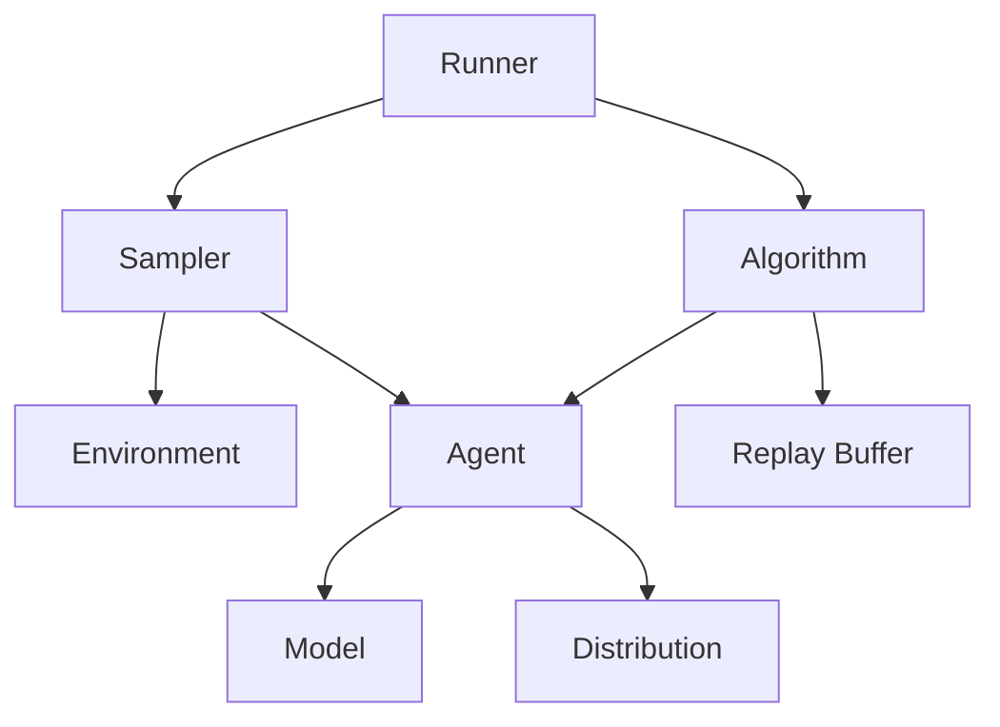
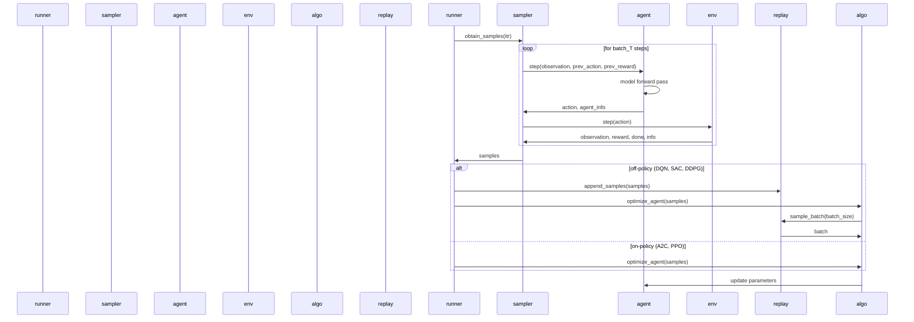
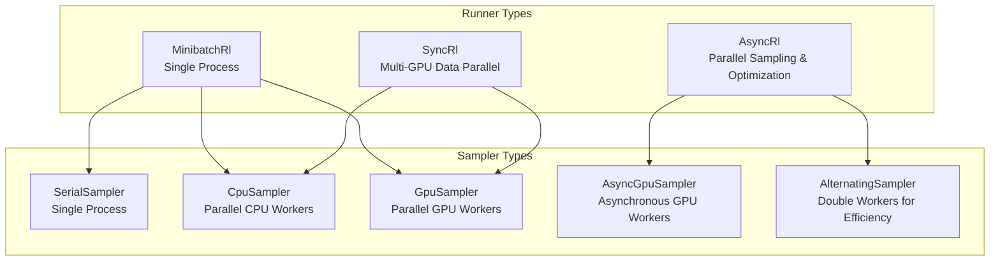

<!-- source: DeepWiki mcp.deepwiki.com · repo astooke/rlpyt · page 1 Overview · fetched 2026-10-30 -->

# Overview

<details>
<summary>Relevant source files</summary>

The following files were used as context for generating this wiki page:

- [README.md](README.md)
- [docs/source/conf.py](docs/source/conf.py)
- [docs/source/index.rst](docs/source/index.rst)
- [docs/source/pages/base.rst](docs/source/pages/base.rst)
- [docs/source/pages/qpg.rst](docs/source/pages/qpg.rst)
- [docs/source/pages/runner.rst](docs/source/pages/runner.rst)
- [docs/source/pages/sampler.rst](docs/source/pages/sampler.rst)
- [linux_cpu.yml](linux_cpu.yml)
- [linux_cuda10.yml](linux_cuda10.yml)
- [linux_cuda9.yml](linux_cuda9.yml)
- [macos_cpu.yml](macos_cpu.yml)
- [rlpyt/agents/qpg/sac_v_agent.py](rlpyt/agents/qpg/sac_v_agent.py)
- [rlpyt/envs/base.py](rlpyt/envs/base.py)
- [rlpyt/runners/base.py](rlpyt/runners/base.py)
- [setup.py](setup.py)

</details>


The `rlpyt` framework is a modular, optimized implementation of common deep reinforcement learning algorithms in PyTorch. This page introduces the purpose, design philosophy, and key features of the framework, providing a foundation for understanding its architecture and capabilities.

## Purpose and Scope

`rlpyt` is designed to be a high-throughput codebase for small to medium-scale reinforcement learning research. It supports all three major families of model-free algorithms:

- Policy Gradient methods (like A2C, PPO)
- Deep Q-Learning methods (like DQN and variants)
- Q-Function Policy Gradient methods (like SAC, DDPG, TD3)

The framework prioritizes modularity, allowing researchers to easily modify components, and performance optimization, with support for parallelization across CPUs and GPUs.

Sources: [README.md:11-18](), [docs/source/index.rst:10-10]()

## System Architecture

This diagram shows the primary building blocks of the `rlpyt` framework and their relationships:



The key components and their roles are:

| Component | Role |
|-----------|------|
| Runner | Orchestrates the training process, connecting samplers with algorithms |
| Algorithm | Implements learning methods (PPO, DQN, SAC, etc.) that update agent parameters |
| Agent | Interfaces between algorithms and environments, selects actions using models |
| Sampler | Manages environment interaction to collect training data |
| Environment | Provides the task to be learned (compatible with OpenAI Gym) |
| Model | PyTorch neural network that processes observations |
| Distribution | Handles action sampling for stochastic policies |
| Replay Buffer | Stores experiences for off-policy algorithms |

Sources: [README.md:108-123](), [docs/source/base.rst:1-41]()

## Training Process Flow

The following diagram illustrates the typical training loop in `rlpyt`:



Sources: [README.md:18-29](), [docs/source/pages/runner.rst:1-24](), [rlpyt/runners/base.py:1-15]()

## Implemented Algorithms

The framework includes implementations for all three major families of model-free reinforcement learning algorithms:

### Policy Gradient Methods
- Advantage Actor-Critic (A2C)
- Proximal Policy Optimization (PPO)

### Deep Q-Learning Methods
- Deep Q-Network (DQN)
- Double DQN
- Dueling DQN
- Categorical DQN
- Recurrent DQN (R2D2-style)

### Q-Function Policy Gradient Methods
- Deep Deterministic Policy Gradient (DDPG)
- Twin Delayed DDPG (TD3)
- Soft Actor-Critic (SAC)

Sources: [README.md:33-40](), [docs/source/pages/qpg.rst:1-54]()

## Parallelization Options

`rlpyt` provides flexible options for parallel execution to maximize throughput:



Key parallelization features:

1. **Serial mode**: For debugging and small experiments (MinibatchRl + SerialSampler)
2. **Parallel sampling**: Multiple environment instances running on CPU
3. **Multi-GPU optimization**: Using PyTorch's DistributedDataParallel
4. **Asynchronous operation**: Decouple sampling and optimization

Sources: [README.md:20-24](), [docs/source/pages/runner.rst:8-49](), [docs/source/pages/sampler.rst:1-71]()

## Key Features

### Recurrent Agents
- All agents receive `observation, prev_action, prev_reward`
- Training data organized with leading dimensions as `[Time, Batch]`
- Specialized sequence replay buffers for recurrent networks

### Data Structure: `namedarraytuple`
`rlpyt` introduces a custom data structure called `namedarraytuple` for organizing collections of numpy arrays/torch tensors. This allows for:
- Easier slicing and indexing into structured data
- Support for multi-modal observations (e.g., joint angles and camera images)
- Uniform syntax regardless of data complexity

### Environment Compatibility
- Works with OpenAI Gym interface
- Custom environment wrappers provided

### Experiment Management
- Utilities for launching and configuring experiments
- Tools for evaluating agent performance during training

Sources: [README.md:25-32](), [README.md:48-62]()

## Installation

`rlpyt` can be installed on Linux, macOS, or Windows with support for CPU-only or CUDA-enabled systems:

1. Clone the repository
2. Create and activate the appropriate conda environment:
   ```
   conda env create -f linux_[cpu|cuda9|cuda10].yml
   source activate rlpyt
   ```
3. Either add to PYTHONPATH or install as an editable package:
   ```
   pip install -e .
   ```

Sources: [README.md:75-100](), [linux_cpu.yml:1-14](), [linux_cuda9.yml:1-15](), [linux_cuda10.yml:1-15](), [setup.py:1-25]()

For more detailed information on specific components, see the following pages:
- Core Architecture [Core Architecture](#2)
- Algorithms [Algorithms](#3)
- Agents [Agents](#4)
- Runners [Runners](#5)
- Samplers [Samplers](#6)

---

