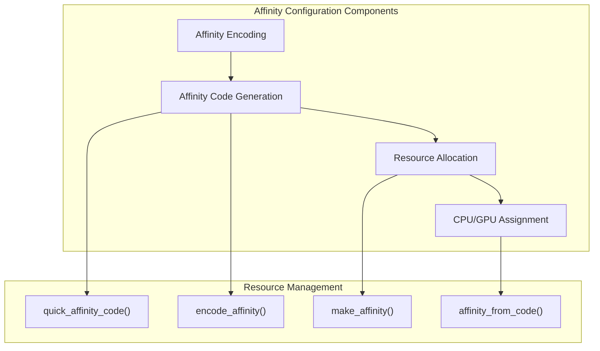
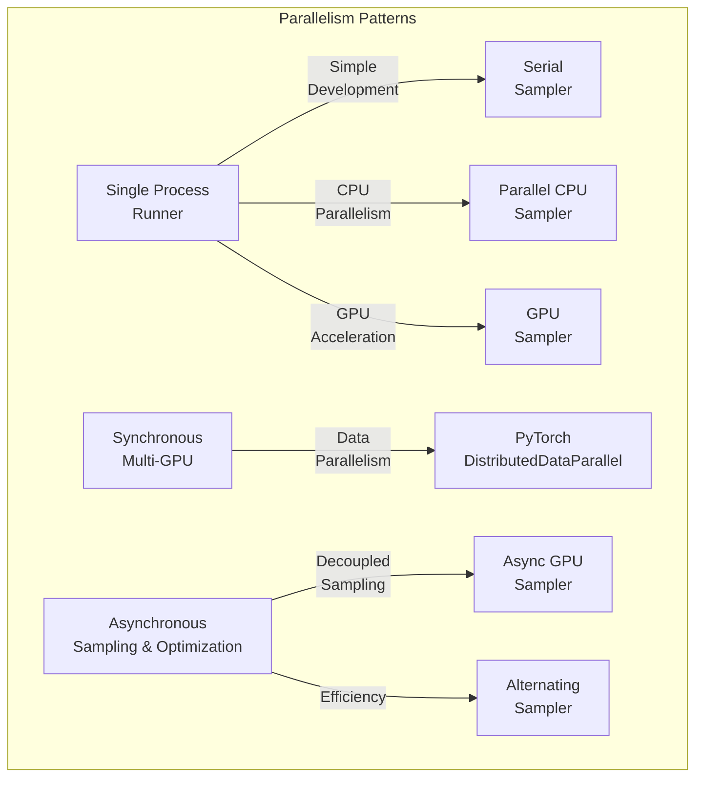

<!-- source: DeepWiki mcp.deepwiki.com · repo astooke/rlpyt · page 1.1 Installation and Setup · fetched 2026-10-30 -->

# Installation and Setup

<details>
<summary>Relevant source files</summary>

The following files were used as context for generating this wiki page:

- [README.md](README.md)
- [docs/source/pages/launch.rst](docs/source/pages/launch.rst)
- [docs/source/pages/log.rst](docs/source/pages/log.rst)
- [docs/source/pages/model.rst](docs/source/pages/model.rst)
- [linux_cpu.yml](linux_cpu.yml)
- [linux_cuda10.yml](linux_cuda10.yml)
- [linux_cuda9.yml](linux_cuda9.yml)
- [macos_cpu.yml](macos_cpu.yml)
- [rlpyt/agents/qpg/sac_v_agent.py](rlpyt/agents/qpg/sac_v_agent.py)
- [rlpyt/utils/launching/affinity.py](rlpyt/utils/launching/affinity.py)
- [rlpyt/utils/launching/exp_launcher.py](rlpyt/utils/launching/exp_launcher.py)
- [rlpyt/utils/launching/variant.py](rlpyt/utils/launching/variant.py)
- [rlpyt/utils/logging/context.py](rlpyt/utils/logging/context.py)
- [setup.py](setup.py)

</details>


This document provides detailed instructions for installing and configuring the rlpyt framework on your system. Rlpyt is a modular, optimized implementation of common deep reinforcement learning algorithms in PyTorch, supporting policy gradient, deep Q-learning, and Q-function policy gradient algorithms. For a general overview of the framework, see [Overview](#1).

## Prerequisites

Before installing rlpyt, ensure your system meets the following requirements:

### Hardware Requirements
- **For CPU-only operation**: Any modern CPU will work
- **For GPU acceleration**: NVIDIA GPU with CUDA support (9.2 or 10.2 compatible)

### Software Requirements
- Python 3.7
- Git (for cloning the repository)
- Conda (Anaconda or Miniconda)

## Installation Steps

### 1. Clone the Repository

First, clone the rlpyt repository to your local machine:

```bash
git clone https://github.com/astooke/rlpyt.git
cd rlpyt
```

Sources: [README.md:77-77]()

### 2. Create Conda Environment

Rlpyt provides different environment configuration files depending on your hardware setup:

- **Linux with CUDA 10**:
  ```bash
  conda env create -f linux_cuda10.yml
  ```
  
- **Linux with CUDA 9**:
  ```bash
  conda env create -f linux_cuda9.yml
  ```
  
- **Linux CPU-only**:
  ```bash
  conda env create -f linux_cpu.yml
  ```
  
- **macOS CPU-only**:
  ```bash
  conda env create -f macos_cpu.yml
  ```

After creating the environment, activate it:

```bash
conda activate rlpyt
```

Sources: [README.md:79-83](), [linux_cuda10.yml:1-14](), [linux_cuda9.yml:1-14](), [linux_cpu.yml:1-14](), [macos_cpu.yml:1-13]()

### 3. Make rlpyt Available to Python

You have two options to add rlpyt to your Python path:

**Option A**: Modify the PYTHONPATH environment variable
```bash
export PYTHONPATH=/path/to/rlpyt:$PYTHONPATH
```

**Option B**: Install as an editable Python package
```bash
pip install -e .
```

Sources: [README.md:85-93](), [setup.py:1-25]()

### 4. Install Environment-Specific Packages

Rlpyt includes support for Atari environments by default. For other environments:

- **Gym**: Already included in test dependencies
- **Mujoco**: Requires separate installation (not included)
- **Other environments**: Install as needed for your specific use case

Sources: [README.md:95-95](), [setup.py:7-12]()

## Hardware Configuration and Affinity

Rlpyt includes a sophisticated system for managing hardware resources, particularly for parallel execution. The affinity system helps distribute workloads efficiently across CPUs and GPUs.

### Understanding Affinity Configuration

The affinity system determines:
1. How many experiments can run concurrently
2. Which GPU device(s) to use for each run
3. How many worker processes to use for parallel sampling
4. How to configure processes for multi-GPU and asynchronous runners



Sources: [rlpyt/utils/launching/affinity.py:29-168]()

### Basic Affinity Configuration

For simple setups, use the `quick_affinity_code()` function to automatically detect and allocate resources:

```python
from rlpyt.utils.launching.affinity import quick_affinity_code

# For GPU usage
affinity = quick_affinity_code(use_gpu=True)

# For CPU-only operation
affinity = quick_affinity_code(n_parallel=4, use_gpu=False)
```

For more detailed configuration, use the `encode_affinity()` function to specify exact hardware resources:

```python
from rlpyt.utils.launching.affinity import encode_affinity

# Example: 4 GPUs, 40 CPU cores
affinity = encode_affinity(
    n_cpu_core=40,
    n_gpu=4,
    contexts_per_gpu=1,
    gpu_per_run=1
)
```

Sources: [rlpyt/utils/launching/affinity.py:31-64](), [rlpyt/utils/launching/affinity.py:67-142]()

## Experiment Logging Configuration

Rlpyt includes a logging system to record experiment results. By default, experiments are logged to `rlpyt/data/local/YYYYMMDD/HHMMSS/experiment_name/run_ID`.

### Configuring Logging

When setting up an experiment, you can configure the logging directory:

```python
from rlpyt.utils.logging.context import logger_context

with logger_context(
    log_dir="path/to/log",
    run_ID=0,
    name="experiment_name",
    snapshot_mode="last"
):
    # Run your experiment
    runner.train()
```

The `snapshot_mode` parameter controls how often to save experiment snapshots:
- `"none"`: Don't save snapshots
- `"last"`: Always save and overwrite previous snapshots
- `"all"`: Always save and keep each iteration
- `"gap"`: Save periodically and keep each

Sources: [rlpyt/utils/logging/context.py:24-83]()

## Hardware Parallelism Model

Rlpyt supports various parallelism patterns for efficient utilization of hardware resources:



### Using Affinity for Parallel Runs

To launch multiple experiments in parallel on available hardware:

```python
from rlpyt.utils.launching.exp_launcher import run_experiments

run_experiments(
    script="path/to/experiment_script.py",
    affinity_code=affinity_code,
    experiment_title="my_experiment",
    runs_per_setting=2,
    variants=variants,
    log_dirs=log_dirs
)
```

Sources: [rlpyt/utils/launching/exp_launcher.py:27-135](), [rlpyt/utils/launching/affinity.py:258-485]()

## Verifying Installation

To verify your installation, run one of the example scripts in the examples directory. The examples are ordered by increasing complexity.

```bash
cd rlpyt/examples
python example_1.py
```

## Troubleshooting

### Common Issues

1. **CUDA version mismatch**: Ensure your installed CUDA toolkit version matches the one specified in the conda environment file

2. **PyTorch import errors**: Verify PyTorch was installed with the correct CUDA support by running:
   ```python
   import torch
   print(torch.cuda.is_available())
   ```

3. **Missing environment-specific dependencies**: Install any additional packages required for your specific environment

### Getting Help

For issues not covered here, refer to the project's GitHub issues page or documentation.

## Next Steps

After installation, you can:

1. Explore the examples directory to understand how to use the framework
2. Learn about the [Core Architecture](#2) of rlpyt
3. Study specific algorithm implementations in the [Algorithms](#3) section

Sources: [README.md:43-46]()

---

