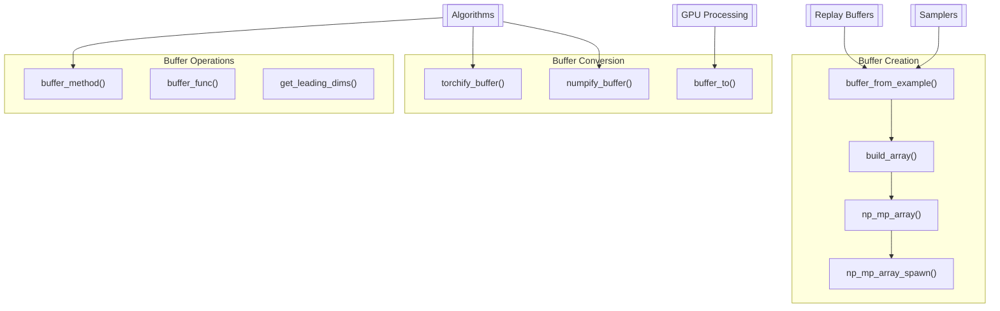
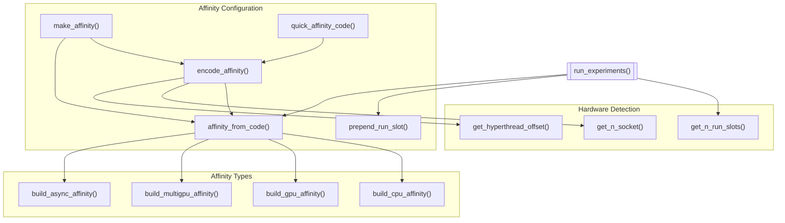
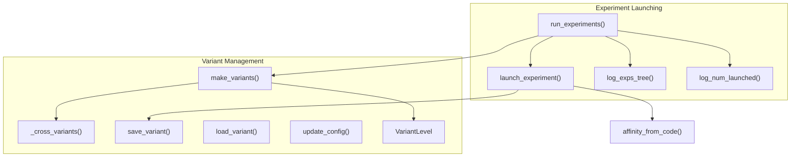
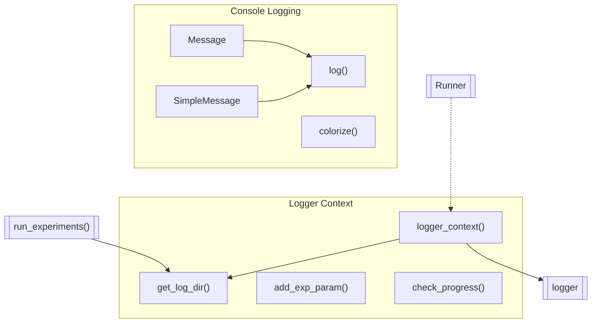
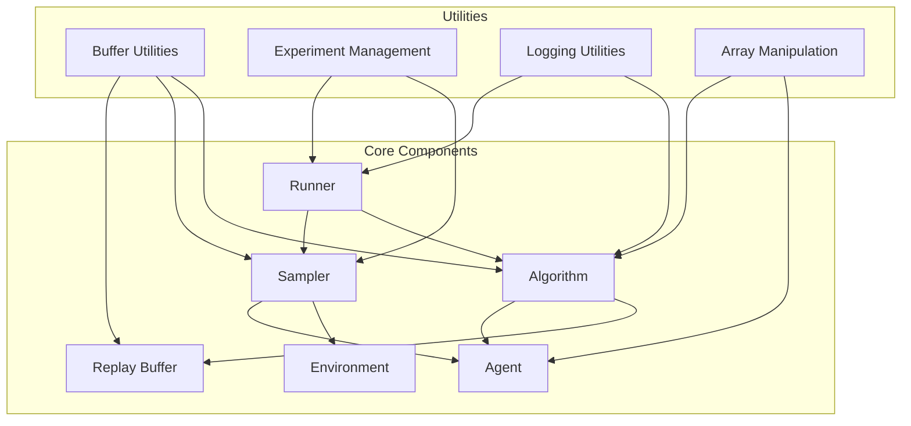

<!-- source: DeepWiki mcp.deepwiki.com · repo astooke/rlpyt · page 10 Utilities · fetched 2026-10-30 -->

# Utilities

Relevant source files

The following files were used as context for generating this wiki page:

- [docs/source/pages/launch.rst](docs/source/pages/launch.rst)
- [docs/source/pages/log.rst](docs/source/pages/log.rst)
- [docs/source/pages/model.rst](docs/source/pages/model.rst)
- [rlpyt/distributions/categorical.py](rlpyt/distributions/categorical.py)
- [rlpyt/envs/gym_schema.py](rlpyt/envs/gym_schema.py)
- [rlpyt/utils/array.py](rlpyt/utils/array.py)
- [rlpyt/utils/buffer.py](rlpyt/utils/buffer.py)
- [rlpyt/utils/launching/affinity.py](rlpyt/utils/launching/affinity.py)
- [rlpyt/utils/launching/exp_launcher.py](rlpyt/utils/launching/exp_launcher.py)
- [rlpyt/utils/launching/variant.py](rlpyt/utils/launching/variant.py)
- [rlpyt/utils/logging/console.py](rlpyt/utils/logging/console.py)
- [rlpyt/utils/logging/context.py](rlpyt/utils/logging/context.py)
- [rlpyt/utils/misc.py](rlpyt/utils/misc.py)

The rlpyt framework provides a robust set of utility modules that support core components of the reinforcement learning pipeline. These utilities handle essential functions like buffer management, experiment launching, hardware resource allocation, logging, and array manipulations. This page documents these utility components and their relationships to other parts of the framework.

For information about probability distributions used in stochastic policies, see [Distributions](#10.2).

## Buffer Utilities

Buffer utilities provide functions for creating, manipulating, and converting data structures used throughout the rlpyt framework. These are particularly important for handling transitions between NumPy arrays and PyTorch tensors, managing shared memory for multiprocessing, and working with the namedarraytuple structures that are pervasive in rlpyt.

**Diagram: Buffer Utility Functions and Their Relationships**

Key buffer utilities include:

1. **Buffer Creation Functions**:
   - `buffer_from_example()`: Creates a buffer structure matching an example's structure
   - `build_array()`: Allocates a NumPy array matching an example's shape and dtype
   - `np_mp_array()`: Creates a shared memory NumPy array for multiprocessing

2. **Buffer Conversion Functions**:
   - `torchify_buffer()`: Converts NumPy arrays to PyTorch tensors throughout a buffer structure
   - `numpify_buffer()`: Converts PyTorch tensors to NumPy arrays throughout a buffer structure
   - `buffer_to()`: Moves PyTorch tensors to a specified device throughout a buffer structure

3. **Buffer Operations**:
   - `buffer_method()`: Applies a method to all array/tensor elements in a buffer structure
   - `buffer_func()`: Applies a function to all array/tensor elements in a buffer structure
   - `get_leading_dims()`: Gets the leading dimensions of a buffer structure

Sources: [rlpyt/utils/buffer.py]()

## Experiment Management Utilities

Experiment management utilities facilitate the creation, configuration, and launching of reinforcement learning experiments. This includes hardware resource allocation (affinity), experiment variant generation, and process management.

### Affinity Management

The affinity utilities provide tools for efficiently allocating hardware resources (CPUs and GPUs) for parallel and distributed learning runs.

**Diagram: Affinity Utility Functions and Their Relationships**

The affinity system helps distribute computing resources across parallel training processes, ensuring efficient utilization of hardware. Key functions include:

- `encode_affinity()`: Encodes hardware configuration into a string code
- `affinity_from_code()`: Converts an affinity code into an affinity configuration structure
- `quick_affinity_code()`: Automatically detects hardware and creates an appropriate affinity code
- `make_affinity()`: Directly creates an affinity configuration structure
- `get_n_run_slots()`: Determines how many parallel experiments can run with a given affinity code

Sources: [rlpyt/utils/launching/affinity.py]()

### Experiment Launching

The experiment launching utilities facilitate running large batches of experiments with different configurations.

**Diagram: Experiment Launching Utilities**

Key experiment launching utilities include:

- `run_experiments()`: Main function for launching a series of experiments with different configurations
- `launch_experiment()`: Launches a single experiment with specific configuration
- `make_variants()`: Creates variants from multiple VariantLevel objects
- `save_variant()`: Saves experiment variant configuration to a JSON file
- `load_variant()`: Loads experiment variant configuration from a JSON file
- `update_config()`: Updates a configuration with new values from a variant

Sources: 
- [rlpyt/utils/launching/exp_launcher.py]()
- [rlpyt/utils/launching/variant.py]()

## Logging Utilities

Logging utilities provide tools for tracking and recording experiment progress, metrics, and configurations.

**Diagram: Logging Utility Components**

The logging system provides mechanisms for:

- Contextual logging for training runs
- Saving experiment parameters and progress
- Console output with formatting
- Tracking experiment progress

Key functions include:

- `logger_context()`: Creates a logging context for a training run
- `get_log_dir()`: Generates a log directory path with timestamp
- `add_exp_param()`: Adds a parameter to all experiments in a directory
- `check_progress()`: Prints the progress of experiments in a directory

Sources: 
- [rlpyt/utils/logging/context.py]()
- [rlpyt/utils/logging/console.py]()

## Array Manipulation Utilities

Array manipulation utilities provide functions for common operations on NumPy arrays and PyTorch tensors.

| Function | Description |
|----------|-------------|
| `select_at_indexes()` | Returns contents of an array at multi-dimensional indexes |
| `to_onehot()` | Converts integer values to one-hot representations |
| `from_onehot()` | Converts one-hot representations to integer values |
| `valid_mean()` | Computes mean with an optional mask for valid values |
| `infer_leading_dims()` | Determines the leading dimensions of an array |
| `iterate_mb_idxs()` | Yields minibatch indexes for iterating over data |
| `zeros()` | Creates a zero array in either PyTorch or NumPy |
| `empty()` | Creates an empty array in either PyTorch or NumPy |
| `extract_sequences()` | Extracts sequences from an array with proper handling of wrapping |

These utilities help with common operations across the framework, particularly in algorithms and models.

Sources: 
- [rlpyt/utils/array.py]()
- [rlpyt/utils/misc.py]()

## Integration with rlpyt Framework

The utilities serve as the foundation for many operations throughout the rlpyt framework. The following diagram illustrates how these utilities integrate with the major components of the system:

**Diagram: Utility Integration in the rlpyt Framework**

Sources: Repository overview

## Summary

The utility modules in rlpyt provide essential functions for:

- Creating and manipulating data structures for reinforcement learning
- Managing experiment resources and configurations
- Logging experiment progress and results
- Performing common array operations

These utilities are foundational to the framework, enabling the efficient implementation of RL algorithms and the effective management of experiments.

Sources: All provided files

## See Also

- [Core Architecture](#2) - For information about how these utilities fit into the overall system architecture
- [Experiment Management](#10.1) - For more detailed information about experiment management utilities
- [Distributions](#10.2) - For information about probability distribution utilities

---

