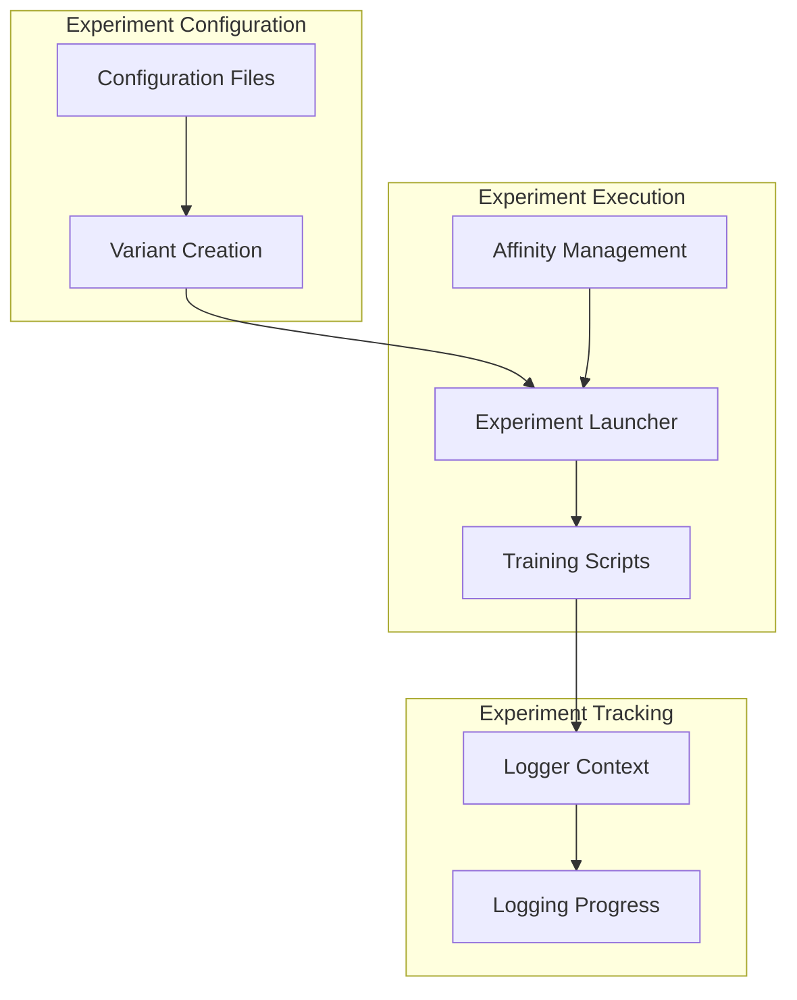
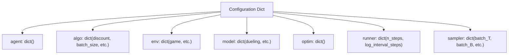
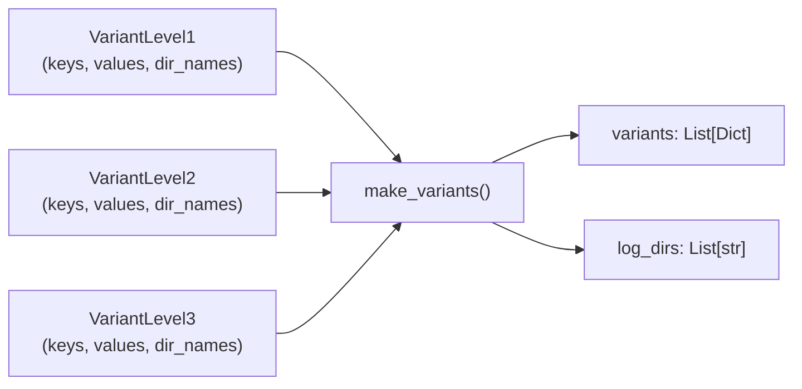
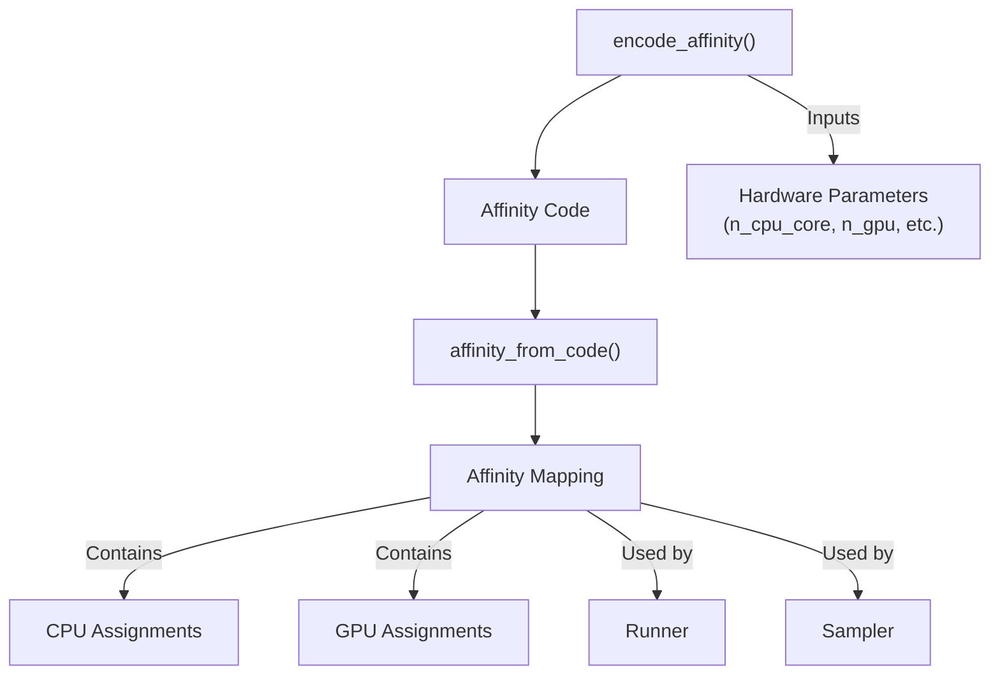
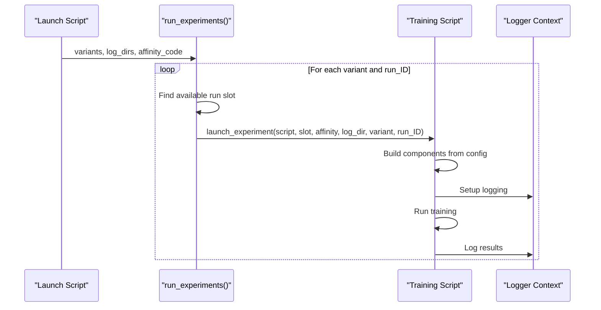
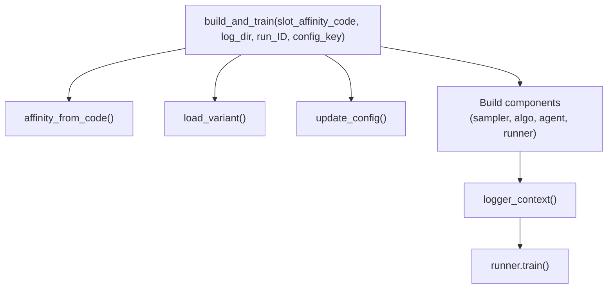
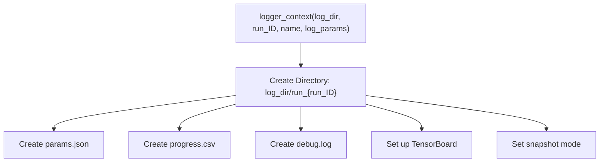
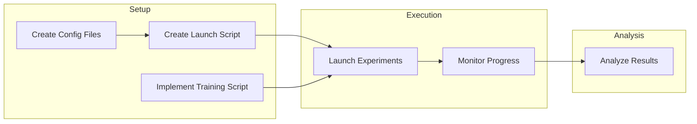

<!-- source: DeepWiki mcp.deepwiki.com · repo astooke/rlpyt · page 10.1 Experiment Management · fetched 2026-10-30 -->

# Experiment Management

<details>
<summary>Relevant source files</summary>

The following files were used as context for generating this wiki page:

- [docs/source/pages/launch.rst](docs/source/pages/launch.rst)
- [docs/source/pages/log.rst](docs/source/pages/log.rst)
- [docs/source/pages/model.rst](docs/source/pages/model.rst)
- [rlpyt/experiments/configs/atari/dqn/atari_dqn.py](rlpyt/experiments/configs/atari/dqn/atari_dqn.py)
- [rlpyt/experiments/scripts/atari/dqn/launch/pabti/launch_atari_dqn_gpu_noeval.py](rlpyt/experiments/scripts/atari/dqn/launch/pabti/launch_atari_dqn_gpu_noeval.py)
- [rlpyt/experiments/scripts/atari/dqn/train/atari_catdqn_gpu.py](rlpyt/experiments/scripts/atari/dqn/train/atari_catdqn_gpu.py)
- [rlpyt/experiments/scripts/atari/dqn/train/atari_dqn_gpu.py](rlpyt/experiments/scripts/atari/dqn/train/atari_dqn_gpu.py)
- [rlpyt/experiments/scripts/atari/dqn/train/atari_dqn_gpu_noeval.py](rlpyt/experiments/scripts/atari/dqn/train/atari_dqn_gpu_noeval.py)
- [rlpyt/experiments/scripts/atari/dqn/train/atari_r2d1_gpu.py](rlpyt/experiments/scripts/atari/dqn/train/atari_r2d1_gpu.py)
- [rlpyt/experiments/scripts/atari/pg/train/atari_lstm_ppo_gpu.py](rlpyt/experiments/scripts/atari/pg/train/atari_lstm_ppo_gpu.py)
- [rlpyt/experiments/scripts/mujoco/pg/train/mujoco_ff_ppo_gpu.py](rlpyt/experiments/scripts/mujoco/pg/train/mujoco_ff_ppo_gpu.py)
- [rlpyt/utils/launching/affinity.py](rlpyt/utils/launching/affinity.py)
- [rlpyt/utils/launching/exp_launcher.py](rlpyt/utils/launching/exp_launcher.py)
- [rlpyt/utils/launching/variant.py](rlpyt/utils/launching/variant.py)
- [rlpyt/utils/logging/context.py](rlpyt/utils/logging/context.py)

</details>


The experiment management system in rlpyt provides utilities for configuring, launching, and tracking reinforcement learning experiments. This page covers the core components for managing experiments, including configuration structures, variant generation, hardware affinity specification, experiment launching mechanisms, and experiment logging.

## System Overview

Rlpyt's experiment management system allows researchers to efficiently run and track reinforcement learning experiments across different configurations. The system handles the complexities of experiment configuration, resource allocation, and result logging.



Sources:
- [rlpyt/utils/launching/variant.py]()
- [rlpyt/utils/launching/exp_launcher.py]()
- [rlpyt/utils/launching/affinity.py]()
- [rlpyt/utils/logging/context.py]()

## Configuration Management

Configurations in rlpyt are structured as nested dictionaries that define parameters for different system components. A typical configuration includes settings for the agent, algorithm, environment, model, optimizer, runner, and sampler.

### Configuration Structure



Example configuration structure from a typical configuration file:

```python
config = dict(
    agent=dict(),
    algo=dict(
        discount=0.99,
        batch_size=128,
        learning_rate=1e-4,
        # Other algorithm parameters
    ),
    env=dict(
        game="pong",
        episodic_lives=True,
    ),
    model=dict(dueling=False),
    optim=dict(),
    runner=dict(
        n_steps=50e6,
        log_interval_steps=1e6,
    ),
    sampler=dict(
        batch_T=2,
        batch_B=16,
        max_decorrelation_steps=1000,
        # Other sampler parameters
    ),
)
```

Sources:
- [rlpyt/experiments/configs/atari/dqn/atari_dqn.py:7-43]()

### Variant Generation

The `variant.py` module provides utilities for creating hyperparameter variants:



Key components:
- `VariantLevel`: Defines a set of hyperparameter variations
- `make_variants()`: Crosses multiple VariantLevel objects to create all combinations

Example:

```python
from rlpyt.utils.launching.variant import make_variants, VariantLevel

# Define variant for different games
games = ["pong", "seaquest", "qbert", "chopper_command"]
values = list(zip(games))
dir_names = ["{}".format(*v) for v in values]
keys = [("env", "game")]
variant_levels = [VariantLevel(keys, values, dir_names)]

# Generate all variants
variants, log_dirs = make_variants(*variant_levels)
```

Sources:
- [rlpyt/utils/launching/variant.py:10-23]()
- [rlpyt/utils/launching/variant.py:25-37]()
- [rlpyt/experiments/scripts/atari/dqn/launch/pabti/launch_atari_dqn_gpu_noeval.py:17-24]()

## Hardware Affinity Management

Rlpyt provides a system for specifying hardware resource allocation via affinity codes. This controls how experiments are distributed across CPUs and GPUs.

### Affinity Specification



The `affinity.py` module provides functions for encoding and interpreting hardware specifications:

- `encode_affinity()`: Creates an affinity code string from hardware parameters
- `affinity_from_code()`: Interprets an affinity code to create hardware assignments
- `quick_affinity_code()`: Simplified interface that attempts to detect hardware resources

Example usage:

```python
from rlpyt.utils.launching.affinity import encode_affinity

# Specify hardware resources
affinity_code = encode_affinity(
    n_cpu_core=16,    # Total physical CPU cores
    n_gpu=8,          # Total GPUs
    hyperthread_offset=24,  # For hyperthreaded CPUs
    n_socket=2,       # Number of CPU sockets
    contexts_per_gpu=1  # How many experiments share each GPU
)
```

Sources:
- [rlpyt/utils/launching/affinity.py:30-64]()
- [rlpyt/utils/launching/affinity.py:67-142]()
- [rlpyt/utils/launching/affinity.py:150-160]()

## Launching Experiments

The experiment launcher system automates the process of running multiple experiments with different configurations.

### Experiment Launching Flow



Key components:
- `run_experiments()`: Main function for launching multiple experiments
- `launch_experiment()`: Function for launching a single experiment subprocess

Example launch script:

```python
from rlpyt.utils.launching.affinity import encode_affinity
from rlpyt.utils.launching.exp_launcher import run_experiments

# Define hardware resources
affinity_code = encode_affinity(n_cpu_core=16, n_gpu=8)

# Launch experiments
run_experiments(
    script="rlpyt/experiments/scripts/atari/dqn/train/atari_dqn_gpu.py",
    affinity_code=affinity_code,
    experiment_title="atari_dqn_experiment",
    runs_per_setting=2,  # Run each variant twice
    variants=variants,
    log_dirs=log_dirs,
    common_args=("dqn",),  # Config key
)
```

Sources:
- [rlpyt/utils/launching/exp_launcher.py:27-77]()
- [rlpyt/utils/launching/exp_launcher.py:80-135]()
- [rlpyt/experiments/scripts/atari/dqn/launch/pabti/launch_atari_dqn_gpu_noeval.py:2-35]()

## Training Script Structure

Training scripts in rlpyt follow a common pattern that integrates with the experiment management system:



Example training script structure:

```python
def build_and_train(slot_affinity_code, log_dir, run_ID, config_key):
    # Parse affinity and configuration
    affinity = affinity_from_code(slot_affinity_code)
    config = configs[config_key]
    variant = load_variant(log_dir)
    config = update_config(config, variant)
    
    # Build components based on config
    sampler = GpuSampler(...)
    algo = DQN(...)
    agent = AtariDqnAgent(...)
    runner = MinibatchRlEval(...)
    
    # Run training with logging
    with logger_context(log_dir, run_ID, name, config):
        runner.train()
```

Sources:
- [rlpyt/experiments/scripts/atari/dqn/train/atari_dqn_gpu.py:17-43]()
- [rlpyt/experiments/scripts/atari/dqn/train/atari_r2d1_gpu.py:17-43]()
- [rlpyt/experiments/scripts/atari/pg/train/atari_lstm_ppo_gpu.py:17-41]()

## Experiment Logging

The logging system in rlpyt tracks experiment progress and saves results in a structured format.

### Logger Context and Directory Structure



The `logger_context` function:
- Creates a directory structure for experiment logs
- Saves hyperparameters to `params.json`
- Configures logging of progress metrics to `progress.csv`
- Configures debugging information to `debug.log`
- Sets up snapshot saving for model checkpoints

Example directory structure:
```
data/
  local/
    YYYYMMDD/
      HHMMSS/
        experiment_name/
          run_0/
            params.json
            progress.csv
            debug.log
            variant_config.json
            snapshots/
          run_1/
            ...
```

Snapshot modes:
- `"none"`: Don't save checkpoints
- `"last"`: Always save and overwrite previous checkpoint
- `"all"`: Save each iteration separately
- `"gap"`: Save periodically with specified gap

Sources:
- [rlpyt/utils/logging/context.py:24-83]()
- [rlpyt/utils/logging/context.py:16-21]()

### Checking Experiment Progress

Rlpyt provides utilities for monitoring experiment progress:

- `check_progress()`: Prints line counts of progress files for all experiments
- `add_exp_param()`: Adds or updates parameters in experiment configuration files

Example:
```python
from rlpyt.utils.logging.context import check_progress

check_progress('path_to_experiment_directory')
```

Sources:
- [rlpyt/utils/logging/context.py:117-128]()
- [rlpyt/utils/logging/context.py:86-114]()

## Complete Experiment Workflow

A typical workflow for running experiments in rlpyt involves:

1. Creating configuration files defining experiment parameters and variants
2. Creating a launch script that specifies hardware resources and variants
3. Implementing a training script that builds components and runs training
4. Using the launcher to execute experiments
5. Monitoring progress and analyzing results

This structure enables systematic experimentation and hyperparameter optimization while efficiently utilizing hardware resources.



Sources:
- [rlpyt/experiments/configs/atari/dqn/atari_dqn.py]()
- [rlpyt/experiments/scripts/atari/dqn/launch/pabti/launch_atari_dqn_gpu_noeval.py]()
- [rlpyt/experiments/scripts/atari/dqn/train/atari_dqn_gpu.py]()
- [rlpyt/utils/launching/exp_launcher.py]()
- [rlpyt/utils/logging/context.py]()

---

