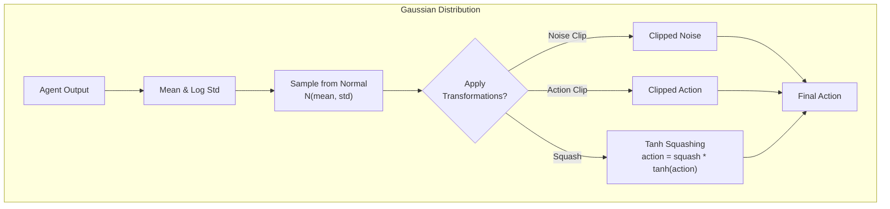
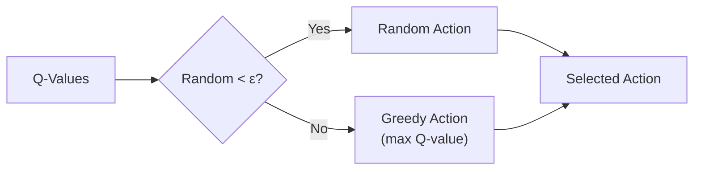
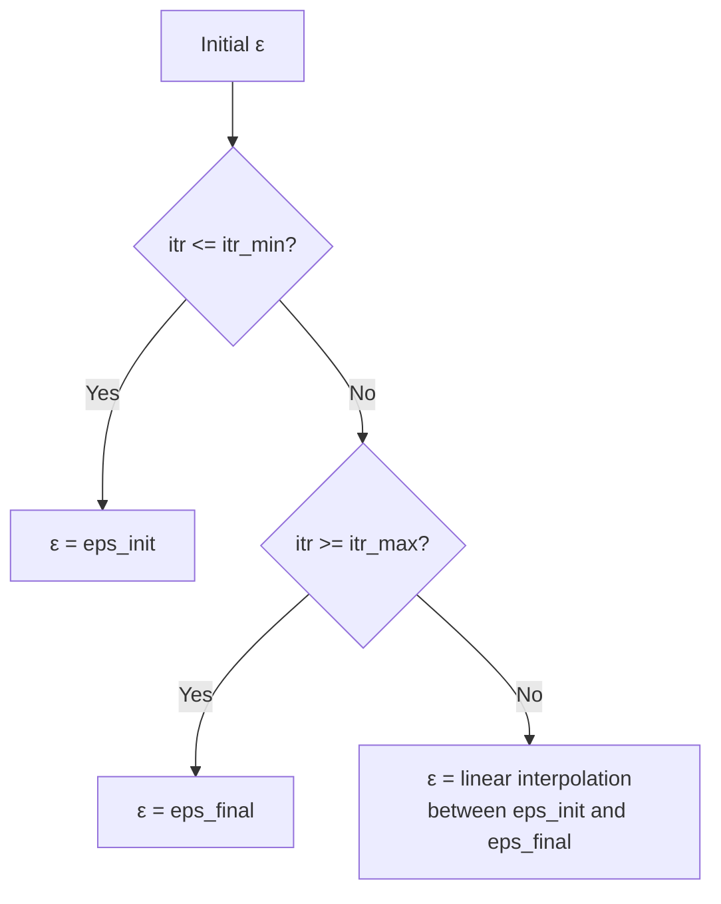
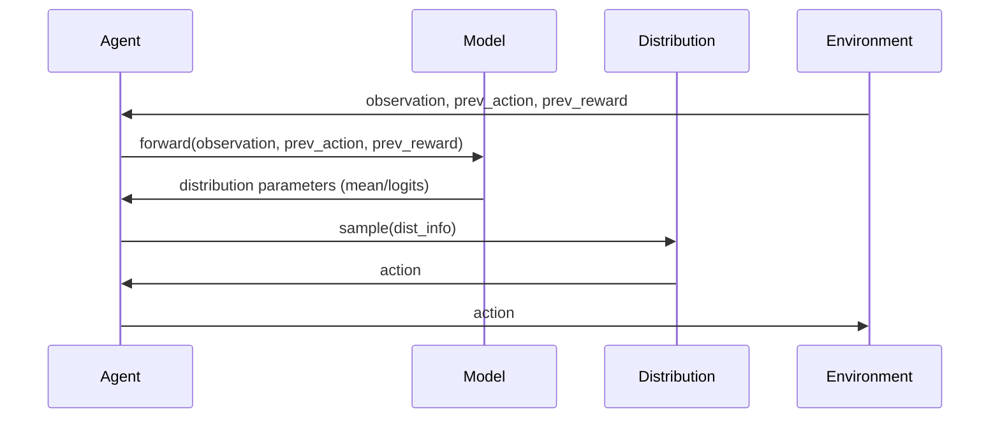

<!-- source: DeepWiki mcp.deepwiki.com · repo astooke/rlpyt · page 10.2 Distributions · fetched 2026-10-30 -->

# Distributions

<details>
<summary>Relevant source files</summary>

The following files were used as context for generating this wiki page:

- [rlpyt/agents/dqn/dqn_agent.py](rlpyt/agents/dqn/dqn_agent.py)
- [rlpyt/agents/dqn/epsilon_greedy.py](rlpyt/agents/dqn/epsilon_greedy.py)
- [rlpyt/agents/dqn/r2d1_agent.py](rlpyt/agents/dqn/r2d1_agent.py)
- [rlpyt/agents/pg/atari.py](rlpyt/agents/pg/atari.py)
- [rlpyt/agents/pg/base.py](rlpyt/agents/pg/base.py)
- [rlpyt/agents/pg/categorical.py](rlpyt/agents/pg/categorical.py)
- [rlpyt/agents/pg/gaussian.py](rlpyt/agents/pg/gaussian.py)
- [rlpyt/agents/qpg/ddpg_agent.py](rlpyt/agents/qpg/ddpg_agent.py)
- [rlpyt/agents/qpg/sac_agent.py](rlpyt/agents/qpg/sac_agent.py)
- [rlpyt/agents/qpg/td3_agent.py](rlpyt/agents/qpg/td3_agent.py)
- [rlpyt/distributions/gaussian.py](rlpyt/distributions/gaussian.py)
- [rlpyt/experiments/scripts/mujoco/pg/launch/pabti/launch_mujoco_ppo_serial.py](rlpyt/experiments/scripts/mujoco/pg/launch/pabti/launch_mujoco_ppo_serial.py)
- [rlpyt/samplers/parallel/gpu/alternating_sampler.py](rlpyt/samplers/parallel/gpu/alternating_sampler.py)

</details>


## Purpose and Overview

This page documents the probability distribution implementations in rlpyt, which are fundamental components that enable agents to select actions based on their policies. Distributions serve multiple purposes in reinforcement learning:

1. Generating actions during environment interaction
2. Computing log probabilities during policy updates
3. Calculating entropy for exploration regularization 
4. Computing KL-divergence between policy updates

For information about how agents use these distributions, see [Agents](#4).

Sources: [rlpyt/distributions/gaussian.py:15-246]()

## Distribution Hierarchy

The following diagram shows the distribution classes available in the rlpyt framework and their relationships with agents.

```mermaid
classDiagram
    class Distribution {
        <<abstract>>
        +dim
        +sample(dist_info)
        +log_likelihood(action, dist_info)
        +entropy(dist_info)
        +kl(old_dist_info, new_dist_info)
    }
    
    class Gaussian {
        +__init__(dim, std, clip, noise_clip, min_std, max_std, squash)
        +sample(dist_info)
        +log_likelihood(action, dist_info)
        +sample_loglikelihood(dist_info)
        +set_std(std)
        +set_noise_clip(noise_clip)
        +set_squash(squash)
    }
    
    class Categorical {
        +sample(dist_info)
        +log_likelihood(action, dist_info)
        +entropy(dist_info)
        +to_onehot(action)
    }
    
    class EpsilonGreedy {
        +__init__(dim, epsilon)
        +sample(q_values)
        +set_epsilon(epsilon)
        +to_onehot(action)
    }
    
    Distribution <|-- Gaussian
    Distribution <|-- Categorical
    Distribution <|-- EpsilonGreedy
    
    class "GaussianPgAgent" {
        +distribution: Gaussian
    }
    
    class "CategoricalPgAgent" {
        +distribution: Categorical
    }
    
    class "DqnAgent" {
        +distribution: EpsilonGreedy
    }
    
    class "SacAgent" {
        +distribution: Gaussian
    }
    
    Gaussian <-- "GaussianPgAgent"
    Gaussian <-- "SacAgent"
    Categorical <-- "CategoricalPgAgent"
    EpsilonGreedy <-- "DqnAgent"
```

Sources: [rlpyt/distributions/gaussian.py:15-246](), [rlpyt/agents/pg/gaussian.py:14-135](), [rlpyt/agents/pg/categorical.py:11-106](), [rlpyt/agents/dqn/dqn_agent.py:18-82](), [rlpyt/agents/qpg/sac_agent.py:25-204]()

## Distribution Information

Distribution information (dist_info) contains the parameters that define a probability distribution. This is passed between agents and distributions and allows for computation of probabilities and sampling.

| Distribution Type | DistInfo Class | Parameters |
|-------------------|---------------|------------|
| Gaussian | `DistInfo` | mean |
| Gaussian (learnable std) | `DistInfoStd` | mean, log_std |
| Categorical | `DistInfo` | prob |

Sources: [rlpyt/distributions/gaussian.py:11-12]()

## Gaussian Distribution

The Gaussian distribution is used for continuous action spaces and is implemented in `rlpyt/distributions/gaussian.py`. It's the most feature-rich distribution in rlpyt, supporting various transformations and constraints used by different algorithms.



### Key Features

1. **Fixed or Learnable Standard Deviation**:
   - Can use a fixed standard deviation or learn it as part of the policy
   - Supports clamping of log_std values to prevent numerical issues

2. **Action Transformations**:
   - **Squashing**: Maps unbounded actions to a bounded range using tanh
   - **Clipping**: Simple clamping of values to a specified range
   - **Noise Clipping**: Controls exploration noise magnitude

3. **Special Methods**:
   - `sample_loglikelihood()`: Used by SAC to correctly compute log probabilities with squashed actions
   - `kl()`: Computes KL divergence for trust region methods like PPO
   - `entropy()`: Computes entropy for exploration regularization

### Usage Example

Gaussian distribution is instantiated by agents in their `initialize` methods:

```python
# In GaussianPgAgent.initialize
self.distribution = Gaussian(
    dim=env_spaces.action.shape[0],
)

# In SacAgent.initialize
self.distribution = Gaussian(
    dim=env_spaces.action.shape[0],
    squash=self.action_squash,
    min_std=np.exp(MIN_LOG_STD),
    max_std=np.exp(MAX_LOG_STD),
)
```

Sources: [rlpyt/distributions/gaussian.py:15-246](), [rlpyt/agents/pg/gaussian.py:33-38](), [rlpyt/agents/qpg/sac_agent.py:69-74]()

## Categorical Distribution

The Categorical distribution is used for discrete action spaces, particularly in policy gradient methods. It represents a probability distribution over a finite set of actions.

Key features:
- Generates one-hot encoded actions
- Computes entropy for exploration regularization
- Supports sampling with and without reparameterization

Usage example in agents:

```python
# In CategoricalPgAgent.initialize
self.distribution = Categorical(dim=env_spaces.action.n)
```

Sources: [rlpyt/agents/pg/categorical.py:31](), [rlpyt/agents/pg/categorical.py:68-69]()

## Epsilon Greedy Distribution

The Epsilon Greedy distribution is used for exploration in value-based methods like DQN. It selects the action with the highest Q-value with probability 1-ε, and a random action with probability ε.



### Epsilon Annealing

Epsilon can be annealed over time to decrease exploration as training progresses:



### Vector-Valued Epsilon

For parallel sampling, DQN agents can use vector-valued epsilon, where each environment instance has its own exploration rate:

```python
# Vector epsilon in EpsilonGreedyAgentMixin.make_vec_eps
global_eps_final = torch.logspace(
    torch.log10(torch.tensor(self.eps_final_min)),
    torch.log10(torch.tensor(self._eps_final_scalar)),
    global_B)
self.eps_final = global_eps_final[env_ranks]
```

Sources: [rlpyt/agents/dqn/epsilon_greedy.py:12-132](), [rlpyt/agents/dqn/dqn_agent.py:45]()

## Integration with Agents

Distributions are created and configured by agents during initialization and are used for action selection during environment interaction.

### Action Selection Flow



### Distribution Modes

Agents configure their distributions differently based on the execution mode:

| Mode | Gaussian Behavior | Epsilon Greedy Behavior |
|------|------------------|------------------------|
| Sample (training) | Uses learned/configured std | Uses annealed epsilon |
| Evaluation | Uses zero std (deterministic) | Uses small/zero epsilon |

Sample code from agent implementations:

```python
# In DdpgAgent
def sample_mode(self, itr):
    super().sample_mode(itr)
    self.q_model.eval()
    self.distribution.set_std(self.action_std)

def eval_mode(self, itr):
    super().eval_mode(itr)
    self.q_model.eval()
    self.distribution.set_std(0.)  # Deterministic.
```

Sources: [rlpyt/agents/qpg/ddpg_agent.py:138-146](), [rlpyt/agents/dqn/epsilon_greedy.py:100-126]()

## Special Distribution Features

### Action Squashing in SAC

SAC uses a squashed Gaussian to bound actions to a range (typically [-1, 1]) while maintaining a continuous distribution:

1. Sample action from unbounded Gaussian
2. Apply tanh transformation: action = squash * tanh(action)
3. Adjust log probability to account for this non-linear transformation

```python
# In SacAgent.pi
action, log_pi = self.distribution.sample_loglikelihood(dist_info)
```

The `sample_loglikelihood` method handles the squashing correction:

```python
# In Gaussian.sample_loglikelihood
squash = self.squash
self.squash = None  # Temporarily turn OFF, raw sample into log_likelihood.
sample = self.sample(dist_info)
self.squash = squash  # Turn it back ON, squash correction in log_likelihood.
logli = self.log_likelihood(sample, dist_info)
if squash is not None:
    sample = squash * torch.tanh(sample)
return sample, logli
```

Sources: [rlpyt/distributions/gaussian.py:141-155](), [rlpyt/agents/qpg/sac_agent.py:134]()

### Noise Clipping in DDPG/TD3

DDPG and TD3 use clipped noise for stable exploration:

```python
# In Gaussian.sample
noise = std * torch.normal(torch.zeros_like(mean), torch.ones_like(mean))
if self.noise_clip is not None:
    noise = torch.clamp(noise, -self.noise_clip, self.noise_clip)
sample = mean + noise
```

TD3 also uses a separate target noise distribution for regularization:

```python
# In Td3Agent.initialize
self.target_distribution = Gaussian(
    dim=env_spaces.action.shape[0],
    std=self.target_noise_std,
    noise_clip=self.target_noise_clip,
    clip=env_spaces.action.high[0],
)
```

Sources: [rlpyt/distributions/gaussian.py:204-208](), [rlpyt/agents/qpg/td3_agent.py:39-44]()

## Summary

Distributions in rlpyt provide a unified interface for action selection and probability calculations across different reinforcement learning algorithms. The framework supports:

1. **Gaussian distributions** for continuous action spaces
2. **Categorical distributions** for discrete action spaces
3. **Epsilon Greedy** for value-based methods

Each distribution type offers specialized features needed by different algorithms, such as action squashing, noise clipping, and epsilon annealing. Distributions are created and managed by agents, which configure them based on the current execution mode (training or evaluation).

---

