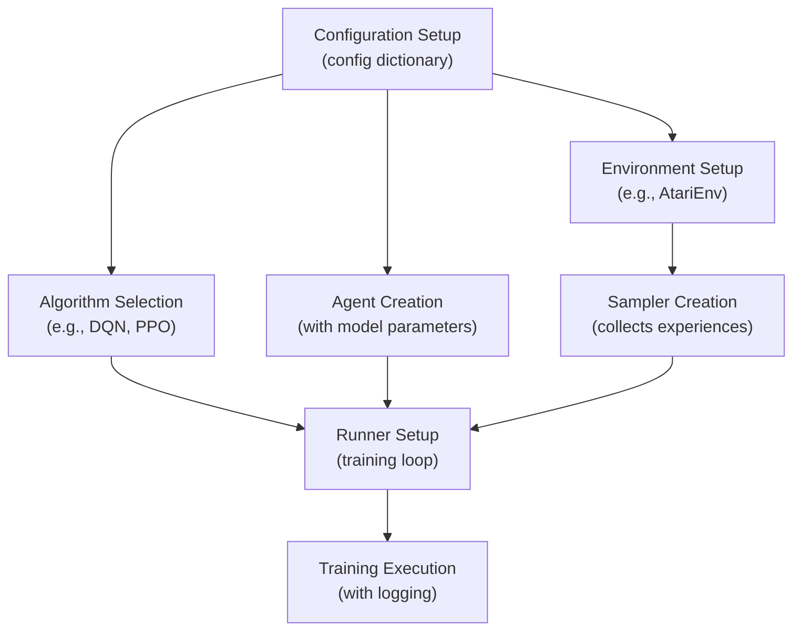
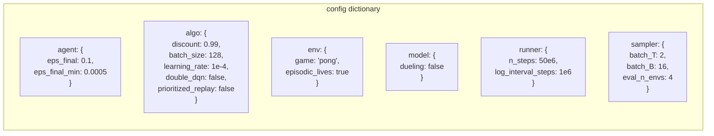
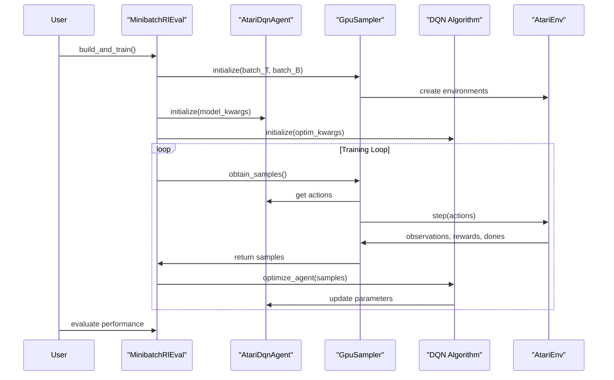
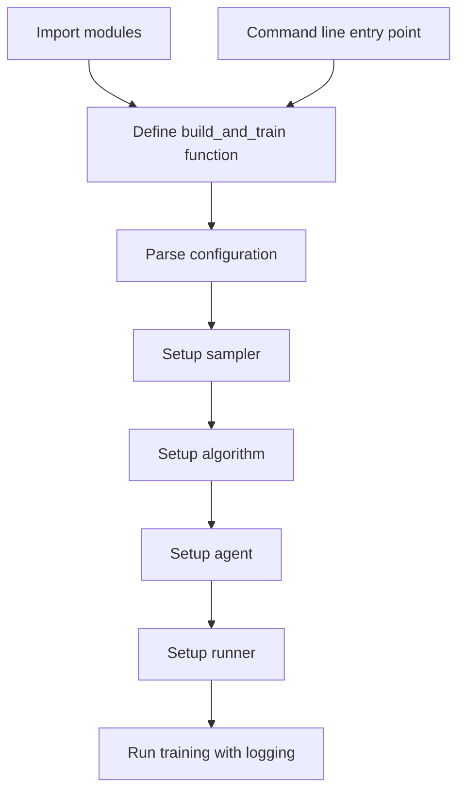
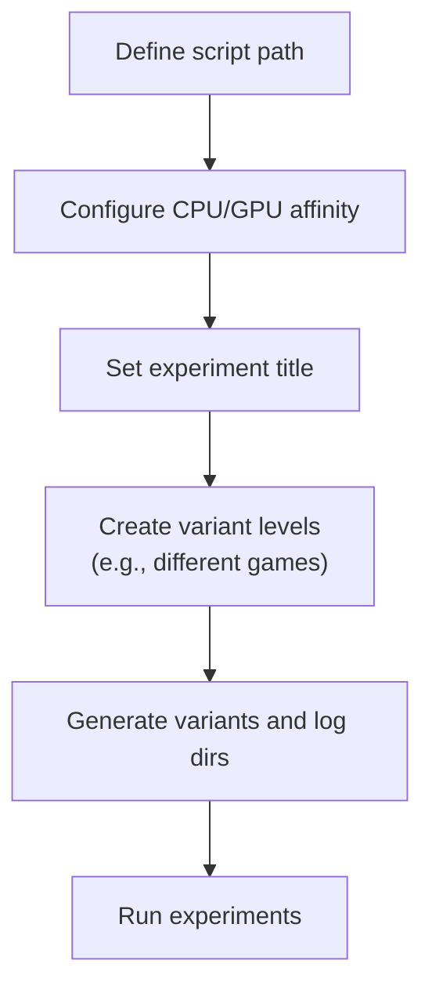
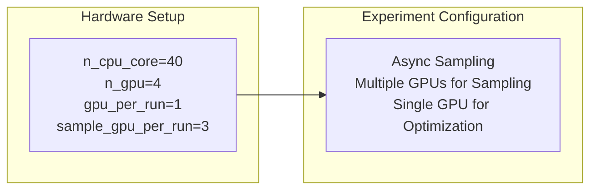
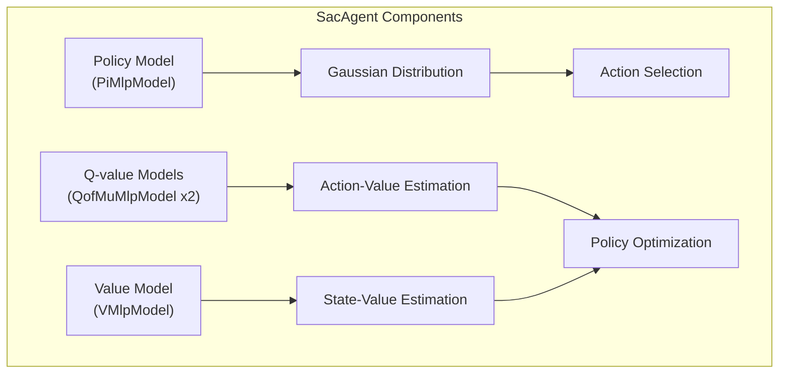

<!-- source: DeepWiki mcp.deepwiki.com · repo astooke/rlpyt · page 11 Examples and Tutorials · fetched 2026-10-30 -->

# Examples and Tutorials

<details>
<summary>Relevant source files</summary>

The following files were used as context for generating this wiki page:

- [README.md](README.md)
- [linux_cpu.yml](linux_cpu.yml)
- [linux_cuda10.yml](linux_cuda10.yml)
- [linux_cuda9.yml](linux_cuda9.yml)
- [macos_cpu.yml](macos_cpu.yml)
- [rlpyt/agents/qpg/sac_v_agent.py](rlpyt/agents/qpg/sac_v_agent.py)
- [rlpyt/experiments/configs/atari/dqn/atari_dqn.py](rlpyt/experiments/configs/atari/dqn/atari_dqn.py)
- [rlpyt/experiments/configs/atari/dqn/atari_r2d1.py](rlpyt/experiments/configs/atari/dqn/atari_r2d1.py)
- [rlpyt/experiments/scripts/atari/dqn/launch/dgx/launch_atari_r2d1_async_gpu.py](rlpyt/experiments/scripts/atari/dqn/launch/dgx/launch_atari_r2d1_async_gpu.py)
- [rlpyt/experiments/scripts/atari/dqn/launch/pabti/launch_atari_dqn_gpu_noeval.py](rlpyt/experiments/scripts/atari/dqn/launch/pabti/launch_atari_dqn_gpu_noeval.py)
- [rlpyt/experiments/scripts/atari/dqn/train/atari_catdqn_gpu.py](rlpyt/experiments/scripts/atari/dqn/train/atari_catdqn_gpu.py)
- [rlpyt/experiments/scripts/atari/dqn/train/atari_dqn_gpu.py](rlpyt/experiments/scripts/atari/dqn/train/atari_dqn_gpu.py)
- [rlpyt/experiments/scripts/atari/dqn/train/atari_dqn_gpu_noeval.py](rlpyt/experiments/scripts/atari/dqn/train/atari_dqn_gpu_noeval.py)
- [rlpyt/experiments/scripts/atari/dqn/train/atari_r2d1_gpu.py](rlpyt/experiments/scripts/atari/dqn/train/atari_r2d1_gpu.py)
- [rlpyt/experiments/scripts/atari/pg/train/atari_lstm_ppo_gpu.py](rlpyt/experiments/scripts/atari/pg/train/atari_lstm_ppo_gpu.py)
- [rlpyt/experiments/scripts/mujoco/pg/train/mujoco_ff_ppo_gpu.py](rlpyt/experiments/scripts/mujoco/pg/train/mujoco_ff_ppo_gpu.py)
- [setup.py](setup.py)

</details>


This page provides practical examples and tutorials for using the rlpyt reinforcement learning framework. It is designed to help users understand how to configure and run experiments, set up different environments, and implement various reinforcement learning algorithms. For a conceptual overview of the framework, see [Overview](#1), and for details on the core architecture, see [Core Architecture](#2).

## Getting Started with rlpyt

To begin using rlpyt, you first need to install it as described in the [Installation and Setup](#1.1) page. Once installed, you can start running experiments using the example scripts provided in the repository.

The example scripts are organized by environment type and algorithm family:
- `/rlpyt/experiments/scripts/atari/` - For Atari environments
- `/rlpyt/experiments/scripts/mujoco/` - For MuJoCo environments

Within each environment folder, there are subfolders for different algorithm families:
- `dqn/` - Deep Q-Learning algorithms
- `pg/` - Policy Gradient algorithms
- `qpg/` - Q-function Policy Gradient algorithms

Sources: [README.md:43-44]()

## Example Workflow

Below is a typical workflow for running an experiment in rlpyt:



Sources: [rlpyt/experiments/scripts/atari/dqn/train/atari_dqn_gpu.py:17-43]()

## Configuration System

The rlpyt framework uses a configuration system to define hyperparameters, environment settings, and algorithm parameters. Configurations are defined as nested dictionaries in Python files.

### Example Configuration for DQN

The following is an example of a basic DQN configuration for Atari environments:



Multiple configurations can be defined and stored in a dictionary of dictionaries, allowing easy experimentation with different settings:

```
configs = dict()
configs["dqn"] = config  # Basic DQN
configs["double"] = config  # Double DQN
configs["prioritized"] = config  # Prioritized replay
configs["dueling"] = config  # Dueling network architecture
```

Sources: [rlpyt/experiments/configs/atari/dqn/atari_dqn.py:7-64]()

## Basic Training Example

Here's a basic example of training a DQN agent on an Atari environment:



Sources: [rlpyt/experiments/scripts/atari/dqn/train/atari_dqn_gpu.py:17-43]()

## Training Script Structure

A typical training script in rlpyt follows this structure:

1. Import necessary components
2. Define a `build_and_train` function that:
   - Sets up the sampler, algorithm, agent, and runner
   - Launches training with logging
3. Call the `build_and_train` function with command-line arguments

Here's a typical script structure:



Sources: [rlpyt/experiments/scripts/atari/dqn/train/atari_dqn_gpu.py:1-47](), [rlpyt/experiments/scripts/atari/pg/train/atari_lstm_ppo_gpu.py:1-45]()

## Launching Experiments

Rlpyt provides utilities for launching multiple experiments with different configurations. These scripts help organize experiments by variant and handle resource allocation.

### Example Launch Script



Sources: [rlpyt/experiments/scripts/atari/dqn/launch/pabti/launch_atari_dqn_gpu_noeval.py:1-35](), [rlpyt/experiments/scripts/atari/dqn/launch/dgx/launch_atari_r2d1_async_gpu.py:1-40]()

## Advanced Experiment Configuration

For more complex experiments, you can configure many aspects of the training process:

### Environment Configuration

```python
env = dict(
    game="pong",  # Atari game
    episodic_lives=True,  # Reset on life loss
)
```

### Algorithm Configuration

```python
algo = dict(
    discount=0.99,  # Reward discount factor
    batch_size=128,  # Training batch size
    learning_rate=1e-4,  # Optimizer learning rate
    double_dqn=True,  # Use double DQN
    prioritized_replay=True,  # Use prioritized experience replay
)
```

### Model Configuration

```python
model = dict(
    dueling=True,  # Use dueling network architecture
)
```

### Runner Configuration

```python
runner = dict(
    n_steps=50e6,  # Total number of environment steps
    log_interval_steps=1e6,  # Logging frequency
)
```

### Sampler Configuration

```python
sampler = dict(
    batch_T=2,  # Time dimension of batch
    batch_B=16,  # Batch dimension (number of parallel environments)
    eval_n_envs=4,  # Number of evaluation environments
)
```

Sources: [rlpyt/experiments/configs/atari/dqn/atari_dqn.py:7-43](), [rlpyt/experiments/configs/atari/dqn/atari_r2d1.py:7-55]()

## Deep Q-Learning Examples

Rlpyt implements several DQN variants. Here's how to configure and run them:

### Basic DQN

```python
# Basic DQN configuration
config = dict(
    algo=dict(
        double_dqn=False,
        prioritized_replay=False,
    ),
    model=dict(dueling=False),
)
```

### Double DQN

```python
# Double DQN configuration
config = dict(
    algo=dict(
        double_dqn=True,
        prioritized_replay=False,
    ),
    model=dict(dueling=False),
)
```

### Rainbow DQN (without Noisy Nets)

```python
# Rainbow-like configuration
config = dict(
    algo=dict(
        double_dqn=True,
        prioritized_replay=True,
        n_step_return=3,
    ),
    model=dict(dueling=True),
)
```

Sources: [rlpyt/experiments/configs/atari/dqn/atari_dqn.py:45-77]()

## Recurrent DQN (R2D1) Example

For recurrent agents, rlpyt provides the R2D1 algorithm:

```python
# R2D1 configuration
config = dict(
    algo=dict(
        discount=0.997,
        batch_T=80,  # Sequence length
        batch_B=32,  # Batch size
        warmup_T=40,  # Warmup sequence length
        store_rnn_state_interval=40,
        replay_ratio=4,
        prioritized_replay=True,
    ),
    model=dict(dueling=True),
)
```

Sources: [rlpyt/experiments/configs/atari/dqn/atari_r2d1.py:7-57]()

## Policy Gradient Examples

For policy gradient methods like PPO with LSTM networks:

```python
# PPO with LSTM configuration
config = dict(
    algo=dict(
        discount=0.99,
        learning_rate=2.5e-4,
        value_loss_coeff=0.5,
        entropy_loss_coeff=0.01,
        clip_grad_norm=1.0,
        gae_lambda=0.95,
        minibatches=4,
        epochs=4,
        ratio_clip=0.1,
    ),
    agent=dict(
        model=dict(
            lstm_size=256,
            lstm_layers=1,
        ),
    ),
)
```

Sources: [rlpyt/experiments/scripts/atari/pg/train/atari_lstm_ppo_gpu.py:1-45]()

## Running on Different Hardware Configurations

Rlpyt provides flexible options for running on different hardware setups:

### CPU-Only Training

```python
# CPU configuration
config = dict(
    sampler=dict(
        batch_T=4,  # Time dimension of batch
        batch_B=4,  # Number of parallel environments
    ),
)
```

### GPU-Accelerated Training

```python
# GPU configuration
config = dict(
    sampler=dict(
        batch_T=2,  # Time dimension of batch
        batch_B=16,  # Number of parallel environments (higher for GPU)
    ),
)
```

### Multi-GPU Training

For distributed training across multiple GPUs:



Sources: [rlpyt/experiments/scripts/atari/dqn/launch/dgx/launch_atari_r2d1_async_gpu.py:6-17](), [linux_cuda10.yml:1-15](), [linux_cpu.yml:1-14]()

## Debugging and Profiling

For debugging purposes, rlpyt includes configurations with reduced computation:

```python
# Debug configuration
config = dict(
    sampler=dict(
        batch_T=8,
        batch_B=2,
        max_decorrelation_steps=20,  # Reduced steps
        eval_max_steps=8e3,  # Reduced evaluation steps
    ),
    runner=dict(
        n_steps=3e4,  # Reduced total steps
        log_interval_steps=1e4,  # More frequent logging
    ),
    algo=dict(
        min_steps_learn=1e4,  # Start learning earlier
        replay_size=1e4,  # Smaller replay buffer
    ),
)
```

Sources: [rlpyt/experiments/configs/atari/dqn/atari_dqn.py:105-126]()

## Advanced Agent Configuration: Soft Actor-Critic (SAC)

For continuous control problems, rlpyt implements SAC with several customizable components:



Sources: [rlpyt/agents/qpg/sac_v_agent.py:24-210]()

## Conclusion

This page has provided examples and tutorials for using the rlpyt framework for reinforcement learning. By following these examples, you can configure and run experiments with various algorithms, environments, and hardware setups. For more details on specific components, please refer to their respective documentation pages:

- For more on algorithms, see [Algorithms](#3)
- For more on agents, see [Agents](#4)
- For more on samplers, see [Samplers](#6)
- For more on environments, see [Environments](#9)

Sources: [README.md:17-29]()