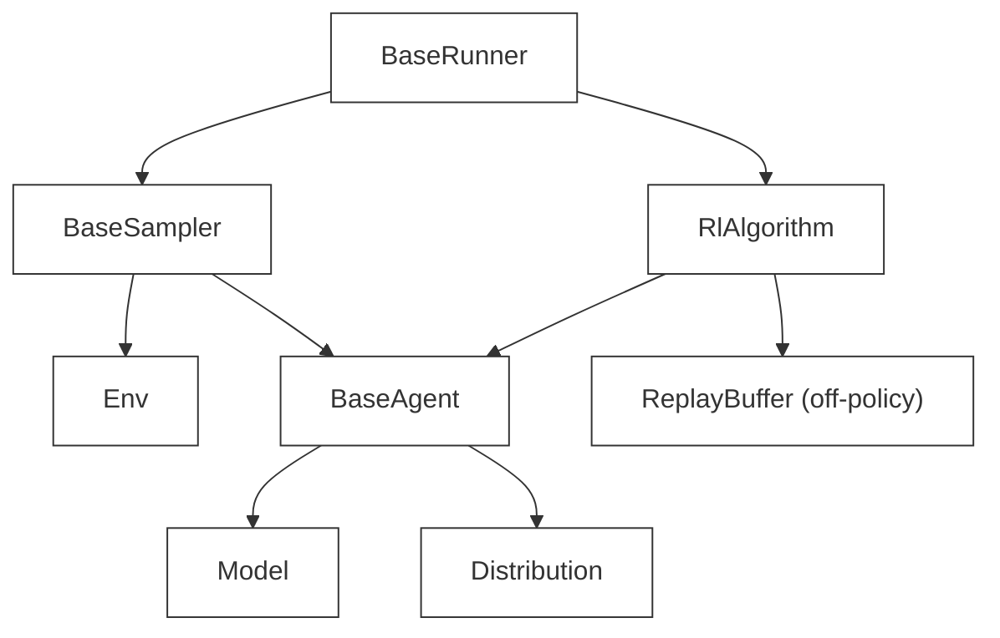
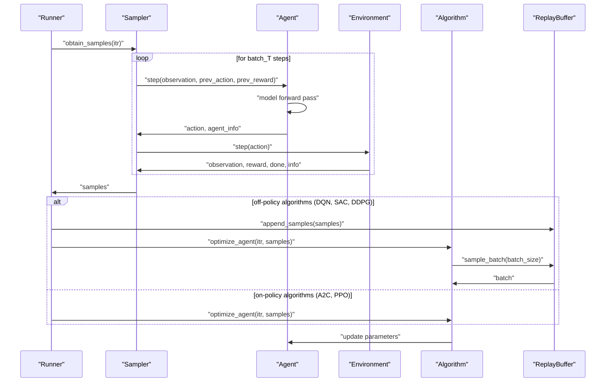
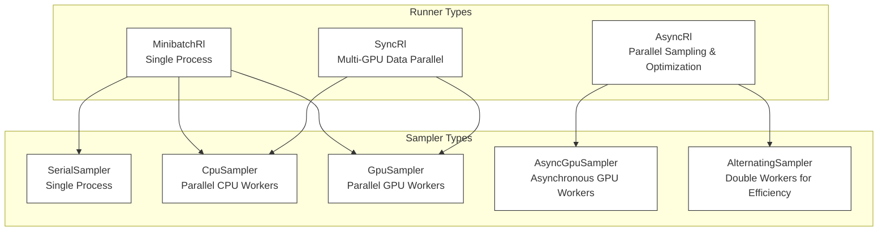
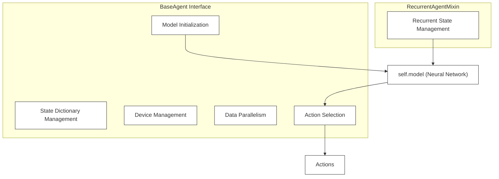

<!-- source: DeepWiki mcp.deepwiki.com · repo astooke/rlpyt · page 2 Core Architecture · fetched 2026-10-30 -->

# Core Architecture

<details>
<summary>Relevant source files</summary>

The following files were used as context for generating this wiki page:

- [docs/source/conf.py](docs/source/conf.py)
- [docs/source/index.rst](docs/source/index.rst)
- [docs/source/pages/base.rst](docs/source/pages/base.rst)
- [docs/source/pages/qpg.rst](docs/source/pages/qpg.rst)
- [docs/source/pages/runner.rst](docs/source/pages/runner.rst)
- [docs/source/pages/sampler.rst](docs/source/pages/sampler.rst)
- [rlpyt/agents/base.py](rlpyt/agents/base.py)
- [rlpyt/algos/base.py](rlpyt/algos/base.py)
- [rlpyt/envs/base.py](rlpyt/envs/base.py)
- [rlpyt/runners/base.py](rlpyt/runners/base.py)

</details>


This document provides a technical overview of the rlpyt framework's core architecture, explaining the fundamental building blocks and how they interact to implement reinforcement learning algorithms. For specific algorithm implementations, see [Algorithms](#3), and for detailed information about samplers, see [Samplers](#6).

## Core Components and Relationships

The rlpyt framework is built around several key components that work together to implement reinforcement learning algorithms:

**Core Components Diagram**


Sources:
- [rlpyt/runners/base.py:1-16]()
- [rlpyt/algos/base.py:1-69]()
- [rlpyt/agents/base.py:17-246]()
- [rlpyt/envs/base.py:11-66]()

### Runner

The Runner (implemented as `BaseRunner` in [rlpyt/runners/base.py:1-16]()) orchestrates the entire training process. It connects the sampling system with the optimization system and manages the training loop, evaluation, and checkpointing. The `train()` method serves as the entry point for running an RL experiment.

### Algorithm

The Algorithm (implemented as `RlAlgorithm` in [rlpyt/algos/base.py:1-69]()) is responsible for updating the agent's parameters based on collected experience data. It handles the reinforcement learning logic, such as computing TD-errors and performing gradient descent on the agent's model parameters. Key methods include `initialize()` to set up optimization and `optimize_agent()` to perform parameter updates.

### Agent

The Agent (implemented as `BaseAgent` in [rlpyt/agents/base.py:17-246]()) serves as the interface between the algorithm and environment. It contains the policy model (neural network) and handles action selection during sampling and training. The agent manages model device placement, recurrent state (if applicable), and parameter communication between processes.

### Sampler

The Sampler collects experience by coordinating agent-environment interactions. It manages worker processes that run environments in parallel to collect training data. Different sampler implementations support various parallelization strategies for CPU or GPU computation.

### Environment

The Environment (interface defined in [rlpyt/envs/base.py:11-66]() as `Env`) provides the interface to the reinforcement learning task, with defined observation and action spaces. It follows a standard interface similar to OpenAI Gym with `step()` and `reset()` methods.

## Training Process Flow

The following diagram illustrates how components interact during the training process:

**Training Flow Diagram**


Sources:
- [rlpyt/runners/base.py:1-16]()
- [rlpyt/agents/base.py:59-170]()
- [rlpyt/algos/base.py:42-54]()
- [rlpyt/envs/base.py:17-32]()

The typical data flow in rlpyt follows these steps:

1. The Runner initializes all components (agent, algorithm, sampler) and starts the training loop
2. The Runner calls `sampler.obtain_samples(itr)` to collect experiences
3. The Sampler coordinates:
   - Getting actions from the Agent via `agent.step(observation, prev_action, prev_reward)`
   - Executing actions in Environments via `env.step(action)`
   - Collecting the resulting observations, rewards, and done flags
4. The collected experiences are returned to the Runner
5. For off-policy algorithms, experiences may be stored in a replay buffer
6. The Algorithm processes experiences and updates the Agent's parameters via `algorithm.optimize_agent(itr, samples)`
7. This cycle repeats until training completes

## Parallelism Patterns

rlpyt provides flexible parallelism options to efficiently utilize available hardware:

**Parallelism Options Diagram**


Sources:
- [docs/source/pages/runner.rst:1-60]()
- [docs/source/pages/sampler.rst:1-71]()

### Single-Process Execution (MinibatchRl)
A simple execution pattern with minimal overhead, suitable for debugging or small-scale experiments. The `MinibatchRl` runner implements this pattern with sequential sampling and optimization.

### Multi-GPU Data Parallel (SyncRl)
Distributes neural network computation across multiple GPUs for faster training. The `SyncRl` runner implements this pattern using PyTorch's DistributedDataParallel for data-parallel training.

### Asynchronous Execution (AsyncRl)
Separates sampling and optimization into different processes, allowing them to run concurrently. The `AsyncRl` runner implements this pattern for better resource utilization.

## Agent Architecture

The agent is a crucial component that bridges between the algorithm and environment. It encapsulates neural networks and manages model state:

**Agent Structure Diagram**


Sources:
- [rlpyt/agents/base.py:17-246]()
- [rlpyt/agents/base.py:252-372]()

The `BaseAgent` class in [rlpyt/agents/base.py:17-246]() defines the interface for all agents. Key methods include:

- `initialize(env_spaces, ...)`: Sets up the agent's model based on environment specifications
- `step(observation, prev_action, prev_reward)`: Selects actions during sampling
- `to_device(cuda_idx)`: Moves the model to a specified GPU device
- `data_parallel()`: Wraps the model with PyTorch's DistributedDataParallel
- `train_mode()`, `sample_mode()`, `eval_mode()`: Toggle between different operation modes

For recurrent agents, additional functionality is provided by `RecurrentAgentMixin` [rlpyt/agents/base.py:252-304](), which manages recurrent state during sampling. For alternating samplers, `AlternatingRecurrentAgentMixin` [rlpyt/agents/base.py:307-372]() provides specialized state management.

## Data Structures

rlpyt uses structured named tuples for passing data between components:

| Data Structure | Fields | Purpose |
|----------------|--------|---------|
| `AgentInputs` | observation, prev_action, prev_reward | Input to agent's step function |
| `AgentStep` | action, agent_info | Output from agent's step function |
| `EnvStep` | observation, reward, done, env_info | Output from environment's step function |
| `AgentInputsRnn` | observation, prev_action, prev_reward, init_rnn_state | Input for recurrent agents (training) |

Sources:
- [rlpyt/agents/base.py:12-14]()
- [rlpyt/agents/base.py:248-249]()
- [rlpyt/envs/base.py:5-8]()

These data structures ensure consistent interfaces and memory layout between components.

## Environment Interface

Environments in rlpyt follow a standard interface similar to OpenAI Gym:

```python
# Environment step interface
observation, reward, done, info = env.step(action)

# Environment reset interface
observation = env.reset()
```

The environment interface is defined in the `Env` class in [rlpyt/envs/base.py:11-66](). Each environment must provide:

- `step(action)`: Execute action and return next observation, reward, done flag, and info
- `reset()`: Reset the environment and return initial observation
- `action_space` and `observation_space`: Define the shape and type of actions and observations

## Extending the Framework

To implement new algorithms or agents in rlpyt, you typically:

1. Subclass the appropriate base class (`RlAlgorithm`, `BaseAgent`, etc.)
2. Implement the required methods for that component
3. Define any custom models needed

For example, to create a new agent:

```python
class MyCustomAgent(BaseAgent):
    def __init__(self, ModelCls=MyCustomModel, **kwargs):
        super().__init__(ModelCls=ModelCls, **kwargs)
        
    def step(self, observation, prev_action, prev_reward):
        # Custom action selection logic
        return AgentStep(action=action, agent_info=info)
```

## Conclusion

The core architecture of rlpyt provides a flexible, modular framework for implementing reinforcement learning algorithms. Its components are designed to be interchangeable, allowing researchers to easily experiment with different algorithms, agents, and parallelization strategies. The clean separation of concerns between sampling, agent behavior, and optimization makes it straightforward to extend the framework with new methods.

---

