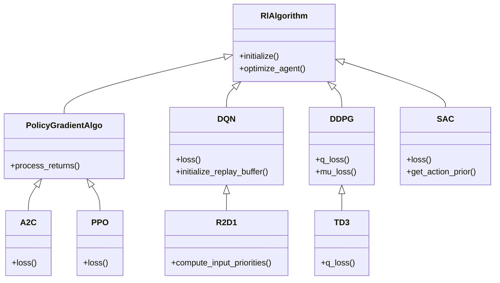
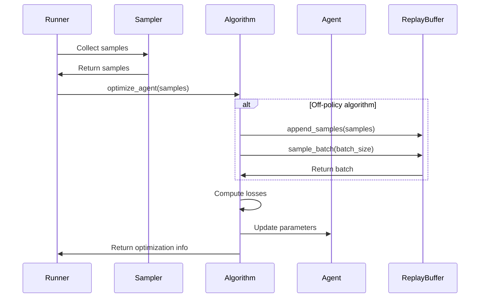
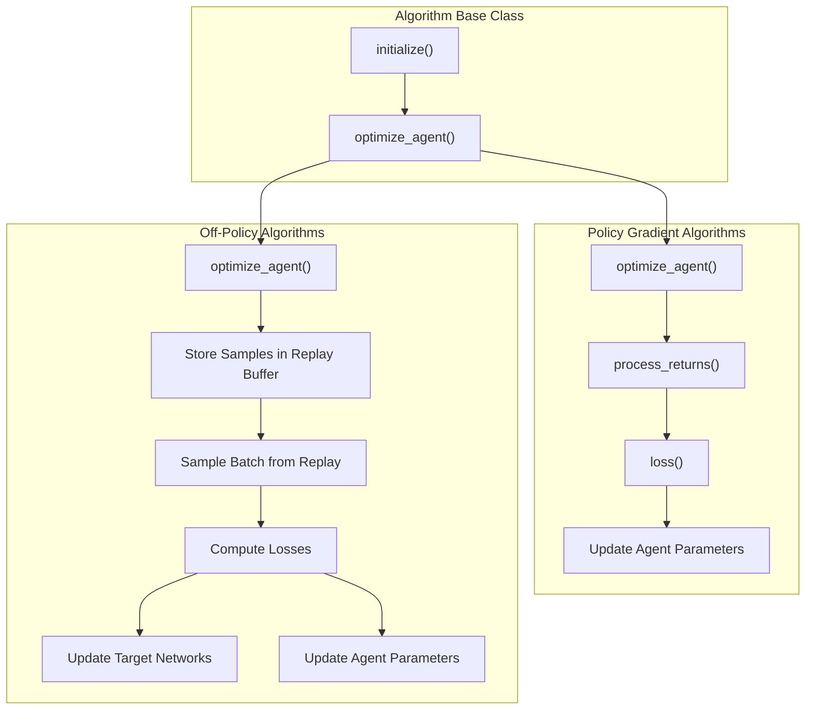

<!-- source: DeepWiki mcp.deepwiki.com · repo astooke/rlpyt · page 3 Algorithms · fetched 2026-10-30 -->

# Algorithms

<details>
<summary>Relevant source files</summary>

The following files were used as context for generating this wiki page:

- [docs/source/pages/util.rst](docs/source/pages/util.rst)
- [rlpyt/algos/dqn/dqn.py](rlpyt/algos/dqn/dqn.py)
- [rlpyt/algos/dqn/r2d1.py](rlpyt/algos/dqn/r2d1.py)
- [rlpyt/algos/pg/a2c.py](rlpyt/algos/pg/a2c.py)
- [rlpyt/algos/pg/base.py](rlpyt/algos/pg/base.py)
- [rlpyt/algos/pg/ppo.py](rlpyt/algos/pg/ppo.py)
- [rlpyt/algos/qpg/ddpg.py](rlpyt/algos/qpg/ddpg.py)
- [rlpyt/algos/qpg/sac.py](rlpyt/algos/qpg/sac.py)
- [rlpyt/algos/qpg/sac_v.py](rlpyt/algos/qpg/sac_v.py)
- [rlpyt/algos/qpg/td3.py](rlpyt/algos/qpg/td3.py)
- [rlpyt/algos/utils.py](rlpyt/algos/utils.py)
- [rlpyt/experiments/configs/mujoco/qpg/mujoco_sac_v.py](rlpyt/experiments/configs/mujoco/qpg/mujoco_sac_v.py)

</details>


This page documents the reinforcement learning algorithms implemented in the rlpyt framework. Algorithms in rlpyt define the learning process - they determine how agent parameters are updated using collected experiences, implement optimization procedures, and manage replay buffers when needed. For information about Agents that use these algorithms, see [Agents](#4), and for how Runners coordinate the training process, see [Runners](#5).

## Algorithm Hierarchy and Categories

Rlpyt organizes algorithms into three main families, all deriving from a common base class:



Sources: 
- [rlpyt/algos/base.py]()
- [rlpyt/algos/pg/base.py]()
- [rlpyt/algos/dqn/dqn.py]()
- [rlpyt/algos/qpg/ddpg.py]()
- [rlpyt/algos/qpg/sac.py]()

## Common Algorithm Interface

All algorithms in rlpyt implement a standardized interface for interacting with other framework components:



Sources:
- [rlpyt/algos/dqn/dqn.py:158-190]()
- [rlpyt/algos/qpg/sac.py:160-211]()
- [rlpyt/algos/pg/a2c.py:41-61]()

## Base Algorithm Class

The `RlAlgorithm` base class defines the interface that all algorithms must implement:

| Method | Purpose |
|--------|---------|
| `initialize` | Setup algorithm for standard training runs |
| `async_initialize` | Setup for parallel/async training |
| `optimize_agent` | Main training method that processes samples and updates agent |
| `optim_initialize` | Initialize optimizers |
| `initialize_replay_buffer` | Setup replay buffers for off-policy algorithms |

Sources:
- [rlpyt/algos/base.py]()

## Policy Gradient Algorithms

Policy gradient algorithms in rlpyt optimize the agent's policy directly by computing gradients of the expected return.

### Policy Gradient Base Class

The `PolicyGradientAlgo` class provides common functionality for all policy gradient methods:

```python
# Key method in PolicyGradientAlgo
def process_returns(self, samples):
    # Compute bootstrapped returns and advantages
    # Handle GAE if specified
    # Normalize advantages if requested
    return return_, advantage, valid
```

Sources:
- [rlpyt/algos/pg/base.py:41-75]()

### A2C (Advantage Actor-Critic)

A2C is a synchronous version of Advantage Actor-Critic that performs one gradient update per batch of collected experiences.

```python
# A2C loss computation
def loss(self, samples):
    # Policy loss: -log_likelihood * advantage
    pi_loss = -valid_mean(logli * advantage, valid)
    
    # Value loss: 0.5 * (value - return)^2
    value_loss = self.value_loss_coeff * valid_mean(value_error, valid)
    
    # Entropy loss to encourage exploration
    entropy_loss = -self.entropy_loss_coeff * entropy
    
    # Combined loss
    loss = pi_loss + value_loss + entropy_loss
```

Sources:
- [rlpyt/algos/pg/a2c.py:63-103]()

### PPO (Proximal Policy Optimization)

PPO uses clipped surrogate objectives to improve stability by preventing too large policy updates.

```python
# PPO loss computation
def loss(self, agent_inputs, action, return_, advantage, valid, old_dist_info):
    # Compute likelihood ratio
    ratio = dist.likelihood_ratio(action, old_dist_info, new_dist_info)
    
    # Clipped surrogate objective
    surr_1 = ratio * advantage
    clipped_ratio = torch.clamp(ratio, 1-self.ratio_clip, 1+self.ratio_clip)
    surr_2 = clipped_ratio * advantage
    surrogate = torch.min(surr_1, surr_2)
    pi_loss = -valid_mean(surrogate, valid)
```

Sources:
- [rlpyt/algos/pg/ppo.py:117-154]()

## Q-Learning Algorithms

Q-learning algorithms learn action-value functions and derive policies from them, typically using experience replay.

### DQN (Deep Q-Network)

DQN learns an action-value function by minimizing the temporal difference error.

```python
# DQN loss computation
def loss(self, samples):
    # Compute Q-values for current states and actions
    q = select_at_indexes(samples.action, qs)
    
    # Compute target Q-values
    with torch.no_grad():
        if self.double_dqn:
            # Double DQN: Select actions using online network
            next_a = torch.argmax(next_qs, dim=-1)
            target_q = select_at_indexes(next_a, target_qs)
        else:
            # Standard DQN: Max over target network Q-values
            target_q = torch.max(target_qs, dim=-1).values
    
    # Compute TD error
    y = samples.return_ + (1 - samples.done_n.float()) * disc_target_q
    delta = y - q
    
    # Compute loss (MSE or Huber)
    losses = 0.5 * delta ** 2
    if self.delta_clip is not None:  # Huber loss
        b = self.delta_clip * (abs_delta - self.delta_clip / 2)
        losses = torch.where(abs_delta <= self.delta_clip, losses, b)
```

Sources:
- [rlpyt/algos/dqn/dqn.py:211-265]()

### R2D1 (Recurrent Replay Distributed DQN)

R2D1 extends DQN to recurrent networks with special handling for sequence data and priorities.

```python
# R2D1 loss computation
def loss(self, samples):
    # Warm up RNN state first
    if wT > 0:
        with torch.no_grad():
            _, target_rnn_state = self.agent.target(*warmup_inputs, init_rnn_state)
            _, init_rnn_state = self.agent(*warmup_inputs, init_rnn_state)
    
    # Compute Q-values and targets
    qs, _ = self.agent(*agent_inputs, init_rnn_state)
    q = select_at_indexes(action, qs)
    
    with torch.no_grad():
        target_qs, _ = self.agent.target(*target_inputs, target_rnn_state)
        # Similar to DQN but with recurrent state handling
```

Sources:
- [rlpyt/algos/dqn/r2d1.py:244-333]()

## Actor-Critic Algorithms

Actor-critic algorithms combine policy optimization with value function learning.

### SAC (Soft Actor-Critic)

SAC is an off-policy actor-critic method that uses entropy regularization and twin Q-functions.

```python
# SAC loss computation
def loss(self, samples):
    # Twin Q-losses
    q1, q2 = self.agent.q(*agent_inputs, action)
    with torch.no_grad():
        target_action, target_log_pi, _ = self.agent.pi(*target_inputs)
        target_q1, target_q2 = self.agent.target_q(*target_inputs, target_action)
    min_target_q = torch.min(target_q1, target_q2)
    target_value = min_target_q - self._alpha * target_log_pi
    y = self.reward_scale * samples.return_ + (1 - samples.done_n.float()) * disc * target_value
    q1_loss = 0.5 * valid_mean((y - q1) ** 2, valid)
    q2_loss = 0.5 * valid_mean((y - q2) ** 2, valid)
    
    # Policy loss
    new_action, log_pi, (pi_mean, pi_log_std) = self.agent.pi(*agent_inputs)
    log_target1, log_target2 = self.agent.q(*agent_inputs, new_action)
    min_log_target = torch.min(log_target1, log_target2)
    prior_log_pi = self.get_action_prior(new_action.cpu())
    pi_losses = self._alpha * log_pi - min_log_target - prior_log_pi
    pi_loss = valid_mean(pi_losses, valid)
    
    # Alpha loss for automatic entropy tuning
    if self.target_entropy is not None and self.fixed_alpha is None:
        alpha_losses = -self._log_alpha * (log_pi.detach() + self.target_entropy)
        alpha_loss = valid_mean(alpha_losses, valid)
```

Sources:
- [rlpyt/algos/qpg/sac.py:227-283]()

### DDPG (Deep Deterministic Policy Gradient)

DDPG is a deterministic policy gradient algorithm that uses an actor-critic architecture with off-policy learning.

```python
# DDPG Q-loss computation
def q_loss(self, samples, valid):
    q = self.agent.q(*samples.agent_inputs, samples.action)
    with torch.no_grad():
        target_q = self.agent.target_q_at_mu(*samples.target_inputs)
    y = samples.return_ + (1 - samples.done_n.float()) * disc * target_q
    y = torch.clamp(y, -self.q_target_clip, self.q_target_clip)
    q_losses = 0.5 * (y - q) ** 2
    q_loss = valid_mean(q_losses, valid)
    return q_loss

# DDPG policy loss
def mu_loss(self, samples, valid):
    mu_losses = self.agent.q_at_mu(*samples.agent_inputs)
    mu_loss = valid_mean(mu_losses, valid)
    return -mu_loss  # Negative for gradient ascent
```

Sources:
- [rlpyt/algos/qpg/ddpg.py:188-204]()

### TD3 (Twin Delayed DDPG)

TD3 improves DDPG with twin Q-functions, delayed policy updates, and target policy noise.

```python
# TD3 Q-loss computation
def q_loss(self, samples, valid):
    q1, q2 = self.agent.q(*samples.agent_inputs, samples.action)
    with torch.no_grad():
        target_q1, target_q2 = self.agent.target_q_at_mu(*samples.target_inputs)
        target_q = torch.min(target_q1, target_q2)
    y = samples.return_ + (1 - samples.done_n.float()) * disc * target_q
    q1_losses = 0.5 * (y - q1) ** 2
    q2_losses = 0.5 * (y - q2) ** 2
    q_loss = valid_mean(q1_losses + q2_losses, valid)
    return q_loss
```

Sources:
- [rlpyt/algos/qpg/td3.py:38-50]()

## Algorithm Optimization Flow

The following diagram illustrates the optimization flow for different algorithm types:



Sources:
- [rlpyt/algos/pg/a2c.py:41-61]()
- [rlpyt/algos/dqn/dqn.py:158-190]()
- [rlpyt/algos/qpg/sac.py:160-211]()

## Algorithm Utility Functions

Rlpyt provides utility functions for common RL algorithm operations:

| Function | Purpose |
|----------|---------|
| `discount_return` | Computes discounted returns from rewards |
| `generalized_advantage_estimation` | Computes GAE for policy gradient methods |
| `discount_return_n_step` | Computes n-step returns for Q-learning |
| `valid_from_done` | Creates a mask for valid timesteps in trajectories |

```python
# Example: Generalized Advantage Estimation
def generalized_advantage_estimation(reward, value, done, bootstrap_value,
        discount, gae_lambda, advantage_dest=None, return_dest=None):
    """
    Computes generalized advantage estimation (GAE) for policy gradient methods.
    Used to reduce variance in policy gradient estimates.
    """
    advantage = advantage_dest if advantage_dest is not None else zeros(
        reward.shape, dtype=reward.dtype)
    return_ = return_dest if return_dest is not None else zeros(
        reward.shape, dtype=reward.dtype)
    nd = 1 - done
    advantage[-1] = reward[-1] + discount * bootstrap_value * nd[-1] - value[-1]
    for t in reversed(range(len(reward) - 1)):
        delta = reward[t] + discount * value[t + 1] * nd[t] - value[t]
        advantage[t] = delta + discount * gae_lambda * nd[t] * advantage[t + 1]
    return_[:] = advantage + value
    return advantage, return_
```

Sources:
- [rlpyt/algos/utils.py:8-162]()
- [docs/source/pages/util.rst:83-96]()

## Advanced Features

### Prioritized Experience Replay

DQN and R2D1 support prioritized experience replay to more efficiently learn from important samples:

```python
# R2D1 with prioritized replay
def compute_input_priorities(self, samples):
    """
    Computes priorities for new samples entering the replay buffer
    based on TD-error magnitudes
    """
    q = samples.agent.agent_info.q
    action = samples.agent.action
    q_at_a = select_at_indexes(action, q)
    
    # Compute n-step returns
    return_n, done_n = discount_return_n_step(
        reward=samples.env.reward,
        done=samples.env.done,
        n_step=self.n_step_return,
        discount=self.discount,
        do_truncated=False,
    )
    
    # Compute TD-error and use it for priorities
    y = self.value_scale(return_n + (1 - done_n.float()) * self.inv_value_scale(q_max[nm1:]))
    delta = abs(q_at_a[:-nm1] - y)
    
    # Combine max and mean TD-errors for robust prioritization
    max_d = torch.max(delta * valid, dim=0).values
    mean_d = valid_mean(delta, valid, dim=0)
    priorities = self.pri_eta * max_d + (1 - self.pri_eta) * mean_d
```

Sources:
- [rlpyt/algos/dqn/r2d1.py:181-242]()

### Automatic Entropy Tuning

SAC includes automatic tuning of the entropy coefficient to maintain a target entropy level:

```python
# SAC entropy coefficient tuning
if self.target_entropy is not None and self.fixed_alpha is None:
    alpha_losses = -self._log_alpha * (log_pi.detach() + self.target_entropy)
    alpha_loss = valid_mean(alpha_losses, valid)
    
    self.alpha_optimizer.zero_grad()
    alpha_loss.backward()
    self.alpha_optimizer.step()
    self._alpha = torch.exp(self._log_alpha.detach())
```

Sources:
- [rlpyt/algos/qpg/sac.py:277-283]()
- [rlpyt/algos/qpg/sac.py:179-183]()

## Implementing Custom Algorithms

Custom algorithms can be implemented by subclassing one of the base algorithm classes and implementing the required methods:

1. Subclass `RlAlgorithm` or one of its derivatives like `PolicyGradientAlgo`
2. Implement `initialize` to set up your algorithm
3. Implement `optimize_agent` to define the update rule
4. Implement `loss` to compute your algorithm's loss function

For off-policy algorithms, you'll also need to implement:

1. `initialize_replay_buffer` to set up your experience replay
2. `samples_to_buffer` to define how samples are stored

---

